# Page: Overview

# Overview

<details>
<summary>Relevant source files</summary>

The following files were used as context for generating this wiki page:

- [.github/workflows/tests.yaml](.github/workflows/tests.yaml)
- [CLAUDE.md](CLAUDE.md)
- [README.md](README.md)
- [agents/README.md](agents/README.md)
- [customer-support-agent/README.md](customer-support-agent/README.md)
- [financial-data-analyst/README.md](financial-data-analyst/README.md)
- [financial-data-analyst/app/api/finance/route.ts](financial-data-analyst/app/api/finance/route.ts)

</details>


This page introduces the `claude-quickstarts` repository, summarizes each project it contains, and describes the tech stacks and entry points for getting started. For deeper documentation of any individual project, follow the links in each section below.

---

## Repository Purpose

`claude-quickstarts` ([README.md:1-3]()) is a collection of self-contained reference implementations demonstrating how to build applications with the Claude API. Each project is independently runnable and is intended as a starting point for customization.

A Claude API key is required for all projects. Keys can be obtained at `console.anthropic.com`.

Sources: [README.md:1-8]()

---

## Projects at a Glance

| Directory | Language / Framework | Primary Focus |
|---|---|---|
| `computer-use-demo/` | Python, Streamlit, Docker | Desktop automation via Claude computer use tools |
| `customer-support-agent/` | TypeScript, Next.js | RAG-backed chat with Amazon Bedrock knowledge bases |
| `financial-data-analyst/` | TypeScript, Next.js | File upload + chart generation via Claude tool use |
| `autonomous-coding/` | Python, Claude Code SDK | Two-agent autonomous code generation |
| `browser-use-demo/` | Python, Playwright | Browser automation via Claude browser tools |
| `agents/` | Python | Minimal educational agent framework |

Sources: [README.md:9-40](), [CLAUDE.md:1-63]()

---

## Repository Structure

**Repository layout diagram**

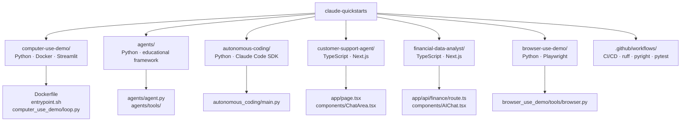

Sources: [README.md:9-40](), [CLAUDE.md:1-63]()

---

## Project Summaries

### Computer Use Demo

The most fully featured project in the repository. Claude controls a real Linux desktop inside a Docker container using three tool types: `BashTool`, `ComputerTool`, and `EditTool`. The agent loop is implemented in `computer_use_demo/loop.py` as the `sampling_loop()` function. A Streamlit web UI on port `:8501` and a noVNC viewer on port `:6080` provide the user interface. Port `:8080` serves a combined landing page.

Supports three API providers: Anthropic direct, AWS Bedrock, and Google Vertex AI.

For full documentation, see the Computer Use Demo section (page [2]()).

**Quick start:**
```bash
docker run -e ANTHROPIC_API_KEY=$ANTHROPIC_API_KEY \
  -p 5900:5900 -p 8501:8501 -p 6080:6080 -p 8080:8080 \
  ghcr.io/anthropics/anthropic-quickstarts:computer-use-demo-latest
```

Sources: [README.md:23-27](), [CLAUDE.md:9-16]()

---

### Customer Support Agent

A Next.js chat application backed by Amazon Bedrock knowledge bases for retrieval-augmented generation (RAG). The core component is `ChatArea.tsx`. The application supports configurable sidebar layouts via npm scripts (`dev:full`, `dev:left`, `dev:right`, `dev:chat`) and can be deployed to AWS Amplify.

Required environment variables: `ANTHROPIC_API_KEY`, `BAWS_ACCESS_KEY_ID`, `BAWS_SECRET_ACCESS_KEY`.

For full documentation, see [3.1]().

**Quick start:**
```bash
cd customer-support-agent
npm install
npm run dev
```

Sources: [customer-support-agent/README.md:1-22](), [CLAUDE.md:31-40]()

---

### Financial Data Analyst

A Next.js application that accepts file uploads (images, PDFs, text/CSV) and uses Claude's tool use to generate interactive charts via Recharts. The backend API route is at `financial-data-analyst/app/api/finance/route.ts`. Claude calls the `generate_graph_data` tool ([financial-data-analyst/app/api/finance/route.ts:37-101]()) to produce structured chart data, which the frontend renders using Recharts.

Supported chart types: `bar`, `multiBar`, `line`, `pie`, `area`, `stackedArea`.

For full documentation, see [3.2]().

**Quick start:**
```bash
cd financial-data-analyst
npm install
npm run dev
```

Sources: [financial-data-analyst/README.md:1-52](), [financial-data-analyst/app/api/finance/route.ts:37-101]()

---

### Autonomous Coding Agent

A Python project demonstrating a two-agent pattern using the Claude Code SDK. An **Initializer** agent and a **Coding Agent** collaborate to build applications incrementally across multiple sessions. Progress is persisted via git and a `feature_list.json` file. The `ClaudeSDKClient` applies security sandboxing and filesystem restrictions.

For full documentation, see [3.3]().

**Quick start:**
```bash
cd autonomous-coding
pip install -r requirements.txt
python main.py
```

Sources: [README.md:37-39]()

---

### Browser Use Demo

A Python project providing a `BrowserTool` class built on Playwright for browser automation. Claude navigates web pages, interacts with DOM elements, fills forms, and reads page content. A `CoordinateScaler` adapts between logical and physical coordinates.

For full documentation, see [3.4]().

Sources: [README.md:29-33]()

---

### Agents Framework

A minimal, educational Python package (`agents/`) that demonstrates how to implement an LLM agent from scratch using the Claude API. The core logic is under 300 lines. It is **not** an SDK — it is a reference implementation. Key components are `agent.py` (the `Agent` class), `tools/` (local and MCP tool implementations), and `utils/` (message history and MCP connection utilities).

For full documentation, see [4]().

**Quick start:**
```python
from agents.agent import Agent
from agents.tools.think import ThinkTool

agent = Agent(name="MyAgent", system="You are a helpful assistant.", tools=[ThinkTool()])
response = agent.run("What should I consider when buying a new laptop?")
```

Sources: [agents/README.md:1-44]()

---

## How Claude API Integrations Work Across Projects

**API integration patterns diagram**

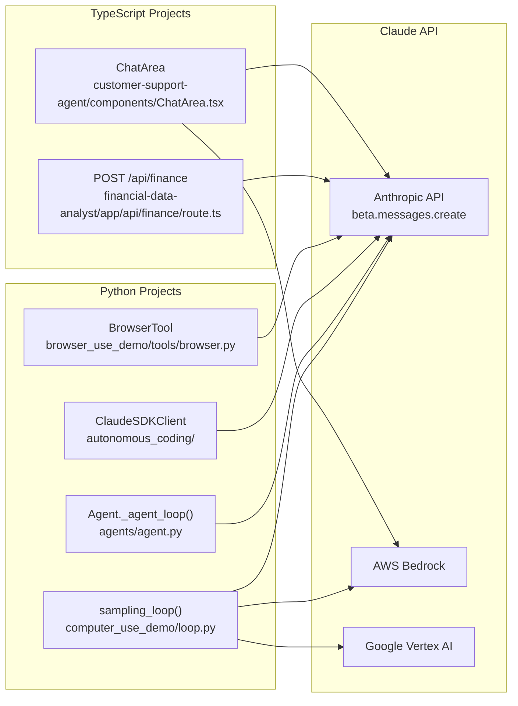

Sources: [README.md:1-70](), [CLAUDE.md:1-63](), [financial-data-analyst/app/api/finance/route.ts:1-15]()

---

## General Setup Pattern

All projects follow the same general setup steps ([README.md:41-49]()):

1. Clone the repository: `git clone https://github.com/anthropics/claude-quickstarts`
2. Navigate to the project directory: `cd <project-name>`
3. Install dependencies (either `pip install -r requirements.txt` or `npm install`)
4. Set the `ANTHROPIC_API_KEY` environment variable (plus any provider-specific keys)
5. Run the application

---

## CI/CD

The repository includes a GitHub Actions workflow at `.github/workflows/tests.yaml` that runs on pull requests and pushes to `main`. It targets the `computer-use-demo/` directory and runs three jobs: `ruff` (linting), `pyright` (type checking), and `pytest` (unit tests). For more details, see [5]().

Sources: [.github/workflows/tests.yaml:1-59]()

---

## Further Reading

| Resource | Description |
|---|---|
| Claude API Documentation | `docs.claude.com` |
| Claude Cookbooks | `github.com/anthropics/claude-cookbooks` |
| Claude API Fundamentals Course | `github.com/anthropics/courses` |
| Anthropic Discord | `anthropic.com/discord` |

Sources: [README.md:51-66]()

---

# Page: Computer Use Demo

# Computer Use Demo

<details>
<summary>Relevant source files</summary>

The following files were used as context for generating this wiki page:

- [computer-use-demo/README.md](computer-use-demo/README.md)

</details>


This page introduces the Computer Use Demo quickstart: what it demonstrates, which Claude models it supports, which API providers it works with, and a top-level summary of the system. For deeper technical detail, see the child pages: [Architecture Overview](#2.1), [Sampling Loop & Agent Orchestration](#2.2), [Streamlit User Interface](#2.3), [Tool System](#2.4), [Docker Environment & Deployment](#2.5), and [Setup & Configuration](#2.6).

---

## Purpose

The Computer Use Demo is a reference implementation showing how to give Claude control of a real desktop environment — mouse, keyboard, screenshots, shell, and files — through Anthropic's **computer use** beta API. It bundles a full Linux desktop inside a Docker container and exposes a Streamlit chat interface so users can issue natural language instructions that Claude carries out by operating the desktop directly.

> **Beta notice:** Computer use is a beta feature. The API and tool definitions are subject to change. See [computer-use-demo/README.md:27-28]() for the relevant caution.

---

## What the Demo Provides

| Component | Description |
|---|---|
| Docker container | Self-contained Ubuntu environment with a virtual X display, VNC server, noVNC proxy, and all Python dependencies |
| Agent loop | `sampling_loop()` in `computer-use-demo/computer_use_demo/loop.py` — drives the conversation with the API and dispatches tool calls |
| Computer use tools | `BashTool`, `ComputerTool`, `EditTool` — versioned implementations that map Claude's tool calls to real system actions |
| Streamlit UI | A chat interface for user input, message rendering, and real-time tool output display |
| Landing page | A combined view at port 8080 embedding both the chat and the live desktop |

Sources: [computer-use-demo/README.md:18-23]()

---

## Supported Models

The demo supports the following Claude models across providers:

| Model | Identifier |
|---|---|
| Claude Opus 4.5 | `claude-opus-4-5-20251101` |
| Claude Opus 4 | `claude-opus-4-20250514` |
| Claude Sonnet 4.5 | `claude-sonnet-4-5-20250929` |
| Claude Sonnet 4 | `claude-sonnet-4-20250514` |
| Claude Haiku 4.5 | `claude-haiku-4-5-20251001` |
| Claude 3.7 Sonnet | `claude-sonnet-3-7-...` |
| Claude 3.5 Sonnet | `claude-sonnet-3-5-...` |

Sources: [computer-use-demo/README.md:4-4](), [computer-use-demo/README.md:21-21]()

---

## Supported API Providers

Three API providers are supported, selected via the `API_PROVIDER` environment variable:

| Provider | `API_PROVIDER` value | Credentials required |
|---|---|---|
| Anthropic (default) | _(unset)_ | `ANTHROPIC_API_KEY` |
| AWS Bedrock | `bedrock` | AWS credentials (profile or access key) |
| Google Vertex AI | `vertex` | GCP Application Default Credentials |

Sources: [computer-use-demo/README.md:35-127]()

---

## System Overview

The entire demo runs inside a single Docker container. The agent loop executes inside the same container that Claude is controlling, which means the tools have direct access to the virtual desktop's processes, filesystem, and display.

**Runtime architecture diagram:**

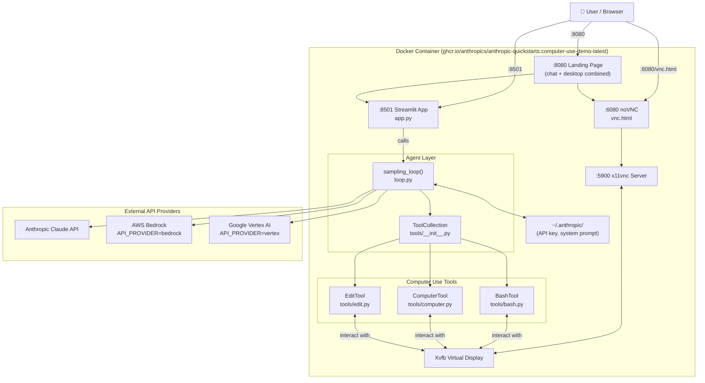

Sources: [computer-use-demo/README.md:129-139]()

---

## Key Design Constraints

- **Single session:** The agent loop and tools run inside the container under control. Only one session can use the loop at a time. Restarting the container resets state between sessions. [computer-use-demo/README.md:31-31]()
- **Weakly separated components:** The Streamlit UI, agent loop, and desktop environment are all colocated inside the container by design, for simplicity of the reference implementation.
- **Screen resolution:** The demo defaults to XGA (1024×768) for optimal model accuracy. Higher resolutions are supported via `WIDTH` and `HEIGHT` environment variables, but screenshots are scaled down before being sent to the API. [computer-use-demo/README.md:141-164]()
- **Settings persistence:** API keys and custom system prompts are stored in `~/.anthropic/` inside the container. Mount a host directory at that path to persist settings across container restarts.

---

## Quick Start

To run the demo with the Anthropic API:

```bash
export ANTHROPIC_API_KEY=<your_api_key>
docker run \
    -e ANTHROPIC_API_KEY=$ANTHROPIC_API_KEY \
    -v $HOME/.anthropic:/home/computeruse/.anthropic \
    -p 5900:5900 \
    -p 8501:8501 \
    -p 6080:6080 \
    -p 8080:8080 \
    -it ghcr.io/anthropics/anthropic-quickstarts:computer-use-demo-latest
```

Then open `http://localhost:8080` in a browser. [computer-use-demo/README.md:40-52]()

For Bedrock and Vertex setup instructions, see [Setup & Configuration](#2.6).

---

## Port Reference

| Port | Service | URL |
|---|---|---|
| `8080` | Combined landing page | `http://localhost:8080` |
| `8501` | Streamlit chat interface only | `http://localhost:8501` |
| `6080` | noVNC desktop view only | `http://localhost:6080/vnc.html` |
| `5900` | Raw VNC | `vnc://localhost:5900` |

Sources: [computer-use-demo/README.md:129-139]()

---

## Component Map

The following diagram maps the major code modules to their roles:

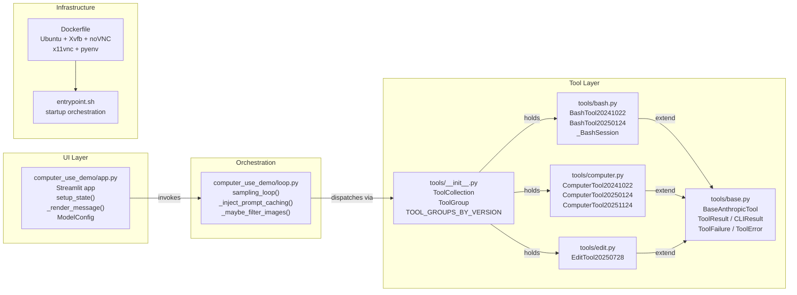

Sources: [computer-use-demo/README.md:18-23]()

---

# Page: Architecture Overview

# Architecture Overview

<details>
<summary>Relevant source files</summary>

The following files were used as context for generating this wiki page:

- [computer-use-demo/.gitignore](computer-use-demo/.gitignore)
- [computer-use-demo/.zed/settings.json](computer-use-demo/.zed/settings.json)
- [computer-use-demo/Dockerfile](computer-use-demo/Dockerfile)
- [computer-use-demo/LICENSE](computer-use-demo/LICENSE)
- [computer-use-demo/README.md](computer-use-demo/README.md)
- [computer-use-demo/computer_use_demo/__init__.py](computer-use-demo/computer_use_demo/__init__.py)
- [computer-use-demo/computer_use_demo/loop.py](computer-use-demo/computer_use_demo/loop.py)
- [computer-use-demo/computer_use_demo/streamlit.py](computer-use-demo/computer_use_demo/streamlit.py)

</details>


This page describes the runtime architecture of the Computer Use Demo: how its Docker container is structured, what services run inside it, and how the agent loop connects user input, Claude models, and a live desktop environment. For details on the agent loop's internal logic, see [Sampling Loop & Agent Orchestration](#2.2). For the tool system, see [Tool System](#2.4). For Docker environment and deployment specifics, see [Docker Environment & Deployment](#2.5).

---

## System Boundaries

The entire demo runs inside a single Docker container. There is no external backend service — the Streamlit application, the VNC desktop, and the agent loop all coexist in one process space on one container. This is an intentional design: the agent controls the same machine it runs on.

> **Important constraint:** The agent loop runs in the container being controlled by Claude. Only one session is supported at a time, and the container must be restarted or reset between sessions if necessary. ([computer-use-demo/README.md:31-32]())

---

## Port Map

Four ports are exposed by the container and serve distinct purposes:

| Port | Service | Description |
|------|---------|-------------|
| `8080` | Landing page | Combined view: chat interface + desktop iframe |
| `8501` | Streamlit app | Chat interface only |
| `6080` | noVNC web client | Browser-based VNC viewer (`/vnc.html`) |
| `5900` | x11vnc server | Raw VNC protocol, for native VNC clients |

Sources: [computer-use-demo/README.md:131-139]()

---

## Container Internal Architecture

**Diagram: Services Inside the Docker Container**

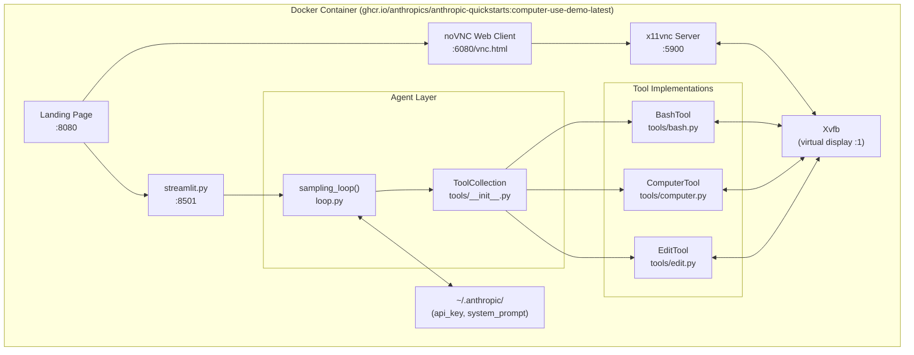

Sources: [computer-use-demo/Dockerfile:1-104](), [computer-use-demo/README.md:131-139](), [computer-use-demo/computer_use_demo/loop.py:70-191]()

---

## API Provider Integration

The `sampling_loop()` function in [computer-use-demo/computer_use_demo/loop.py:70-87]() accepts a `provider` argument of type `APIProvider` (a `StrEnum` defined at [computer-use-demo/computer_use_demo/loop.py:42-45]()). The provider controls which API client is instantiated on each loop iteration:

| `APIProvider` value | Client class | Required credentials |
|--------------------|-------------|----------------------|
| `APIProvider.ANTHROPIC` | `Anthropic(api_key=api_key)` | `ANTHROPIC_API_KEY` env var |
| `APIProvider.BEDROCK` | `AnthropicBedrock()` | AWS credentials (profile, key+secret, or IAM role) |
| `APIProvider.VERTEX` | `AnthropicVertex()` | GCP application default credentials + `CLOUD_ML_REGION` |

Prompt caching is only enabled for the `ANTHROPIC` provider ([computer-use-demo/computer_use_demo/loop.py:104-106]()). Bedrock and Vertex rely on their respective SDK credential resolution chains rather than an explicit API key.

The provider is set via the `API_PROVIDER` environment variable, which `streamlit.py` reads into `st.session_state.provider` during `setup_state()` ([computer-use-demo/computer_use_demo/streamlit.py:130-132]()).

**Diagram: API Provider Selection in `sampling_loop`**

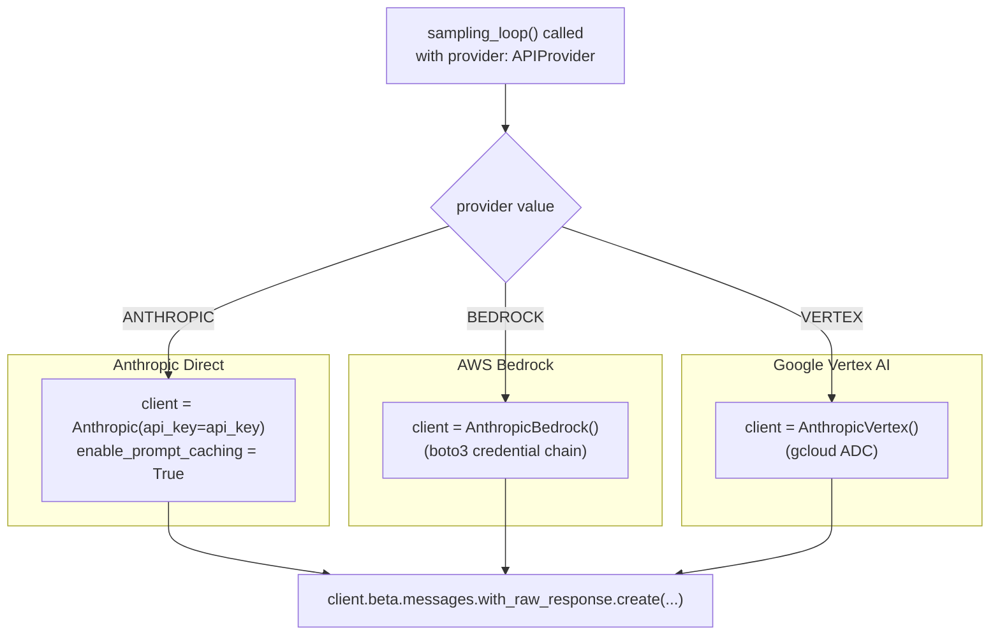

Sources: [computer-use-demo/computer_use_demo/loop.py:98-147](), [computer-use-demo/computer_use_demo/streamlit.py:34-38](), [computer-use-demo/computer_use_demo/streamlit.py:385-405]()

---

## Agent Loop and Desktop Interaction

The agent loop (`sampling_loop` in `loop.py`) sits between the Streamlit UI and the Claude API. On each iteration:

1. The current message history is sent to the Claude API.
2. Claude responds with text blocks and/or `tool_use` blocks.
3. Each `tool_use` block is dispatched to a tool in the `ToolCollection`.
4. Tools act on the virtual desktop (Xvfb) via shell commands, X11 input synthesis, or file operations.
5. Tool results are appended to the message history and the loop repeats.
6. The loop terminates when a response contains no `tool_use` blocks.

This means the agent's "eyes" (screenshots via `ComputerTool`) and "hands" (keyboard/mouse via `ComputerTool`, shell via `BashTool`) are all operating on the same virtual machine running inside the container.

**Diagram: Agent Loop Data Flow**

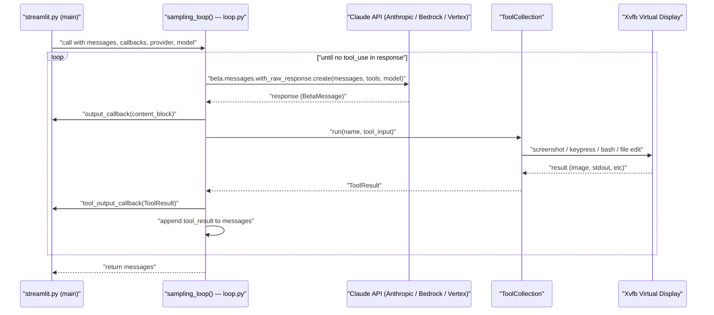

Sources: [computer-use-demo/computer_use_demo/loop.py:98-191](), [computer-use-demo/computer_use_demo/streamlit.py:327-351]()

---

## Key Code Entities and Their Roles

The table below maps architectural components to their concrete code locations:

| Component | File | Key symbol |
|-----------|------|-----------|
| Agent loop | `computer_use_demo/loop.py` | `sampling_loop()` |
| API provider enum | `computer_use_demo/loop.py` | `APIProvider` |
| Streamlit UI entry | `computer_use_demo/streamlit.py` | `main()` |
| Session initialization | `computer_use_demo/streamlit.py` | `setup_state()` |
| Model/tool version mapping | `computer_use_demo/streamlit.py` | `MODEL_TO_MODEL_CONF`, `ModelConfig` |
| Tool dispatcher | `computer_use_demo/tools/__init__.py` | `ToolCollection` |
| Tool versioning registry | `computer_use_demo/tools/__init__.py` | `TOOL_GROUPS_BY_VERSION` |
| Container entrypoint | `computer-use-demo/image/entrypoint.sh` | `entrypoint.sh` |
| Persistent settings | `~/.anthropic/` | `api_key`, `system_prompt` files |

Sources: [computer-use-demo/computer_use_demo/loop.py:1-50](), [computer-use-demo/computer_use_demo/streamlit.py:1-90](), [computer-use-demo/Dockerfile:94-104]()

---

## Weak Separation Constraint

The README explicitly notes that the components are "weakly separated" ([computer-use-demo/README.md:31-32]()). Concretely:

- The agent loop and the desktop it controls run in the same container.
- There is no sandbox boundary between Claude's tool execution and the Streamlit process.
- A single container handles one user session at a time.

This is suitable for a demo or development environment. For production use, the README recommends running in a dedicated VM or container with minimal privileges and restricted network access ([computer-use-demo/README.md:7-16]()).

---

# Page: Sampling Loop & Agent Orchestration

# Sampling Loop & Agent Orchestration

<details>
<summary>Relevant source files</summary>

The following files were used as context for generating this wiki page:

- [computer-use-demo/computer_use_demo/loop.py](computer-use-demo/computer_use_demo/loop.py)
- [computer-use-demo/computer_use_demo/streamlit.py](computer-use-demo/computer_use_demo/streamlit.py)
- [computer-use-demo/computer_use_demo/tools/__init__.py](computer-use-demo/computer_use_demo/tools/__init__.py)

</details>


## Purpose and Scope

This page documents the `sampling_loop` function, which serves as the core orchestration mechanism for the Computer Use Demo. The sampling loop manages the iterative cycle of sending messages to Claude, receiving responses, executing requested tools, and feeding results back into the conversation. It handles message history management, prompt caching optimization, image truncation, and multi-provider API support.

For information about the individual tools that the sampling loop orchestrates, see [Tool System](#2.4). For details on how the Streamlit UI invokes the sampling loop and processes callbacks, see [Streamlit User Interface](#2.3).

---

## Core Function: `sampling_loop`

The `sampling_loop` function is the central orchestrator located in [computer-use-demo/computer_use_demo/loop.py:70-191](). It implements an asynchronous agent loop that alternates between LLM inference and tool execution until the model produces a final response without tool requests.

### Function Signature

| Parameter | Type | Purpose |
|-----------|------|---------|
| `model` | `str` | Model identifier (e.g., `"claude-3-5-sonnet-20241022"`) |
| `provider` | `APIProvider` | API provider: `ANTHROPIC`, `BEDROCK`, or `VERTEX` |
| `system_prompt_suffix` | `str` | Additional context appended to system prompt |
| `messages` | `list[BetaMessageParam]` | Conversation history (modified in-place) |
| `output_callback` | `Callable` | Called for each content block in LLM response |
| `tool_output_callback` | `Callable` | Called after each tool execution |
| `api_response_callback` | `Callable` | Called with raw HTTP request/response details |
| `api_key` | `str` | API authentication key |
| `only_n_most_recent_images` | `int \| None` | Image truncation limit (0 disables) |
| `max_tokens` | `int` | Maximum tokens for LLM response (default: 4096) |
| `tool_version` | `ToolVersion` | Tool version to use (date-based enum) |
| `thinking_budget` | `int \| None` | Extended thinking budget in tokens |
| `token_efficient_tools_beta` | `bool` | Enable token-efficient tools beta feature |

The function modifies `messages` in-place and returns it when the loop terminates (either on error or when the model produces a non-tool response).

**Sources:** [computer-use-demo/computer_use_demo/loop.py:70-96]()

---

## API Provider Configuration

The sampling loop supports three API providers through the `APIProvider` enum:

```python
class APIProvider(StrEnum):
    ANTHROPIC = "anthropic"
    BEDROCK = "bedrock"
    VERTEX = "vertex"
```

### Provider Initialization

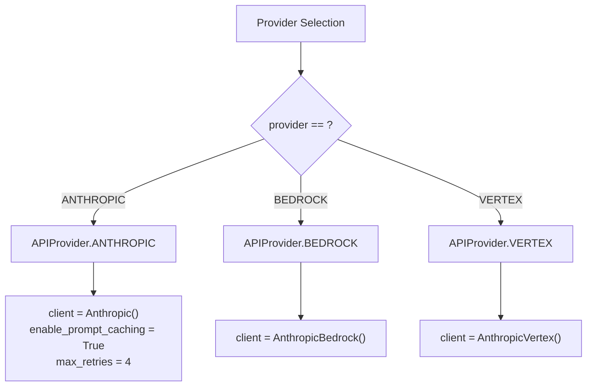

**Provider-Specific Features:**

| Provider | Prompt Caching | Max Retries | Notes |
|----------|----------------|-------------|-------|
| `ANTHROPIC` | ✓ Enabled | 4 | Full feature support including prompt caching |
| `BEDROCK` | ✗ Disabled | Default | AWS-hosted Claude via Bedrock |
| `VERTEX` | ✗ Disabled | Default | GCP-hosted Claude via Vertex AI |

Only the `ANTHROPIC` provider enables prompt caching, which significantly impacts the image truncation and message management strategy.

**Sources:** [computer-use-demo/computer_use_demo/loop.py:42-45](), [computer-use-demo/computer_use_demo/loop.py:104-119]()

---

## System Prompt

The `SYSTEM_PROMPT` constant defines the environmental context and capabilities available to Claude. It is dynamically constructed with:

- **Architecture information**: Platform architecture (`platform.machine()`)
- **Current date**: Formatted as "DayOfWeek, Month Day, Year"
- **Ubuntu environment details**: Instructions for GUI applications, bash commands
- **Tool usage guidance**: Best practices for bash, computer, and edit tools
- **Firefox-specific instructions**: Handling startup wizards, PDF downloads

The system prompt is appended with an optional `system_prompt_suffix` parameter and marked with cache control when prompt caching is enabled.

**Sources:** [computer-use-demo/computer_use_demo/loop.py:53-67](), [computer-use-demo/computer_use_demo/loop.py:93-96]()

---

## Message Flow and Orchestration

### Main Loop Structure

```mermaid
sequenceDiagram
    participant Loop as "sampling_loop"
    participant Config as "Configuration Phase"
    participant API as "Claude API"
    participant Tools as "ToolCollection"
    participant Messages as "messages list"
    
    activate Loop
    Loop->>Config: Initialize tool_collection<br/>from tool_version
    
    loop "While True"
        Loop->>Config: Configure provider client<br/>(Anthropic/Bedrock/Vertex)
        
        alt "enable_prompt_caching == True"
            Loop->>Messages: _inject_prompt_caching(messages)
            Note over Messages: Cache breakpoints on<br/>3 most recent user turns
            Loop->>Loop: only_n_most_recent_images = 0
        end
        
        alt "only_n_most_recent_images > 0"
            Loop->>Messages: _maybe_filter_to_n_most_recent_images()
            Note over Messages: Remove old images<br/>in chunks
        end
        
        Loop->>API: client.beta.messages.with_raw_response.create()
        Note over API: Include: messages, system,<br/>tools, betas, max_tokens
        
        alt "API Error"
            API-->>Loop: APIStatusError / APIError
            Loop->>Loop: api_response_callback(error)
            Loop-->>Loop: return messages
        end
        
        API-->>Loop: BetaMessage response
        Loop->>Loop: api_response_callback(success)
        
        Loop->>Messages: Append assistant message<br/>with response_params
        
        loop "For each content_block"
            Loop->>Loop: output_callback(content_block)
            
            alt "content_block is tool_use"
                Loop->>Tools: run(name, tool_input)
                Tools-->>Loop: ToolResult
                Loop->>Loop: tool_output_callback(result)
                Loop->>Messages: Append tool_result as user message
            end
        end
        
        alt "No tool_result_content"
            Loop-->>Loop: return messages
        end
    end
    
    deactivate Loop
```

### Message History Management

The `messages` parameter is a mutable list of `BetaMessageParam` objects that grows throughout the conversation:

1. **Initial state**: User messages from previous conversation
2. **Assistant responses**: Appended after each LLM call [computer-use-demo/computer_use_demo/loop.py:162-167]()
3. **Tool results**: Appended as user messages with `tool_result` content [computer-use-demo/computer_use_demo/loop.py:190]()

The conversation alternates between `"assistant"` and `"user"` roles, with assistant messages containing text and tool_use blocks, and user messages containing tool_result blocks.

**Sources:** [computer-use-demo/computer_use_demo/loop.py:98-191]()

---

## Prompt Caching Strategy

When using the `ANTHROPIC` provider, the sampling loop implements a sophisticated prompt caching strategy to reduce API costs and improve latency.

### Cache Breakpoint Injection

The `_inject_prompt_caching` function marks the last content item in the 3 most recent user messages with `cache_control` ephemeral breakpoints:

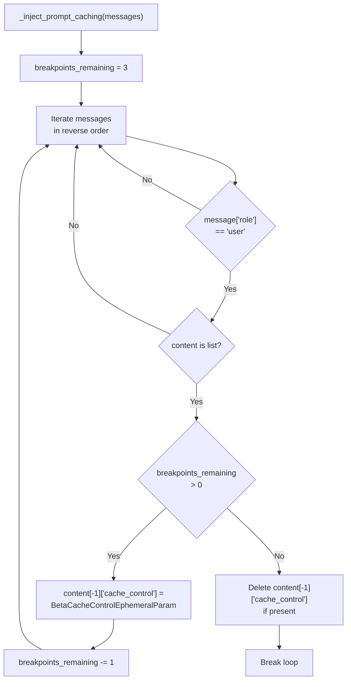

**Cache Breakpoint Strategy:**

| Breakpoint | Location | Purpose |
|------------|----------|---------|
| 1 | System prompt | Shared across all sessions |
| 2 | Tools definitions | Shared across all sessions |
| 3 | 3rd most recent user turn | Recent conversation context |
| 4 | 2nd most recent user turn | Recent conversation context |
| 5 | Most recent user turn | Current context |

This strategy ensures that the expensive system prompt and tool definitions are cached once, while the 3 most recent conversational turns are also cached for fast iteration.

**Impact on Image Truncation:**

When prompt caching is enabled, `only_n_most_recent_images` is set to `0` [computer-use-demo/computer_use_demo/loop.py:117](). This is because cached reads are 10% of the price of regular reads, making it uneconomical to break the cache by removing images.

**Sources:** [computer-use-demo/computer_use_demo/loop.py:112-119](), [computer-use-demo/computer_use_demo/loop.py:265-288]()

---

## Image Truncation

For non-caching providers or when explicitly configured, the `_maybe_filter_to_n_most_recent_images` function removes older screenshots from tool_result blocks to manage context window size.

### Truncation Algorithm

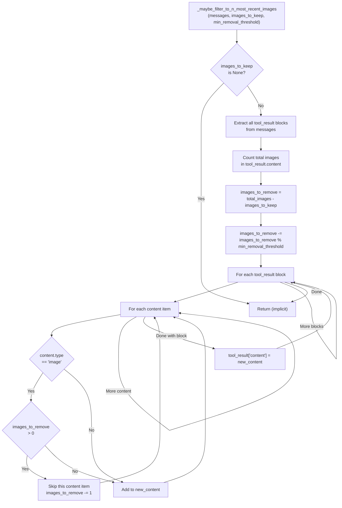

**Chunk-Based Removal:**

The algorithm removes images in chunks of `min_removal_threshold` to minimize cache invalidation. For example, with `min_removal_threshold=10`, removing 23 images would actually remove only 20 (rounded down to nearest multiple of 10).

**Implementation Details:**

- Images are removed from oldest to newest (first-in-first-out)
- Only images in `tool_result` blocks are affected
- Text content is never removed
- The function modifies messages in-place

**Sources:** [computer-use-demo/computer_use_demo/loop.py:193-240]()

---

## Tool Execution Cycle

### Response Processing

After receiving a `BetaMessage` from the API, the sampling loop processes the response through several stages:

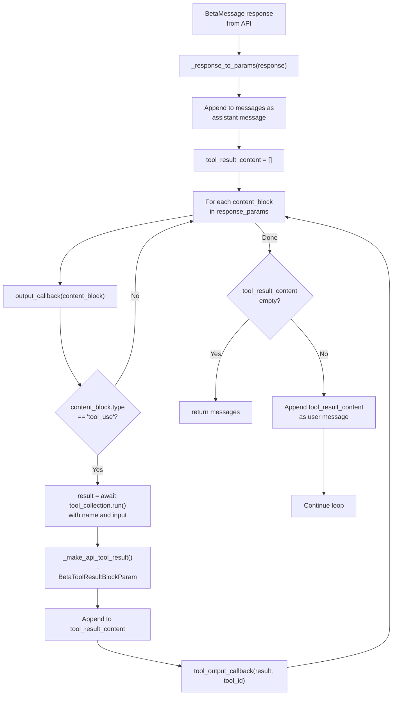

### Tool Result Formatting

The `_make_api_tool_result` function converts a `ToolResult` object into a `BetaToolResultBlockParam` suitable for the API:

**Structure:**

```
BetaToolResultBlockParam {
    type: "tool_result"
    tool_use_id: string
    is_error: boolean
    content: [
        {type: "text", text: string},  // Optional: result.output
        {type: "image", source: {...}} // Optional: result.base64_image
    ]
}
```

**Error Handling:**

- If `result.error` exists, `is_error=True` and `content` is a string with the error message
- If `result.system` exists, it's prepended as `<system>...</system>` XML tags

**Sources:** [computer-use-demo/computer_use_demo/loop.py:169-190](), [computer-use-demo/computer_use_demo/loop.py:291-324]()

---

## Response Transformations

The `_response_to_params` function converts `BetaMessage.content` blocks into `BetaContentBlockParam` format suitable for message history:

### Transformation Logic

| Input Block Type | Condition | Output |
|-----------------|-----------|---------|
| `BetaTextBlock` | `block.text` exists | `BetaTextBlockParam` with text |
| `BetaTextBlock` | `type == "thinking"` | Thinking block dict with `thinking` and optional `signature` fields |
| Tool use block | Always | `BetaToolUseBlockParam` via `model_dump()` |

**Thinking Block Support:**

Extended thinking blocks are preserved with their signature field when present, enabling the thinking feature introduced in later API versions.

**Sources:** [computer-use-demo/computer_use_demo/loop.py:242-262]()

---

## Error Handling

The sampling loop implements comprehensive error handling for API failures:

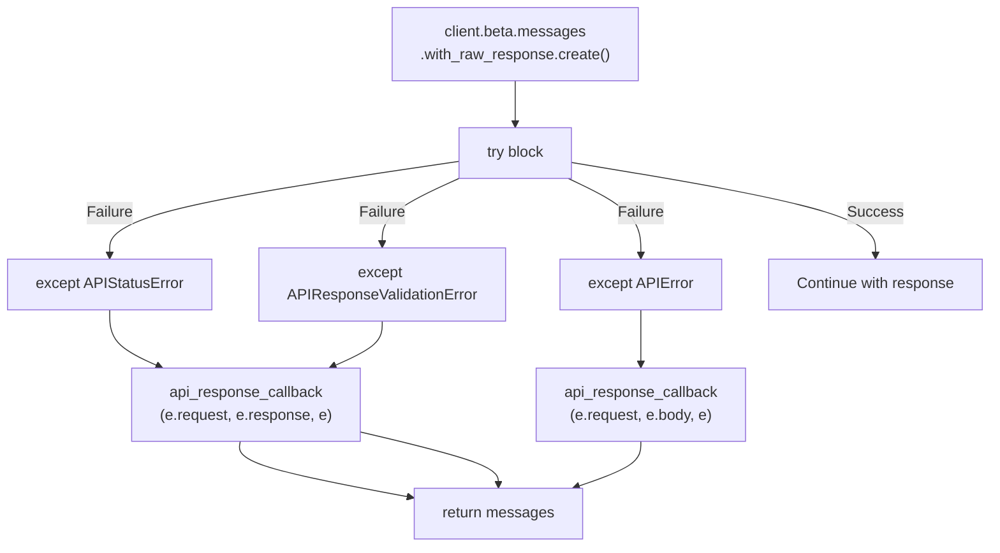

**Error Types:**

- **`APIStatusError`**: HTTP status code errors (4xx, 5xx)
- **`APIResponseValidationError`**: Response doesn't match expected schema
- **`APIError`**: General API errors (network, timeout, etc.)

All errors are reported via `api_response_callback` with full request/response details for debugging, then the function returns the current `messages` list to preserve conversation state.

**Sources:** [computer-use-demo/computer_use_demo/loop.py:138-157]()

---

## Beta Features

The sampling loop supports multiple beta features through the `betas` parameter:

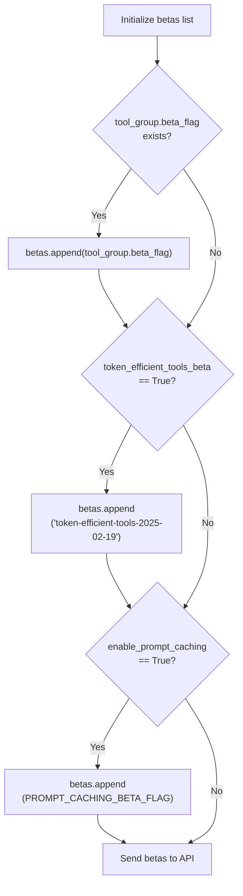

**Beta Flags:**

| Flag | Condition | Purpose |
|------|-----------|---------|
| Tool-specific beta | `tool_group.beta_flag` present | Enable features for specific tool versions |
| `token-efficient-tools-2025-02-19` | `token_efficient_tools_beta=True` | Reduce token usage for tool definitions |
| `prompt-caching-2024-07-31` | `provider=ANTHROPIC` | Enable prompt caching |

**Sources:** [computer-use-demo/computer_use_demo/loop.py:99-113]()

---

# Page: Streamlit User Interface

# Streamlit User Interface

<details>
<summary>Relevant source files</summary>

The following files were used as context for generating this wiki page:

- [computer-use-demo/computer_use_demo/loop.py](computer-use-demo/computer_use_demo/loop.py)
- [computer-use-demo/computer_use_demo/streamlit.py](computer-use-demo/computer_use_demo/streamlit.py)

</details>


## Purpose and Scope

This document covers the Streamlit web application that provides the primary user interface for the computer-use-demo system. The application enables users to interact with Claude through a chat interface, configure model parameters, monitor tool execution, and view HTTP exchange logs.

For information about the agent loop that processes messages, see [Sampling Loop & Agent Orchestration](#2.2). For details on the underlying tools, see [Tool System](#2.4). For deployment configuration, see [Docker Environment & Deployment](#2.5).

---

## Application Architecture

The Streamlit application is implemented as a single-file application in [computer-use-demo/computer_use_demo/streamlit.py:1-544]() that orchestrates the user interface, state management, and integration with the sampling loop.

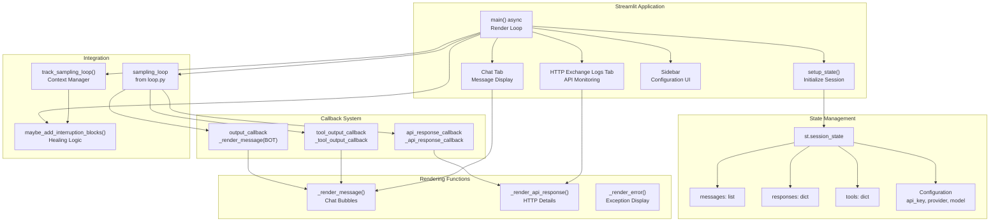

**Sources:** [computer-use-demo/computer_use_demo/streamlit.py:185-356]()

---

## Session State Management

The application maintains state across Streamlit reruns using `st.session_state`. The `setup_state()` function initializes all required state variables with default values.

| State Variable | Type | Purpose |
|----------------|------|---------|
| `messages` | `list[BetaMessageParam]` | Conversation history passed to Claude API |
| `api_key` | `str` | Anthropic API key (loaded from file or environment) |
| `provider` | `APIProvider` | Selected API provider (Anthropic, Bedrock, Vertex) |
| `model` | `str` | Model identifier (e.g., "claude-sonnet-4-5-20250929") |
| `auth_validated` | `bool` | Whether authentication has been validated |
| `responses` | `dict[str, tuple]` | HTTP request/response pairs for logging |
| `tools` | `dict[str, ToolResult]` | Tool execution results indexed by tool_use_id |
| `only_n_most_recent_images` | `int` | Number of recent screenshots to include (default: 3) |
| `custom_system_prompt` | `str` | User-provided system prompt suffix |
| `hide_images` | `bool` | Toggle for hiding screenshots in UI |
| `token_efficient_tools_beta` | `bool` | Enable beta token-efficient tools flag |
| `in_sampling_loop` | `bool` | Tracks whether sampling loop is currently executing |

**Model Configuration:**

The application maps model names to configuration objects that specify tool versions, token limits, and capabilities:

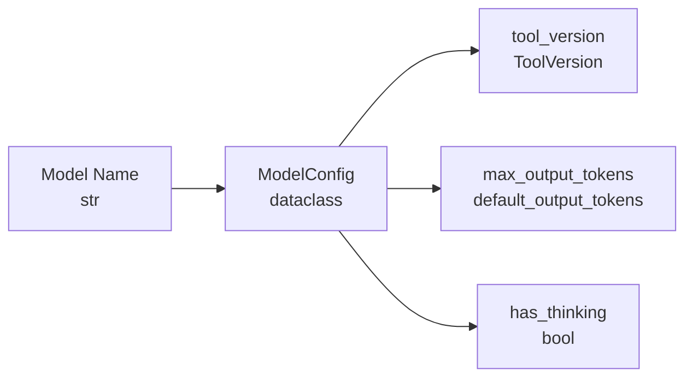

Configuration constants defined in [computer-use-demo/computer_use_demo/streamlit.py:41-92]():
- `SONNET_3_5_NEW`: 8K max tokens, no thinking, `computer_use_20241022`
- `SONNET_3_7`: 128K max tokens, thinking enabled, `computer_use_20250124`
- `CLAUDE_4`, `CLAUDE_4_5`: 128K max tokens, thinking enabled, `computer_use_20250124`
- `HAIKU_4_5`: 8K max tokens, no thinking, `computer_use_20250124`

**Storage Persistence:**

The application persists API keys and custom system prompts to `~/.anthropic/` directory using `save_to_storage()` and `load_from_storage()` functions [computer-use-demo/computer_use_demo/streamlit.py:412-434](). Files are created with `0o600` permissions (user read/write only) for security.

| State Variable | Type | Purpose |
|----------------|------|---------|
| `messages` | `list[BetaMessageParam]` | Conversation history passed to Claude API |
| `api_key` | `str` | Anthropic API key (loaded from file or environment) |
| `provider` | `APIProvider` | Active API provider (committed value) |
| `provider_radio` | `APIProvider` | Sidebar radio widget binding (triggers `_reset_api_provider`) |
| `model` | `str` | Model identifier (e.g., `claude-sonnet-4-5-20250929`) |
| `auth_validated` | `bool` | Whether authentication has been validated this session |
| `responses` | `dict[str, tuple]` | HTTP request/response pairs for the Logs tab |
| `tools` | `dict[str, ToolResult]` | Tool execution results indexed by `tool_use_id` |
| `only_n_most_recent_images` | `int` | Number of recent screenshots to retain in API messages (default: 3) |
| `custom_system_prompt` | `str` | User-provided system prompt suffix (persisted to `~/.anthropic/system_prompt`) |
| `hide_images` | `bool` | UI-only toggle to hide screenshots in the chat view |
| `token_efficient_tools_beta` | `bool` | Enables the `token-efficient-tools-2025-02-19` beta flag |
| `in_sampling_loop` | `bool` | `True` while `sampling_loop()` is executing; used for interruption detection |
| `tool_version` | `ToolVersion` | Active tool version string passed to `sampling_loop()` |
| `has_thinking` | `bool` | Whether the selected model supports extended thinking |
| `output_tokens` | `int` | Max output token budget passed to `sampling_loop()` |
| `max_output_tokens` | `int` | Upper bound for `thinking_budget` widget |
| `thinking_budget` | `int` | Token allocation for thinking (half of `default_output_tokens` by default) |
</old_str>

<old_str>
**Sources:** [computer-use-demo/computer_use_demo/streamlit.py:125-157](), [computer-use-demo/computer_use_demo/streamlit.py:41-92](), [computer-use-demo/computer_use_demo/streamlit.py:412-434]()
</old_str>
<new_str>
**Sources:** [computer-use-demo/computer_use_demo/streamlit.py:121-177](), [computer-use-demo/computer_use_demo/streamlit.py:41-88](), [computer-use-demo/computer_use_demo/streamlit.py:408-430]()

---

## Main Render Loop

The `main()` async function implements the core render loop that handles user input and orchestrates the sampling loop execution.

```mermaid
sequenceDiagram
    participant User
    participant Main as "main()"
    participant State as "st.session_state"
    participant Auth as "validate_auth()"
    participant Loop as "sampling_loop()"
    participant Render as "_render_message()"
    
    User->>Main: Load page
    Main->>State: setup_state()
    Main->>Auth: validate_auth()
    
    alt Authentication Failed
        Auth-->>Main: Error message
        Main-->>User: Display warning
    else Authentication Successful
        State->>State: auth_validated = True
        User->>Main: Submit chat input
        Main->>State: Append user message
        Main->>Render: Render user message
        Main->>State: Check maybe_add_interruption_blocks()
        Main->>Loop: Call sampling_loop()
        
        loop For each response block
            Loop->>Render: output_callback()
            Loop->>Render: tool_output_callback()
            Loop->>Render: api_response_callback()
        end
        
        Loop-->>Main: Updated messages
        Main->>State: Update messages
    end
```

**Execution Flow:**

1. **Initialization** [computer-use-demo/computer_use_demo/streamlit.py:179-188]():
   - Call `setup_state()` to initialize session state
   - Apply custom CSS styling via `STREAMLIT_STYLE`
   - Display `WARNING_TEXT` security alert (suppressed when `HIDE_WARNING` env var is set)

2. **Authentication** [computer-use-demo/computer_use_demo/streamlit.py:268-275]():
   - Validate credentials using `validate_auth(provider, api_key)`
   - For `APIProvider.ANTHROPIC`: check that `api_key` is non-empty
   - For `APIProvider.BEDROCK`: verify AWS credentials via `boto3.Session().get_credentials()`
   - For `APIProvider.VERTEX`: verify `CLOUD_ML_REGION` env var and Google Cloud default credentials

3. **UI Rendering** [computer-use-demo/computer_use_demo/streamlit.py:277-303]():
   - Create two tabs: `"Chat"` and `"HTTP Exchange Logs"`
   - Render historical messages from `st.session_state.messages`
   - Render historical HTTP exchanges from `st.session_state.responses`

4. **User Input Processing** [computer-use-demo/computer_use_demo/streamlit.py:306-325]():
   - Capture new message from `st.chat_input()`
   - Prepend interruption blocks via `maybe_add_interruption_blocks()` if needed
   - Append user message to `messages` list

5. **Sampling Loop Execution** [computer-use-demo/computer_use_demo/streamlit.py:327-351]():
   - Execute within `track_sampling_loop()` context manager
   - Pass partial callbacks for progressive rendering
   - Update `st.session_state.messages` with complete conversation returned by `sampling_loop()`

**Sources:** [computer-use-demo/computer_use_demo/streamlit.py:179-351](), [computer-use-demo/computer_use_demo/streamlit.py:385-406]()

---

## Message Rendering System

The application renders different message types using the `_render_message()` function, which handles text, tool use blocks, tool results, and thinking blocks.

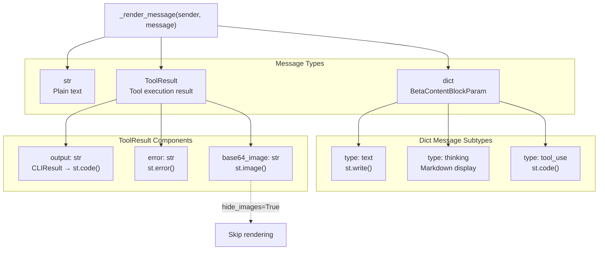

**Rendering Logic** [computer-use-demo/computer_use_demo/streamlit.py:497-535]():

1. **String Messages**: Rendered with `st.markdown()`
2. **Dict (`BetaContentBlockParam`) Messages**: Dispatched on the `type` field:
   - `"text"`: `st.write(message["text"])`
   - `"thinking"`: `st.markdown(f"[Thinking]\n\n{thinking_content}")`
   - `"tool_use"`: `st.code(f"Tool Use: {message['name']}\nInput: {message['input']}")`
3. **`ToolResult` Objects**: Multi-component rendering in order:
   - `output`: `st.code()` if the instance's class name is `"CLIResult"`, else `st.markdown()`
   - `error`: `st.error()`
   - `base64_image`: `st.image(base64.b64decode(...))` — skipped when `hide_images` is `True`

> **Note:** The `is_tool_result` check uses `not isinstance(message, str | dict)` rather than `isinstance(message, ToolResult)` to avoid a Streamlit hot-reload issue where `isinstance` checks against imported types can fail after a module reload.

**Sender Enumeration:**

The `Sender` enum [computer-use-demo/computer_use_demo/streamlit.py:119-122]() defines three message origins:
- `USER`: User-submitted messages
- `BOT`: Assistant (Claude) responses
- `TOOL`: Tool execution results

**Image Management:**

Screenshot visibility is controlled by two mechanisms:
1. `only_n_most_recent_images`: Limits images sent to API (token optimization)
2. `hide_images`: UI-only toggle that hides screenshots in chat display

**Sources:** [computer-use-demo/computer_use_demo/streamlit.py:115-118](), [computer-use-demo/computer_use_demo/streamlit.py:497-535]()

---

## Callback System

The application integrates with the sampling loop via three callback functions that enable progressive rendering of agent activity.

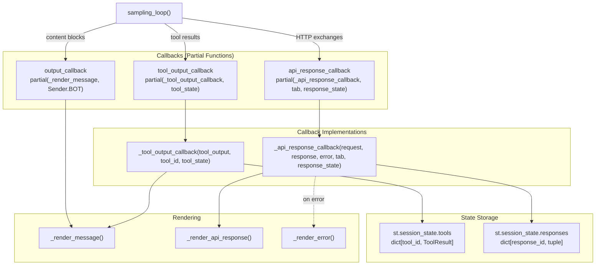

**Output Callback** [computer-use-demo/computer_use_demo/streamlit.py:334]():
- Receives each `BetaContentBlockParam` from Claude's response
- Renders text, thinking, and `tool_use` blocks immediately via `_render_message`
- Constructed as `partial(_render_message, Sender.BOT)` to bind the sender

**Tool Output Callback** — `_tool_output_callback` [computer-use-demo/computer_use_demo/streamlit.py:450-455]():
- Called after each tool execution with `(tool_output: ToolResult, tool_id: str)`
- Stores the `ToolResult` in `st.session_state.tools[tool_id]`
- Immediately calls `_render_message(Sender.TOOL, tool_output)` for live feedback
- The stored value is later used when re-rendering the full conversation history (tool results in messages reference the stored object by `tool_use_id`)

**API Response Callback** — `_api_response_callback` [computer-use-demo/computer_use_demo/streamlit.py:433-447]():
- Captures the raw `httpx.Request` / `httpx.Response` pair after each API call
- Stores in `st.session_state.responses` keyed by `datetime.now().isoformat()`
- Forwards to `_render_api_response()` in the HTTP Logs tab
- On error, calls `_render_error()` before rendering the exchange

**Progressive Rendering:**

The callback pattern enables the UI to update incrementally as the agent loop progresses, providing real-time feedback without waiting for the entire conversation to complete.

**Sources:** [computer-use-demo/computer_use_demo/streamlit.py:327-351](), [computer-use-demo/computer_use_demo/streamlit.py:433-455]()

---

## Sidebar Configuration

The sidebar provides controls for API configuration, model selection, and execution parameters.

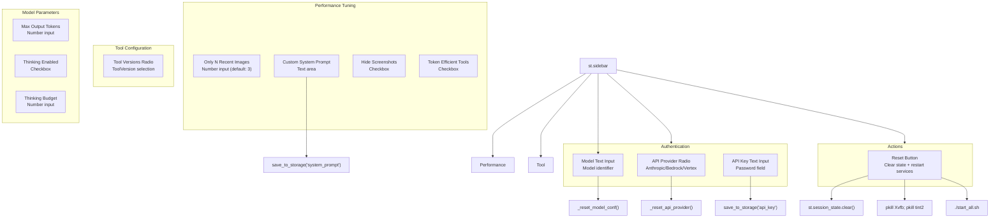

**Configuration Controls** [computer-use-demo/computer_use_demo/streamlit.py:190-261]():

| Control | Widget | Key | Behaviour on Change |
|---------|--------|-----|---------------------|
| API Provider | `st.radio` | `provider_radio` | Calls `_reset_api_provider()`: resets model + invalidates `auth_validated` |
| Model | `st.text_input` | `model` | Calls `_reset_model_conf()`: updates `tool_version`, `output_tokens`, `thinking_budget` |
| Claude API Key | `st.text_input` (password) | `api_key` | Saves to `~/.anthropic/api_key` via `save_to_storage()` |
| Only N Recent Images | `st.number_input` | `only_n_most_recent_images` | Passed directly to `sampling_loop()` |
| Custom System Prompt | `st.text_area` | `custom_system_prompt` | Saves to `~/.anthropic/system_prompt`; appended to `SYSTEM_PROMPT` in `loop.py` |
| Hide Screenshots | `st.checkbox` | `hide_images` | Suppresses `base64_image` rendering in `_render_message` |
| Token-Efficient Tools | `st.checkbox` | `token_efficient_tools_beta` | Passes `token_efficient_tools_beta=True` to `sampling_loop()` |
| Tool Versions | `st.radio` | `tool_versions` | Overrides the model-derived `tool_version`; uses `get_args(ToolVersion)` for options |
| Max Output Tokens | `st.number_input` | `output_tokens` | Passed as `max_tokens` to `sampling_loop()` |
| Thinking Enabled | `st.checkbox` | `thinking` | Enables/disables `thinking_budget` widget; gates `thinking_budget` arg in `sampling_loop()` |
| Thinking Budget | `st.number_input` | `thinking_budget` | Passed to `sampling_loop()` when `thinking=True`; bounded by `max_output_tokens` |

> The API Key field is only shown when `provider == APIProvider.ANTHROPIC`. Bedrock and Vertex use ambient credentials (boto3 / Google auth).

**`_reset_api_provider()`** [computer-use-demo/computer_use_demo/streamlit.py:192-195](): compares `provider_radio` to `provider`; if different, calls `_reset_model()` and sets `auth_validated = False`.

**`_reset_model_conf()`** [computer-use-demo/computer_use_demo/streamlit.py:162-176](): looks up the model in `MODEL_TO_MODEL_CONF` (falls back to `CLAUDE_4`), then writes `tool_version`, `has_thinking`, `output_tokens`, `max_output_tokens`, and `thinking_budget` into session state. If `tool_versions` is already in session state (user has made a manual radio selection), that value takes precedence over the model-derived `tool_version`.

**Reset Button** [computer-use-demo/computer_use_demo/streamlit.py:259-266]():
- Clears all session state via `st.session_state.clear()`
- Kills `Xvfb` and `tint2` processes with `pkill`
- Restarts the virtual desktop via `./start_all.sh`

**Sources:** [computer-use-demo/computer_use_demo/streamlit.py:190-266]()

---

## Interruption Handling

The application implements graceful interruption handling to allow users to stop the agent loop mid-execution and provide corrective instructions.

```mermaid
sequenceDiagram
    participant User
    participant Main as "main()"
    participant Track as "track_sampling_loop()"
    participant State as "st.session_state"
    participant Interrupt as "maybe_add_interruption_blocks()"
    participant Loop as "sampling_loop()"
    
    User->>Main: Submit first message
    Main->>Track: Enter context manager
    Track->>State: in_sampling_loop = True
    Main->>Loop: Execute sampling_loop()
    
    Note over Loop: Agent executing tools...
    
    User->>Main: Submit new message (interruption)
    Main->>Interrupt: Check for interruption
    Interrupt->>State: Check in_sampling_loop
    
    alt Interrupted (in_sampling_loop = True)
        Interrupt->>State: Get last message
        Interrupt->>State: Extract tool_use_ids
        
        loop For each pending tool_use_id
            Interrupt->>State: tools[tool_use_id] = ToolResult(error)
            Interrupt->>Interrupt: Create BetaToolResultBlockParam(is_error=True)
        end
        
        Interrupt->>Interrupt: Add INTERRUPT_TEXT block
        Interrupt-->>Main: Return interruption blocks
        Main->>State: Append blocks to new message
    else Not Interrupted
        Interrupt-->>Main: Return empty list
    end
    
    Main->>Loop: Execute with healed message
    Loop-->>Main: Complete
    Main->>Track: Exit context manager
    Track->>State: in_sampling_loop = False
```

**Interruption Detection** [computer-use-demo/computer_use_demo/streamlit.py:354-375]():

The `maybe_add_interruption_blocks()` function detects interruptions by checking the `in_sampling_loop` flag. If a new user message arrives while the sampling loop is executing, the system:

1. **Identifies Incomplete Tool Calls**: Extracts `tool_use_id` values from the last assistant message
2. **Injects Error Results**: Creates `BetaToolResultBlockParam` objects with `is_error=True` and error message `"human stopped or interrupted tool execution"`
3. **Stores Error State**: Updates `st.session_state.tools` with `ToolResult(error=INTERRUPT_TOOL_ERROR)`
4. **Adds Context Block**: Appends text block with `INTERRUPT_TEXT` ("(user stopped or interrupted and wrote the following)")
5. **Returns Healing Blocks**: Returns list of blocks to prepend to new user message

**Context Manager** [computer-use-demo/computer_use_demo/streamlit.py:378-382]():

The `track_sampling_loop()` context manager ensures proper state tracking:
- Sets `in_sampling_loop = True` on entry
- Sets `in_sampling_loop = False` on exit (even if exception occurs)
- Enables interruption detection in subsequent render cycles

**Interruption Constants** [computer-use-demo/computer_use_demo/streamlit.py:111-112]():
- `INTERRUPT_TEXT`: Message displayed to Claude about interruption
- `INTERRUPT_TOOL_ERROR`: Error message for incomplete tool executions

This mechanism allows users to:
- Stop long-running or incorrect tool executions
- Provide corrective guidance mid-task
- Maintain conversation coherence by healing incomplete tool calls

**Sources:** [computer-use-demo/computer_use_demo/streamlit.py:354-382](), [computer-use-demo/computer_use_demo/streamlit.py:111-112](), [computer-use-demo/computer_use_demo/streamlit.py:327-351]()

---

## HTTP Exchange Visualization

The "HTTP Exchange Logs" tab provides detailed visibility into API interactions for debugging and monitoring.

```mermaid
graph TB
    APICallback["_api_response_callback()"]
    
    subgraph "Storage"
        RespID["response_id<br/>ISO timestamp"]
        RespState["st.session_state.responses<br/>dict[response_id, tuple]"]
        ReqResp["(httpx.Request, httpx.Response)"]
    end
    
    subgraph "Rendering"
        RenderAPI["_render_api_response()"]
        Expander["st.expander<br/>Request/Response (timestamp)"]
    end
    
    subgraph "Request Display"
        ReqMethod["HTTP method + URL"]
        ReqHeaders["Request headers"]
        ReqBody["Request body JSON"]
    end
    
    subgraph "Response Display"
        RespStatus["Status code"]
        RespHeaders["Response headers"]
        RespBody["Response body JSON"]
    end
    
    APICallback --> RespID
    APICallback --> RespState
    RespState --> ReqResp
    
    APICallback --> RenderAPI
    RenderAPI --> Expander
    
    Expander --> ReqMethod
    Expander --> ReqHeaders
    Expander --> ReqBody
    Expander --> RespStatus
    Expander --> RespHeaders
    Expander --> RespBody
```

**API Response Callback Flow** [computer-use-demo/computer_use_demo/streamlit.py:433-447]():

1. Generate unique `response_id` using ISO timestamp
2. Store `(request, response)` tuple in `st.session_state.responses`
3. Render error via `_render_error()` if present
4. Render exchange via `_render_api_response()`

**Response Rendering** [computer-use-demo/computer_use_demo/streamlit.py:458-479]():

Each HTTP exchange is displayed in an expandable section showing:

**Request Section:**
- HTTP method and URL (e.g., `POST https://api.anthropic.com/v1/messages`)
- Request headers formatted as key-value pairs
- Request body as formatted JSON

**Response Section:**
- HTTP status code (e.g., `200`)
- Response headers formatted as key-value pairs
- Response body as formatted JSON

**Error Handling** [computer-use-demo/computer_use_demo/streamlit.py:482-494]():

The `_render_error()` function provides specialized handling for different exception types:

1. **RateLimitError**:
   - Displays rate limit message
   - Extracts `retry-after` header and converts to HH:MM:SS format
   - Links to API documentation
   - Shows error message

2. **Other Exceptions**:
   - Displays exception class name
   - Shows exception message
   - Includes full traceback in code block
   - Saves error details to timestamped file in `~/.anthropic/`

The error rendering uses `st.error()` with material error icon for visual prominence.

**Sources:** [computer-use-demo/computer_use_demo/streamlit.py:433-494]()

---

## Testing

The Streamlit application includes integration tests that verify core functionality.

**Test Structure** [computer-use-demo/tests/streamlit_test.py:1-28]():

The test suite uses `streamlit.testing.v1.AppTest` to simulate user interactions:

1. **App Initialization**: Loads app from file path
2. **Authentication**: Sets API key via text input
3. **Message Submission**: Submits chat message via `chat_input`
4. **Sampling Loop Verification**: Mocks `sampling_loop` and verifies:
   - Function is called
   - Messages include user input with correct structure
   - No exceptions are raised

The test validates the integration between the Streamlit UI and the sampling loop, ensuring that user messages are correctly formatted as `BetaMessageParam` objects with the appropriate `role` and `content` structure.

**Sources:** [computer-use-demo/tests/streamlit_test.py:1-28]()

---

# Page: Tool System

# Tool System

<details>
<summary>Relevant source files</summary>

The following files were used as context for generating this wiki page:

- [computer-use-demo/computer_use_demo/requirements.txt](computer-use-demo/computer_use_demo/requirements.txt)
- [computer-use-demo/computer_use_demo/tools/__init__.py](computer-use-demo/computer_use_demo/tools/__init__.py)
- [computer-use-demo/computer_use_demo/tools/base.py](computer-use-demo/computer_use_demo/tools/base.py)
- [computer-use-demo/computer_use_demo/tools/bash.py](computer-use-demo/computer_use_demo/tools/bash.py)
- [computer-use-demo/computer_use_demo/tools/collection.py](computer-use-demo/computer_use_demo/tools/collection.py)
- [computer-use-demo/computer_use_demo/tools/groups.py](computer-use-demo/computer_use_demo/tools/groups.py)

</details>


This page provides an overview of the computer use tool system in `computer-use-demo`: the abstract base class, result types, the `ToolCollection` dispatcher, and the versioned tool group registry that ties them together at runtime.

For deeper coverage of individual tools, see:
- [Tool Architecture & Versioning](#2.4.1) — interface contracts, `ToolGroup`, and the version registry in detail
- [BashTool](#2.4.2) — `BashTool20250124`, `BashTool20241022`, and the `_BashSession` lifecycle
- [ComputerTool](#2.4.3) — action sets, coordinate scaling, and version differences
- [EditTool](#2.4.4) — the four file-editing commands and path validation

For how the tool system is invoked during the agent loop, see [Sampling Loop & Agent Orchestration](#2.2).

---

## Tool Class Hierarchy

All tools inherit from `BaseAnthropicTool`, defined in [computer-use-demo/computer_use_demo/tools/base.py]().

**Tool Class Hierarchy and Result Types**

```mermaid
graph TD
    BASE["BaseAnthropicTool\n(ABCMeta)\ncomputer_use_demo/tools/base.py"]

    BASE --> BashTool20250124["BashTool20250124\nbash.py"]
    BashTool20250124 --> BashTool20241022["BashTool20241022\nbash.py"]

    BASE --> ComputerTool20241022["ComputerTool20241022\ncomputer.py"]
    BASE --> ComputerTool20250124["ComputerTool20250124\ncomputer.py"]
    BASE --> ComputerTool20251124["ComputerTool20251124\ncomputer.py"]

    BASE --> EditTool20250728["EditTool20250728\nedit.py"]

    subgraph results["Result Types  (base.py)"]
        ToolResult["ToolResult\noutput, error,\nbase64_image, system"]
        CLIResult["CLIResult\n(subclass of ToolResult)"]
        ToolFailure["ToolFailure\n(subclass of ToolResult)"]
        ToolError["ToolError\n(Exception)\nmessage: str"]
        ToolResult --> CLIResult
        ToolResult --> ToolFailure
    end
```

Sources: [computer-use-demo/computer_use_demo/tools/base.py:1-70](), [computer-use-demo/computer_use_demo/tools/bash.py:104-148]()

---

## BaseAnthropicTool

`BaseAnthropicTool` ([computer-use-demo/computer_use_demo/tools/base.py:8-20]()) uses `ABCMeta` and mandates two abstract methods on every concrete tool:

| Method | Signature | Purpose |
|---|---|---|
| `__call__` | `(**kwargs) -> Any` | Execute the tool with Claude-supplied arguments |
| `to_params` | `() -> BetaToolUnionParam` | Return the Anthropic API schema dict for this tool |

Both must be implemented; `ToolCollection` (see below) calls `to_params()` to build the API request and `__call__()` to dispatch execution.

Sources: [computer-use-demo/computer_use_demo/tools/base.py:8-20]()

---

## Result Types

Tool executions return instances of `ToolResult` or one of its two subclasses. `ToolError` is an exception, not a result type — it is caught by `ToolCollection` and converted into a `ToolFailure`.

```mermaid
classDiagram
    class ToolResult {
        +output: str | None
        +error: str | None
        +base64_image: str | None
        +system: str | None
        +__bool__()
        +__add__(other: ToolResult)
        +replace(**kwargs)
    }

    class CLIResult {
    }

    class ToolFailure {
    }

    class ToolError {
        +message: str
    }

    ToolResult <|-- CLIResult
    ToolResult <|-- ToolFailure
    Exception <|-- ToolError
```

All three `ToolResult` variants are frozen dataclasses. The `__add__` method on `ToolResult` allows concatenating two results; it raises `ValueError` if both sides have a `base64_image` field set ([computer-use-demo/computer_use_demo/tools/base.py:35-50]()).

| Type | Produced by | Meaning |
|---|---|---|
| `ToolResult` | Any tool | Generic result carrying output, error, image, or system text |
| `CLIResult` | `_BashSession.run()` | Terminal-style output; rendered differently in the UI |
| `ToolFailure` | `ToolCollection.run()` | Tool name not found, or a `ToolError` was raised during execution |
| `ToolError` | Any tool raising it | Exception form; never returned to callers directly |

Sources: [computer-use-demo/computer_use_demo/tools/base.py:23-70](), [computer-use-demo/computer_use_demo/tools/collection.py:29-36]()

---

## ToolCollection

`ToolCollection` ([computer-use-demo/computer_use_demo/tools/collection.py:15-36]()) is the runtime dispatcher. It holds a set of instantiated tools and exposes two methods used by the sampling loop:

| Method | Signature | Returns |
|---|---|---|
| `to_params` | `() -> list[BetaToolUnionParam]` | API-format tool schemas for the `tools=` argument in the Claude API call |
| `run` | `(*, name: str, tool_input: dict) -> ToolResult` | Dispatches a tool call by name and returns a `ToolResult` |

**ToolCollection dispatch flow**

```mermaid
sequenceDiagram
    participant SL as "sampling_loop()"
    participant TC as "ToolCollection"
    participant TM as "tool_map: dict[str, BaseAnthropicTool]"
    participant Tool as "concrete tool (__call__)"

    SL->>TC: "run(name='bash', tool_input={command: ...})"
    TC->>TM: "tool_map.get('bash')"
    alt "tool not found"
        TM-->>TC: "None"
        TC-->>SL: "ToolFailure(error='Tool bash is invalid')"
    else "tool found"
        TM-->>TC: "BashTool20250124 instance"
        TC->>Tool: "await tool(**tool_input)"
        alt "ToolError raised"
            Tool-->>TC: "raises ToolError"
            TC-->>SL: "ToolFailure(error=e.message)"
        else "success"
            Tool-->>TC: "ToolResult / CLIResult"
            TC-->>SL: "ToolResult / CLIResult"
        end
    end
```

`tool_map` is built at construction time from each tool's `to_params()["name"]` value ([computer-use-demo/computer_use_demo/tools/collection.py:19-22]()).

Sources: [computer-use-demo/computer_use_demo/tools/collection.py:1-36]()

---

## Versioned Tool Groups

Different Claude model versions require different tool schemas. The version registry in [computer-use-demo/computer_use_demo/tools/groups.py]() maps each `ToolVersion` string to a `ToolGroup` that specifies which concrete tool classes and which API beta flag to use.

### Types

```python
ToolVersion = Literal[
    "computer_use_20241022",
    "computer_use_20250124",
    "computer_use_20250429",
    "computer_use_20251124",
]

BetaFlag = Literal[
    "computer-use-2024-10-22",
    "computer-use-2025-01-24",
    "computer-use-2025-04-29",
    "computer-use-2025-11-24",
]
```

`ToolGroup` is a frozen dataclass with three fields ([computer-use-demo/computer_use_demo/tools/groups.py:23-27]()):

| Field | Type | Purpose |
|---|---|---|
| `version` | `ToolVersion` | The string key used to look up this group |
| `tools` | `list[type[BaseAnthropicTool]]` | Tool classes to instantiate for this version |
| `beta_flag` | `BetaFlag \| None` | Added to the `betas=` API header; `None` for no beta flag |

### Registry

`TOOL_GROUPS_BY_VERSION` is a `dict[ToolVersion, ToolGroup]` built from the `TOOL_GROUPS` list:

| `ToolVersion` | `ComputerTool` class | `BashTool` class | `EditTool` class | `BetaFlag` |
|---|---|---|---|---|
| `computer_use_20241022` | `ComputerTool20241022` | `BashTool20241022` | `EditTool20250728` | `computer-use-2024-10-22` |
| `computer_use_20250124` | `ComputerTool20250124` | `BashTool20250124` | `EditTool20250728` | `computer-use-2025-01-24` |
| `computer_use_20250429` | `ComputerTool20250124` | `BashTool20250124` | `EditTool20250728` | `computer-use-2025-01-24` |
| `computer_use_20251124` | `ComputerTool20251124` | `BashTool20250124` | `EditTool20250728` | `computer-use-2025-11-24` |

Note that `computer_use_20250429` reuses the same tool classes as `computer_use_20250124` but is a distinct `ToolVersion` entry ([computer-use-demo/computer_use_demo/tools/groups.py:41-45]()).

Sources: [computer-use-demo/computer_use_demo/tools/groups.py:1-53]()

---

## Runtime Tool Group Selection

The Streamlit UI exposes `ToolVersion` as a sidebar option (see [Streamlit User Interface](#2.3)). At the start of each `sampling_loop` invocation, the selected version string is used to look up the matching `ToolGroup`:

**Version selection to ToolCollection construction**

```mermaid
flowchart LR
    UI["Streamlit sidebar\nToolVersion selection"]
    LOOKUP["TOOL_GROUPS_BY_VERSION\n[tool_version]"]
    TG["ToolGroup\n.version\n.tools (list of classes)\n.beta_flag"]
    INST["instantiate each class\nin .tools"]
    COL["ToolCollection(*instances)"]
    API["Claude API call\nbetas=[beta_flag]\ntools=collection.to_params()"]

    UI --> LOOKUP
    LOOKUP --> TG
    TG --> INST
    INST --> COL
    TG -->|"beta_flag"| API
    COL -->|"to_params()"| API
```

The `beta_flag` from the `ToolGroup` is passed directly into the `betas=` parameter of the Anthropic API call. If `beta_flag` is `None`, no beta header is sent.

Sources: [computer-use-demo/computer_use_demo/tools/groups.py:30-53](), [computer-use-demo/computer_use_demo/tools/collection.py:15-36]()

---

## Module Exports

The public surface of the tools package is defined in [computer-use-demo/computer_use_demo/tools/__init__.py:1-19](). The following names are exported for use by the rest of the application:

| Export | Source module |
|---|---|
| `CLIResult` | `base.py` |
| `ToolResult` | `base.py` |
| `BashTool20241022` | `bash.py` |
| `BashTool20250124` | `bash.py` |
| `ToolCollection` | `collection.py` |
| `ComputerTool20241022` | `computer.py` |
| `ComputerTool20250124` | `computer.py` |
| `EditTool20250728` | `edit.py` |
| `TOOL_GROUPS_BY_VERSION` | `groups.py` |
| `ToolVersion` | `groups.py` |

Sources: [computer-use-demo/computer_use_demo/tools/__init__.py:1-19]()

---

# Page: Tool Architecture & Versioning

# Tool Architecture & Versioning

<details>
<summary>Relevant source files</summary>

The following files were used as context for generating this wiki page:

- [computer-use-demo/computer_use_demo/requirements.txt](computer-use-demo/computer_use_demo/requirements.txt)
- [computer-use-demo/computer_use_demo/tools/__init__.py](computer-use-demo/computer_use_demo/tools/__init__.py)
- [computer-use-demo/computer_use_demo/tools/base.py](computer-use-demo/computer_use_demo/tools/base.py)
- [computer-use-demo/computer_use_demo/tools/bash.py](computer-use-demo/computer_use_demo/tools/bash.py)
- [computer-use-demo/computer_use_demo/tools/collection.py](computer-use-demo/computer_use_demo/tools/collection.py)
- [computer-use-demo/computer_use_demo/tools/groups.py](computer-use-demo/computer_use_demo/tools/groups.py)

</details>


This page covers the foundational abstractions that all computer-use tools are built on: `BaseAnthropicTool`, the `ToolResult` type hierarchy, `ToolCollection`, and the versioning registry (`ToolGroup`, `ToolVersion`, `TOOL_GROUPS_BY_VERSION`). It does **not** cover the individual tool implementations — for those, see [BashTool](#2.4.2), [ComputerTool](#2.4.3), and [EditTool](#2.4.4).

---

## Core Abstractions

### `BaseAnthropicTool`

`BaseAnthropicTool` ([computer-use-demo/computer_use_demo/tools/base.py:8-20]()) is an abstract base class (using `ABCMeta`) that all tool implementations must subclass. It declares two abstract methods:

| Method | Signature | Purpose |
|---|---|---|
| `__call__` | `(**kwargs) -> Any` | Executes the tool with arguments provided by the API |
| `to_params` | `() -> BetaToolUnionParam` | Returns the tool's API schema in the format expected by the Anthropic beta messages API |

Every concrete tool class provides its own `to_params` implementation that returns its `api_type` and `name`, which the API uses to identify and route tool calls.

Sources: [computer-use-demo/computer_use_demo/tools/base.py:1-21]()

---

### `ToolResult` and Its Subtypes

`ToolResult` ([computer-use-demo/computer_use_demo/tools/base.py:23-54]()) is a frozen dataclass representing the output of any tool execution. It has four optional fields:

| Field | Type | Description |
|---|---|---|
| `output` | `str \| None` | Standard text output to return to the model |
| `error` | `str \| None` | Error message, if the tool encountered a problem |
| `base64_image` | `str \| None` | A screenshot or image result, base64-encoded |
| `system` | `str \| None` | A system-level message (e.g., "tool must be restarted") |

`ToolResult.__bool__` returns `True` if any field is non-`None`. `ToolResult.__add__` merges two results by concatenating string fields (raising `ValueError` if both have a `base64_image`). `ToolResult.replace` creates a modified copy via `dataclasses.replace`.

Three additional types extend `ToolResult`:

**ToolResult type hierarchy:**

```mermaid
classDiagram
    class ToolResult {
        +output: str | None
        +error: str | None
        +base64_image: str | None
        +system: str | None
        +__bool__()
        +__add__(other)
        +replace(**kwargs)
    }
    class CLIResult {
        "Rendered as CLI output"
    }
    class ToolFailure {
        "Represents a tool failure"
    }
    class ToolError {
        +message: str
        "Raised as exception"
    }

    ToolResult <|-- CLIResult
    ToolResult <|-- ToolFailure
    Exception <|-- ToolError
```

- **`CLIResult`** ([computer-use-demo/computer_use_demo/tools/base.py:57-58]()): A `ToolResult` subclass for command-line output (e.g., from bash). Has no extra fields; exists for semantic distinction.
- **`ToolFailure`** ([computer-use-demo/computer_use_demo/tools/base.py:61-62]()): A `ToolResult` subclass representing a tool failure, typically with only the `error` field set.
- **`ToolError`** ([computer-use-demo/computer_use_demo/tools/base.py:65-69]()): An `Exception` subclass (not a `ToolResult`). Raised internally when a tool encounters an unrecoverable error. It carries a `message` attribute. `ToolCollection.run` catches `ToolError` and converts it to a `ToolFailure`.

Sources: [computer-use-demo/computer_use_demo/tools/base.py:23-69]()

---

## `ToolCollection`

`ToolCollection` ([computer-use-demo/computer_use_demo/tools/collection.py:15-36]()) is a container for a set of instantiated tool objects. It is the primary interface through which `sampling_loop` interacts with tools (see [Sampling Loop & Agent Orchestration](#2.2)).

**Construction:**

```python
ToolCollection(*tools: BaseAnthropicTool)
```

On construction, it builds an internal `tool_map` dict keyed by each tool's `name` field (extracted by calling `to_params()`).

**Methods:**

| Method | Return type | Description |
|---|---|---|
| `to_params()` | `list[BetaToolUnionParam]` | Returns the API parameter schemas for all tools, for inclusion in the API request |
| `run(*, name, tool_input)` | `ToolResult` (async) | Looks up the tool by name, calls it with `**tool_input`, catches `ToolError` and converts to `ToolFailure` |

**`run` dispatch flow:**

```mermaid
flowchart TD
    A["ToolCollection.run(name, tool_input)"]
    B{"tool_map.get(name)"}
    C["return ToolFailure(error='Tool X is invalid')"]
    D["await tool(**tool_input)"]
    E{"ToolError raised?"}
    F["return ToolFailure(error=e.message)"]
    G["return ToolResult (or subtype)"]

    A --> B
    B -- "not found" --> C
    B -- "found" --> D
    D --> E
    E -- "yes" --> F
    E -- "no" --> G
```

Sources: [computer-use-demo/computer_use_demo/tools/collection.py:1-36]()

---

## Versioning System

The versioning system maps string version identifiers to specific sets of tool classes and Anthropic API beta flags. This allows the Streamlit UI (see [Streamlit User Interface](#2.3)) to switch between tool generations without changing any tool logic.

### `ToolVersion` and `BetaFlag`

Both are `Literal` type aliases defined in [computer-use-demo/computer_use_demo/tools/groups.py:9-20]().

| `ToolVersion` | Corresponding `BetaFlag` |
|---|---|
| `"computer_use_20241022"` | `"computer-use-2024-10-22"` |
| `"computer_use_20250124"` | `"computer-use-2025-01-24"` |
| `"computer_use_20250429"` | `"computer-use-2025-01-24"` |
| `"computer_use_20251124"` | `"computer-use-2025-11-24"` |

Note that `computer_use_20250429` reuses the same beta flag as `computer_use_20250124` — it is differentiated by the tool set it uses, not a new API flag.

### `ToolGroup`

`ToolGroup` ([computer-use-demo/computer_use_demo/tools/groups.py:23-27]()) is a frozen dataclass with three fields:

| Field | Type | Description |
|---|---|---|
| `version` | `ToolVersion` | The version identifier string |
| `tools` | `list[type[BaseAnthropicTool]]` | The tool *classes* (not instances) bundled with this version |
| `beta_flag` | `BetaFlag \| None` | The API beta header value to include when calling this version |

### `TOOL_GROUPS_BY_VERSION`

`TOOL_GROUPS_BY_VERSION` ([computer-use-demo/computer_use_demo/tools/groups.py:53]()) is a dict built from the `TOOL_GROUPS` list. It maps each `ToolVersion` string to its `ToolGroup` instance, enabling O(1) lookup at runtime.

```python
TOOL_GROUPS_BY_VERSION: dict[ToolVersion, ToolGroup]
```

**Version-to-tool-class mapping:**

```mermaid
graph TD
    TGBV["TOOL_GROUPS_BY_VERSION"]

    TGBV --> G1["ToolGroup\nversion: computer_use_20241022\nbeta_flag: computer-use-2024-10-22"]
    TGBV --> G2["ToolGroup\nversion: computer_use_20250124\nbeta_flag: computer-use-2025-01-24"]
    TGBV --> G3["ToolGroup\nversion: computer_use_20250429\nbeta_flag: computer-use-2025-01-24"]
    TGBV --> G4["ToolGroup\nversion: computer_use_20251124\nbeta_flag: computer-use-2025-11-24"]

    G1 --> T1["ComputerTool20241022\nEditTool20250728\nBashTool20241022"]
    G2 --> T2["ComputerTool20250124\nEditTool20250728\nBashTool20250124"]
    G3 --> T3["ComputerTool20250124\nEditTool20250728\nBashTool20250124"]
    G4 --> T4["ComputerTool20251124\nEditTool20250728\nBashTool20250124"]
```

Sources: [computer-use-demo/computer_use_demo/tools/groups.py:1-53]()

---

## Runtime Version Selection

The Streamlit UI holds the selected `ToolVersion` in session state. When a user sends a message, `sampling_loop` receives the version string and performs the following steps to construct a `ToolCollection`:

```mermaid
sequenceDiagram
    participant UI as "Streamlit UI"
    participant SL as "sampling_loop()"
    participant REG as "TOOL_GROUPS_BY_VERSION"
    participant TC as "ToolCollection"
    participant API as "Anthropic API"

    UI->>SL: "tool_version (ToolVersion string)"
    SL->>REG: "TOOL_GROUPS_BY_VERSION[tool_version]"
    REG-->>SL: "ToolGroup (version, tools, beta_flag)"
    SL->>TC: "ToolCollection(*[ToolClass() for ToolClass in group.tools])"
    SL->>API: "messages.create(tools=tc.to_params(), betas=[group.beta_flag])"
    API-->>SL: "response with tool_use blocks"
    SL->>TC: "run(name=..., tool_input=...)"
    TC-->>SL: "ToolResult"
```

- The `beta_flag` from the `ToolGroup` is passed as a beta header on every API request for that session.
- Each tool class in `group.tools` is instantiated fresh per session; stateful tools like `BashTool` hold their `_BashSession` as instance state.
- `ToolCollection.to_params()` returns the list of tool schemas that the API uses to identify callable tools.

Sources: [computer-use-demo/computer_use_demo/tools/groups.py:30-53](), [computer-use-demo/computer_use_demo/tools/collection.py:15-36]()

---

## Public Exports

The `tools` package exposes the following symbols via [computer-use-demo/computer_use_demo/tools/__init__.py:1-19]():

| Symbol | Origin |
|---|---|
| `ToolResult` | `tools/base.py` |
| `CLIResult` | `tools/base.py` |
| `BashTool20241022` | `tools/bash.py` |
| `BashTool20250124` | `tools/bash.py` |
| `ToolCollection` | `tools/collection.py` |
| `ComputerTool20241022` | `tools/computer.py` |
| `ComputerTool20250124` | `tools/computer.py` |
| `EditTool20250728` | `tools/edit.py` |
| `TOOL_GROUPS_BY_VERSION` | `tools/groups.py` |
| `ToolVersion` | `tools/groups.py` |

Sources: [computer-use-demo/computer_use_demo/tools/__init__.py:1-19]()

---

# Page: BashTool

# BashTool

<details>
<summary>Relevant source files</summary>

The following files were used as context for generating this wiki page:

- [computer-use-demo/computer_use_demo/requirements.txt](computer-use-demo/computer_use_demo/requirements.txt)
- [computer-use-demo/computer_use_demo/tools/base.py](computer-use-demo/computer_use_demo/tools/base.py)
- [computer-use-demo/computer_use_demo/tools/bash.py](computer-use-demo/computer_use_demo/tools/bash.py)
- [computer-use-demo/computer_use_demo/tools/collection.py](computer-use-demo/computer_use_demo/tools/collection.py)
- [computer-use-demo/tests/tools/bash_test.py](computer-use-demo/tests/tools/bash_test.py)
- [computer-use-demo/tests/tools/computer_test.py](computer-use-demo/tests/tools/computer_test.py)

</details>


This page covers the `BashTool` implementations in the Computer Use Demo: the `_BashSession` class that manages a persistent shell subprocess, and the two versioned tool classes (`BashTool20250124` and `BashTool20241022`) that expose bash execution to the agent. For an overview of how tools fit into the broader tool system (versioning, `ToolCollection`, `BaseAnthropicTool`), see [Tool Architecture & Versioning](#2.4.1). For how `BashTool` is selected at runtime alongside other tools, see [Tool System](#2.4).

---

## Overview

`BashTool` gives the Claude agent the ability to run shell commands inside the Docker container's virtual desktop environment. It maintains a **persistent bash session** across invocations, which means environment variables, working directory changes, and shell state are preserved between commands. A `restart` parameter is available to tear down and recreate the session when needed.

All relevant code is in [computer-use-demo/computer_use_demo/tools/bash.py]().

---

## Class Structure

**Class diagram: BashTool class hierarchy**

```mermaid
classDiagram
    class BaseAnthropicTool {
        <<abstract>>
        +__call__(**kwargs)
        +to_params()
    }

    class BashTool20250124 {
        +api_type: "bash_20250124"
        +name: "bash"
        +_session: _BashSession | None
        +__call__(command, restart)
        +to_params()
    }

    class BashTool20241022 {
        +api_type: "bash_20250124"
    }

    class _BashSession {
        +command: "/bin/bash"
        +_output_delay: 0.2
        +_timeout: 120.0
        +_sentinel: "<<exit>>"
        +_started: bool
        +_timed_out: bool
        +_process: asyncio.subprocess.Process
        +start()
        +stop()
        +run(command)
    }

    BaseAnthropicTool <|-- BashTool20250124
    BashTool20250124 <|-- BashTool20241022
    BashTool20250124 --> _BashSession : "_session"
```

Sources: [computer-use-demo/computer_use_demo/tools/bash.py:1-148]()

---

## `_BashSession`

`_BashSession` [computer-use-demo/computer_use_demo/tools/bash.py:8-101]() encapsulates a single long-lived `/bin/bash` subprocess. It uses `asyncio.create_subprocess_shell` with `PIPE` for `stdin`, `stdout`, and `stderr`.

### Session Constants

| Attribute | Value | Purpose |
|---|---|---|
| `command` | `"/bin/bash"` | Shell binary to launch |
| `_output_delay` | `0.2` seconds | Polling interval when reading output |
| `_timeout` | `120.0` seconds | Maximum time to wait for a command |
| `_sentinel` | `"<<exit>>"` | Marker appended after each command to detect completion |

Sources: [computer-use-demo/computer_use_demo/tools/bash.py:14-17]()

### Session Lifecycle

```mermaid
stateDiagram-v2
    [*] --> "Unstarted": "_BashSession()"
    "Unstarted" --> "Running": "start()"
    "Running" --> "Running": "run(command)"
    "Running" --> "TimedOut": "asyncio.TimeoutError"
    "Running" --> "Exited": "process exits"
    "Running" --> "Stopped": "stop()"
    "TimedOut" --> "Stopped": "stop() + restart=True"
    "Exited" --> "Stopped": "restart=True"
    "Stopped" --> [*]
```

Sources: [computer-use-demo/computer_use_demo/tools/bash.py:23-59]()

### Sentinel-Based Output Capture

The `run()` method cannot simply wait for EOF on `stdout` because the shell process remains alive between commands. Instead it uses a **sentinel pattern**:

1. The command string is written to `stdin`, suffixed with `; echo '<<exit>>'`.
2. The method polls `stdout._buffer` every `_output_delay` seconds.
3. When `"<<exit>>"` appears in the buffer, the output up to that marker is extracted and the sentinel is stripped.
4. The `stdout` and `stderr` buffers are manually cleared so the next command starts clean.

This is a direct read from the `asyncio.StreamReader` internal buffer rather than the public async API, because `await read()` would block indefinitely waiting for EOF.

Sources: [computer-use-demo/computer_use_demo/tools/bash.py:66-101]()

**Sequence diagram: single command execution in `_BashSession.run()`**

```mermaid
sequenceDiagram
    participant Caller as "BashTool20250124.__call__"
    participant Session as "_BashSession.run()"
    participant Stdin as "process.stdin"
    participant Stdout as "process.stdout._buffer"
    participant Stderr as "process.stderr._buffer"

    Caller->>Session: "run(command)"
    Session->>Stdin: "write(command + \"; echo '<<exit>>'\n\")"
    loop "every _output_delay (0.2s)"
        Session->>Stdout: "read _buffer"
        alt "sentinel '<<exit>>' found"
            Session->>Session: "strip sentinel, break"
        end
    end
    Session->>Stderr: "read _buffer"
    Session->>Stdout: "_buffer.clear()"
    Session->>Stderr: "_buffer.clear()"
    Session-->>Caller: "CLIResult(output, error)"
```

Sources: [computer-use-demo/computer_use_demo/tools/bash.py:67-101]()

### Timeout Behavior

The output-reading loop is wrapped in `asyncio.timeout(self._timeout)` (120 seconds). If a command does not produce the sentinel within that window:

- `self._timed_out` is set to `True`.
- A `ToolError` is raised: `"timed out: bash has not returned in 120.0 seconds and must be restarted"`.
- All subsequent calls to `run()` will immediately raise the same error until the session is restarted.

The only recovery path is to call `BashTool20250124.__call__(restart=True)`, which calls `session.stop()` and creates a fresh `_BashSession`.

Sources: [computer-use-demo/computer_use_demo/tools/bash.py:56-88]()

### Exited Process Detection

Before running any command, `run()` checks `self._process.returncode`. If the process has already exited (returncode is not `None`), it returns a `ToolResult` with `system="tool must be restarted"` and an error message including the return code. This is a non-exception signal to the agent that a restart is required.

Sources: [computer-use-demo/computer_use_demo/tools/bash.py:50-55]()

---

## `BashTool20250124`

`BashTool20250124` [computer-use-demo/computer_use_demo/tools/bash.py:104-143]() is the primary concrete implementation. It holds a single `_BashSession` instance as `_session`, lazily initializing it on first use.

### `to_params()`

Returns the API schema descriptor sent to the Anthropic API:

```
{"type": "bash_20250124", "name": "bash"}
```

Sources: [computer-use-demo/computer_use_demo/tools/bash.py:119-123]()

### `__call__(command, restart, **kwargs)`

**Call diagram: `BashTool20250124.__call__` decision tree**

```mermaid
flowchart TD
    A["__call__(command, restart)"] --> B{"restart=True?"}
    B -- "Yes" --> C{"_session exists?"}
    C -- "Yes" --> D["_session.stop()"]
    D --> E["_session = new _BashSession()"]
    C -- "No" --> E
    E --> F["await _session.start()"]
    F --> G["return ToolResult(system='tool has been restarted.')"]

    B -- "No" --> H{"_session is None?"}
    H -- "Yes" --> I["_session = new _BashSession()"]
    I --> J["await _session.start()"]
    J --> K{"command is not None?"}
    H -- "No" --> K
    K -- "Yes" --> L["return await _session.run(command)"]
    K -- "No" --> M["raise ToolError('no command provided.')"]
```

Sources: [computer-use-demo/computer_use_demo/tools/bash.py:125-143]()

### Parameters

| Parameter | Type | Description |
|---|---|---|
| `command` | `str \| None` | Shell command to execute. Required unless `restart=True`. |
| `restart` | `bool` | If `True`, terminates the current session and starts a fresh one. |

Sources: [computer-use-demo/computer_use_demo/tools/bash.py:126-143]()

---

## `BashTool20241022`

`BashTool20241022` [computer-use-demo/computer_use_demo/tools/bash.py:146-147]() is a subclass of `BashTool20250124` that exists for backward compatibility. It overrides `api_type` but sets it to the **same value** (`"bash_20250124"`) as the parent class, making the two classes functionally identical from the API's perspective.

```
class BashTool20241022(BashTool20250124):
    api_type: Literal["bash_20250124"] = "bash_20250124"
```

The `pyright: ignore` comment on that line acknowledges that this technically violates the `Literal` type override rule but is intentional.

Sources: [computer-use-demo/computer_use_demo/tools/bash.py:146-147]()

### Version Comparison

| Property | `BashTool20250124` | `BashTool20241022` |
|---|---|---|
| `api_type` | `"bash_20250124"` | `"bash_20250124"` (same) |
| `name` | `"bash"` | `"bash"` (inherited) |
| Behavior | Full implementation | Identical (inherits all) |
| Parent class | `BaseAnthropicTool` | `BashTool20250124` |

Both classes are exercised by the same parameterized test fixture in [computer-use-demo/tests/tools/bash_test.py:6-8]().

Sources: [computer-use-demo/computer_use_demo/tools/bash.py:104-148](), [computer-use-demo/tests/tools/bash_test.py:1-8]()

---

## Return Values

`_BashSession.run()` always returns a `CLIResult` (a subtype of `ToolResult`). `BashTool20250124.__call__()` can return either a `ToolResult` (for restart) or a `CLIResult` (for command execution).

| Situation | Return type | Fields set |
|---|---|---|
| `restart=True` | `ToolResult` | `system="tool has been restarted."` |
| Command succeeds | `CLIResult` | `output`, `error` (may both be non-empty) |
| Process already exited | `ToolResult` | `system="tool must be restarted"`, `error=<returncode>` |
| No command provided | raises `ToolError` | — |
| Timeout | raises `ToolError` | — |
| Subsequent call after timeout | raises `ToolError` | — |

Sources: [computer-use-demo/computer_use_demo/tools/bash.py:47-101](), [computer-use-demo/computer_use_demo/tools/base.py:57-61]()

---

## Test Coverage

The test file [computer-use-demo/tests/tools/bash_test.py]() covers both tool versions via a parameterized fixture and validates:

| Test | What it checks |
|---|---|
| `test_bash_tool_restart` | `restart=True` returns system message; subsequent command works |
| `test_bash_tool_run_command` | stdout captured, error is empty string |
| `test_bash_tool_no_command` | `ToolError("no command provided.")` raised |
| `test_bash_tool_session_creation` | `_session` is not `None` after first call |
| `test_bash_tool_session_reuse` | Same session object handles multiple commands |
| `test_bash_tool_session_error` | Invalid command writes to stderr |
| `test_bash_tool_non_zero_exit` | Non-zero exit code produces no output or error text |
| `test_bash_tool_timeout` | Short `_timeout` triggers `ToolError` with correct message |

Sources: [computer-use-demo/tests/tools/bash_test.py:1-72]()

---

# Page: ComputerTool

# ComputerTool

<details>
<summary>Relevant source files</summary>

The following files were used as context for generating this wiki page:

- [computer-use-demo/computer_use_demo/tools/computer.py](computer-use-demo/computer_use_demo/tools/computer.py)
- [computer-use-demo/tests/tools/bash_test.py](computer-use-demo/tests/tools/bash_test.py)
- [computer-use-demo/tests/tools/computer_test.py](computer-use-demo/tests/tools/computer_test.py)

</details>


The `ComputerTool` enables Claude to interact with graphical user interfaces (GUIs) through mouse control, keyboard input, and screenshot capture. This tool is the primary mechanism for Claude to observe and manipulate desktop applications within the virtual environment.

For information about shell command execution, see [BashTool](#2.4.2). For file editing operations, see [EditTool](#2.4.4). For the overall tool architecture, see [Tool Architecture & Versioning](#2.4.1).

## Overview

The `ComputerTool` provides three categories of interaction with the desktop environment:
- **Mouse Actions**: Move cursor, click (left/right/middle), double-click, and drag operations
- **Keyboard Actions**: Text input and special key combinations
- **Screenshot Capture**: Visual observation of the desktop state

All interactions are implemented using `xdotool`, a command-line tool for simulating X11 keyboard and mouse events. The tool includes a coordinate scaling system to handle different screen resolutions optimally for Claude's vision capabilities.

**Sources:** [computer-use-demo/README.md:158-165](), [computer-use-demo/tests/tools/computer_test.py:1-141]()

## Supported Actions by Version

The `ComputerTool` actions have evolved across three versions. Each version maintains backward compatibility with previous actions while adding new capabilities.

### Action Version Matrix

| Action | 20241022 | 20250124 | 20251124 | Description |
|--------|----------|----------|----------|-------------|
| `screenshot` | ✓ | ✓ | ✓ | Capture desktop as base64 PNG |
| `cursor_position` | ✓ | ✓ | ✓ | Get current cursor coordinates |
| `mouse_move` | ✓ | ✓ | ✓ | Move cursor to coordinate |
| `left_click` | ✓ | ✓ | ✓ | Click at coordinate (optional in 20250124+) |
| `right_click` | ✓ | ✓ | ✓ | Right-click at coordinate (optional in 20250124+) |
| `middle_click` | ✓ | ✓ | ✓ | Middle-click at coordinate (optional in 20250124+) |
| `double_click` | ✓ | ✓ | ✓ | Double-click at coordinate (optional in 20250124+) |
| `left_click_drag` | ✓ | ✓ | ✓ | Drag from current position to coordinate |
| `type` | ✓ | ✓ | ✓ | Type text with delay |
| `key` | ✓ | ✓ | ✓ | Press special keys |
| `left_mouse_down` | — | ✓ | ✓ | Hold left button down |
| `left_mouse_up` | — | ✓ | ✓ | Release left button |
| `scroll` | — | ✓ | ✓ | Scroll in direction with modifier keys |
| `hold_key` | — | ✓ | ✓ | Hold key for duration |
| `wait` | — | ✓ | ✓ | Wait for duration, return screenshot |
| `triple_click` | — | ✓ | ✓ | Triple-click at coordinate (optional) |
| `zoom` | — | — | ✓ | Crop screenshot to region |

### Action Category Architecture

```mermaid
graph TB
    subgraph "BaseComputerTool__call__"
        ActionDispatcher["__call__(action, ...)"]
    end
    
    subgraph "Version20241022Actions"
        MouseBasic["mouse_move<br/>left_click_drag"]
        KeyboardBasic["key<br/>type"]
        ClickBasic["left_click<br/>right_click<br/>middle_click<br/>double_click"]
        ObserveBasic["screenshot<br/>cursor_position"]
    end
    
    subgraph "Version20250124NewActions"
        MouseState["left_mouse_down<br/>left_mouse_up"]
        Scroll["scroll"]
        KeyHold["hold_key"]
        Wait["wait"]
        TripleClick["triple_click"]
    end
    
    subgraph "Version20251124NewActions"
        Zoom["zoom"]
    end
    
    subgraph "ExecutionMethods"
        ShellMethod["shell(command)"]
        ScreenshotMethod["screenshot()"]
        ScaleCoords["scale_coordinates(source, x, y)"]
    end
    
    ActionDispatcher --> MouseBasic
    ActionDispatcher --> KeyboardBasic
    ActionDispatcher --> ClickBasic
    ActionDispatcher --> ObserveBasic
    ActionDispatcher --> MouseState
    ActionDispatcher --> Scroll
    ActionDispatcher --> KeyHold
    ActionDispatcher --> Wait
    ActionDispatcher --> TripleClick
    ActionDispatcher --> Zoom
    
    MouseBasic --> ScaleCoords
    ClickBasic --> ScaleCoords
    MouseState --> ShellMethod
    Scroll --> ShellMethod
    KeyHold --> ShellMethod
    Wait --> ScreenshotMethod
    Zoom --> ScreenshotMethod
    
    MouseBasic --> ShellMethod
    KeyboardBasic --> ShellMethod
    ClickBasic --> ShellMethod
    ObserveBasic --> ScreenshotMethod
```

### Mouse Actions (All Versions)

| Action | Parameters | Description | xdotool Pattern |
|--------|-----------|-------------|----------------|
| `mouse_move` | `coordinate: [x, y]` | Move cursor to position | `mousemove --sync x y` |
| `left_click_drag` | `coordinate: [x, y]` | Drag from current to coordinate | `mousedown 1 mousemove --sync x y mouseup 1` |

**Version 20241022:** Click actions require coordinate parameter.

| Action | Parameters | xdotool Pattern |
|--------|-----------|----------------|
| `left_click` | `coordinate: [x, y]` | `mousemove --sync x y click 1` |
| `right_click` | `coordinate: [x, y]` | `mousemove --sync x y click 3` |
| `middle_click` | `coordinate: [x, y]` | `mousemove --sync x y click 2` |
| `double_click` | `coordinate: [x, y]` | `mousemove --sync x y click --repeat 2 --delay 10 1` |

**Version 20250124+:** Click actions support optional coordinate and modifier key.

| Action | Parameters | xdotool Pattern |
|--------|-----------|----------------|
| `left_click` | `coordinate: [x, y]` (optional)<br/>`key: str` (optional) | `[mousemove --sync x y] [keydown key] click 1 [keyup key]` |
| `right_click` | `coordinate: [x, y]` (optional)<br/>`key: str` (optional) | `[mousemove --sync x y] [keydown key] click 3 [keyup key]` |
| `middle_click` | `coordinate: [x, y]` (optional)<br/>`key: str` (optional) | `[mousemove --sync x y] [keydown key] click 2 [keyup key]` |
| `double_click` | `coordinate: [x, y]` (optional)<br/>`key: str` (optional) | `[mousemove --sync x y] [keydown key] click --repeat 2 --delay 10 1 [keyup key]` |
| `triple_click` | `coordinate: [x, y]` (optional)<br/>`key: str` (optional) | `[mousemove --sync x y] [keydown key] click --repeat 3 --delay 10 1 [keyup key]` |

**Version 20250124+:** Mouse state control actions.

| Action | Parameters | Description | xdotool Pattern |
|--------|-----------|-------------|----------------|
| `left_mouse_down` | None | Press and hold left button | `mousedown 1` |
| `left_mouse_up` | None | Release left button | `mouseup 1` |

**Version 20250124+:** Scroll action with modifier key support.

| Action | Parameters | Description | xdotool Pattern |
|--------|-----------|-------------|----------------|
| `scroll` | `scroll_direction: "up"\|"down"\|"left"\|"right"`<br/>`scroll_amount: int`<br/>`coordinate: [x, y]` (optional)<br/>`text: str` (optional modifier key) | Scroll at position with modifier | `[mousemove --sync x y] [keydown text] click --repeat N {4\|5\|6\|7} [keyup text]` |

**Sources:** [computer-use-demo/computer_use_demo/tools/computer.py:21-46](), [computer-use-demo/computer_use_demo/tools/computer.py:136-213](), [computer-use-demo/computer_use_demo/tools/computer.py:318-401]()

### Keyboard Actions (All Versions)

| Action | Parameters | Description | Implementation |
|--------|-----------|-------------|----------------|
| `type` | `text: str` | Type literal text in chunks | Chunks of 50 chars, 12ms delay per char |
| `key` | `text: str` | Press special key(s) | `xdotool key -- {text}` |

The `type` action chunks text into groups of `TYPING_GROUP_SIZE` (50 characters) to avoid command-line length limits. Each chunk is typed with `TYPING_DELAY_MS` (12ms) between characters.

**Version 20250124+:** Key hold action.

| Action | Parameters | Description | xdotool Pattern |
|--------|-----------|-------------|----------------|
| `hold_key` | `text: str`<br/>`duration: int\|float` | Hold key for duration (max 100s) | `keydown {text} sleep {duration} keyup {text}` |

**Sources:** [computer-use-demo/computer_use_demo/tools/computer.py:18-19](), [computer-use-demo/computer_use_demo/tools/computer.py:154-180](), [computer-use-demo/computer_use_demo/tools/computer.py:363-373]()

### Screenshot and Observation Actions (All Versions)

| Action | Parameters | Description | Return Value |
|--------|-----------|-------------|--------------|
| `screenshot` | None | Capture desktop as PNG | `ToolResult` with `base64_image` |
| `cursor_position` | None | Get cursor coordinates | `ToolResult` with output `"X={x},Y={y}"` |

**Version 20250124+:** Wait action.

| Action | Parameters | Description | Return Value |
|--------|-----------|-------------|--------------|
| `wait` | `duration: int\|float` | Sleep then capture (max 100s) | `ToolResult` with `base64_image` |

**Version 20251124:** Zoom action.

| Action | Parameters | Description | Implementation |
|--------|-----------|-------------|----------------|
| `zoom` | `region: [x0, y0, x1, y1]` | Crop screenshot to region | Takes screenshot, crops using ImageMagick `convert` |

The `zoom` action enables Claude to focus on a specific region of the screen. It scales coordinates from API space to screen space, takes a full screenshot, then crops using ImageMagick:

```
convert {screenshot} -crop {width}x{height}+{x0}+{y0} +repage {output}
```

**Sources:** [computer-use-demo/computer_use_demo/tools/computer.py:195-209](), [computer-use-demo/computer_use_demo/tools/computer.py:224-250](), [computer-use-demo/computer_use_demo/tools/computer.py:375-377](), [computer-use-demo/computer_use_demo/tools/computer.py:427-469]()

## Coordinate Scaling System

The `ComputerTool` implements bidirectional coordinate scaling to optimize Claude's vision performance. The system translates between actual desktop resolution and target API resolutions defined in `MAX_SCALING_TARGETS`.

### Scaling Configuration

```mermaid
graph TB
    subgraph "EnvironmentConfig"
        WIDTH["WIDTH env var"]
        HEIGHT["HEIGHT env var"]
        DISPLAYNUM["DISPLAY_NUM env var"]
    end
    
    subgraph "BaseComputerToolInit"
        InitMethod["__init__()"]
        WidthProperty["self.width: int"]
        HeightProperty["self.height: int"]
        DisplayNum["self.display_num: int | None"]
        ScalingEnabled["self._scaling_enabled = True"]
    end
    
    subgraph "MAX_SCALING_TARGETS"
        XGA["XGA: 1024x768<br/>(4:3)"]
        WXGA["WXGA: 1280x800<br/>(16:10)"]
        FWXGA["FWXGA: 1366x768<br/>(~16:9)"]
    end
    
    subgraph "ScalingSourceEnum"
        API["ScalingSource.API<br/>Coordinates from Claude"]
        COMPUTER["ScalingSource.COMPUTER<br/>Coordinates from desktop"]
    end
    
    WIDTH --> InitMethod
    HEIGHT --> InitMethod
    DISPLAYNUM --> InitMethod
    
    InitMethod --> WidthProperty
    InitMethod --> HeightProperty
    InitMethod --> DisplayNum
    InitMethod --> ScalingEnabled
    
    WidthProperty -.used by.-> ScaleMethod["scale_coordinates(source, x, y)"]
    HeightProperty -.used by.-> ScaleMethod
    ScalingEnabled -.controls.-> ScaleMethod
    
    ScaleMethod --> XGA
    ScaleMethod --> WXGA
    ScaleMethod --> FWXGA
    
    API --> ScaleMethod
    COMPUTER --> ScaleMethod
```

### Resolution Targets and Aspect Ratios

The `MAX_SCALING_TARGETS` dictionary defines three target resolutions selected based on aspect ratio matching:

| Target | Resolution | Aspect Ratio | Use Case |
|--------|-----------|--------------|----------|
| `XGA` | 1024×768 | 4:3 (~1.33) | Standard displays |
| `WXGA` | 1280×800 | 16:10 (1.60) | Widescreen displays |
| `FWXGA` | 1366×768 | ~16:9 (~1.78) | Full HD widescreen |

The scaling algorithm selects a target by:
1. Calculating desktop aspect ratio: `width / height`
2. Finding target with matching aspect ratio (within 0.02 tolerance)
3. Verifying target width is less than desktop width
4. If no match or target larger than desktop, no scaling applied

**Sources:** [computer-use-demo/computer_use_demo/tools/computer.py:56-62](), [computer-use-demo/computer_use_demo/tools/computer.py:113-125]()

### Scale Coordinates Method

The `scale_coordinates(source: ScalingSource, x: int, y: int)` method performs bidirectional coordinate translation:

#### Scaling from API Space to Computer Space

When `source == ScalingSource.API`:
- Validates coordinates are within bounds (raises `ToolError` if out of bounds)
- Scales up from target resolution to actual desktop resolution
- Used when executing actions with coordinates from Claude

```python
# Scaling factor is < 1 (target smaller than desktop)
x_scaling_factor = target_width / self.width
y_scaling_factor = target_height / self.height

# Scale up by dividing
return round(x / x_scaling_factor), round(y / y_scaling_factor)
```

#### Scaling from Computer Space to API Space

When `source == ScalingSource.COMPUTER`:
- Scales down from actual desktop resolution to target resolution
- Used for screenshots and `cursor_position` output

```python
# Scale down by multiplying
return round(x * x_scaling_factor), round(y * y_scaling_factor)
```

#### No-Scaling Cases

Scaling is bypassed when:
- `_scaling_enabled == False`
- No matching aspect ratio found in `MAX_SCALING_TARGETS`
- Desktop resolution smaller than all targets

**Sources:** [computer-use-demo/computer_use_demo/tools/computer.py:264-287]()

### Usage in Tool Operations

The scaling system integrates into multiple tool operations:

| Operation | Scaling Direction | Method |
|-----------|------------------|--------|
| Mouse action input | API → Computer | `validate_and_get_coordinates()` calls `scale_coordinates(API, x, y)` |
| Screenshot capture | Computer → API | `screenshot()` resizes image using ImageMagick |
| Cursor position output | Computer → API | `cursor_position` action scales result |
| Tool options | Computer → API | `options` property scales `display_width_px`, `display_height_px` |

The `options` property returns scaled dimensions to Claude:

```python
@property
def options(self) -> ComputerToolOptions:
    width, height = self.scale_coordinates(
        ScalingSource.COMPUTER, self.width, self.height
    )
    return {
        "display_width_px": width,
        "display_height_px": height,
        "display_number": self.display_num,
    }
```

This ensures Claude receives consistent coordinate spaces in both tool definitions and screenshot images.

**Sources:** [computer-use-demo/computer_use_demo/tools/computer.py:102-111](), [computer-use-demo/computer_use_demo/tools/computer.py:216-222](), [computer-use-demo/computer_use_demo/tools/computer.py:238-244]()

## Tool Versions and Evolution

Three versions of `ComputerTool` are implemented, each with distinct API types and capabilities. All versions inherit from `BaseComputerTool` and implement the `BaseAnthropicTool` interface.

### Version Architecture

```mermaid
graph TB
    subgraph "BaseClasses"
        BaseAnthropicTool["BaseAnthropicTool<br/>(Abstract Interface)"]
        BaseComputerTool["BaseComputerTool<br/>(Shared Implementation)"]
    end
    
    subgraph "Version20241022"
        CT20241022["ComputerTool20241022"]
        API20241022["api_type: 'computer_20241022'"]
        Actions20241022["11 Actions"]
    end
    
    subgraph "Version20250124"
        CT20250124["ComputerTool20250124"]
        API20250124["api_type: 'computer_20250124'"]
        Actions20250124["17 Actions<br/>(+6 new)"]
        NewActions20250124["left_mouse_down<br/>left_mouse_up<br/>scroll<br/>hold_key<br/>wait<br/>triple_click"]
    end
    
    subgraph "Version20251124"
        CT20251124["ComputerTool20251124"]
        API20251124["api_type: 'computer_20251124'"]
        Actions20251124["18 Actions<br/>(+1 new)"]
        NewActions20251124["zoom"]
        EnableZoom["enable_zoom: True<br/>(in options)"]
    end
    
    BaseAnthropicTool -.interface.-> CT20241022
    BaseComputerTool -.implementation.-> CT20241022
    
    BaseAnthropicTool -.interface.-> CT20250124
    BaseComputerTool -.implementation.-> CT20250124
    
    CT20250124 -.inherits.-> CT20251124
    
    CT20241022 --> API20241022
    CT20241022 --> Actions20241022
    
    CT20250124 --> API20250124
    CT20250124 --> Actions20250124
    Actions20250124 --> NewActions20250124
    
    CT20251124 --> API20251124
    CT20251124 --> Actions20251124
    Actions20251124 --> NewActions20251124
    CT20251124 --> EnableZoom
```

### ComputerTool20241022

The initial version implementing the core computer use API type `computer_20241022`. Provides 11 fundamental actions for mouse, keyboard, and screenshot operations.

**Key Characteristics:**
- Click actions require `coordinate` parameter
- No mouse state control
- No scroll support
- Basic drag operation via `left_click_drag`

**API Type:** `computer_20241022`

**Class Definition:** [computer-use-demo/computer_use_demo/tools/computer.py:290-295]()

**to_params() Return Type:** `BetaToolComputerUse20241022Param`

### ComputerTool20250124

Enhanced version with API type `computer_20250124`. Adds 6 new actions focusing on advanced mouse control, scrolling, and timing operations.

**New Capabilities:**
- Optional `coordinate` parameter for click actions (enables clicking at current position)
- Optional `key` parameter for click actions (modifier keys like Ctrl, Shift)
- Mouse state control: `left_mouse_down`, `left_mouse_up`
- Scrolling with direction and amount: `scroll`
- Key hold operation: `hold_key`
- Timed wait: `wait`
- Triple-click: `triple_click`

**API Type:** `computer_20250124`

**Class Definition:** [computer-use-demo/computer_use_demo/tools/computer.py:297-405]()

**to_params() Return Type:** `BetaToolUnionParam` (cast)

**Implementation Notes:**
- Inherits all actions from `BaseComputerTool` via `super().__call__()` for backward compatibility
- Adds validation for new parameters (`scroll_direction`, `scroll_amount`, `duration`)
- Scroll action supports modifier keys via optional `text` parameter
- Duration-based actions (`hold_key`, `wait`) limited to 100 seconds

### ComputerTool20251124

Latest version with API type `computer_20251124`. Inherits from `ComputerTool20250124` and adds zoom capability.

**New Capabilities:**
- `zoom` action: crops screenshot to specified region
- `enable_zoom: True` added to options dictionary

**API Type:** `computer_20251124`

**Class Definition:** [computer-use-demo/computer_use_demo/tools/computer.py:407-481]()

**Options Override:** [computer-use-demo/computer_use_demo/tools/computer.py:410-412]()

**Implementation Details:**
- The `zoom` action validates region as 4-element tuple `[x0, y0, x1, y1]`
- Scales region coordinates from API space to screen space
- Uses ImageMagick `convert` command for cropping
- Returns only the cropped image (no full screenshot)
- Cleans up temporary files after operation

**Sources:** [computer-use-demo/computer_use_demo/tools/computer.py:290-295](), [computer-use-demo/computer_use_demo/tools/computer.py:297-305](), [computer-use-demo/computer_use_demo/tools/computer.py:407-412]()

## Implementation Architecture

The `ComputerTool` integrates with the virtual desktop environment through `xdotool` commands and screenshot utilities.

### Command Execution Flow

```mermaid
graph TB
    subgraph "CallMethodDispatch"
        CallMethod["BaseComputerTool.__call__()<br/>or ComputerTool20250124.__call__()"]
        ActionSwitch["Action-based dispatch"]
    end
    
    subgraph "CoordinateActions"
        MouseMove["mouse_move<br/>left_click_drag"]
        ValidateCoords["validate_and_get_coordinates()"]
        ScaleAPI["scale_coordinates(API, x, y)"]
    end
    
    subgraph "ClickActions"
        Clicks["left_click<br/>right_click<br/>middle_click<br/>double_click<br/>triple_click"]
        ClickButtons["CLICK_BUTTONS dict"]
    end
    
    subgraph "KeyboardActions"
        Type["type action<br/>chunks text"]
        Key["key action"]
        HoldKey["hold_key action"]
    end
    
    subgraph "ScrollAction"
        Scroll["scroll action"]
        ScrollButtons["Scroll direction map:<br/>up=4, down=5, left=6, right=7"]
    end
    
    subgraph "StateActions"
        MouseDown["left_mouse_down"]
        MouseUp["left_mouse_up"]
        Wait["wait action"]
    end
    
    subgraph "ObserveActions"
        Screenshot["screenshot action"]
        CursorPos["cursor_position"]
        Zoom["zoom action<br/>(20251124 only)"]
    end
    
    subgraph "ExecutionLayer"
        ShellMethod["shell(command, take_screenshot=True)"]
        ScreenshotMethod["screenshot()"]
        RunFunction["run(command)<br/>from tools.run"]
    end
    
    subgraph "XDotoolCommands"
        XDotoolProperty["self.xdotool<br/>= '{display_prefix}xdotool'"]
        MouseCmd["mousemove --sync x y"]
        ClickCmd["click N"]
        TypeCmd["type --delay 12 -- 'text'"]
        KeyCmd["key -- 'keyname'"]
    end
    
    subgraph "ScreenshotTools"
        GnomeScreenshot["gnome-screenshot -f path -p"]
        Scrot["scrot -p path"]
        ConvertResize["convert path -resize WxH! path"]
        ConvertCrop["convert path -crop WxH+X+Y +repage path"]
    end
    
    CallMethod --> ActionSwitch
    
    ActionSwitch --> MouseMove
    ActionSwitch --> Clicks
    ActionSwitch --> Type
    ActionSwitch --> Key
    ActionSwitch --> HoldKey
    ActionSwitch --> Scroll
    ActionSwitch --> MouseDown
    ActionSwitch --> MouseUp
    ActionSwitch --> Wait
    ActionSwitch --> Screenshot
    ActionSwitch --> CursorPos
    ActionSwitch --> Zoom
    
    MouseMove --> ValidateCoords
    ValidateCoords --> ScaleAPI
    
    Clicks --> ClickButtons
    
    Scroll --> ScrollButtons
    
    MouseMove --> XDotoolProperty
    Clicks --> XDotoolProperty
    Type --> XDotoolProperty
    Key --> XDotoolProperty
    HoldKey --> XDotoolProperty
    Scroll --> XDotoolProperty
    MouseDown --> XDotoolProperty
    MouseUp --> XDotoolProperty
    
    XDotoolProperty --> MouseCmd
    XDotoolProperty --> ClickCmd
    XDotoolProperty --> TypeCmd
    XDotoolProperty --> KeyCmd
    
    MouseCmd --> ShellMethod
    ClickCmd --> ShellMethod
    TypeCmd --> ShellMethod
    KeyCmd --> ShellMethod
    
    ShellMethod --> RunFunction
    ShellMethod --> ScreenshotMethod
    
    Screenshot --> ScreenshotMethod
    Wait --> ScreenshotMethod
    Zoom --> ScreenshotMethod
    
    ScreenshotMethod --> GnomeScreenshot
    ScreenshotMethod --> Scrot
    ScreenshotMethod --> ConvertResize
    
    Zoom --> ConvertCrop
```

### Core Methods

| Method | Signature | Purpose |
|--------|-----------|---------|
| `__init__()` | `() -> None` | Initialize from `WIDTH`, `HEIGHT`, `DISPLAY_NUM` env vars |
| `__call__()` | `(action, text?, coordinate?, scroll_direction?, scroll_amount?, duration?, key?, region?, **kwargs)` | Main action dispatcher |
| `shell()` | `(command: str, take_screenshot: bool = True) -> ToolResult` | Execute shell command with optional screenshot |
| `screenshot()` | `() -> ToolResult` | Capture desktop as base64 PNG |
| `scale_coordinates()` | `(source: ScalingSource, x: int, y: int) -> tuple[int, int]` | Translate coordinates between API and computer space |
| `validate_and_get_coordinates()` | `(coordinate: tuple[int, int] | None) -> tuple[int, int]` | Validate and scale coordinates from API |

**Sources:** [computer-use-demo/computer_use_demo/tools/computer.py:113-127](), [computer-use-demo/computer_use_demo/tools/computer.py:128-214](), [computer-use-demo/computer_use_demo/tools/computer.py:252-262]()

### xdotool Command Patterns

The `xdotool` property includes the display prefix for multi-display support:

```python
self.xdotool = f"{self._display_prefix}xdotool"
# Example: "DISPLAY=:1 xdotool" or "xdotool"
```

**Click Button Mapping (CLICK_BUTTONS):**

```python
CLICK_BUTTONS = {
    "left_click": 1,
    "right_click": 3,
    "middle_click": 2,
    "double_click": "--repeat 2 --delay 10 1",
    "triple_click": "--repeat 3 --delay 10 1",
}
```

**Scroll Direction Mapping:**

```python
scroll_button = {
    "up": 4,
    "down": 5,
    "left": 6,
    "right": 7,
}[scroll_direction]
```

**Sources:** [computer-use-demo/computer_use_demo/tools/computer.py:64-70](), [computer-use-demo/computer_use_demo/tools/computer.py:339-344]()

### Screenshot Implementation

The `screenshot()` method supports two capture tools with automatic fallback:

1. **Primary:** `gnome-screenshot -f {path} -p` (if available)
2. **Fallback:** `scrot -p {path}`

After capture, if scaling is enabled:
1. Determines target resolution via `scale_coordinates(COMPUTER, width, height)`
2. Resizes image using ImageMagick: `convert {path} -resize {x}x{y}! {path}`

Screenshots are saved to `OUTPUT_DIR` (`/tmp/outputs`) with UUID-based filenames.

**Sources:** [computer-use-demo/computer_use_demo/tools/computer.py:16](), [computer-use-demo/computer_use_demo/tools/computer.py:224-250]()

### ToolResult Return Type

All actions return a `ToolResult` object from the `base` module. The result contains:

| Field | Type | Purpose |
|-------|------|---------|
| `output` | `str | None` | Text output from command |
| `error` | `str | None` | Error messages from stderr |
| `base64_image` | `str | None` | Base64-encoded PNG screenshot |

Most mouse and keyboard actions automatically capture a screenshot after execution by calling `shell()` with `take_screenshot=True` (default). The `_screenshot_delay` of 2.0 seconds allows the desktop to settle before capture.

**Sources:** [computer-use-demo/computer_use_demo/tools/computer.py:99](), [computer-use-demo/computer_use_demo/tools/computer.py:252-262](), [computer-use-demo/computer_use_demo/tools/base.py]()

## Error Handling and Validation

The `ComputerTool` validates inputs and raises `ToolError` exceptions before command execution.

### Validation Rules by Version

**BaseComputerTool (20241022):**

| Error Condition | Validated Actions | Error Message |
|----------------|------------------|---------------|
| Invalid action | All | `Invalid action: {action}` |
| Missing coordinate | `mouse_move`, `left_click_drag` | `coordinate is required for {action}` |
| Unexpected coordinate | `key`, `type`, `screenshot`, `cursor_position`, click actions | `coordinate is not accepted for {action}` |
| Missing text | `key`, `type` | `text is required for {action}` |
| Unexpected text | `mouse_move`, `left_click_drag`, `screenshot`, `cursor_position`, click actions | `text is not accepted for {action}` |
| Invalid coordinate type | Any with coordinate | `{coordinate} must be a tuple of length 2` |
| Negative coordinate | Any with coordinate | `{coordinate} must be a tuple of non-negative ints` |
| Out of bounds coordinate | Any with coordinate | `Coordinates {x}, {y} are out of bounds` |
| Text not string | `type` | `{text} must be a string` |

**ComputerTool20250124 Additional Validations:**

| Error Condition | Validated Actions | Error Message |
|----------------|------------------|---------------|
| Unexpected coordinate | `left_mouse_down`, `left_mouse_up` | `coordinate is not accepted for {action=}.` |
| Invalid scroll direction | `scroll` | `{scroll_direction=} must be 'up', 'down', 'left', or 'right'` |
| Invalid scroll amount | `scroll` | `{scroll_amount=} must be a non-negative int` |
| Missing duration | `hold_key`, `wait` | `{duration=} must be a number` |
| Negative duration | `hold_key`, `wait` | `{duration=} must be non-negative` |
| Duration too long | `hold_key`, `wait` | `{duration=} is too long.` (max 100) |
| Missing text for hold_key | `hold_key` | `text is required for {action}` |

**ComputerTool20251124 Additional Validations:**

| Error Condition | Validated Actions | Error Message |
|----------------|------------------|---------------|
| Invalid region type | `zoom` | `{region=} must be a tuple of 4 coordinates (x0, y0, x1, y1)` |
| Invalid region values | `zoom` | `{region=} must contain non-negative integers` |
| Screenshot failed for zoom | `zoom` | `Failed to take screenshot for zoom` |
| Crop failed | `zoom` | `Failed to crop screenshot for zoom` |

### Error Handling Flow

```mermaid
graph TB
    subgraph "InputValidation"
        CheckAction["Check action type"]
        CheckCoordinate["Validate coordinate<br/>if required/forbidden"]
        CheckText["Validate text<br/>if required/forbidden"]
        CheckType["Check parameter types"]
        CheckBounds["Check coordinate bounds"]
        CheckRange["Check numeric ranges"]
    end
    
    subgraph "ErrorRaising"
        RaiseToolError["raise ToolError(message)"]
    end
    
    subgraph "ExecutionPath"
        BuildCommand["Build xdotool command"]
        ExecuteShell["Execute via shell()"]
        CaptureScreenshot["Capture screenshot"]
        ReturnResult["Return ToolResult"]
    end
    
    CheckAction -->|Invalid| RaiseToolError
    CheckCoordinate -->|Invalid| RaiseToolError
    CheckText -->|Invalid| RaiseToolError
    CheckType -->|Invalid| RaiseToolError
    CheckBounds -->|Out of bounds| RaiseToolError
    CheckRange -->|Out of range| RaiseToolError
    
    CheckAction -->|Valid| CheckCoordinate
    CheckCoordinate -->|Valid| CheckText
    CheckText -->|Valid| CheckType
    CheckType -->|Valid| CheckBounds
    CheckBounds -->|Valid| CheckRange
    CheckRange -->|Valid| BuildCommand
    
    BuildCommand --> ExecuteShell
    ExecuteShell --> CaptureScreenshot
    CaptureScreenshot --> ReturnResult
```

All validation occurs before command construction, ensuring that malformed requests never reach the execution layer.

**Sources:** [computer-use-demo/computer_use_demo/tools/computer.py:136-214](), [computer-use-demo/computer_use_demo/tools/computer.py:318-404](), [computer-use-demo/computer_use_demo/tools/computer.py:427-469]()

## Integration with Sampling Loop

The `ComputerTool` is instantiated and registered with the `ToolCollection` at the start of each agent loop session. Claude receives the tool's schema through the API's `tools` parameter and can invoke it by generating `tool_use` content blocks.

The typical interaction flow:
1. Agent loop captures initial screenshot
2. Claude receives screenshot and tool definitions
3. Claude generates `tool_use` block with `ComputerTool` action
4. Loop executes the tool via `ToolCollection`
5. Tool returns result with updated screenshot
6. Result is added to message history
7. Loop continues with new screenshot in context

This feedback loop enables Claude to observe, act, and adapt its strategy based on visual confirmation of action results.

**Sources:** [computer-use-demo/README.md:1-184]()

## Best Practices

Based on the implementation and documentation:

1. **Use XGA Resolution**: Configure the virtual desktop to 1024x768 (XGA) for optimal model performance without requiring scaling
2. **Enable Scaling for Higher Resolutions**: If using resolutions above XGA, ensure `_scaling_enabled` is true and the scaling system is properly configured
3. **Leverage Screenshot Feedback**: All mouse and keyboard actions automatically return screenshots, providing immediate visual feedback to Claude
4. **Handle Timeouts**: The underlying `shell` method inherits timeout behavior from the bash session, ensuring commands don't hang indefinitely
5. **Validate Coordinates**: The tool validates coordinate bounds, but client code should still handle `ToolError` exceptions appropriately

**Sources:** [computer-use-demo/README.md:158-165](), [computer-use-demo/tests/tools/computer_test.py:1-141]()

---

# Page: EditTool

# EditTool

<details>
<summary>Relevant source files</summary>

The following files were used as context for generating this wiki page:

- [computer-use-demo/computer_use_demo/tools/edit.py](computer-use-demo/computer_use_demo/tools/edit.py)
- [computer-use-demo/tests/loop_test.py](computer-use-demo/tests/loop_test.py)
- [computer-use-demo/tests/streamlit_test.py](computer-use-demo/tests/streamlit_test.py)
- [computer-use-demo/tests/tools/edit_test.py](computer-use-demo/tests/tools/edit_test.py)

</details>


This page documents `EditTool20250728`, the filesystem editing tool used in the Computer Use Demo. It covers the four supported commands, path validation rules, internal file history state, and output formatting. For an overview of how `EditTool20250728` fits into the broader tool system — including `BaseAnthropicTool`, `ToolCollection`, and tool versioning — see [Tool Architecture & Versioning](#2.4.1). For the other tools in the same system, see [BashTool](#2.4.2) and [ComputerTool](#2.4.3).

---

## Overview

`EditTool20250728` is defined in [computer-use-demo/computer_use_demo/tools/edit.py]() and implements the `text_editor_20250728` API tool type. It exposes four commands to the agent: `view`, `create`, `str_replace`, and `insert`. The tool registers itself with the API under the name `str_replace_based_edit_tool`.

Key identifiers:

| Attribute | Value |
|---|---|
| Class name | `EditTool20250728` |
| `name` | `"str_replace_based_edit_tool"` |
| `api_type` | `"text_editor_20250728"` |
| Source file | `computer-use-demo/computer_use_demo/tools/edit.py` |

The `Command` type alias enumerates the allowed commands:

```
Command = Literal["view", "create", "str_replace", "insert"]
```

[computer-use-demo/computer_use_demo/tools/edit.py:9-14]()

Sources: [computer-use-demo/computer_use_demo/tools/edit.py:18-42]()

---

## Class Structure

**Class diagram: EditTool20250728**

```mermaid
classDiagram
    class BaseAnthropicTool {
        <<abstract>>
        +__call__(**kwargs)
        +to_params()
    }

    class EditTool20250728 {
        +api_type: Literal["text_editor_20250728"]
        +name: Literal["str_replace_based_edit_tool"]
        -_file_history: dict~Path, list~str~~
        +__init__()
        +to_params() dict
        +__call__(command, path, ...) ToolResult
        +validate_path(command, path)
        +view(path, view_range) CLIResult
        +str_replace(path, old_str, new_str) CLIResult
        +insert(path, insert_line, new_str) CLIResult
        +read_file(path) str
        +write_file(path, file)
        +_make_output(file_content, file_descriptor, init_line, expand_tabs) str
    }

    class CLIResult {
        +output: str
        +error: str
    }

    class ToolResult {
        +output: str
    }

    class ToolError {
        <<exception>>
    }

    BaseAnthropicTool <|-- EditTool20250728
    EditTool20250728 ..> CLIResult : "returns"
    EditTool20250728 ..> ToolResult : "returns"
    EditTool20250728 ..> ToolError : "raises"
```

Sources: [computer-use-demo/computer_use_demo/tools/edit.py:18-42]()

---

## Command Reference

The `__call__` method dispatches to a command-specific method based on the `command` parameter. Each command has required parameters; missing required parameters raise `ToolError`.

**Diagram: Command dispatch flow**

```mermaid
flowchart TD
    CALL["__call__(command, path, ...)"]
    VAL["validate_path(command, _path)"]
    CMD{{"command?"}}
    VIEW["view(_path, view_range)"]
    CREATE["write_file + _file_history append"]
    STRREPLACE["str_replace(_path, old_str, new_str)"]
    INSERT["insert(_path, insert_line, insert_text)"]
    ERR["raise ToolError"]

    CALL --> VAL
    VAL --> CMD
    CMD -->|"view"| VIEW
    CMD -->|"create"| CREATE
    CMD -->|"str_replace"| STRREPLACE
    CMD -->|"insert"| INSERT
    CMD -->|"unknown"| ERR
```

Sources: [computer-use-demo/computer_use_demo/tools/edit.py:44-85]()

### `view`

Displays the content of a file or directory listing.

| Parameter | Type | Required | Notes |
|---|---|---|---|
| `path` | `str` | Yes | Must be absolute |
| `view_range` | `list[int]` | No | `[start_line, end_line]`; forbidden for directories |

- **Directory:** runs `find {path} -maxdepth 2 -not -path '*/\.*'` via `run()` and returns a `CLIResult`.
- **File:** reads the full file, then optionally slices to `view_range`. A `final_line` of `-1` means "to end of file".
- Output is formatted by `_make_output`, showing line numbers.

[computer-use-demo/computer_use_demo/tools/edit.py:113-158]()

### `create`

Creates a new file with the given content. Cannot overwrite an existing file.

| Parameter | Type | Required |
|---|---|---|
| `path` | `str` | Yes |
| `file_text` | `str` | Yes |

- Calls `write_file(_path, file_text)`, then appends `file_text` to `_file_history[_path]`.
- Returns a plain `ToolResult` (not `CLIResult`) with the message `"File created successfully at: {_path}"`.

[computer-use-demo/computer_use_demo/tools/edit.py:61-66]()

### `str_replace`

Replaces a unique occurrence of `old_str` with `new_str` in a file.

| Parameter | Type | Required | Notes |
|---|---|---|---|
| `path` | `str` | Yes | |
| `old_str` | `str` | Yes | Must appear exactly once |
| `new_str` | `str` | No | Defaults to `""` (deletion) if omitted |

**Error conditions:**
- `old_str` not found → `ToolError` ("did not appear verbatim")
- `old_str` found more than once → `ToolError` listing the line numbers of each match

**On success:**
1. Reads the file and expands tabs.
2. Replaces the single occurrence.
3. Writes the new content.
4. Saves the pre-edit content to `_file_history[path]`.
5. Returns a `CLIResult` with a context snippet around the changed region (see [SNIPPET_LINES](#snippet_lines-and-_make_output)).

[computer-use-demo/computer_use_demo/tools/edit.py:160-206]()

### `insert`

Inserts text after a given line number (0-indexed, where 0 means before the first line).

| Parameter | Type | Required | Notes |
|---|---|---|---|
| `path` | `str` | Yes | |
| `insert_line` | `int` | Yes | `0` = before first line; `n_lines_file` = after last line |
| `insert_text` | `str` | Yes | |

**Error condition:** `insert_line` outside `[0, n_lines_file]` → `ToolError`.

**On success:**
1. Reads the file and expands tabs.
2. Splits `new_str` on newlines and splices into the line list.
3. Writes the new content.
4. Saves the pre-edit content to `_file_history[path]`.
5. Returns a `CLIResult` with a context snippet.

[computer-use-demo/computer_use_demo/tools/edit.py:208-245]()

---

## Path Validation

`validate_path(command, path)` enforces the following rules before any command executes:

**Diagram: validate_path decision tree**

```mermaid
flowchart TD
    A["validate_path(command, path)"]
    B{"path.is_absolute()?"}
    C["raise ToolError: not an absolute path"]
    D{"path.exists()?"}
    E{"command == 'create'?"}
    F["raise ToolError: does not exist"]
    G["raise ToolError: File already exists"]
    H{"path.is_dir()?"}
    I{"command == 'view'?"}
    J["raise ToolError: is a directory"]
    K["OK — proceed"]

    A --> B
    B -->|"No"| C
    B -->|"Yes"| D
    D -->|"No"| E
    E -->|"No"| F
    E -->|"Yes"| K
    D -->|"Yes"| E2{"command == 'create'?"}
    E2 -->|"Yes"| G
    E2 -->|"No"| H
    H -->|"No"| K
    H -->|"Yes"| I
    I -->|"Yes"| K
    I -->|"No"| J
```

Summary of rules:

| Condition | Allowed commands |
|---|---|
| Relative path | None (always errors) |
| Path does not exist | `create` only |
| Path exists | `view`, `str_replace`, `insert` |
| Path is a directory | `view` only |
| Path is a file | All commands |

Sources: [computer-use-demo/computer_use_demo/tools/edit.py:87-111]()

---

## `_file_history` State

`_file_history` is a `defaultdict(list)` keyed by `Path`, storing previous file contents as strings.

```python
_file_history: dict[Path, list[str]]
```

It is populated by `create`, `str_replace`, and `insert` — each saves the file content **before** the modification. This gives a per-session history of file states.

> **No undo support:** Although `_file_history` accumulates previous file contents, there is no `undo_edit` command in this tool version. The history is retained in memory for the lifetime of the tool instance but is not exposed as an operation. This is explicitly noted in the class docstring.

[computer-use-demo/computer_use_demo/tools/edit.py:18-36]()

---

## `SNIPPET_LINES` and `_make_output`

### `SNIPPET_LINES`

`SNIPPET_LINES = 4` is a module-level constant that controls the context window shown in success messages for `str_replace` and `insert`. After an edit, the output includes `SNIPPET_LINES` lines before and after the changed region.

[computer-use-demo/computer_use_demo/tools/edit.py:15]()

### `_make_output`

```
_make_output(file_content, file_descriptor, init_line=1, expand_tabs=True) → str
```

Formats file content for display, mimicking `cat -n` output:

1. Truncates content via `maybe_truncate(file_content)` (imported from `tools/run.py`).
2. Optionally expands tabs.
3. Prefixes each line with a right-justified 6-character line number starting at `init_line`.
4. Wraps the result in a header: `"Here's the result of running \`cat -n\` on {file_descriptor}:\n"`.

Example output structure:
```
Here's the result of running `cat -n` on /path/to/file.txt:
     1	line one
     2	line two
     3	line three
```

[computer-use-demo/computer_use_demo/tools/edit.py:261-282]()

Sources: [computer-use-demo/computer_use_demo/tools/edit.py:261-282]()

---

## `to_params`

`EditTool20250728.to_params()` returns only the `name` and `type` fields, unlike `ComputerTool` which returns a full input schema. The schema is registered server-side by Anthropic.

```python
def to_params(self):
    return {
        "name": self.name,        # "str_replace_based_edit_tool"
        "type": self.api_type,    # "text_editor_20250728"
    }
```

[computer-use-demo/computer_use_demo/tools/edit.py:38-42]()

---

## Error Handling

All errors are raised as `ToolError` exceptions, which the `ToolCollection.run()` method catches and converts into `ToolFailure` results to pass back to the agent. File read/write errors are caught in `read_file` and `write_file` and re-raised as `ToolError` with context.

| Error scenario | Message pattern |
|---|---|
| Relative path | `"not an absolute path, it should start with '/'."` |
| Non-existent path (non-create) | `"does not exist. Please provide a valid path."` |
| Existing path (create) | `"File already exists at: {path}. Cannot overwrite files using command \`create\`."` |
| Directory for non-view command | `"is a directory and only the \`view\` command can be used on directories"` |
| `old_str` not found | `"did not appear verbatim in {path}."` |
| Multiple `old_str` matches | `"Multiple occurrences of old_str ... in lines {lines}."` |
| `insert_line` out of range | `"Invalid \`insert_line\` parameter: {insert_line}."` |
| Invalid `view_range` | `"Invalid \`view_range\`."` |
| `view_range` on directory | `"The \`view_range\` parameter is not allowed when \`path\` points to a directory."` |
| File read failure | `"Ran into {e} while trying to read {path}"` |
| File write failure | `"Ran into {e} while trying to write to {path}"` |

Sources: [computer-use-demo/computer_use_demo/tools/edit.py:87-111](), [computer-use-demo/computer_use_demo/tools/edit.py:160-245](), [computer-use-demo/computer_use_demo/tools/edit.py:247-259]()

---

## Test Coverage

Tests for `EditTool20250728` are in [computer-use-demo/tests/tools/edit_test.py](). The test suite covers:

- `test_view_command`: file viewing, directory listing, `view_range` slicing, invalid ranges, non-existent files, `view_range` on directories.
- `test_create_command`: creating new files, missing `file_text`, overwriting existing files.
- `test_str_replace_command`: unique replacement, not-found string, multiple occurrences, history update.
- `test_insert_command`: insert at middle/beginning/end, out-of-range line numbers, history update.
- `test_validate_path`: all six validation branches.

[computer-use-demo/tests/tools/edit_test.py:1-302]()

---

# Page: Docker Environment & Deployment

# Docker Environment & Deployment

<details>
<summary>Relevant source files</summary>

The following files were used as context for generating this wiki page:

- [computer-use-demo/.gitignore](computer-use-demo/.gitignore)
- [computer-use-demo/.zed/settings.json](computer-use-demo/.zed/settings.json)
- [computer-use-demo/Dockerfile](computer-use-demo/Dockerfile)
- [computer-use-demo/LICENSE](computer-use-demo/LICENSE)
- [computer-use-demo/README.md](computer-use-demo/README.md)
- [computer-use-demo/computer_use_demo/__init__.py](computer-use-demo/computer_use_demo/__init__.py)
- [computer-use-demo/image/x11vnc_startup.sh](computer-use-demo/image/x11vnc_startup.sh)

</details>


This page documents the Docker image used by the Computer Use Demo: its base OS, installed system packages, Python runtime setup, display server stack, VNC configuration, the non-root user, and the startup sequence defined in `entrypoint.sh`. For information about environment variables, volume mounts, screen resolution, and API provider configuration, see [Setup & Configuration](#2.6). For the overall runtime architecture and how these services interconnect, see [Architecture Overview](#2.1).

---

## Image Overview

The Computer Use Demo ships as a single self-contained Docker image published to GitHub Container Registry:

```
ghcr.io/anthropics/anthropic-quickstarts:computer-use-demo-latest
```

The image bundles a full virtual desktop environment (Xvfb + Mutter), a VNC server (x11vnc), a browser-based VNC client (noVNC), the Streamlit application, and the Python agent loop. All components run inside a single container, co-located so the agent tools can interact with the same desktop the user sees.

**Sources:** [computer-use-demo/Dockerfile:1-104](), [computer-use-demo/README.md:33-52]()

---

## Dockerfile Walkthrough

**Diagram: Dockerfile Layer Structure**

```mermaid
graph TD
    L1["ubuntu:22.04\n(base image)"]
    L2["apt packages\n(UI + Python build deps + userland apps)"]
    L3["noVNC v1.5.0 + websockify v0.12.0\nat /opt/noVNC"]
    L4["computeruse user\n(/home/computeruse)"]
    L5["pyenv + Python 3.11.6\n(~/.pyenv)"]
    L6["pip install requirements.txt"]
    L7["COPY image/ -> $HOME\nCOPY computer_use_demo/ -> $HOME/computer_use_demo/"]
    L8["ENV: DISPLAY_NUM, HEIGHT, WIDTH\nENTRYPOINT: entrypoint.sh"]

    L1 --> L2 --> L3 --> L4 --> L5 --> L6 --> L7 --> L8
```

**Sources:** [computer-use-demo/Dockerfile:1-104]()

### Base Image

```
FROM docker.io/ubuntu:22.04
```

`DEBIAN_FRONTEND=noninteractive` and `DEBIAN_PRIORITY=high` are set to suppress interactive prompts during package installation [computer-use-demo/Dockerfile:1-5]().

### System Packages

Packages are installed in three logical groups [computer-use-demo/Dockerfile:6-52]():

| Group | Packages |
|---|---|
| **UI / Display** | `xvfb`, `xterm`, `xdotool`, `scrot`, `imagemagick`, `sudo`, `mutter`, `x11vnc` |
| **Python / pyenv build deps** | `build-essential`, `libssl-dev`, `zlib1g-dev`, `libbz2-dev`, `libreadline-dev`, `libsqlite3-dev`, `curl`, `git`, `libncursesw5-dev`, `xz-utils`, `tk-dev`, `libxml2-dev`, `libxmlsec1-dev`, `libffi-dev`, `liblzma-dev` |
| **Network tools** | `net-tools`, `netcat` |
| **Userland apps** (via Mozilla PPA) | `libreoffice`, `firefox-esr`, `x11-apps`, `xpdf`, `gedit`, `xpaint`, `tint2`, `galculator`, `pcmanfm`, `unzip` |

The userland applications (Firefox, LibreOffice, etc.) are installed because Claude's computer use tools interact with a real desktop. These are the programs Claude can open and control via `BashTool`, `ComputerTool`, and `EditTool`. See [Tool System](#2.4) for details on the tool implementations.

### noVNC Installation

noVNC is cloned directly from GitHub at a pinned version [computer-use-demo/Dockerfile:54-57]():

| Component | Version | Install Path |
|---|---|---|
| `noVNC` | `v1.5.0` | `/opt/noVNC` |
| `websockify` | `v0.12.0` | `/opt/noVNC/utils/websockify` |

A symlink is created from `/opt/noVNC/vnc.html` to `/opt/noVNC/index.html` so that the noVNC client is reachable at both `/vnc.html` and `/`.

### The `computeruse` User

The container runs as a non-root user [computer-use-demo/Dockerfile:59-65]():

```
ENV USERNAME=computeruse
ENV HOME=/home/computeruse
RUN useradd -m -s /bin/bash -d $HOME $USERNAME
RUN echo "${USERNAME} ALL=(ALL) NOPASSWD: ALL" >> /etc/sudoers
USER computeruse
WORKDIR $HOME
```

The user is granted passwordless `sudo` so that tools operating inside the container (e.g., package installation tasks initiated by Claude) can escalate privileges. All subsequent layers run as `computeruse`.

### Python Runtime: pyenv + Python 3.11.6

Python is installed via pyenv rather than the system package manager to allow exact version pinning [computer-use-demo/Dockerfile:67-87]():

| Environment Variable | Value |
|---|---|
| `PYENV_ROOT` | `$HOME/.pyenv` |
| `PYENV_VERSION` | `3.11.6` |
| `PYENV_VERSION_MAJOR` | `3` |
| `PYENV_VERSION_MINOR` | `11` |
| `PYENV_VERSION_PATCH` | `6` |

The pyenv shims directory is prepended to `PATH` so that `python` and `pip` resolve to the pyenv-managed installation without requiring `eval "$(pyenv init -)"` in every shell invocation [computer-use-demo/Dockerfile:84]().

pip is pinned to version `23.1.2`, setuptools to `58.0.4`, and wheel to `0.40.0` for reproducible builds [computer-use-demo/Dockerfile:86-87]().

### Application Code and Dependencies

Dependencies are installed before copying the full application source, which preserves the Docker build cache when only source files change [computer-use-demo/Dockerfile:89-95]():

1. `computer_use_demo/requirements.txt` is copied first and `pip install` is run.
2. `image/` directory contents are copied to `$HOME` (this includes `entrypoint.sh`, `x11vnc_startup.sh`, and desktop configuration files).
3. `computer_use_demo/` source is copied to `$HOME/computer_use_demo/`.

### Build Arguments and Display Environment

Three `ARG`/`ENV` pairs control the virtual display resolution [computer-use-demo/Dockerfile:97-103]():

| Variable | Default | Description |
|---|---|---|
| `DISPLAY_NUM` | `1` | X11 display number (`:1`) |
| `HEIGHT` | `768` | Virtual display height in pixels |
| `WIDTH` | `1024` | Virtual display width in pixels |

These can be overridden at `docker run` time with `-e WIDTH=... -e HEIGHT=...`.

The entrypoint is set to `./entrypoint.sh` (resolved relative to `WORKDIR`, i.e., `/home/computeruse/entrypoint.sh`) [computer-use-demo/Dockerfile:104]().

**Sources:** [computer-use-demo/Dockerfile:1-104]()

---

## Startup Sequence

**Diagram: Container Startup — `entrypoint.sh` Service Launch Order**

```mermaid
sequenceDiagram
    participant D as "Docker Runtime"
    participant E as "entrypoint.sh"
    participant X as "Xvfb (virtual display)"
    participant M as "Mutter (window manager)"
    participant V as "x11vnc_startup.sh"
    participant N as "noVNC / websockify"
    participant S as "Streamlit (:8501)"
    participant H as "HTTP landing (:8080)"

    D->>E: "exec entrypoint.sh"
    E->>X: "Xvfb :$DISPLAY_NUM -screen 0 ${WIDTH}x${HEIGHT}x24"
    E->>M: "mutter --display=:$DISPLAY_NUM"
    E->>V: "./x11vnc_startup.sh"
    V-->>V: "x11vnc -rfbport 5900 (background)"
    V-->>V: "watchdog loop (background)"
    E->>N: "websockify --web /opt/noVNC 6080 localhost:5900"
    E->>S: "streamlit run computer_use_demo/streamlit.py"
    E->>H: "http-server (port 8080)"
```

> Note: The exact entrypoint script is part of the `image/` directory (`COPY --chown=$USERNAME:$USERNAME image/ $HOME`). Its source is not listed in the provided files but its behavior is inferred from the README, the Dockerfile ENTRYPOINT declaration, and the port bindings.

**Sources:** [computer-use-demo/Dockerfile:94-104](), [computer-use-demo/README.md:33-52](), [computer-use-demo/image/x11vnc_startup.sh:1-46]()

---

## x11vnc Startup and Watchdog (`x11vnc_startup.sh`)

The `x11vnc_startup.sh` script handles both initial startup and crash recovery for the VNC server [computer-use-demo/image/x11vnc_startup.sh:1-46]().

**Diagram: `x11vnc_startup.sh` Control Flow**

```mermaid
flowchart TD
    A["start: x11vnc_startup.sh"]
    B["launch x11vnc in background\n-display \$DISPLAY\n-forever -shared\n-wait 50 -rfbport 5900 -nopw"]
    C["capture x11vnc PID\n(x11vnc_pid)"]
    D["poll netstat for :5900\n(timeout=10 seconds)"]
    E{":5900 listening?"}
    F["exit 1\n(print stderr log)"]
    G["clear /tmp/x11vnc_stderr.log"]
    H["background watchdog loop\n(sleep 5, check kill -0 \$x11vnc_pid)"]
    I{"process alive?"}
    J["exec \$0\n(restart script)"]

    A --> B --> C --> D --> E
    E -- "no (timeout)" --> F
    E -- "yes" --> G --> H --> I
    I -- "yes" --> H
    I -- "no (crashed)" --> J
```

### x11vnc Launch Flags

| Flag | Value | Purpose |
|---|---|---|
| `-display` | `$DISPLAY` | Connect to the Xvfb virtual display |
| `-forever` | — | Keep running after client disconnects |
| `-shared` | — | Allow multiple simultaneous VNC clients |
| `-wait` | `50` | Milliseconds between screen polls |
| `-rfbport` | `5900` | RFB (VNC) protocol port |
| `-nopw` | — | No VNC password required |

### Startup Health Check

After launching x11vnc in the background, the script polls `netstat -tuln` once per second for up to 10 seconds to confirm that port 5900 is bound [computer-use-demo/image/x11vnc_startup.sh:14-28](). If the port never appears, the script prints the captured stderr from `/tmp/x11vnc_stderr.log` and exits with code 1, which propagates back through `entrypoint.sh` to halt container startup.

### Crash Watchdog

A second background subshell runs a `while true` loop that checks whether `x11vnc_pid` is still alive every 5 seconds using `kill -0` [computer-use-demo/image/x11vnc_startup.sh:33-46](). If the process has died, the watchdog calls `exec "$0"` to replace itself with a fresh run of `x11vnc_startup.sh`, which re-launches x11vnc and re-registers a new watchdog.

**Sources:** [computer-use-demo/image/x11vnc_startup.sh:1-46]()

---

## Exposed Ports

The container exposes four ports, each serving a distinct interface:

| Port | Service | Description |
|---|---|---|
| `8080` | Landing page | Combined chat + desktop view (primary access point) |
| `8501` | Streamlit | Chat-only agent interface |
| `6080` | noVNC (websockify) | Browser-based VNC desktop viewer at `/vnc.html` |
| `5900` | x11vnc (RFB) | Raw VNC protocol for native VNC clients |

Standard `docker run` port mapping:

```
-p 5900:5900 -p 8501:8501 -p 6080:6080 -p 8080:8080
```

**Sources:** [computer-use-demo/README.md:41-50]()

---

## File and Directory Layout Inside the Container

**Diagram: Filesystem Layout — Key Paths**

```mermaid
graph TD
    home["/home/computeruse  (WORKDIR)"]
    home --> entry["entrypoint.sh\n(container entrypoint)"]
    home --> x11["x11vnc_startup.sh\n(VNC watchdog)"]
    home --> cu["computer_use_demo/\n(Python package)"]
    cu --> req["requirements.txt"]
    cu --> loop["loop.py  (sampling_loop)"]
    cu --> ui["streamlit.py  (Streamlit UI)"]
    cu --> tools["tools/  (BashTool, ComputerTool, EditTool)"]
    home --> anthro["~/.anthropic/\n(API key + system prompt, volume mount)"]
    home --> pyenv["~/.pyenv/\n(Python 3.11.6)"]
    novnc["/opt/noVNC/\n(noVNC web client)"]
    novnc --> ws["/opt/noVNC/utils/websockify"]
    novnc --> idx["/opt/noVNC/index.html -> vnc.html"]
```

The `image/` directory on the host is copied verbatim into `$HOME` [computer-use-demo/Dockerfile:94](). This means scripts like `entrypoint.sh` and `x11vnc_startup.sh` live alongside the Python application code in the working directory.

The `~/.anthropic/` directory is not part of the image; it is expected to be volume-mounted from the host to persist the API key and custom system prompt across container restarts.

**Sources:** [computer-use-demo/Dockerfile:89-95](), [computer-use-demo/README.md:133]()

---

## CI/CD: Automated Image Builds

The repository includes a GitHub Actions workflow ([.github/workflows/]()) that builds and publishes the Docker image for both `amd64` and `arm64` architectures. The published image tag is:

```
ghcr.io/anthropics/anthropic-quickstarts:computer-use-demo-latest
```

For details on the development setup, local builds, and the pre-commit pipeline, see [Development Setup](#5.1) and [Setup & Configuration](#2.6).

**Sources:** [computer-use-demo/README.md:167-183]()

---

# Page: Setup & Configuration

# Setup & Configuration

<details>
<summary>Relevant source files</summary>

The following files were used as context for generating this wiki page:

- [CLAUDE.md](CLAUDE.md)
- [computer-use-demo/README.md](computer-use-demo/README.md)
- [computer-use-demo/setup.sh](computer-use-demo/setup.sh)

</details>


This page covers how to configure and run the Computer Use Demo — both as a pre-built Docker container (the typical path) and as a local development environment. It documents required environment variables per API provider, volume mounts, port mappings, screen resolution settings, and the custom system prompt mechanism.

For a description of what runs *inside* the container once it starts, see [Docker Environment & Deployment](#2.5). For information about the Streamlit UI configuration options (model selection, tool version, etc.), see [Streamlit User Interface](#2.3).

---

## Local Development Setup

The `setup.sh` script prepares a local Python environment for running tests, linting, and type checking against the `computer_use_demo` module without being inside the container.

**Steps performed by `setup.sh`** [computer-use-demo/setup.sh:1-21]():

| Step | Action |
|------|--------|
| Python version check | Requires Python 3.12 or lower; exits if `python3 --version` minor version > 12 |
| Cargo check | Requires Rust's `cargo` to be available (needed by a dependency); exits if missing |
| venv creation | `python3 -m venv .venv` |
| Activation | `source .venv/bin/activate` |
| Dependency install | `pip install -r dev-requirements.txt` |
| Pre-commit hooks | `pre-commit install` |

After running `setup.sh`, the standard development commands are available:

| Command | Purpose |
|---------|---------|
| `ruff check .` | Lint |
| `ruff format .` | Format |
| `pyright` | Type check |
| `pytest` | Run test suite |

For full documentation of the development tooling, see [Development Setup](#5.1).

Sources: [computer-use-demo/setup.sh:1-21](), [CLAUDE.md:9-21]()

---

## Running with Docker

All three supported API providers use the same published image:

```
ghcr.io/anthropics/anthropic-quickstarts:computer-use-demo-latest
```

All `docker run` invocations share a common set of port mappings:

| Host Port | Container Port | Service |
|-----------|---------------|---------|
| `5900` | `5900` | x11vnc (raw VNC) |
| `8501` | `8501` | Streamlit app |
| `6080` | `6080` | noVNC web client |
| `8080` | `8080` | Landing page (combined view) |

Once running, open `http://localhost:8080` for the combined chat + desktop interface.

Sources: [computer-use-demo/README.md:33-131]()

---

## Environment Variables by API Provider

**Provider selection** is controlled by the `API_PROVIDER` environment variable. The sampling loop reads this to determine which Anthropic client to initialize. For the default Anthropic direct API, `API_PROVIDER` does not need to be set.

### Diagram: Environment Variables per Provider

```mermaid
graph TD
    subgraph "Anthropic Direct API"
        A_VAR["ANTHROPIC_API_KEY\n(required)"]
        A_PROV["API_PROVIDER\n(omit or 'anthropic')"]
    end

    subgraph "AWS Bedrock"
        B_PROV["API_PROVIDER=bedrock"]
        B_REGION["AWS_REGION\n(e.g. us-west-2)"]
        B_OPT1["Option 1: AWS_PROFILE\n+ mount ~/.aws"]
        B_OPT2["Option 2: AWS_ACCESS_KEY_ID\n+ AWS_SECRET_ACCESS_KEY\n+ AWS_SESSION_TOKEN"]
        B_PROV --> B_REGION
        B_PROV --> B_OPT1
        B_PROV --> B_OPT2
    end

    subgraph "Google Vertex AI"
        V_PROV["API_PROVIDER=vertex"]
        V_REGION["CLOUD_ML_REGION\n(Vertex region)"]
        V_PROJ["ANTHROPIC_VERTEX_PROJECT_ID\n(GCP project)"]
        V_CREDS["mount application_default_credentials.json\nor set GOOGLE_APPLICATION_CREDENTIALS"]
        V_PROV --> V_REGION
        V_PROV --> V_PROJ
        V_PROV --> V_CREDS
    end
```

Sources: [computer-use-demo/README.md:35-127]()

### Anthropic Direct API

| Variable | Required | Description |
|----------|----------|-------------|
| `ANTHROPIC_API_KEY` | Yes | API key from [console.anthropic.com] |

[computer-use-demo/README.md:40-50]()

### AWS Bedrock

| Variable | Required | Description |
|----------|----------|-------------|
| `API_PROVIDER` | Yes | Must be `bedrock` |
| `AWS_REGION` | Yes | AWS region (e.g. `us-west-2`) |
| `AWS_PROFILE` | Option 1 | AWS CLI profile name |
| `AWS_ACCESS_KEY_ID` | Option 2 | IAM access key |
| `AWS_SECRET_ACCESS_KEY` | Option 2 | IAM secret key |
| `AWS_SESSION_TOKEN` | Option 2 | Session token (if using temp credentials) |

[computer-use-demo/README.md:54-101]()

### Google Vertex AI

| Variable | Required | Description |
|----------|----------|-------------|
| `API_PROVIDER` | Yes | Must be `vertex` |
| `CLOUD_ML_REGION` | Yes | Vertex AI region |
| `ANTHROPIC_VERTEX_PROJECT_ID` | Yes | GCP project ID |
| `GOOGLE_APPLICATION_CREDENTIALS` | Alt | Path to a service account credentials file |

[computer-use-demo/README.md:103-127]()

---

## Volume Mounts

Volume mounts serve two purposes: persisting configuration across container runs, and enabling live-reload development by mounting local source files into the container.

### Diagram: Volume Mount Mapping

```mermaid
graph LR
    subgraph "Host Filesystem"
        H_ANTHROPIC["~/.anthropic/\n(API key, system prompt)"]
        H_AWS["~/.aws/\n(AWS credentials)"]
        H_GCLOUD["~/.config/gcloud/\napplication_default_credentials.json"]
        H_SRC["./computer_use_demo/\n(local source — dev only)"]
    end

    subgraph "Container Filesystem"
        C_ANTHROPIC["/home/computeruse/.anthropic/"]
        C_AWS["/home/computeruse/.aws/"]
        C_GCLOUD["/home/computeruse/.config/gcloud/\napplication_default_credentials.json"]
        C_SRC["/home/computeruse/computer_use_demo/"]
    end

    H_ANTHROPIC -->|"-v"| C_ANTHROPIC
    H_AWS -->|"-v (Bedrock Option 1)"| C_AWS
    H_GCLOUD -->|"-v (Vertex)"| C_GCLOUD
    H_SRC -->|"-v (development only)"| C_SRC
```

| Host Path | Container Path | Purpose | Provider |
|-----------|---------------|---------|----------|
| `$HOME/.anthropic` | `/home/computeruse/.anthropic` | Persists API key and custom system prompt | All |
| `$HOME/.aws` | `/home/computeruse/.aws` | AWS credentials file | Bedrock (Option 1) |
| `$HOME/.config/gcloud/application_default_credentials.json` | `/home/computeruse/.config/gcloud/application_default_credentials.json` | GCP application default credentials | Vertex |
| `$(pwd)/computer_use_demo` | `/home/computeruse/computer_use_demo` | Live source mount for development | Dev only |

The `~/.anthropic/` directory is the most universally used mount. It persists settings between container restarts so the API key and system prompt do not need to be re-entered each time.

Sources: [computer-use-demo/README.md:41-50](), [computer-use-demo/README.md:62-99](), [computer-use-demo/README.md:107-122](), [computer-use-demo/README.md:166-183]()

---

## Screen Resolution

The virtual display resolution is controlled by two environment variables passed to `docker run`:

| Variable | Default | Description |
|----------|---------|-------------|
| `WIDTH` | (container default) | Virtual display width in pixels |
| `HEIGHT` | (container default) | Virtual display height in pixels |

Example: [computer-use-demo/README.md:144-156]()

```
-e WIDTH=1920 -e HEIGHT=1080
```

**Recommended resolution**: XGA (1024×768). The `ComputerTool` implements coordinate scaling internally (`MAX_SCALING_TARGETS`, `ScalingSource`), which maps between the actual virtual display resolution and the resolution sent to the model. Sending screenshots above XGA resolution increases latency and reduces model accuracy. For full details on the scaling implementation, see [ComputerTool](#2.4.3).

| Scenario | Recommendation |
|----------|---------------|
| Higher resolution than XGA | Scale image down to XGA; map coordinates back proportionally |
| Lower resolution / small device | Add black padding to reach 1024×768 |

Sources: [computer-use-demo/README.md:141-164]()

---

## Custom System Prompt

The container stores the custom system prompt in `~/.anthropic/` (i.e., `/home/computeruse/.anthropic/` inside the container). By mounting `$HOME/.anthropic` from the host, the system prompt is persisted across container restarts and can be edited from the host filesystem.

The system prompt is surfaced in the Streamlit sidebar and is read during `sampling_loop()` initialization. For details on how the system prompt is constructed and injected into the API call, see [Sampling Loop & Agent Orchestration](#2.2).

Sources: [computer-use-demo/README.md:133-134]()

---

## Development Workflow

For development, the local Python module is mounted into the container. Streamlit is configured with auto-reload, so edits to files under `computer_use_demo/` on the host take effect immediately without rebuilding the image.

### Diagram: Development Setup Flow

```mermaid
flowchart TD
    A["Run ./setup.sh"] --> B["Creates .venv\nInstalls dev-requirements.txt\nInstalls pre-commit hooks"]
    B --> C["Build image (optional)\ndocker build . -t computer-use-demo:local"]
    C --> D["docker run with\n-v ./computer_use_demo:/home/computeruse/computer_use_demo/\n-v ~/.anthropic:/home/computeruse/.anthropic"]
    D --> E["Streamlit auto-reload active\nEdits on host reflected immediately"]
    B --> F["Run tests / lint / typecheck\npytest / ruff / pyright"]
```

The full development `docker run` command mounts the source directory and uses either the locally built image or the published image [computer-use-demo/README.md:166-183]().

Sources: [computer-use-demo/README.md:166-183](), [computer-use-demo/setup.sh:1-21](), [CLAUDE.md:9-21]()

---

# Page: Quickstart Applications

# Quickstart Applications

<details>
<summary>Relevant source files</summary>

The following files were used as context for generating this wiki page:

- [.github/workflows/tests.yaml](.github/workflows/tests.yaml)
- [README.md](README.md)
- [agents/README.md](agents/README.md)
- [customer-support-agent/README.md](customer-support-agent/README.md)
- [financial-data-analyst/README.md](financial-data-analyst/README.md)
- [financial-data-analyst/app/api/finance/route.ts](financial-data-analyst/app/api/finance/route.ts)

</details>


This section covers four quickstart projects beyond the Computer Use Demo: two Next.js web applications (Financial Data Analyst and Customer Support Agent) and two Python-based automation projects (Autonomous Coding Agent and Browser Use Demo). Each demonstrates a distinct pattern for building Claude-powered applications.

For detailed documentation, see the sub-pages: [Customer Support Agent](3.1), [Financial Data Analyst](3.2), [Autonomous Coding Agent](3.3), and [Browser Use Demo](3.4). For the agent framework and computer use demo, see [Agent Framework](4) and [Computer Use Demo](2).

**Sources:** [README.md:9-39](), [customer-support-agent/README.md:1-14](), [financial-data-analyst/README.md:1-21]()

## Available Quickstarts

| Quickstart | Language / Stack | Primary Pattern | Directory |
|------------|-----------------|-----------------|-----------|
| **Customer Support Agent** | TypeScript / Next.js | RAG with AWS Bedrock Knowledge Bases | `customer-support-agent/` |
| **Financial Data Analyst** | TypeScript / Next.js | Tool use, chart generation, file upload | `financial-data-analyst/` |
| **Autonomous Coding Agent** | Python / Claude Code SDK | Two-agent orchestration, session continuity | `autonomous-coding/` |
| **Browser Use Demo** | Python / Playwright | Browser automation via Claude tool use | `browser-use-demo/` |

The two Next.js apps share a common architecture (Next.js API routes, Anthropic SDK, AWS Amplify deployment). The two Python apps each implement a custom tool loop tailored to their domain.

**Sources:** [README.md:11-39](), [financial-data-analyst/README.md:54-67](), [customer-support-agent/README.md:6-13]()

## Next.js Application Pattern (Financial Data Analyst & Customer Support Agent)

Both Next.js quickstarts share the same structural pattern: a React chat UI in the browser posts to a Next.js Edge Runtime API route, which calls the Anthropic SDK, then returns structured JSON for the frontend to render.

**Next.js Applications: Shared Architecture**

```mermaid
graph TB
    subgraph "Frontend Layer"
        Browser["User Browser"]
        ChatUI["Chat Interface (React Components)"]
        FileUpload["File Upload (FDA only)"]
    end

    subgraph "Next.js Application"
        Pages["app/ directory"]
        APIRoutes["API Routes"]
        EdgeRuntime["Edge Runtime (runtime=edge)"]
        Pages --> APIRoutes
        APIRoutes --> EdgeRuntime
    end

    subgraph "API Route Layer"
        FinanceRoute["/api/finance (POST)"]
        ChatRoute["/api/chat (POST)"]
        APIRoutes --> FinanceRoute
        APIRoutes --> ChatRoute
    end

    subgraph "Anthropic SDK"
        AnthropicClient["new Anthropic(apiKey)"]
        MessagesCreate["anthropic.messages.create()"]
        AnthropicClient --> MessagesCreate
    end

    subgraph "Response Processing"
        ToolUse["tool_use block detection"]
        TextContent["text block extraction"]
        ToolUse --> TextContent
    end

    Browser --> ChatUI
    Browser --> FileUpload
    ChatUI --> Pages
    FileUpload --> Pages
    FinanceRoute --> AnthropicClient
    ChatRoute --> AnthropicClient
    MessagesCreate --> ToolUse
```

The pattern implemented in both apps:

1. **Frontend**: React chat interface with message history; file upload in FDA
2. **API Routes**: Next.js Edge Runtime routes — `/api/finance` (FDA) and `/api/chat` (CSA)
3. **Claude Integration**: `@anthropic-ai/sdk` `Anthropic` client calls `messages.create()`
4. **Response Processing**: Detect `tool_use` vs `text` content blocks and return structured JSON

**Sources:** [financial-data-analyst/app/api/finance/route.ts:1-11](), [financial-data-analyst/README.md:56-67](), [customer-support-agent/README.md:6-9]()

## Python Application Pattern (Autonomous Coding Agent & Browser Use Demo)

The two Python-based quickstarts implement custom agent loops rather than a web API layer. Each defines a tool class that Claude can invoke, and runs an interaction loop to drive automation.

**Python Applications: Shared Architecture**

```mermaid
graph TB
    subgraph "autonomous-coding/"
        ACInit["Initializer Agent (run_autonomous_agent)"]
        ACCoding["Coding Agent (ClaudeSDKClient)"]
        ACFeatures["feature_list.json"]
        ACSandbox["Security Sandbox (filesystem + bash allowlist)"]
        ACInit --> ACCoding
        ACCoding --> ACFeatures
        ACCoding --> ACSandbox
    end

    subgraph "browser-use-demo/"
        BUTool["BrowserTool"]
        BUScaler["CoordinateScaler"]
        BUPlaywright["Playwright Browser Session"]
        BUJS["JS Utility Scripts (DOM, element, text, form)"]
        BUTool --> BUScaler
        BUTool --> BUPlaywright
        BUPlaywright --> BUJS
    end

    subgraph "Anthropic Claude API"
        ClaudeAPI["claude-* models"]
    end

    ACCoding --> ClaudeAPI
    BUTool --> ClaudeAPI
```

- **Autonomous Coding Agent**: Orchestrates two agents. The initializer parses a `feature_list.json` and the coding agent implements features incrementally using the Claude Code SDK, with a security sandbox restricting filesystem and shell access.
- **Browser Use Demo**: Provides a `BrowserTool` class with actions for navigation, DOM inspection, and form interaction. A `CoordinateScaler` maps between display and browser coordinate spaces. Playwright manages the browser session.

**Sources:** [README.md:35-39](), [agents/README.md:1-10]()

## Request/Response Flow

```mermaid
sequenceDiagram
    participant User
    participant UI as "Chat Interface"
    participant Route as "API Route<br/>/api/finance or /api/chat"
    participant Anthropic as "Anthropic SDK"
    participant Claude as "Claude API"
    
    User->>UI: Submit message/file
    UI->>UI: Process file<br/>(base64 encode)
    UI->>Route: POST { messages, fileData?, model }
    
    Route->>Route: Validate inputs
    Route->>Route: Build anthropicMessages
    
    alt File attached (FDA)
        Route->>Route: Process fileData<br/>text/image/PDF
        Route->>Route: Add to messages
    end
    
    Route->>Anthropic: messages.create({<br/>model, messages,<br/>tools?, system })
    Anthropic->>Claude: API request
    Claude-->>Anthropic: Response
    Anthropic-->>Route: MessageResponse
    
    alt Has tool_use
        Route->>Route: processToolResponse()
        Route->>Route: Transform data
    end
    
    Route-->>UI: JSON response
    UI->>UI: Update chat history
    UI->>UI: Render chart/content
    UI-->>User: Display result
```

**Request/Response Flow: Message Processing Pipeline**

The flow maps to specific code paths:

1. **Input Validation**: [financial-data-analyst/app/api/finance/route.ts:116-128]() validates `messages` array and `model` selection
2. **Message Conversion**: [financial-data-analyst/app/api/finance/route.ts:130-134]() transforms UI messages to Anthropic format
3. **File Processing**: [financial-data-analyst/app/api/finance/route.ts:137-193]() handles base64 encoding, text decoding, and image attachment
4. **Claude API Call**: [financial-data-analyst/app/api/finance/route.ts:215-330]() invokes `anthropic.messages.create()` with tools and system prompt
5. **Response Processing**: [financial-data-analyst/app/api/finance/route.ts:350-406]() extracts tool use and text content

**Sources:** [financial-data-analyst/app/api/finance/route.ts:103-222]()

## Comparison Across All Four Quickstarts

**All Quickstarts: Feature Comparison**

```mermaid
graph TB
    subgraph "financial-data-analyst/"
        FDAroute["/api/finance (POST handler)"]
        FDAtools["tools: [generate_graph_data]"]
        FDAsystem["System prompt: chart type + data structure guidance"]
        FDAprocess["processToolResponse(): transform for Recharts"]
        FDAcharts["Chart components: Bar, Line, Pie, Area, StackedArea, MultiBar"]
        FDAroute --> FDAtools
        FDAroute --> FDAsystem
        FDAtools --> FDAprocess
        FDAprocess --> FDAcharts
    end

    subgraph "customer-support-agent/"
        CSAroute["/api/chat (POST handler)"]
        CSAkb["knowledgeBases array (ChatArea.tsx)"]
        CSARAG["AWS Bedrock KB API (RAG pipeline)"]
        CSAmood["Mood detection + agent handoff"]
        CSAdebug["Debug sidebar (thinking display)"]
        CSAroute --> CSAkb
        CSAkb --> CSARAG
        CSAroute --> CSAmood
        CSAroute --> CSAdebug
    end

    subgraph "autonomous-coding/"
        ACagent["run_autonomous_agent()"]
        ACfeatures["feature_list.json"]
        ACsdk["ClaudeSDKClient (sandbox + allowlist)"]
        ACagent --> ACfeatures
        ACagent --> ACsdk
    end

    subgraph "browser-use-demo/"
        BUtool["BrowserTool"]
        BUscaler["CoordinateScaler"]
        BUplaywright["Playwright session"]
        BUtool --> BUscaler
        BUtool --> BUplaywright
    end

    ClaudeAPI["Claude API"]
    BedrockAPI["AWS Bedrock API"]
    FDAroute --> ClaudeAPI
    CSAroute --> ClaudeAPI
    CSARAG --> BedrockAPI
    ACsdk --> ClaudeAPI
    BUtool --> ClaudeAPI
```

| Aspect | Financial Data Analyst | Customer Support Agent | Autonomous Coding | Browser Use Demo |
|--------|------------------------|------------------------|-------------------|-----------------|
| **Stack** | TypeScript / Next.js | TypeScript / Next.js | Python | Python / Playwright |
| **Primary Pattern** | Tool calling, structured chart output | RAG, knowledge retrieval | Two-agent orchestration | Browser automation |
| **Claude Integration** | `tools: [generate_graph_data]` | System prompt + RAG context | Claude Code SDK | `BrowserTool` actions |
| **External Services** | None | AWS Bedrock Knowledge Bases | None | Playwright browser |
| **Output Format** | `ChartData` JSON → Recharts | Natural language + citations | Generated code files | DOM / page state |
| **File Processing** | Client-side (PDF.js, base64) | Pre-indexed in S3 | `feature_list.json` | N/A |
| **Session Continuity** | Stateless per-request | Knowledge base selection | `feature_list.json` + git | Playwright session |
| **Deployment** | AWS Amplify / local | AWS Amplify / local | Local | Local |

**Sources:** [financial-data-analyst/app/api/finance/route.ts:37-101](), [customer-support-agent/README.md:69-109](), [README.md:35-39]()

## Tool Definition: generate_graph_data

The Financial Data Analyst defines a single tool that constrains Claude's output to valid chart specifications:

```mermaid
graph LR
    subgraph "ToolSchema Definition"
        Tool["generate_graph_data"]
        Schema["input_schema"]
        Props["properties"]
        
        Tool --> Schema
        Schema --> Props
    end
    
    subgraph "Properties"
        ChartType["chartType<br/>enum: bar, multiBar,<br/>line, pie, area, stackedArea"]
        Config["config<br/>title, description,<br/>trend, footer"]
        Data["data<br/>array of objects"]
        ChartConfig["chartConfig<br/>label mappings"]
        
        Props --> ChartType
        Props --> Config
        Props --> Data
        Props --> ChartConfig
    end
    
    subgraph "Processing Pipeline"
        Input["Tool Use Response"]
        Process["processToolResponse()"]
        Transform["Data transformation<br/>for pie charts"]
        ColorMap["Color mapping<br/>hsl(var(--chart-N))"]
        Output["ChartData<br/>for Recharts"]
        
        Input --> Process
        Process --> Transform
        Transform --> ColorMap
        ColorMap --> Output
    end
    
    ChartType --> Input
    Config --> Input
    Data --> Input
    ChartConfig --> Input
```

**Tool Definition Structure**

The `generate_graph_data` tool is defined at [financial-data-analyst/app/api/finance/route.ts:37-101]() with:

- **`chartType`**: Enum constraining to six supported chart types
- **`config`**: Metadata including title, description, trend percentage/direction, footer
- **`data`**: Array of objects with flexible structure based on chart type
- **`chartConfig`**: Mapping of data keys to display labels and colors

Post-processing at [financial-data-analyst/app/api/finance/route.ts:353-402]() transforms tool output:

1. **Pie Chart Normalization**: Ensures `segment` and `value` keys for consistency
2. **Color Assignment**: Maps data keys to CSS variables (`hsl(var(--chart-1))`, etc.)
3. **Data Validation**: Verifies required fields and array structure

**Sources:** [financial-data-analyst/app/api/finance/route.ts:27-101](), [financial-data-analyst/app/api/finance/route.ts:353-402]()

## System Prompts and Behavior

Both quickstarts use detailed system prompts to guide Claude's behavior:

**Financial Data Analyst System Prompt** [financial-data-analyst/app/api/finance/route.ts:222-330]():

- Defines six chart types with use cases (time series, comparisons, distributions)
- Provides data structure examples for each chart type
- Specifies formatting requirements (proper financial formatting, contextual data)
- Includes explicit instructions: "NEVER SAY you are using the generate_graph_data tool"
- Focuses on generating real, contextually appropriate data

**Customer Support Agent** (documented in [Customer Support Agent](#3.2)):

- Implements mood detection for escalation to human agents
- Integrates RAG context from Bedrock Knowledge Bases
- Displays thinking process in debug sidebar
- Supports multiple knowledge base switching

The Financial Data Analyst uses a prescriptive prompt with examples, while the Customer Support Agent uses a conversational prompt with RAG context injection.

**Sources:** [financial-data-analyst/app/api/finance/route.ts:222-330](), [customer-support-agent/README.md:11-12]()

## File Processing: Multi-Format Support

The Financial Data Analyst implements comprehensive file processing:

```mermaid
graph TB
    subgraph "Client-Side Processing"
        FileInput["File Input"]
        TypeDetect["Media Type Detection"]
        Base64["Base64 Encoding"]
        
        FileInput --> TypeDetect
        TypeDetect --> Base64
    end
    
    subgraph "Server-Side Processing"
        Receive["Receive fileData<br/>{ base64, mediaType, isText }"]
        Validate["Validate base64"]
        Branch["Branch by type"]
        
        Receive --> Validate
        Validate --> Branch
    end
    
    subgraph "Text Files"
        TextDecode["atob(base64)"]
        TextContent["Prepend 'File contents of...'"]
        TextMessage["Add to messages"]
        
        Branch -->|"isText=true"| TextDecode
        TextDecode --> TextContent
        TextContent --> TextMessage
    end
    
    subgraph "Image Files"
        ImageDetect["mediaType.startsWith('image/')"]
        ImageBlock["Image content block"]
        ImageMessage["Add to messages"]
        
        Branch -->|"image/*"| ImageDetect
        ImageDetect --> ImageBlock
        ImageBlock --> ImageMessage
    end
    
    subgraph "PDF Files"
        PDFNote["Processed client-side<br/>with PDF.js"]
        PDFText["Extracted as text"]
        PDFFlow["Follows text path"]
        
        PDFNote --> PDFText
        PDFText --> PDFFlow
        PDFFlow --> TextDecode
    end
```

**Multi-Format File Processing Pipeline**

The implementation at [financial-data-analyst/app/api/finance/route.ts:137-193]() handles:

1. **Text Files**: Decoded from base64 with `atob()`, prepended with filename context
2. **Image Files**: Embedded as image content blocks with media type and base64 data
3. **PDF Files**: Client-side extraction with PDF.js, then processed as text

File content is inserted into the last message of the conversation, combining with the user's prompt. The Customer Support Agent does not support file upload; documents are pre-indexed in S3-backed knowledge bases.

**Sources:** [financial-data-analyst/app/api/finance/route.ts:137-193](), [financial-data-analyst/README.md:10-13](), [customer-support-agent/README.md:69-109]()

## Deployment Configuration

Both quickstarts support AWS Amplify deployment with environment variable configuration:

| Environment Variable | Financial Data Analyst | Customer Support Agent | Purpose |
|---------------------|------------------------|------------------------|---------|
| `ANTHROPIC_API_KEY` | Required | Required | Claude API authentication |
| `BAWS_ACCESS_KEY_ID` | - | Required | AWS Bedrock access (prefixed to avoid Amplify restriction) |
| `BAWS_SECRET_ACCESS_KEY` | - | Required | AWS Bedrock secret key |
| `KNOWLEDGE_BASE_ID` | - | Optional | Default knowledge base selection |

The "B" prefix on AWS credentials works around Amplify's restriction on environment variables starting with "AWS". The variables are referenced without the prefix in application code.

**Amplify Build Configuration** [customer-support-agent/README.md:169-191]():

```yaml
version: 1
frontend:
  phases:
    preBuild:
      commands:
        - npm ci --cache .npm --prefer-offline
    build:
      commands:
        - npm run build
        - echo "ANTHROPIC_API_KEY=$ANTHROPIC_API_KEY" >> .env
        - echo "BAWS_ACCESS_KEY_ID=$BAWS_ACCESS_KEY_ID" >> .env
        - echo "BAWS_SECRET_ACCESS_KEY=$BAWS_SECRET_ACCESS_KEY" >> .env
```

For local development, both applications use `.env.local` files with standard variable names.

**Sources:** [customer-support-agent/README.md:23-33](), [customer-support-agent/README.md:159-206](), [financial-data-analyst/README.md:42-45]()

## Common Patterns and Best Practices

Both quickstarts demonstrate production-ready patterns:

**API Route Design:**
- Edge Runtime for low latency and global distribution
- Comprehensive input validation before processing
- Detailed error handling with specific error types
- Structured JSON responses with consistent schema

**Claude Integration:**
- Model selection via runtime parameter (not hardcoded)
- Temperature setting for appropriate creativity level (0.7 for both)
- Max tokens configured for expected response length (4096)
- Detailed system prompts with examples and constraints

**Response Processing:**
- Detection of tool use via `content.type === 'tool_use'`
- Separation of text content and tool outputs
- Progressive UI updates via callback patterns
- Client-side rendering of structured outputs (charts, formatted text)

**Error Handling:**
- Authentication error detection (`Anthropic.AuthenticationError`)
- API error handling (`Anthropic.APIError`) with status codes
- Detailed console logging for debugging
- User-friendly error messages in responses

The quickstarts serve as templates for building production applications with similar requirements.

**Sources:** [financial-data-analyst/app/api/finance/route.ts:103-465](), [README.md:29-38]()

---

# Page: Customer Support Agent

# Customer Support Agent

<details>
<summary>Relevant source files</summary>

The following files were used as context for generating this wiki page:

- [.github/workflows/tests.yaml](.github/workflows/tests.yaml)
- [README.md](README.md)
- [agents/README.md](agents/README.md)
- [customer-support-agent/README.md](customer-support-agent/README.md)
- [customer-support-agent/components/ChatArea.tsx](customer-support-agent/components/ChatArea.tsx)
- [financial-data-analyst/README.md](financial-data-analyst/README.md)
- [financial-data-analyst/app/api/finance/route.ts](financial-data-analyst/app/api/finance/route.ts)
- [financial-data-analyst/app/finance/page.tsx](financial-data-analyst/app/finance/page.tsx)

</details>


## Purpose and Scope

This document describes the Customer Support Agent quickstart, a production-ready Next.js application demonstrating AI-powered customer support using Claude with AWS Bedrock Knowledge Base integration for retrieval-augmented generation (RAG). The application showcases real-time chat, mood detection, human agent escalation, and suggested follow-up questions. For information about the Financial Data Analyst application with chart generation capabilities, see [3.2](#3.2). For the minimal agent framework reference implementation, see [4](#4).

**Sources:** [README.md:11-15](), [customer-support-agent/README.md:1-14]()

---

## Architecture Overview

The Customer Support Agent is built as a Next.js application with a React-based frontend and serverless API routes. The system integrates with AWS Bedrock Knowledge Bases for contextual retrieval and uses Anthropic's Claude API for response generation.

### System Architecture

```mermaid
graph TB
    subgraph "Client Layer"
        ChatArea["ChatArea.tsx<br/>Main Chat Component"]
        LeftSidebar["LeftSidebar<br/>(Optional)"]
        RightSidebar["RightSidebar<br/>(Optional)"]
        Config["config.ts<br/>UI Configuration"]
    end
    
    subgraph "Next.js Application"
        APIRoute["/api/chat<br/>API Route"]
        EnvConfig["Environment Variables<br/>ANTHROPIC_API_KEY<br/>BAWS_ACCESS_KEY_ID<br/>BAWS_SECRET_ACCESS_KEY"]
    end
    
    subgraph "External Services"
        Claude["Claude API<br/>Anthropic"]
        Bedrock["AWS Bedrock<br/>Knowledge Base RAG"]
    end
    
    subgraph "State Management"
        Messages["messages: Message[]"]
        ModelState["selectedModel: string"]
        KBState["selectedKnowledgeBase: string"]
    end
    
    ChatArea --> Messages
    ChatArea --> ModelState
    ChatArea --> KBState
    ChatArea --> APIRoute
    Config --> ChatArea
    
    APIRoute --> Claude
    APIRoute --> Bedrock
    APIRoute --> EnvConfig
    
    ChatArea -.CustomEvent: updateSidebar.-> LeftSidebar
    ChatArea -.CustomEvent: updateRagSources.-> RightSidebar
    ChatArea -.CustomEvent: humanAgentRequested.-> LeftSidebar
```

**Sources:** [customer-support-agent/components/ChatArea.tsx:1-726](), [customer-support-agent/README.md:24-33]()

---

## Core Components

### ChatArea Component

The `ChatArea` component ([customer-support-agent/components/ChatArea.tsx:300-723]()) serves as the primary chat interface. It manages conversation state, handles user input, and coordinates communication with the API.

**Key State Variables:**

| State Variable | Type | Default | Purpose |
|---------------|------|---------|---------|
| `messages` | `Message[]` | `[]` | Conversation history |
| `selectedModel` | `string` | `"claude-haiku-4-5-20251001"` | Active Claude model ID |
| `selectedKnowledgeBase` | `string` | `"your-knowledge-base-id"` | Active Bedrock KB ID |
| `input` | `string` | `""` | Current textarea value |
| `isLoading` | `boolean` | `false` | API request in-flight flag |
| `showHeader` | `boolean` | `false` | Whether conversation header is visible |
| `showAvatar` | `boolean` | `false` | Whether AI avatar is visible |

**Sources:** [customer-support-agent/components/ChatArea.tsx:301-312]()

### Message Interface

```typescript
interface Message {
  id: string;
  role: string;  // "user" or "assistant"
  content: string;
}
```

Assistant messages contain JSON-formatted responses with structured fields:

| Field | Type | Description |
|-------|------|-------------|
| `response` | `string` | The assistant's reply text |
| `thinking` | `string` | Internal reasoning process |
| `user_mood` | `string` | Detected user sentiment |
| `suggested_questions` | `string[]` | Follow-up question suggestions |
| `redirect_to_agent` | `object` | Human agent escalation data |
| `debug` | `object` | Debug information including context usage |

**Sources:** [customer-support-agent/components/ChatArea.tsx:199-203](), [customer-support-agent/components/ChatArea.tsx:126-135]()

### Model and Knowledge Base Configuration

The application supports multiple Claude models and knowledge bases, configurable via dropdown selectors:

```typescript
const models: Model[] = [
  { id: "claude-3-haiku-20240307", name: "Claude 3 Haiku" },
  { id: "claude-haiku-4-5-20251001", name: "Claude 4.5 Haiku" },
  { id: "claude-3-5-sonnet-20240620", name: "Claude 3.5 Sonnet" },
];

const knowledgeBases: KnowledgeBase[] = [
  { id: "your-knowledge-base-id", name: "Your KB Name" },
  // Add more knowledge bases as needed
];
```

**Sources:** [customer-support-agent/components/ChatArea.tsx:318-322](), [customer-support-agent/components/ChatArea.tsx:313-316]()

---

## Message Flow and API Integration

### Request Lifecycle

```mermaid
sequenceDiagram
    participant User
    participant ChatArea as "ChatArea.tsx"
    participant API as "/api/chat Route"
    participant Claude as "Claude API"
    participant Bedrock as "AWS Bedrock KB"
    participant Sidebar as "Sidebars<br/>(Optional)"
    
    User->>ChatArea: "handleSubmit(event)"
    ChatArea->>ChatArea: "Create userMessage"
    ChatArea->>ChatArea: "Create placeholderMessage"
    ChatArea->>ChatArea: "setMessages([...prev, userMessage, placeholderMessage])"
    
    Note over ChatArea: "Perceived Latency logged"
    
    ChatArea->>API: "POST /api/chat<br/>{messages, model, knowledgeBaseId}"
    
    API->>Bedrock: "Query Knowledge Base<br/>for relevant context"
    Bedrock-->>API: "RAG sources with snippets"
    
    API->>Claude: "messages.create()<br/>with RAG context"
    Claude-->>API: "Response with analysis"
    
    API-->>ChatArea: "Response + Headers<br/>x-suggested-questions<br/>x-rag-sources<br/>x-debug-data"
    
    ChatArea->>ChatArea: "Update last message<br/>with response data"
    
    ChatArea->>Sidebar: "dispatchEvent('updateSidebar')<br/>{thinking, user_mood, debug}"
    ChatArea->>Sidebar: "dispatchEvent('updateRagSources')<br/>{sources, query, debug}"
    
    alt "Redirect to human agent"
        ChatArea->>Sidebar: "dispatchEvent('humanAgentRequested')<br/>{reason, mood}"
    end
```

**Sources:** [customer-support-agent/components/ChatArea.tsx:402-539]()

### handleSubmit Function Flow

The `handleSubmit` function ([customer-support-agent/components/ChatArea.tsx:402-539]()) orchestrates the request lifecycle with performance tracking:

1. **Initial Setup** ([customer-support-agent/components/ChatArea.tsx:408-442]()): Creates user message and placeholder assistant message
2. **API Request** ([customer-support-agent/components/ChatArea.tsx:444-466]()): Sends POST to `/api/chat` with conversation history
3. **Response Processing** ([customer-support-agent/components/ChatArea.tsx:467-511]()): Parses JSON response and custom headers
4. **Event Dispatching** ([customer-support-agent/components/ChatArea.tsx:513-530]()): Emits custom events for sidebar updates

**Performance Monitoring:**
- Perceived Latency: Time until placeholder displayed
- Network Duration: Full round trip to API
- JSON Parse Duration: Response deserialization time
- Total Client Operation: End-to-end timing

**Sources:** [customer-support-agent/components/ChatArea.tsx:397-401](), [customer-support-agent/components/ChatArea.tsx:441-442]()

---

## Custom Event System

`ChatArea` communicates response data to optional sidebar components and external listeners using `window.dispatchEvent` with standard browser `CustomEvent` instances. This decouples the chat core from the optional UI panels.

**Events dispatched by `ChatArea`:**

| Event Name | Dispatcher | `detail` Payload | Typical Listener |
|-----------|-----------|-----------------|-----------------|
| `updateSidebar` | `handleSubmit` [line 513-522]() | `{id, content, user_mood, debug, matched_categories}` | `LeftSidebar` |
| `updateRagSources` | `handleSubmit` [line 488-496]() | `{sources, query, debug}` | `RightSidebar` |
| `agentRedirectRequested` | `handleSubmit` [line 524-530]() | `redirect_to_agent` object | External escalation handler |
| `humanAgentRequested` | `UISelector` button click [line 68-80]() | `{reason, mood, timestamp}` | External escalation handler |

**Events listened for by `ChatArea`:**

| Event Name | Handler | Purpose |
|-----------|---------|---------|
| `toolExecution` | `handleToolExecution` [line 562-573]() | Receives tool execution results from external components |

When a sidebar is excluded via `config.ts`, `ChatArea` registers a no-op fallback handler for the corresponding event to prevent unhandled event scenarios:

- `updateSidebar` fallback: active when `!config.includeLeftSidebar` [customer-support-agent/components/ChatArea.tsx:346-364]()
- `updateRagSources` fallback: active when `!config.includeRightSidebar` [customer-support-agent/components/ChatArea.tsx:366-384]()

**Custom Event Flow:**

```mermaid
graph LR
    subgraph "ChatArea.tsx"
        handleSubmit["handleSubmit()"]
        UISelector["UISelector (button)"]
    end

    E1["updateSidebar"]
    E2["updateRagSources"]
    E3["agentRedirectRequested"]
    E4["humanAgentRequested"]

    subgraph "Listeners"
        LS["LeftSidebar (optional)"]
        RS["RightSidebar (optional)"]
        EH["External handler"]
    end

    handleSubmit --> E1
    handleSubmit --> E2
    handleSubmit --> E3
    UISelector --> E4

    E1 --> LS
    E2 --> RS
    E3 --> EH
    E4 --> EH
```

Sources: [customer-support-agent/components/ChatArea.tsx:346-384](), [customer-support-agent/components/ChatArea.tsx:488-530](), [customer-support-agent/components/ChatArea.tsx:562-573]()

---

## AWS Bedrock RAG Integration

### Knowledge Base Configuration

The application uses AWS Bedrock Knowledge Bases for retrieval-augmented generation. Each knowledge base is identified by an ID and contains indexed documents/sources.

**Configuration Location:**
- Knowledge base IDs are stored in the `knowledgeBases` array ([customer-support-agent/components/ChatArea.tsx:313-316]())
- The selected knowledge base ID is passed to the API route via `knowledgeBaseId` parameter ([customer-support-agent/components/ChatArea.tsx:453]())

**Setup Requirements:**

| Component | Configuration |
|-----------|--------------|
| AWS Account | Bedrock access enabled |
| Knowledge Base | Created in AWS region, documents indexed |
| IAM Permissions | `AmazonBedrockFullAccess` policy attached |
| Environment Variables | `BAWS_ACCESS_KEY_ID`, `BAWS_SECRET_ACCESS_KEY` |

**Sources:** [customer-support-agent/README.md:69-86](), [customer-support-agent/README.md:44-67]()

### RAG Source Visualization

When the API returns RAG sources in the `x-rag-sources` header ([customer-support-agent/components/ChatArea.tsx:480-497]()), the application dispatches a custom event to update the RightSidebar:

```typescript
window.dispatchEvent(
  new CustomEvent("updateRagSources", {
    detail: {
      sources,
      query: userMessage.content,
      debug: data.debug,
    },
  })
);
```

**Sources:** [customer-support-agent/components/ChatArea.tsx:488-496]()

---

## Key Features

### Mood Detection and Human Agent Escalation

The system analyzes user sentiment and can trigger human agent escalation based on detected frustration or complex queries.

```mermaid
graph LR
    subgraph "MessageContent Component"
        Parse["JSON.parse(content)"]
        Extract["Extract user_mood,<br/>redirect_to_agent"]
    end
    
    subgraph "UISelector Component"
        Check["Check should_redirect"]
        Button["'Talk to a human' Button"]
    end
    
    subgraph "Event System"
        CustomEvent["CustomEvent:<br/>humanAgentRequested"]
        EventDetail["detail: {reason, mood, timestamp}"]
    end
    
    Parse --> Extract
    Extract --> Check
    Check -->|true| Button
    Button -->|onClick| CustomEvent
    CustomEvent --> EventDetail
    EventDetail -->|window.dispatchEvent| ExternalHandler["External Handler<br/>(e.g., LeftSidebar)"]
```

**Implementation Details:**

The `UISelector` component ([customer-support-agent/components/ChatArea.tsx:58-87]()) checks the `redirect_to_agent` field in the parsed response. When `should_redirect` is true, it renders a "Talk to a human" button that dispatches the `humanAgentRequested` event via `window.dispatchEvent`.

`handleSubmit` also independently dispatches `agentRedirectRequested` when the API response includes `redirect_to_agent.should_redirect === true` ([customer-support-agent/components/ChatArea.tsx:524-530]()). The two events serve different listener audiences: `humanAgentRequested` is user-initiated (button click), while `agentRedirectRequested` is API-initiated (automatic after response parsing).

**Sources:** [customer-support-agent/components/ChatArea.tsx:58-87](), [customer-support-agent/components/ChatArea.tsx:186-188](), [customer-support-agent/components/ChatArea.tsx:524-530]()

### Suggested Questions

The system generates contextual follow-up questions to guide user interactions. Suggested questions are returned in the `x-suggested-questions` header ([customer-support-agent/components/ChatArea.tsx:473-478]()) and stored in the message's `suggested_questions` field.

**SuggestedQuestions Component:**

The component ([customer-support-agent/components/ChatArea.tsx:89-116]()) renders clickable buttons for each suggested question. When clicked, the question is automatically submitted via `handleSubmit(question)` ([customer-support-agent/components/ChatArea.tsx:558-560]()).

**Sources:** [customer-support-agent/components/ChatArea.tsx:89-116](), [customer-support-agent/components/ChatArea.tsx:663-670]()

### Message Parsing and Display

The `MessageContent` component ([customer-support-agent/components/ChatArea.tsx:118-191]()) handles JSON parsing and display of assistant responses with several states:

| State | Condition | Display |
|-------|-----------|---------|
| Thinking | Response not yet parsed | Animated spinner + "Thinking..." |
| Error | Parse failure after timeout | "Something went wrong" message |
| Success | Valid response received | Markdown-rendered response + UI elements |

**Timeout Handling:** A 30-second timeout ([customer-support-agent/components/ChatArea.tsx:141-144]()) triggers error state if response is incomplete.

**Sources:** [customer-support-agent/components/ChatArea.tsx:118-191]()

---

## UI Configuration System

The application supports flexible deployment configurations to include or exclude sidebar components based on environment variables.

### Configuration Architecture

```mermaid
graph TB
    subgraph "config.ts"
        EnvLeft["process.env.NEXT_PUBLIC_INCLUDE_LEFT_SIDEBAR"]
        EnvRight["process.env.NEXT_PUBLIC_INCLUDE_RIGHT_SIDEBAR"]
        ConfigObj["config: Config<br/>{includeLeftSidebar, includeRightSidebar}"]
    end
    
    subgraph "NPM Scripts"
        DevFull["dev:full<br/>Both sidebars"]
        DevLeft["dev:left<br/>Left only"]
        DevRight["dev:right<br/>Right only"]
        DevChat["dev:chat<br/>No sidebars"]
    end
    
    subgraph "ChatArea Component"
        Import["import config"]
        CheckLeft["if (!config.includeLeftSidebar)"]
        CheckRight["if (!config.includeRightSidebar)"]
        EventHandlers["Custom Event Handlers"]
    end
    
    EnvLeft --> ConfigObj
    EnvRight --> ConfigObj
    
    DevFull --> EnvLeft
    DevFull --> EnvRight
    DevLeft --> EnvLeft
    DevRight --> EnvRight
    DevChat --> EnvLeft
    DevChat --> EnvRight
    
    ConfigObj --> Import
    Import --> CheckLeft
    Import --> CheckRight
    CheckLeft --> EventHandlers
    CheckRight --> EventHandlers
```

**Configuration Options:**

| Script | Left Sidebar | Right Sidebar | Use Case |
|--------|--------------|---------------|----------|
| `npm run dev` (default) | ✓ | ✓ | Full application |
| `npm run dev:left` | ✓ | ✗ | Focus on thinking/mood display |
| `npm run dev:right` | ✗ | ✓ | Focus on RAG sources |
| `npm run dev:chat` | ✗ | ✗ | Minimal chat interface |

**Event Handling with Config:** The ChatArea component checks configuration before registering event listeners ([customer-support-agent/components/ChatArea.tsx:346-384]()):

```typescript
if (!config.includeLeftSidebar) {
  const handleUpdateSidebar = (event: CustomEvent<ThinkingContent>) => {
    console.log("LeftSidebar not included. Event data:", event.detail);
  };
  // Register alternative handler
}
```

**Sources:** [customer-support-agent/README.md:221-267](), [customer-support-agent/components/ChatArea.tsx:4](), [customer-support-agent/components/ChatArea.tsx:346-384]()

---

## Environment Configuration

### Required Environment Variables

The application requires three environment variables in a `.env.local` file:

| Variable | Purpose | Source |
|----------|---------|--------|
| `ANTHROPIC_API_KEY` | Claude API authentication | [console.anthropic.com](https://console.anthropic.com) |
| `BAWS_ACCESS_KEY_ID` | AWS Bedrock access | IAM User Access Key |
| `BAWS_SECRET_ACCESS_KEY` | AWS Bedrock access | IAM User Secret Key |

**Note:** The "B" prefix in AWS variable names is required because AWS Amplify does not allow environment variable names starting with "AWS" ([customer-support-agent/README.md:33](), [customer-support-agent/README.md:201]()).

**Sources:** [customer-support-agent/README.md:24-33](), [customer-support-agent/README.md:36-67]()

### AWS IAM Setup

To obtain AWS credentials for Bedrock access:

1. Create IAM user in AWS Management Console
2. Attach `AmazonBedrockFullAccess` policy ([customer-support-agent/README.md:57-58]())
3. Create access key with "Application running on an AWS compute service" option
4. Save Access Key ID and Secret Access Key (only visible once)

**Sources:** [customer-support-agent/README.md:44-67]()

---

## Deployment

### AWS Amplify Deployment

The application can be deployed using AWS Amplify with automatic GitHub integration.

**Build Configuration (amplify.yml):**

```yaml
version: 1
frontend:
  phases:
    preBuild:
      commands:
        - npm ci --cache .npm --prefer-offline
    build:
      commands:
        - npm run build
        - echo "ANTHROPIC_API_KEY=$ANTHROPIC_API_KEY" >> .env
        - echo "BAWS_ACCESS_KEY_ID=$BAWS_ACCESS_KEY_ID" >> .env
        - echo "BAWS_SECRET_ACCESS_KEY=$BAWS_SECRET_ACCESS_KEY" >> .env
  artifacts:
    baseDirectory: .next
    files:
      - "**/*"
  cache:
    paths:
      - .next/cache/**/*
      - .npm/**/*
```

**Service Role Configuration:**

After deployment, the Amplify service role must have the `AmazonBedrockFullAccess` policy attached:

1. Navigate to deployment settings
2. Copy Service role ARN
3. Locate role in IAM console
4. Attach `AmazonBedrockFullAccess` policy

**Sources:** [customer-support-agent/README.md:159-220]()

---

## Component Reference

### ConversationHeader

The `ConversationHeader` component ([customer-support-agent/components/ChatArea.tsx:221-298]()) displays the conversation header with model and knowledge base selection dropdowns.

**Props:**

| Prop | Type | Description |
|------|------|-------------|
| `selectedModel` | `string` | Current model ID |
| `setSelectedModel` | `(modelId: string) => void` | Model change handler |
| `models` | `Model[]` | Available models |
| `showAvatar` | `boolean` | Display AI avatar |
| `selectedKnowledgeBase` | `string` | Current KB ID |
| `setSelectedKnowledgeBase` | `(kbId: string) => void` | KB change handler |
| `knowledgeBases` | `KnowledgeBase[]` | Available knowledge bases |

**Sources:** [customer-support-agent/components/ChatArea.tsx:206-228]()

### Auto-scrolling Behavior

The application implements automatic scrolling to the latest message using `useEffect` hooks and `messagesEndRef` ([customer-support-agent/components/ChatArea.tsx:308](), [customer-support-agent/components/ChatArea.tsx:673]()).

**Scroll Timing Logic:**

```typescript
useEffect(() => {
  const scrollToNewestMessage = () => {
    if (messagesEndRef.current) {
      const behavior = messages.length <= 2 ? "auto" : "smooth";
      messagesEndRef.current.scrollIntoView({ behavior, block: "end" });
    }
  };
  
  if (messages.length > 0) {
    setTimeout(scrollToNewestMessage, 100);
  }
}, [messages]);
```

**Sources:** [customer-support-agent/components/ChatArea.tsx:328-344]()

---

## Customization

### Theme System

The application uses shadcn/ui components with a customizable theme system. Themes are defined in `styles/themes.js` with separate light and dark mode configurations:

```javascript
export const themes = {
  neutral: {
    light: {
      // Light mode colors for neutral theme
    },
    dark: {
      // Dark mode colors for neutral theme
    }
  },
  // Add more themes here
};
```

**UI Component Customization:**
- Modify components in `components/ui` directory
- Adjust global styles in `app/globals.css`
- Update theme colors in `styles/themes.js`

**Sources:** [customer-support-agent/README.md:134-158]()

---

## Technology Stack

| Category | Technology |
|----------|-----------|
| Framework | Next.js 14 |
| UI Library | React with shadcn/ui components |
| Styling | TailwindCSS |
| Markdown Rendering | `react-markdown` with `rehype-highlight`, `rehype-raw` |
| Syntax Highlighting | `highlight.js` with Atom One Dark theme |
| AI Integration | Anthropic SDK (Claude API) |
| RAG Backend | AWS Bedrock Knowledge Bases |
| Deployment | AWS Amplify (or local development server) |

**Sources:** [customer-support-agent/components/ChatArea.tsx:3-28](), [customer-support-agent/README.md:1-278]()

---

# Page: Financial Data Analyst

# Financial Data Analyst

<details>
<summary>Relevant source files</summary>

The following files were used as context for generating this wiki page:

- [.github/workflows/tests.yaml](.github/workflows/tests.yaml)
- [README.md](README.md)
- [agents/README.md](agents/README.md)
- [customer-support-agent/README.md](customer-support-agent/README.md)
- [customer-support-agent/components/ChatArea.tsx](customer-support-agent/components/ChatArea.tsx)
- [financial-data-analyst/README.md](financial-data-analyst/README.md)
- [financial-data-analyst/app/api/finance/route.ts](financial-data-analyst/app/api/finance/route.ts)
- [financial-data-analyst/app/finance/page.tsx](financial-data-analyst/app/finance/page.tsx)

</details>


## Purpose and Scope

This document describes the Financial Data Analyst quickstart application, a Next.js-based demonstration of Claude's ability to analyze financial data and generate interactive visualizations. The application implements a chat interface where users can upload files (CSV, PDF, images, text) and request data analysis, with Claude generating structured chart data through tool use.

For information about the customer support use case with RAG integration, see page 3.1. For the Python agent framework, see page 4.

**Sources:** [README.md:1-59](), [financial-data-analyst/README.md:1-120]()

## Architecture Overview

The Financial Data Analyst implements a three-layer architecture consisting of a React frontend, Next.js API route middleware, and Claude API integration. The system processes multi-modal inputs (text, images, PDFs) and outputs structured chart data through Claude's tool use capability.

### System Architecture

```mermaid
graph TB
    subgraph "Frontend Layer"
        Page["page.tsx<br/>AIChat Component"]
        FileUpload["File Upload<br/>fileInputRef"]
        MessageList["Message State<br/>messages: Message[]"]
        ChartDisplay["ChartRenderer<br/>Recharts Integration"]
    end
    
    subgraph "API Layer"
        FinanceRoute["/api/finance<br/>route.ts"]
        ToolDef["tools[0]<br/>generate_graph_data"]
        FileProcessor["File Processing<br/>base64/PDF.js"]
    end
    
    subgraph "External Services"
        AnthropicSDK["@anthropic-ai/sdk<br/>messages.create"]
        ClaudeModel["Claude Model<br/>claude-3-5-sonnet"]
    end
    
    Page --> FileUpload
    Page --> MessageList
    Page --> ChartDisplay
    
    FileUpload --> FileProcessor
    Page -->|POST /api/finance| FinanceRoute
    FinanceRoute --> ToolDef
    FinanceRoute --> AnthropicSDK
    AnthropicSDK --> ClaudeModel
    ClaudeModel -->|tool_use response| FinanceRoute
    FinanceRoute -->|APIResponse| Page
    Page --> ChartDisplay
    
    FileProcessor -->|FileUpload object| FinanceRoute
```

**Sources:** [financial-data-analyst/app/finance/page.tsx:1-748](), [financial-data-analyst/app/api/finance/route.ts:1-466]()

### Key Components

| Component | File Path | Purpose |
|-----------|-----------|---------|
| `AIChat` | [app/finance/page.tsx:197-747]() | Main page component managing chat state and UI |
| `POST` handler | [app/api/finance/route.ts:103-465]() | Edge runtime API route processing Claude requests |
| `generate_graph_data` | [app/api/finance/route.ts:37-101]() | Tool definition for structured chart data output |
| `ChartRenderer` | Referenced in [app/finance/page.tsx:27]() | Component rendering Recharts visualizations |
| `MessageComponent` | [app/finance/page.tsx:114-171]() | Individual message display with chart badges |

**Sources:** [financial-data-analyst/app/finance/page.tsx:197-747](), [financial-data-analyst/app/api/finance/route.ts:1-466]()

## API Route Implementation

The `/api/finance` route implements an Edge Runtime handler that processes chat messages, manages file uploads, and orchestrates Claude's tool use for chart generation.

### Request Processing Flow

```mermaid
sequenceDiagram
    participant Client as page.tsx
    participant API as /api/finance
    participant Processor as File Processing
    participant Claude as anthropic.messages.create
    participant Tool as generate_graph_data
    
    Client->>API: POST {messages, fileData, model}
    API->>API: Validate messages array and model
    
    alt Has fileData
        API->>Processor: Process base64 content
        Processor->>API: Return formatted content
        API->>API: Append to anthropicMessages
    end
    
    API->>Claude: messages.create(tools, messages)
    Claude->>Tool: Invoke tool_use
    Tool-->>Claude: Return ChartData input
    Claude-->>API: Response with tool_use content
    
    API->>API: processToolResponse(toolUseContent)
    API->>API: Transform pie chart data
    API->>API: Apply color variables
    API-->>Client: APIResponse {content, chartData}
    
    Client->>Client: Update messages state
    Client->>Client: Render ChartRenderer
```

**Sources:** [financial-data-analyst/app/api/finance/route.ts:103-465]()

### Tool Definition Structure

The `generate_graph_data` tool is defined with a comprehensive JSON schema specifying six chart types and their configuration requirements:

```mermaid
graph TB
    Tool["generate_graph_data"]
    
    Tool --> ChartType["chartType: enum"]
    Tool --> Config["config: object"]
    Tool --> Data["data: array"]
    Tool --> ChartConfig["chartConfig: object"]
    
    ChartType --> Bar["bar"]
    ChartType --> MultiBar["multiBar"]
    ChartType --> Line["line"]
    ChartType --> Pie["pie"]
    ChartType --> Area["area"]
    ChartType --> StackedArea["stackedArea"]
    
    Config --> Title["title: string"]
    Config --> Description["description: string"]
    Config --> Trend["trend?: {percentage, direction}"]
    Config --> Footer["footer?: string"]
    Config --> TotalLabel["totalLabel?: string"]
    Config --> XAxisKey["xAxisKey?: string"]
    
    ChartConfig --> MetricConfig["metric_name: {label, stacked?}"]
```

The tool schema is defined at [app/api/finance/route.ts:37-101]() with these key properties:

| Property | Type | Required | Description |
|----------|------|----------|-------------|
| `chartType` | `enum` | Yes | One of: bar, multiBar, line, pie, area, stackedArea |
| `config.title` | `string` | Yes | Chart title displayed in UI |
| `config.description` | `string` | Yes | Chart description/subtitle |
| `config.trend` | `object` | No | Percentage and direction (up/down) |
| `config.xAxisKey` | `string` | No | Key for x-axis data points |
| `data` | `array` | Yes | Array of data objects with arbitrary structure |
| `chartConfig` | `object` | Yes | Mapping of data keys to label and display properties |

**Sources:** [financial-data-analyst/app/api/finance/route.ts:37-101]()

### System Prompt Configuration

The API route includes a comprehensive system prompt at [app/api/finance/route.ts:222-329]() that instructs Claude on:

1. **Chart Type Selection**: Guidance on when to use each of the six chart types
2. **Data Structure Patterns**: Examples for time-series, comparisons, and distributions
3. **Best Practices**: Real data generation, proper financial formatting, appropriate visualization choices
4. **Prohibited Behaviors**: Never announce tool usage, avoid placeholder data, exclude technical details

The system prompt defines specific data structure patterns:

- **Time-Series (Line/Bar/Area)**: Objects with `period` and metric keys, requires `xAxisKey: "period"`
- **Comparisons (MultiBar)**: Objects with `category` and multiple metric keys for side-by-side analysis
- **Distributions (Pie)**: Objects with `segment` and `value` keys, requires `totalLabel` in config

**Sources:** [financial-data-analyst/app/api/finance/route.ts:222-329]()

## File Upload Processing

The application supports three file input types with distinct processing pipelines: images (base64), text files (base64-encoded text), and PDFs (text extraction via PDF.js).

### File Processing Pipeline

```mermaid
graph TB
    FileInput["input type=file<br/>fileInputRef"]
    
    FileInput --> HandleSelect["handleFileSelect"]
    
    HandleSelect --> TypeCheck{File Type?}
    
    TypeCheck -->|image/*| ImagePath["readFileAsBase64"]
    TypeCheck -->|application/pdf| PDFPath["readFileAsPDFText"]
    TypeCheck -->|text/*| TextPath["readFileAsText"]
    
    ImagePath --> ImageEncode["base64 data<br/>isText: false"]
    PDFPath --> PDFParse["PDF.js extraction"]
    TextPath --> TextEncode["btoa(encodeURIComponent)"]
    
    PDFParse --> PDFEncode["btoa(encodeURIComponent)<br/>isText: true"]
    TextEncode --> TextResult["isText: true"]
    
    ImageEncode --> Upload["FileUpload object"]
    PDFEncode --> Upload
    TextResult --> Upload
    
    Upload --> State["setCurrentUpload"]
    State --> Submit["handleSubmit"]
    
    Submit --> APIRequest{isText?}
    APIRequest -->|true| DecodeText["Decode to text content"]
    APIRequest -->|false| ImageContent["Multi-part content"]
    
    DecodeText --> APIMessages["anthropicMessages"]
    ImageContent --> APIMessages
```

The file processing logic is implemented in [app/finance/page.tsx:282-369]():

1. **Image Files**: Read as base64 using `readFileAsBase64`, stored with `isText: false`, sent to Claude as image content blocks
2. **PDF Files**: Text extracted using `readFileAsPDFText` from PDF.js, encoded with `btoa(encodeURIComponent)`, marked as `isText: true`
3. **Text Files**: Read as text using `readFileAsText`, encoded same as PDFs, marked as `isText: true`

When sending to the API, text files are decoded and prepended to the message content at [app/finance/page.tsx:399-405](), while images are sent as multi-part content with image source blocks at [app/finance/page.tsx:407-424]().

**Sources:** [financial-data-analyst/app/finance/page.tsx:282-369](), [financial-data-analyst/app/finance/page.tsx:371-491](), [financial-data-analyst/app/api/finance/route.ts:130-193]()

### Message Structure Transformation

The API route transforms user messages with file attachments into Claude-compatible formats:

**Text Files and PDFs** — the last `anthropicMessages` entry is replaced with a two-element array: a `text` block prefixed with `"File contents of <fileName>:\n\n..."` followed by the user's typed message. See [financial-data-analyst/app/api/finance/route.ts:148-165]().

**Image Files** — the last entry is replaced with a two-element array: an `image` block carrying `type: "base64"`, `media_type`, and `data`, followed by the user's typed message text. See [financial-data-analyst/app/api/finance/route.ts:166-184]().

**Sources:** [financial-data-analyst/app/api/finance/route.ts:136-193]()

## Frontend Application

The `AIChat` component manages the entire user experience including message history, file uploads, model selection, and chart display with pagination.

### Component State Management

The main state elements in [app/finance/page.tsx:198-211]():

| State Variable | Type | Purpose |
|----------------|------|---------|
| `messages` | `Message[]` | Chat history with user/assistant messages and chart data |
| `input` | `string` | Current textarea input value |
| `isLoading` | `boolean` | Loading state during API requests |
| `selectedModel` | `string` | Currently selected Claude model ID |
| `currentUpload` | `FileUpload \| null` | Pending file attachment |
| `currentChartIndex` | `number` | Active chart in pagination view |
| `isScrollLocked` | `boolean` | Prevents scroll during message updates |

### Message Type Definition

The `Message` interface is defined at [financial-data-analyst/app/finance/page.tsx:45-57]() and carries these fields:

| Field | Type | Purpose |
|-------|------|---------|
| `id` | `string` | Unique UUID per message |
| `role` | `string` | `"user"` or `"assistant"` |
| `content` | `string` | Text content or `"thinking"` sentinel for loading state |
| `hasToolUse` | `boolean?` | Indicates Claude invoked `generate_graph_data` |
| `file.base64` | `string?` | Base64-encoded file payload |
| `file.mediaType` | `string?` | MIME type of the attached file |
| `file.isText` | `boolean?` | Whether payload is text-encoded vs. binary image |
| `chartData` | `ChartData?` | Processed chart payload returned by the API |

**Sources:** [financial-data-analyst/app/finance/page.tsx:44-70](), [financial-data-analyst/app/finance/page.tsx:197-211]()

### UI Layout Structure

The application uses a two-column layout with chat sidebar and chart display area:

```mermaid
graph TB
    Root["div.flex.flex-col.h-screen"]
    
    Root --> NavBar["TopNavBar"]
    Root --> MainContainer["div.flex-1.flex"]
    
    MainContainer --> ChatCard["Card w-1/3<br/>Chat Sidebar"]
    MainContainer --> ChartCard["Card flex-1<br/>Chart Display"]
    
    ChatCard --> ChatHeader["CardHeader<br/>Avatar + Model Selector"]
    ChatCard --> ChatContent["CardContent<br/>Message List"]
    ChatCard --> ChatFooter["CardFooter<br/>Input Form"]
    
    ChatContent --> EmptyState{messages.length?}
    EmptyState -->|0| Welcome["Welcome Screen<br/>Feature Icons"]
    EmptyState -->|>0| Messages["MessageComponent[]<br/>messagesEndRef"]
    
    ChatFooter --> FileButton["Paperclip Button<br/>fileInputRef"]
    ChatFooter --> Textarea["Input Textarea"]
    ChatFooter --> SendButton["Send Button"]
    
    ChartCard --> ChartHeader["CardHeader<br/>Analysis & Visualizations"]
    ChartCard --> ChartContent["CardContent<br/>contentRef"]
    
    ChartContent --> ChartState{Has chartData?}
    ChartState -->|Yes| ChartList["SafeChartRenderer[]<br/>Snap Scroll"]
    ChartState -->|No| ChartEmpty["Empty State<br/>Chart Type Badges"]
    
    Root --> Pagination["ChartPagination<br/>Fixed Right Position"]
```

**Sources:** [financial-data-analyst/app/finance/page.tsx:516-746]()

### Submit Flow and Response Handling

The `handleSubmit` function at [app/finance/page.tsx:371-491]() implements the complete submission flow:

```mermaid
sequenceDiagram
    participant User
    participant Form as handleSubmit
    participant State as React State
    participant API as /api/finance
    participant Render as ChartRenderer
    
    User->>Form: Submit (Enter or Click)
    Form->>Form: Validate input or file
    Form->>State: Add userMessage
    Form->>State: Add thinkingMessage
    Form->>State: setIsLoading(true)
    
    Form->>Form: Build apiMessages array
    
    alt Has file attachment
        Form->>Form: Decode text or format image
    end
    
    Form->>API: POST {messages, model}
    API-->>Form: APIResponse {content, chartData}
    
    Form->>State: Replace thinkingMessage
    Form->>State: Set content, hasToolUse, chartData
    Form->>State: Clear currentUpload
    Form->>State: setIsLoading(false)
    
    State->>Render: Trigger re-render
    Render->>Render: SafeChartRenderer(chartData)
    
    Form->>Form: Scroll to messagesEndRef
    Form->>Form: Scroll to newest chart
```

**Key Implementation Details:**

1. **Placeholder Message**: A "thinking" message is immediately added at [page.tsx:385-392]() for instant feedback
2. **Message Transformation**: The `apiMessages` array is built by mapping over all messages and handling file attachments at [page.tsx:397-432]()
3. **Response Processing**: The API response replaces the thinking message at [page.tsx:453-466]() with actual content and chart data
4. **Auto-scroll**: Multiple scroll mechanisms ensure visibility of new messages at [page.tsx:213-230](), [page.tsx:232-247](), and [page.tsx:483-489]()

**Sources:** [financial-data-analyst/app/finance/page.tsx:371-491]()

## Chart Rendering System

The chart rendering system processes tool output from Claude into interactive Recharts visualizations with automatic scrolling and pagination.

### Chart Data Processing

The `processToolResponse` function at [app/api/finance/route.ts:353-402]() transforms Claude's tool output:

1. **Validation**: Checks for required `chartType`, `data` array at [route.ts:356-364]()
2. **Pie Chart Normalization**: Transforms data items to consistent `segment`/`value` structure at [route.ts:367-383]()
3. **Color Assignment**: Maps `chartConfig` keys to CSS variables `hsl(var(--chart-${index + 1}))` at [route.ts:386-396]()

```mermaid
graph LR
    ToolOutput["tool_use.input<br/>ChartToolResponse"]
    
    ToolOutput --> Validate["Validate Structure<br/>chartType, data[]"]
    Validate --> PieCheck{chartType === 'pie'?}
    
    PieCheck -->|Yes| Transform["Transform to<br/>{segment, value}"]
    PieCheck -->|No| ColorMap["Color Mapping"]
    Transform --> ColorMap
    
    ColorMap --> ProcessConfig["processedChartConfig<br/>Add color variables"]
    
    ProcessConfig --> Return["Return ChartData<br/>with processed config"]
```

**Sources:** [financial-data-analyst/app/api/finance/route.ts:353-402]()

### Chart Type Configurations

The six supported chart types with their typical use cases:

| Chart Type | Use Case | Data Structure | Required Config |
|------------|----------|----------------|-----------------|
| `line` | Time series trends | `{period, metric}` | `xAxisKey: "period"` |
| `bar` | Single metric comparisons | `{category, value}` | `xAxisKey` |
| `multiBar` | Multiple metrics side-by-side | `{category, metric1, metric2}` | `xAxisKey`, multiple chartConfig entries |
| `area` | Volume over time | `{period, quantity}` | `xAxisKey: "period"` |
| `stackedArea` | Component breakdowns | `{period, component1, component2}` | `xAxisKey`, `stacked: true` in chartConfig |
| `pie` | Distribution analysis | `{segment, value}` | `xAxisKey: "segment"`, `totalLabel` |

The system prompt at [financial-data-analyst/app/api/finance/route.ts:281-296]() includes a concrete `multiBar` example with `category`, `sales`, and `costs` keys in each data object, `xAxisKey: "category"` in `config`, and separate `chartConfig` entries for `sales` and `costs`.

**Sources:** [financial-data-analyst/app/api/finance/route.ts:222-329]()

### Chart Display and Pagination

The chart display area implements snap scrolling and pagination dots:

**Snap Scroll Container** [page.tsx:689-693]():
- Uses `overflow-y-auto snap-y snap-mandatory` classes
- Each chart is `min-h-full flex-shrink-0 snap-start snap-always`
- Tracks scroll position via `handleChartScroll` at [page.tsx:249-255]()

**Pagination Controls** [page.tsx:173-195]():
- Fixed right position dots indicating total charts
- Current chart highlighted with `scale-125` transform
- Click handler calls `scrollToChart(index)` for navigation

**Auto-scroll to Newest** [page.tsx:267-280]():
- Effect triggers when messages update
- Finds last chart index and scrolls to it
- Ensures new visualizations are immediately visible

**Sources:** [financial-data-analyst/app/finance/page.tsx:173-195](), [financial-data-analyst/app/finance/page.tsx:249-280](), [financial-data-analyst/app/finance/page.tsx:681-736]()

## Model Selection and Configuration

The application supports three Claude models with a dropdown selector in the chat header:

```typescript
const models: Model[] = [
  { id: "claude-3-haiku-20240307", name: "Claude 3 Haiku" },
  { id: "claude-haiku-4-5-20251001", name: "Claude 4.5 Haiku" },
  { id: "claude-3-5-sonnet-20240620", name: "Claude 3.5 Sonnet" },
];
```

Defined at [app/finance/page.tsx:72-76]()

The selected model is passed to the API at [page.tsx:436]() in the request body. The API route uses this model ID directly in the `anthropic.messages.create` call at [route.ts:215-330]() with these parameters:

- `max_tokens: 4096` - Maximum response length
- `temperature: 0.7` - Balanced creativity/consistency
- `tool_choice: { type: "auto" }` - Claude decides when to use tools
- `tools: [generate_graph_data]` - Single tool definition

**Sources:** [financial-data-analyst/app/finance/page.tsx:72-76](), [financial-data-analyst/app/finance/page.tsx:434-446](), [financial-data-analyst/app/api/finance/route.ts:215-330]()

## Error Handling and Edge Cases

The application implements comprehensive error handling across file processing, API requests, and chart rendering:

### File Processing Errors

[app/finance/page.tsx:298-368]()

- **PDF Parsing Failure**: Catches errors from `readFileAsPDFText`, shows "PDF parsing failed" toast
- **Text Reading Failure**: Falls back to "Invalid file type" error for unreadable files
- **General Upload Error**: Shows "Upload failed" toast and clears loading state

### API Request Errors

[app/api/finance/route.ts:422-464]()

- **Anthropic.APIError**: Returns error with status code and message details
- **Anthropic.AuthenticationError**: Returns 401 with authentication failure message
- **Invalid Input**: Returns 400 for missing messages array or model selection at [route.ts:116-128]()
- **General Errors**: Returns 500 with error message

### Chart Rendering Errors

The `SafeChartRenderer` component at [financial-data-analyst/app/finance/page.tsx:95-112]() wraps chart rendering in a try-catch block. On success it renders `ChartRenderer`; on failure it logs via `console.error` and renders a `text-red-500` error message div in place of the chart.

**Sources:** [financial-data-analyst/app/finance/page.tsx:95-112](), [financial-data-analyst/app/finance/page.tsx:282-369](), [financial-data-analyst/app/api/finance/route.ts:422-464]()

## Technology Stack Integration

The Financial Data Analyst integrates several key technologies:

| Technology | Version/Config | Usage | File Reference |
|------------|----------------|-------|----------------|
| Next.js | 14 | React framework with API routes | [financial-data-analyst/README.md:57]() |
| Edge Runtime | `export const runtime = "edge"` | Lightweight API execution | [route.ts:11]() |
| Anthropic SDK | `@anthropic-ai/sdk` | Claude API client | [route.ts:3](), [route.ts:7-9]() |
| Recharts | Chart library | Interactive data visualizations | [README.md:62]() |
| PDF.js | PDF parser | Text extraction from PDFs | [README.md:62]() |
| TailwindCSS | Utility CSS | Styling and layout | [README.md:59]() |
| Shadcn/ui | Component library | Button, Card, Textarea components | [README.md:60]() |

**Runtime Configuration:**
- The Edge Runtime at [route.ts:11]() enables fast, globally distributed API execution
- Allows deployment to edge networks for lower latency
- Supports streaming responses (though current implementation uses standard JSON)

**Sources:** [financial-data-analyst/README.md:54-68](), [financial-data-analyst/app/api/finance/route.ts:11]()

---

# Page: Autonomous Coding Agent

# Autonomous Coding Agent

<details>
<summary>Relevant source files</summary>

The following files were used as context for generating this wiki page:

- [autonomous-coding/README.md](autonomous-coding/README.md)
- [autonomous-coding/agent.py](autonomous-coding/agent.py)
- [autonomous-coding/autonomous_agent_demo.py](autonomous-coding/autonomous_agent_demo.py)
- [autonomous-coding/client.py](autonomous-coding/client.py)
- [autonomous-coding/progress.py](autonomous-coding/progress.py)
- [autonomous-coding/prompts.py](autonomous-coding/prompts.py)

</details>


## Purpose and Scope

The `autonomous-coding` quickstart demonstrates long-running autonomous coding with the Claude Code SDK. It implements a two-agent pattern (an Initializer and a Coding Agent) that builds complete applications across multiple sessions, with progress persisted to `feature_list.json` and git.

For information about the foundational agent framework, see page 4. For other quickstart applications, see page 3.1 (Customer Support Agent) and page 3.2 (Financial Data Analyst).

Sources: [autonomous-coding/README.md:1-3]()

---

## Overview

The system is driven from a single entry point, `autonomous_agent_demo.py`, which parses CLI arguments and calls `run_autonomous_agent` from `agent.py`. The agent loop creates a fresh `ClaudeSDKClient` for each session, loads the appropriate prompt, and streams the response back to the terminal. Progress is tracked by reading `feature_list.json` in the project directory.

**Key files:**

| File | Role |
|------|------|
| `autonomous_agent_demo.py` | CLI entry point, argument parsing |
| `agent.py` | `run_autonomous_agent` loop, `run_agent_session` |
| `client.py` | `create_client` — SDK client + security configuration |
| `security.py` | `bash_security_hook`, `ALLOWED_COMMANDS` allowlist |
| `progress.py` | `count_passing_tests`, `print_progress_summary` |
| `prompts.py` | `get_initializer_prompt`, `get_coding_prompt`, `copy_spec_to_project` |
| `prompts/initializer_prompt.md` | First-session prompt template |
| `prompts/coding_prompt.md` | Continuation-session prompt template |
| `prompts/app_spec.txt` | Application specification fed to the initializer |

Sources: [autonomous-coding/README.md:81-95]()

---

## Two-Agent Pattern

The system uses two distinct agent roles, distinguished by whether `feature_list.json` exists in the project directory. The decision is made inside `run_autonomous_agent`.

**Two-agent pattern overview:**

```mermaid
graph TB
    main["autonomous_agent_demo.py\nmain()"]
    run["agent.py\nrun_autonomous_agent()"]
    check{"feature_list.json\nexists?"}
    init["Initializer Agent\nprompts/initializer_prompt.md"]
    code["Coding Agent\nprompts/coding_prompt.md"]
    client["client.py\ncreate_client()"]
    session["agent.py\nrun_agent_session()"]
    feature["feature_list.json\n(progress state)"]
    git["git\n(code state)"]

    main --> run
    run --> check
    check -- "No (first run)" --> init
    check -- "Yes (continuation)" --> code
    init --> client
    code --> client
    client --> session
    session --> feature
    session --> git
    feature -- "read on resume" --> run
```

| Agent Role | Triggered When | Prompt File | Key Output |
|---|---|---|---|
| Initializer | `feature_list.json` absent | `prompts/initializer_prompt.md` | `feature_list.json`, project scaffold, `init.sh`, git init |
| Coding Agent | `feature_list.json` present | `prompts/coding_prompt.md` | Feature implementations, updated `feature_list.json`, git commits |

Sources: [autonomous-coding/agent.py:122-166](), [autonomous-coding/README.md:53-65]()

---

## `run_autonomous_agent` Orchestration

`run_autonomous_agent` in `agent.py` is the main loop. It runs indefinitely (or until `--max-iterations` is reached), creating a fresh `ClaudeSDKClient` per iteration via `create_client`.

**Session loop flow:**

```mermaid
sequenceDiagram
    participant CLI as "autonomous_agent_demo.py\nmain()"
    participant LOOP as "agent.py\nrun_autonomous_agent()"
    participant PROMPTS as "prompts.py"
    participant CLIENT as "client.py\ncreate_client()"
    participant SESSION as "agent.py\nrun_agent_session()"
    participant SDK as "ClaudeSDKClient\n(claude_code_sdk)"
    participant PROGRESS as "progress.py\nprint_progress_summary()"

    CLI->>LOOP: "run_autonomous_agent(project_dir, model, max_iterations)"
    LOOP->>LOOP: "check feature_list.json exists"
    loop "each iteration"
        LOOP->>CLIENT: "create_client(project_dir, model)"
        CLIENT-->>LOOP: "ClaudeSDKClient"
        LOOP->>PROMPTS: "get_initializer_prompt() or get_coding_prompt()"
        PROMPTS-->>LOOP: "prompt string"
        LOOP->>SESSION: "run_agent_session(client, prompt, project_dir)"
        SESSION->>SDK: "client.query(message)"
        SDK-->>SESSION: "stream: AssistantMessage / UserMessage"
        SESSION-->>LOOP: "(status, response_text)"
        LOOP->>PROGRESS: "print_progress_summary(project_dir)"
        LOOP->>LOOP: "asyncio.sleep(AUTO_CONTINUE_DELAY_SECONDS)"
    end
```

Key constants:
- `AUTO_CONTINUE_DELAY_SECONDS = 3` — delay between sessions [autonomous-coding/agent.py:20]()
- `DEFAULT_MODEL = "claude-sonnet-4-5-20250929"` — default model [autonomous-coding/autonomous_agent_demo.py:24]()
- `max_turns=1000` — passed to `ClaudeCodeOptions` [autonomous-coding/client.py:118]()

Sources: [autonomous-coding/agent.py:97-206](), [autonomous-coding/autonomous_agent_demo.py:75-116]()

---

## `ClaudeSDKClient` Configuration

`create_client` in `client.py` constructs a `ClaudeSDKClient` (from `claude_code_sdk`) with a `ClaudeCodeOptions` object. A fresh client is created at the start of every session, giving each session its own context window.

**Client and options structure:**

```mermaid
graph TD
    create_client["client.py\ncreate_client(project_dir, model)"]
    opts["ClaudeCodeOptions\n(claude_code_sdk)"]
    tools["allowed_tools\nBUILTIN_TOOLS + PUPPETEER_TOOLS"]
    mcp["mcp_servers\npuppeteer → npx puppeteer-mcp-server"]
    hooks["hooks\nPreToolUse: Bash → bash_security_hook"]
    settings["ClaudeCodeOptions.settings\n.claude_settings.json"]
    cwd["ClaudeCodeOptions.cwd\nproject_dir.resolve()"]
    sdk["ClaudeSDKClient"]

    create_client --> opts
    opts --> tools
    opts --> mcp
    opts --> hooks
    opts --> settings
    opts --> cwd
    opts --> sdk
```

**`BUILTIN_TOOLS`** (allowed file/shell operations): `Read`, `Write`, `Edit`, `Glob`, `Grep`, `Bash`

**`PUPPETEER_TOOLS`** (MCP browser automation): `mcp__puppeteer__puppeteer_navigate`, `mcp__puppeteer__puppeteer_screenshot`, `mcp__puppeteer__puppeteer_click`, `mcp__puppeteer__puppeteer_fill`, `mcp__puppeteer__puppeteer_select`, `mcp__puppeteer__puppeteer_hover`, `mcp__puppeteer__puppeteer_evaluate`

Sources: [autonomous-coding/client.py:19-122]()

---

## Security Model

The system uses a three-layer defense-in-depth approach configured in `create_client` and `security.py`.

**Security layers:**

```mermaid
graph TB
    agent["ClaudeSDKClient\n(runs agent)"]
    layer1["Layer 1: OS Sandbox\nsecurity_settings sandbox.enabled=true\nautoAllowBashIfSandboxed=true"]
    layer2["Layer 2: Filesystem Restriction\npermissions.allow: Read(./**) Write(./**) Edit(./**)\n(cwd = project_dir)"]
    layer3["Layer 3: Bash Allowlist\nhooks.PreToolUse: Bash → bash_security_hook\n(security.py: ALLOWED_COMMANDS)"]
    settingsfile[".claude_settings.json\n(written to project_dir per session)"]

    agent --> layer1
    agent --> layer2
    agent --> layer3
    layer1 --> settingsfile
    layer2 --> settingsfile
```

**`ALLOWED_COMMANDS`** in `security.py`:

| Category | Commands |
|---|---|
| File inspection | `ls`, `cat`, `head`, `tail`, `wc`, `grep` |
| Node.js | `npm`, `node` |
| Version control | `git` |
| Process management | `ps`, `lsof`, `sleep`, `pkill` |

Any `Bash` tool call whose command is not in the allowlist is blocked by `bash_security_hook` before execution. The settings are written to `.claude_settings.json` in the project directory on every call to `create_client`.

Sources: [autonomous-coding/client.py:56-122](), [autonomous-coding/README.md:67-78]()

---

## `feature_list.json` Session Continuity

`feature_list.json` is the source of truth for progress. It is created by the Initializer Agent and updated by the Coding Agent as features are implemented.

- **Schema**: a JSON array of objects; each entry has at minimum a `passes` boolean field.
- **Checked on startup**: `run_autonomous_agent` checks `project_dir / "feature_list.json"` to determine whether to use the Initializer or Coding Agent prompt [autonomous-coding/agent.py:125-129]().
- **Progress read**: `count_passing_tests` in `progress.py` reads and parses the file, returning `(passing_count, total_count)` [autonomous-coding/progress.py:12-36]().
- **Displayed after each session**: `print_progress_summary` calls `count_passing_tests` and prints `{passing}/{total} tests passing ({pct}%)` [autonomous-coding/progress.py:49-57]().

**Generated project directory layout** (after initialization):

```
{project_dir}/
├── feature_list.json       # test cases, passes tracked here
├── app_spec.txt            # copied from prompts/app_spec.txt
├── init.sh                 # environment setup (created by agent)
├── claude-progress.txt     # session notes (created by agent)
└── .claude_settings.json   # security settings (written by create_client)
```

Sources: [autonomous-coding/progress.py:12-57](), [autonomous-coding/agent.py:122-142](), [autonomous-coding/README.md:98-109]()

---

## Prompt Management

`prompts.py` loads prompt templates from the `prompts/` subdirectory. All prompts are plain text/Markdown files read at runtime.

| Function | File read | Used when |
|---|---|---|
| `get_initializer_prompt()` | `prompts/initializer_prompt.md` | First session (no `feature_list.json`) |
| `get_coding_prompt()` | `prompts/coding_prompt.md` | All subsequent sessions |
| `copy_spec_to_project(project_dir)` | copies `prompts/app_spec.txt` → `{project_dir}/app_spec.txt` | Before first session |

The `copy_spec_to_project` function is called once before the first `run_agent_session` to make the application spec available to the agent in its working directory [autonomous-coding/agent.py:137-138]().

Sources: [autonomous-coding/prompts.py:1-37]()

---

## Setup and Usage

The quickstart is located in `autonomous-coding/`. Prerequisites and installation:

1. Install Claude Code CLI: `npm install -g @anthropic-ai/claude-code`
2. Install Python dependencies: `pip install -r requirements.txt`
3. Set the API key: `export ANTHROPIC_API_KEY='your-api-key-here'`

**CLI options** (parsed by `parse_args` in `autonomous_agent_demo.py`):

| Option | Default | Description |
|---|---|---|
| `--project-dir` | `./autonomous_demo_project` | Project output directory; relative paths are placed under `generations/` |
| `--max-iterations` | `None` (unlimited) | Stop after N agent iterations |
| `--model` | `claude-sonnet-4-5-20250929` | Claude model identifier |

**Resuming a session**: Running the same `--project-dir` command again automatically detects `feature_list.json` and switches to the Coding Agent prompt. Press `Ctrl+C` to pause at any point.

> **Note on timing**: The first (Initializer) session generates 200 test cases in `feature_list.json` and can take 10–20+ minutes. Subsequent coding sessions take 5–15 minutes each.

Sources: [autonomous-coding/README.md:6-49](), [autonomous-coding/autonomous_agent_demo.py:27-116]()

---

## Key Differentiators

The Autonomous Coding Agent differs from other quickstarts in several important ways:

| Feature | Autonomous Coding Agent | Other Quickstarts |
|---------|------------------------|-------------------|
| Session Model | Multi-session with persistence | Single-session interactions |
| State Management | Git-based version control | In-memory message history |
| Agent Pattern | Two specialized agents | Single agent per application |
| Task Scope | Complete application development | Domain-specific tasks |
| Time Scale | Hours to days | Minutes to hours |
| Tool Focus | File system + version control | API integration, GUI automation |

This quickstart is particularly suited for:
- Building prototype applications iteratively
- Demonstrating long-running agent workflows
- Showcasing multi-agent collaboration patterns
- Exploring state persistence in agent systems

**Sources:** [README.md:29-33](), [README.md:11-27]()

---

# Page: Browser Use Demo

# Browser Use Demo

<details>
<summary>Relevant source files</summary>

The following files were used as context for generating this wiki page:

- [browser-use-demo/CHANGELOG.md](browser-use-demo/CHANGELOG.md)
- [browser-use-demo/browser_use_demo/tools/browser.py](browser-use-demo/browser_use_demo/tools/browser.py)

</details>


This page documents the `browser-use-demo` quickstart: its `BrowserTool` class, supported actions, coordinate scaling logic, JavaScript utility scripts, and Playwright browser session lifecycle. For the related desktop automation approach that operates at the OS level (mouse, keyboard, screenshots), see the Computer Use Demo ([2](#2)) and its tool system ([2.4](#2.4)).

---

## Overview

The Browser Use Demo provides a Claude-controlled Playwright-based browser that can navigate websites, interact with DOM elements, extract structured content, and execute JavaScript — all through a single `BrowserTool` class exposed to the Claude API as a custom tool.

The demo operates a non-headless Chromium browser instance and translates Claude's tool calls into Playwright API calls. Unlike the Computer Use Demo (which controls a full virtual desktop), this demo scopes interaction exclusively to a browser page via DOM APIs.

---

## Project Structure

```
browser-use-demo/
├── browser_use_demo/
│   ├── tools/
│   │   ├── base.py               # BaseAnthropicTool, ToolResult, ToolError
│   │   ├── browser.py            # BrowserTool (main implementation)
│   │   └── coordinate_scaling.py # CoordinateScaler
│   ├── browser_tool_utils/
│   │   ├── browser_dom_script.js      # DOM accessibility tree extraction
│   │   ├── browser_element_script.js  # Element finding and coordinate lookup
│   │   ├── browser_text_script.js     # Full-page text extraction
│   │   ├── browser_form_input_script.js # Form field manipulation
│   │   └── browser_key_map.py         # KEY_MAP for key name normalization
│   └── display_constants.py      # BROWSER_WIDTH, BROWSER_HEIGHT, DISPLAY_NUM
└── CHANGELOG.md
```

Sources: [browser-use-demo/browser_use_demo/tools/browser.py:1-25]()

---

## BrowserTool Class

`BrowserTool` ([browser-use-demo/browser_use_demo/tools/browser.py:158-177]()) extends `BaseAnthropicTool` and holds a persistent Playwright session across conversation turns.

### Key Instance Attributes

| Attribute | Type | Description |
|---|---|---|
| `_browser` | `Optional[Browser]` | Playwright `Browser` object |
| `_context` | `Optional[BrowserContext]` | Browser context with viewport/UA config |
| `_page` | `Optional[Page]` | Active page; default timeout 30s |
| `_playwright` | `AsyncPlaywright` | Playwright runtime handle |
| `_initialized` | `bool` | Guards against double-initialization |
| `width` / `height` | `int` | Viewport dimensions from `BROWSER_WIDTH`/`BROWSER_HEIGHT` |
| `cdp_url` | `Optional[str]` | CDP endpoint (when connecting to existing browser) |

### Tool API Parameters

`to_params()` ([browser-use-demo/browser_use_demo/tools/browser.py:207-216]()) returns a custom tool definition using `BROWSER_TOOL_INPUT_SCHEMA` and `BROWSER_TOOL_DESCRIPTION` rather than using a built-in Anthropic computer use beta tool.

```
name:         "browser"
description:  BROWSER_TOOL_DESCRIPTION
input_schema: BROWSER_TOOL_INPUT_SCHEMA
```

Sources: [browser-use-demo/browser_use_demo/tools/browser.py:158-216]()

---

## Supported Actions

The `Actions` type alias ([browser-use-demo/browser_use_demo/tools/browser.py:131-155]()) enumerates all valid action strings. These are also declared in `BROWSER_TOOL_INPUT_SCHEMA` as an enum.

**Action reference by category:**

| Category | Actions | Required Parameters |
|---|---|---|
| Navigation | `navigate` | `text` (URL or `"back"`/`"forward"`) |
| Visual | `screenshot`, `zoom` | `region` (x1,y1,x2,y2) for zoom |
| Mouse — Click | `left_click`, `right_click`, `middle_click`, `double_click`, `triple_click` | `coordinate` or `ref` |
| Mouse — Movement | `hover`, `left_click_drag`, `left_mouse_down`, `left_mouse_up` | `coordinate`; `start_coordinate` + `coordinate` for drag |
| Keyboard | `type`, `key`, `hold_key` | `text`; `duration` for `hold_key` |
| Scroll | `scroll`, `scroll_to` | `scroll_direction`, `scroll_amount`; `ref` for `scroll_to` |
| DOM/Content | `read_page`, `get_page_text`, `find` | `text` for `find` |
| Form | `form_input` | `ref`, `value` |
| Timing | `wait` | `duration` (0–100 seconds) |
| Scripting | `execute_js` | `text` (JavaScript code string) |

The `__call__` method ([browser-use-demo/browser_use_demo/tools/browser.py:1105-1248]()) dispatches each action string to its corresponding private method.

Sources: [browser-use-demo/browser_use_demo/tools/browser.py:28-102](), [browser-use-demo/browser_use_demo/tools/browser.py:131-155]()

---

## Input Schema

`BROWSER_TOOL_INPUT_SCHEMA` ([browser-use-demo/browser_use_demo/tools/browser.py:28-102]()) defines the JSON schema for the tool's inputs. Only `action` is required; all other parameters are conditional on the action.

**Schema fields summary:**

| Field | Type | Used By |
|---|---|---|
| `action` | `string` (enum) | All actions |
| `text` | `string` | `navigate`, `type`, `key`, `hold_key`, `find`, `execute_js`, modifier for clicks |
| `ref` | `string` | `scroll_to`, `form_input`, click actions (alternative to coordinate) |
| `coordinate` | `[int, int]` | Mouse actions |
| `start_coordinate` | `[int, int]` | `left_click_drag` |
| `scroll_direction` | `string` (enum) | `scroll` |
| `scroll_amount` | `integer` | `scroll` |
| `duration` | `number` | `hold_key`, `wait` |
| `value` | `string\|number\|boolean` | `form_input` |
| `region` | `[int, int, int, int]` | `zoom` |

Sources: [browser-use-demo/browser_use_demo/tools/browser.py:28-102]()

---

## Browser Session Lifecycle

**Title: BrowserTool Session Lifecycle**

```mermaid
sequenceDiagram
    participant "Claude API" as API
    participant "__call__()" as Call
    participant "_ensure_browser()" as EnsureBrowser
    participant "playwright.chromium.launch()" as Launch
    participant "_page" as Page

    API->>"__call__()": "action=navigate, text=url"
    "__call__()"->>"_ensure_browser()": "await"
    "_ensure_browser()"->>"+_ensure_browser()": "_initialized == False?"
    "_ensure_browser()"->>+"playwright.chromium.launch()": "headless=False, args=[...]"
    "playwright.chromium.launch()"->>-"_ensure_browser()": "Browser instance"
    "_ensure_browser()"->>+"_page": "new_context() → new_page()"
    "_page"->>-"_ensure_browser()": "Page ready"
    "_ensure_browser()"-->>-"__call__()": "_initialized = True"
    "__call__()"->>+"_page": "_navigate(url)"
    "_page"-->>"__call__()": "ToolResult(base64_image=...)"
    "__call__()"-->>API: "ToolResult"

    note over "_ensure_browser()": "Second call: _initialized=True → reuse existing session"
```

Key behaviors of `_ensure_browser()` ([browser-use-demo/browser_use_demo/tools/browser.py:218-321]()):

- Browser is launched **once** and reused across all subsequent tool calls within a session.
- In Docker environments (detected via `/.dockerenv`), extra Chromium args are added including `--display=:{DISPLAY_NUM}` to connect to the X virtual framebuffer.
- Viewport is set to `BROWSER_WIDTH × BROWSER_HEIGHT` (imported from `display_constants`).
- User-agent is set to a Chrome/macOS string to avoid bot detection.
- Default page timeout: 30 seconds.

`cleanup()` ([browser-use-demo/browser_use_demo/tools/browser.py:1250-1276]()) closes the page, context, and browser, then stops the Playwright runtime. If `cdp_url` is set (external browser mode), it only drops references without closing the browser.

Sources: [browser-use-demo/browser_use_demo/tools/browser.py:218-321](), [browser-use-demo/browser_use_demo/tools/browser.py:1250-1276]()

---

## Coordinate Scaling

Claude's vision model interprets screenshots at a resolution that may differ from the actual browser viewport. The `CoordinateScaler` class ([browser-use-demo/browser_use_demo/tools/coordinate_scaling.py]()) compensates for this.

`_scale_coordinates(x, y)` ([browser-use-demo/browser_use_demo/tools/browser.py:416-455]()) is called before every mouse operation that takes raw coordinates:

1. Calls `CoordinateScaler.get_scale_factors(self.width, self.height)` to get `(scale_x, scale_y)`.
2. Calls `CoordinateScaler.scale_coordinates(x, y, self.width, self.height)` to produce `(scaled_x, scaled_y)`.
3. Logs a warning if the original and scaled values differ.

This is applied to: `_click`, `_drag`, `_mouse_down`, `_mouse_up`, and `_hover` (coordinate path).

> **Note:** The code comments ([browser-use-demo/browser_use_demo/tools/browser.py:197-205]()) document that this implementation uses fixed 1920×1080 dimensions with empirical correction. The Anthropic computer use documentation describes an alternative approach using client-side downscaling.

**Title: Coordinate Scaling Data Flow**

```mermaid
graph LR
    ClaudeCoords["Claude-provided\n(x, y)"]
    ScaleFactors["CoordinateScaler\n.get_scale_factors(width, height)"]
    Scaled["CoordinateScaler\n.scale_coordinates(x, y, width, height)"]
    PageMouseAPI["page.mouse.move()\n/ page.mouse.click()"]

    ClaudeCoords --> Scaled
    ScaleFactors --> Scaled
    Scaled --> PageMouseAPI
```

Sources: [browser-use-demo/browser_use_demo/tools/browser.py:416-455]()

---

## JavaScript Utility Scripts

`BrowserTool` delegates DOM introspection and element interaction to JavaScript files loaded at runtime from `BROWSER_TOOL_UTILS_DIR` ([browser-use-demo/browser_use_demo/tools/browser.py:123]()). The `_execute_js_from_file(filename, *args)` method ([browser-use-demo/browser_use_demo/tools/browser.py:323-350]()) reads each file and evaluates it via `page.evaluate()`.

| File | Used By | Behavior |
|---|---|---|
| `browser_dom_script.js` | `_read_page()`, `_find()` | Defines `window.__generateAccessibilityTree(filterType)` and returns a YAML-formatted accessibility tree with `ref_*` element IDs. Wrapped in an IIFE on execution. |
| `browser_element_script.js` | `_click()` (ref path), `_hover()` (ref path), `_scroll_to()` | Finds an element by its `ref_*` ID and returns `{ success, coordinates, message }`. |
| `browser_text_script.js` | `_get_page_text()` | Extracts all visible text, returning `{ title, url, source, text }`. |
| `browser_form_input_script.js` | `_form_input()` | Sets a form field's value by `ref_*` ID, returning `{ success, message }`. |
| `browser_key_map.py` | `_press_key()` | `KEY_MAP` dict mapping lowercase key names to `{ key, code }` structures for Playwright. |

The `browser_dom_script.js` file is handled specially: it is wrapped in an IIFE that calls `window.__generateAccessibilityTree(filterType)` ([browser-use-demo/browser_use_demo/tools/browser.py:335-345]()), whereas all other scripts are wrapped and called with JSON-serialized positional arguments.

Sources: [browser-use-demo/browser_use_demo/tools/browser.py:323-350](), [browser-use-demo/CHANGELOG.md:7-11]()

---

## Action Method Details

**Title: BrowserTool Action Method Map**

```mermaid
graph TD
    Call["__call__(action, ...)"]

    Call --> navigate["_navigate(url)\npage.goto() + _take_screenshot()"]
    Call --> screenshot["_take_screenshot()\npage.screenshot() → base64"]
    Call --> zoom["_zoom_screenshot(x,y,w,h)\npage.screenshot(clip=...)"]
    Call --> click["_click(action, coordinate, ref, text)\npage.mouse.click() or ref-based"]
    Call --> hover["_hover(coordinate, ref)\npage.mouse.move()"]
    Call --> type["_type_text(text)\npage.keyboard.type()"]
    Call --> key["_press_key(key, hold, duration)\npage.keyboard.press()"]
    Call --> scroll["_scroll(coord, dir, amount)\nmouse.wheel() or window.scrollBy()"]
    Call --> scroll_to["_scroll_to(ref)\nbrowser_element_script.js"]
    Call --> drag["_drag(sx, sy, ex, ey)\nmouse.down/move/up"]
    Call --> mouse_down["_mouse_down(x, y)\npage.mouse.down()"]
    Call --> mouse_up["_mouse_up(x, y)\npage.mouse.up()"]
    Call --> read_page["_read_page(filter_type)\nbrowser_dom_script.js"]
    Call --> get_text["_get_page_text()\nbrowser_text_script.js"]
    Call --> find["_find(query)\nbrowser_dom_script.js + Claude API"]
    Call --> form_input["_form_input(ref, value)\nbrowser_form_input_script.js"]
    Call --> wait["_wait(duration)\nasyncio.sleep()"]
    Call --> exec_js["_execute_js(code)\npage.evaluate(code)"]
```

### `_navigate`

[browser-use-demo/browser_use_demo/tools/browser.py:397-414]()

- Prepends `https://` if no protocol is present.
- Uses `wait_until="domcontentloaded"` then sleeps 2 seconds.
- Automatically returns a screenshot on completion.
- Supports `"back"` and `"forward"` as special `text` values (per schema description).

### `_click`

[browser-use-demo/browser_use_demo/tools/browser.py:457-556]()

Supports three targeting modes, in priority order:
1. **`coordinate`** — applies `_scale_coordinates`, validates against viewport bounds (logs warnings but proceeds), then calls `page.mouse.click()`.
2. **`ref`** — resolves element position via `browser_element_script.js`, then calls `page.mouse.click()` at the returned coordinates.
3. **`text`** — uses Playwright's `page.click(f"text={text}")` selector.

### `_read_page`

[browser-use-demo/browser_use_demo/tools/browser.py:814-855]()

Returns a structured output string prefixed with `__PAGE_EXTRACTED__` and a token/character count summary, followed by `__FULL_CONTENT__` and the full accessibility tree text. The `filter_type` parameter may be `"interactive"` to restrict results to interactive elements.

### `_get_page_text`

[browser-use-demo/browser_use_demo/tools/browser.py:857-901]()

Returns output prefixed with `__TEXT_EXTRACTED__` and a per-page summary (title, URL, estimated token count), followed by the full extracted text.

### `_find`

[browser-use-demo/browser_use_demo/tools/browser.py:903-1045]()

Two-phase operation:
1. Fetches the accessibility tree via `browser_dom_script.js`.
2. If `ANTHROPIC_API_KEY` is set, sends the tree to `claude-3-5-sonnet-20241022` with a structured prompt requesting `ref_*` matches. Falls back to `page.query_selector_all()` text matching if the API is unavailable.

### `_press_key`

[browser-use-demo/browser_use_demo/tools/browser.py:569-614]()

- Imports `KEY_MAP` from `browser_tool_utils/browser_key_map.py` to normalize key names.
- Handles `+`-delimited combinations (e.g., `"ctrl+c"`) by splitting and mapping each part.
- `hold=True` mode calls `keyboard.down()`, sleeps `duration`, then `keyboard.up()`.

### `_scroll`

[browser-use-demo/browser_use_demo/tools/browser.py:616-664]()

- Each scroll unit equals 100 pixels of `scrollBy` delta.
- When a `coordinate` is given, uses `page.mouse.wheel(delta_x, delta_y)`.
- Otherwise uses `page.evaluate("window.scrollBy(...)")`.
- Returns a screenshot after a 0.5-second stabilization delay.

Sources: [browser-use-demo/browser_use_demo/tools/browser.py:397-1077](), [browser-use-demo/CHANGELOG.md:28-35]()

---

## Output Format Conventions

`ToolResult` objects returned by `BrowserTool` follow these conventions:

| Action type | `output` field | `base64_image` field |
|---|---|---|
| Mouse clicks | `"Clicked at (x, y)"` or `"Clicked element with ref: ..."` | None |
| `navigate` | — (via `_take_screenshot`) | PNG as base64 |
| `screenshot` | `""` | PNG as base64 |
| `zoom` | `""` | Clipped PNG as base64 |
| `scroll` / `scroll_to` / `hover` | Text description | PNG as base64 |
| `read_page` | `__PAGE_EXTRACTED__\n<summary>\n__FULL_CONTENT__\n<tree>` | None |
| `get_page_text` | `__TEXT_EXTRACTED__\n<summary>\n__FULL_CONTENT__\n<text>` | None |
| `execute_js` | JSON-formatted result or `"undefined"` | None |

Screenshot files are written to `/tmp/outputs/` with UUID-based filenames before being read back as base64 ([browser-use-demo/browser_use_demo/tools/browser.py:119-120](), [browser-use-demo/browser_use_demo/tools/browser.py:362-371]()).

Sources: [browser-use-demo/browser_use_demo/tools/browser.py:352-395](), [browser-use-demo/browser_use_demo/tools/browser.py:848-900]()

---

## Relationship to BaseAnthropicTool

`BrowserTool` follows the same `BaseAnthropicTool` contract used by the Computer Use Demo tools (see [2.4.1](#2.4.1)):

- `to_params()` — returns a `BetaToolUnionParam` dict with `name`, `description`, and `input_schema`.
- `__call__(**kwargs)` — async entry point, returns `ToolResult`.

The difference is that `BrowserTool` provides a fully custom `input_schema` (`BROWSER_TOOL_INPUT_SCHEMA`) instead of using the versioned built-in Anthropic computer use schemas.

Sources: [browser-use-demo/browser_use_demo/tools/browser.py:207-216](), [browser-use-demo/browser_use_demo/tools/browser.py:1105-1119]()

---

# Page: Agent Framework

# Agent Framework

<details>
<summary>Relevant source files</summary>

The following files were used as context for generating this wiki page:

- [.github/workflows/tests.yaml](.github/workflows/tests.yaml)
- [README.md](README.md)
- [agents/.gitignore](agents/.gitignore)
- [agents/README.md](agents/README.md)
- [agents/__init__.py](agents/__init__.py)
- [customer-support-agent/README.md](customer-support-agent/README.md)
- [financial-data-analyst/README.md](financial-data-analyst/README.md)
- [financial-data-analyst/app/api/finance/route.ts](financial-data-analyst/app/api/finance/route.ts)

</details>


This page introduces the `agents/` Python package: its design goals, package structure, and the relationships among its components. For detailed coverage of the `Agent` class internals, see [Agent Class Architecture](#4.1). For the tool system and MCP integration, see [Tool Integration & MCP](#4.2).

---

## Purpose

The `agents/` package is a **minimal, educational reference implementation** of an LLM agent using the Claude API. It is explicitly **not an SDK**. The entire core logic is under 300 lines of code and deliberately omits production features (retry policies, observability, rate-limit handling, etc.) to keep the patterns readable and easy to adapt.

Its stated goal is to demonstrate how sophisticated AI behavior emerges from one foundational pattern: **an LLM calling tools in a loop**. The implementation is intentionally language-neutral in spirit — the README encourages translating the patterns to other languages or production stacks.

Sources: [agents/README.md:1-11]()

---

## Package Structure

The package is organized into three directories:

| Path | Role |
|---|---|
| `agents/agent.py` | `Agent` class and `ModelConfig` dataclass — the main API interaction and loop |
| `agents/tools/` | Tool implementations: native local tools and MCP-backed tools |
| `agents/utils/` | Utilities for message history management and MCP server connections |

The public surface area of the package is defined in `agents/__init__.py`:

```
Agent       — main agent class
ModelConfig — dataclass for model configuration
Tool        — abstract base class for all tools
```

Sources: [agents/__init__.py:1-6](), [agents/README.md:11-16]()

---

## Component Overview Diagram

**Diagram: `agents/` Package Components and Public Exports**

```mermaid
graph TD
    PKG["agents/__init__.py"]

    PKG -->|"exports Agent"| AGENT["agents/agent.py\nAgent\nModelConfig"]
    PKG -->|"exports Tool"| TOOLBASE["agents/tools/base.py\nTool (abstract base)"]

    AGENT -->|"uses"| TOOLS["agents/tools/\nThinkTool\nFileReadTool\nFileWriteTool\nMCPTool\nWebSearchServerTool\nCodeExecutionServerTool"]
    AGENT -->|"uses"| UTILS["agents/utils/\nMessageHistory\nMCPConnection"]

    TOOLS -->|"local tools inherit"| TOOLBASE
    TOOLS -->|"MCP tools use"| MCPCONN["agents/utils/MCPConnection"]

    MCPCONN -->|"connects to"| MCPSRV["External MCP Server\n(e.g. calculator_mcp via FastMCP)"]
```

Sources: [agents/__init__.py:1-6](), [agents/README.md:11-16]()

---

## Key Design Principles

1. **Tools in a loop**: The agent repeatedly calls the Claude API; when the model returns a `tool_use` block, the agent executes the corresponding tool and feeds the result back in the next turn. The loop terminates when the model returns a response with no tool calls.

2. **Local tools vs. server tools**: Local tools (`ThinkTool`, `FileReadTool`, `FileWriteTool`) execute directly in-process. MCP tools (`MCPTool`) delegate to an external MCP server process via the `MCPConnection` utility. Server tools (`WebSearchServerTool`, `CodeExecutionServerTool`) use a separate schema format recognized by the Anthropic API.

3. **MCP server support**: The `Agent` constructor accepts an `mcp_servers` list. Each entry is a configuration dict (type, command, args) that `MCPConnection` uses to spawn and communicate with an MCP server subprocess.

4. **Sync and async**: The agent exposes both `run` (synchronous) and `run_async` (async) entrypoints, wrapping the same `_agent_loop` core.

Sources: [agents/README.md:1-44]()

---

## Runtime Flow Diagram

**Diagram: High-Level Agent Runtime — from `agent.run()` to tool execution**

```mermaid
sequenceDiagram
    participant C as "Caller"
    participant A as "Agent\n(agent.py)"
    participant MH as "MessageHistory\n(utils)"
    participant API as "Anthropic Claude API"
    participant TL as "Tool\n(tools)"
    participant MCP as "MCPConnection\n(utils)"

    C->>A: "run(user_message)"
    A->>MH: "append user message"
    loop "_agent_loop until no tool_use"
        A->>API: "messages.create(model, system, tools, messages)"
        API-->>A: "response (text + tool_use blocks)"
        A->>MH: "append assistant response"
        alt "tool_use block present"
            A->>TL: "execute(tool_name, tool_input)"
            alt "local tool"
                TL-->>A: "ToolResult"
            else "MCPTool"
                TL->>MCP: "call_tool(name, input)"
                MCP-->>TL: "MCP result"
                TL-->>A: "ToolResult"
            end
            A->>MH: "append tool_result"
        else "no tool_use"
            A-->>C: "final text response"
        end
    end
```

Sources: [agents/README.md:1-44](), [agents/__init__.py:1-6]()

---

## Requirements

| Requirement | Detail |
|---|---|
| Python | 3.8+ |
| `ANTHROPIC_API_KEY` | Environment variable — required for all API calls |
| `anthropic` library | Anthropic Python SDK |
| `mcp` library | Required for MCP server tool support |

Sources: [agents/README.md:42-44]()

---

## Quick Usage Example

The minimal usage pattern from the README — creating an agent with a local tool and an MCP server tool:

[agents/README.md:19-39]()

The constructor accepts:
- `name` — agent identifier
- `system` — system prompt string
- `tools` — list of `Tool` instances (local tools)
- `mcp_servers` — list of MCP server config dicts

After construction, `agent.run(message)` returns the final text response from the model.

---

## Relationship to Other Parts of the Repository

The `agents/` package is a standalone Python package. It is not used by the other quickstart projects (`computer-use-demo`, `customer-support-agent`, `financial-data-analyst`, etc.), which each implement their own patterns for Claude API interaction. The `agents/` package exists as a separate reference alongside those projects.

For the Computer Use Demo's own agent loop pattern, see [Sampling Loop & Agent Orchestration](#2.2). That implementation is a different approach (function-based, not class-based) targeted specifically at computer control tasks.

Sources: [agents/README.md:1-44](), [README.md:1-70]()

---

# Page: Agent Class Architecture

# Agent Class Architecture

<details>
<summary>Relevant source files</summary>

The following files were used as context for generating this wiki page:

- [agents/.gitignore](agents/.gitignore)
- [agents/__init__.py](agents/__init__.py)
- [agents/agent.py](agents/agent.py)
- [agents/test_message_params.py](agents/test_message_params.py)
- [agents/tools/mcp_tool.py](agents/tools/mcp_tool.py)

</details>


## Purpose and Scope

The `Agent` class in `agents/agent.py` provides a reusable implementation for building Claude-powered agents with tool use capabilities. It handles API communication, conversation history management, tool execution orchestration, and configuration management.

For information about the `Tool` base class and MCP integration, see page 4.2. For comparison with the computer-use-demo's `sampling_loop` approach, see page 2.2.

The package exports `Agent`, `ModelConfig`, and `Tool` from `agents/__init__.py`.

Sources: [agents/__init__.py:1-6](), [agents/agent.py:1-174]()

---

## Agent Class Overview

The `Agent` class in `agents/agent.py` encapsulates all aspects of agent behavior:

- `Anthropic` client management
- Conversation history tracking via `MessageHistory`
- Tool availability and execution
- MCP server connection lifecycle
- Model configuration and parameter customization via `ModelConfig` and `message_params`

The diagram below maps the key responsibilities to the actual class fields and methods in `agents/agent.py`:

**Diagram: `Agent` class structure mapped to code entities**

```mermaid
graph TB
    subgraph "agents/agent.py — Agent class"
        subgraph "Configuration fields"
            MC["config: ModelConfig"]
            MP["message_params: dict"]
            SYS["system: str"]
        end
        subgraph "State fields"
            MH["history: MessageHistory"]
            TL["tools: list[Tool]"]
            MS["mcp_servers: list[dict]"]
        end
        subgraph "Methods"
            AL["_agent_loop(user_input)"]
            PP["_prepare_message_params()"]
            RA["run_async(user_input)"]
            RS["run(user_input)"]
        end
        subgraph "External client"
            CL["client: Anthropic"]
        end
    end

    RS -->|"asyncio.run()"| RA
    RA -->|"await"| AL
    AL -->|"calls"| PP
    PP -->|"reads"| MC
    PP -->|"reads"| MP
    PP -->|"calls history.format_for_api()"| MH
    PP -->|"calls tool.to_dict()"| TL
    AL -->|"client.messages.create()"| CL
```

Sources: [agents/agent.py:33-76](), [agents/agent.py:80-173]()

---

## ModelConfig Dataclass

`ModelConfig` is a `@dataclass` defined at [agents/agent.py:17-31]() that centralizes model selection and generation settings.

| Field | Type | Default | Description |
|-------|------|---------|-------------|
| `model` | `str` | `"claude-sonnet-4-20250514"` | Claude model identifier |
| `max_tokens` | `int` | `4096` | Maximum tokens in response |
| `temperature` | `float` | `1.0` | Sampling temperature |
| `context_window_tokens` | `int` | `180000` | Token budget for `MessageHistory` truncation |

The `model` field accepts any Claude model identifier. Values noted in source comments:

- `claude-sonnet-4-20250514` (default)
- `claude-opus-4-20250514`
- `claude-haiku-4-5-20251001`
- `claude-3-5-sonnet-20240620`
- `claude-3-haiku-20240307`

`context_window_tokens` is passed to `MessageHistory` and is not sent to the API directly — it controls when the history manager trims older messages.

Sources: [agents/agent.py:17-31]()

---

## Agent Initialization

`Agent.__init__` parameters:

| Parameter | Type | Default | Description |
|-----------|------|---------|-------------|
| `name` | `str` | — | Agent identifier used in verbose logging |
| `system` | `str` | — | System prompt passed to the API |
| `tools` | `list[Tool] \| None` | `None` | Local tool instances |
| `mcp_servers` | `list[dict[str, Any]] \| None` | `None` | MCP server configuration dicts |
| `config` | `ModelConfig \| None` | `None` | Model settings; defaults to `ModelConfig()` |
| `verbose` | `bool` | `False` | Print detailed progress to stdout |
| `client` | `Anthropic \| None` | `None` | Pre-built client; creates one from `ANTHROPIC_API_KEY` if omitted |
| `message_params` | `dict[str, Any] \| None` | `None` | Extra params forwarded to `client.messages.create()` |

### Initialization Sequence

**Diagram: `Agent.__init__` execution sequence**

```mermaid
sequenceDiagram
    participant Caller
    participant Agent["Agent.__init__"]
    participant MC["ModelConfig()"]
    participant MH["MessageHistory()"]
    participant AC["Anthropic(api_key=...)"]

    Caller->>Agent: __init__(name, system, tools, ...)
    Agent->>Agent: "self.name, self.system, self.verbose"
    Agent->>Agent: "self.tools = list(tools or [])"

    alt "config is None"
        Agent->>MC: "ModelConfig()"
        MC-->>Agent: "default ModelConfig instance"
    else "config provided"
        Agent->>Agent: "self.config = config"
    end

    Agent->>Agent: "self.mcp_servers, self.message_params"

    alt "client is None"
        Agent->>AC: "Anthropic(api_key=os.environ.get(...))"
        AC-->>Agent: "Anthropic instance"
    else "client provided"
        Agent->>Agent: "self.client = client"
    end

    Agent->>MH: "MessageHistory(model, system, context_window_tokens, client)"
    MH-->>Agent: "self.history"

    alt "self.verbose"
        Agent->>Agent: "print([name] Agent initialized)"
    end
```

Sources: [agents/agent.py:36-79]()

---

## Message Parameter System

`message_params` allows passing additional or overriding parameters to `client.messages.create()`.

### `_prepare_message_params()`

The method at [agents/agent.py:80-94]() builds the final dict for the API call. `message_params` is spread last, so its keys override any conflicting base parameters.

**Diagram: Parameter assembly in `_prepare_message_params`**

```mermaid
graph LR
    subgraph "Base — from ModelConfig + agent state"
        P1["model"]
        P2["max_tokens"]
        P3["temperature"]
        P4["system"]
        P5["messages — history.format_for_api()"]
        P6["tools — tool.to_dict() per tool"]
    end

    subgraph "Override — from message_params"
        O1["any key in message_params"]
    end

    subgraph "Result passed to client.messages.create()"
        FP["merged dict"]
    end

    P1 --> FP
    P2 --> FP
    P3 --> FP
    P4 --> FP
    P5 --> FP
    P6 --> FP
    O1 -->|"overrides conflicting keys"| FP
```

### Supported `message_params` Keys

| Category | Example keys | Effect |
|----------|-------------|--------|
| Sampling overrides | `temperature`, `top_k`, `top_p` | Override `ModelConfig` defaults |
| Response limits | `max_tokens` | Override `ModelConfig.max_tokens` |
| Custom HTTP headers | `extra_headers` | Merged with default beta header (see below) |
| Beta feature flags | `extra_headers["anthropic-beta"]` | Overrides the default beta string |
| Request metadata | `metadata["user_id"]` | Passed through to the API |

### `extra_headers` Merging in `_agent_loop`

`_agent_loop` applies special merging logic at [agents/agent.py:108-120]():

1. A default header dict is built: `{"anthropic-beta": "code-execution-2025-05-22"}`
2. If `extra_headers` is present in the assembled params, it is **popped** from the params dict
3. The caller-supplied headers are spread over the defaults (`{**default_headers, **custom_headers}`), so custom values win
4. The merged dict is passed as `extra_headers=` to `client.messages.create()`

This means providing `anthropic-beta` in `message_params["extra_headers"]` replaces the default `code-execution-2025-05-22` value entirely.

Sources: [agents/agent.py:80-94](), [agents/agent.py:108-120](), [agents/test_message_params.py:57-228]()

---

## Agent Loop Execution Flow

`_agent_loop` at [agents/agent.py:96-156]() implements the core reasoning-and-tool-use cycle.

**Diagram: `_agent_loop` message flow**

```mermaid
sequenceDiagram
    participant Caller
    participant AL["_agent_loop(user_input)"]
    participant MH["self.history: MessageHistory"]
    participant PP["_prepare_message_params()"]
    participant CL["self.client: Anthropic"]
    participant ET["execute_tools()"]

    Caller->>AL: "user_input"
    AL->>MH: "add_message('user', user_input, None)"
    AL->>AL: "tool_dict = {tool.name: tool for tool in self.tools}"

    loop "while True"
        AL->>MH: "history.truncate()"
        AL->>PP: "_prepare_message_params()"
        PP-->>AL: "params dict"
        AL->>AL: "merge extra_headers with default beta header"
        AL->>CL: "client.messages.create(**params, extra_headers=...)"
        CL-->>AL: "response (Message object)"
        AL->>AL: "tool_calls = [b for b in response.content if b.type == 'tool_use']"
        AL->>MH: "add_message('assistant', response.content, response.usage)"

        alt "tool_calls is non-empty"
            AL->>ET: "execute_tools(tool_calls, tool_dict)"
            ET-->>AL: "tool_results"
            AL->>MH: "add_message('user', tool_results)"
            Note over AL: "continue loop"
        else "no tool_calls"
            AL-->>Caller: "return response"
            Note over AL: "exit loop"
        end
    end
```

### Step-by-Step Breakdown

| Step | Code Location | Description |
|------|--------------|-------------|
| User message enqueue | [agents/agent.py:100]() | `history.add_message("user", user_input, None)` |
| Tool name index | [agents/agent.py:102]() | `tool_dict = {tool.name: tool for tool in self.tools}` |
| Context truncation | [agents/agent.py:105]() | `self.history.truncate()` — trims old messages to fit context window |
| Parameter assembly | [agents/agent.py:106]() | `_prepare_message_params()` |
| Header merge | [agents/agent.py:108-119]() | Pop `extra_headers`, merge with `{"anthropic-beta": "code-execution-2025-05-22"}` |
| API call | [agents/agent.py:117-120]() | `client.messages.create(**params, extra_headers=merged_headers)` |
| Tool extraction | [agents/agent.py:121-123]() | Filter `response.content` for blocks where `block.type == "tool_use"` |
| Assistant message record | [agents/agent.py:138-140]() | `history.add_message("assistant", response.content, response.usage)` |
| Tool execution | [agents/agent.py:143-146]() | `execute_tools(tool_calls, tool_dict)` — async |
| Tool result enqueue | [agents/agent.py:153]() | `history.add_message("user", tool_results)` |
| Loop exit | [agents/agent.py:155]() | `return response` when no tool calls remain |

Sources: [agents/agent.py:96-156]()

---

## Execution Entrypoints

The `Agent` class provides both synchronous and asynchronous entry points.

### `run_async(user_input)`

Defined at [agents/agent.py:157-170](). Manages the MCP connection lifecycle around `_agent_loop`.

**Diagram: `run_async` and `run` call chain**

```mermaid
graph TB
    subgraph "agents/agent.py"
        RN["run(user_input)"]
        RA["run_async(user_input)"]
        subgraph "async with AsyncExitStack() as stack"
            OT["original_tools = list(self.tools)"]
            SM["setup_mcp_connections(self.mcp_servers, stack)"]
            EX["self.tools.extend(mcp_tools)"]
            AL["_agent_loop(user_input)"]
            FN["finally: self.tools = original_tools"]
        end
    end

    RN -->|"asyncio.run()"| RA
    RA --> OT
    OT --> SM
    SM -->|"returns list[MCPTool]"| EX
    EX --> AL
    AL -->|"return response"| RA
    RA --> FN
```

Key behaviors:
- `AsyncExitStack` ensures MCP connections are torn down even on exception
- `self.tools` is restored in the `finally` block, so MCP tools do not persist across calls
- `setup_mcp_connections` is imported from `agents/utils/connections.py`

### `run(user_input)`

Defined at [agents/agent.py:171-173](). A thin synchronous wrapper:

```
asyncio.run(self.run_async(user_input))
```

Both methods return the raw `response` object from `client.messages.create()`.

Sources: [agents/agent.py:157-173]()

---

## Integration Points

The `Agent` class integrates with several other components in the framework:

```mermaid
graph TB
    subgraph "Agent Dependencies"
        Agent["Agent"]
        
        Tool["Tool<br/>(tools/base.py)"]
        MCPConnection["MCPConnection<br/>(utils/connections.py)"]
        MessageHistory["MessageHistory<br/>(utils/history_util.py)"]
        ExecuteTools["execute_tools()<br/>(utils/tool_util.py)"]
        SetupMCP["setup_mcp_connections()<br/>(utils/connections.py)"]
    end
    
    Agent -->|"uses"| Tool
    Agent -->|"creates"| MessageHistory
    Agent -->|"calls"| ExecuteTools
    Agent -->|"calls"| SetupMCP
    SetupMCP -->|"creates"| MCPConnection
    ExecuteTools -->|"invokes"| Tool
```

### Key Dependencies

1. **Tool** [agents/tools/base.py](): Base class for agent tools
   - Agent stores list of `Tool` instances
   - Converts tools to dictionaries for API
   - Passes tools to execution utilities

2. **MessageHistory** [agents/utils/history_util.py](): Conversation state manager
   - Created during agent initialization
   - Handles context window truncation
   - Formats messages for API
   - Tracks token usage

3. **execute_tools** [agents/utils/tool_util.py](): Tool execution utility
   - Receives tool calls and tool dictionary
   - Executes each tool asynchronously
   - Returns formatted tool results

4. **setup_mcp_connections** [agents/utils/connections.py](): MCP server setup
   - Connects to configured MCP servers
   - Returns list of `MCPTool` instances
   - Manages connection lifecycle with `AsyncExitStack`

**Sources:** [agents/agent.py:11-14](), [agents/agent.py:33-76](), [agents/agent.py:157-170]()

---

# Page: Tool Integration & MCP

# Tool Integration & MCP

<details>
<summary>Relevant source files</summary>

The following files were used as context for generating this wiki page:

- [agents/agent.py](agents/agent.py)
- [agents/agent_demo.ipynb](agents/agent_demo.ipynb)
- [agents/test_message_params.py](agents/test_message_params.py)
- [agents/tools/__init__.py](agents/tools/__init__.py)
- [agents/tools/base.py](agents/tools/base.py)
- [agents/tools/calculator_mcp.py](agents/tools/calculator_mcp.py)
- [agents/tools/code_execution.py](agents/tools/code_execution.py)
- [agents/tools/file_tools.py](agents/tools/file_tools.py)
- [agents/tools/mcp_tool.py](agents/tools/mcp_tool.py)
- [agents/tools/think.py](agents/tools/think.py)
- [agents/tools/web_search.py](agents/tools/web_search.py)

</details>


This page documents the tool system in the `agents/` package: the `Tool` base class, all built-in tool implementations, the two server tool types (`WebSearchServerTool` and `CodeExecutionServerTool`), the MCP integration layer (`MCPTool`, `MCPConnection`, `setup_mcp_connections`), and the `calculator_mcp` FastMCP example server. For a description of how the `Agent` class consumes tools and runs the agent loop, see [Agent Class Architecture](#4.1).

---

## Tool System Overview

The framework supports three categories of tools, each with a different execution model:

| Category | Classes | Execution | Format sent to API |
|---|---|---|---|
| **Local tools** | `Tool` subclasses | Python `async execute()` | Standard `input_schema` format |
| **Server tools** | `WebSearchServerTool`, `CodeExecutionServerTool` | Handled by Anthropic's servers | Anthropic server tool format (`type` field) |
| **MCP tools** | `MCPTool` | Delegated to an MCP server via `MCPConnection` | Standard `input_schema` format |

All three are passed into `Agent.tools` and serialized by calling `.to_dict()` on each item. Local and MCP tools share the `Tool` base class; server tools are standalone dataclasses that happen to also expose `to_dict()`.

**Tool class hierarchy:**

```mermaid
graph TD
    T["Tool\n(dataclass)\nagents/tools/base.py"]
    T --> ThinkTool["ThinkTool\nagents/tools/think.py"]
    T --> FileReadTool["FileReadTool\nagents/tools/file_tools.py"]
    T --> FileWriteTool["FileWriteTool\nagents/tools/file_tools.py"]
    T --> MCPTool["MCPTool\nagents/tools/mcp_tool.py"]

    subgraph ServerTools["Server Tools (not Tool subclasses)"]
        WebSearchServerTool["WebSearchServerTool\nagents/tools/web_search.py"]
        CodeExecutionServerTool["CodeExecutionServerTool\nagents/tools/code_execution.py"]
    end
```

Sources: [agents/tools/__init__.py:1-16](), [agents/tools/base.py:1-27](), [agents/tools/mcp_tool.py:1-36]()

---

## `Tool` Base Class

Defined in [agents/tools/base.py:1-27]() as a `@dataclass`.

**Fields:**

| Field | Type | Purpose |
|---|---|---|
| `name` | `str` | Tool identifier used by the model |
| `description` | `str` | Natural language description sent in the API call |
| `input_schema` | `dict[str, Any]` | JSON Schema describing the tool's parameters |

**Methods:**

- `to_dict()` — Returns `{"name": ..., "description": ..., "input_schema": ...}`, the format expected by the Claude messages API.
- `execute(**kwargs) -> str` — Abstract async method. Raises `NotImplementedError` in the base class. All subclasses must implement it.

---

## Built-in Local Tools

### `ThinkTool`

[agents/tools/think.py:1-32]()

A no-op reasoning tool. When the model calls it, `execute()` returns the string `"Thinking complete!"` without performing any external action. Its purpose is to give the model a structured scratch pad — the `thought` argument is logged in the message history but has no side effects.

- Tool name: `"think"`
- Input schema: one required string field `thought`

### `FileReadTool`

[agents/tools/file_tools.py:11-135]()

Exposes two operations via a single `operation` parameter:

| `operation` | Required params | Behavior |
|---|---|---|
| `"read"` | `path`, optional `max_lines` | Reads file content; `max_lines=0` means no limit |
| `"list"` | `path`, optional `pattern` | `glob`s files matching pattern in the directory |

All I/O is done with `asyncio.to_thread` to avoid blocking the event loop.

- Tool name: `"file_read"`

### `FileWriteTool`

[agents/tools/file_tools.py:138-277]()

Exposes two operations:

| `operation` | Required params | Behavior |
|---|---|---|
| `"write"` | `path`, `content` | Creates or overwrites a file; creates parent directories with `os.makedirs` |
| `"edit"` | `path`, `old_text`, `new_text` | String-replaces `old_text` with `new_text`; warns if multiple occurrences exist |

- Tool name: `"file_write"`

---

## Server Tools

Server tools use Anthropic's hosted execution infrastructure rather than local Python code. They are not subclasses of `Tool`; they are standalone `@dataclass` classes that only implement `to_dict()`. The model's tool calls for these are handled entirely server-side.

### `WebSearchServerTool`

[agents/tools/web_search.py:1-38]()

| Field | Default | Purpose |
|---|---|---|
| `name` | `"web_search"` | Tool name |
| `type` | `"web_search_20250305"` | Anthropic server tool type identifier |
| `max_uses` | `None` | Limit number of searches per request |
| `allowed_domains` | `None` | Allowlist of domains to search |
| `blocked_domains` | `None` | Blocklist of domains to exclude |
| `user_location` | `None` | Location hint for local search results |

`to_dict()` produces the server tool format: `{"type": "web_search_20250305", "name": "web_search", ...optional fields}`. Fields with `None` values are omitted.

### `CodeExecutionServerTool`

[agents/tools/code_execution.py:1-18]()

| Field | Default | Purpose |
|---|---|---|
| `name` | `"code_execution"` | Tool name |
| `type` | `"code_execution_20250522"` | Anthropic server tool type identifier |

`to_dict()` returns `{"type": "code_execution_20250522", "name": "code_execution"}`.

> **Note:** The `Agent._agent_loop` method always sends the beta header `"anthropic-beta": "code-execution-2025-05-22"` by default ([agents/agent.py:109]()). This is required for the `CodeExecutionServerTool` to function.

---

## MCP Integration

The Model Context Protocol (MCP) integration allows the agent to connect to external tool servers at runtime. The key components are:

```mermaid
sequenceDiagram
    participant Agent as "Agent.run_async()"
    participant Stack as "AsyncExitStack"
    participant Setup as "setup_mcp_connections()\nagents/utils/connections.py"
    participant Conn as "MCPConnection"
    participant MCPSrv as "MCP Server process"
    participant Loop as "Agent._agent_loop()"
    participant MCPTool as "MCPTool.execute()"

    Agent->>Stack: "enter async context"
    Agent->>Setup: "setup_mcp_connections(mcp_servers, stack)"
    Setup->>MCPSrv: "spawn subprocess / connect"
    Setup->>Conn: "create MCPConnection per server"
    Setup->>MCPTool: "wrap each server tool as MCPTool"
    Setup-->>Agent: "list[MCPTool]"
    Agent->>Agent: "self.tools.extend(mcp_tools)"
    Agent->>Loop: "_agent_loop(user_input)"
    Loop->>MCPTool: "execute(**kwargs)"
    MCPTool->>Conn: "call_tool(name, arguments)"
    Conn->>MCPSrv: "MCP protocol call"
    MCPSrv-->>Conn: "result"
    Conn-->>MCPTool: "result.content"
    MCPTool-->>Loop: "text string"
    Agent->>Agent: "self.tools = original_tools (finally)"
```

Sources: [agents/agent.py:157-173](), [agents/tools/mcp_tool.py:1-36]()

### `MCPTool`

[agents/tools/mcp_tool.py:1-36]()

A `Tool` subclass that wraps a single tool exposed by an MCP server.

- Constructed by `setup_mcp_connections` with `name`, `description`, `input_schema` obtained from the MCP server's tool manifest, plus a `connection` reference.
- `execute(**kwargs)` calls `self.connection.call_tool(self.name, arguments=kwargs)`, extracts the first `text`-type item from `result.content`, and returns it as a string.
- Non-text content types in the MCP result are currently ignored; the method returns `"No text content in tool response"` if no text item is found.

### `MCPConnection` and `setup_mcp_connections`

Defined in `agents/utils/connections.py` (imported in [agents/tools/mcp_tool.py:5]() and [agents/agent.py:6]()).

`setup_mcp_connections(mcp_servers, stack)` iterates over the list of MCP server configuration dicts, establishes a connection to each (registered with the `AsyncExitStack` so it is torn down on exit), queries the server's tool list, and wraps each tool as an `MCPTool`. It returns a flat `list[MCPTool]`.

`MCPConnection` holds the active session for a single MCP server and exposes `call_tool(name, arguments)`.

### MCP Server Configuration Format

Each entry in `Agent.mcp_servers` is a plain `dict` with at minimum:

| Key | Example | Purpose |
|---|---|---|
| `"type"` | `"stdio"` | Transport type |
| `"command"` | `"python"` | Executable to launch |
| `"args"` | `["path/to/server.py"]` | Command-line arguments |
| `"env"` | `{"API_KEY": "..."}` | Optional environment variables |

Example from the demo notebook [agents/agent_demo.ipynb:62-66]():

```python
calculator_server = {
    "type": "stdio",
    "command": "python",
    "args": [calculator_server_path]
}
```

The Brave Search MCP server example shows how to pass environment variables and use `npx` for TypeScript-based servers [agents/agent_demo.ipynb:74-83]().

---

## Tool Lifecycle in `Agent`

```mermaid
graph TD
    AgentInit["Agent.__init__()\nagents/agent.py"]
    AgentInit -->|"stores"| ToolsList["self.tools: list[Tool]"]
    AgentInit -->|"stores"| MCPList["self.mcp_servers: list[dict]"]

    RunAsync["Agent.run_async()\nagents/agent.py:157"]
    RunAsync -->|"creates"| ExitStack["AsyncExitStack"]
    RunAsync -->|"calls"| SetupMCP["setup_mcp_connections()\nagents/utils/connections.py"]
    SetupMCP -->|"returns"| DynTools["list[MCPTool]"]
    RunAsync -->|"extends self.tools with"| DynTools

    AgentLoop["Agent._agent_loop()\nagents/agent.py:96"]
    RunAsync -->|"calls"| AgentLoop

    AgentLoop -->|"calls to_dict() on each"| ToolsList
    AgentLoop -->|"passes to"| APICall["client.messages.create(tools=[...])"]
    APICall -->|"returns tool_use blocks"| ExecuteTools["execute_tools()\nagents/utils/tool_util.py"]
    ExecuteTools -->|"dispatches by name via"| ToolDict["tool_dict = {tool.name: tool}"]
    ExecuteTools -->|"calls"| Execute["tool.execute(**kwargs)"]

    RunAsync -->|"finally: restores"| OrigTools["self.tools = original_tools"]
```

Sources: [agents/agent.py:63-173]()

Key behavior details:
- During `run_async`, MCP tools are appended to `self.tools` for the duration of the call and removed in a `finally` block ([agents/agent.py:159-169]()).
- `_prepare_message_params` calls `tool.to_dict()` on every item in `self.tools` ([agents/agent.py:92]()). Both `Tool` subclasses and server tool dataclasses expose `to_dict()`, so they are interchangeable at this call site.
- The `tool_dict` used for dispatch in `execute_tools` is built as `{tool.name: tool for tool in self.tools}` ([agents/agent.py:102]()). Server tools (which lack `execute()`) are not dispatched locally; their calls never appear in `tool_calls` because the server handles them.

---

## `calculator_mcp` — FastMCP Example

[agents/tools/calculator_mcp.py:1-55]()

A self-contained MCP server using the `FastMCP` framework, illustrating the minimum structure needed to expose a tool via MCP.

```mermaid
graph LR
    FastMCP["FastMCP('Calculator')\ncalculator_mcp.py:9"]
    FastMCP -->|"@mcp.tool(name='calculator')"| Func["calculator(number1, number2, operator)"]
    Func -->|"supports"| Ops["+ - * / ^ sqrt"]
    Func -->|"returns"| Result["'Result: {value}' or 'Error: ...'"]
    FastMCP -->|"mcp.run() as __main__"| Stdio["stdio transport"]
```

The `calculator` function is decorated with `@mcp.tool(name="calculator")`. When run as a script (`mcp.run()`), it starts a stdio MCP server. The agent connects to it using a config dict pointing to the script path.

Supported operators: `+`, `-`, `*`, `/`, `^` (exponentiation), `sqrt` (uses `number1`, ignores `number2`).

Sources: [agents/tools/calculator_mcp.py:1-55]()

---

## Public Exports

[agents/tools/__init__.py:1-16]()

The `agents.tools` package exports:

| Symbol | Source file |
|---|---|
| `Tool` | `tools/base.py` |
| `CodeExecutionServerTool` | `tools/code_execution.py` |
| `FileReadTool` | `tools/file_tools.py` |
| `FileWriteTool` | `tools/file_tools.py` |
| `ThinkTool` | `tools/think.py` |
| `WebSearchServerTool` | `tools/web_search.py` |

`MCPTool` is not in `__all__`; it is constructed internally by `setup_mcp_connections` and not intended for direct instantiation by callers.

---

# Page: Development & CI/CD

# Development & CI/CD

<details>
<summary>Relevant source files</summary>

The following files were used as context for generating this wiki page:

- [.github/pull_request_template.md](.github/pull_request_template.md)
- [.github/workflows/build.yaml](.github/workflows/build.yaml)
- [.github/workflows/reusable_build_step.yaml](.github/workflows/reusable_build_step.yaml)
- [computer-use-demo/CONTRIBUTING.md](computer-use-demo/CONTRIBUTING.md)

</details>


This page covers the overall development tooling, quality assurance infrastructure, and the GitHub Actions CI/CD pipeline for the `claude-quickstarts` repository. The primary artifact produced by the CI/CD system is a multi-architecture Docker image for the Computer Use Demo.

For contributor-specific setup steps, see [Development Setup](#5.1). For test suite details, see [Testing & Quality Assurance](#5.2). For linting and formatting rules, see [Code Style & Conventions](#5.3).

---

## CI/CD Overview

The repository uses two GitHub Actions workflow files to build, test, and publish the Computer Use Demo Docker image to the GitHub Container Registry (`ghcr.io`).

| File | Role |
|---|---|
| [`.github/workflows/build.yaml`](.github/workflows/build.yaml:1-73)() | Orchestration: triggers, platform jobs, manifest merge |
| [`.github/workflows/reusable_build_step.yaml`](.github/workflows/reusable_build_step.yaml:1-92)() | Reusable: build, smoke-test, and push for a single platform |

### Trigger Conditions

The build pipeline runs on two events, both scoped to paths that include `.github/**` or `computer-use-demo/**`:

| Event | Branch | Effect |
|---|---|---|
| `pull_request` | any | Builds and pushes platform images tagged with the short SHA; does **not** update `latest` |
| `push` | `main` | Builds and pushes platform images tagged with the short SHA **and** updates `latest` tags |

Sources: [`.github/workflows/build.yaml:4-14`](.github/workflows/build.yaml:4-14)()

---

## Pipeline Architecture

**CI/CD Job Flow**

```mermaid
flowchart TD
    trigger["GitHub Event\n(push to main or pull_request)"]
    trigger --> amd64["build-amd64\n(ubuntu-latest-16core)"]
    trigger --> arm64["build-arm64\n(ubuntu-22.04-arm64-16core)"]
    amd64 --> reuse_amd["reusable_build_step.yaml\nplatform=amd64"]
    arm64 --> reuse_arm["reusable_build_step.yaml\nplatform=arm64"]
    reuse_amd --> push_amd["Push\ncomputer-use-demo-{SHA}-amd64"]
    reuse_arm --> push_arm["Push\ncomputer-use-demo-{SHA}-arm64"]
    push_amd --> merge["merge job\n(ubuntu-latest)"]
    push_arm --> merge
    merge --> sha_manifest["Create manifest\ncomputer-use-demo-{SHA}"]
    merge --> latest_manifest["Create manifest\ncomputer-use-demo-latest\n(push to main only)"]
```

Sources: [`.github/workflows/build.yaml:15-72`](.github/workflows/build.yaml:15-72)()

---

## Reusable Build Step Detail

Each platform build runs through a linear sequence of steps inside `reusable_build_step.yaml`. The steps after the Docker build perform live smoke tests against the running container.

**`reusable_build_step.yaml` Step Sequence**

```mermaid
flowchart LR
    checkout["actions/checkout@v4"]
    login["docker/login-action@v3\nghcr.io"]
    buildx["docker/setup-buildx-action@v3"]
    tag["Set image tag\n{registry}:{prefix}{short_sha}"]
    build["docker/build-push-action@v5\npush=false, load=true\ncache: type=gha"]
    run["docker run -d -p 8051:8051"]
    check_sl["Check Streamlit\nHTTP 200 on :8501\n(60s timeout)"]
    check_vnc["Check VNC\nnc localhost 5900 -z"]
    check_novnc["Check noVNC\nHTTP 200 on :6080"]
    check_landing["Check landing page\nHTTP 200 on :8080"]
    push["docker/build-push-action@v5\npush=true"]

    checkout --> login --> buildx --> tag --> build --> run
    run --> check_sl --> check_vnc --> check_novnc --> check_landing --> push
```

Sources: [`.github/workflows/reusable_build_step.yaml:26-92`](.github/workflows/reusable_build_step.yaml:26-92)()

### Smoke Test Checks

After starting the container, four checks verify that all primary services are reachable:

| Check | Command | Expected Result |
|---|---|---|
| Streamlit app | `curl http://127.0.0.1:8501` | HTTP 200 (polled for up to 60 s) |
| VNC server | `nc localhost 5900 -z` | Port open |
| noVNC proxy | `curl http://localhost:6080` | HTTP 200 |
| Landing page | `curl http://localhost:8080` | HTTP 200 |

Sources: [`.github/workflows/reusable_build_step.yaml:49-75`](.github/workflows/reusable_build_step.yaml:49-75)()

### Image Tagging Strategy

| Event | Tags pushed per platform | Multi-arch manifest |
|---|---|---|
| `pull_request` | `{prefix}{SHA}-{platform}` | SHA-tagged only |
| `push` to `main` | `{prefix}{SHA}-{platform}`, `{prefix}latest-{platform}` | SHA-tagged + `latest` |

The short SHA is computed via `git rev-parse --short ${{ github.sha }}` in both workflow files.

Sources: [`.github/workflows/reusable_build_step.yaml:77-81`](.github/workflows/reusable_build_step.yaml:77-81)(), [`.github/workflows/build.yaml:57-72`](.github/workflows/build.yaml:57-72)()

---

## Registry and Image Coordinates

| Variable | Value |
|---|---|
| Registry | `ghcr.io/anthropics/anthropic-quickstarts` |
| Tag prefix | `computer-use-demo-` |
| Latest image | `ghcr.io/anthropics/anthropic-quickstarts:computer-use-demo-latest` |

The `REGISTRY` environment variable is defined at the top of `build.yaml` [`.github/workflows/build.yaml:1-2`](.github/workflows/build.yaml:1-2)() and passed as the `registry` input to the reusable workflow.

---

## Build Cache

Both platform builds use GitHub Actions cache (`type=gha`) scoped by platform:

- `scope=computer-use-amd64`
- `scope=computer-use-arm64`

This avoids redundant layer rebuilds across runs. Cache is written with `mode=max` to maximize layer coverage.

Sources: [`.github/workflows/reusable_build_step.yaml:46-47`](.github/workflows/reusable_build_step.yaml:46-47)()

---

## Pull Request Process

The repository provides a pull request template at [`.github/pull_request_template.md`](.github/pull_request_template.md:1-27)(). Contributors are expected to:

1. Identify which quickstart the PR affects (Computer Use Demo, Customer Support Agent, Financial Data Analyst, or N/A)
2. Classify the type of change (bug fix, feature, documentation, refactoring)
3. Confirm testing steps taken (unit tests added/updated, manual testing, development environment verification)

Per [`computer-use-demo/CONTRIBUTING.md`](computer-use-demo/CONTRIBUTING.md:86-88)(), **all commits must be signed** (`git commit -S`).

### PR Checklist Summary

| Requirement | Notes |
|---|---|
| Tests pass | Run `pytest` |
| Ruff linting passes | `ruff check .` |
| Type checking passes | `pyright` |
| Pre-commit hooks pass | `pre-commit run --all-files` |
| Commits signed | `git commit -S` |
| Documentation updated | README and docstrings |

Sources: [`computer-use-demo/CONTRIBUTING.md:86-101`](computer-use-demo/CONTRIBUTING.md:86-101)()

---

## Contribution Policy

The `CONTRIBUTING.md` distinguishes between two categories of contribution:

- **Always welcome**: bug fixes and correctness-focused documentation updates.
- **Accepted at maintainer discretion**: feature additions, refactors, and other major changes — submitted as separate PRs, evaluated against criteria including coding standards, reference-implementation clarity, third-party dependency minimization, and broad developer applicability.

Sources: [`computer-use-demo/CONTRIBUTING.md:9-20`](computer-use-demo/CONTRIBUTING.md:9-20)()

---

# Page: Development Setup

# Development Setup

<details>
<summary>Relevant source files</summary>

The following files were used as context for generating this wiki page:

- [.github/pull_request_template.md](.github/pull_request_template.md)
- [CLAUDE.md](CLAUDE.md)
- [computer-use-demo/CONTRIBUTING.md](computer-use-demo/CONTRIBUTING.md)
- [computer-use-demo/setup.sh](computer-use-demo/setup.sh)

</details>


This page covers the contributor development setup for the `computer-use-demo` quickstart project within the `claude-quickstarts` repository. It describes how to prepare a local environment for running, testing, and modifying the Python-based code. For information on code style and linting conventions, see [Code Style & Conventions](#5.3). For the test suite itself, see [Testing & Quality Assurance](#5.2).

---

## Prerequisites

Before running setup, two prerequisites must be satisfied:

| Requirement | Details |
|---|---|
| Python | Version 3.12 or lower (`python3.12` or earlier) |
| Cargo (Rust) | Required by one of the pip dependencies; see [rust-lang.org/tools/install](https://www.rust-lang.org/tools/install) |

The `setup.sh` script enforces both of these checks before proceeding.

[computer-use-demo/setup.sh:2-15]()

**Python version check:** The script extracts the Python minor version and exits with an error if it is greater than 12, printing instructions for manually specifying a Python version in the `venv` creation command.

**Cargo check:** The script checks for the `cargo` binary via `command -v cargo`. If absent, it prints installation instructions and exits.

Sources: [computer-use-demo/setup.sh:1-15](), [computer-use-demo/CONTRIBUTING.md:24-43]()

---

## Running the Setup Script

The primary setup entry point is `setup.sh` in the `computer-use-demo/` directory.

**Setup script flow diagram:**

```mermaid
flowchart TD
    A["./setup.sh"] --> B{"Python minor version > 12?"}
    B -- "Yes" --> C["Exit with version error"]
    B -- "No" --> D{"cargo present?"}
    D -- "No" --> E["Exit with cargo error"]
    D -- "Yes" --> F["python3 -m venv .venv"]
    F --> G["source .venv/bin/activate"]
    G --> H["pip install --upgrade pip"]
    H --> I["pip install -r dev-requirements.txt"]
    I --> J["pre-commit install"]
    J --> K["Environment ready"]
```

Sources: [computer-use-demo/setup.sh:1-21]()

The steps performed by `setup.sh` in order:

1. Checks Python minor version (must be ≤ 12)
2. Checks that `cargo` is available
3. Creates a virtual environment at `.venv` using `python3 -m venv`
4. Activates the virtual environment
5. Upgrades `pip`
6. Installs all dependencies from `dev-requirements.txt`
7. Installs pre-commit hooks via `pre-commit install`

[computer-use-demo/setup.sh:17-21]()

---

## Development Commands Reference

After setup, the following commands are used during development:

| Task | Command |
|---|---|
| Lint | `ruff check .` |
| Format | `ruff format .` |
| Type check | `pyright` |
| Run all tests | `pytest` |
| Run single test | `pytest tests/path_to_test.py::test_name -v` |
| Build Docker image | `docker build . -t computer-use-demo:local` |
| Run Docker container | See `CLAUDE.md` for the full `docker run` invocation |

Sources: [CLAUDE.md:16-21]()

---

## Dependency Installation

All Python development dependencies are installed from `dev-requirements.txt`. This single file covers both runtime and development-time packages (the application dependencies, test libraries, linting tools, and type checkers).

The `pre-commit install` step registers git hooks defined in the project's pre-commit configuration. These hooks run `ruff`, `pyright`, and other checks automatically before each commit.

Sources: [computer-use-demo/setup.sh:20-21](), [computer-use-demo/CONTRIBUTING.md:38-43]()

---

## Contributing Workflow

The contribution process follows a standard fork-and-PR model.

**Contribution workflow diagram:**

```mermaid
flowchart LR
    Fork["Fork repository"] --> Branch["Create feature branch"]
    Branch --> Changes["Make changes\n(follow coding standards)"]
    Changes --> Checks["Run checks:\nruff check .\nruff format .\npyright\npytest"]
    Checks --> Commit["git commit -S\n(signed commits required)"]
    Commit --> PR["Open Pull Request\nwith description"]
    PR --> Review["Maintainer review"]
    Review --> Address["Address feedback"]
    Address --> Merge["Merge"]
```

Sources: [computer-use-demo/CONTRIBUTING.md:44-101]()

### Commit Requirements

- All commits **must be signed**: `git commit -S`
- Commit messages use present tense ("Add feature", not "Added feature")
- Issue numbers should be referenced when applicable

[computer-use-demo/CONTRIBUTING.md:87-91]()

### Pull Request Checklist

The `.github/pull_request_template.md` provides a standard PR template. Before requesting review, contributors should verify:

- [ ] Tests added or updated for new functionality
- [ ] `ruff check .` passes
- [ ] `pyright` type checking passes
- [ ] `pre-commit` hooks pass
- [ ] Documentation updated as needed

[.github/pull_request_template.md:1-30](), [computer-use-demo/CONTRIBUTING.md:93-101]()

---

## Contribution Policy Summary

The `CONTRIBUTING.md` distinguishes between two categories of contributions:

| Type | Policy |
|---|---|
| Bug fixes, correctness documentation updates | Always welcome |
| Feature additions, refactors, major documentation changes | Accepted at maintainer discretion; submit each in a separate PR |

Criteria for evaluating major changes include: coding standards adherence, value as a reference implementation, user experience, applicability to a broad developer audience, minimization of third-party dependencies, and no promotion of a product or service.

Sources: [computer-use-demo/CONTRIBUTING.md:9-21]()

---

# Page: Testing & Quality Assurance

# Testing & Quality Assurance

<details>
<summary>Relevant source files</summary>

The following files were used as context for generating this wiki page:

- [.github/pull_request_template.md](.github/pull_request_template.md)
- [computer-use-demo/CONTRIBUTING.md](computer-use-demo/CONTRIBUTING.md)
- [computer-use-demo/tests/loop_test.py](computer-use-demo/tests/loop_test.py)
- [computer-use-demo/tests/streamlit_test.py](computer-use-demo/tests/streamlit_test.py)
- [computer-use-demo/tests/tools/bash_test.py](computer-use-demo/tests/tools/bash_test.py)
- [computer-use-demo/tests/tools/computer_test.py](computer-use-demo/tests/tools/computer_test.py)
- [computer-use-demo/tests/tools/edit_test.py](computer-use-demo/tests/tools/edit_test.py)

</details>


This page documents the automated test suite for the **computer-use-demo** project: its structure, configuration, and the specific behaviors each test module validates. Code style enforcement and linting tools are covered separately in [Code Style & Conventions](#5.3). For details on setting up the development environment to run these tests, see [Development Setup](#5.1).

---

## Scope

Testing in this repository is concentrated in the `computer-use-demo` component. The test suite covers:

- The `sampling_loop` agent orchestration function
- The Streamlit user interface initialization and message dispatch
- The three core tools: `EditTool`, `BashTool`, and `ComputerTool`

---

## Test Infrastructure

### Configuration

pytest is configured to run all tests in **async mode**, as required by the async tool implementations. This is set in [computer-use-demo/pyproject.toml]() via:

```
asyncio_mode = "auto"
```

All async test functions use the `@pytest.mark.asyncio` decorator (or rely on the auto mode), and the `pytest-asyncio` package is included in dev dependencies.

### Running Tests

From within the `computer-use-demo` directory with the virtual environment active:

```bash
pytest
```

Dev dependencies are declared in [computer-use-demo/CONTRIBUTING.md:77-83]().

---

## Test Directory Structure

```
computer-use-demo/
└── tests/
    ├── loop_test.py
    ├── streamlit_test.py
    └── tools/
        ├── bash_test.py
        ├── computer_test.py
        └── edit_test.py
```

**Test module map:**

| File | Subject Under Test | Key Classes/Functions |
|---|---|---|
| `tests/loop_test.py` | Agent loop orchestration | `sampling_loop`, `APIProvider` |
| `tests/streamlit_test.py` | Streamlit UI | `Sender`, `AppTest` |
| `tests/tools/bash_test.py` | Shell tool | `BashTool20241022`, `BashTool20250124` |
| `tests/tools/computer_test.py` | Mouse/keyboard tool | `ComputerTool20241022`, `ComputerTool20250124` |
| `tests/tools/edit_test.py` | File editing tool | `EditTool20250728` |

Sources: [computer-use-demo/tests/loop_test.py:1-69](), [computer-use-demo/tests/streamlit_test.py:1-27](), [computer-use-demo/tests/tools/bash_test.py:1-72](), [computer-use-demo/tests/tools/computer_test.py:1-141](), [computer-use-demo/tests/tools/edit_test.py:1-302]()

---

## Sampling Loop Tests

**File:** `computer-use-demo/tests/loop_test.py`

The single `test_loop` function validates the full two-iteration behavior of `sampling_loop`.

### Test Setup

The test mocks two collaborators:

- `Anthropic` client — patched via `mock.patch("computer_use_demo.loop.Anthropic")` to return a mock that produces two sequential API responses
- `ToolCollection` — patched via `mock.patch("computer_use_demo.loop.ToolCollection")` as an `AsyncMock`

The first simulated API response contains a `TextBlock` followed by a `ToolUseBlock` (triggering a second loop iteration). The second response contains only a `TextBlock` (terminating the loop).

### Assertions

[computer-use-demo/tests/loop_test.py:53-68]()

| Assertion | What It Verifies |
|---|---|
| `len(result) == 4` | Message list grows correctly over two loop iterations |
| `result[0]["role"] == "user"` | Original user message preserved |
| `result[1]["role"] == "assistant"` | First assistant response appended |
| `result[2]["role"] == "user"` | Tool result appended as user message |
| `result[3]["role"] == "assistant"` | Second assistant response appended |
| `create.call_count == 2` | API called exactly twice |
| `tool_collection.run.assert_called_once_with(name="computer", ...)` | Tool dispatch by name |
| `output_callback.call_count == 3` | Text block callback fires for each text block |
| `tool_output_callback.call_count == 1` | Tool result callback fires once |
| `api_response_callback.call_count == 2` | API response callback fires per API call |

**Loop flow diagram:**

```mermaid
sequenceDiagram
    participant T as "test_loop"
    participant SL as "sampling_loop"
    participant API as "mock Anthropic client"
    participant TC as "mock ToolCollection"

    T->>SL: "call with messages=['Test message']"
    SL->>API: "create() → [TextBlock('Hello'), ToolUseBlock('computer')]"
    API-->>SL: "response 1"
    SL->>TC: "run(name='computer', tool_input={'action':'test'})"
    TC-->>SL: "ToolResult(output='Tool output')"
    SL->>API: "create() → [TextBlock('Done!')]"
    API-->>SL: "response 2"
    SL-->>T: "returns messages list (len=4)"
```

Sources: [computer-use-demo/tests/loop_test.py:1-69]()

---

## Streamlit App Tests

**File:** `computer-use-demo/tests/streamlit_test.py`

Uses Streamlit's built-in `AppTest` harness to drive the app programmatically without a browser.

### Fixture

```python
@pytest.fixture
def streamlit_app():
    return AppTest.from_file("computer_use_demo/streamlit.py")
```

[computer-use-demo/tests/streamlit_test.py:10-12]()

### `test_streamlit`

[computer-use-demo/tests/streamlit_test.py:15-27]()

1. Runs the app with `streamlit_app.run()`
2. Sets the API key input (`text_input[1]`) to a dummy value `"sk-ant-0000000000000"`
3. Patches `computer_use_demo.loop.sampling_loop`
4. Submits `"Hello"` via `chat_input[0]`
5. Asserts that `sampling_loop` was called with `messages` containing a correctly shaped `BetaMessageParam`:

```python
{
    "role": Sender.USER,
    "content": [TextBlockParam(text="Hello", type="text")],
}
```

6. Asserts `not streamlit_app.exception` — no unhandled errors during execution

Sources: [computer-use-demo/tests/streamlit_test.py:1-27]()

---

## EditTool Tests

**File:** `computer-use-demo/tests/tools/edit_test.py`

All tests use a shared `edit_tool` fixture that returns a fresh `EditTool20250728()` instance. Filesystem operations are mocked via `unittest.mock.patch`.

### Command Coverage

**`test_view_command`** — [computer-use-demo/tests/tools/edit_test.py:16-77]()

| Scenario | Mock | Expected Result |
|---|---|---|
| View existing file | `Path.read_text` returns content | `CLIResult` with file content |
| View directory | `run` returns listing | `CLIResult` with filenames |
| View with `view_range=[2,3]` | `Path.read_text` returns 4 lines | Output contains lines 2–3 with line numbers |
| Invalid range (`[3,2]`) | — | `ToolError("Invalid \`view_range\`")` |
| Non-existent path | `Path.exists` → `False` | `ToolError("does not exist")` |
| Directory + `view_range` | `Path.is_dir` → `True` | `ToolError("\`view_range\` parameter is not allowed")` |

**`test_create_command`** — [computer-use-demo/tests/tools/edit_test.py:80-105]()

| Scenario | Expected Result |
|---|---|
| Create new file with `file_text` | `ToolResult` with "File created successfully"; `write_text` called once |
| Missing `file_text` | `ToolError("Parameter \`file_text\` is required")` |
| File already exists | `ToolError("File already exists")` |

**`test_str_replace_command`** — [computer-use-demo/tests/tools/edit_test.py:108-174]()

| Scenario | Expected Result |
|---|---|
| Replace unique string | `CLIResult` with "has been edited"; `write_text` called with replaced content |
| `old_str` not found | `ToolError("did not appear verbatim")` |
| `old_str` appears multiple times | `ToolError("Multiple occurrences")` |
| Successful replacement | `_file_history[path]` contains original content |

**`test_insert_command`** — [computer-use-demo/tests/tools/edit_test.py:177-262]()

| Scenario | `insert_line` | Expected Written Content |
|---|---|---|
| Insert mid-file | `2` | `"Line 1\nLine 2\nNew Line\nLine 3"` |
| Insert at beginning | `0` | `"New First Line\nLine 1\nLine 2"` |
| Insert at end | `2` (== line count) | `"Line 1\nLine 2\nNew Last Line"` |
| Out-of-bounds line | `5` (> line count) | `ToolError("Invalid \`insert_line\` parameter")` |
| Successful insert | any valid | `_file_history[path]` contains original content |

**`test_validate_path`** — [computer-use-demo/tests/tools/edit_test.py:265-301]()

| Path Type | Command | Expected |
|---|---|---|
| Absolute, exists | `view` | No error |
| Relative path | `view` | `ToolError("not an absolute path")` |
| Non-existent | `view` | `ToolError("does not exist")` |
| Existing path | `create` | `ToolError("File already exists")` |
| Directory path | `str_replace` | `ToolError("is a directory")` |
| Directory path | `view` | No error |

Sources: [computer-use-demo/tests/tools/edit_test.py:1-302]()

---

## BashTool Tests

**File:** `computer-use-demo/tests/tools/bash_test.py`

Uses a **parametrized fixture** that runs each test against both `BashTool20241022` and `BashTool20250124`:

[computer-use-demo/tests/tools/bash_test.py:6-8]()

```python
@pytest.fixture(params=[BashTool20241022, BashTool20250124])
def bash_tool(request):
    return request.param()
```

Unlike the EditTool tests, BashTool tests run **real subprocesses** — no filesystem mocking.

### Test Cases

| Test Function | What It Verifies |
|---|---|
| `test_bash_tool_restart` | `restart=True` returns `system="tool has been restarted."`, then tool still executes commands |
| `test_bash_tool_run_command` | `echo 'Hello, World!'` → `result.output.strip() == "Hello, World!"`, `result.error == ""` |
| `test_bash_tool_no_command` | Calling with no args raises `ToolError("no command provided.")` |
| `test_bash_tool_session_creation` | After first call, `bash_tool._session is not None` |
| `test_bash_tool_session_reuse` | Two sequential calls each return their own output (session persists) |
| `test_bash_tool_session_error` | Invalid command → `"command not found"` in `result.error` |
| `test_bash_tool_non_zero_exit` | `bash -c 'exit 1'` → empty output and error (non-zero exit captured silently) |
| `test_bash_tool_timeout` | Setting `_session._timeout = 0.1` then running `sleep 1` raises `ToolError("timed out: ...")` |

[computer-use-demo/tests/tools/bash_test.py:11-72]()

Sources: [computer-use-demo/tests/tools/bash_test.py:1-72]()

---

## ComputerTool Tests

**File:** `computer-use-demo/tests/tools/computer_test.py`

Also uses a **parametrized fixture** over `ComputerTool20241022` and `ComputerTool20250124`:

[computer-use-demo/tests/tools/computer_test.py:14-17]()

Individual tool methods (`shell`, `screenshot`) are patched with `AsyncMock` to avoid real X11 dependencies.

### Action Tests

| Test Function | Action Tested | Key Assertion |
|---|---|---|
| `test_computer_tool_mouse_move` | `mouse_move` | `shell` called with `xdotool mousemove --sync 100 200` |
| `test_computer_tool_type` | `type` | `shell` called with `type --delay 12 -- 'Hello, World!'`; screenshot attached |
| `test_computer_tool_screenshot` | `screenshot` | `screenshot()` called once; `result.base64_image` returned |
| `test_computer_tool_invalid_action` | `invalid_action` | `ToolError("Invalid action: invalid_action")` |
| `test_computer_tool_missing_coordinate` | `mouse_move` without coord | `ToolError("coordinate is required for mouse_move")` |
| `test_computer_tool_missing_text` | `type` without text | `ToolError("text is required for type")` |

### Coordinate Scaling Tests

[computer-use-demo/tests/tools/computer_test.py:58-111]()

The `scale_coordinates` method is tested directly. `ScalingSource.API` scales from API coordinates to screen coordinates; `ScalingSource.COMPUTER` scales the reverse.

```mermaid
graph LR
    A["ScalingSource.API\n(1366×768 input)"]
    B["scale_coordinates()"]
    C["Screen coords\n(1920×1080 output)"]
    D["ScalingSource.COMPUTER\n(1920×1080 input)"]
    E["API coords\n(1366×768 output)"]

    A --> B --> C
    D --> B --> E
```

| Test | Screen Resolution | Source | Input Coords | Expected Output |
|---|---|---|---|---|
| `test_computer_tool_scaling` | 1920×1080 | `API` | 1366, 768 | 1920, 1080 |
| `test_computer_tool_scaling` | 1920×1080 | `COMPUTER` | 1920, 1080 | 1366, 768 |
| `test_computer_tool_scaling` (disabled) | 1920×1080 | `API` | 1366, 768 | 1366, 768 (passthrough) |
| `test_computer_tool_scaling_with_different_aspect_ratio` | 1920×1200 | `API` | 1280, 800 | 1920, 1200 |
| `test_computer_tool_no_scaling_for_unsupported_resolution` | 4096×2160 | `API` | 4096, 2160 | 4096, 2160 (no target match) |
| `test_computer_tool_scaling_out_of_bounds` | 1920×1080 | `API` | 2000, 1500 | `ToolError("Coordinates .* are out of bounds")` |

Sources: [computer-use-demo/tests/tools/computer_test.py:1-141]()

---

## Mocking Patterns

The test suite uses three distinct mocking strategies depending on the module under test:

```mermaid
graph TD
    subgraph "loop_test.py"
        L1["mock.patch\n'computer_use_demo.loop.Anthropic'"]
        L2["mock.patch\n'computer_use_demo.loop.ToolCollection'"]
        L3["mock.AsyncMock for run()"]
    end

    subgraph "streamlit_test.py"
        S1["AppTest.from_file()\n(Streamlit harness)"]
        S2["mock.patch\n'computer_use_demo.loop.sampling_loop'"]
    end

    subgraph "edit_test.py"
        E1["patch 'pathlib.Path.exists'"]
        E2["patch 'pathlib.Path.read_text'"]
        E3["patch 'pathlib.Path.write_text'"]
        E4["patch 'pathlib.Path.is_dir'"]
    end

    subgraph "computer_test.py"
        C1["patch.object(tool, 'shell')\nAsyncMock"]
        C2["patch.object(tool, 'screenshot')\nAsyncMock"]
    end

    subgraph "bash_test.py"
        B1["No mocking — real subprocess\nvia _BashSession"]
    end
```

Sources: [computer-use-demo/tests/loop_test.py:34-39](), [computer-use-demo/tests/streamlit_test.py:18-19](), [computer-use-demo/tests/tools/edit_test.py:18-23](), [computer-use-demo/tests/tools/computer_test.py:21-23](), [computer-use-demo/tests/tools/bash_test.py:11-18]()

---

## Test Coverage Summary

| Module | Real I/O | Mocking Level | Async |
|---|---|---|---|
| `loop_test.py` | No (API mocked) | Full — Anthropic client + ToolCollection | Yes |
| `streamlit_test.py` | No (loop mocked) | Partial — sampling_loop only | No |
| `edit_test.py` | No (filesystem mocked) | Full — all Path operations | Yes |
| `bash_test.py` | Yes (real subprocess) | None | Yes |
| `computer_test.py` | No (X11 mocked) | Partial — shell/screenshot | Yes |

Sources: [computer-use-demo/CONTRIBUTING.md:74-83]()

---

# Page: Code Style & Conventions

# Code Style & Conventions

<details>
<summary>Relevant source files</summary>

The following files were used as context for generating this wiki page:

- [.github/pull_request_template.md](.github/pull_request_template.md)
- [.pre-commit-config.yaml](.pre-commit-config.yaml)
- [CLAUDE.md](CLAUDE.md)
- [computer-use-demo/CONTRIBUTING.md](computer-use-demo/CONTRIBUTING.md)
- [pyproject.toml](pyproject.toml)

</details>


This page documents the coding standards, tooling configuration, and contribution conventions for the `claude-quickstarts` repository. The scope covers Python linting and formatting rules, type checking settings, the pre-commit hook pipeline, naming conventions, and class design patterns. For information about running the test suite, see [Testing & Quality Assurance](#5.2). For the contributor setup steps (virtual environment, `setup.sh`), see [Development Setup](#5.1).

---

## Scope by Subproject

The repository contains both Python and TypeScript projects. Automated tooling (ruff, pyright, pre-commit) applies only to the `computer-use-demo/` Python project. The TypeScript projects (`customer-support-agent`, `financial-data-analyst`) use ESLint via their own `package.json` configurations.

| Project | Language | Linter | Formatter | Type Checker |
|---|---|---|---|---|
| `computer-use-demo` | Python | ruff | ruff format | pyright |
| `agents` | Python | ruff | ruff format | pyright |
| `customer-support-agent` | TypeScript | ESLint (Next.js) | ESLint | TypeScript strict |
| `financial-data-analyst` | TypeScript | ESLint (Next.js) | ESLint | TypeScript strict |
| `autonomous-coding` | Python | — | — | — |
| `browser-use-demo` | Python | — | — | — |

Sources: [CLAUDE.md:1-63]()

---

## Python Naming Conventions

The Python codebase follows PEP 8 with these specific rules:

| Construct | Convention | Example |
|---|---|---|
| Functions | `snake_case` | `sampling_loop`, `_inject_prompt_caching` |
| Variables | `snake_case` | `tool_result`, `api_response` |
| Classes | `PascalCase` | `BashTool20250124`, `ToolCollection` |
| Constants | `UPPER_SNAKE_CASE` | `TOOL_GROUPS_BY_VERSION`, `SNIPPET_LINES` |
| Private methods | leading underscore + `snake_case` | `_file_history`, `_make_output` |

Sources: [CLAUDE.md:23-29](), [computer-use-demo/CONTRIBUTING.md:51-60]()

---

## Type Annotations

All Python function parameters and return values must have type annotations. This applies to both public API and private helper methods.

- Use `Literal` for constrained string types (e.g., `ToolVersion`, `BetaFlag`, `ScalingSource`).
- Use `TypedDict` or dataclasses for structured data — not plain `dict`.
- Set `useLibraryCodeForTypes = false` in pyright config to enforce that types come from stubs, not inferred library source.

Sources: [CLAUDE.md:28](), [computer-use-demo/CONTRIBUTING.md:56](), [pyproject.toml:1-4]()

---

## Ruff: Lint and Format

Ruff is the single tool used for both linting and formatting in the Python projects. The CONTRIBUTING.md references a `ruff.toml` for enabled rule details.

**CLI commands** (from `computer-use-demo/`):

```
ruff check .          # lint only
ruff format .         # format only
```

The pre-commit pipeline runs ruff in three ordered passes:

**Pre-commit Hook Pipeline — ruff**

```mermaid
flowchart LR
    COMMIT["git commit"]
    YAML["check-yaml"]
    EOF["end-of-file-fixer"]
    TRAIL["trailing-whitespace"]
    FIX["ruff --fix-only\n(autofix lint errors)"]
    FMT["ruff format --force-exclude\n(format code)"]
    LINT["ruff\n(lint, fail if errors remain)"]
    PYRIGHT["pyright\n(type check)"]

    COMMIT --> YAML --> EOF --> TRAIL --> FIX --> FMT --> LINT --> PYRIGHT
```

Sources: [.pre-commit-config.yaml:1-23](), [CLAUDE.md:17-19](), [computer-use-demo/CONTRIBUTING.md:63-72]()

---

## Pre-commit Hook Configuration

The `.pre-commit-config.yaml` at the repository root scopes all hooks to the `computer-use-demo/` directory via the `files: ^computer-use-demo/` filter. Hooks run on both `pre-commit` and `pre-push` stages.

**Hook inventory:**

| Hook ID | Source | Purpose |
|---|---|---|
| `check-yaml` | `pre-commit-hooks` v2.3.0 | Validate YAML syntax |
| `end-of-file-fixer` | `pre-commit-hooks` v2.3.0 | Ensure files end with a newline |
| `trailing-whitespace` | `pre-commit-hooks` v2.3.0 | Remove trailing whitespace |
| `ruff` (fix-only) | `astral-sh/ruff-pre-commit` v0.6.7 | Autofix lint violations |
| `ruff` (format) | `astral-sh/ruff-pre-commit` v0.6.7 | Enforce formatting |
| `ruff` (lint) | `astral-sh/ruff-pre-commit` v0.6.7 | Fail on remaining lint errors |
| `pyright` | `RobertCraigie/pyright-python` v1.1.384 | Static type checking |

Sources: [.pre-commit-config.yaml:1-23]()

---

## Pyright Configuration

Pyright is configured in `pyproject.toml` at the repository root. It targets the `computer-use-demo/.venv` virtual environment.

[pyproject.toml:1-4]()

| Setting | Value | Effect |
|---|---|---|
| `venvPath` | `"computer-use-demo"` | Directory containing the venv |
| `venv` | `".venv"` | Virtual environment name |
| `useLibraryCodeForTypes` | `false` | Only use `.pyi` stubs, not inferred source types |

Sources: [pyproject.toml:1-4]()

---

## Class Design Patterns

**Diagram: Key Abstract Patterns in Code**

```mermaid
classDiagram
    class BaseAnthropicTool {
        <<abstract>>
        +__call__(**kwargs) ToolResult
        +to_params() BetaToolUnionParam
    }
    class ToolResult {
        +output: str
        +error: str
        +base64_image: str
        +system: str
    }
    class CLIResult {
    }
    class ToolFailure {
    }
    class ToolError {
        <<exception>>
    }
    class ToolCollection {
        +run(name, tool_input) ToolResult
        +to_params() list
    }
    class ToolGroup {
        <<frozen dataclass>>
        +version: ToolVersion
        +tools: tuple
        +beta_flag: BetaFlag
    }

    BaseAnthropicTool <|-- BashTool20250124
    BaseAnthropicTool <|-- ComputerTool20250124
    BaseAnthropicTool <|-- EditTool20250728
    ToolResult <|-- CLIResult
    ToolResult <|-- ToolFailure
    ToolCollection --> BaseAnthropicTool
    ToolGroup --> BaseAnthropicTool
```

The key design rules enforced by `CONTRIBUTING.md`:

- All tools **must** inherit from `BaseAnthropicTool` and implement `__call__` and `to_params`.
- Use `ToolError` (exception) to signal tool-level failures inside a tool's execution.
- Return `ToolFailure` (a `ToolResult` subtype) when a tool completes but produces an error output to surface to the model.
- Use `CLIResult` for shell command output.
- Use **frozen dataclasses** for immutable structured data (e.g., `ToolGroup`).
- Use **abstract base classes (ABC)** to define shared interfaces.

Sources: [computer-use-demo/CONTRIBUTING.md:57-60](), [computer-use-demo/CONTRIBUTING.md:104-111]()

---

## Error Handling

| Scenario | Pattern |
|---|---|
| Tool logic failure (invalid input, unexpected state) | Raise `ToolError` |
| Tool produces error output for the model | Return `ToolFailure` |
| Shell command output (success or failure) | Return `CLIResult` |

Do not use bare `Exception` for tool errors. The `ToolError` and `ToolFailure` classes in `computer-use-demo/computer_use_demo/tools/base.py` are the correct vehicles.

Sources: [CLAUDE.md:27](), [computer-use-demo/CONTRIBUTING.md:59-60]()

---

## Imports

Python imports use **isort** with the `combine-as-imports` option enabled. This means `from x import a, b as c` style imports are combined on one line rather than split into separate `import` statements for each alias.

Sources: [CLAUDE.md:26]()

---

## Documentation Conventions

- All public classes and methods must have docstrings.
- For simple functions, use a concise single-line docstring.
- For complex functions, document: a brief description, parameters (if not obvious), return value (if not obvious), and important behavioral notes.
- Avoid inline comments — code should be self-documenting through clear naming.

Sources: [computer-use-demo/CONTRIBUTING.md:114-126]()

---

## Commit Requirements

All commits to the repository **must be signed** (`git commit -S`). This is a hard requirement documented in the contributing guidelines.

Commit message conventions:
- Use **present tense** ("Add feature", not "Added feature").
- Write clear, descriptive messages.
- Reference issue numbers when applicable.

Sources: [computer-use-demo/CONTRIBUTING.md:86-90]()

---

## TypeScript Conventions (Next.js Projects)

The `customer-support-agent` and `financial-data-analyst` projects follow these patterns:

| Convention | Rule |
|---|---|
| Type mode | Strict mode with complete interface definitions |
| Components | Function components using React hooks (no class components) |
| Formatting | ESLint with Next.js configuration |
| UI library | `shadcn/ui` (customer-support-agent) |
| Visualization | Recharts (financial-data-analyst) |
| State management | React hooks (`useState`, `useEffect`, etc.) |

Sources: [CLAUDE.md:41-47](), [CLAUDE.md:57-63]()

---

## Pull Request Checklist

The PR template at [.github/pull_request_template.md:1-29]() structures contributions around:

- Identifying which quickstart the PR affects.
- Classifying the change type (bug fix, feature, docs, refactor).
- Confirming unit tests were added or updated and manually verified.

Before a PR can be merged, all of these must pass:

1. `pytest` — all tests pass
2. `ruff check .` — no lint errors
3. `pyright` — no type errors
4. Pre-commit hooks — all hooks pass

Sources: [computer-use-demo/CONTRIBUTING.md:92-101](), [.github/pull_request_template.md:1-29]()