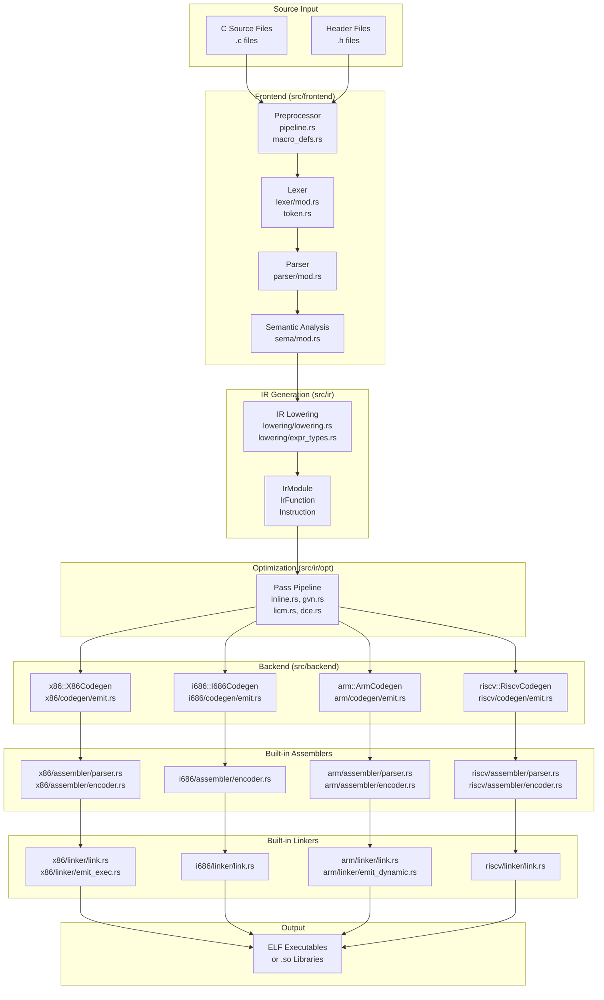
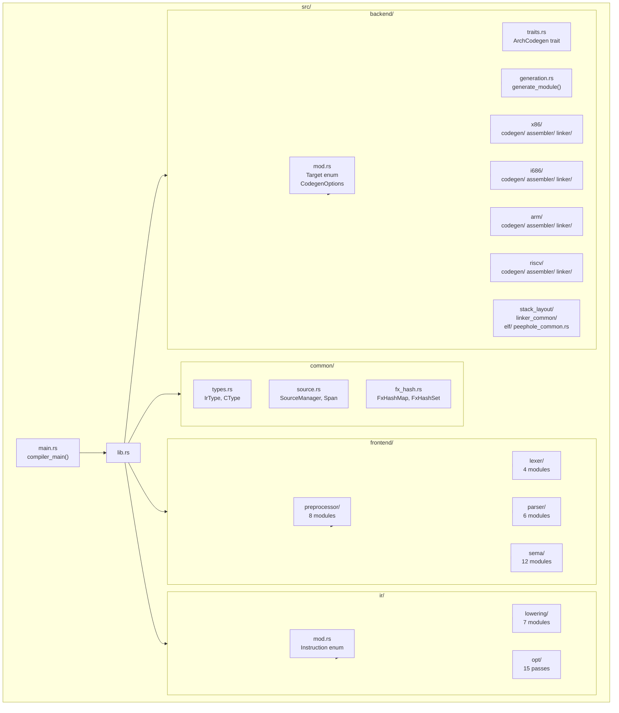
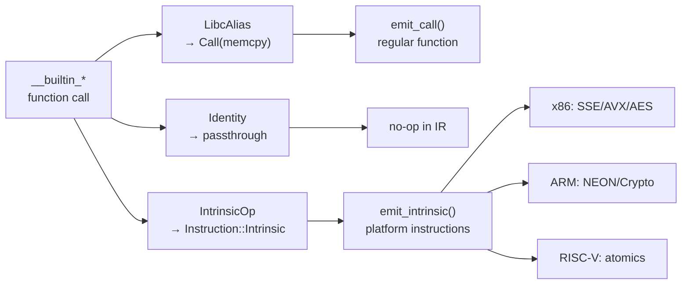

<!-- source: DeepWiki mcp.deepwiki.com · repo anthropics/claudes-c-compiler · page 1 Overview · fetched 2026-10-26 -->

# Overview

Relevant source files

The following files were used as context for generating this wiki page:

- [ideas/new_projects_myasm.txt](ideas/new_projects_myasm.txt)
- [src/backend/README.md](src/backend/README.md)
- [src/backend/arm/linker/README.md](src/backend/arm/linker/README.md)
- [src/backend/arm/linker/elf.rs](src/backend/arm/linker/elf.rs)
- [src/backend/arm/linker/mod.rs](src/backend/arm/linker/mod.rs)
- [src/backend/common.rs](src/backend/common.rs)
- [src/backend/mod.rs](src/backend/mod.rs)
- [src/backend/state.rs](src/backend/state.rs)
- [src/backend/x86/linker/README.md](src/backend/x86/linker/README.md)
- [src/backend/x86/linker/elf.rs](src/backend/x86/linker/elf.rs)
- [src/backend/x86/linker/mod.rs](src/backend/x86/linker/mod.rs)
- [src/frontend/lexer/token.rs](src/frontend/lexer/token.rs)
- [src/frontend/preprocessor/conditionals.rs](src/frontend/preprocessor/conditionals.rs)
- [src/frontend/preprocessor/macro_defs.rs](src/frontend/preprocessor/macro_defs.rs)
- [src/frontend/preprocessor/mod.rs](src/frontend/preprocessor/mod.rs)
- [src/main.rs](src/main.rs)

## Purpose and Scope

Claude's C Compiler (CCC) is a complete, self-contained C compiler toolchain implemented in Rust. Unlike typical compilers that rely on external tools like GCC or system linkers, CCC includes its own assembler and linker for all four target architectures (x86-64, i686, AArch64, RISC-V 64). The system transforms C source files into executable ELF binaries through a multi-stage pipeline: preprocessing, lexing, parsing, semantic analysis, IR lowering, optimization, code generation, assembly, and linking.

This page provides a high-level overview of the entire system. For detailed information about specific subsystems, see:
- Frontend components: [Frontend](#2), [Preprocessor](#2.1), [Lexer and Parser](#2.2), [Semantic Analysis](#2.3)
- IR and lowering: [IR and Lowering](#3)
- Optimization: [Optimization Passes](#4)
- Code generation: [Backend Code Generation](#5)
- Toolchain integration: [Toolchain Integration](#7)

**Sources:** [ideas/new_projects_myasm.txt:1-291](), [src/backend/README.md:1-464](), [src/backend/mod.rs:1-388]()

## System Architecture

The compiler consists of seven major subsystems that transform C source code into executable binaries:

**Sources:** [src/backend/README.md:14-82](), [src/backend/mod.rs:1-388]()

## Supported Targets

CCC supports four architectures with complete toolchain integration:

| Target | Triple | ABI | Pointer Size | Notes |
|--------|--------|-----|--------------|-------|
| **x86-64** | `x86_64-linux-gnu` | System V AMD64 | 64-bit | REX/VEX/EVEX encoding, RIP-relative addressing |
| **i686** | `i686-linux-gnu` | i386 System V (cdecl) | 32-bit | Severe register pressure (6 GP regs), stack-based struct returns |
| **AArch64** | `aarch64-linux-gnu` | AAPCS64 | 64-bit | Fixed 32-bit instructions, ADRP/ADD pairs, HFA detection |
| **RISC-V 64** | `riscv64-linux-gnu` | LP64D | 64-bit | Immediate splitting, RV64C compression, relaxation hints |

Each target has its own dynamic linker path and implicit library search paths, configured in [src/backend/mod.rs:130-219](). The `Target` enum ([src/backend/mod.rs:121-128]()) dispatches code generation, assembly, and linking operations to the appropriate backend modules.

**Sources:** [src/backend/mod.rs:121-289](), [src/backend/common.rs:24-480]()

## Complete Compilation Pipeline

The following diagram shows the detailed pipeline with concrete code entities:

```mermaid
graph TB
    subgraph SOURCE["1. Source Files"]
        FILES["main.c, utils.c<br/>stdio.h, stdlib.h"]
    end
    
    subgraph PREPROCESS["2. Preprocessing<br/>(preprocessor/pipeline.rs)"]
        STRIP["strip_comments()<br/>splice_lines()"]
        MACRO["MacroTable::expand_line()<br/>macro_defs.rs"]
        COND["ConditionalStack<br/>conditionals.rs"]
        INC["resolve_include()<br/>includes.rs"]
    end
    
    subgraph LEX["3. Lexing<br/>(lexer/mod.rs)"]
        SCAN["scan_token()<br/>Token, TokenKind"]
    end
    
    subgraph PARSE["4. Parsing<br/>(parser/mod.rs)"]
        DECL["parse_external_declaration()<br/>parse_declarator()"]
        AST["TranslationUnit<br/>ExternalDecl<br/>Stmt, Expr"]
    end
    
    subgraph SEMA["5. Semantic Analysis<br/>(sema/mod.rs)"]
        TYPECHECK["ExprTypeChecker<br/>type_inference.rs"]
        SYMRES["SymbolTable<br/>scope management"]
        CONSTEVAL["SemaConstEval<br/>const_eval.rs"]
    end
    
    subgraph LOWER["6. IR Lowering<br/>(ir/lowering)"]
        CTYPE["CType → IrType<br/>expr_types.rs"]
        EXPRLOWER["lower_expr()<br/>lowering.rs:1850-2950"]
        STMTLOWER["lower_compound_stmt()<br/>lowering.rs:3100-3500"]
        ABI["CallAbi classification<br/>backend/call_abi.rs"]
    end
    
    subgraph IROUT["7. IR Output"]
        MODULE["IrModule<br/>functions: Vec<IrFunction><br/>globals: Vec<IrGlobal>"]
        FUNC["IrFunction<br/>blocks: Vec<BasicBlock><br/>instructions: Vec<Instruction>"]
    end
    
    subgraph OPT["8. Optimization<br/>(ir/opt)"]
        INLINE["inline.rs<br/>budget-based inlining"]
        GVN["gvn.rs<br/>common subexpression"]
        LICM["licm.rs<br/>loop-invariant hoisting"]
        DCE["dce.rs<br/>dead code elimination"]
    end
    
    subgraph CODEGEN["9. Code Generation<br/>(backend)"]
        TRAIT["ArchCodegen trait<br/>traits.rs"]
        REGALLOC["Linear scan<br/>regalloc.rs"]
        STACK["Stack layout<br/>stack_layout/"]
        EMIT["emit_prologue()<br/>emit_instruction()<br/>emit_epilogue()"]
    end
    
    subgraph PEEP["10. Peephole<br/>(*/codegen/peephole)"]
        PASSES["Local passes x8<br/>Global pass x1<br/>Cleanup x4"]
    end
    
    subgraph ASM["11. Assembly<br/>(*/assembler)"]
        PARSER["parse_asm()<br/>AsmItem IR"]
        ENCODER["encode_instruction()<br/>binary encoding"]
        ELFOBJ["write_elf_object()<br/>.o file"]
    end
    
    subgraph LINKER["12. Linking<br/>(*/linker)"]
        LOAD["load_file()<br/>parse ELF/archive"]
        RESOLVE["register_symbols()<br/>GlobalSymbol map"]
        MERGE["merge_sections()<br/>OutputSection list"]
        PLTGOT["create_plt_got()<br/>PLT/GOT entries"]
        RELOC["apply_relocations()<br/>R_*_* types"]
        OUTPUT["emit_executable()<br/>ELF file"]
    end
    
    subgraph FINAL["13. Output"]
        EXE["a.out<br/>ELF executable"]
    end
    
    FILES --> STRIP
    STRIP --> MACRO
    MACRO --> COND
    COND --> INC
    INC --> SCAN
    SCAN --> DECL
    DECL --> AST
    AST --> TYPECHECK
    TYPECHECK --> SYMRES
    SYMRES --> CONSTEVAL
    CONSTEVAL --> CTYPE
    CTYPE --> EXPRLOWER
    EXPRLOWER --> STMTLOWER
    STMTLOWER --> ABI
    ABI --> MODULE
    MODULE --> FUNC
    FUNC --> INLINE
    INLINE --> GVN
    GVN --> LICM
    LICM --> DCE
    DCE --> TRAIT
    TRAIT --> REGALLOC
    REGALLOC --> STACK
    STACK --> EMIT
    EMIT --> PASSES
    PASSES --> PARSER
    PARSER --> ENCODER
    ENCODER --> ELFOBJ
    ELFOBJ --> LOAD
    LOAD --> RESOLVE
    RESOLVE --> MERGE
    MERGE --> PLTGOT
    PLTGOT --> RELOC
    RELOC --> OUTPUT
    OUTPUT --> EXE
```

**Sources:** [src/backend/README.md:14-98](), [src/frontend/preprocessor/pipeline.rs:1-50](), [src/backend/generation.rs:1-100]()

## Component Organization

The codebase is organized into focused subsystems with clear boundaries:

**Sources:** [src/backend/README.md:101-220](), [src/backend/mod.rs:1-50]()

## Key Design Principles

### 1. Self-Contained Toolchain

CCC includes built-in assemblers and linkers for all targets, eliminating external dependencies. The assembler implements a three-stage pipeline:

| Stage | Modules | Responsibility |
|-------|---------|----------------|
| **Parsing** | `*/assembler/parser.rs` | GAS syntax parsing, macro expansion, `.rept`/`.if` conditionals |
| **Encoding** | `*/assembler/encoder.rs` | Instruction encoding (REX/VEX for x86, fixed-width for ARM/RISC-V) |
| **ELF Writing** | `*/assembler/*.rs` | Object file generation, relocation emission, symbol tables |

The linker shares ~80% of code through `linker_common` module, with architecture-specific relocation application and PLT/GOT construction.

**Sources:** [src/backend/README.md:1-11](), [ideas/new_projects_myasm.txt:1-291]()

### 2. Unified Backend Framework

The `ArchCodegen` trait ([src/backend/traits.rs]()) defines ~185 methods with ~64 default implementations. Backends share:

- **Stack layout**: Three-tier slot allocation ([src/backend/stack_layout/mod.rs]())
- **Register allocation**: Linear scan with loop-depth weighting ([src/backend/regalloc.rs]())
- **Code generation**: Common instruction dispatch ([src/backend/generation.rs]())
- **ABI handling**: Unified parameter classification ([src/backend/call_abi.rs]())

This design enables ~90% code reuse across architectures while allowing platform-specific optimizations.

**Sources:** [src/backend/README.md:222-320](), [src/backend/traits.rs:1-100]()

### 3. Multi-Phase Optimization

The optimization pipeline ([src/ir/opt/]()) uses a sophisticated strategy:

| Phase | Passes | Purpose |
|-------|--------|---------|
| **Phase 0** | `inline.rs` + cleanup | Budget-based inlining (800 instructions), `always_inline` priority |
| **Phase 0.5** | `is_constant.rs` | `__builtin_constant_p` resolution |
| **Main Loop** | `gvn.rs`, `licm.rs`, `ivsr.rs`, `dce.rs`, `ipcp.rs` | Iterative optimization (up to 3 iterations) |
| **Phase 11** | Dead static elimination | Remove unused `static` functions |

The loop uses **dirty tracking** to skip converged functions and terminates on fixed point or diminishing returns (<5% of iteration 0 changes).

**Sources:** [src/backend/README.md:14-82](), [src/ir/opt/]()

### 4. Comprehensive Builtin Support

The compiler supports 1000+ GCC builtins via three-tier classification:

Hardware intrinsics are mapped to native instructions: 300+ SSE/AVX/AES on x86, full NEON support on ARM, atomic operations on RISC-V.

**Sources:** [src/ir/lowering/expr_builtins.rs:1-100](), [src/backend/README.md:14-82]()

## Validation and Testing

CCC has been validated by successfully building and testing 200+ real-world projects:

| Category | Projects | Notable Examples |
|----------|----------|------------------|
| **Core Libraries** | 50+ | zlib, bzip2, xz, lz4, zstd, sqlite |
| **Compilers** | 12 | 8cc, chibicc, cproc, lacc, lcc, pcc, vbcc |
| **Interpreters** | 10 | CPython, Lua, MicroPython, MuJS, QuickJS |
| **Media** | 8 | FFmpeg (7,331 tests), libjpeg, libpng, libvorbis |
| **Networking** | 15 | curl, nginx, haproxy, openssh, dropbear |
| **Databases** | 5 | PostgreSQL, redis, gdbm, lmdb, unqlite |
| **Crypto** | 12 | bearssl, mbedtls, nettle, tweetnacl, wolfssl |

FFmpeg is particularly significant: all libraries compile successfully and all 7,331 checkasm tests pass on x86-64 and AArch64 using the standalone assembler and linker.

**Sources:** [ideas/new_projects_myasm.txt:1-291]()

## Performance Characteristics

The compiler balances compilation speed with output quality:

| Optimization | Implementation | Impact |
|--------------|----------------|--------|
| **Macro expansion** | Byte-slice scanning, FxHashMap | ~3x faster than `HashMap<String, String>` |
| **Register allocation** | Loop-depth weighting, callee-saved priority | 10^D weight for loop depth D |
| **Stack layout** | Three-tier packing (alloca/liveness/block-local) | ~40% frame size reduction |
| **Peephole optimization** | Multi-pass with fixed point | 8 local + 1 global + 4 cleanup passes |
| **Dirty tracking** | Per-function change detection | Skip converged functions in opt loop |

The `AsmOutput` buffer ([src/backend/common.rs:742-900]()) uses fast-path emitters that avoid `core::fmt` overhead for common patterns like `movq $imm, %reg`.

**Sources:** [src/backend/common.rs:742-900](), [src/backend/README.md:464-580]()

## Entry Point and Driver

The main entry point is [src/main.rs:1-4](), which calls `compiler_main()` from the library. The driver ([src/lib.rs]()) orchestrates the entire pipeline:

1. Parse command-line arguments (GCC-compatible flags)
2. Invoke preprocessor on each source file
3. Lex and parse to produce AST
4. Run semantic analysis
5. Lower to IR
6. Run optimization passes
7. Generate assembly via `Target::generate_assembly_with_opts_and_debug()` ([src/backend/mod.rs:293-340]())
8. Assemble via `Target::assemble_with_extra()` ([src/backend/mod.rs:347-371]())
9. Link via `Target::link_with_args()` ([src/backend/mod.rs:384-386]())

The `Target` enum ([src/backend/mod.rs:121-128]()) and `CodegenOptions` struct ([src/backend/mod.rs:35-118]()) control architecture-specific behavior and code generation flags (PIC, retpoline, CET, patchable entry, etc.).

**Sources:** [src/main.rs:1-4](), [src/backend/mod.rs:121-388]()

---

