<!-- source: DeepWiki mcp.deepwiki.com · repo anthropics/claudes-c-compiler · page 8.3 Constant Evaluation · fetched 2026-10-26 -->

# Constant Evaluation

<details>
<summary>Relevant source files</summary>

The following files were used as context for generating this wiki page:

- [ideas/new_projects.txt](ideas/new_projects.txt)
- [src/common/const_arith.rs](src/common/const_arith.rs)
- [src/common/long_double.rs](src/common/long_double.rs)
- [src/frontend/preprocessor/README.md](src/frontend/preprocessor/README.md)
- [src/frontend/preprocessor/includes.rs](src/frontend/preprocessor/includes.rs)
- [src/frontend/preprocessor/utils.rs](src/frontend/preprocessor/utils.rs)
- [src/frontend/sema/const_eval.rs](src/frontend/sema/const_eval.rs)
- [src/frontend/sema/type_checker.rs](src/frontend/sema/type_checker.rs)
- [src/ir/lowering/complex.rs](src/ir/lowering/complex.rs)
- [src/ir/lowering/const_eval.rs](src/ir/lowering/const_eval.rs)
- [src/ir/lowering/expr_calls.rs](src/ir/lowering/expr_calls.rs)
- [src/ir/lowering/expr_types.rs](src/ir/lowering/expr_types.rs)
- [src/ir/lowering/global_init.rs](src/ir/lowering/global_init.rs)
- [src/ir/lowering/global_init_bytes.rs](src/ir/lowering/global_init_bytes.rs)
- [src/ir/lowering/global_init_compound.rs](src/ir/lowering/global_init_compound.rs)
- [src/ir/lowering/stmt_init.rs](src/ir/lowering/stmt_init.rs)
- [src/ir/lowering/stmt_return.rs](src/ir/lowering/stmt_return.rs)

</details>


Constant evaluation performs compile-time arithmetic and type operations on constant expressions, enabling optimizations like constant folding and supporting C's requirement for compile-time constant expressions in array sizes, case labels, and global initializers. The compiler implements a **two-phase evaluation architecture**: sema pre-computes constants during semantic analysis and stores them in a memoization cache, while the lowerer handles IR-specific cases like global address arithmetic and consults sema's cache as an O(1) fast path.

This page covers compile-time constant expression evaluation. For runtime complex number arithmetic, see [Complex Number Support](#8.1). For long double precision handling, see [Long Double Handling](#8.2).

---

## Two-Phase Evaluation Architecture

Constant evaluation is split between the semantic analyzer (sema) and the IR lowerer to separate concerns and prevent duplicate work:

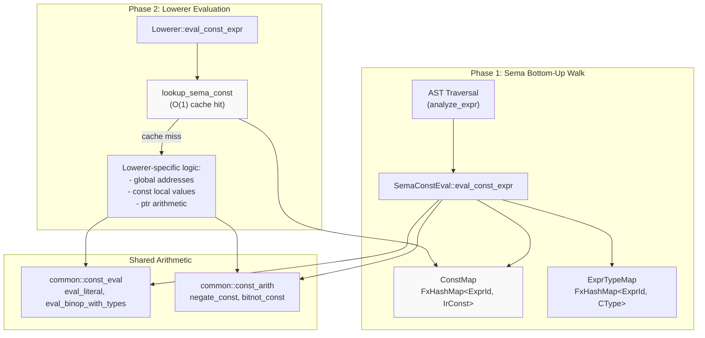

**Why Two Phases?**

| Concern | Solution |
|---------|----------|
| Exponential blowup on deep expression trees | Sema memoizes results in `ConstMap` during bottom-up walk |
| IR-specific state (globals, allocas) | Lowerer handles cases requiring IR metadata |
| Code duplication | Both delegate arithmetic to `common::const_arith` |
| Type information | Sema uses `CType`, lowerer uses `IrType`, but both produce `IrConst` |

**Sources:** [src/frontend/sema/const_eval.rs:1-68](), [src/ir/lowering/const_eval.rs:1-24](), [src/ir/lowering/const_eval.rs:65-87]()

---

## Evaluation Entry Points

### Sema Entry Point: `SemaConstEval::eval_const_expr`

The semantic analyzer evaluates constants using only sema-available state (no IR):

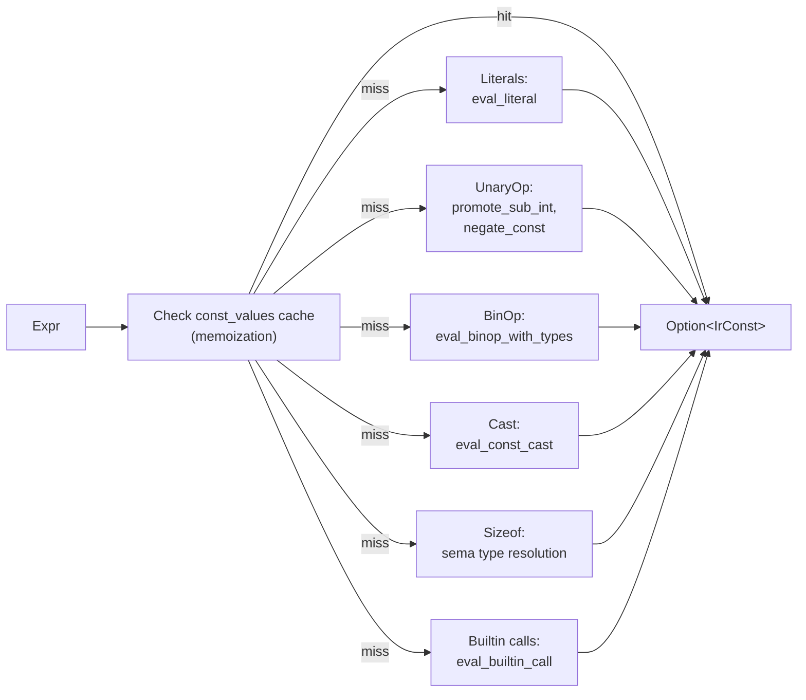

**Key State:**
- `types: &TypeContext` – typedef, enum, struct layout resolution
- `symbols: &SymbolTable` – variable type lookup
- `functions: &FxHashMap<String, FunctionInfo>` – return types for `sizeof(func())`
- `const_values: Option<&ConstMap>` – memoization cache (prevents exponential blowup)
- `expr_types: Option<&ExprTypeMap>` – type cache (prevents re-traversal)

**Sources:** [src/frontend/sema/const_eval.rs:49-68](), [src/frontend/sema/const_eval.rs:70-255]()

### Lowerer Entry Point: `Lowerer::eval_const_expr`

The IR lowerer handles all constant evaluation during code generation:

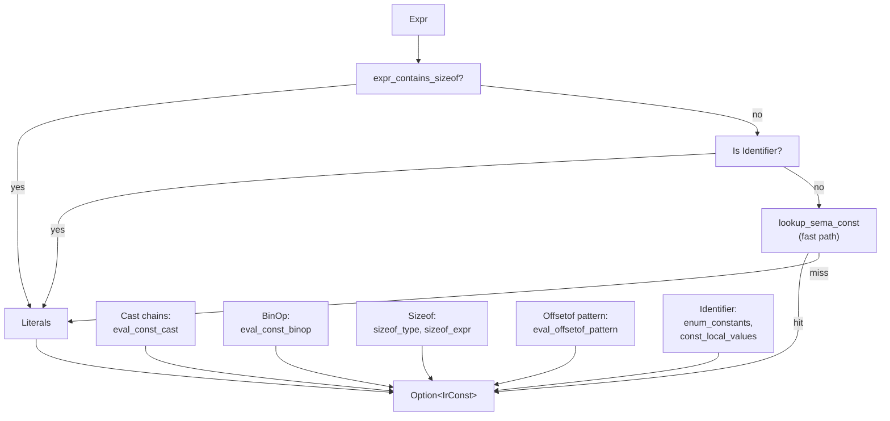

**Why Skip Sema Lookup for Sizeof?**

Sema evaluates `sizeof(unsized_array)` before the lowerer resolves the actual array size from its initializer. For example, `int arr[] = {1,2,3}` has `sizeof(arr)` initially unknown to sema but correctly computed as 12 by the lowerer after analyzing the initializer.

**Sources:** [src/ir/lowering/const_eval.rs:26-87](), [src/ir/lowering/const_eval.rs:178-184]()

---

## Integer Constant Folding

Integer constant evaluation respects C's width and signedness semantics:

### Width and Signedness Handling

The `eval_const_binop_int` function uses explicit width/signedness parameters to implement C11 usual arithmetic conversions:

| Operation | Caller Responsibility | Shared Function Behavior |
|-----------|----------------------|--------------------------|
| Sema | Derive from `CType`: `(ctype_size(&ct) <= 4, ct.is_unsigned())` | Apply C semantics with given width/sign |
| Lowering | Derive from `IrType`: `(ir_ty.size() <= 4, ir_ty.is_unsigned())` | Apply C semantics with given width/sign |

**Example: `(1 << 31) / N`**

Without proper width tracking, the shift produces 64-bit `0x0000000080000000` (positive), but C semantics require 32-bit `0x80000000` (INT_MIN = -2147483648). The result width affects division signedness:

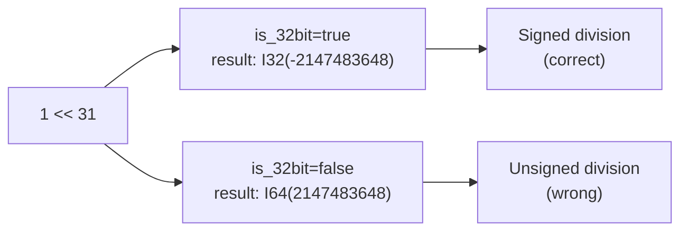

**Result Type Preservation:**

Results are stored with proper width to enable correct type inference in downstream operations:
- 32-bit unsigned: `IrConst::I64(result as u32 as i64)` (zero-extension to avoid sign issues)
- 32-bit signed: `IrConst::I32(result as i32)`
- 64-bit: `IrConst::I64(result)`

**Sources:** [src/common/const_arith.rs:47-139](), [src/ir/lowering/const_eval.rs:104-117]()

### Sub-Integer Promotion

C promotes types smaller than `int` to `int` before arithmetic. The `promote_sub_int` helper handles this:

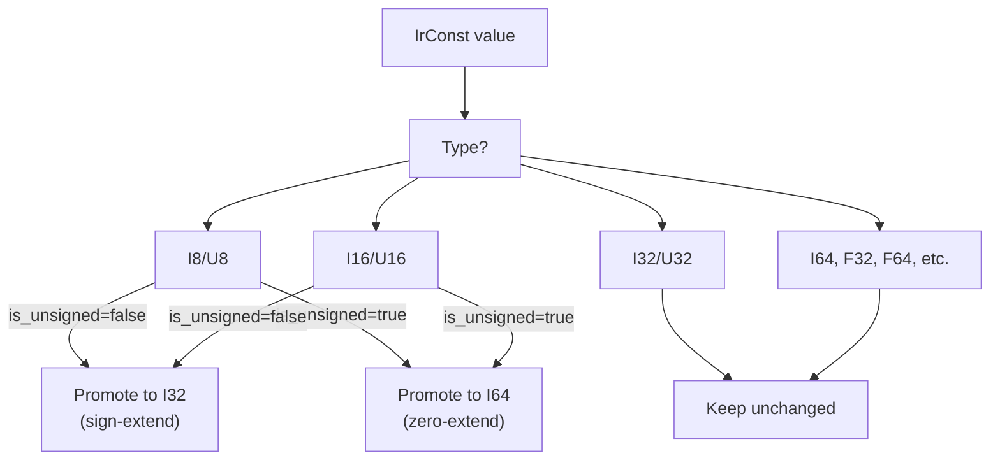

**Sources:** [src/common/const_eval.rs:180-197]()

---

## Floating-Point Constant Folding

### Three Float Precisions

The compiler supports three floating-point precisions with distinct constant representations:

| Type | IR Representation | Arithmetic Implementation |
|------|------------------|---------------------------|
| `float` | `IrConst::F32(f32)` | Native Rust `f32` operations |
| `double` | `IrConst::F64(f64)` | Native Rust `f64` operations |
| `long double` | `IrConst::LongDouble(f64, [u8; 16])` | Software f128 arithmetic (via `long_double.rs`) |

**Long Double Precision Storage:**

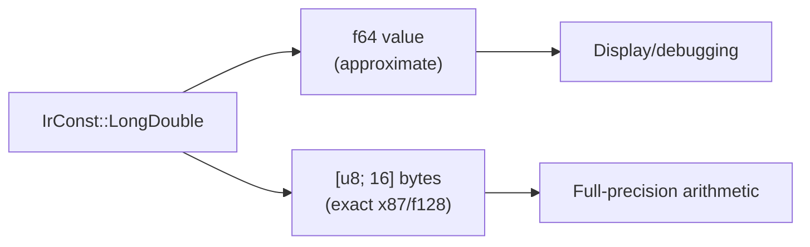

The `f64` field provides fast approximate values for display, while the byte array preserves full x87 80-bit or IEEE binary128 precision for arithmetic.

**Sources:** [src/common/const_arith.rs:142-242]()

### Architecture-Aware Long Double Arithmetic

Long double operations dispatch to architecture-specific implementations:

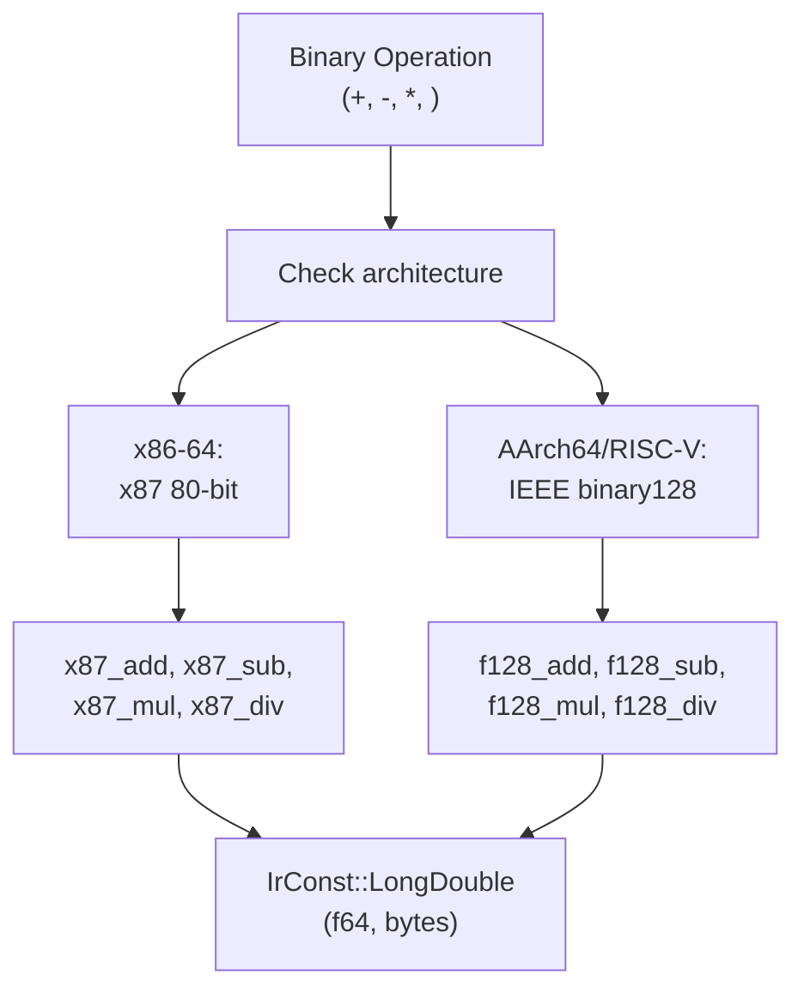

**Sources:** [src/common/const_arith.rs:195-242](), [src/common/long_double.rs:1-21]()

---

## Cast Chain Evaluation

Cast expressions require careful bit-width and signedness tracking to preserve C semantics through multiple casts:

### Bit-Based Cast Evaluation

The lowerer uses `eval_const_expr_as_bits` to track raw bit patterns through cast chains:

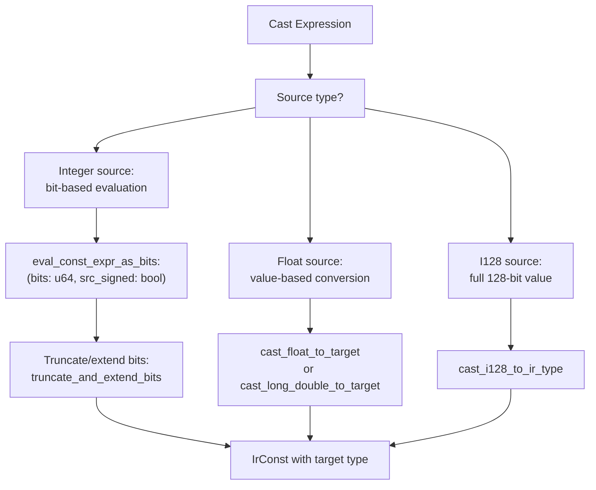

**Example Cast Chain:**

```
(unsigned char)((int)((unsigned int)0xFFFFFFFF))
```

1. `0xFFFFFFFF` as `unsigned int` → bits: `0x00000000FFFFFFFF`, signed: `false`
2. Cast to `int` → truncate to 32 bits, re-interpret as signed → bits: `0x00000000FFFFFFFF`, signed: `true`
3. Cast to `unsigned char` → truncate to 8 bits, zero-extend → bits: `0x00000000000000FF`, signed: `false`
4. Final result: `IrConst::I64(255)`

**Sources:** [src/ir/lowering/const_eval.rs:257-294](), [src/common/const_arith.rs:245-267]()

---

## Special Evaluation Cases

### Sizeof Expression Evaluation

The lowerer's `sizeof` evaluation differs from sema's because it has access to resolved array dimensions from initializers:

| Case | Sema Behavior | Lowerer Behavior |
|------|--------------|------------------|
| `sizeof(int)` | Computes from `CType` | Computes from `TypeSpecifier` |
| `sizeof(arr)` where `int arr[] = {1,2,3}` | Unknown (unsized array) | `12` (3 elements × 4 bytes) |
| `sizeof(expr)` | Uses inferred `CType` | Uses `get_expr_ctype` with global metadata |

**Sources:** [src/ir/lowering/const_eval.rs:178-184](), [src/ir/lowering/expr_types.rs:768-1277]()

### Offsetof Pattern Recognition

The compiler recognizes the common offsetof pattern `&((type*)0)->member` and evaluates it at compile time:

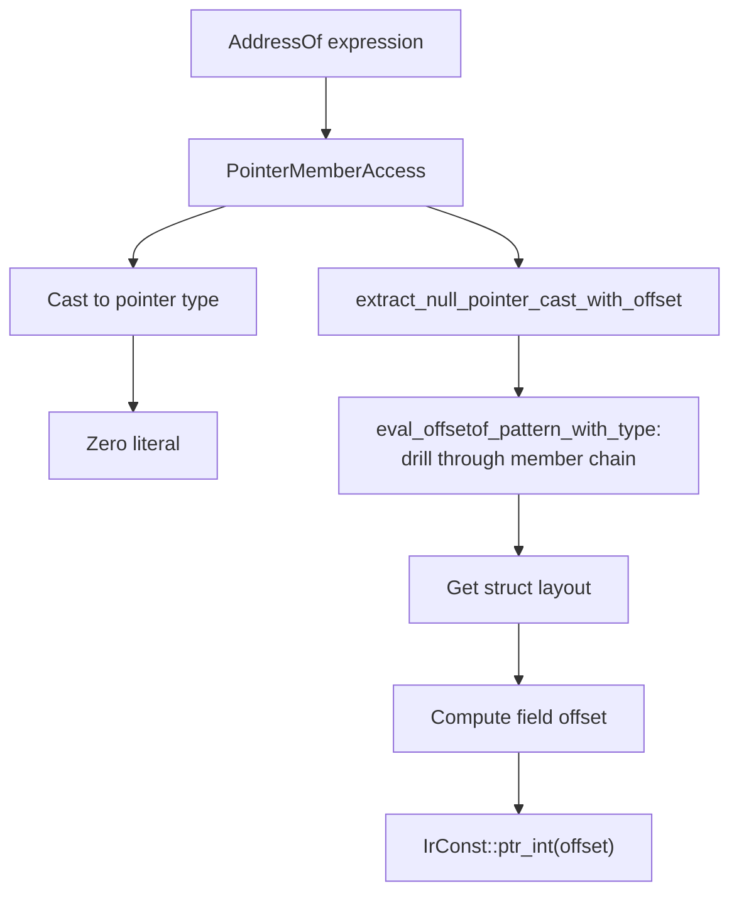

**Nested Member Access:**

For patterns like `&((type*)0)->data.x`, the drill function recursively walks the member chain, accumulating byte offsets and tracking bitfield information.

**Sources:** [src/ir/lowering/const_eval.rs:383-439]()

### Pointer Difference Evaluation

Constant pointer differences between global addresses are evaluated by `eval_const_ptr_diff`:

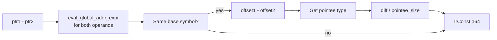

**Example:**
```c
struct S { int a; char b; int c; };
struct S s;
ptrdiff_t diff = (char*)&s.c - (char*)&s.a;  // Evaluates to 8
```

**Sources:** [src/ir/lowering/const_eval_global_addr.rs:174-242]()

---

## Memoization and Performance

### Exponential Blowup Prevention

Without memoization, evaluating deeply nested expressions like `1+1+1+...+1` (100 terms) would re-evaluate each sub-tree multiple times, causing O(2^N) complexity:

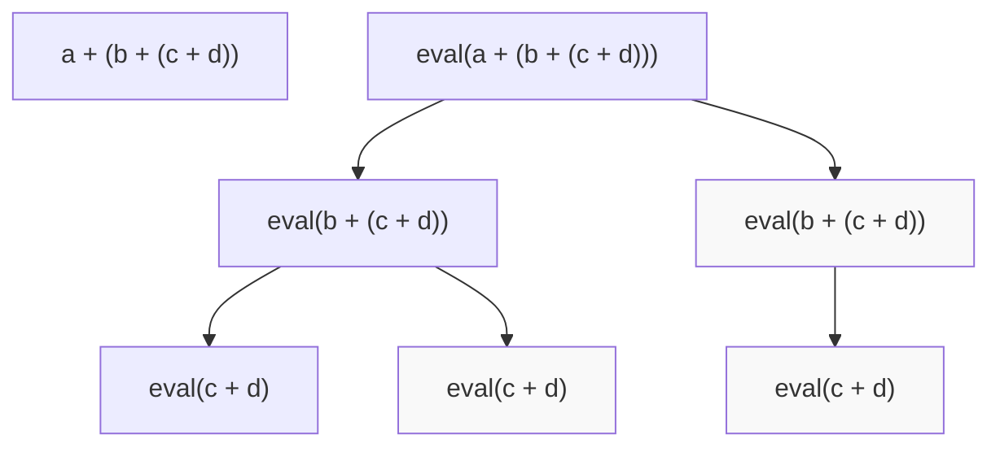

**Memoization Strategy:**


The `ExprId` type-safe wrapper ensures stable identity across AST nodes even when expressions are re-created during transformations.

**Sources:** [src/frontend/sema/const_eval.rs:42-47](), [src/ir/lowering/const_eval.rs:28-32]()

### Cache Structure

| Cache | Key Type | Value Type | Purpose |
|-------|----------|-----------|---------|
| `ConstMap` | `ExprId` | `IrConst` | Memoized constant values |
| `ExprTypeMap` | `ExprId` | `CType` | Memoized expression types (used for signedness/width inference) |

Both caches are populated during sema's bottom-up AST walk and passed immutably to const evaluation functions.

**Sources:** [src/frontend/sema/const_eval.rs:42-47](), [src/frontend/sema/type_checker.rs:35-44]()

---

## Shared Arithmetic Primitives

To ensure consistency between sema and lowering evaluation, all arithmetic operations delegate to shared functions in `common::const_arith`:

### Arithmetic Function Dispatch

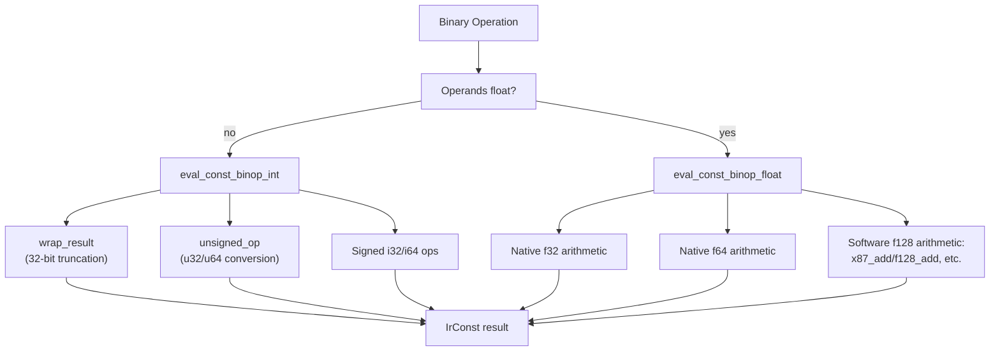

**Shared Functions:**

| Function | Purpose | Used By |
|----------|---------|---------|
| `eval_literal` | Parse literal expressions to `IrConst` | Sema, Lowering |
| `eval_binop_with_types` | Binary operation with explicit width/sign | Sema, Lowering |
| `eval_builtin_call` | Constant builtin function evaluation | Sema, Lowering |
| `promote_sub_int` | Sub-integer to int promotion | Sema, Lowering |
| `negate_const`, `bitnot_const` | Unary operations | Sema, Lowering |
| `truncate_and_extend_bits` | Cast bit manipulation | Lowering only |

**Sources:** [src/common/const_arith.rs:1-10](), [src/common/const_eval.rs:1-197]()

---

## Architecture-Specific Behavior

### Target-Dependent Integer Sizes

Constant evaluation respects the target architecture's type sizes:

| Type | ILP32 (i686) | LP64 (x86-64, AArch64, RISC-V) |
|------|--------------|-------------------------------|
| `int` | 32-bit | 32-bit |
| `long` | 32-bit | 64-bit |
| `long long` | 64-bit | 64-bit |
| `void*` | 32-bit | 64-bit |

**Example: Literal Type Inference**

```c
// On i686:
1000000000L     // Fits in 32-bit long → CType::Long
2147483648L     // Exceeds 32-bit, promotes to long long → CType::LongLong

// On x86-64:
1000000000L     // Fits in 64-bit long → CType::Long
2147483648L     // Fits in 64-bit long → CType::Long
```

**Sources:** [src/ir/lowering/const_eval.rs:676-707](), [src/frontend/sema/type_checker.rs:92-137]()

### Long Double Format

Long double arithmetic uses architecture-specific software implementations:

| Architecture | Format | Mantissa Bits | Exponent Bias | Implementation |
|--------------|--------|--------------|---------------|----------------|
| x86-64 | x87 extended precision | 64 (explicit) | 16383 | `x87_add`, `x87_mul`, etc. |
| i686 | x87 extended precision | 64 (explicit) | 16383 | `x87_add`, `x87_mul`, etc. |
| AArch64 | IEEE binary128 | 112 (implicit) | 16383 | `f128_add`, `f128_mul`, etc. |
| RISC-V | IEEE binary128 | 112 (implicit) | 16383 | `f128_add`, `f128_mul`, etc. |

Both formats store results as `IrConst::LongDouble(f64, [u8; 16])` where the byte array contains the exact bit representation.

**Sources:** [src/common/long_double.rs:1-21](), [src/common/const_arith.rs:195-242]()