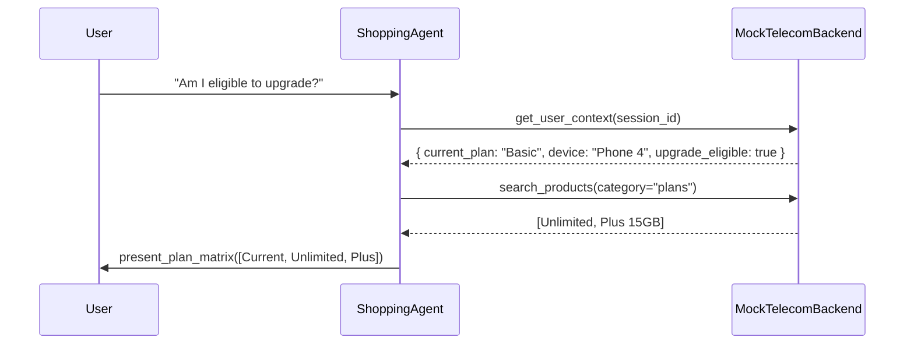
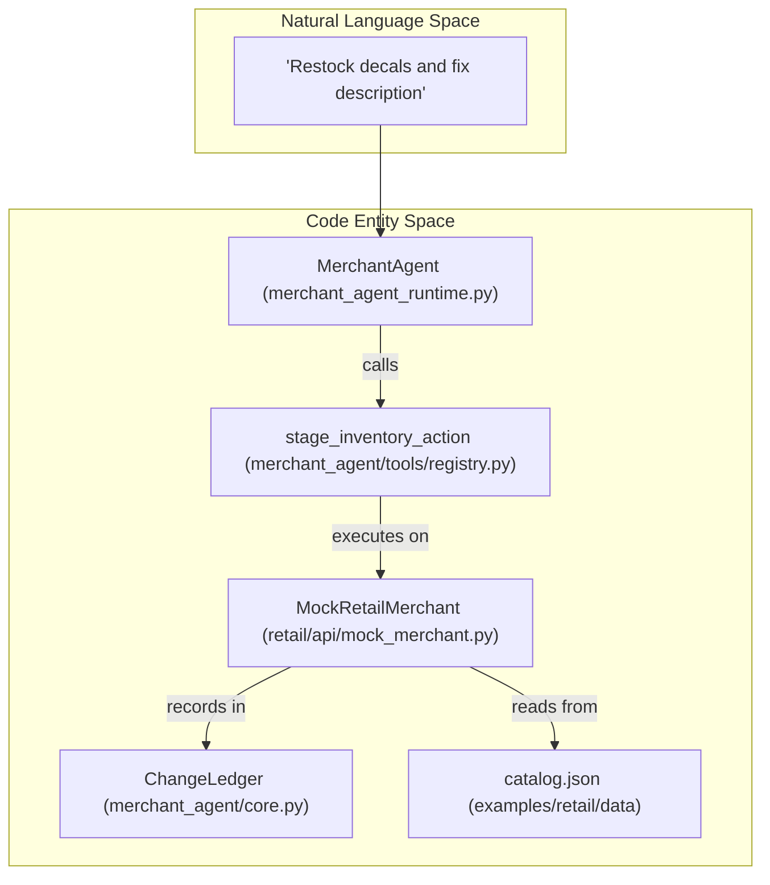
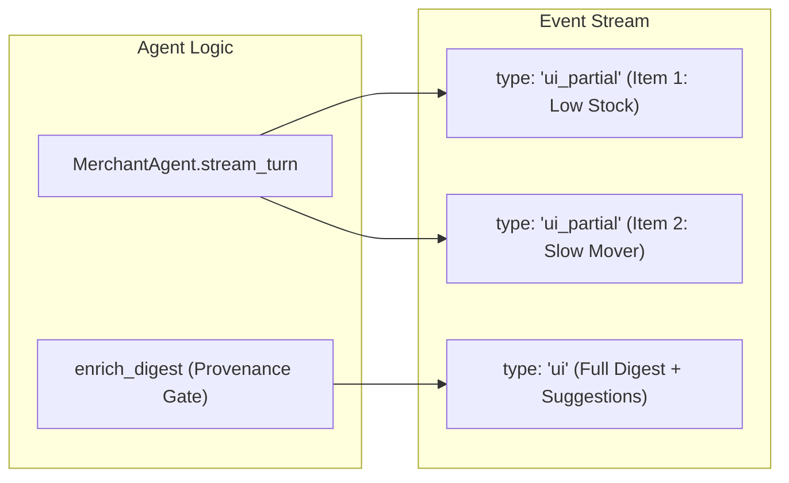

<!-- source: DeepWiki mcp.deepwiki.com · repo anthropics/commerce-agents · page 6.2 Vertical Implementations: Retail, Travel, Telecom, Entertainment · fetched 2026-10-26 -->

# Vertical Implementations: Retail, Travel, Telecom, Entertainment

Relevant source files

The following files were used as context for generating this wiki page:

- [commerce-common/commerce_common/manifest.py](commerce-common/commerce_common/manifest.py)
- [merchant-agent/managed-agents/scheduled-digest/README.md](merchant-agent/managed-agents/scheduled-digest/README.md)
- [merchant-agent/managed-agents/scheduled-digest/run_morning_digest.py](merchant-agent/managed-agents/scheduled-digest/run_morning_digest.py)
- [merchant-agent/runtime-messages-api/tests/test_orchestrator_partial.py](merchant-agent/runtime-messages-api/tests/test_orchestrator_partial.py)
- [merchant-agent/runtime-messages-api/tests/test_scheduled_digest.py](merchant-agent/runtime-messages-api/tests/test_scheduled_digest.py)
- [scripts/check.py](scripts/check.py)
- [scripts/deploy_managed_agent.sh](scripts/deploy_managed_agent.sh)
- [scripts/run_demo.py](scripts/run_demo.py)
- [scripts/screenshot_tour.py](scripts/screenshot_tour.py)
- [scripts/smoke_chat.py](scripts/smoke_chat.py)

This page details the four vertical examples provided in the reference implementation. Each vertical demonstrates a complete commerce lifecycle—from product discovery to checkout or merchant operations—using a specialized domain model, mock backend, and UI extensions.

## Architecture Overview

Each vertical follows a consistent structure within the `examples/` directory, implementing both a **Storefront** and a **Merchant** interface. The implementations leverage `demo_common` for shared host logic and provide vertical-specific extensions to the `PresentationComponent` system.

### Vertical Components
| Component | Description |
| :--- | :--- |
| **Mock Backend** | Python classes implementing `StorefrontBackend` and `MerchantBackend`. |
| **Fixture Data** | JSON files (`catalog.json`, `orders.json`, `policies.json`) defining the world state. |
| **API Layer** | FastAPI routes that bridge the web frontend to the Agent runtimes. |
| **Web Apps** | Next.js applications (Storefront and Merchant Portal) using `web-shared` components. |

**Sources:** [scripts/run_demo.py:44-54](), [scripts/smoke_chat.py:130-135]()

---

## 1. Retail Vertical (`retail`)
The Retail vertical is the baseline implementation, demonstrating high-volume physical goods commerce with complex inventory and durable memory.

### Unique Features
*   **Durable Memory:** Persists user facts (e.g., "niece turns nine next month") across restarts using local JSON files [scripts/run_demo.py:48-49]().
*   **Inventory Operations:** Demonstrates the `stage_inventory_action` tool for restocking and description updates [scripts/smoke_chat.py:151-157]().
*   **Product Variants:** Handles complex SKU mapping where a family (e.g., "Ocean Wall Decals") has multiple variants with distinct stock levels [scripts/check.py:191-201]().

### Mock Backend
*   `MockRetail`: Implements standard search and cart logic.
*   `MockRetailMerchant`: Implements the `MerchantBackend` for catalog and inventory management [merchant-agent/managed-agents/scheduled-digest/run_morning_digest.py:40-41]().

**Sources:** [scripts/run_demo.py:45-50](), [scripts/smoke_chat.py:38-57](), [scripts/screenshot_tour.py:29-63]()

---

## 2. Travel Vertical (`travel`)
The Travel vertical focuses on **date-bound inventory** and complex service attributes (e.g., refundability).

### Unique Features
*   **Itinerary Planning:** The agent uses `search_products` to build multi-day plans [scripts/smoke_chat.py:59-66]().
*   **Flexibility Comparisons:** Demonstrates side-by-side comparison of refundable vs. non-refundable stays, highlighting price deltas for flexibility [scripts/screenshot_tour.py:73-76]().
*   **Constraint-Based Memory:** Captures preferences like "always book refundable fares" to influence future searches [scripts/screenshot_tour.py:80-83]().

### Presentation Extensions
*   **`present_plan`**: Used to render day-by-day itineraries.
*   **`present_comparison`**: Specialized for comparing travel amenities and cancellation policies.

**Sources:** [scripts/smoke_chat.py:58-77](), [scripts/screenshot_tour.py:64-90]()

---

## 3. Telecom Vertical (`telecom`)
The Telecom vertical demonstrates **Account Context** and **Plan Matrices**, where the agent must reason about the user's current subscription.

### Unique Features
*   **Plan Matrix:** Renders complex grids of data limits, speeds, and pricing side-by-side [scripts/screenshot_tour.py:96-99]().
*   **Eligibility Logic:** Checks if a user is eligible for device upgrades (e.g., "ACME Phone 4") and calculates trade-in credits [scripts/smoke_chat.py:87-93]().
*   **Service Facts:** Uses `present_disclosure` to show official regulatory service labels and fee breakdowns [scripts/screenshot_tour.py:106-109]().

### Data Flow: Plan Upgrade

**Sources:** [scripts/smoke_chat.py:78-103](), [scripts/screenshot_tour.py:91-122]()

---

## 4. Entertainment Vertical (`entertainment`)
The Entertainment vertical showcases **Ticketing Engines** with real-time seat availability and fee transparency.

### Unique Features
*   **Venue Mapping:** The agent describes seat locations (e.g., "Lower Bowl" vs "Pit") and tier options [scripts/smoke_chat.py:104-113]().
*   **Fee Transparency:** Uses `present_disclosure` to provide a mandatory breakdown of face value vs. service fees before checkout [scripts/smoke_chat.py:114-121]().
*   **Checkout Holds:** Demonstrates temporary inventory locking ("Hold two tickets while I find my card") [scripts/screenshot_tour.py:146-150]().

### Presentation Extensions
*   **`present_disclosure`**: Critical for legal compliance in ticketing, showing the "all-in" price breakdown [scripts/smoke_chat.py:119]().

**Sources:** [scripts/smoke_chat.py:104-128](), [scripts/screenshot_tour.py:123-152]()

---

## Vertical Implementation Details

### Mock Backend Structure
All mock backends are initialized using fixture data located in `examples/<vertical>/data/`. The `scripts/check.py` utility ensures that all catalog IDs, variants, and order records are consistent across the vertical's data files.

### System Mapping: Natural Language to Code
The following diagram illustrates how a natural language request is routed through the vertical-specific implementation.

**Sources:** [scripts/check.py:44-53](), [merchant-agent/managed-agents/scheduled-digest/run_morning_digest.py:33-48](), [scripts/smoke_chat.py:151-157]()

### Morning Digest Implementation
The Merchant Agent includes a `run_morning_digest.py` script that demonstrates a headless implementation for any vertical. It defaults to the `retail` vertical's mock backend.

*   **Function:** `run_digest` [merchant-agent/managed-agents/scheduled-digest/run_morning_digest.py:51-82]()
*   **Input:** `DIGEST_PROMPT` ("Produce the morning digest...") [merchant-agent/managed-agents/scheduled-digest/run_morning_digest.py:30]()
*   **Output:** A JSON payload containing the text reply and the `present_digest` UI component [merchant-agent/managed-agents/scheduled-digest/run_morning_digest.py:77-82]().

### Presentation Partial Streaming
Verticals support partial UI updates during streaming. For example, a `present_digest` component will emit `ui_partial` events as items are generated.

**Sources:** [merchant-agent/runtime-messages-api/tests/test_orchestrator_partial.py:51-66](), [merchant-agent/managed-agents/scheduled-digest/run_morning_digest.py:70-76]()

---
**Sources:**
- `scripts/run_demo.py:44-65`
- `scripts/smoke_chat.py:37-135, 140-169`
- `scripts/screenshot_tour.py:28-152, 157-170`
- `scripts/check.py:32, 44-53, 182-201`
- `merchant-agent/managed-agents/scheduled-digest/run_morning_digest.py:30-82`
- `merchant-agent/runtime-messages-api/tests/test_orchestrator_partial.py:41-66, 85-118`
- `merchant-agent/runtime-messages-api/tests/test_scheduled_digest.py:49-65`

---

