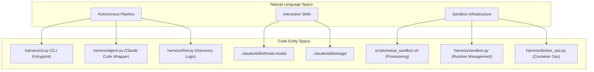
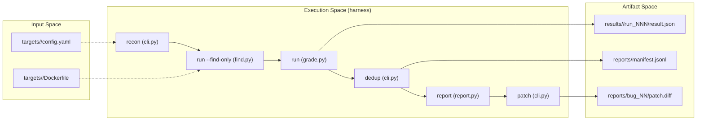

<!-- source: DeepWiki mcp.deepwiki.com · repo anthropics/defending-code-reference-harness · page 1 Overview · fetched 2026-10-26 -->

# Overview

Relevant source files

The following files were used as context for generating this wiki page:

- [.claude/skills/quickstart/SKILL.md](.claude/skills/quickstart/SKILL.md)
- [CLAUDE.md](CLAUDE.md)
- [README.md](README.md)
- [docs/agent-sandbox.md](docs/agent-sandbox.md)
- [docs/best-practices.md](docs/best-practices.md)
- [docs/patching.md](docs/patching.md)
- [docs/security.md](docs/security.md)
- [docs/troubleshooting.md](docs/troubleshooting.md)
- [harness/README.md](harness/README.md)

The **Defending Code Reference Harness** is a reference implementation for autonomous vulnerability discovery and remediation using Claude. It provides a multi-agent framework designed to find, verify, and patch security vulnerabilities (specifically memory corruption in C/C++ via ASAN) with high precision and low false-positive rates [README.md:1-18]().

The system is designed around the principle of **executable oracles**: it does not just produce prose reports of potential bugs, but generates crashing input files (PoCs) and verifies them in isolated environments [CLAUDE.md:22-27]().

### Operational Modes

The harness operates in two primary modes depending on the user's needs for interactivity and execution:

| Mode | Tools | Analysis Type | Primary Use Case |
| :--- | :--- | :--- | :--- |
| **Interactive Skills** | `.claude/skills/` | Static / File-based | Threat modeling, initial scanning, and human-in-the-loop triage [CLAUDE.md:5-12](). |
| **Autonomous Pipeline** | `harness/` | Dynamic / Execution | Autonomous find-verify-report-patch loops using Docker and ASAN [CLAUDE.md:13-15](). |

For a step-by-step guide on choosing and setting up these modes, see [Getting Started](#1.1).

### Key Concepts

#### The Two-Container Trust Boundary
To prevent agents from "hallucinating" success or being misled by their own previous actions, the harness enforces a strict boundary between discovery and verification. A **Find Agent** works in one container to produce a candidate; a **Grade Agent** then attempts to reproduce that candidate in a completely fresh, isolated container [docs/patching.md:5-7](), [docs/best-practices.md:123-126]().

#### Sandbox Isolation
The harness utilizes **gVisor** (`runsc`) to provide syscall-level isolation for agents executing target code. This ensures that even if an agent triggers a malicious payload or attempts an escape, the host system remains protected [docs/agent-sandbox.md:1-9](). For architectural details on this boundary, see [System Architecture](#1.2).

#### Natural Language to Code Entity Mapping
The following diagram illustrates how high-level system components map to specific code entities and files within the repository.

**System Component Mapping**

Sources: [CLAUDE.md:5-15](), [harness/README.md:161-162](), [docs/agent-sandbox.md:30-37](), [harness/sandbox.py:1-20]()

### Workflow: From Recon to Patch

The autonomous pipeline follows a structured lifecycle to ensure coverage and depth:

1.  **Recon**: An agent partitions the attack surface into `focus_areas` [harness/README.md:108-108]().
2.  **Find**: Parallel agents attempt to trigger ASAN crashes in their assigned areas [harness/README.md:59-61]().
3.  **Grade**: A fresh container verifies the reproducibility of the crash [harness/README.md:6-7]().
4.  **Judge/Dedup**: The system performs semantic deduplication to group crashes by root cause [harness/README.md:139-139]().
5.  **Report**: A detailed exploitability analysis is generated for unique bugs [harness/README.md:140-140]().
6.  **Patch**: A fix is generated and validated against a multi-tier "verification ladder" [docs/patching.md:85-99]().

**Pipeline Data Flow**

Sources: [CLAUDE.md:52-68](), [harness/README.md:56-66](), [docs/patching.md:50-53](), [harness/cli.py:1-50]()

### Next Steps

*   To set up your environment and run a smoke test, see **[Getting Started](#1.1)**.
*   For a deep dive into the security boundaries and multi-agent coordination, see **[System Architecture](#1.2)**.
*   To learn how to adapt the harness for a new language or project, refer to the **[Autonomous Pipeline](#2)** and **[Targets](#5)** documentation.

Sources: [README.md:1-55](), [CLAUDE.md:1-18](), [harness/README.md:1-17]()

---

