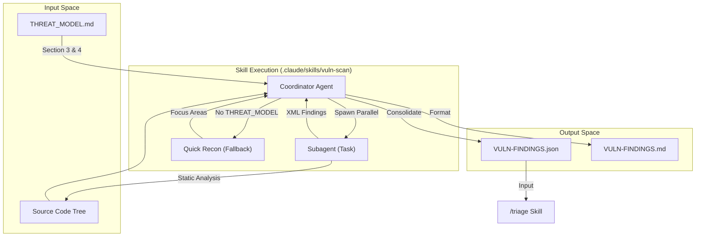
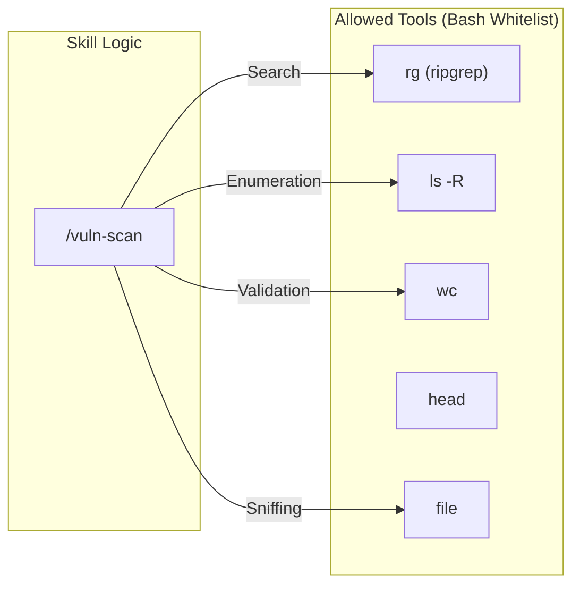

<!-- source: DeepWiki mcp.deepwiki.com · repo anthropics/defending-code-reference-harness · page 3.2 Vulnerability Scan Skill · fetched 2026-10-26 -->

# Vulnerability Scan Skill

Relevant source files

The following files were used as context for generating this wiki page:

- [.claude/skills/vuln-scan/SKILL.md](.claude/skills/vuln-scan/SKILL.md)
- [docs/other-use-cases.md](docs/other-use-cases.md)
- [docs/prompting.md](docs/prompting.md)

The `/vuln-scan` skill is an interactive Claude Code skill designed to perform static source-code vulnerability analysis on a target directory. Unlike the autonomous `vuln-pipeline`, which focuses on dynamic execution and PoC generation, `/vuln-scan` relies on static reasoning to identify candidate vulnerabilities across a broad range of classes, from memory safety to logic flaws [.claude/skills/vuln-scan/SKILL.md:4-10]().

It is scoped by a threat model (typically generated by `/threat-model`) and produces structured `VULN-FINDINGS.json` and human-readable `.md` files, which serve as the primary input for the `/triage` skill [.claude/skills/vuln-scan/SKILL.md:28-29]().

## Operational Overview

The skill operates in a read-only capacity. It is strictly prohibited from building, running, or probing the target code [.claude/skills/vuln-scan/SKILL.md:31-33](). Instead, it leverages a "Fan-out" architecture where a coordinator agent partitions the codebase into focus areas and spawns parallel subagents to conduct deep-dive reviews.

### Data Flow: Scan to Triage

The following diagram illustrates how the skill transforms raw source code and threat models into structured findings for the triage layer.

**Vulnerability Scan Data Flow**

Sources: [.claude/skills/vuln-scan/SKILL.md:28-29](), [.claude/skills/vuln-scan/SKILL.md:57-78]()

## Implementation Phases

### 1. Scoping and Reconnaissance
The skill first attempts to resolve the `<target-dir>`. If a `THREAT_MODEL.md` exists, it parses Section 3 ("Entry points & trust boundaries") and Section 4 ("Threats") to identify high-risk focus areas [.claude/skills/vuln-scan/SKILL.md:57-63]().

If no threat model is provided, the skill performs a **quick recon** phase. This involves:
* Enumerating the source tree using `ls -R` or `rg --files`.
* Reading entry points and dispatch logic.
* Proposing 3-10 focus areas following the pattern: `<subsystem> (<function/file>) — <key operations>` [.claude/skills/vuln-scan/SKILL.md:64-67]().

### 2. Parallel Fan-out
Unless the `--single` flag is used, the skill spawns one `Task` subagent per focus area (capped at 10 concurrent agents) [.claude/skills/vuln-scan/SKILL.md:73-78](). This avoids work duplication and ensures parallel coverage of the attack surface [docs/prompting.md:26-33]().

Each subagent is provided with a **Review Brief** that defines:
* **The Trust Boundary**: Derived from the threat model (e.g., "untrusted input → process memory") [.claude/skills/vuln-scan/SKILL.md:88-89]().
* **High-Value Targets**: Memory safety (C/C++), Injection, Code Execution, and Auth/Crypto bypasses [.claude/skills/vuln-scan/SKILL.md:100-120]().
* **Exclusion Rules**: The skill explicitly ignores volumetric DoS, memory-safety in safe languages, and findings in test/doc files to reduce noise [.claude/skills/vuln-scan/SKILL.md:125-136]().

### 3. Finding Generation
Subagents produce findings in a strict XML format. The schema is designed so that the model must provide the description and exploit scenario before assigning a severity score, preventing "anchoring bias" where the model rationalizes a score it has already committed to [docs/prompting.md:48-55]().

**Finding Schema Elements**
| Element | Description |
| :--- | :--- |
| `<id>` | Format `F-{focus_idx}-{n}` for tracking [.claude/skills/vuln-scan/SKILL.md:146]() |
| `<category>` | Standardized labels (e.g., `heap-buffer-overflow`, `path-traversal`) [.claude/skills/vuln-scan/SKILL.md:149]() |
| `<confidence>` | A float between 0.0 and 1.0 [.claude/skills/vuln-scan/SKILL.md:151]() |
| `<exploit_scenario>` | Concrete description of input and outcome [.claude/skills/vuln-scan/SKILL.md:154]() |

Sources: [.claude/skills/vuln-scan/SKILL.md:143-156](), [docs/prompting.md:48-55]()

## Tooling and Sandbox Constraints

The `/vuln-scan` skill is restricted to read-only tools. It uses a specific whitelist of Bash commands when dedicated `Glob` or `Grep` tools are unavailable.

**Code Entity to Tool Mapping**

Sources: [.claude/skills/vuln-scan/SKILL.md:12-23](), [.claude/skills/vuln-scan/SKILL.md:35-42]()

## Integration with Triage

Once the scan is complete, the findings are written to `VULN-FINDINGS.json`. This file acts as a handoff artifact. The `/triage` skill then consumes this file to perform adversarial verification, where a separate agent attempts to "disprove" the findings by hunting for reachability constraints or existing mitigations that the scanner might have missed [docs/prompting.md:58-70]().

Sources: [.claude/skills/vuln-scan/SKILL.md:28-29](), [docs/prompting.md:64-69]()

---

