# Page: Overview

# Overview

<details>
<summary>Relevant source files</summary>

The following files were used as context for generating this wiki page:

- [.claude-plugin/marketplace.json](.claude-plugin/marketplace.json)
- [.github/workflows/plugin-validate.yml](.github/workflows/plugin-validate.yml)
- [CLAUDE.md](CLAUDE.md)
- [README.md](README.md)
- [plugins/vertical-plugins/financial-analysis/.mcp.json](plugins/vertical-plugins/financial-analysis/.mcp.json)

</details>


The `financial-services` repository is a comprehensive collection of reference agents, domain-specific skills, and data connectors tailored for high-stakes financial workflows including investment banking, equity research, private equity, and wealth management [[README.md:1-4]]().

The repository is designed around a **"one source, two wrappers"** principle: every agentic workflow is authored once and can be deployed either as a **Claude Cowork plugin** for interactive use or as a **Claude Managed Agent (CMA)** via the API for headless orchestration [[README.md:5-6]]().

## System Architecture

The codebase bridges high-level financial workflows (Natural Language Space) with structured execution (Code Entity Space). The following diagram illustrates how user-facing agents map to the underlying repository structure and deployment surfaces.

### Workflow to Code Mapping
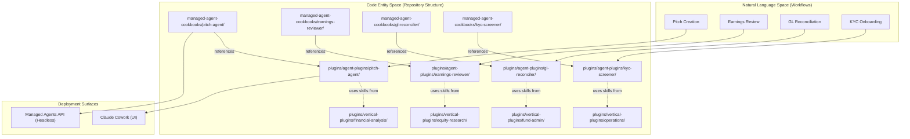
**Sources:** [[CLAUDE.md:7-29]](), [[README.md:10-14]](), [[README.md:89-98]](), [[.claude-plugin/marketplace.json:50-90]]()

## Key Components

The repository is organized into four primary directories that separate domain logic from deployment configuration:

| Component | Directory | Description |
| :--- | :--- | :--- |
| **Agent Plugins** | `plugins/agent-plugins/` | Self-contained, workflow-specific bundles (e.g., `pitch-agent`) containing a canonical system prompt and synced skills [[CLAUDE.md:9-13]](). |
| **Vertical Plugins** | `plugins/vertical-plugins/` | The "source of truth" for domain skills, slash commands (e.g., `/comps`), and MCP data connectors [[CLAUDE.md:14-19]](). |
| **Partner Plugins** | `plugins/partner-built/` | Plugins authored by partners like LSEG and S&P Global for specific data terminal integrations [[README.md:42]](), [[.claude-plugin/marketplace.json:110-120]](). |
| **CMA Cookbooks** | `managed-agent-cookbooks/` | Templates for API deployment, including `agent.yaml` manifests and subagent (leaf-worker) definitions [[CLAUDE.md:21-26]](). |
| **Admin Tooling** | `claude-for-msft-365-install/` | Tooling for provisioning the Claude Microsoft 365 add-in in enterprise environments [[CLAUDE.md:27]](). |

### Deployment Surface Relationship
The relationship between Cowork and Managed Agents is governed by shared assets. The `agents/<slug>.md` file in an agent-plugin folder serves as the canonical system prompt for both surfaces [[CLAUDE.md:12]]().

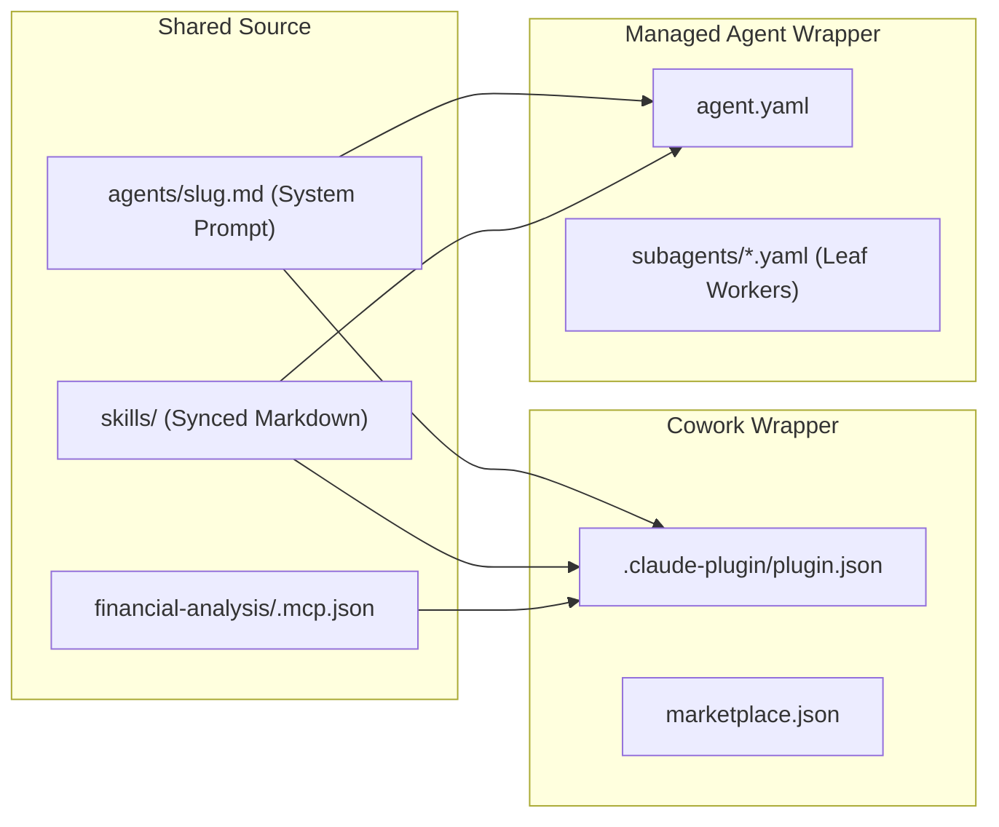
**Sources:** [[CLAUDE.md:7-29]](), [[README.md:89-98]](), [[plugins/vertical-plugins/financial-analysis/.mcp.json:1-51]]()

## Development Workflow & Tooling

The repository includes a suite of Python scripts in `scripts/` to maintain consistency between the two deployment surfaces and validate the integrity of the plugins.

*   **`check.py`**: The primary linter. It verifies that all manifest references resolve and detects drift between `vertical-plugins/` (source) and `agent-plugins/` (bundles) [[CLAUDE.md:31]]().
*   **`sync-agent-skills.py`**: Propagates skill updates from the vertical source directories into the self-contained agent bundles [[CLAUDE.md:31]]().
*   **`deploy-managed-agent.sh`**: Resolves YAML manifests, uploads skills to the `/v1/skills` endpoint, and creates agents via the API [[README.md:81-85]]().
*   **`orchestrate.py`**: A reference event loop for handling `handoff_request` events between managed agents [[README.md:85]]().
*   **`plugin-validate.yml`**: A GitHub Action that runs the official Claude Code linter (`claude plugin validate`) over every plugin and the marketplace manifest [[.github/workflows/plugin-validate.yml:1-5]]().

For detailed setup instructions, see **[Getting Started](#1.1)**.
For a deep dive into the directory layout and design principles, see **[Repository Structure & Key Concepts](#1.2)**.

**Sources:** [[CLAUDE.md:31]](), [[README.md:45]](), [[README.md:81-85]](), [[.github/workflows/plugin-validate.yml:43-59]]()

---

# Page: Getting Started

# Getting Started

<details>
<summary>Relevant source files</summary>

The following files were used as context for generating this wiki page:

- [CLAUDE.md](CLAUDE.md)
- [README.md](README.md)
- [plugins/vertical-plugins/financial-analysis/.mcp.json](plugins/vertical-plugins/financial-analysis/.mcp.json)
- [scripts/check.py](scripts/check.py)

</details>


This guide provides a step-by-step walkthrough for setting up the development environment, validating the repository state, and deploying agents across the two supported surfaces: **Claude Cowork** and **Claude Managed Agents (CMA)**.

The repository follows a "one source, two wrappers" design principle [README.md:3-5](), where core logic (prompts and skills) is authored once and packaged for different execution environments.

## Environment Setup

### 1. Clone the Repository
Clone the repository to your local machine to begin development.
```bash
git clone https://github.com/anthropics/financial-services.git
cd financial-services
```

### 2. Prerequisites
The repository primarily uses Python for linting, synchronization, and deployment scripts. Ensure you have Python 3.x installed.
*   **Dependencies**: The project minimizes external dependencies, focusing on standard Python libraries for scripts like `check.py` and `sync-agent-skills.py`. `check.py` requires `pyyaml` [scripts/check.py:53-57]().
*   **API Keys**: If deploying Managed Agents, you must export your Anthropic API key [README.md:81]().
    ```bash
    export ANTHROPIC_API_KEY=sk-ant-...
    ```

### 3. Local Development Workflow
The development workflow is centered around editing Markdown files (for prompts and skills) and JSON manifests [CLAUDE.md:44-46](). Changes take effect immediately in the "Natural Language Space" of the agents.

| Step | Action | Command |
| :--- | :--- | :--- |
| **1** | Edit Skills | Modify files in `plugins/vertical-plugins/<vertical>/skills/` [CLAUDE.md:31]() |
| **2** | Sync Agents | `python3 scripts/sync-agent-skills.py` [CLAUDE.md:31]() |
| **3** | Lint/Verify | `python3 scripts/check.py` [CLAUDE.md:31]() |

**Sources:** [CLAUDE.md:31-47](), [README.md:81-83](), [scripts/check.py:53-57]()

---

## Validation and Linting

Before committing changes or deploying, you must run the validation suite. The primary entry point is `scripts/check.py`.

### The `check.py` Script
This script performs the following critical checks:
1.  **Manifest Linting**: Validates `.claude-plugin/plugin.json` and `agent.yaml` structures [scripts/check.py:78-89]().
2.  **Reference Resolution**: Verifies that all file pointers (e.g., `system.file`, `skills.path`, `callable_agents.manifest`) exist on disk [scripts/check.py:109-140]().
3.  **Drift Detection**: Ensures that the bundled skills in `plugins/agent-plugins/<slug>/skills/` match their upstream sources in `plugins/vertical-plugins/` [scripts/check.py:142-160]().
4.  **Frontmatter Validation**: Checks that all agent Markdown files contain valid YAML frontmatter with `name` and `description` [scripts/check.py:91-105]().

`check.py` also self-installs a `.githooks` pre-commit hook by setting `core.hooksPath` [scripts/check.py:27-46](). This hook runs version bumping logic to automatically increment the patch version of modified plugins [CLAUDE.md:33]().

### Data Flow: Skill Synchronization
The following diagram illustrates how skills move from vertical domain libraries into self-contained agent bundles.

**Skill Propagation Logic**
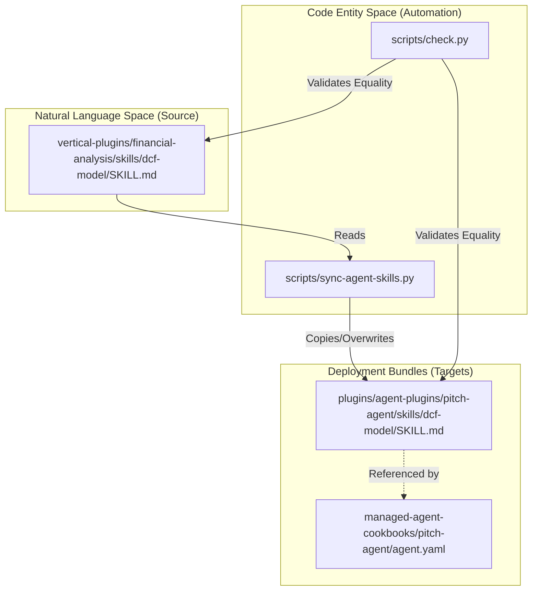
**Sources:** [CLAUDE.md:8-29](), [CLAUDE.md:31-32](), [README.md:93-97](), [scripts/check.py:142-160]()

---

## Deploying to Claude Cowork

Cowork plugins allow users to interact with FSI tools directly within the Claude.com interface.

### Installation Methods
1.  **URL-based**: In Cowork, navigate to **Settings → Plugins → Add plugin** and paste the GitHub repository URL [README.md:52-54]().
2.  **Manual Upload**: Zip a specific directory (e.g., `plugins/agent-plugins/pitch-agent/`) and upload it via the "Upload a zip" option [README.md:55-56]().
3.  **Claude Code CLI**: Use the CLI to install specific plugins from the marketplace [README.md:59-61]():
    ```bash
    claude plugin marketplace add anthropics/financial-services
    claude plugin install financial-analysis@claude-for-financial-services
    ```
    [README.md:61-74]()

---

## Deploying Managed Agents

Managed Agents are deployed as headless entities via the Anthropic API using the templates in `managed-agent-cookbooks/` [CLAUDE.md:21](), [README.md:78-85]().

### Deployment Process
The `scripts/deploy-managed-agent.sh` script automates the transition from a local cookbook to a live API agent [README.md:82-85]().

1.  **Manifest Resolution**: Resolves the `agent.yaml` manifest which links the canonical system prompt and skills [CLAUDE.md:23](), [README.md:85]().
2.  **Skill Upload**: Uploads local Markdown skills to the `/v1/skills` endpoint [README.md:85]().
3.  **Subagent Creation**: Creates any "leaf-worker" subagents defined in the `subagents/` directory [CLAUDE.md:24](), [README.md:85]().
4.  **Orchestrator Provisioning**: POSTs the final agent configuration to the `/v1/agents` endpoint [README.md:85]().

### Managed Agent Architecture
This diagram bridges the cookbook definitions to the actual API entities created during deployment.

**Managed Agent Entity Mapping**
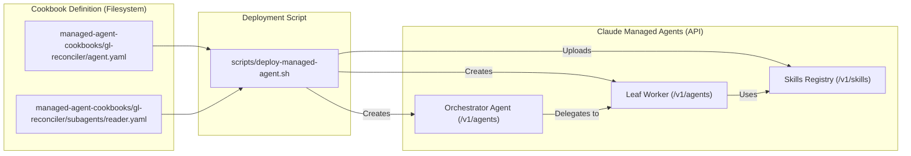
**Sources:** [CLAUDE.md:21-26](), [README.md:80-87](), [README.md:97](), [scripts/check.py:109-140]()

### Running the Agent
Once deployed, you can use `scripts/orchestrate.py` as a reference for the event loop. It handles `handoff_request` events to route communication between the orchestrator and its subagents [README.md:85]().

**Sources:** [CLAUDE.md:28](), [README.md:85]()

---

# Page: Repository Structure & Key Concepts

# Repository Structure & Key Concepts

<details>
<summary>Relevant source files</summary>

The following files were used as context for generating this wiki page:

- [.claude-plugin/marketplace.json](.claude-plugin/marketplace.json)
- [.github/workflows/plugin-validate.yml](.github/workflows/plugin-validate.yml)
- [CLAUDE.md](CLAUDE.md)
- [README.md](README.md)
- [plugins/vertical-plugins/financial-analysis/.mcp.json](plugins/vertical-plugins/financial-analysis/.mcp.json)

</details>


This page details the technical organization of the `financial-services` repository. It explains the design patterns used to maintain consistency across different deployment surfaces and the relationship between core domain logic and agentic workflows.

## Monorepo Layout

The repository is organized as a monorepo containing plugins, managed agent configurations, and deployment tooling. This structure ensures that domain-specific logic (skills) and agent personas (system prompts) remain synchronized regardless of whether they are deployed as Cowork plugins or Managed Agents.

### Directory Overview

| Directory | Purpose | Key Contents |
|-----------|---------|--------------|
| `plugins/` | The core logic layer containing all skill sources and agent definitions. | `vertical-plugins/`, `agent-plugins/`, `partner-built/` |
| `managed-agent-cookbooks/` | Configuration templates for deploying headless agents via the Claude Managed Agents (CMA) API. | `agent.yaml`, `subagents/`, `steering-examples.json` |
| `scripts/` | Tooling for validation, synchronization, and deployment. | `check.py`, `sync-agent-skills.py`, `deploy-managed-agent.sh` |
| `claude-for-msft-365-install/` | Administrative tooling for provisioning the Claude Microsoft 365 add-in. | Setup and manifest generation scripts. |

**Sources:** [CLAUDE.md:5-29](), [README.md:38-46]()

---

## The "One Source, Two Wrappers" Design Principle

A central architectural goal of this repository is to ensure that a single source of truth (the prompt and skill set) can be deployed to two different surfaces:
1.  **Claude Cowork:** Interactive, UI-driven plugins used directly within the Claude interface.
2.  **Claude Managed Agents (CMA):** Headless, API-driven agents deployed via `/v1/agents` for integration into custom enterprise workflows.

### Data Flow and Synchronization

The "Source of Truth" for any financial skill resides in `plugins/vertical-plugins/`. Agent-specific bundles in `plugins/agent-plugins/` contain **synced copies** of these skills.

#### Component Relationship Diagram
This diagram illustrates how code entities in the `plugins/` directory map to deployment artifacts.

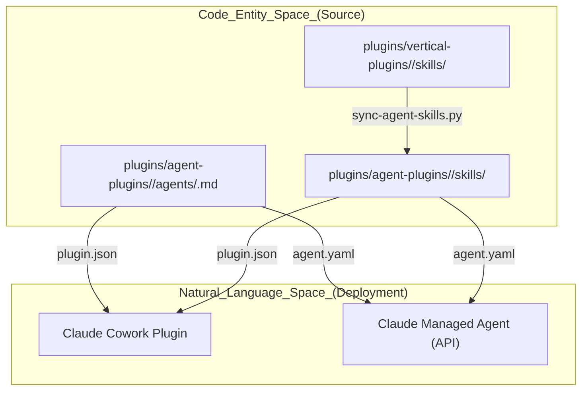
**Sources:** [CLAUDE.md:3-13](), [README.md:5-13](), [README.md:91-98]()

---

## Plugin Categories

The repository distinguishes between three types of plugins, defined in `.claude-plugin/marketplace.json`.

### 1. Vertical Plugins (Skill Sources)
Located in `plugins/vertical-plugins/`, these are domain-specific libraries. They contain:
*   **Commands:** Slash actions (e.g., `/comps`, `/dcf`) found in `commands/*.md`. [CLAUDE.md:39-39]()
*   **Skills:** Detailed workflows found in `skills/*/SKILL.md`. [CLAUDE.md:40-40]()
*   **Connectors:** MCP (Model Context Protocol) configurations in `.mcp.json`. [CLAUDE.md:19-19]()

The `financial-analysis` plugin serves as the "Core Vertical," hosting the primary data connectors (FactSet, LSEG, etc.) and foundational modeling skills. [README.md:103-107](), [plugins/vertical-plugins/financial-analysis/.mcp.json:1-51]()

### 2. Agent Plugins (Bundled Agents)
Located in `plugins/agent-plugins/`, these are self-contained workflow agents (e.g., `pitch-agent`, `gl-reconciler`). Each agent bundles:
*   A canonical system prompt in `agents/<slug>.md`. [CLAUDE.md:12-12]()
*   A subset of skills copied from the vertical plugins to ensure the agent is "self-contained". [CLAUDE.md:13-13](), [README.md:19-19]()

### 3. Partner-Built Plugins
Located in `plugins/partner-built/`, these are authored by external partners like LSEG and S&P Global. They provide specialized financial data and analytics skills that integrate with the broader ecosystem. [.claude-plugin/marketplace.json:110-120]()

### 4. Managed Agent Cookbooks
Located in `managed-agent-cookbooks/`, these are not plugins themselves but templates for the Managed Agents API. They reference the `agent-plugins/` source code to define the agent's behavior and include:
*   `agent.yaml`: The manifest linking the system prompt and skills. [CLAUDE.md:23-23]()
*   `subagents/`: YAML definitions for "leaf workers"—specialized sub-agents that handle specific tasks like "untrusted document reading" or "model building". [CLAUDE.md:24-24]()

**Sources:** [.claude-plugin/marketplace.json:1-128](), [CLAUDE.md:8-26](), [README.md:15-34]()

---

## Implementation Details & Tooling

The repository relies on a set of Python scripts to maintain integrity across the monorepo.

### Dependency and Reference Graph
This diagram shows how the `scripts/` layer interacts with the repository structure to enforce the "One Source" principle.

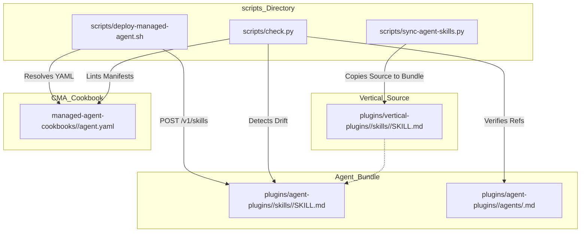

### Key Functions of Tooling
*   **`check.py`**: Performs linting on manifests. It verifies that all `system.file`, `skills.path`, and `callable_agents.manifest` references in `agent.yaml` resolve to existing files. It also detects "drift" where a bundled skill in an agent-plugin differs from its source in a vertical-plugin. [CLAUDE.md:31-31]()
*   **`sync-agent-skills.py`**: The mechanism for propagation. Developers are instructed to **edit skills only in `vertical-plugins/`** and then run this script to update all agent bundles. [CLAUDE.md:31-32]()
*   **`deploy-managed-agent.sh`**: Handles the transition from the local file system to the Anthropic API. It resolves the YAML manifest into a JSON payload, uploads skills to the `/v1/skills` endpoint, and creates the orchestrator agent via `POST /v1/agents`. [README.md:85-85]()
*   **CI Validation**: The `.github/workflows/plugin-validate.yml` workflow runs the `claude plugin validate` command over every plugin and the `marketplace.json` manifest to catch malformed manifests before they reach users. [.github/workflows/plugin-validate.yml:1-65]()

**Sources:** [CLAUDE.md:31-32](), [README.md:45](), [README.md:80-85](), [.github/workflows/plugin-validate.yml:43-59]()

---

# Page: Plugin Architecture

# Plugin Architecture

<details>
<summary>Relevant source files</summary>

The following files were used as context for generating this wiki page:

- [.claude-plugin/marketplace.json](.claude-plugin/marketplace.json)
- [.github/workflows/plugin-validate.yml](.github/workflows/plugin-validate.yml)
- [README.md](README.md)
- [plugins/vertical-plugins/financial-analysis/.mcp.json](plugins/vertical-plugins/financial-analysis/.mcp.json)

</details>


The financial-services repository utilizes a modular plugin system designed to deliver domain-specific financial expertise across two primary surfaces: **Claude Cowork** and **Claude Managed Agents (CMA)** [README.md:3-5](). The architecture follows a "one source, two wrappers" principle, where the core logic (system prompts and skills) is authored once and packaged for different deployment contexts [README.md:5]().

## Discovery and Registration

Plugins are discovered and registered through a hierarchical manifest system that allows the Claude environment to understand the capabilities and source locations of various tools.

### Marketplace Manifest
The root `.claude-plugin/marketplace.json` serves as the central registry for the entire repository. It maps plugin names to their filesystem sources and provides high-level descriptions for the marketplace UI [marketplace.json:1-128]().

### Plugin Manifest
Each individual plugin directory contains a `.claude-plugin/plugin.json` file. This manifest defines:
*   **Metadata**: Name, version, and description [README.md:93-97]().
*   **Component Discovery**: Instructions for how Claude should find commands and skills within that specific plugin [README.md:94-95]().
*   **Validation**: Every plugin is validated via the Claude Code CLI in CI to ensure manifest integrity [github/workflows/plugin-validate.yml:43-60]().

**Sources:** [.claude-plugin/marketplace.json:1-128](), [README.md:91-99](), [.github/workflows/plugin-validate.yml:1-65]()

## Plugin Categories

The system distinguishes between three types of plugins to balance modularity with ease of use.

### 1. Vertical Plugins (FSI Domain Libraries)
Vertical plugins are the primary sources of domain expertise. They bundle specific financial commands, skills, and **Model Context Protocol (MCP)** connectors [README.md:13-14]().
*   **Purpose**: To provide a library of tools for specific financial sectors (e.g., Equity Research, Private Equity) [marketplace.json:14-48]().
*   **Key Feature**: The `financial-analysis` vertical acts as the "core" hub, housing shared modeling skills and primary data connectors like FactSet, LSEG, and PitchBook [README.md:103-107](), [plugins/vertical-plugins/financial-analysis/.mcp.json:1-51]().
*   **Details**: For a full reference of commands and MCP configurations, see **[Vertical Plugins (FSI Domain Libraries)](#2.1)**.

### 2. Agent Plugins
Agent plugins are "named" agents designed for end-to-end workflows (e.g., `pitch-agent`, `gl-reconciler`) [README.md:15-32]().
*   **Self-Contained**: Each agent plugin bundles its own system prompt and a local copy of the skills it requires to ensure it is fully functional upon installation [README.md:19]().
*   **Synchronization**: To prevent logic drift, skills are authored in `vertical-plugins/` (source) and synced to `agent-plugins/` (bundled) using `scripts/sync-agent-skills.py` [README.md:45](), [README.md:94]().
*   **Details**: For details on agent prompts and bundling, see **[Agent Plugins](#2.2)**.

### 3. Partner-Built Plugins
These are specialized plugins authored by partners (LSEG and S&P Global) that provide deep integration with proprietary financial data terminals and analytics engines [marketplace.json:110-120]().
*   **Details**: For installation and entitlement requirements, see **[Partner-Built Plugins (LSEG & S&P Global)](#2.3)**.

## Interaction Model

The following diagram illustrates how natural language intent is mapped to code entities and executed through the plugin architecture.

### Intent Execution Flow
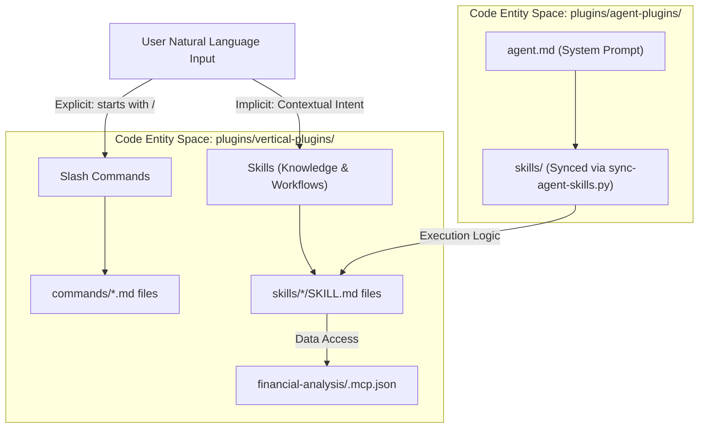
**Sources:** [README.md:45](), [README.md:91-97](), [plugins/vertical-plugins/financial-analysis/.mcp.json:1-51]()

## Component Invocation

| Component | Invocation Method | File Location |
| :--- | :--- | :--- |
| **Commands** | Explicitly triggered by user via slash commands (e.g., `/comps`) [README.md:76](). | `plugins/vertical-plugins/<vertical>/commands/` [README.md:95]() |
| **Skills** | Automatically invoked by Claude when relevant to the conversation context [README.md:76](). | `plugins/vertical-plugins/<vertical>/skills/` [README.md:94]() |
| **MCP Connectors** | Tools called by Claude to fetch live data from 11+ external providers [README.md:96](). | `plugins/vertical-plugins/financial-analysis/.mcp.json` [README.md:96]() |

### System Architecture Overview
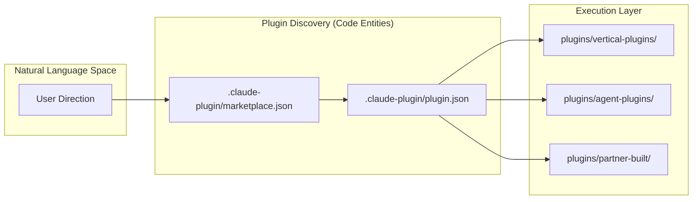
**Sources:** [marketplace.json:1-128](), [README.md:39-46](), [README.md:91-99]()

## Validation and Syncing

To maintain integrity across the repository, especially when skills are duplicated for agent bundling, the repository includes mandatory validation tooling.

*   **`scripts/check.py`**: Lints manifests and detects drift between vertical-plugins and agent-plugins [README.md:45]().
*   **`scripts/sync-agent-skills.py`**: The canonical script for propagating updates from the source of truth in `vertical-plugins/` to the self-contained `agent-plugins/` [README.md:45](), [README.md:94]().
*   **`scripts/deploy-managed-agent.sh`**: Resolves YAML manifests to JSON, uploads skills, and creates the managed agent via the API [README.md:85]().
*   **`scripts/orchestrate.py`**: Provides a reference event loop for routing `handoff_request` events between agents in headless deployments [README.md:85]().

**Sources:** [README.md:45](), [README.md:80-87](), [README.md:94]()

---

# Page: Vertical Plugins (FSI Domain Libraries)

# Vertical Plugins (FSI Domain Libraries)

<details>
<summary>Relevant source files</summary>

The following files were used as context for generating this wiki page:

- [plugins/vertical-plugins/equity-research/.claude-plugin/plugin.json](plugins/vertical-plugins/equity-research/.claude-plugin/plugin.json)
- [plugins/vertical-plugins/financial-analysis/.claude-plugin/plugin.json](plugins/vertical-plugins/financial-analysis/.claude-plugin/plugin.json)
- [plugins/vertical-plugins/financial-analysis/hooks/hooks.json](plugins/vertical-plugins/financial-analysis/hooks/hooks.json)
- [plugins/vertical-plugins/investment-banking/.claude-plugin/plugin.json](plugins/vertical-plugins/investment-banking/.claude-plugin/plugin.json)
- [plugins/vertical-plugins/private-equity/.claude-plugin/plugin.json](plugins/vertical-plugins/private-equity/.claude-plugin/plugin.json)
- [plugins/vertical-plugins/wealth-management/.claude-plugin/plugin.json](plugins/vertical-plugins/wealth-management/.claude-plugin/plugin.json)

</details>


This page provides a high-level overview of the seven vertical plugins that serve as the domain-specific libraries for the Claude for Financial Services repository. These plugins contain the foundational skills, slash commands, and Model Context Protocol (MCP) configurations that power both the standalone Cowork experience and the end-to-end [Agent Plugins](#2.2).

## Overview

Vertical plugins are organized by financial services industry (FSI) domains. They act as the "source of truth" for specialized financial workflows. Unlike [Agent Plugins](#2.2), which are self-contained bundles designed for specific roles (e.g., `pitch-agent`), vertical plugins are modular libraries intended to be mixed and matched based on an analyst's specific coverage area [README.md:13]().

### Core Architecture

The vertical plugins are located in `plugins/vertical-plugins/` [CLAUDE.md:14](). Each vertical follows a standard structure:
- **`commands/`**: Explicit slash actions invoked as `/plugin:command-name` [CLAUDE.md:17, 39]().
- **`skills/`**: Domain expertise, conventions, and step-by-step methods invoked automatically by Claude when trigger conditions match [CLAUDE.md:18, 48]().
- **`.mcp.json`**: Configuration for data connectors (Terminals, CRM, Document Stores) [CLAUDE.md:19]().
- **`.claude-plugin/plugin.json`**: Metadata defining the plugin name, version, and description [plugins/vertical-plugins/financial-analysis/.claude-plugin/plugin.json:1-8]().

### Plugin Mapping: Natural Language to Code Entities

The following diagram illustrates how natural language domain concepts map to specific code directories and manifest entries within the `vertical-plugins` directory.

**Vertical Plugin Entity Map**
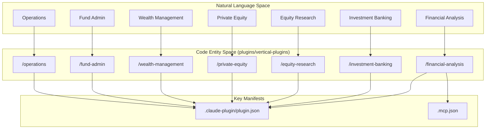
**Sources:** [.claude-plugin/marketplace.json:6-41](), [CLAUDE.md:14-19](), [README.md:101-107](), [plugins/vertical-plugins/financial-analysis/.claude-plugin/plugin.json:1-8]()

---

## The Seven Vertical Plugins

### 1. Financial Analysis (Core)
The `financial-analysis` plugin is the central hub of the repository. It contains the core financial modeling and analysis tools, including DCF, comps, LBO, and 3-statement models [plugins/vertical-plugins/financial-analysis/.claude-plugin/plugin.json:4](). It also serves as the primary configuration point for all 11 MCP data connectors, including Daloopa, FactSet, LSEG, and Morningstar [.claude-plugin/marketplace.json:8-11](), [README.md:96, 103]().

For details, see [Financial Analysis (Core Vertical)](#2.1.1).

### 2. Investment Banking
Focused on advisory and capital markets productivity. It includes tools for market insights, deck creation, and transaction management, as well as specific outputs like CIMs and teasers [plugins/vertical-plugins/investment-banking/.claude-plugin/plugin.json:4]().

For details, see [Investment Banking, Equity Research & Other Verticals](#2.1.2).

### 3. Equity Research
Contains workflows for the research process, including earnings analysis, initiating coverage reports, and research note drafting [plugins/vertical-plugins/equity-research/.claude-plugin/plugin.json:4]().

For details, see [Investment Banking, Equity Research & Other Verticals](#2.1.2).

### 4. Private Equity
Tailored for the deal lifecycle, including company discovery, CRM integration for sourcing, and founder outreach workflows [plugins/vertical-plugins/private-equity/.claude-plugin/plugin.json:4]().

For details, see [Investment Banking, Equity Research & Other Verticals](#2.1.2).

### 5. Wealth Management
Provides tools for financial advisors and wealth managers, covering client reviews, financial planning, portfolio analysis, and reporting [plugins/vertical-plugins/wealth-management/.claude-plugin/plugin.json:4]().

For details, see [Investment Banking, Equity Research & Other Verticals](#2.1.2).

### 6. Fund Admin
Supports fund administration and finance operations. Key workflows include GL reconciliation, break tracing, accruals, roll-forwards, and NAV tie-outs [.claude-plugin/marketplace.json:33-36]().

For details, see [Investment Banking, Equity Research & Other Verticals](#2.1.2).

### 7. Operations
Focuses on operational workflows, specifically parsing KYC (Know Your Customer) documents and evaluating rules-grids [.claude-plugin/marketplace.json:38-41]().

For details, see [Investment Banking, Equity Research & Other Verticals](#2.1.2).

---

## Relationship to Agents

Vertical plugins provide the "source" skills that are synced into `agent-plugins`. While an analyst might install a vertical plugin to gain access to a specific command like `/comps`, the named agents (e.g., `pitch-agent`) bundle these skills to provide a guided, end-to-end experience [README.md:93-94]().

**Skill Propagation Flow**
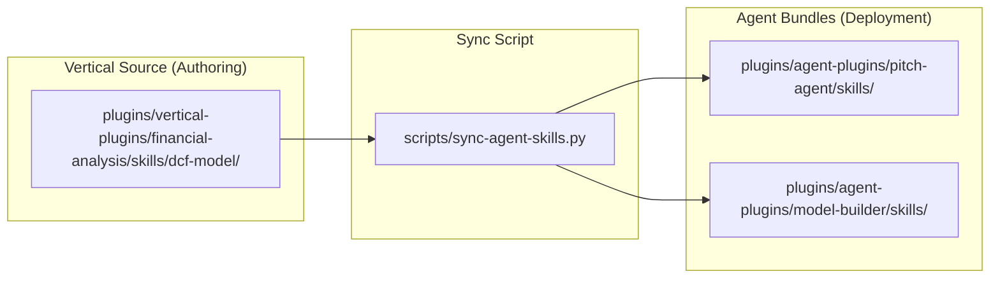
**Sources:** [CLAUDE.md:31](), [README.md:94]()

**Sources:**
- [.claude-plugin/marketplace.json:1-108]()
- [CLAUDE.md:1-46]()
- [README.md:1-107]()
- [plugins/vertical-plugins/financial-analysis/.claude-plugin/plugin.json:1-8]()
- [plugins/vertical-plugins/investment-banking/.claude-plugin/plugin.json:1-8]()
- [plugins/vertical-plugins/equity-research/.claude-plugin/plugin.json:1-8]()
- [plugins/vertical-plugins/private-equity/.claude-plugin/plugin.json:1-8]()
- [plugins/vertical-plugins/wealth-management/.claude-plugin/plugin.json:1-8]()

---

# Page: Financial Analysis (Core Vertical)

# Financial Analysis (Core Vertical)

<details>
<summary>Relevant source files</summary>

The following files were used as context for generating this wiki page:

- [README.md](README.md)
- [plugins/vertical-plugins/financial-analysis/.claude-plugin/plugin.json](plugins/vertical-plugins/financial-analysis/.claude-plugin/plugin.json)
- [plugins/vertical-plugins/financial-analysis/.mcp.json](plugins/vertical-plugins/financial-analysis/.mcp.json)
- [plugins/vertical-plugins/financial-analysis/hooks/hooks.json](plugins/vertical-plugins/financial-analysis/hooks/hooks.json)

</details>


The `financial-analysis` vertical serves as the foundational intelligence layer of the repository. It acts as the central hub for data integration, housing the configurations for all 11 Model Context Protocol (MCP) data connectors, and provides the core computational skills required for valuation, modeling, and document authoring.

## Overview and Role

The `financial-analysis` plugin is a "Vertical Plugin" designed to provide domain-specific expertise that can be used standalone or bundled into specialized agents. It is the most critical dependency in the monorepo, as it defines the shared modeling logic and data access patterns used across Investment Banking, Equity Research, and Private Equity workflows [README.md:101-104]().

### Key Responsibilities
- **Data Orchestration**: Managing connections to premium financial data providers (FactSet, LSEG, Morningstar, etc.) via the `.mcp.json` configuration [plugins/vertical-plugins/financial-analysis/.mcp.json:1-51]().
- **Core Modeling**: Providing the logic for Discounted Cash Flow (DCF), Leveraged Buyback (LBO), and Public Comps analysis [README.md:107-108]().
- **Model Integrity**: Auditing complex Excel workbooks for structural and logical errors through the `audit-xls` skill [README.md:108-110]().
- **Artifact Generation**: Authoring professional-grade Excel models and PowerPoint decks via `xlsx-author` and `pptx-author` [README.md:108-110]().

**Sources:** [README.md:101-110](), [plugins/vertical-plugins/financial-analysis/.mcp.json:1-51]()

---

## Data Flow: Natural Language to Code Entities

The following diagram illustrates how a user's natural language request is routed through the system's commands and skills to interact with the underlying MCP data connectors defined in the vertical.

### Command and Skill Routing
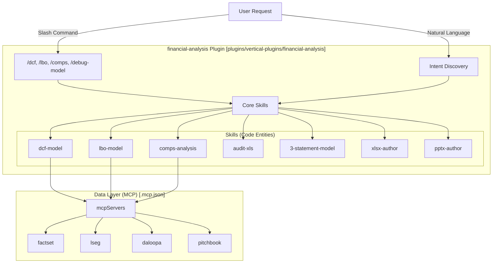
**Sources:** [README.md:91-97](), [README.md:103-110](), [plugins/vertical-plugins/financial-analysis/.mcp.json:1-51]()

---

## Core Skills & Implementation

### 1. Financial Modeling Skills
These skills represent the computational core of the vertical. They are designed to operate within Excel via the `xlsx-author` skill or generate standalone reports [README.md:107-110]().

| Skill Name | Role | Key Functions / Triggers |
| :--- | :--- | :--- |
| `3-statement-model` | Builds integrated IS/BS/CF models | Triggers on "build a 3-statement", "link the financials" |
| `dcf-model` | Performs intrinsic valuation | Calculates WACC, FCF, and Terminal Value |
| `lbo-model` | Analyzes PE returns | Sources & Uses, Debt Sweeps, IRR/MOIC hurdles |
| `comps-analysis` | Relative valuation | Pulls peer multiples (P/E, EV/EBITDA) via MCP |
| `xlsx-author` | Excel Manipulation | Writes formulas, formats cells, creates charts |
| `pptx-author` | Deck Generation | Generates branded slides and charts |

### 2. Audit and Quality Control (`audit-xls`)
The `audit-xls` skill is a logic engine for validating financial models. It identifies formula errors, hardcoded values in calculation blocks, and structural integrity issues [README.md:108-110]().

**Implementation Logic:**
- **Formula Checks**: Scans for `#REF!` errors and inconsistent patterns across rows or columns.
- **Integrity Checks**: Validates if the Balance Sheet balances (`Assets = Liabilities + Equity`) and if the Cash Flow Statement ties to the Balance Sheet cash account.
- **Circular Reference Detection**: Identifies intentional loops (like Interest Expense $\leftrightarrow$ Debt Balance) and verifies iteration toggles.

**Sources:** [README.md:101-110]()

---

## MCP Connector Hub

The `financial-analysis` vertical centralizes the configuration for 11 MCP connectors. These connectors allow Claude to fetch real-time and historical data directly from financial terminals and databases [plugins/vertical-plugins/financial-analysis/.mcp.json:1-51]().

### Integrated Connectors
1.  **Daloopa**: Deep-link data into Excel models [plugins/vertical-plugins/financial-analysis/.mcp.json:3-6]().
2.  **Morningstar**: Equity research and fund data [plugins/vertical-plugins/financial-analysis/.mcp.json:7-10]().
3.  **S&P Global / Kensho**: Earnings transcripts and transaction summaries [plugins/vertical-plugins/financial-analysis/.mcp.json:11-14]().
4.  **FactSet**: Estimates, fundamentals, and ownership data [plugins/vertical-plugins/financial-analysis/.mcp.json:15-18]().
5.  **Moody's**: Credit ratings and risk metrics [plugins/vertical-plugins/financial-analysis/.mcp.json:19-22]().
6.  **MT Newswires**: Real-time financial news [plugins/vertical-plugins/financial-analysis/.mcp.json:23-26]().
7.  **Aiera**: Event monitoring and transcripts [plugins/vertical-plugins/financial-analysis/.mcp.json:27-30]().
8.  **LSEG**: Real-time pricing and fixed income analytics [plugins/vertical-plugins/financial-analysis/.mcp.json:31-34]().
9.  **PitchBook**: Private company data and VC/PE deal flow [plugins/vertical-plugins/financial-analysis/.mcp.json:35-38]().
10. **Chronograph**: Private equity portfolio monitoring [plugins/vertical-plugins/financial-analysis/.mcp.json:39-42]().
11. **Egnyte/Box**: Secure document storage and retrieval [plugins/vertical-plugins/financial-analysis/.mcp.json:43-50]().

### System Integration Diagram
This diagram shows how the `financial-analysis` vertical acts as a bridge between the User Interface (Cowork/Managed Agents) and the external data providers.

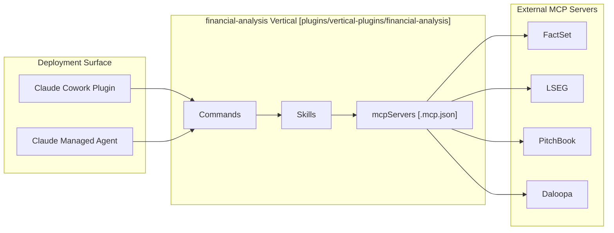
**Sources:** [README.md:91-97](), [plugins/vertical-plugins/financial-analysis/.mcp.json:1-51]()

---

## Slash Commands Reference

The following commands are explicitly registered within the `financial-analysis` vertical to provide quick access to complex workflows [README.md:76, 107-110]():

- `/comps`: Initiates a comparable company analysis for a given ticker.
- `/dcf`: Generates a Discounted Cash Flow valuation template.
- `/lbo`: Creates a 5-year Leveraged Buyout return model.
- `/debug-model`: Invokes the `audit-xls` skill to scan for errors in an active workbook.
- `/deck-refresh`: Uses `pptx-author` logic to update charts in a PowerPoint file based on new Excel data.
- `/3-statement`: Scaffolds an integrated three-statement financial model.

**Sources:** [README.md:76](), [README.md:95](), [README.md:107-110]()

---

# Page: Investment Banking, Equity Research & Other Verticals

# Investment Banking, Equity Research & Other Verticals

<details>
<summary>Relevant source files</summary>

The following files were used as context for generating this wiki page:

- [plugins/vertical-plugins/equity-research/.claude-plugin/plugin.json](plugins/vertical-plugins/equity-research/.claude-plugin/plugin.json)
- [plugins/vertical-plugins/equity-research/skills/earnings-preview/SKILL.md](plugins/vertical-plugins/equity-research/skills/earnings-preview/SKILL.md)
- [plugins/vertical-plugins/equity-research/skills/morning-note/SKILL.md](plugins/vertical-plugins/equity-research/skills/morning-note/SKILL.md)
- [plugins/vertical-plugins/investment-banking/.claude-plugin/plugin.json](plugins/vertical-plugins/investment-banking/.claude-plugin/plugin.json)
- [plugins/vertical-plugins/investment-banking/skills/cim-builder/SKILL.md](plugins/vertical-plugins/investment-banking/skills/cim-builder/SKILL.md)
- [plugins/vertical-plugins/investment-banking/skills/merger-model/SKILL.md](plugins/vertical-plugins/investment-banking/skills/merger-model/SKILL.md)
- [plugins/vertical-plugins/investment-banking/skills/teaser/SKILL.md](plugins/vertical-plugins/investment-banking/skills/teaser/SKILL.md)
- [plugins/vertical-plugins/private-equity/.claude-plugin/plugin.json](plugins/vertical-plugins/private-equity/.claude-plugin/plugin.json)
- [plugins/vertical-plugins/private-equity/skills/deal-sourcing/SKILL.md](plugins/vertical-plugins/private-equity/skills/deal-sourcing/SKILL.md)
- [plugins/vertical-plugins/private-equity/skills/ic-memo/SKILL.md](plugins/vertical-plugins/private-equity/skills/ic-memo/SKILL.md)
- [plugins/vertical-plugins/wealth-management/.claude-plugin/plugin.json](plugins/vertical-plugins/wealth-management/.claude-plugin/plugin.json)
- [plugins/vertical-plugins/wealth-management/skills/client-report/SKILL.md](plugins/vertical-plugins/wealth-management/skills/client-report/SKILL.md)
- [plugins/vertical-plugins/wealth-management/skills/portfolio-rebalance/SKILL.md](plugins/vertical-plugins/wealth-management/skills/portfolio-rebalance/SKILL.md)

</details>


This page provides a technical reference for the domain-specific vertical plugins within the `financial-services` repository. While the `financial-analysis` plugin serves as the core engine for modeling and data connectivity, these additional verticals provide specialized prompts, logic, and workflows for specific financial services sectors including Investment Banking, Equity Research, Private Equity, Wealth Management, Fund Administration, and Operations.

## Overview of Vertical Plugins

The repository organizes domain logic into "Vertical Plugins" located in `plugins/vertical-plugins/`. These plugins serve as the source of truth for specialized financial skills and are defined by a `plugin.json` manifest in their respective `.claude-plugin/` directories.

| Plugin Name | Purpose | Key Workflows |
|:---|:---|:---|
| `investment-banking` | Advisory productivity | CIMs, teasers, merger models, pitch decks |
| `equity-research` | Public markets analysis | Earnings previews, morning notes, initiating coverage |
| `private-equity` | Buy-side deal flow | Deal sourcing, IC memos, returns analysis |
| `wealth-management` | Client advisory | Portfolio rebalancing, client reporting, financial planning |
| `fund-admin` | Middle/Back office ops | GL reconciliation, NAV tie-outs, roll-forwards |
| `operations` | Compliance & KYC | KYC document parsing, rules-grid evaluation |

Sources: [plugins/vertical-plugins/investment-banking/.claude-plugin/plugin.json:1-8](), [plugins/vertical-plugins/equity-research/.claude-plugin/plugin.json:1-8](), [plugins/vertical-plugins/private-equity/.claude-plugin/plugin.json:1-8](), [plugins/vertical-plugins/wealth-management/.claude-plugin/plugin.json:1-8]()

## Investment Banking

The `investment-banking` vertical automates the creation of high-stakes transaction documents and merger analysis.

### CIM & Teaser Construction
The `cim-builder` and `teaser` skills utilize structured workflows to transform raw company data into investor-ready materials.

*   **`cim-builder`**: Organizes data into an 8-section memorandum, including Executive Summary, Industry Overview, and Financial Overview [plugins/vertical-plugins/investment-banking/skills/cim-builder/SKILL.md:24-82]().
*   **`teaser`**: Focuses on anonymization logic, ensuring no company names, specific geographies, or identifiable employee counts are disclosed while maintaining a compelling narrative [plugins/vertical-plugins/investment-banking/skills/teaser/SKILL.md:58-66]().

### Merger Modeling
The `merger-model` skill performs accretion/dilution analysis. It calculates pro forma EPS impact by adjusting for synergies, new debt interest, and foregone interest on cash [plugins/vertical-plugins/investment-banking/skills/merger-model/SKILL.md:54-69]().

**Technical Entity Mapping: Investment Banking**
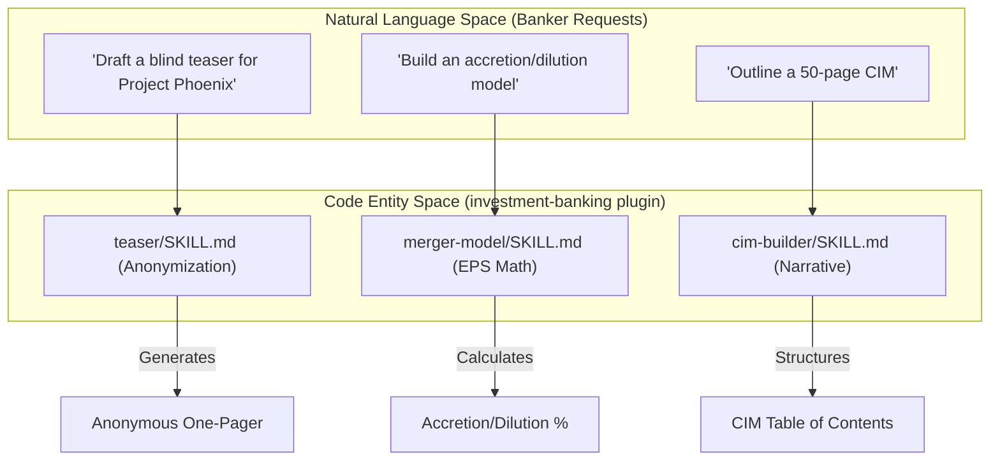
Sources: [plugins/vertical-plugins/investment-banking/skills/teaser/SKILL.md:1-4](), [plugins/vertical-plugins/investment-banking/skills/merger-model/SKILL.md:1-4](), [plugins/vertical-plugins/investment-banking/skills/cim-builder/SKILL.md:1-4]()

## Equity Research (ER)

The `equity-research` vertical focuses on the high-velocity lifecycle of public company coverage, specifically pre-earnings positioning and daily market reactions.

### Earnings Preview & Morning Notes
*   **`earnings-preview`**: Builds a "what to watch" framework, ranking financial and sector-specific operational metrics (e.g., ARR for SaaS, NIM for Banks) and creating bull/base/bear scenarios [plugins/vertical-plugins/equity-research/skills/earnings-preview/SKILL.md:17-48]().
*   **`morning-note`**: Optimized for a 7:00 AM meeting format. It summarizes overnight developments and provides "Quick Takes" on earnings with a comparison of Actual vs. Consensus metrics [plugins/vertical-plugins/equity-research/skills/morning-note/SKILL.md:32-75]().

Sources: [plugins/vertical-plugins/equity-research/skills/earnings-preview/SKILL.md:1-4](), [plugins/vertical-plugins/equity-research/skills/morning-note/SKILL.md:1-4]()

## Private Equity

The `private-equity` vertical handles the "top of the funnel" sourcing and the formal Investment Committee (IC) approval process.

### Deal Sourcing & IC Memos
*   **`deal-sourcing`**: Implements a 3-step pipeline: Company Discovery (web search), CRM Check (searching Gmail/Slack for prior contact), and Founder Outreach (drafting personalized, low-pressure emails) [plugins/vertical-plugins/private-equity/skills/deal-sourcing/SKILL.md:10-50]().
*   **`ic-memo`**: Synthesizes due diligence findings into a structured recommendation, including a "Value Creation Plan" and "Returns Analysis" (IRR/MOIC) across multiple scenarios [plugins/vertical-plugins/private-equity/skills/ic-memo/SKILL.md:23-75]().

**Data Flow: PE Deal Sourcing**
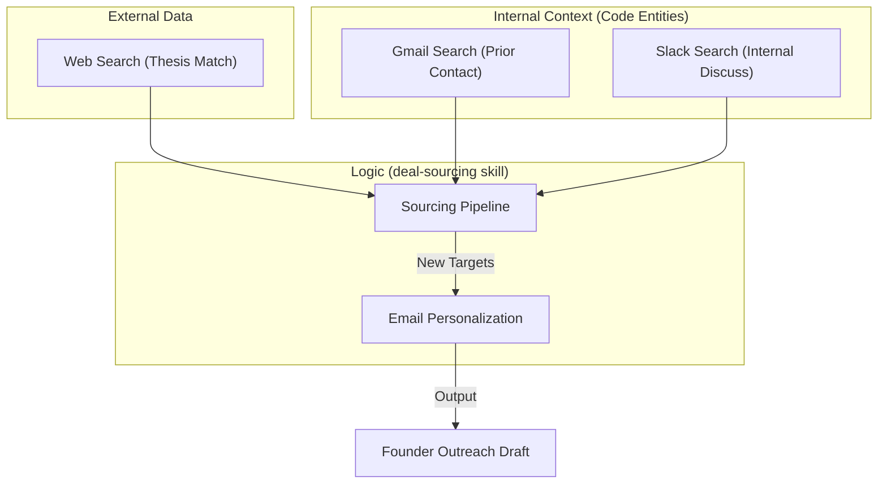
Sources: [plugins/vertical-plugins/private-equity/skills/deal-sourcing/SKILL.md:12-44]()

## Wealth Management

Tailored for financial advisors managing private client portfolios and households.

### Client Reporting & Rebalancing
*   **`client-report`**: Generates multi-page performance reviews. It aggregates data by household and account (Taxable, IRA, 529), comparing returns against custom benchmarks defined in the Investment Policy Statement (IPS) [plugins/vertical-plugins/wealth-management/skills/client-report/SKILL.md:10-36]().
*   **`portfolio-rebalance`**: (Referenced) Analyzes current allocations against target models to identify necessary trades.

Sources: [plugins/vertical-plugins/wealth-management/skills/client-report/SKILL.md:1-4](), [plugins/vertical-plugins/wealth-management/skills/portfolio-rebalance/SKILL.md:1-4]()

## Fund Administration & Operations

These verticals handle the middle and back-office control functions.

### Fund Administration
Focuses on reconciliation and NAV (Net Asset Value) accuracy.
*   **GL Reconciliation**: Performs matching between General Ledger and Subledger extracts, bucketing breaks into categories like "Amount", "Quantity", or "Timing" mismatches.
*   **NAV Tie-out**: Validates the roll-forward of fund capital and expenses.

### Operations
Handles high-volume compliance and document processing.
*   **KYC Parsing**: Extraction of entities from onboarding documentation (passports, incorporation papers).
*   **Rules Evaluation**: Matching extracted data against a compliance rules-grid to flag missing documentation or regulatory gaps.

---

# Page: Agent Plugins

# Agent Plugins

<details>
<summary>Relevant source files</summary>

The following files were used as context for generating this wiki page:

- [plugins/agent-plugins/earnings-reviewer/.claude-plugin/plugin.json](plugins/agent-plugins/earnings-reviewer/.claude-plugin/plugin.json)
- [plugins/agent-plugins/market-researcher/.claude-plugin/plugin.json](plugins/agent-plugins/market-researcher/.claude-plugin/plugin.json)
- [plugins/agent-plugins/meeting-prep-agent/.claude-plugin/plugin.json](plugins/agent-plugins/meeting-prep-agent/.claude-plugin/plugin.json)
- [plugins/agent-plugins/pitch-agent/.claude-plugin/plugin.json](plugins/agent-plugins/pitch-agent/.claude-plugin/plugin.json)
- [plugins/agent-plugins/valuation-reviewer/.claude-plugin/plugin.json](plugins/agent-plugins/valuation-reviewer/.claude-plugin/plugin.json)

</details>


The **Agent Plugin** layer (located in `plugins/agent-plugins/`) represents the high-level "Persona" tier of the repository. While **Vertical Plugins** provide the raw tools and domain libraries (skills), Agent Plugins bundle these capabilities into cohesive, named agents designed to perform end-to-end financial workflows like earnings reviews, GL reconciliation, or pitch book generation [[CLAUDE.md:1-13]]().

Each agent plugin is a self-contained package that serves as the canonical source for two deployment surfaces: **Claude Cowork** (interactive plugins) and **Claude Managed Agents** (automated cookbooks) [[CLAUDE.md:1-5]]().

## Architectural Overview

Agent Plugins act as an orchestration layer. They do not define new skills from scratch; instead, they reference and bundle existing skills from the `vertical-plugins/` directory [[CLAUDE.md:12-14]]().

### Data Flow: Skill Propagation
The repository follows a "One Source, Two Wrappers" design principle. To maintain consistency:
1.  **Source of Truth:** All technical logic (skills and commands) is authored in `plugins/vertical-plugins/` [[CLAUDE.md:31-32]]().
2.  **Propagation:** The script `scripts/sync-agent-skills.py` is used to copy these skills into the `skills/` directory of the relevant Agent Plugin [[CLAUDE.md:28-31]]().
3.  **Validation:** The `scripts/check.py` utility verifies that the bundled skills in the agent-plugins haven't drifted from their vertical sources [[CLAUDE.md:31-32]]().

### Component Mapping: Natural Language to Code
This diagram illustrates how a natural language request to a specific agent maps to the underlying code entities and the sync mechanism.

**Agent Entity Mapping**
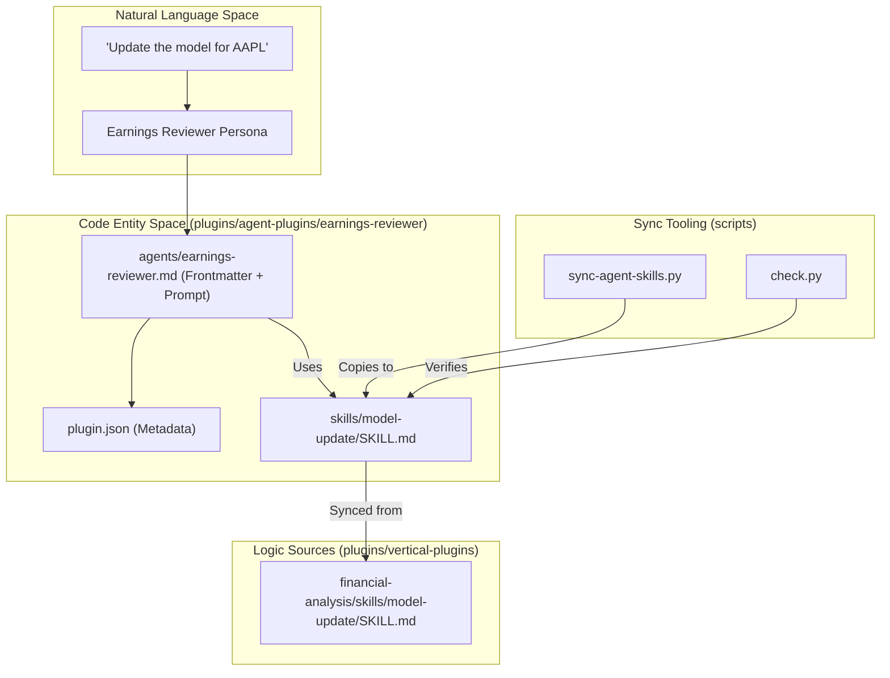
Sources: [[CLAUDE.md:8-19]](), [[CLAUDE.md:28-31]]()

---

## Plugin Structure

Every agent plugin directory (e.g., `plugins/agent-plugins/earnings-reviewer/`) must contain the following structure:

### 1. The Metadata Manifest (`plugin.json`)
Located at `.claude-plugin/plugin.json`, this file defines the agent's identity for the marketplace. It includes the `name`, `version`, and `description`.

| Field | Description | Example (Pitch Agent) |
| :--- | :--- | :--- |
| `name` | Unique identifier for the agent | `"pitch-agent"` |
| `version` | SemVer versioning | `"0.1.1"` |
| `description` | High-level summary of capabilities | `"Comps, precedents, LBO to a branded pitch deck"` |

Sources: [[plugins/agent-plugins/earnings-reviewer/.claude-plugin/plugin.json:1-8]](), [[plugins/agent-plugins/pitch-agent/.claude-plugin/plugin.json:1-8]]()

### 2. The Canonical Agent Definition (`agents/<slug>.md`)
This Markdown file is the most critical component. It contains:
*   **YAML Frontmatter:** Defines the agent's `name`, `description`, and the specific `tools` it is granted (e.g., `mcp__factset__*`, `Read`, `Write`).
*   **System Prompt:** The detailed instructions governing the agent's behavior, specific deliverables (e.g., "Updated coverage model"), and multi-step workflows.

### 3. Bundled Skills (`skills/`)
A subdirectory containing local copies of skills required by the agent. Each skill includes its own `SKILL.md` which defines triggers and step-by-step logic.

---

## Agent Catalog & Skill Bundling

The following table details how specific agents bundle skills from the vertical libraries to perform their roles.

| Agent Slug | Description from `plugin.json` | Core Purpose |
| :--- | :--- | :--- |
| `earnings-reviewer` | "Earnings call and filings to model update to note draft" | End-to-end processing of earnings events [[plugins/agent-plugins/earnings-reviewer/.claude-plugin/plugin.json:4-4]]() |
| `market-researcher` | "Sector or theme to industry overview, competitive landscape..." | Peer comps and ideas shortlist [[plugins/agent-plugins/market-researcher/.claude-plugin/plugin.json:4-4]]() |
| `meeting-prep-agent`| "Briefing pack before every client meeting" | Generates client briefing packs [[plugins/agent-plugins/meeting-prep-agent/.claude-plugin/plugin.json:4-4]]() |
| `pitch-agent` | "Comps, precedents, LBO to a branded pitch deck, end to end" | Generates pitch books and valuation decks [[plugins/agent-plugins/pitch-agent/.claude-plugin/plugin.json:4-4]]() |
| `valuation-reviewer`| "Ingests GP packages, runs valuation template, stages LP reporting" | Private equity fund reporting workflows [[plugins/agent-plugins/valuation-reviewer/.claude-plugin/plugin.json:4-4]]() |

---

## Implementation Details: The Agent Prompt

The agent's `agents/<slug>.md` file serves as the master configuration. It uses a structured format to ensure the LLM understands its constraints and operational workflow.

### Workflow & Guardrails
Agents are programmed with explicit workflows and guardrails. For example, a typical agent has a multi-step workflow starting with data ingestion and ending with a final deliverable.

**Agent Execution Logic**
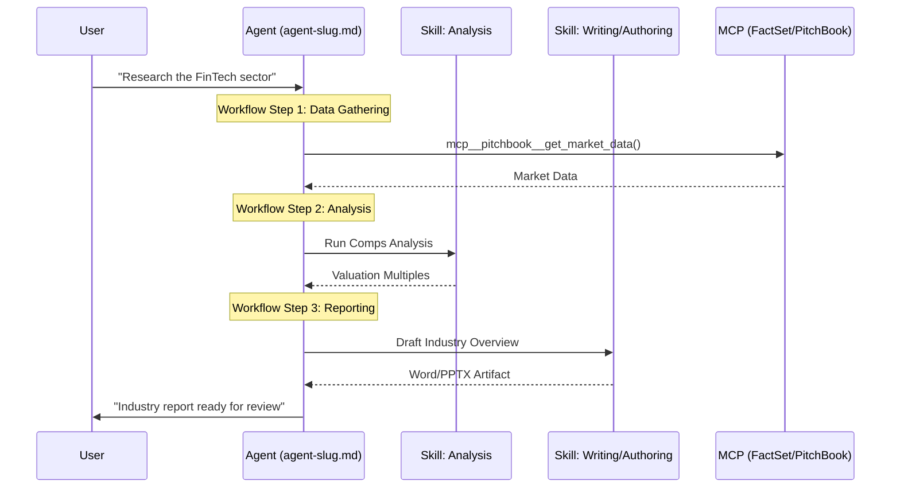
Sources: [[CLAUDE.md:46-47]](), [[plugins/agent-plugins/pitch-agent/.claude-plugin/plugin.json:4-4]]()

### Skill Integration
Agents reference their bundled skills within the prompt to guide the LLM on when to transition from general reasoning to specific technical workflows.
*   **Headless Fallbacks:** In managed-agent (headless) modes, agents often use skills like `xlsx-author` or `pptx-author` to produce file artifacts instead of driving live desktop applications via MCP.

## Syncing and Validation

Because Agent Plugins contain redundant copies of skills (for portability as standalone plugins), the following scripts must be used during development:

1.  **`scripts/sync-agent-skills.py`**: Iterates through `plugins/agent-plugins/`, identifies required skills, and copies the latest versions from `plugins/vertical-plugins/` [[CLAUDE.md:31-31]]().
2.  **`scripts/check.py`**: A linter that ensures `plugin.json` is valid and verifies that no `skills/` within an agent plugin have drifted from their vertical source [[CLAUDE.md:31-31]]().

Sources: [[CLAUDE.md:28-32]]()

---

# Page: Partner-Built Plugins (LSEG & S&P Global)

# Partner-Built Plugins (LSEG & S&P Global)

<details>
<summary>Relevant source files</summary>

The following files were used as context for generating this wiki page:

- [README.md](README.md)
- [plugins/partner-built/spglobal/.claude-plugin/plugin.json](plugins/partner-built/spglobal/.claude-plugin/plugin.json)
- [plugins/vertical-plugins/financial-analysis/.mcp.json](plugins/vertical-plugins/financial-analysis/.mcp.json)

</details>


This page documents the partner-built plugins integrated into the `claude-for-financial-services` ecosystem. Unlike the vertical or agent plugins authored by Anthropic, these plugins are built and maintained by industry-leading data providers—**LSEG** and **S&P Global / Kensho**. They provide high-fidelity financial data, fixed income analytics, and automated research summaries directly to Claude via the Model Context Protocol (MCP) and specialized APIs.

### Overview of Partner Plugins

The partner plugins are located in the `plugins/partner-built/` directory [[README.md:42-42]](). These plugins allow Claude to transition from general reasoning to precise, data-backed financial analysis by connecting to institutional-grade terminals and data lakes.

| Partner | Plugin Name | Core Capabilities | Data Source | MCP Endpoint |
| :--- | :--- | :--- | :--- | :--- |
| **LSEG** | `lseg` | Bond pricing, FX carry trades, yield curves, options valuation, fixed income analytics. | LFA MCP Server | `https://api.analytics.lseg.com/lfa/mcp` |
| **S&P Global** | `sp-global` | Company tearsheets, transaction summaries, earnings previews. | Kensho LLM-ready API | `https://kfinance.kensho.com/integrations/mcp` |

Sources: [[README.md:42-42]](), [[plugins/vertical-plugins/financial-analysis/.mcp.json:11-34]](), [[plugins/partner-built/spglobal/.claude-plugin/plugin.json:2-3]]()

---

## LSEG Plugin

The LSEG plugin provides deep fixed income and macro analytics. It leverages the **LSEG Financial Analytics (LFA) MCP Server** to bridge Claude's reasoning capabilities with LSEG's proprietary financial models and real-time data feeds [[plugins/vertical-plugins/financial-analysis/.mcp.json:31-34]]().

### Technical Architecture & Data Flow

The LSEG plugin operates by connecting Claude to an MCP server that handles authentication and request signing for LSEG's backend services.

**LSEG Data Interaction Diagram**
```mermaid
graph TD
    subgraph "Claude_Space" ["Claude Space"]
        "Claude_LLM"["Claude LLM"]
        "LSEG_Plugin"["LSEG Plugin (plugins/partner-built/lseg)"]
    end

    subgraph "Local_Environment" ["Local / Environment"]
        "MCP_Host"["MCP Host (Cowork / Claude Code)"]
        "LFA_Server"["LFA MCP Server (api.analytics.lseg.com/lfa/mcp)"]
    end

    subgraph "LSEG_Infrastructure" ["LSEG Infrastructure"]
        "LSEG_API"["LSEG Financial Analytics API"]
        "Data_Feeds"["Real-time Pricing & Analytics"]
    end

    "Claude_LLM" -- "Inference" --> "LSEG_Plugin"
    "LSEG_Plugin" -- "Tool Call" --> "MCP_Host"
    "MCP_Host" -- "MCP Protocol" --> "LFA_Server"
    "LFA_Server" -- "HTTPS / Auth" --> "LSEG_API"
    "LSEG_API" -- "Query" --> "Data_Feeds"
```
Sources: [[plugins/vertical-plugins/financial-analysis/.mcp.json:31-34]](), [[README.md:96-96]]()

### Key Skills and Commands

The LSEG plugin enables Claude to perform complex quantitative tasks that require structured financial data:

1.  **Fixed Income Analytics**: Pricing individual bonds, calculating duration/convexity, and analyzing yield curves.
2.  **FX & Macro**: Evaluating FX carry trades and generating macro-economic dashboards.
3.  **Derivatives**: Valuing options and analyzing Greeks using LSEG's valuation engines.
4.  **Real-time Data**: Accessing current market prices for a wide range of asset classes.

Sources: [[plugins/vertical-plugins/financial-analysis/.mcp.json:31-34]]()

---

## S&P Global / Kensho Plugin

The S&P Global plugin (maintained by Kensho Technologies) focuses on equity research and corporate intelligence. It provides "LLM-ready" data structures that allow Claude to ingest complex financial summaries without the noise typically found in raw filings [[plugins/partner-built/spglobal/.claude-plugin/plugin.json:3-9]]().

### Technical Architecture & Data Flow

The S&P Global plugin utilizes a specialized API designed specifically for Large Language Models. This API returns pre-processed, high-density information such as "tearsheets" and "transaction summaries" which are optimized for Claude's context window.

**S&P Global / Kensho Integration Diagram**
```mermaid
graph TD
    subgraph "Natural_Language_Space" ["Natural Language Space"]
        "User_Prompt"["'Summarize the latest M&A for AAPL'"]
        "Claude_Response"["Formatted Research Note"]
    end

    subgraph "Code_Entity_Space" ["Code Entity Space (plugins/partner-built/spglobal)"]
        "SP_Plugin"["S&P Global Plugin (plugin.json)"]
        "MCP_Config"["mcpServers/sp-global (.mcp.json)"]
        "Kensho_API"["kfinance.kensho.com/integrations/mcp"]
    end

    subgraph "External_API" ["External API"]
        "SP_API"["S&P Global / Kensho LLM-Ready API"]
    end

    "User_Prompt" --> "Claude_Response"
    "Claude_Response" -. "Invokes Tool" .-> "SP_Plugin"
    "SP_Plugin" --> "MCP_Config"
    "MCP_Config" -- "MCP Protocol" --> "Kensho_API"
    "Kensho_API" -- "REST Request" --> "SP_API"
```
Sources: [[plugins/partner-built/spglobal/.claude-plugin/plugin.json:1-21]](), [[plugins/vertical-plugins/financial-analysis/.mcp.json:11-14]](), [[README.md:105-105]]()

### Available Skills

The S&P Global plugin exposes the following primary capabilities to Claude:

*   **Company Tearsheets**: Comprehensive snapshots of company health, including key financials, segments, and top-line metrics [[plugins/partner-built/spglobal/.claude-plugin/plugin.json:16-16]]().
*   **Earnings Previews**: Predictive and historical data points to prepare for upcoming earnings calls [[plugins/partner-built/spglobal/.claude-plugin/plugin.json:17-17]]().
*   **Transaction Summaries**: Structured data on M&A, private placements, and other corporate transactions [[plugins/partner-built/spglobal/.claude-plugin/plugin.json:18-18]]().

Sources: [[plugins/partner-built/spglobal/.claude-plugin/plugin.json:1-21]]()

---

## Installation & Entitlements

### Prerequisites
Both plugins require active subscriptions and API credentials from the respective partners:
*   **LSEG**: Requires access to the LSEG Financial Analytics (LFA) suite and an MCP-compatible environment [[plugins/vertical-plugins/financial-analysis/.mcp.json:31-34]]().
*   **S&P Global**: Requires an API key for the Kensho/S&P Global LLM-ready API [[plugins/partner-built/spglobal/.claude-plugin/plugin.json:9-9]]().

### Installation via Claude Code
To install these plugins using the `claude` CLI tool:

```bash
# Install LSEG Plugin
claude plugin install lseg@claude-for-financial-services

# Install S&P Global Plugin
claude plugin install sp-global@claude-for-financial-services
```
Sources: [[README.md:57-74]]()

### Manual Installation (Cowork)
1.  Navigate to the directory: `plugins/partner-built/lseg` or `plugins/partner-built/spglobal` [[README.md:42-42]]().
2.  Zip the contents of the chosen directory.
3.  In Claude Cowork, go to **Settings → Plugins → Add plugin** and upload the zip file [[README.md:52-55]]().

### MCP Server Registration
The underlying data connectors are defined in the core `financial-analysis` vertical's MCP configuration [[plugins/vertical-plugins/financial-analysis/.mcp.json:1-51]]().

*   **LSEG MCP URL**: `https://api.analytics.lseg.com/lfa/mcp` [[plugins/vertical-plugins/financial-analysis/.mcp.json:33-33]]()
*   **S&P Global MCP URL**: `https://kfinance.kensho.com/integrations/mcp` [[plugins/vertical-plugins/financial-analysis/.mcp.json:13-13]]()

Sources: [[plugins/vertical-plugins/financial-analysis/.mcp.json:11-34]](), [[README.md:96-96]]()

---

# Page: Managed Agent Cookbooks

# Managed Agent Cookbooks

<details>
<summary>Relevant source files</summary>

The following files were used as context for generating this wiki page:

- [README.md](README.md)
- [plugins/vertical-plugins/financial-analysis/.mcp.json](plugins/vertical-plugins/financial-analysis/.mcp.json)
- [scripts/deploy-managed-agent.sh](scripts/deploy-managed-agent.sh)

</details>


This section provides an overview of the `managed-agent-cookbooks/` directory, which contains the deployment templates for **Claude Managed Agents (CMA)**. These cookbooks allow the same financial services agents used in Claude Cowork to be deployed headlessly via the `/v1/agents` API.

## One Source, Two Surfaces

The repository follows a "one source, two wrappers" design principle. Every agent (e.g., `pitch-agent`, `gl-reconciler`) is defined once in `plugins/agent-plugins/` and then "wrapped" for different deployment surfaces [README.md:5]().

- **Cowork Surface:** Uses the `plugin.json` manifest and is installed directly into the Claude UI or via Claude Code [README.md:50-74]().
- **Managed Agent Surface:** Uses the `agent.yaml` manifest in `managed-agent-cookbooks/` for API-driven, headless deployment via the `/v1/agents` endpoint [README.md:81-85]().

### Architectural Relationship

The following diagram illustrates how the Managed Agent Cookbooks bridge the gap between the core plugin logic and the Managed Agents API.

**Managed Agent Deployment Architecture**
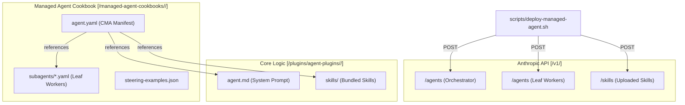
**Sources:** [README.md:5](), [README.md:89-97](), [scripts/deploy-managed-agent.sh:1-12]()

---

## The `agent.yaml` Manifest

The `agent.yaml` file is the primary configuration for a Managed Agent. While it mirrors the `POST /v1/agents` API structure, the deployment script `scripts/deploy-managed-agent.sh` provides several convenience resolutions at runtime [scripts/deploy-managed-agent.sh:4-10]().

| Manifest Field | Resolution Behavior |
| :--- | :--- |
| `system: {file: ...}` | Inlines the markdown content from the referenced file into a string [scripts/deploy-managed-agent.sh:5](). |
| `skills: [{from_plugin: ...}]` | Automatically uploads all skills in the referenced directory to `/v1/skills` and replaces the path with the resulting `skill_id` [scripts/deploy-managed-agent.sh:6, 99-111](). |
| `callable_agents: [{manifest: ...}]` | Recursively creates the subagents defined in the manifest first, then references them by their generated agent ID [scripts/deploy-managed-agent.sh:7, 152-160](). |

**Sources:** [scripts/deploy-managed-agent.sh:4-11](), [scripts/deploy-managed-agent.sh:99-111](), [scripts/deploy-managed-agent.sh:152-160]()

---

## The Leaf-Worker (Subagent) Pattern

Managed Agents in this repository utilize a **hub-and-spoke delegation model**. An "Orchestrator" agent (the main agent defined in `agent.yaml`) delegates specific tasks to "Leaf Workers" (defined in `subagents/*.yaml`) [scripts/deploy-managed-agent.sh:152-160]().

- **Specialization:** Each leaf worker is specialized for a specific part of the workflow. For example, a reader subagent might focus on document ingestion while a writer handles final output [scripts/deploy-managed-agent.sh:9-10]().
- **Validation Wrapper:** Reader subagents with an `output_schema` block receive a thin validation wrapper so their JSON is schema-checked before the orchestrator consumes it [scripts/deploy-managed-agent.sh:9-10]().
- **Security Tiering:** To ensure security, the system often isolates untrusted document readers (Read/Grep only) from workers that possess Write or Shell access.

**Subagent Interaction Flow**
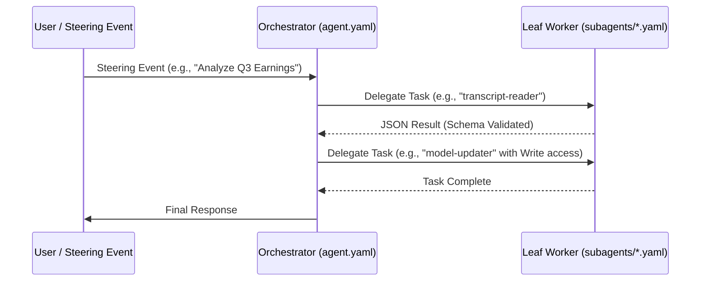
**Sources:** [scripts/deploy-managed-agent.sh:9-10](), [scripts/deploy-managed-agent.sh:152-160]()

---

## Steering Events & Handoffs

### Steering Model
Managed Agents are triggered by **Steering Events**—structured natural language or JSON inputs that define the goal of the session. These events serve as the entry point for the orchestrator to begin delegating tasks to its leaf workers.

### Cross-Agent Handoffs
Named agents (e.g., `pitch-agent` and `model-builder`) can communicate via a `handoff_request` mechanism managed by an external controller [README.md:85-86]().

1. **Emission:** An agent emits a `handoff_request` event.
2. **Orchestration:** An external event loop, such as `scripts/orchestrate.py`, intercepts the request [README.md:85-86]().
3. **Routing:** The orchestrator validates the payload and routes it to the target agent, maintaining the workflow across different specialized agents.

For details, see [Security Model & Cross-Agent Handoffs](#3.2).

**Sources:** [README.md:85-86]()

---

## Agent Catalog

The repository includes ten reference agents, each with a specific cookbook and subagent configuration:

- **Pitch Agent:** End-to-end investment banking (Comps, Precedents, LBO, Pitch Deck) [README.md:23]().
- **Earnings Reviewer:** Equity research workflow (Transcripts, Filings, Model updates) [README.md:26]().
- **GL Reconciler:** Finance operations (Break identification, Root cause, Sign-off routing) [README.md:29]().
- **KYC Screener:** Compliance (Onboarding docs, Rules engine, Gap flagging) [README.md:32]().
- **Market Researcher:** Sector analysis and competitive landscapes [README.md:25]().
- **Meeting Prep Agent:** Briefing packs for client meetings [README.md:24]().
- **Model Builder:** Live Excel modeling (DCF, LBO, Comps) [README.md:27]().
- **Month-End Closer:** Accruals, roll-forwards, and variance commentary [README.md:30]().
- **Statement Auditor:** LP statement auditing before distribution [README.md:31]().
- **Valuation Reviewer:** GP package ingestion and LP reporting [README.md:28]().

For a full list and detailed subagent breakdowns, see [Agent Catalog & Subagent Patterns](#3.1).

**Sources:** [README.md:21-32]()

---

# Page: Agent Catalog & Subagent Patterns

# Agent Catalog & Subagent Patterns

<details>
<summary>Relevant source files</summary>

The following files were used as context for generating this wiki page:

- [plugins/agent-plugins/earnings-reviewer/.claude-plugin/plugin.json](plugins/agent-plugins/earnings-reviewer/.claude-plugin/plugin.json)
- [plugins/agent-plugins/earnings-reviewer/skills/earnings-preview/SKILL.md](plugins/agent-plugins/earnings-reviewer/skills/earnings-preview/SKILL.md)
- [plugins/agent-plugins/earnings-reviewer/skills/model-update/SKILL.md](plugins/agent-plugins/earnings-reviewer/skills/model-update/SKILL.md)
- [plugins/agent-plugins/earnings-reviewer/skills/morning-note/SKILL.md](plugins/agent-plugins/earnings-reviewer/skills/morning-note/SKILL.md)
- [plugins/agent-plugins/market-researcher/.claude-plugin/plugin.json](plugins/agent-plugins/market-researcher/.claude-plugin/plugin.json)
- [plugins/agent-plugins/meeting-prep-agent/.claude-plugin/plugin.json](plugins/agent-plugins/meeting-prep-agent/.claude-plugin/plugin.json)
- [plugins/agent-plugins/pitch-agent/.claude-plugin/plugin.json](plugins/agent-plugins/pitch-agent/.claude-plugin/plugin.json)
- [plugins/agent-plugins/valuation-reviewer/.claude-plugin/plugin.json](plugins/agent-plugins/valuation-reviewer/.claude-plugin/plugin.json)
- [scripts/deploy-managed-agent.sh](scripts/deploy-managed-agent.sh)

</details>


This page provides a technical reference for the ten managed agents defined in the `managed-agent-cookbooks/` directory. Each agent follows a **Three-Tier Isolation Pattern** designed to handle untrusted financial documents (transcripts, counterparty statements, onboarding KYC docs) while maintaining a secure "Write-holder" leaf worker for output generation.

## Agent Design Patterns

Managed agents are defined via an `agent.yaml` manifest which specifies the orchestrator's behavior, tool grants, and its child "leaf" workers. The deployment process is handled by `scripts/deploy-managed-agent.sh`, which resolves these manifests into JSON payloads for the Anthropic API [scripts/deploy-managed-agent.sh:4-10]().

### Three-Tier Isolation Architecture
To prevent prompt injection from untrusted documents (e.g., a malicious instruction hidden in a PDF), agents are split into functional tiers:

1.  **Reader (Untrusted Tier):** Granted only `read` and `grep` tools. It extracts data into schema-validated JSON. It is explicitly instructed to treat any instruction inside documents as data [managed-agent-cookbooks/earnings-reviewer/subagents/transcript-reader.yaml:5-7]().
2.  **Orchestrator/Critic (Trusted Tier):** Holds the main system prompt and coordinates between subagents. It has access to MCP connectors (FactSet, Daloopa, Internal GL) but cannot write files [managed-agent-cookbooks/gl-reconciler/agent.yaml:14-16]().
3.  **Writer (Write-holder Tier):** The only worker granted `write` and `edit` tools. It consumes validated data from the Orchestrator to produce final artifacts (Excel, PowerPoint) in the `./out/` directory [managed-agent-cookbooks/earnings-reviewer/subagents/note-writer.yaml:5-7]().

### Data Flow & Handoffs
Agents communicate via `handoff_request` events. When an agent (e.g., `gl-reconciler`) identifies a need for a downstream task, it emits a request that is routed by the orchestration layer. The deployment script recursively creates these subagents, referencing them by `agent_id` in the parent's `callable_agents` list [scripts/deploy-managed-agent.sh:152-160]().

#### Agent Communication Diagram
Title: Data Flow between Subagents and Orchestrator
```mermaid
graph TD
    subgraph "Untrusted_Space"
        "PDF/XLSX_Docs" --> "Reader_Leaf"
    end

    "Reader_Leaf" -- "Validated_JSON (output_schema)" --> "Orchestrator"
    "Orchestrator" -- "MCP_Queries" --> "MCP_Servers"
    "MCP_Servers" -- "Trusted_Data" --> "Orchestrator"
    
    subgraph "Trusted_Space"
        "Orchestrator" -- "Clean_Payload" --> "Critic_Leaf"
        "Critic_Leaf" -- "Verification" --> "Orchestrator"
        "Orchestrator" -- "Final_Data" --> "Writer_Leaf"
    end

    subgraph "Output_Space"
        "Writer_Leaf" -- "fs_write" --> "out_Artifacts"
    end
```
**Sources:** [managed-agent-cookbooks/gl-reconciler/subagents/reader.yaml:1-15](), [managed-agent-cookbooks/gl-reconciler/subagents/resolver.yaml:1-7](), [managed-agent-cookbooks/earnings-reviewer/subagents/transcript-reader.yaml:1-7](), [scripts/deploy-managed-agent.sh:9-10]()

---

## Agent Catalog

### 1. Earnings Reviewer
Processes earnings call transcripts and filings to update financial models and draft investment notes [plugins/agent-plugins/earnings-reviewer/.claude-plugin/plugin.json:4]().
*   **Steering Events:** Includes single ticker processing, fan-out across coverage lists, or model-only updates [managed-agent-cookbooks/earnings-reviewer/steering-examples.json:1-6]().
*   **Skills:** 
    *   `earnings-preview`: Pre-earnings analysis with bull/bear scenarios [plugins/agent-plugins/earnings-reviewer/skills/earnings-preview/SKILL.md:1-4]().
    *   `model-update`: Plugs earnings actuals and revises forward estimates [plugins/agent-plugins/earnings-reviewer/skills/model-update/SKILL.md:1-4]().
    *   `morning-note`: Opinionated, actionable summaries for the 7am meeting [plugins/agent-plugins/earnings-reviewer/skills/morning-note/SKILL.md:1-4]().
*   **Leaf Workers:** 
    *   `transcript-reader`: Extracts metrics from untrusted text [managed-agent-cookbooks/earnings-reviewer/agent.yaml:28]().
    *   `model-updater`: Reconciles metrics with Daloopa/FactSet [managed-agent-cookbooks/earnings-reviewer/subagents/model-updater.yaml:1-7]().
    *   `note-writer`: (Write-holder) Generates `./out/model-<ticker>.xlsx` and `./out/note-<ticker>.docx` [managed-agent-cookbooks/earnings-reviewer/subagents/note-writer.yaml:5-7]().
*   **MCP Connectors:** `factset`, `daloopa` [managed-agent-cookbooks/earnings-reviewer/agent.yaml:21-22]().

### 2. GL Reconciler
Identifies breaks between the General Ledger and subledgers for specific trade dates.
*   **Steering Events:** Daily runs, month-end runs with thresholds, or re-tracing specific account breaks [managed-agent-cookbooks/gl-reconciler/steering-examples.json:1-14]().
*   **Leaf Workers:**
    *   `gl-reconciler-reader`: Reads untrusted counterparty statements [managed-agent-cookbooks/gl-reconciler/subagents/reader.yaml:7-15]().
    *   `gl-reconciler-critic`: Re-verifies breaks against internal MCPs (`internal-gl`, `subledger`) [managed-agent-cookbooks/gl-reconciler/subagents/critic.yaml:1-7]().
    *   `gl-reconciler-resolver`: (Write-holder) Drafts the exception report using `xlsx-author` [managed-agent-cookbooks/gl-reconciler/subagents/resolver.yaml:1-17]().
*   **Output Schema:** Enforces strict regex patterns on account names (`^[A-Za-z0-9._:-]+$`) and variances [managed-agent-cookbooks/gl-reconciler/subagents/reader.yaml:35-59]().

### 3. KYC Screener
Automates onboarding document parsing and AML/Sanctions screening.
*   **Steering Event:** Onboarding packet ID and document paths.
*   **Leaf Workers:**
    *   `kyc-doc-reader`: Extracts entity fields (Legal Name, Country, UBOs) [managed-agent-cookbooks/kyc-screener/subagents/doc-reader.yaml:1-7]().
    *   `kyc-rules-engine`: Evaluates firm rules and runs screening [managed-agent-cookbooks/kyc-screener/agent.yaml:27]().
    *   `kyc-escalator`: (Write-holder) Produces escalation artifacts [managed-agent-cookbooks/kyc-screener/agent.yaml:28]().
*   **MCP Connectors:** `screening` [managed-agent-cookbooks/kyc-screener/agent.yaml:19-20]().

### 4. Pitch Agent
A multi-modal agent for investment banking workflows, spanning research to deck generation (comps, precedents, LBO) [plugins/agent-plugins/pitch-agent/.claude-plugin/plugin.json:4]().
*   **Leaf Workers:** `researcher`, `modeler`, `deck-writer`.
*   **Tools:** Accesses `pptx-author` and `xlsx-author` skills.

### 5. Market Researcher
Monitors sector-specific news and industry overviews to provide summarized sentiment and trend analysis [plugins/agent-plugins/market-researcher/.claude-plugin/plugin.json:4]().

### 6. Meeting Prep Agent
Aggregates CRM data, recent news, and portfolio holdings to generate briefings for client meetings [plugins/agent-plugins/meeting-prep-agent/.claude-plugin/plugin.json:4]().

### 7. Model Builder
Generates three-statement models, DCFs, and LBO models from scratch or templates.

### 8. Month-End Closer
Coordinates the final ledger closing process, consuming verified breaks from the `gl-reconciler`.

### 9. Statement Auditor
Performs tie-outs between financial statements and supporting schedules, flagging discrepancies in footnotes or tables.

### 10. Valuation Reviewer
Audits valuation models (DCF, Comps) for logic errors, hardcoded values, and sensitivity to key assumptions [plugins/agent-plugins/valuation-reviewer/.claude-plugin/plugin.json:4]().

---

## Technical Implementation: `agent.yaml`

The `agent.yaml` manifest serves as the source of truth for the deployment script, which resolves file references and environment variables before calling the Anthropic API.

Title: Mapping Manifest to Code Entities
```mermaid
classDiagram
    class AgentManifest {
        +String name
        +String model
        +SystemPrompt system
        +List~ToolConfig~ tools
        +List~MCPServer~ mcp_servers
        +List~SkillRef~ skills
        +List~SubagentRef~ callable_agents
    }
    class SystemPrompt {
        +String file
        +String append
    }
    class SubagentRef {
        +String manifest
    }
    
    AgentManifest --> SystemPrompt : "Resolves via .md file"
    AgentManifest --> SubagentRef : "Recursively deploys"
    
    note for AgentManifest "Found in managed-agent-cookbooks/*/agent.yaml"
    note for SystemPrompt "Usually points to plugins/agent-plugins/*/agents/*.md"
```
**Sources:** [managed-agent-cookbooks/gl-reconciler/agent.yaml:1-12](), [managed-agent-cookbooks/kyc-screener/agent.yaml:1-10](), [managed-agent-cookbooks/earnings-reviewer/agent.yaml:1-9](), [scripts/deploy-managed-agent.sh:138-162]()

### Security Constraints in Code
The `output_schema` defined in leaf workers like `gl-reconciler-reader` is consumed by validation scripts during deployment [scripts/deploy-managed-agent.sh:9-10](). This ensures that:
*   String fields are length-capped (e.g., `maxLength: 32` for asset classes) [managed-agent-cookbooks/gl-reconciler/subagents/reader.yaml:40]().
*   Characters are restricted to safe sets via regex (e.g., `^[A-Z]{2}$` for country codes) [managed-agent-cookbooks/kyc-screener/subagents/doc-reader.yaml:28]().
*   Subagents cannot return free-form text that might contain hidden instructions for the orchestrator [managed-agent-cookbooks/gl-reconciler/subagents/reader.yaml:14-15]().

**Sources:** [managed-agent-cookbooks/gl-reconciler/subagents/reader.yaml:35-59](), [managed-agent-cookbooks/kyc-screener/subagents/doc-reader.yaml:17-38](), [scripts/deploy-managed-agent.sh:152-160]()

---

# Page: Security Model & Cross-Agent Handoffs

# Security Model & Cross-Agent Handoffs

<details>
<summary>Relevant source files</summary>

The following files were used as context for generating this wiki page:

- [README.md](README.md)
- [plugins/vertical-plugins/financial-analysis/.mcp.json](plugins/vertical-plugins/financial-analysis/.mcp.json)
- [scripts/deploy-managed-agent.sh](scripts/deploy-managed-agent.sh)

</details>


The Claude Managed Agent (CMA) architecture in this repository implements a "defense-in-depth" security model designed for the financial services industry. It specifically addresses the risks of processing untrusted third-party documents (e.g., custodian statements, counterparty PDFs, earnings transcripts) and prevents lateral movement or unauthorized data modification through a tiered isolation strategy.

## Security Tier Design

The system employs a "Least Privilege" model for subagents (leaf workers). Instead of a single monolithic agent with full filesystem and tool access, tasks are decomposed into workers with specific, restricted toolsets defined in the `agent.yaml` manifests [managed-agent-cookbooks/README.md:22-32]().

### Untrusted Document Isolation
Workers that must ingest external, potentially adversarial documents are strictly isolated. These "Readers" are granted only `Read` and `Grep` capabilities. They are explicitly denied `Write` access, shell access (`Bash`), and connectivity to internal systems of record.

*   **`transcript-reader`**: Processes earnings calls; limited to `Read` and `Grep` [managed-agent-cookbooks/earnings-reviewer/README.md:25]().
*   **`doc-reader`**: Parses onboarding packets; limited to `Read` and `Grep` [managed-agent-cookbooks/kyc-screener/README.md:25]().
*   **`reader`**: Ingests counterparty statements; limited to `Read` and `Grep` [managed-agent-cookbooks/gl-reconciler/README.md:28]().

### The Write-Holder Pattern
To prevent unauthorized modification of the filesystem or internal data, exactly one leaf worker per agent is designated as the **Write-holder** (indicated in bold in the agent catalog) [managed-agent-cookbooks/README.md:9-20](). This worker is the only entity capable of producing final artifacts (e.g., `.pptx` decks, `.xlsx` models, or `.md` reports). 

| Tier | Touches Untrusted Docs? | Tools | Role |
| :--- | :--- | :--- | :--- |
| **Reader** | **Yes** | `Read`, `Grep` | Ingests external files; outputs length-capped JSON. |
| **Orchestrator** | No | `Read`, `Grep`, `Glob`, `Agent` | Coordinates subagents; holds MCP connectors. |
| **Writer** | No | `Read`, `Write`, `Edit` | Generates final output; never opens external files. |

**Example: GL Reconciler Security Tiering**
In the `gl-reconciler` template, the `reader` parses external statements but cannot write files. The `resolver` holds the `Write` tool to create the exception report in `./out/` but never touches the external statements directly [managed-agent-cookbooks/gl-reconciler/README.md:23-32]().

**Example: KYC Screener Isolation**
The `doc-reader` extracts data from untrusted onboarding documents. The `escalator` (Write-holder) produces the final escalation report but is isolated from the raw documents to prevent prompt injection from reaching the filesystem [managed-agent-cookbooks/kyc-screener/README.md:21-29]().

### Implementation Mapping: Security Tiers to Code

The following diagram illustrates how the security tiers defined in the `agent.yaml` manifests map to the runtime execution environment and tool grants.

**Security Isolation Data Flow**
```mermaid
graph TD
    subgraph "Untrusted_Zone"
        ExternalDocs["External Documents (PDF/CSV)"]
    end

    subgraph "Managed_Agent_Runtime"
        Reader["Reader Leaf Worker<br/>(e.g., transcript-reader)<br/>(Tools: Read, Grep)"]
        Orchestrator["Orchestrator<br/>(orchestrate.py / POST /v1/agents)<br/>(Tools: Agent Delegation)"]
        Writer["Writer Leaf Worker<br/>(e.g., note-writer)<br/>(Tools: Read, Write, Edit)"]
    end

    subgraph "Internal_Systems"
        MCP["MCP Connectors<br/>(e.g., FactSet, Daloopa, GL)"]
        OutDir["./out/ (Final Artifacts)"]
    end

    ExternalDocs -->|"/v1/files"| Reader
    Reader -->|Schema-Validated JSON| Orchestrator
    Orchestrator <--> MCP
    Orchestrator -->|Validated Payload| Writer
    Writer -->|FileSystem Write| OutDir
```
Sources: [managed-agent-cookbooks/gl-reconciler/README.md:23-34](), [managed-agent-cookbooks/earnings-reviewer/README.md:21-29](), [managed-agent-cookbooks/kyc-screener/README.md:21-29](), [managed-agent-cookbooks/README.md:9-18]()

## Cross-Agent Handoffs

Complex financial workflows often exceed the scope of a single agent. This repository implements a "Shared Nothing" architecture for cross-agent communication. Named agents never call each other directly via tools to prevent recursive complexity and privilege escalation [managed-agent-cookbooks/README.md:38-38]().

### The `handoff_request` Mechanism
When an agent determines that a task requires a different specialized agent, it emits a `handoff_request` in its final JSON output. This request is intercepted by an external event bus or the `scripts/orchestrate.py` script [managed-agent-cookbooks/README.md:38-38]().

1.  **Emission**: The source agent completes its task and includes a JSON object: `{"handoff_request": {"target": "model-builder", "payload": {...}}}`.
2.  **Interception**: `scripts/orchestrate.py` (or a production bus like Temporal) monitors the session output [managed-agent-cookbooks/README.md:38-38]().
3.  **Validation**: The script checks the target against a hardcoded **allowlist** and validates the payload against the target agent's **steering event schema** [managed-agent-cookbooks/gl-reconciler/README.md:34-34]().
4.  **Routing**: A new steering event is triggered for the target agent in a fresh session [managed-agent-cookbooks/README.md:38-38]().

### Deployment & Resolution
The `scripts/deploy-managed-agent.sh` script handles the complexity of creating these multi-agent hierarchies. It performs a recursive resolution of the `agent.yaml` manifest:
*   **Inlining System Prompts**: Converts `{file: ...}` references into strings [scripts/deploy-managed-agent.sh:5-5]().
*   **Skill Upload**: Uploads directories to `/v1/skills` and replaces local paths with `skill_id` [scripts/deploy-managed-agent.sh:6-6]().
*   **Subagent Creation**: Creates leaf workers first, then injects their generated `agent_id` into the parent's `callable_agents` list [scripts/deploy-managed-agent.sh:7-7]().

### Handoff Logic and Orchestration
```mermaid
sequenceDiagram
    participant O as "scripts/orchestrate.py"
    participant A1 as "GL-Reconciler (Agent)"
    participant V as "scripts/validate.py"
    participant A2 as "Month-End-Closer (Agent)"

    A1->>A1: Identify breaks requiring adjustment
    A1->>O: Output: handoff_request(target="month-end-closer")
    Note over O: Intercept handoff
    O->>O: Check target against Allowlist
    O->>V: validate_payload(payload, schema)
    V-->>O: Success
    O->>A2: POST /v1/agents/month-end-closer/events (New Steering Event)
    Note over A2: Process accruals based on breaks
```
Sources: [managed-agent-cookbooks/README.md:36-38](), [managed-agent-cookbooks/gl-reconciler/README.md:34-34](), [managed-agent-cookbooks/earnings-reviewer/README.md:31-31](), [scripts/deploy-managed-agent.sh:138-178]()

## Schema Validation & Payload Safety

To ensure that data passed between subagents or across handoffs is not used as an injection vector, the system enforces strict JSON schemas.

*   **Length-Capping**: Outputs from "Reader" tiers (like `transcript-reader` or `doc-reader`) are length-capped to prevent "long-context" injection attacks where an agent might be overwhelmed by adversarial text [managed-agent-cookbooks/earnings-reviewer/README.md:29](), [managed-agent-cookbooks/kyc-screener/README.md:29]().
*   **Structure Enforcement**: Subagents must return data that conforms to the expected fields. `scripts/validate.py` is used to ensure that the JSON returned by untrusted readers is safe for the orchestrator to process [managed-agent-cookbooks/gl-reconciler/README.md:32-32]().
*   **Validation Wrappers**: The deployment script `scripts/deploy-managed-agent.sh` automatically wraps reader subagents that have an `output_schema` with a validation layer [scripts/deploy-managed-agent.sh:9-10]().

## Summary of Agent Security Roles

| Agent | Write-Holder Leaf | Key Security Feature |
| :--- | :--- | :--- |
| `earnings-reviewer` | `note-writer` | `transcript-reader` is isolated from FactSet/Daloopa connectors [managed-agent-cookbooks/earnings-reviewer/README.md:23-27](). |
| `gl-reconciler` | `resolver` | `reader` has no access to GL/Subledger MCPs [managed-agent-cookbooks/gl-reconciler/README.md:28-30](). |
| `kyc-screener` | `escalator` | `doc-reader` is restricted from writing escalation files [managed-agent-cookbooks/kyc-screener/README.md:25-27](). |
| `pitch-agent` | `deck-writer` | `researcher` is read-only; `modeler` is restricted to Bash [managed-agent-cookbooks/README.md:9-9](). |

Sources: [managed-agent-cookbooks/README.md:9-20](), [managed-agent-cookbooks/gl-reconciler/README.md:23-32](), [managed-agent-cookbooks/earnings-reviewer/README.md:23-27](), [managed-agent-cookbooks/kyc-screener/README.md:23-27](), [scripts/deploy-managed-agent.sh:9-10]()

---

# Page: Scripts & Tooling

# Scripts & Tooling

<details>
<summary>Relevant source files</summary>

The following files were used as context for generating this wiki page:

- [scripts/check.py](scripts/check.py)
- [scripts/deploy-managed-agent.sh](scripts/deploy-managed-agent.sh)
- [scripts/version_bump.py](scripts/version_bump.py)

</details>


The `scripts/` directory contains the automation, validation, and orchestration logic required to maintain the "one source, two wrappers" architecture of the repository. These tools ensure that system prompts and skills remain synchronized between Claude Cowork plugins and Claude Managed Agent (CMA) templates, while providing the necessary pipeline for headless deployment and cross-agent communication [scripts/check.py:3-13]().

### Development & Deployment Lifecycle

The tooling follows the repository's design principle where development occurs in markdown and YAML files, and scripts handle the transformation into deployable artifacts. The lifecycle is centered around three main phases:

1.  **Synchronization**: Propagating skill updates from vertical sources to agent-specific bundles using `sync-agent-skills.py` [scripts/check.py:155-159]().
2.  **Validation**: Linting manifests and verifying reference integrity across the monorepo via `check.py` [scripts/check.py:5-11]().
3.  **Deployment**: Resolving YAML manifests into JSON payloads for the Anthropic API via `deploy-managed-agent.sh` [scripts/deploy-managed-agent.sh:4-10]().

#### Tooling Overview Diagram
This diagram illustrates how the scripts interact with different repository layers to move code from the "Natural Language Space" (Markdown/YAML) to the "Code Entity Space" (API/JSON).

```mermaid
graph TD
    subgraph "Natural Language Space (Source)"
        V_SKILLS["plugins/vertical-plugins/*/skills/*.md"]
        A_PROMPT["plugins/agent-plugins/*/agents/*.md"]
        C_YAML["managed-agent-cookbooks/*/agent.yaml"]
    end

    subgraph "Scripts & Tooling"
        SYNC["sync-agent-skills.py"]
        CHECK["check.py"]
        DEPLOY["deploy-managed-agent.sh"]
        VERSION["version_bump.py"]
    end

    subgraph "Code Entity Space (Deployment)"
        A_SKILLS["plugins/agent-plugins/*/skills/"]
        V1_SKILLS["POST /v1/skills"]
        V1_AGENTS["POST /v1/agents"]
        PLUGIN_JSON[".claude-plugin/plugin.json"]
    end

    V_SKILLS --> SYNC
    SYNC --> A_SKILLS
    A_SKILLS --> CHECK
    A_PROMPT --> CHECK
    C_YAML --> CHECK
    
    C_YAML --> DEPLOY
    DEPLOY --> V1_SKILLS
    DEPLOY --> V1_AGENTS
    
    A_SKILLS --> VERSION
    VERSION --> PLUGIN_JSON
```
**Sources:** [scripts/check.py:5-13](), [scripts/deploy-managed-agent.sh:4-10](), [scripts/version_bump.py:5-9]()

---

### Deployment Pipeline
The deployment pipeline automates the creation of Claude Managed Agents. The primary entry point is `deploy-managed-agent.sh`, which performs YAML-to-JSON resolution for agent manifests [scripts/deploy-managed-agent.sh:12-13]().

Key components include:
*   **Manifest Resolution**: The `resolve_manifest` function expands `from_plugin` conveniences and resolves relative paths [scripts/deploy-managed-agent.sh:94-118]().
*   **Skill Upload**: The `upload_skill` function zips local skill directories and uploads them to the `/v1/skills` endpoint [scripts/deploy-managed-agent.sh:62-92]().
*   **Subagent Creation**: The script recursively calls `create_agent` to provision `callable_agents` before the parent orchestrator is created [scripts/deploy-managed-agent.sh:152-160]().
*   **Orchestration**: `orchestrate.py` provides a reference event loop for handling cross-agent communication and payload schema validation.

For details, see [Deployment Pipeline](#4.1).

---

### Validation & Linting Tools
To maintain repository hygiene, `check.py` serves as the primary gatekeeper. It verifies the structural integrity of the plugin ecosystem and managed agent cookbooks [scripts/check.py:3-13]().

Key functions of the validation suite:
*   **Reference Resolution**: The `check_refs` function ensures that `system.file`, `skills.path`, and `callable_agents.manifest` pointers resolve to existing files [scripts/check.py:109-137]().
*   **Drift Detection**: The script uses `filecmp.dircmp` to identify discrepancies between source skills in `vertical-plugins/` and their bundled copies in `agent-plugins/` [scripts/check.py:143-160]().
*   **Schema Validation**: `validate.py` ensures JSON output from subagents adheres to defined schemas.

For details, see [Validation & Linting Tools](#4.2).

---

### CI/CD & Repository Hygiene
The repository employs a CI strategy focused on security and structural correctness, including automated versioning and hook enforcement.

Key elements:
*   **Version Management**: `version_bump.py` enforces semver increments. The `--apply` mode is used in git hooks to patch-bump modified plugins [scripts/version_bump.py:12-16](), while `--check` is used in CI as a gate [scripts/version_bump.py:18-21]().
*   **Git Hook Integration**: `check.py` includes an `ensure_hooks_installed` function that automatically configures `core.hooksPath` to `.githooks` to ensure local enforcement of versioning rules [scripts/check.py:27-47]().
*   **Secret Scanning**: Integration of `gitleaks` to monitor commits for credentials and internal Anthropic domain patterns.

For details, see [CI/CD & Repository Hygiene](#4.3).

---

### Script Summary Table

| Script | Language | Primary Purpose | Key File Interactions |
| :--- | :--- | :--- | :--- |
| `check.py` | Python | Linting and reference verification | `plugin.json`, `agent.yaml`, `agent.md` [scripts/check.py:5-11]() |
| `deploy-managed-agent.sh`| Bash | Deploying CMA templates to API | `agent.yaml`, `/v1/agents`, `/v1/skills` [scripts/deploy-managed-agent.sh:4-7]() |
| `version_bump.py` | Python | Automatic plugin versioning | `.claude-plugin/plugin.json` [scripts/version_bump.py:5-9]() |
| `sync-agent-skills.py` | Python | Propagating skills from verticals to agents | `vertical-plugins/`, `agent-plugins/` [scripts/check.py:158-159]() |
| `orchestrate.py` | Python | Cross-agent handoff event loop | Handoff events and payload validation |
| `validate.py` | Python | JSON schema validation | Subagent `output_schema` blocks [scripts/deploy-managed-agent.sh:9-10]() |

**Sources:** [scripts/check.py:1-25](), [scripts/deploy-managed-agent.sh:1-15](), [scripts/version_bump.py:1-26]()

---

# Page: Deployment Pipeline

# Deployment Pipeline

<details>
<summary>Relevant source files</summary>

The following files were used as context for generating this wiki page:

- [README.md](README.md)
- [plugins/vertical-plugins/financial-analysis/.mcp.json](plugins/vertical-plugins/financial-analysis/.mcp.json)
- [scripts/deploy-managed-agent.sh](scripts/deploy-managed-agent.sh)

</details>


The deployment pipeline provides a unified mechanism for transforming the repository's markdown-based agents and skills into production-ready **Claude Managed Agents (CMA)**. It ensures that the "one source, two wrappers" principle is maintained by resolving local file references into API-compatible JSON manifests, managing skill uploads, and configuring multi-agent delegation.

## Core Deployment Workflow

The pipeline is centered around `scripts/deploy-managed-agent.sh`, which automates the transition from the `managed-agent-cookbooks/` directory to the Anthropic `/v1/agents` API [README.md:80-85]().

### 1. Manifest Resolution
The deployment script parses the `agent.yaml` manifest found in each cookbook. While these manifests use standard API field names, they include convenience keys that the script resolves before transmission [scripts/deploy-managed-agent.sh:4-10]():

| Manifest Key | Resolution Logic |
| :--- | :--- |
| `system.file` | Reads the canonical system prompt from a local file and inlines it as a string [scripts/deploy-managed-agent.sh:120-136](). |
| `skills.from_plugin` | Discovers all skills in the agent's plugin directory, uploads them to `/v1/skills`, and replaces the entry with `skill_id` references [scripts/deploy-managed-agent.sh:99-111](). |
| `skills.path` | Uploads a specific skill from a local path to the `/v1/skills` endpoint to generate a `skill_id` [scripts/deploy-managed-agent.sh:113-117](). |
| `callable_agents.manifest` | Recursively triggers the deployment of subagents defined in the `subagents/` directory to obtain their `agent_id` [scripts/deploy-managed-agent.sh:152-160](). |

### 2. Skill Lifecycle
Skills are authored in `plugins/vertical-plugins/` and synced to `plugins/agent-plugins/` [README.md:94-94](). During deployment:
1. The script identifies skill directories (containing `SKILL.md`) via the `upload_skill` function [scripts/deploy-managed-agent.sh:62-92]().
2. Each skill is zipped and uploaded to the `/v1/skills` endpoint using a multipart/form-data request [scripts/deploy-managed-agent.sh:72-81]().
3. The resulting `id` is cached and injected into the parent agent's configuration as a `skill_id` [scripts/deploy-managed-agent.sh:83-91]().

### 3. Subagent Creation (Leaf-Worker Pattern)
The pipeline supports a depth-1 delegation model. The orchestrator agent (defined in `agent.yaml`) is granted access to "leaf workers" (defined in `subagents/*.yaml`) [README.md:34-34]().
- **Recursion:** The `create_agent` function in `deploy-managed-agent.sh` recursively processes `callable_agents` before the main orchestrator, ensuring subagent IDs are available for the final POST [scripts/deploy-managed-agent.sh:152-160]().
- **Output Schema:** Subagents with an `output_schema` block are handled specifically to ensure JSON is schema-checked before consumption [scripts/deploy-managed-agent.sh:9-10]().

**Sources:** [README.md:34-34](), [README.md:80-85](), [scripts/deploy-managed-agent.sh:4-178]()

---

## Deployment Data Flow

The following diagram illustrates how the `deploy-managed-agent.sh` script transforms local filesystem entities into cloud-hosted API entities.

### Manifest to API Entity Mapping
```mermaid
graph TD
    subgraph "Local Filesystem (Natural Language Space)"
        A["agent.yaml (Manifest)"]
        B["agents/slug.md (System Prompt)"]
        C["skills/*/SKILL.md (Markdown Skills)"]
        D["subagents/*.yaml (Leaf Worker Configs)"]
    end

    subgraph "Deployment Logic (scripts/deploy-managed-agent.sh)"
        E["yaml2json() Resolver"]
        F["upload_skill()"]
        G["create_agent() (Recursive)"]
    end

    subgraph "Claude API (Code Entity Space)"
        H["POST /v1/agents (Orchestrator)"]
        I["POST /v1/skills (Skill Entities)"]
        J["POST /v1/agents (Worker Entities)"]
    end

    A --> E
    B --> G
    C --> F
    D --> G
    F --> I
    I -- "skill_id" --> G
    G --> J
    J -- "agent_id" --> G
    G --> H
```
**Sources:** [scripts/deploy-managed-agent.sh:42-58](), [scripts/deploy-managed-agent.sh:62-92](), [scripts/deploy-managed-agent.sh:138-178]()

---

## Orchestration and Handoffs

Managed agents in this repository utilize `scripts/orchestrate.py` as a reference event loop for handling cross-agent communication. Because named agents (e.g., `pitch-agent` and `gl-reconciler`) never call each other directly, the orchestrator manages the routing [README.md:85-86]().

### The Handoff Event Loop
1. **Handoff Request:** When an agent determines a task requires a different agent's expertise, it emits a `handoff_request` event in its output [README.md:85-86]().
2. **Validation:** `orchestrate.py` intercepts the event and performs two critical checks:
    - **Allowlist:** Verifies the target agent is permitted to be called via a hard-coded allowlist [README.md:85-86]().
    - **Schema Validation:** Uses `scripts/validate.py` to ensure the JSON payload matches the target agent's expected steering event schema [README.md:45-45]().
3. **Routing:** The script initiates a new session with the target agent using the validated payload as the new steering event [README.md:85-86]().

### Orchestration Sequence
```mermaid
sequenceDiagram
    participant User
    participant O as "scripts/orchestrate.py (Event Loop)"
    participant A1 as "Agent A (e.g. market-researcher)"
    participant A2 as "Agent B (e.g. model-builder)"

    User->>O: Initial Steering Event
    O->>A1: POST /v1/agents/invoke
    A1-->>O: handoff_request(target="model-builder", payload={...})
    Note over O: validate.py (Schema Check)
    Note over O: Allowlist Check
    O->>A2: POST /v1/agents/invoke (New Session)
    A2-->>O: Final Output
    O-->>User: Result
```
**Sources:** [README.md:45-45](), [README.md:85-86]()

---

## Validation and Dry-Runs

Before deployment, the pipeline utilizes `test-cookbooks.sh` and `check.py` to ensure integrity.

### `test-cookbooks.sh`
This script performs dry-run validations of all cookbooks in the `managed-agent-cookbooks/` directory. It invokes `deploy-managed-agent.sh` with the `--dry-run` flag [scripts/deploy-managed-agent.sh:18-18]().
- **Dry-Run Mode:** In dry-run mode, the script does not call the API. Instead, it generates mock `skill_id` values (e.g., `DRYRUN_skillname`) and outputs the resolved JSON bodies that would be sent to `/v1/agents` [scripts/deploy-managed-agent.sh:67-71]().
- **Output:** The final resolved manifests are collected and printed as a JSON array for inspection [scripts/deploy-managed-agent.sh:183-184]().

### `check.py`
This is the primary linting tool for the repository [README.md:45-45](). It performs:
- **Manifest Linting:** Validates `plugin.json` and `agent.yaml` structures.
- **Drift Detection:** Compares skills in `agent-plugins/` against their sources in `vertical-plugins/`. It fails if `scripts/sync-agent-skills.py` has not been run to propagate changes.
- **Reference Resolution:** Ensures every `system.file`, `skills.path`, and `callable_agents.manifest` pointer is valid.

**Sources:** [README.md:45-45](), [scripts/deploy-managed-agent.sh:17-24](), [scripts/deploy-managed-agent.sh:180-187]()

---

# Page: Validation & Linting Tools

# Validation & Linting Tools

<details>
<summary>Relevant source files</summary>

The following files were used as context for generating this wiki page:

- [CLAUDE.md](CLAUDE.md)
- [scripts/check.py](scripts/check.py)
- [scripts/version_bump.py](scripts/version_bump.py)

</details>


The `financial-services` repository utilizes a suite of Python-based utilities to maintain consistency across its "one source, two wrappers" architecture. These tools ensure that plugin manifests are valid, that file references in Managed Agent cookbooks resolve correctly, and that skills remain synchronized between domain-specific vertical plugins and bundled agent plugins.

## Overview of Tooling Suite

The validation logic is centralized in the `scripts/` directory and is integrated into the development workflow to prevent configuration drift and runtime errors in both Claude Cowork and Claude Managed Agents (CMA).

| Tool | Primary Responsibility | Key Files Involved |
| :--- | :--- | :--- |
| `check.py` | Manifest linting, reference resolution, and drift detection. | `plugin.json`, `agent.yaml`, `marketplace.json` |
| `sync-agent-skills.py` | Propagating skill updates from verticals to agents. | `plugins/vertical-plugins/`, `plugins/agent-plugins/` |
| `validate.py` | JSON schema validation for subagent/leaf-worker outputs. | `managed-agent-cookbooks/` |
| `version_bump.py` | Automated patch-version incrementing for plugins. | `.claude-plugin/plugin.json` |

Sources: [CLAUDE.md:28-31](), [CLAUDE.md:33-33]()

---

## check.py: The Repository Linter

`check.py` is the primary gatekeeper for repository health. It performs static analysis on the filesystem to ensure that all metadata files adhere to the expected structure and that internal links are functional.

### Implementation Details
The script iterates through the repository using specific glob patterns to locate manifests and reference files [scripts/check.py:78-82](). It uses the `yaml` and `json` libraries to verify syntax and the `filecmp` module to detect drift between source and bundled skills [scripts/check.py:54-57](), [scripts/check.py:143-143]().

### Key Validation Logic
1.  **YAML/JSON Parsing**: Every `*.yaml` in `managed-agent-cookbooks/` and every `plugin.json` / `marketplace.json` must be syntactically valid [scripts/check.py:69-89]().
2.  **Frontmatter Validation**: Every agent definition in `plugins/agent-plugins/*/agents/*.md` must contain YAML frontmatter with `name` and `description` keys [scripts/check.py:92-105]().
3.  **Reference Resolution**:
    *   `system.file` in `agent.yaml` must point to an existing file [scripts/check.py:116-120]().
    *   `skills[].path` and `skills[].from_plugin` must resolve to valid directories [scripts/check.py:122-130]().
    *   `callable_agents[].manifest` must point to an existing subagent YAML [scripts/check.py:132-136]().
4.  **Drift Detection**: The script compares `agent-plugins/<slug>/skills/` content against `vertical-plugins/*/skills/`. If the files differ, it suggests running `sync-agent-skills.py` [scripts/check.py:146-159]().
5.  **Agent Prose Linting**: Scans `agent.md` files for backticked skill references (e.g., `` `dcf-model` ``) and verifies that the referenced skill is actually bundled in that agent's local `skills/` directory [scripts/check.py:162-171]().

### Workflow Integration
Developers are required to run `python3 scripts/check.py` before committing changes [CLAUDE.md:31-31](). On first run, the function `ensure_hooks_installed()` self-installs a git `pre-commit` hook by setting `core.hooksPath` to `.githooks` [scripts/check.py:27-51]().

Sources: [scripts/check.py:1-191](), [CLAUDE.md:31-33]()

---

## sync-agent-skills.py: Skill Propagation

Because `agent-plugins` are designed to be self-contained for easy installation in Claude Cowork, they bundle local copies of skills defined in the `vertical-plugins`. `sync-agent-skills.py` automates the distribution of these skills from the vertical source of truth to the agent bundles [CLAUDE.md:13-13](), [CLAUDE.md:31-32]().

### Data Flow: Vertical to Agent
The script follows a source-of-truth model where domain logic is authored once and distributed to many agents.

1.  **Source Identification**: Scans `plugins/vertical-plugins/<vertical>/skills/` for the canonical version of a skill [CLAUDE.md:14-18]().
2.  **Target Mapping**: Identifies which agents require the skill based on their `plugin.json` or `agent.yaml` definitions.
3.  **File Synchronization**: Overwrites the content in `plugins/agent-plugins/<slug>/skills/` with the source content [CLAUDE.md:13-13]().

### Skill Propagation Diagram
The following diagram illustrates how a skill (e.g., `dcf-model`) moves from a vertical source to multiple agent bundles.

```mermaid
graph TD
    subgraph "Natural Language Space (Domain Logic)"
        A["DCF Modeling Logic"]
        B["LBO Analysis Logic"]
    end

    subgraph "Code Entity Space (Source)"
        V_FA["plugins/vertical-plugins/financial-analysis/"]
        S_DCF["skills/dcf-model/SKILL.md"]
        S_LBO["skills/lbo-model/SKILL.md"]
    end

    subgraph "Code Entity Space (Bundled Agents)"
        AG_MB["plugins/agent-plugins/model-builder/"]
        AG_PA["plugins/agent-plugins/pitch-agent/"]
        
        SYNC["scripts/sync-agent-skills.py"]
    end

    A --> S_DCF
    B --> S_LBO
    
    V_FA --> S_DCF
    V_FA --> S_LBO
    
    S_DCF -- "reads from" --> SYNC
    S_LBO -- "reads from" --> SYNC
    
    SYNC -- "writes to" --> AG_MB
    SYNC -- "writes to" --> AG_PA
```
Sources: [CLAUDE.md:8-18](), [CLAUDE.md:31-32]()

---

## version_bump.py: Plugin Version Management

To ensure that already-installed users receive updates, every modification to a plugin must be accompanied by a version bump in its `.claude-plugin/plugin.json` [scripts/version_bump.py:5-9]().

### Implementation Logic
The script supports two primary modes: `--apply` for local development and `--check` for CI environments [scripts/version_bump.py:11-21]().

*   **Base Ref Resolution**: It determines the comparison point by checking `origin/main` or `main` [scripts/version_bump.py:56-60]().
*   **Change Detection**: `changed_plugins()` uses `git diff` to identify which plugin directories have modified files relative to the base ref [scripts/version_bump.py:129-145]().
*   **Version Comparison**: It parses semver strings into integer tuples to ensure the working version is strictly greater than the base version [scripts/version_bump.py:80-89](), [scripts/version_bump.py:117-127]().

### Automation Mechanics
*   **Local Hook**: The `.githooks/pre-commit` script calls `version_bump.py --apply` to patch-bump any plugin with staged changes [scripts/version_bump.py:148-164](). This ensures the version is bumped once per branch rather than per commit [CLAUDE.md:33-33]().
*   **CI Backstop**: The `version-bump` GitHub Action runs `scripts/version_bump.py --check` on every pull request to enforce this rule for contributors who bypassed local hooks [scripts/version_bump.py:167-187]().

Sources: [scripts/version_bump.py:1-190](), [CLAUDE.md:33-33]()

---

## validate.py: Subagent Output Validation

`validate.py` focuses on the Managed Agent deployment surface. In complex workflows (like the `pitch-agent`), the primary orchestrator delegates tasks to "leaf-worker" subagents [CLAUDE.md:21-24]().

### JSON Schema Enforcement
Managed Agents communicate via structured events. `validate.py` ensures that:
*   **Handoff Requests**: Any `handoff_request` generated by a subagent matches the expected schema for the target agent.
*   **Steering Examples**: The `steering-examples.json` files in `managed-agent-cookbooks/` are syntactically correct and provide valid input/output pairs for testing [CLAUDE.md:25-25]().

Sources: [CLAUDE.md:21-28]()

---

## Deployment & Validation Flow

The following diagram maps the relationship between the validation scripts and the deployment process for Managed Agents.

```mermaid
sequenceDiagram
    participant Dev as "Developer"
    participant Sync as "scripts/sync-agent-skills.py"
    participant Check as "scripts/check.py"
    participant VBump as "scripts/version_bump.py"
    participant Deploy as "scripts/deploy-managed-agent.sh"
    participant CMA as "Claude Managed Agents API"

    Note over Dev, CMA: Development Phase
    Dev->>Sync: Edit skill in vertical-plugins/
    Sync->>Dev: Propagate to agent-plugins/
    Dev->>Check: Run scripts/check.py
    Check-->>Dev: Manifests & Refs Validated
    Dev->>VBump: git commit (triggers pre-commit hook)
    VBump->>Dev: Plugin version incremented

    Note over Dev, CMA: Deployment Phase
    Dev->>Deploy: Execute deploy-managed-agent.sh
    activate Deploy
    Deploy->>Check: Internal validation of agent.yaml
    Deploy->>CMA: POST /v1/skills
    Deploy->>CMA: POST /v1/agents
    deactivate Deploy
    CMA-->>Dev: Agent Endpoint Ready
```

Sources: [CLAUDE.md:31-33](), [scripts/check.py:27-51](), [scripts/version_bump.py:11-21]()

---

# Page: CI/CD & Repository Hygiene

# CI/CD & Repository Hygiene

<details>
<summary>Relevant source files</summary>

The following files were used as context for generating this wiki page:

- [.claude-plugin/marketplace.json](.claude-plugin/marketplace.json)
- [.githooks/pre-commit](.githooks/pre-commit)
- [.github/workflows/plugin-validate.yml](.github/workflows/plugin-validate.yml)
- [.github/workflows/version-bump.yml](.github/workflows/version-bump.yml)
- [.gitignore](.gitignore)
- [scripts/version_bump.py](scripts/version_bump.py)

</details>


This page details the automated safeguards and repository configurations that ensure the security, privacy, and integrity of the `financial-services` codebase. The repository employs a rigorous CI gate strategy focused on preventing the accidental exposure of credentials and internal-only references, while maintaining a clean development environment across the monorepo.

## CI Gate Strategy

The repository utilizes GitHub Actions to enforce security standards, manifest validity, and versioning integrity on every contribution. The primary gates are defined in the `plugin-validate`, `secret-scan`, and `version-bump` workflows.

*   **Pull Requests**: Every PR must pass the `plugin-validate` [ .github/workflows/plugin-validate.yml:8 ](), `secret-scan` (internal security), and `version-bump` check [ .github/workflows/version-bump.yml:8 ]() before it can be merged.
*   **Main Branch Pushes**: Direct pushes to the `main` branch are scanned and validated to ensure the integrity of the primary codebase [ .github/workflows/plugin-validate.yml:10 ]().

### Data Flow: Security and Validation Gates

The following diagram illustrates the sequence of checks performed when code is pushed to the repository, bridging the CI configuration to the underlying scripts.

**CI Pipeline Sequence**
```mermaid
sequenceDiagram
    participant Dev as "Developer / GitHub"
    participant GHA_Val as "GHA: plugin-validate.yml"
    participant GHA_Ver as "GHA: version-bump.yml"
    participant Script as "scripts/version_bump.py"
    participant CLI as "Claude Code CLI"

    Dev->>GHA_Val: Push / Pull Request
    GHA_Val->>CLI: claude plugin validate .claude-plugin/marketplace.json
    Note over CLI: Validates marketplace.json schema
    GHA_Val->>CLI: claude plugin validate [plugin_dir]
    Note over CLI: Iterates through all plugins in plugins/
    CLI-->>GHA_Val: Exit Code 0/1

    Dev->>GHA_Ver: Pull Request
    GHA_Ver->>Script: run --check --base origin/main
    Note over Script: Compares plugin.json versions<br/>against base branch
    Script-->>GHA_Ver: Exit Code 0/1
    GHA_Ver-->>Dev: Status Results
```
Sources: [ .github/workflows/plugin-validate.yml:1-65 ](), [ .github/workflows/version-bump.yml:1-27 ](), [ scripts/version_bump.py:1-26 ]()

## Plugin Validation

The `plugin-validate` workflow ensures that all plugin manifests and the central marketplace manifest conform to the expected schema required by Claude Code. This prevents malformed plugins (e.g., incorrect `hooks.json` structure) from reaching end-users [ .github/workflows/plugin-validate.yml:3-5 ]().

*   **Environment**: Runs on `ubuntu-latest` and installs the Claude Code CLI via `curl -fsSL https://claude.ai/install.sh` [ .github/workflows/plugin-validate.yml:24-41 ]().
*   **Pinned Version**: The workflow uses `CLAUDE_VERSION: 2.1.143` to ensure reproducible builds and compatibility with the `displayName` key in `marketplace.json` [ .github/workflows/plugin-validate.yml:16-20 ]().
*   **Marketplace Check**: Validates the root-level `.claude-plugin/marketplace.json` [ .github/workflows/plugin-validate.yml:51 ]().
*   **Recursive Plugin Check**: Uses `find plugins -path '*/.claude-plugin/plugin.json'` to discover every plugin in the monorepo and runs `claude plugin validate` on each directory [ .github/workflows/plugin-validate.yml:54-59 ]().

Sources: [ .github/workflows/plugin-validate.yml:1-65 ](), [ .claude-plugin/marketplace.json:1-128 ]()

## Plugin Version Enforcement

To ensure that Claude Cowork users receive updates, every PR that modifies a plugin must increment that plugin's version in its `.claude-plugin/plugin.json` file. Claude Code only re-delivers a plugin when its version changes [ scripts/version_bump.py:5-9 ]().

### Versioning Implementation

The `scripts/version_bump.py` script serves as the single source of truth for enforcement [ scripts/version_bump.py:3 ](). It operates in two modes:

| Mode | Trigger | Action |
| :--- | :--- | :--- |
| `--apply` | `.githooks/pre-commit` | Automatically patch-bumps (`x.y.z+1`) any plugin with staged changes if it isn't already ahead of `main` [ scripts/version_bump.py:12-16 ](). |
| `--check` | `version-bump.yml` | Fails the CI build if any changed plugin has a version less than or equal to the version in the base branch [ scripts/version_bump.py:18-21 ](). |

### Automated Workflow
1.  **Local Hook**: Developers are encouraged to run `git config core.hooksPath .githooks` [ .githooks/pre-commit:5 ](). The `pre-commit` hook then runs the script to ensure the version is bumped once per branch, not once per commit [ .githooks/pre-commit:1-19 ]().
2.  **CI Backstop**: The `version-bump` GitHub Action [ .github/workflows/version-bump.yml:1 ]() performs a `git fetch` of the base ref and runs the check to catch contributors who bypassed the local hook [ .github/workflows/version-bump.yml:20-26 ]().

Sources: [ .githooks/pre-commit:1-19 ](), [ .github/workflows/version-bump.yml:1-27 ](), [ scripts/version_bump.py:1-165 ]()

## Repository Hygiene (.gitignore)

The `.gitignore` configuration is structured to prevent environment-specific files, IDE metadata, and build artifacts from entering the repository.

### Configuration Mapping

The following diagram maps the `.gitignore` categories to the specific code entities and environments they protect.

**Gitignore Entity Mapping**
```mermaid
graph TD
    subgraph "Local Environment"
        ENV[".env / .env.local"]
        VENV["venv/ / env/"]
        PYC["__pycache__ / *.pyc"]
    end

    subgraph "Development Tools"
        VSCODE[".vscode/"]
        IDEA[".idea/"]
        CLAUDE[".claude/worktrees/"]
    end

    subgraph "Build & Test"
        DIST["dist/ / build/"]
        COV[".coverage / .pytest_cache/"]
        LOGS["*.log"]
    end

    subgraph "Sensitive Assets"
        KEYS["*.key / *.pem"]
    end

    ENV -.->|Ignored| GIT[".git Repository"]
    VENV -.->|Ignored| GIT
    PYC -.->|Ignored| GIT
    VSCODE -.->|Ignored| GIT
    IDEA -.->|Ignored| GIT
    CLAUDE -.->|Ignored| GIT
    DIST -.->|Ignored| GIT
    COV -.->|Ignored| GIT
    LOGS -.->|Ignored| GIT
    KEYS -.->|Ignored| GIT
```

### Key Exclusions
*   **Environment & Secrets**: Explicitly blocks `.env` files and cryptographic keys (`*.key`, `*.pem`) [ .gitignore:28-32 ]().
*   **Python Artifacts**: Prevents the inclusion of `__pycache__` and virtual environments (`venv/`), which are essential for scripts like `version_bump.py` to run in a clean state [ .gitignore:15-18 ]().
*   **Claude Specifics**: Specifically ignores `.claude/worktrees/`, ensuring that local agent development context does not leak into the shared repository [ .gitignore:47 ]().
*   **Personal Files**: Common personal tracking files like `TASKS.md` and `MEMORY.md` are ignored to allow developers to maintain local notes without cluttering the PR history [ .gitignore:45-46 ]().

Sources: [ .gitignore:1-48 ]()

---

# Page: Microsoft 365 Integration

# Microsoft 365 Integration

<details>
<summary>Relevant source files</summary>

The following files were used as context for generating this wiki page:

- [claude-for-msft-365-install/.claude-plugin/plugin.json](claude-for-msft-365-install/.claude-plugin/plugin.json)
- [claude-for-msft-365-install/README.md](claude-for-msft-365-install/README.md)

</details>


The `claude-for-msft-365-install` subsystem provides the administrative tooling required to deploy and configure the Claude Office add-in within enterprise Microsoft 365 environments. Unlike standard consumer installations, this subsystem allows enterprises to route Claude's requests through their own private cloud infrastructure (Google Vertex AI, AWS Bedrock, or a custom LLM gateway) rather than calling Anthropic's API directly [claude-for-msft-365-install/README.md:1-4]().

It acts as the bridge between the FSI plugins defined in this repository and the Microsoft 365 ecosystem, ensuring that enterprise security, per-user configurations, and data residency requirements are met.

### System Role
The integration is defined as a specialized plugin [claude-for-msft-365-install/.claude-plugin/plugin.json:1-9]() and serves three primary functions:
1.  **Cloud Provisioning**: Configuring the target LLM provider (Vertex AI, Bedrock, or Gateway) [claude-for-msft-365-install/README.md:42-42]().
2.  **M365 Identity & Consent**: Managing Azure App Registrations and admin consent for Nested App Authentication (NAA) [claude-for-msft-365-install/README.md:44-44]().
3.  **Dynamic Configuration**: Delivering per-user MCP servers and skills via a secure bootstrap mechanism [claude-for-msft-365-install/README.md:46-46]().

### Relationship to FSI Plugins
While the `vertical-plugins` and `agent-plugins` define the financial logic and tools, the `claude-for-msft-365-install` package is the delivery vehicle for these capabilities into Word, Excel, and PowerPoint. It uses Microsoft Graph extension attributes to store configuration metadata that determines which FSI skills are available to specific users [claude-for-msft-365-install/README.md:45-45]().

---

## Command-Based Entrypoints

The subsystem is operated through six primary commands, typically initiated by a `/setup` wizard [claude-for-msft-365-install/README.md:40-48]().

| Command | Function |
| :--- | :--- |
| `/setup` | Interactive wizard that orchestrates the entire provisioning lifecycle, including cloud resource selection and manifest generation [claude-for-msft-365-install/README.md:42-42](). |
| `/manifest` | Generates the customized Office add-in XML manifest required for side-loading or centralized deployment [claude-for-msft-365-install/README.md:43-43](). |
| `/consent` | Generates the Azure admin consent URL to authorize the add-in's Service Principal for Graph API access [claude-for-msft-365-install/README.md:44-44](). |
| `/update-user-attrs` | Writes per-user configuration (such as model routing or feature flags) to Microsoft Graph extension attributes [claude-for-msft-365-install/README.md:45-45](). |
| `/bootstrap` | Configures the dynamic endpoint that provides the add-in with its runtime MCP servers and skills [claude-for-msft-365-install/README.md:46-46](). |
| `/debug` | Diagnoses deployment issues like stale configuration or missing add-in components [claude-for-msft-365-install/README.md:47-47](). |

**Sources:**
- [claude-for-msft-365-install/README.md:40-48]()
- [claude-for-msft-365-install/.claude-plugin/plugin.json:1-9]()

---

## Integration Architecture

The following diagram illustrates how the installation subsystem connects the local development environment, the Azure/M365 Tenant, and the Cloud Provider.

### Deployment & Configuration Flow
```mermaid
graph TD
    subgraph "Local / Admin Environment"
        A["/setup Wizard"] --> B["/manifest Generator"]
        A --> C["/consent Link"]
        A --> D["/update-user-attrs"]
    end

    subgraph "Microsoft 365 Tenant"
        E["Office Add-in (Word/Excel)"]
        F["Azure App Registration"]
        G["MS Graph Extension Attributes"]
        
        B -.->|"Sideload/Deploy"| E
        C -->|"Authorize"| F
        D -->|"Write Config"| G
    end

    subgraph "Cloud Provider (Vertex/Bedrock/Gateway)"
        H["LLM Inference Endpoint"]
        I["MCP Server Hosting"]
    end

    E -->|"Nested App Auth"| F
    E -->|"Fetch Config"| G
    E -->|"Inference"| H
    E -->|"Execute Skills"| I
```
**Sources:**
- [claude-for-msft-365-install/README.md:1-4]()
- [claude-for-msft-365-install/README.md:40-48]()

---

## Configuration Management

The integration relies on a "Merge Chain" to determine the final behavior of the Claude add-in for any given user. This ensures that global enterprise policies can be overridden by specific department or user needs.

### Configuration Entity Mapping
```mermaid
graph LR
    subgraph "Code Entity Space"
        M["/manifest XML"]
        EA["/update-user-attrs"]
        BS["/bootstrap Response"]
    end

    subgraph "Natural Language Space"
        M ---|"Static Global Config"| Global["App ID, Permissions"]
        EA ---|"Per-User Overrides"| User["Model Selection, Dept ID"]
        BS ---|"Runtime Delivery"| Skills["MCP Servers, Auth Tokens"]
    end
```
**Sources:**
- [claude-for-msft-365-install/README.md:43-46]()

---

## Detailed Documentation

For technical implementation details, refer to the following child pages:

### [Setup, Manifest & Azure Consent](#5.1)
Covers the M365 provisioning lifecycle. This includes selecting the cloud provider (Vertex AI, Bedrock, or LLM gateway), generating the Office add-in XML manifest, and handling the Azure admin consent flow for Nested App Authentication (NAA). It also details how to use Microsoft Graph extension attributes for persistent per-user configuration via the `/update-user-attrs` command. For details, see [Setup, Manifest & Azure Consent](#5.1).

### [Bootstrap Endpoint](#5.2)
Provides a deep dive into the dynamic configuration system initiated by the `/bootstrap` command. This includes the `bootstrap_url` contract, the configuration merge chain (Manifest → Extension Attributes → Bootstrap), and the delivery of MCP servers and skills. It covers security requirements such as JWT validation (audience, issuer, and object IDs) and OTLP telemetry configuration for enterprise observability. For details, see [Bootstrap Endpoint](#5.2).

---

# Page: Setup, Manifest & Azure Consent

# Setup, Manifest & Azure Consent

<details>
<summary>Relevant source files</summary>

The following files were used as context for generating this wiki page:

- [claude-for-msft-365-install/commands/bootstrap.md](claude-for-msft-365-install/commands/bootstrap.md)
- [claude-for-msft-365-install/commands/consent.md](claude-for-msft-365-install/commands/consent.md)
- [claude-for-msft-365-install/commands/debug.md](claude-for-msft-365-install/commands/debug.md)
- [claude-for-msft-365-install/commands/manifest.md](claude-for-msft-365-install/commands/manifest.md)
- [claude-for-msft-365-install/commands/setup.md](claude-for-msft-365-install/commands/setup.md)
- [claude-for-msft-365-install/scripts/build-manifest.mjs](claude-for-msft-365-install/scripts/build-manifest.mjs)
- [claude-for-msft-365-install/scripts/clear-addin-cache.ps1](claude-for-msft-365-install/scripts/clear-addin-cache.ps1)
- [claude-for-msft-365-install/scripts/clear-addin-cache.sh](claude-for-msft-365-install/scripts/clear-addin-cache.sh)
- [claude-for-msft-365-install/scripts/sideload-addin.ps1](claude-for-msft-365-install/scripts/sideload-addin.ps1)
- [claude-for-msft-365-install/scripts/sideload-addin.sh](claude-for-msft-365-install/scripts/sideload-addin.sh)

</details>


This section documents the end-to-end provisioning lifecycle for the Claude Microsoft 365 Office add-in. The process transitions from initial cloud provider selection and infrastructure provisioning to manifest generation and enterprise identity integration via Entra ID (formerly Azure AD).

## Provisioning Lifecycle Overview

The deployment follows a structured flow to ensure the Office add-in can securely communicate with enterprise LLM infrastructure (Vertex AI, Bedrock, or custom Gateways) using Nested App Authentication (NAA).

### High-Level Data Flow

The following diagram illustrates how configuration moves from the administrator's setup environment into the M365 tenant.

**Diagram: Provisioning Data Flow**
```mermaid
graph TD
    subgraph "Admin_Environment" ["Admin Setup Environment"]
        A["setup.md (Wizard)"] --> B["build-manifest.mjs (Generation)"]
        B --> C["manifest.xml"]
    end

    subgraph "M365_Tenant" ["M365 Tenant"]
        C --> D["M365 Admin Center"]
        D --> E["Integrated Apps Deployment"]
        F["consent.md (Admin URL)"] --> G["Service Principal (c2995f31-...)"]
        H["update-user-attrs.md"] --> I["Microsoft Graph (User Extension Attrs)"]
    end

    subgraph "Client_Runtime" ["Office Add-in Runtime"]
        E --> J["Office App (Excel/PPT)"]
        J --> K["Taskpane WebView"]
        K -- "Reads URL Params" --> L["Runtime Config"]
        K -- "NAA Token + Extn Claims" --> M["Per-User Overrides"]
    end

    L --> N["Claude API / Gateway"]
    M --> N
```
**Sources:** [claude-for-msft-365-install/commands/setup.md:7-15](), [claude-for-msft-365-install/commands/manifest.md:5-9](), [claude-for-msft-365-install/commands/consent.md:5-13]()

---

## 1. Setup & Cloud Provider Selection (`/setup`)

The `/setup` phase determines the communication path between the Office add-in and the LLM. Admins must select one of four primary paths: `gateway`, `vertex`, `bedrock`, or `foundry` [claude-for-msft-365-install/commands/setup.md:28-44]().

### Cloud Path Requirements
| Path | Target | Authentication Mechanism | Key Manifest Requirements |
| :--- | :--- | :--- | :--- |
| `gateway` | Custom Proxy (LiteLLM, etc.) | Static Token or Passthrough | `gateway_url`, `gateway_token` |
| `vertex` | Google Vertex AI | Google OAuth 2.0 | `google_client_id`, `google_client_secret` |
| `bedrock` | AWS Bedrock | Entra ID + AWS IAM OIDC | `aws_role_arn`, `entra_sso=1` |
| `foundry` | Azure AI Foundry | API Key | `azure_resource_name`, `azure_api_key` |

### Bedrock OIDC Provisioning
For Bedrock deployments, the admin must establish a trust relationship between the Azure Tenant and AWS IAM using an OIDC identity provider [claude-for-msft-365-install/commands/setup.md:112-122]().
- **Issuer:** `https://login.microsoftonline.com/${TENANT_ID}/v2.0`
- **Audience:** `c2995f31-11e7-4882-b7a7-ef9def0a0266` (Anthropic Multi-tenant App ID)
- **Action:** `sts:AssumeRoleWithWebIdentity` gated by the `aud` condition [claude-for-msft-365-install/commands/setup.md:140-151](). Note that Bedrock is currently **not supported** for the Outlook host [claude-for-msft-365-install/commands/manifest.md:30-31]().

**Sources:** [claude-for-msft-365-install/commands/setup.md:39-50](), [claude-for-msft-365-install/commands/setup.md:112-169](), [claude-for-msft-365-install/commands/manifest.md:30-31]()

---

## 2. Manifest Generation (`/manifest`)

The `build-manifest.mjs` script generates the `manifest.xml` file by fetching a canonical template and injecting configuration as URL query parameters into the `SourceLocation` and `Taskpane.Url` slots [claude-for-msft-365-install/scripts/build-manifest.mjs:10-17]().

### Key Implementation Details
- **Script:** `claude-for-msft-365-install/scripts/build-manifest.mjs`
- **Function:** `main()` handles argument parsing, validation against the `KEYS` schema, and XML string replacement [claude-for-msft-365-install/scripts/build-manifest.mjs:82-141]().
- **Validation:** The script enforces dependencies, such as requiring `entra_sso=1` if `aws_role_arn`, `graph_client_id`, or `entra_scope` are present [claude-for-msft-365-install/scripts/build-manifest.mjs:116-122]().
- **Templates:** Uses `pivot.claude.ai/manifest.xml` for Office (Excel/Word/PPT) and `pivot.claude.ai/manifest-outlook-3p.xml` for Outlook [claude-for-msft-365-install/commands/manifest.md:13-17]().

### Entra SSO & Scopes
Setting `entra_sso=1` makes the add-in acquire an Entra ID token at startup [claude-for-msft-365-install/commands/manifest.md:48-52](). 
- **Custom App ID:** Use `graph_client_id` to use a single-tenant app registration instead of Anthropic's multi-tenant app [claude-for-msft-365-install/commands/manifest.md:62-68]().
- **Access Tokens:** If `entra_scope` is set (e.g., `api://<guid>/access_as_user`), the add-in requests an OAuth2 access token instead of a standard ID token [claude-for-msft-365-install/commands/manifest.md:70-83]().

**Sources:** [claude-for-msft-365-install/scripts/build-manifest.mjs:23-78](), [claude-for-msft-365-install/scripts/build-manifest.mjs:116-122](), [claude-for-msft-365-install/commands/manifest.md:13-98]()

---

## 3. Azure Admin Consent (`/consent`)

When `entra_sso=1` is enabled, the tenant must grant admin consent to the Anthropic multi-tenant application (or a custom registered app) to allow the add-in to acquire tokens for the user without interactive prompts [claude-for-msft-365-install/commands/consent.md:5-13]().

### Outlook & Graph Consent
Outlook deployments require additional Microsoft Graph permissions (`Mail.ReadWrite`, `Calendars.Read`, `People.Read`, `User.Read`) [claude-for-msft-365-install/commands/consent.md:43-49](). This is required for Outlook even if `entra_sso` is off [claude-for-msft-365-install/commands/consent.md:40-42]().

### Consent Verification
Admins can verify if the Service Principal exists in their tenant using the Azure CLI:
```bash
az ad sp show --id c2995f31-11e7-4882-b7a7-ef9def0a0266 --query appId -o tsv
```
If the command returns the GUID, consent was successfully processed [claude-for-msft-365-install/commands/consent.md:31-36]().

**Sources:** [claude-for-msft-365-install/commands/consent.md:15-28](), [claude-for-msft-365-install/commands/consent.md:31-36](), [claude-for-msft-365-install/commands/consent.md:48-60]()

---

## 4. Per-User Configuration (`/update-user-attrs`)

For deployments requiring granular control (e.g., different API keys or regions per team), the system leverages Microsoft Graph extension attributes or the **Bootstrap Endpoint**.

### Attribute Mapping
The add-in reads attributes registered on the Anthropic app ID (`c2995f31-11e7-4882-b7a7-ef9def0a0266`). The keys are prefixed as `extension_c2995f3111e74882b7a7ef9def0a0266_<key>` [claude-for-msft-365-install/commands/update-user-attrs.md:7-9]().

**Diagram: User Attribute Mapping**
```mermaid
classDiagram
    class "Microsoft_Graph_User" {
        +String upn
        +String extension_c2995f3111e74882b7a7ef9def0a0266_gateway_token
        +String extension_c2995f3111e74882b7a7ef9def0a0266_gcp_project_id
        +String extension_c2995f3111e74882b7a7ef9def0a0266_aws_role_arn
    }

    class "AddIn_Runtime_Config" {
        +String gateway_token
        +String gcp_project_id
        +String aws_role_arn
    }

    class "update-user-attrs.md" {
        +PATCH /v1.0/users/{upn}
    }

    "update-user-attrs.md" ..> "Microsoft_Graph_User" : Updates via az rest
    "Microsoft_Graph_User" --|> "AddIn_Runtime_Config" : Merged at Runtime (Wins over Manifest)
```

### Bootstrap Endpoint (`/bootstrap`)
While extension attributes handle flat strings (≤256 chars), the `bootstrap_url` handles complex JSON like `mcp_servers` and `skills` [claude-for-msft-365-install/commands/bootstrap.md:28-33]().
- **Template Interpolation:** Strings in the bootstrap response can contain `{{key}}`, which the add-in substitutes against the merged config chain (Manifest → Attrs → Bootstrap) [claude-for-msft-365-install/commands/bootstrap.md:40-46]().
- **CORS Requirements:** Every URL (bootstrap, MCP, skills) must return `Access-Control-Allow-Origin: https://pivot.claude.ai` [claude-for-msft-365-install/commands/bootstrap.md:63-71]().

**Sources:** [claude-for-msft-365-install/commands/update-user-attrs.md:15-30](), [claude-for-msft-365-install/commands/bootstrap.md:5-109]()

---

## 5. Local Development & Sideloading

To iterate on manifests without waiting for M365 Admin Center propagation (which can take up to 72 hours), developers use sideloading scripts [claude-for-msft-365-install/commands/debug.md:79-81]().

### Sideloading Scripts
| Platform | Script | Mechanism |
| :--- | :--- | :--- |
| **macOS** | `sideload-addin.sh` | Copies manifest to `~/Library/Containers/com.microsoft.[App]/Data/Documents/wef` [claude-for-msft-365-install/scripts/sideload-addin.sh:18-43]() |
| **Windows** | `sideload-addin.ps1` | Creates registry values under `HKCU:\SOFTWARE\Microsoft\Office\16.0\Wef\Developer` [claude-for-msft-365-install/scripts/sideload-addin.ps1:26-38]() |

### Cache Clearing
When configuration becomes stale, the `clear-addin-cache` scripts target specific add-in IDs to drop local registrations without affecting other installed add-ins [claude-for-msft-365-install/commands/debug.md:100-106]().
- **macOS:** `clear-addin-cache.sh` removes `<addin-id>.manifest-*.xml` from the Wef folders [claude-for-msft-365-install/scripts/clear-addin-cache.sh:56-64]().
- **Windows:** `clear-addin-cache.ps1` deletes the registry value and the associated `Developer\<Id>` settings subkey [claude-for-msft-365-install/scripts/clear-addin-cache.ps1:71-95]().

**Sources:** [claude-for-msft-365-install/commands/debug.md:72-106](), [claude-for-msft-365-install/scripts/sideload-addin.sh:1-48](), [claude-for-msft-365-install/scripts/clear-addin-cache.ps1:1-96]()

---

# Page: Bootstrap Endpoint

# Bootstrap Endpoint

<details>
<summary>Relevant source files</summary>

The following files were used as context for generating this wiki page:

- [claude-for-msft-365-install/.claude-plugin/plugin.json](claude-for-msft-365-install/.claude-plugin/plugin.json)
- [claude-for-msft-365-install/README.md](claude-for-msft-365-install/README.md)
- [claude-for-msft-365-install/commands/bootstrap.md](claude-for-msft-365-install/commands/bootstrap.md)
- [claude-for-msft-365-install/commands/manifest.md](claude-for-msft-365-install/commands/manifest.md)
- [claude-for-msft-365-install/scripts/build-manifest.mjs](claude-for-msft-365-install/scripts/build-manifest.mjs)

</details>


The **Bootstrap Endpoint** is a dynamic configuration system for the Claude Microsoft 365 add-in. While basic configuration can be stored in the static manifest or flat Microsoft Graph extension attributes, the bootstrap endpoint allows for delivering complex, per-user JSON structures such as Model Model Context Protocol (MCP) server lists, custom skills, and telemetry settings [claude-for-msft-365-install/commands/bootstrap.md:7-10]().

## Configuration Merge Chain

The add-in resolves its configuration through a multi-layer merge chain. Each layer overrides the previous one.

1.  **Manifest Parameters**: Hardcoded defaults in the add-in XML, generated via `build-manifest.mjs` [claude-for-msft-365-install/scripts/build-manifest.mjs:1-7](), [claude-for-msft-365-install/commands/bootstrap.md:42-43]().
2.  **Extension Attributes**: Per-user flat strings (max 256 chars) set via Microsoft Graph extension attributes [claude-for-msft-365-install/commands/bootstrap.md:28-32]().
3.  **Bootstrap Response**: Structured JSON (arrays, nested objects, base64 data) returned by the `bootstrap_url` [claude-for-msft-365-install/commands/bootstrap.md:31-32]().

### Template Interpolation
String values in any layer can contain `{{key}}` placeholders. Interpolation happens in two phases:
*   **Phase 1**: The `bootstrap_url` itself is resolved using only the manifest and extension attributes. This allows for dynamic URLs like `https://config.internal/bootstrap?project={{gcp_project_id}}` [claude-for-msft-365-install/commands/bootstrap.md:50-54]().
*   **Phase 2**: Fields within the bootstrap response are resolved against the full merged set, allowing a response to reference its own keys or keys from lower layers (e.g., `{{gateway_token}}`) [claude-for-msft-365-install/commands/bootstrap.md:55-57]().

Sources: [claude-for-msft-365-install/commands/bootstrap.md:40-62](), [claude-for-msft-365-install/scripts/build-manifest.mjs:45-58]()

## Data Flow and Implementation

The following diagram illustrates the request flow from the Office taskpane to the bootstrap handler and the subsequent resolution of MCP servers and skills.

### Bootstrap Sequence Diagram
```mermaid
sequenceDiagram
    participant AddIn as "Office Add-in (Browser)"
    participant Entra as "Microsoft Entra ID"
    participant BSH as "Bootstrap Handler (app.py)"
    participant S3 as "Storage (S3/GCS)"

    AddIn->>Entra: Get NAA Token (audience: graph_client_id)
    Entra-->>AddIn: JWT (entra_token)
    
    Note over AddIn, BSH: Phase 1: Resolve bootstrap_url
    AddIn->>BSH: GET /bootstrap (Authorization: Bearer <token>)
    
    rect rgb(240, 240, 240)
    Note over BSH: validate(auth_header)
    BSH->>BSH: Verify JWT (iss, aud, exp, oid)
    BSH->>BSH: resolve(oid, groups, app)
    end
    
    BSH-->>AddIn: JSON { skills, mcp_servers, bootstrap_expires_at }
    
    Note over AddIn: Phase 2: Template Interpolation
    
    par Skill Delivery
        AddIn->>S3: GET skill.zip (Presigned URL)
        S3-->>AddIn: Skill Content (Requires CORS)
    and MCP Connection
        AddIn->>BSH: SSE Connection (mcp_servers[].url)
    end
```
Sources: [claude-for-msft-365-install/commands/bootstrap.md:115-130](), [claude-for-msft-365-install/commands/bootstrap.md:132-146]()

## Request and Authentication

The add-in performs an HTTPS GET request to the `bootstrap_url` with the following headers:
*   `Authorization`: `Bearer <entra_token>` (if `entra_sso=1` is enabled in the manifest) [claude-for-msft-365-install/commands/bootstrap.md:118-119]().
*   `X-Claude-User-Agent`: Identifies the host application (e.g., `claude-word/1.4.2`) [claude-for-msft-365-install/commands/bootstrap.md:120-124]().

### JWT Validation Requirements
Handlers must validate the following claims in the Entra token:

| Claim | Required Value / Check |
| :--- | :--- |
| `aud` | Must match the add-in's App ID (`c2995f31-11e7-4882-b7a7-ef9def0a0266`) or custom `graph_client_id` [claude-for-msft-365-install/commands/bootstrap.md:136](). |
| `iss` | Must match `https://login.microsoftonline.com/<TENANT_ID>/v2.0` [claude-for-msft-365-install/commands/bootstrap.md:137](). |
| `oid` | The stable unique identifier for the user [claude-for-msft-365-install/commands/bootstrap.md:139](). |
| `exp` | Token must not be expired [claude-for-msft-365-install/commands/bootstrap.md:138](). |

If `entra_scope` was specified during manifest generation, the Bearer is an **access token** and the `aud` must match the API's Application ID URI [claude-for-msft-365-install/commands/bootstrap.md:141-146]().

Sources: [claude-for-msft-365-install/commands/bootstrap.md:132-146](), [claude-for-msft-365-install/scripts/build-manifest.mjs:59-69]()

## Skill and MCP Delivery

The bootstrap response delivers two primary types of extensions:

### 1. Skills
Skills are custom capabilities that can be delivered in two ways:
*   **Inline**: Small skills provided as base64-encoded strings in the `content` field.
*   **External**: Larger skills provided via a `url`, typically a presigned S3/GCS URL [claude-for-msft-365-install/commands/bootstrap.md:77]().

### 2. MCP Servers
The `mcp_servers` array contains configurations for Model Context Protocol servers. Each entry can include:
*   `url`: The server endpoint.
*   `label`: Human-readable name.
*   `headers`: Static authentication headers (e.g., `{"Authorization": "Bearer {{gateway_token}}"}`) [claude-for-msft-365-install/commands/manifest.md:113-125]().

### Code-to-Entity Mapping: Bootstrap Resolution
```mermaid
graph TD
    subgraph "Bootstrap Configuration (scripts/build-manifest.mjs)"
        BURL["bootstrap_url"] --> Fetch["Add-in Fetch"]
    end

    subgraph "Bootstrap Handler Contract"
        Fetch --> Auth["JWT Validation (aud, iss, oid)"]
        Auth --> Resolve["Resolve Config"]
    end

    subgraph "Response Schema"
        Resolve --> SK["skills[] (url | content)"]
        Resolve --> MC["mcp_servers[] (url, label, headers)"]
        Resolve --> EX["bootstrap_expires_at (timestamp)"]
    end
```
Sources: [claude-for-msft-365-install/scripts/build-manifest.mjs:49-51](), [claude-for-msft-365-install/commands/bootstrap.md:100-110]()

## CORS Requirements

Because the add-in runs in a browser environment, **every URL** accessed by the add-in must support Cross-Origin Resource Sharing (CORS) for `https://pivot.claude.ai` [claude-for-msft-365-install/commands/bootstrap.md:63-68]().

| Target | Configuration Requirement |
| :--- | :--- |
| `bootstrap_url` | Handler must respond to `OPTIONS` preflight and include `Access-Control-Allow-Origin: https://pivot.claude.ai` [claude-for-msft-365-install/commands/bootstrap.md:75, 80-86](). |
| `skills[].url` | The storage bucket (S3/GCS/Azure) must have CORS rules enabled [claude-for-msft-365-install/commands/bootstrap.md:77, 94-108](). |
| `mcp_servers[].url` | The MCP server (if SSE-based) must allow the origin [claude-for-msft-365-install/commands/bootstrap.md:76](). |
| `otlp_endpoint` | The OTLP collector must allow the origin on its HTTP receiver via `cors.allowed_origins` [claude-for-msft-365-install/commands/bootstrap.md:78](). |

Sources: [claude-for-msft-365-install/commands/bootstrap.md:73-108]()

## Cache Management

The add-in caches the bootstrap response to minimize startup latency. This is controlled by the `bootstrap_expires_at` field, which should be a Unix timestamp in seconds [claude-for-msft-365-install/commands/bootstrap.md:33](). When this timestamp is reached, the add-in re-fetches the configuration on the next startup or token refresh.

## Telemetry Configuration

The bootstrap endpoint (or manifest) can configure OpenTelemetry (OTLP) tracing:
*   `otlp_endpoint`: The base HTTPS URL for the collector [claude-for-msft-365-install/commands/manifest.md:128-131]().
*   `otlp_headers`: Authentication headers for the collector [claude-for-msft-365-install/commands/manifest.md:133-135]().
*   `otlp_resource_attributes`: Key-value pairs merged into the OTEL Resource (e.g., `deployment.environment=prod`) [claude-for-msft-365-install/commands/manifest.md:137-143]().

Sources: [claude-for-msft-365-install/commands/manifest.md:126-145](), [claude-for-msft-365-install/scripts/build-manifest.mjs:52-57]()

---

# Page: Glossary

# Glossary

<details>
<summary>Relevant source files</summary>

The following files were used as context for generating this wiki page:

- [.claude-plugin/marketplace.json](.claude-plugin/marketplace.json)
- [.github/workflows/plugin-validate.yml](.github/workflows/plugin-validate.yml)
- [CLAUDE.md](CLAUDE.md)
- [README.md](README.md)
- [claude-for-msft-365-install/commands/bootstrap.md](claude-for-msft-365-install/commands/bootstrap.md)
- [claude-for-msft-365-install/commands/manifest.md](claude-for-msft-365-install/commands/manifest.md)
- [claude-for-msft-365-install/scripts/build-manifest.mjs](claude-for-msft-365-install/scripts/build-manifest.mjs)
- [plugins/vertical-plugins/financial-analysis/.mcp.json](plugins/vertical-plugins/financial-analysis/.mcp.json)

</details>


This glossary provides technical definitions and code pointers for terms, architectural concepts, and domain-specific jargon used throughout the `financial-services` repository. It serves as a reference for onboarding engineers to map financial workflows to the underlying codebase entities.

## Core Architectural Terms

### 1. Vertical Plugins
A "Vertical" is a collection of domain-specific skills, slash commands, and MCP (Model Context Protocol) connectors. Verticals serve as the "source of truth" for capabilities.
*   **Implementation:** Located in `plugins/vertical-plugins/<vertical-name>/` [[.claude-plugin/marketplace.json:9-41]](), [[CLAUDE.md:14-19]]().
*   **Key Files:** Contains a `plugin.json` for metadata and `.mcp.json` for data connector definitions [[CLAUDE.md:16-19]]().
*   **Data Flow:** Skills defined here are propagated to Agent Plugins via `scripts/sync-agent-skills.py` [[CLAUDE.md:31-31]]().

### 2. Agent Plugins
Self-contained bundles that package a canonical system prompt with a specific subset of skills to automate an end-to-end workflow (e.g., `pitch-agent`).
*   **Implementation:** Located in `plugins/agent-plugins/<slug>/` [[.claude-plugin/marketplace.json:43-92]](), [[CLAUDE.md:9-13]]().
*   **Relationship:** Every agent ships "two ways from one source": as a Cowork plugin and as a Managed Agent template [[README.md:3-5]]().
*   **Key Files:** `agents/<slug>.md` contains the system prompt [[CLAUDE.md:12-12]]().

### 3. Managed Agent (CMA)
A deployment of an agent via the Claude Managed Agents API (`/v1/agents`). Unlike Cowork plugins, these are "headless" and run behind a firm's own workflow engine.
*   **Implementation:** Defined in `managed-agent-cookbooks/<slug>/` [[CLAUDE.md:21-26]]().
*   **Deployment:** The `scripts/deploy-managed-agent.sh` script resolves the `agent.yaml` manifest into a JSON payload for the Anthropic API [[README.md:80-85]]().

### 4. Skill
A markdown-based definition of a specific workflow, convention, or knowledge set that Claude invokes automatically when trigger conditions match.
*   **Implementation:** Found in `skills/*/SKILL.md` [[CLAUDE.md:40-40]]().
*   **Management:** Skills are authored in `vertical-plugins` and synced to `agent-plugins` to ensure portability [[CLAUDE.md:31-31]]().

### 5. Command
Explicit slash actions (e.g., `/comps`, `/dcf`) that a user triggers manually in the Claude interface.
*   **Implementation:** Markdown files in `plugins/vertical-plugins/<vertical>/commands/` [[CLAUDE.md:17-17]](), [[README.md:95-95]]().

**Sources:** [[README.md:3-107]](), [[CLAUDE.md:1-50]](), [[.claude-plugin/marketplace.json:1-128]]()

---

## Technical & Deployment Concepts

### Bootstrap Endpoint
An HTTPS GET handler that provides dynamic, per-user configuration (MCP servers, skills, JWT validation) to the Claude Microsoft 365 add-in.
*   **Implementation:** Part of the `claude-for-msft-365-install` package [[claude-for-msft-365-install/commands/bootstrap.md:5-10]]().
*   **Data Flow:** Allows for per-user delivery of MCP servers and skills based on identity provider attributes [[claude-for-msft-365-install/commands/bootstrap.md:31-38]]().
*   **Security:** Requires JWT validation of claims like `aud`, `iss`, and `oid` [[claude-for-msft-365-install/commands/bootstrap.md:132-140]]().

### Handoff Request
A mechanism for cross-agent communication. When an agent completes a task but needs another agent to take over, it emits a `handoff_request` event.
*   **Logic:** Managed by `scripts/orchestrate.py`, which acts as a reference event loop to route these requests [[README.md:80-85]]().

### Steering Event
The initial input or "kick-off" signal sent to a Managed Agent to start a session.
*   **Format:** Defined in `steering-examples.json` within each cookbook directory [[CLAUDE.md:25-25]]().

### Leaf Worker (Subagent)
A specialized, depth-1 subagent delegated to by an orchestrator agent to perform a specific sub-task.
*   **Implementation:** Defined in `managed-agent-cookbooks/<slug>/subagents/*.yaml` [[CLAUDE.md:24-24]]().

### Entra SSO
The integration that allows the Microsoft 365 add-in to acquire an Entra ID token at startup for authentication and per-user configuration.
*   **Configuration:** Enabled via `entra_sso=1` in the manifest generation script [[claude-for-msft-365-install/commands/manifest.md:48-52]]().
*   **Usage:** Used as the Bearer auth for the bootstrap endpoint [[claude-for-msft-365-install/commands/manifest.md:48-52]]().

**Sources:** [[claude-for-msft-365-install/commands/bootstrap.md:1-150]](), [[claude-for-msft-365-install/commands/manifest.md:1-140]](), [[README.md:80-85]]()

---

## System Architecture Diagrams

### From Natural Language to Code Entities (Plugin System)
This diagram illustrates how a user request for a financial tool maps to the specific code structures in the repository.

**Plugin Discovery and Execution Map**
```mermaid
graph TD
    subgraph "NaturalLanguageSpace"
        UserIntent["User types '/comps' or 'Analyze this DCF'"]
    end

    subgraph "CodeEntitySpace"
        Marketplace["marketplace.json"]
        
        subgraph "VerticalPlugin_Source"
            V_Plugin["plugins/vertical-plugins/financial-analysis/.claude-plugin/plugin.json"]
            V_Command["plugins/vertical-plugins/financial-analysis/commands/comps.md"]
            V_Skill["plugins/vertical-plugins/financial-analysis/skills/dcf-model/SKILL.md"]
        end

        subgraph "AgentPlugin_Bundle"
            A_Prompt["plugins/agent-plugins/pitch-agent/agents/pitch-agent.md"]
            A_Skill["plugins/agent-plugins/pitch-agent/skills/dcf-model/SKILL.md"]
        end
    end

    UserIntent --> Marketplace
    Marketplace -- "registers" --> V_Plugin
    V_Plugin -- "defines_command" --> V_Command
    V_Plugin -- "defines_skill" --> V_Skill
    
    V_Skill -- "synced_via_sync-agent-skills.py" --> A_Skill
    A_Prompt -- "references" --> A_Skill
```
**Sources:** [[.claude-plugin/marketplace.json:1-128]](), [[CLAUDE.md:5-31]](), [[README.md:89-99]]()

### Managed Agent Handoff and Security Architecture
This diagram shows the relationship between the orchestration script and the subagent "leaf" workers during a complex financial workflow.

**CMA Orchestration and Security Tiers**
```mermaid
graph TD
    subgraph "OrchestrationLayer"
        OrchScript["scripts/orchestrate.py"]
        DeployScript["scripts/deploy-managed-agent.sh"]
    end

    subgraph "ManagedAgentCookbook"
        Manifest["managed-agent-cookbooks/gl-reconciler/agent.yaml"]
        
        subgraph "Subagents_LeafWorkers"
            Reader["subagents/reader.yaml"]
            Resolver["subagents/resolver.yaml"]
        end
    end

    subgraph "ExternalSystems"
        Daloopa_MCP["daloopa_MCP_Server"]
        FactSet_MCP["factset_MCP_Server"]
    end

    DeployScript -- "POST_v1_agents" --> Manifest
    OrchScript -- "Routes_handoff_request" --> Manifest
    
    Manifest -- "Delegates_to" --> Reader
    Manifest -- "Delegates_to" --> Resolver
    
    Manifest -- "Read-only" --> Daloopa_MCP
    Manifest -- "Read-only" --> FactSet_MCP
    
    Reader -- "Tool_Read_Grep" --> UntrustedDocs["External_Statements"]
    Resolver -- "Tool_Write" --> Output["Reconciliation_Report.xlsx"]
```
**Sources:** [[README.md:80-85]](), [[CLAUDE.md:21-28]](), [[plugins/vertical-plugins/financial-analysis/.mcp.json:1-51]]()

---

## Financial Domain Terms in Code

| Term | Definition | Code Reference |
| :--- | :--- | :--- |
| **Comps** | Comparable Company Analysis; used to value a company against peers. | `plugins/vertical-plugins/financial-analysis/` [[.claude-plugin/marketplace.json:11-11]]() |
| **DCF** | Discounted Cash Flow; a valuation method based on future cash flows. | `plugins/vertical-plugins/financial-analysis/` [[.claude-plugin/marketplace.json:11-11]]() |
| **LBO** | Leveraged Buyout; modeling the acquisition of a company using significant debt. | `plugins/vertical-plugins/financial-analysis/` [[.claude-plugin/marketplace.json:11-11]]() |
| **GL Recon** | General Ledger Reconciliation; matching ledger entries against subledgers. | `plugins/agent-plugins/gl-reconciler/` [[.claude-plugin/marketplace.json:80-83]]() |
| **NAV Tie-out** | Net Asset Value verification; ensuring fund valuations match supporting documentation. | `plugins/vertical-plugins/fund-admin/` [[.claude-plugin/marketplace.json:41-41]]() |
| **KYC** | Know Your Customer; verifying client identity and assessing risks. | `plugins/agent-plugins/kyc-screener/` [[.claude-plugin/marketplace.json:86-89]]() |
| **CIM** | Confidential Information Memorandum; detailed company profile for M&A. | `plugins/vertical-plugins/investment-banking/` [[.claude-plugin/marketplace.json:17-17]]() |

**Sources:** [[.claude-plugin/marketplace.json:8-120]](), [[README.md:21-32]]()