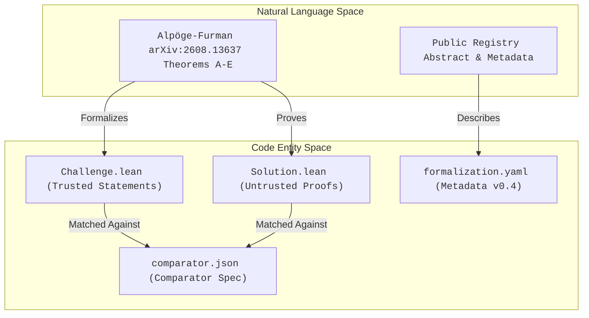
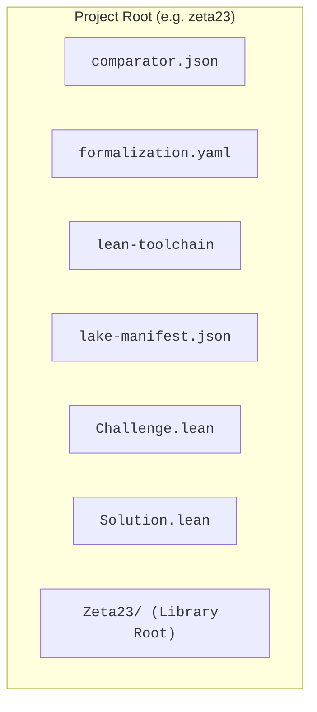
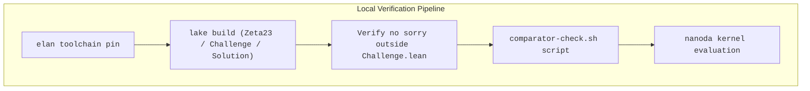

<!-- source: DeepWiki mcp.deepwiki.com · repo anthropics/formal-math · page 1 Overview · fetched 2026-10-26 -->

# Overview

Relevant source files

The following files were used as context for generating this wiki page:

- [.github/workflows/lean-projects.yml](.github/workflows/lean-projects.yml)
- [README.md](README.md)
- [zeta23/README.md](zeta23/README.md)
- [zeta23/formalization.yaml](zeta23/formalization.yaml)

The `anthropics/formal-math` repository contains machine-checked Lean 4 formalizations structured as self-contained Lake projects [README.md:1-3](). Each project adheres to the Palomar submission template, establishing a rigorous verification boundary between trusted statement declarations and untrusted proof implementations [README.md:3](). The primary formalization housed in this repository is `zeta23`, which formalizes the results of Alpöge and Furman regarding the proportion of zeros of the Riemann zeta function that are simple and lie on the critical line [README.md:5-7, zeta23/README.md:1-20]().

*Sources: [README.md:1-14](), [zeta23/README.md:22-48](), [zeta23/formalization.yaml:7-38]()*

---

## 1.1. Repository Layout and Palomar Project Conventions

Projects within `anthropics/formal-math` are organized into top-level directories, with each directory functioning as an independent Lake package [README.md:3, 5-7](). To satisfy the Palomar registry requirements, each project implements a strict structural convention separating specification from implementation, configuration from code, and metadata from build artifacts [README.md:3]().

For detailed information on the required per-project structure—including `Challenge.lean`, `Solution.lean`, `comparator.json`, `formalization.yaml`, `lean-toolchain`, and `lake-manifest.json`—see [Repository Layout and Palomar Project Conventions](#1.1).

*Sources: [README.md:3](), [zeta23/README.md:27-55]()*, [.github/workflows/lean-projects.yml:5-21]()

---

## 1.2. Getting Started: Building zeta23 Locally

Building and verifying projects locally requires setting up `elan` to manage the pinned Lean 4 toolchain (`leanprover/lean4:v4.33.0-rc2`), restoring Mathlib precompiled caches, and executing Lake build commands [README.md:7, 11](). Automated script wrappers also perform containerized comparator verification and generate documentation using `doc-gen4` [README.md:11, zeta23/README.md:49-53]().

For step-by-step instructions on installing `elan`, pinning toolchains, fetching Mathlib caches, running `lake build`, and building API documentation via `docbuild`, see [Getting Started: Building zeta23 Locally](#1.2).

*Sources: [README.md:7-12](), [.github/workflows/lean-projects.yml:11-21]()*, [zeta23/README.md:47-53]()

---

