# Page: Overview

# Overview

<details>
<summary>Relevant source files</summary>

The following files were used as context for generating this wiki page:

- [.github/workflows/lean-projects.yml](.github/workflows/lean-projects.yml)
- [README.md](README.md)
- [zeta23/README.md](zeta23/README.md)
- [zeta23/formalization.yaml](zeta23/formalization.yaml)

</details>


The `anthropics/formal-math` repository contains machine-checked Lean 4 formalizations structured as self-contained Lake projects [README.md:1-3](). Each project adheres to the Palomar submission template, establishing a rigorous verification boundary between trusted statement declarations and untrusted proof implementations [README.md:3](). The primary formalization housed in this repository is `zeta23`, which formalizes the results of Alpöge and Furman regarding the proportion of zeros of the Riemann zeta function that are simple and lie on the critical line [README.md:5-7, zeta23/README.md:1-20]().

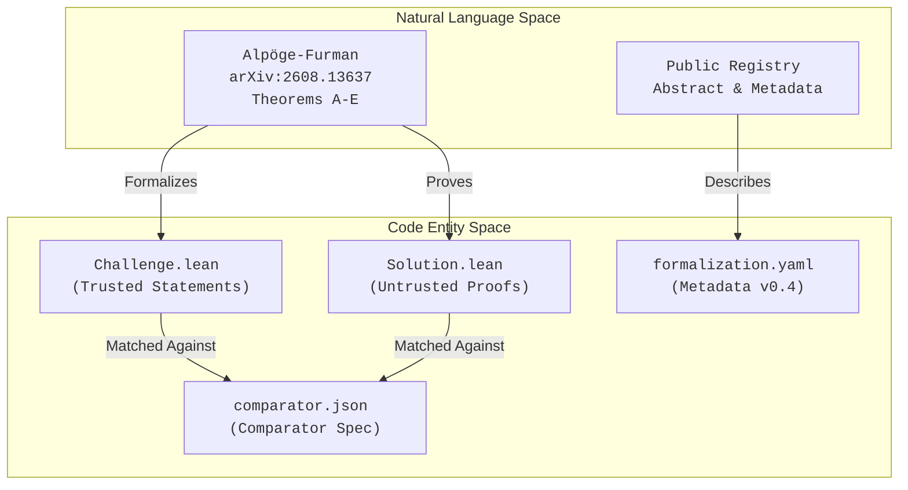
*Sources: [README.md:1-14](), [zeta23/README.md:22-48](), [zeta23/formalization.yaml:7-38]()*

---

## 1.1. Repository Layout and Palomar Project Conventions

Projects within `anthropics/formal-math` are organized into top-level directories, with each directory functioning as an independent Lake package [README.md:3, 5-7](). To satisfy the Palomar registry requirements, each project implements a strict structural convention separating specification from implementation, configuration from code, and metadata from build artifacts [README.md:3]().

For detailed information on the required per-project structure—including `Challenge.lean`, `Solution.lean`, `comparator.json`, `formalization.yaml`, `lean-toolchain`, and `lake-manifest.json`—see [Repository Layout and Palomar Project Conventions](#1.1).

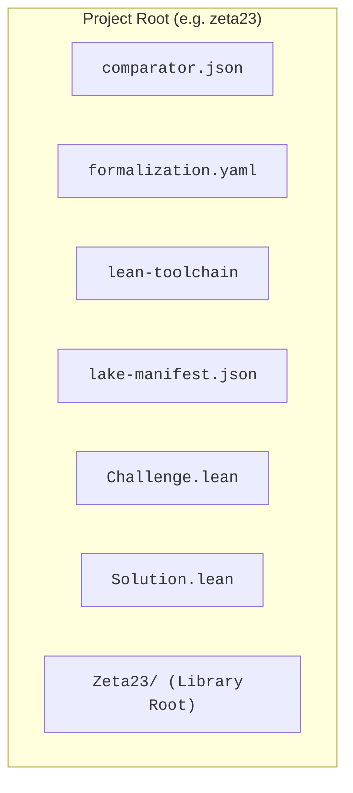
*Sources: [README.md:3](), [zeta23/README.md:27-55]()*, [.github/workflows/lean-projects.yml:5-21]()

---

## 1.2. Getting Started: Building zeta23 Locally

Building and verifying projects locally requires setting up `elan` to manage the pinned Lean 4 toolchain (`leanprover/lean4:v4.33.0-rc2`), restoring Mathlib precompiled caches, and executing Lake build commands [README.md:7, 11](). Automated script wrappers also perform containerized comparator verification and generate documentation using `doc-gen4` [README.md:11, zeta23/README.md:49-53]().

For step-by-step instructions on installing `elan`, pinning toolchains, fetching Mathlib caches, running `lake build`, and building API documentation via `docbuild`, see [Getting Started: Building zeta23 Locally](#1.2).

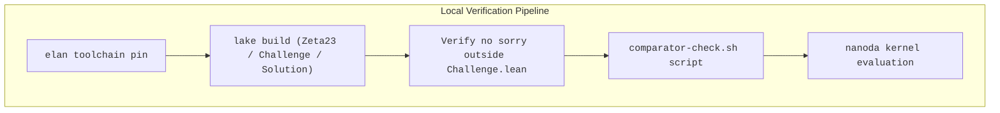
*Sources: [README.md:7-12](), [.github/workflows/lean-projects.yml:11-21]()*, [zeta23/README.md:47-53]()

---

# Page: Repository Layout and Palomar Project Conventions

# Repository Layout and Palomar Project Conventions

<details>
<summary>Relevant source files</summary>

The following files were used as context for generating this wiki page:

- [.github/workflows/lean-projects.yml](.github/workflows/lean-projects.yml)
- [.gitignore](.gitignore)
- [README.md](README.md)
- [zeta23/.gitignore](zeta23/.gitignore)
- [zeta23/formalization.yaml](zeta23/formalization.yaml)
- [zeta23/lakefile.toml](zeta23/lakefile.toml)

</details>


## Purpose and Scope
This page details the structural conventions, mandatory file layouts, and governance rules required for any project submitted to the `anthropics/formal-math` repository. Each subdirectory functions as a self-contained Lake project adhering to the [Palomar submission template](https://github.com/PalomarRegistry/PalomarTemplate), maintaining strict boundaries between trusted challenge statements, untrusted solution proofs, and machine-readable metadata.

Sources: [`README.md:1-18`](), [`zeta23/formalization.yaml:1-38`]()

---

## Per-Project Anatomy and Required Files

Every project directory (such as `zeta23/`) must contain a fixed set of configuration files, statement modules, and proof targets at its root. 

| File / Artifact | Role & Specification |
| :--- | :--- |
| `lakefile.toml` (or `lakefile.lean`) | Lake build configuration defining targets, root modules, and external dependencies (e.g., Mathlib). |
| `lean-toolchain` | Pins the exact Lean 4 compiler version used by the project (e.g., `leanprover/lean4:v4.33.0-rc2`). |
| `lake-manifest.json` | Locks exact revisions of downstream dependencies like Mathlib. |
| `Challenge.lean` | Trusted statement module stating the headline theorems. Permitted to use `sorry` in proof bodies by design. |
| `Solution.lean` | Untrusted solution module importing the proof library and discharging the challenge statements. Must be `sorry`-free. |
| `comparator.json` | JSON configuration mapping challenge declarations to solution proofs for the Palomar comparator harness. |
| `formalization.yaml` | Machine-readable metadata conforming to schema v0.4, providing project abstracts, author lists, axioms, and main results. |

Sources: [`README.md:3-13`](), [`zeta23/lakefile.toml:1-32`]()

---

## Diagram: Project Layout (Natural Language Space to Code Entity Space)

The following diagram maps high-level project concepts (Natural Language Space) to their concrete file and module representations in the repository (Code Entity Space).

```mermaid
graph TD
    subgraph NaturalLanguageSpace ["Natural Language Space"]
        NLS_Root ["Self-Contained Submission Project"]
        NLS_State ["Trusted Mathematical Statements"]
        NLS_Proof ["Machine-Checked Proof Library"]
        NLS_Meta ["Project Metadata & Compliance"]
    end

    subgraph CodeEntitySpace ["Code Entity Space"]
        CES_Lake ["lakefile.toml / lake-manifest.json"]
        CES_Tool ["lean-toolchain"]
        CES_Chal ["Challenge.lean / ChallengeDeps"]
        CES_Soln ["Solution.lean / Zeta23/"]
        CES_Yaml ["formalization.yaml"]
        CES_Comp ["comparator.json"]
    end

    NLS_Root --> CES_Lake
    NLS_Root --> CES_Tool
    NLS_State --> CES_Chal
    NLS_Proof --> CES_Soln
    NLS_Meta --> CES_Yaml
    NLS_Meta --> CES_Comp
```

Sources: [`README.md:3-13`](), [`zeta23/lakefile.toml:1-32`](), [`zeta23/formalization.yaml:1-38`]()

---

## Trusted Statements and Solution Delegation

Submissions enforce a strict separation between statement formulation and proof realization:
1. **Challenge Layer (`Challenge.lean`, `ChallengeDeps`)**: Contains Mathlib-only modules that declare the formal statements of the theorems. These files are marked as trusted statement boundaries. By design, proof bodies here may contain `sorry`, as their validity is established via linkage against `Solution.lean`.
2. **Solution Layer (`Solution.lean`)**: Imports the project's internal proof library (e.g., `Zeta23`) and provides complete, `sorry`-free proofs that discharge the declarations in `Challenge.lean`.

Sources: [`README.md:11-13`](), [`zeta23/lakefile.toml:18-32`]()

---

## Metadata and Compliance: `formalization.yaml` and `comparator.json`

Every project must declare its formalization attributes in `formalization.yaml` under the v0.4 schema rules. This file tracks project metadata, authors, MSC2020 classifications, arXiv identifiers, and main result declarations.

The `comparator.json` configuration pairs each challenge statement with its corresponding solution proof. During verification, the [comparator harness](https://github.com/leanprover/comparator) evaluates these bindings using `lean4export`, the independent `nanoda` kernel, and the `landrun` sandboxing utility.

Sources: [`zeta23/formalization.yaml:1-136`](), [`.github/workflows/lean-projects.yml:17-21`]()

---

## Diagram: Verification Pipeline Data Flow

This diagram illustrates how external verification requirements transition into local code execution steps during CI validation.

```mermaid
graph TD
    subgraph NaturalLanguageSpace ["Natural Language Space"]
        N_Policy ["Palomar Registry Acceptance Bar"]
        N_Check ["Sandbox Replay Verification"]
    end

    subgraph CodeEntitySpace ["Code Entity Space"]
        C_Wflow [".github/workflows/lean-projects.yml"]
        C_Script ["comparator-check.sh"]
        C_Export ["lean4export"]
        C_Nanoda ["nanoda"]
        C_Land ["landrun"]
    end

    N_Policy --> C_Wflow
    N_Check --> C_Script
    C_Wflow --> C_Script
    C_Script --> C_Export
    C_Export --> C_Nanoda
    C_Nanoda --> C_Land
```

Sources: [`README.md:11-13`](), [`.github/workflows/lean-projects.yml:1-22`]()

---

## Toolchain Pinning and Dependency Management

Projects are isolated via local dependency management:
- **`lean-toolchain`**: Ensures reproducible builds by pinning the exact Lean compiler version. Elan automatically installs the specified version when building.
- **`lake-manifest.json`**: Guarantees that Mathlib and transitive dependencies resolve to deterministic commits.
- **`.gitignore` rules**: Build artifacts under `.lake/`, `build/`, and local caches are ignored, while toolchain definitions and lake manifests are strictly tracked in version control.

Sources: [`README.md:3-7`](), [`.gitignore:1-24`](), [`zeta23/.gitignore:1-6`]()

---

# Page: Getting Started: Building zeta23 Locally

# Getting Started: Building zeta23 Locally

<details>
<summary>Relevant source files</summary>

The following files were used as context for generating this wiki page:

- [zeta23/README.md](zeta23/README.md)
- [zeta23/docbuild/lake-manifest.json](zeta23/docbuild/lake-manifest.json)
- [zeta23/docbuild/lakefile.toml](zeta23/docbuild/lakefile.toml)
- [zeta23/docbuild/lean-toolchain](zeta23/docbuild/lean-toolchain)
- [zeta23/lakefile.toml](zeta23/lakefile.toml)

</details>


This section covers the local environment setup required to build, verify, and document the `zeta23` formalization project. It details the installation of `elan`, toolchain pinning, fetching Mathlib precompiled binaries, executing `lake` targets, and generating API documentation using `doc-gen4`.

---

## 1. Toolchain Management and elan Installation

The `zeta23` project relies on the Lean 4 version manager, `elan`, to manage toolchains automatically. The exact Lean toolchain and Mathlib dependency commit are pinned in the package files.

To set up the environment:
1. Ensure `elan` is installed on your system (following the standard Lean 4 installation instructions).
2. Navigate to the `zeta23/` subdirectory [zeta23/README.md:5]():
   ```bash
   cd zeta23
   ```
3. The repository pins Lean version `v4.33.0-rc2` and Mathlib commit `51e6992efd06126df61a496bebf8f49482a4e129` as specified in the project configuration [zeta23/README.md:20](). When you run any `lake` command, `elan` reads `lean-toolchain` and downloads the appropriate Lean binary automatically.

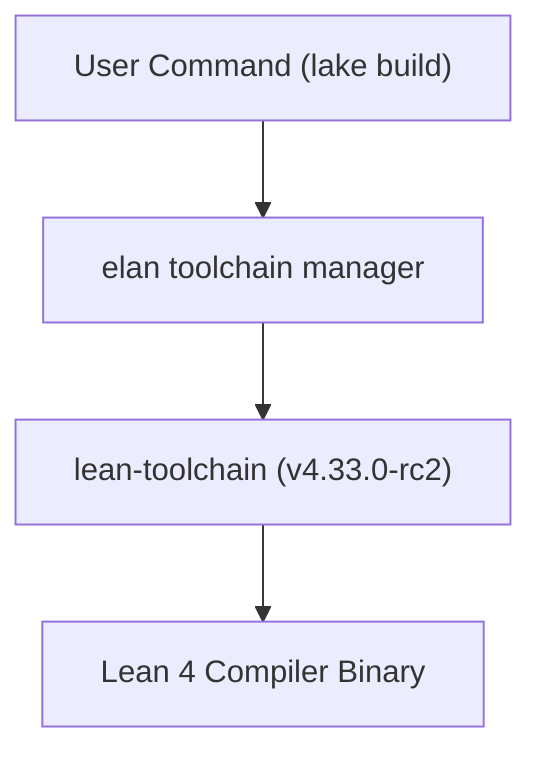
Sources: [zeta23/README.md:1-20]()

---

## 2. Fetching Mathlib Caches and Building Lake Targets

Because `zeta23` depends on Mathlib [zeta23/lakefile.toml:9-13](), compiling it from scratch takes considerable time. You should fetch the precompiled Mathlib build cache using Lake before initiating a full build.

```bash
lake exe cache get
```

Once the cache is restored, you can build the default targets defined in `zeta23/lakefile.toml` [zeta23/lakefile.toml:1-3](). The package defines multiple libraries: `Zeta23` (the main proof development), `ChallengeDeps` (shared definitions), `Challenge` (trusted statement surface), and `Solution` (untrusted verification wrapper) [zeta23/lakefile.toml:15-31]().

To build the default targets (`Zeta23`, `Challenge`, `Solution`) [zeta23/lakefile.toml:1-3]():
```bash
lake build
```

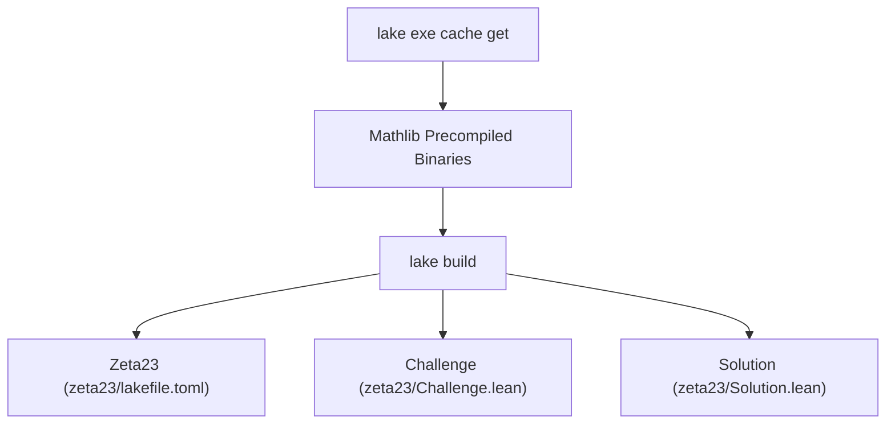
Sources: [zeta23/README.md:1-20](), [zeta23/lakefile.toml:1-31]()

---

## 3. Building API Documentation via docbuild

The repository includes a nested documentation project under `docbuild/` configured to use `doc-gen4` [zeta23/README.md:53](). This generates HTML API documentation for the `Zeta23` library.

To build the documentation:
1. Navigate to the `docbuild/` directory:
   ```bash
   cd docbuild
   ```
2. Run the documentation build target [zeta23/README.md:53]():
   ```bash
   lake build Zeta23:docs
   ```

The `docbuild` package is configured via `docbuild/lakefile.toml` [zeta23/docbuild/lakefile.toml:1-14](), which references `doc-gen4` at revision `v4.33.0-rc2` [zeta23/docbuild/lakefile.toml:6-11]() and links the parent `Zeta23` library locally [zeta23/docbuild/lakefile.toml:12-14]().

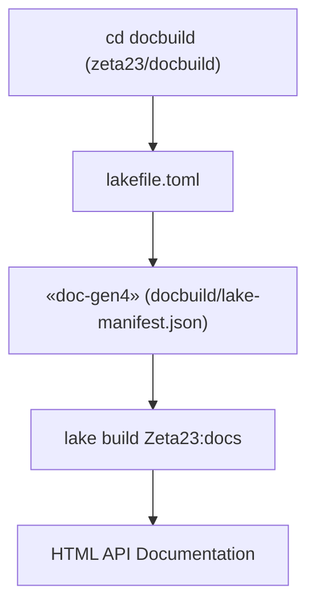
Sources: [zeta23/README.md:53](), [zeta23/docbuild/lake-manifest.json:1-185](), [zeta23/docbuild/lakefile.toml:1-14]()

---

# Page: Challenge / Solution Verification Model

# Challenge / Solution Verification Model

<details>
<summary>Relevant source files</summary>

The following files were used as context for generating this wiki page:

- [zeta23/AUDIT.md](zeta23/AUDIT.md)
- [zeta23/README.md](zeta23/README.md)

</details>


The challenge/solution verification model establishes a rigorous separation of concerns between trusted theorem statements and untrusted proof implementations in the `zeta23` codebase [zeta23/README.md:22-26](). By adopting the Palomar submission template layout [zeta23/README.md:22-26](), the repository isolates the mathematical claims that human auditors need to verify (`Challenge.lean`) from the complex proof machinery (`Solution.lean` and the `Zeta23` proof library) [zeta23/README.md:27-38](). 

This page provides a high-level overview of this architecture, the comparator harness, and axiom hygiene. For specific implementation details, refer to the following child pages:
- [Challenge Statements and Dependency Layers](#2.1)
- [Solution Delegation Wrappers](#2.2)
- [Comparator Configuration and Sandboxed Replay](#2.3)
- [Axiom Auditing and the AUDIT Record](#2.4)

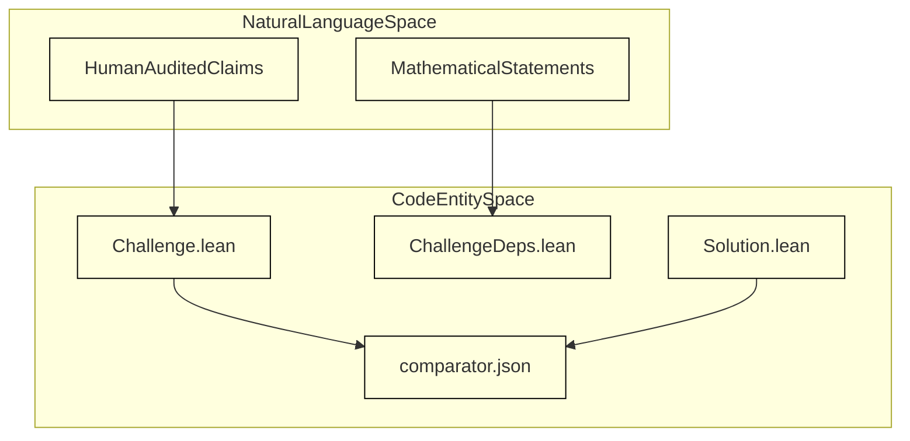
*Figure 1: Bridging human-audited expectations in Natural Language Space to the verification entrypoints (`Challenge.lean`, `Solution.lean`) in Code Entity Space.*

Sources: [zeta23/README.md:22-38](), [zeta23/AUDIT.md:1-5]()

---

## 2.1. Challenge Statements and Dependency Layers

The challenge layer defines the public theorem statements that the formalization aims to prove. `Challenge.lean` acts as a small, trusted statement surface that imports only Mathlib and defines the core theorems using placeholder proofs (`sorry`) [zeta23/README.md:27-31](). It is accompanied by `ChallengeDeps.lean`, which contains inlined helper definitions (such as zero-counting functions and the Montgomery–Taylor constant) [zeta23/README.md:32-34]().

Because `Challenge.lean` is designed for human review, the presence of `sorry` tokens is strictly expected and permitted solely within these trusted statement files [zeta23/README.md:29-31](), [zeta23/AUDIT.md:22-24](). 

For full technical details, see [Challenge Statements and Dependency Layers](#2.1).

Sources: [zeta23/README.md:27-34](), [zeta23/AUDIT.md:22-24]()

---

## 2.2. Solution Delegation Wrappers

To connect the trusted challenges to the underlying constructive proofs, `Solution.lean` re-states the theorems from `Challenge.lean` and provides complete, `sorry`-free proofs by delegating directly into the `Zeta23` proof library [zeta23/README.md:35-36](). Similarly, `Solution/XiPrime.lean` handles the auxiliary development for $\xi'$. 

These solution modules are untrusted by the verification harness; instead, their structural and type-level compliance with `Challenge.lean` is automatically enforced by external comparison tools [zeta23/README.md:35-38]().

For full technical details, see [Solution Delegation Wrappers](#2.2).

Sources: [zeta23/README.md:35-38]()

---

## 2.3. Comparator Configuration and Sandboxed Replay

The verification harness relies on the `comparator` tool and configuration files (`comparator.json` and `comparator-xiprime.json`) to verify that the types and signatures in `Solution.lean` match `Challenge.lean` without introducing unauthorized axioms [zeta23/README.md:37-41](). 

The automated script `scripts/verify-comparator.sh` coordinates this process, leveraging `lean4export`, `nanoda`, and `landrun` sandboxing to guarantee reproducible, isolated validation [zeta23/README.md:49-52]().

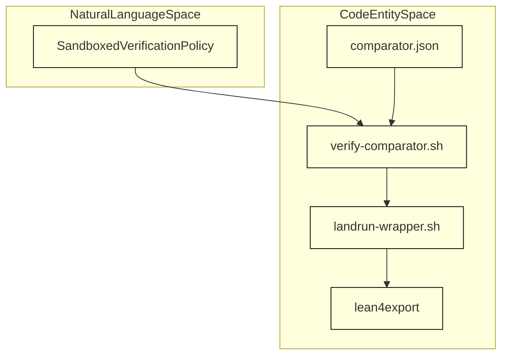
*Figure 2: Pipeline execution flow from policy definition to execution wrappers (`verify-comparator.sh`, `landrun-wrapper.sh`, `lean4export`) within Code Entity Space.*

For full technical details, see [Comparator Configuration and Sandboxed Replay](#2.3).

Sources: [zeta23/README.md:37-52]()

---

## 2.4. Axiom Auditing and the AUDIT Record

Axiom hygiene is strictly maintained across the repository. The build and verification pipeline ensures that no custom or project-specific axioms are declared [zeta23/README.md:17-18](). Using custom `#print axioms` scripts located under `scripts/`, the project verifies that all headline theorems depend solely on Lean's standard three axioms: `propext`, `Classical.choice`, and `Quot.sound` [zeta23/README.md:17-18](), [zeta23/AUDIT.md:25-26]().

Historical and reproducible audit data—including command outputs, axiom lists, and sorry-freeness checks—are systematically tracked in `AUDIT.md` [zeta23/README.md:46](), [zeta23/AUDIT.md:1-26]().

For full technical details, see [Axiom Auditing and the AUDIT Record](#2.4).

Sources: [zeta23/README.md:17-18](), [zeta23/AUDIT.md:1-26]()

---

# Page: Challenge Statements and Dependency Layers

# Challenge Statements and Dependency Layers

<details>
<summary>Relevant source files</summary>

The following files were used as context for generating this wiki page:

- [zeta23/Challenge.lean](zeta23/Challenge.lean)
- [zeta23/Challenge/XiPrime.lean](zeta23/Challenge/XiPrime.lean)
- [zeta23/ChallengeDeps.lean](zeta23/ChallengeDeps.lean)
- [zeta23/ChallengeDeps/XiPrime.lean](zeta23/ChallengeDeps/XiPrime.lean)

</details>


## Purpose and Scope
This page details the architecture of the challenge statement modules (`zeta23/Challenge.lean` and `zeta23/Challenge/XiPrime.lean`) and their trusted definition layers (`zeta23/ChallengeDeps.lean` and `zeta23/ChallengeDeps/XiPrime.lean`). These files form the trusted side of the comparator verification model, defining precisely what mathematical assertions are claimed regarding the zeros of the Riemann zeta function, Dirichlet L-functions, and the derivative of the completed Riemann xi function ($\xi'$).

Sources: `zeta23/Challenge.lean:1-28` [], `zeta23/Challenge/XiPrime.lean:1-10` [], `zeta23/ChallengeDeps.lean:1-27` [].

---

## 1. Structure of Challenge Modules (`Challenge.lean` & `Challenge/XiPrime.lean`)

The challenge modules define the headline mathematical statements (Theorems A through E, plus the $\xi'$ zero distribution theorems) using `sorry` for proofs. To ensure that the external comparator tool can cleanly verify statement equality against the solution side without complex dependency graphs, these modules inline the exact character-for-character content of their respective dependency layer files (`ChallengeDeps.lean` and `ChallengeDeps/XiPrime.lean`). Consequently, these challenge files import only Mathlib.

* **`zeta23/Challenge.lean`**: Declares seventeen theorem statements concerning the zeros of `riemannZeta` and `DirichletCharacter.LFunction`, including asymptotic lower bounds on dyadic and cumulative windows for on-line zeros, simple zeros, and distinct zeros.
* **`zeta23/Challenge/XiPrime.lean`**: Declares theorems regarding the zeros of $\xi'$ (`XiPrime.xiDeriv`), establishing that all zeros lie in the open critical strip, $\text{Re}(\xi'/\xi(s)) > 0$ for $\text{Re}(s) \ge 1$, and precise lower bounds for simple on-line zeros and distinct zeros under standard and quartic windows.

Sources: `zeta23/Challenge.lean:29-41` [], `zeta23/Challenge/XiPrime.lean:11-22` [].

### Diagram: Natural Language Space to Code Entity Space (Zeta and L-Functions)
```mermaid
graph TD
    NLZeta[""Nontrivial Zeros of Zeta""] --> CodeIsZero[""IsNontrivialZero (ρ : ℂ)""]
    NLMult[""Multiplicity (Order of Vanishing)""] --> CodeMult[""zeroMult (ρ : ℂ)""]
    NLWindow[""Dyadic / Cumulative Windows""] --> CodeWindow[""zerosIn (T₁ T₂ : ℝ)""]
    NLCount[""Counting Functions (N, N_d, N_0*, N_0^s)""] --> CodeCounts[""Ncount, Ndist, N0star, N0simple""]
    NLLFunc[""Dirichlet L-Function Zeros""] --> CodeLFunc[""IsNontrivialZeroL, zeroMultL, NcountL""]

    sub-sources-diag1[""Sources: zeta23/Challenge.lean:48-110, zeta23/ChallengeDeps.lean:35-97""]
```
Sources: `zeta23/Challenge.lean:48-110` [], `zeta23/ChallengeDeps.lean:35-97` [].

---

## 2. Inlined Definition Layers (`ChallengeDeps.lean` & `ChallengeDeps/XiPrime.lean`)

The dependency layer files provide the Mathlib-only vocabulary required to state the theorems. By inlining these definitions directly into `Challenge.lean` and `Challenge/XiPrime.lean`, auxiliary generated lemmas (such as internal proof tags like `N0star._proof_1`) retain identical names across both the trusted challenge side and the untrusted solution side.

### Zeta and L-Function Definitions (`ChallengeDeps.lean`)
* **`IsNontrivialZero`**: Evaluates `riemannZeta ρ = 0` subject to $0 < \text{Re}(\rho) < 1$.
* **`zeroMult`**: Computes the order of vanishing via Mathlib's `analyticOrderAt riemannZeta ρ` converted to `ℕ` via `toNat`.
* **`zerosIn`**: Defines the set of nontrivial zeros within height window $T_1 < \text{Im}(\rho) \le T_2$.
* **`Ncount`, `Ndist`, `N0star`, `N0simple`**: Formalize counting functions for total zeros (with multiplicity), distinct zeros, distinct critical-line zeros ($\text{Re}(\rho) = 1/2$), and simple critical-line zeros respectively.
* **Dirichlet Variants**: Replicates the above definitions (`IsNontrivialZeroL`, `zeroMultL`, `zerosInL`, `NcountL`, etc.) parameterized over a Dirichlet character `χ`.
* **`cMT`**: Defines the Montgomery–Taylor constant for Theorem D in closed form:
  $$\text{cMT} := \frac{\sqrt{2} \tan(1/\sqrt{2})}{1 + \frac{1}{\sqrt{2}}\tan(1/\sqrt{2})}$$

Sources: `zeta23/ChallengeDeps.lean:33-109` [].

### Xi Prime Definitions (`ChallengeDeps/XiPrime.lean`)
* **`XiPrime.xi`**: Defines completed Riemann xi function $\xi(s) := \frac{s(s-1)}{2}\Lambda_0(s) + \frac{1}{2}$.
* **`XiPrime.xiDeriv`**: The complex derivative `deriv xi`.
* **`XiPrime.IsXiDerivZero`**: Points where $\xi'(\rho) = 0$ (with no initial real-part restriction).
* **`XiPrime.xiDerivMult`**: Multiplicity via `analyticOrderAt xiDeriv ρ`.
* **`XiPrime.zerosIn`, `XiPrime.Ncount`, `XiPrime.Ndist`, `XiPrime.N0simple`**: Counting infrastructure for $\xi'$ zeros across height windows.

Sources: `zeta23/ChallengeDeps/XiPrime.lean:11-44` [].

### Diagram: Natural Language Space to Code Entity Space (Xi Prime Sub-Development)
```mermaid
graph TD
    NLXi[""Completed Riemann Xi Function""] --> CodeXi[""XiPrime.xi (s : ℂ)""]
    NLXiDeriv[""Derivative of Xi""] --> CodeDeriv[""XiPrime.xiDeriv (s : ℂ)""]
    NLXiZero[""Zeros of Xi Prime""] --> CodeIsZero[""XiPrime.IsXiDerivZero (ρ : ℂ)""]
    NLXiMult[""Multiplicity of Xi Prime Zeros""] --> CodeMult[""XiPrime.xiDerivMult (ρ : ℂ)""]
    NLXiCounts[""Xi Prime Counting (Ncount, Ndist, N0simple)""] --> CodeCounts[""XiPrime.Ncount, XiPrime.Ndist, XiPrime.N0simple""]

    sub-sources-diag2[""Sources: zeta23/Challenge/XiPrime.lean:28-58, zeta23/ChallengeDeps/XiPrime.lean:13-43""]
```
Sources: `zeta23/Challenge/XiPrime.lean:28-58` [], `zeta23/ChallengeDeps/XiPrime.lean:13-43` [].

---

## 3. Why `sorry` is Allowed and the Trusted Boundary

In formal mathematics verification pipelines (such as the Palomar submission template), separation of concerns is enforced between *statement formulation* and *proof implementation*:

1. **The Trusted Statement**: `Challenge.lean` and `Challenge/XiPrime.lean` represent the trusted specification. Reviewers audit these files and `ChallengeDeps.lean` to verify that the formal statements accurately capture the mathematical claims of Theorems A–E and the $\xi'$ distribution.
2. **Deliberate `sorry` Usage**: Because these files are challenge statements rather than proofs, every theorem body concludes with `sorry`. Building these modules generates expected compiler warnings (`declaration uses 'sorry'`).
3. **The Comparator Contract**: The external comparator tool (`github.com/leanprover/comparator`) verifies that `Solution.lean` proves precisely the statements formulated in `Challenge.lean`, ensuring that no weakening or alteration of the theorem hypotheses occurs while discharging the `sorry` placeholders.

Sources: `zeta23/Challenge.lean:6-28` [], `zeta23/ChallengeDeps.lean:10-17` [].

---

# Page: Solution Delegation Wrappers

# Solution Delegation Wrappers

<details>
<summary>Relevant source files</summary>

The following files were used as context for generating this wiki page:

- [zeta23/Solution.lean](zeta23/Solution.lean)
- [zeta23/Solution/XiPrime.lean](zeta23/Solution/XiPrime.lean)
- [zeta23/formalization.yaml](zeta23/formalization.yaml)

</details>


This page details how `Solution.lean` and `Solution/XiPrime.lean` act as untrusted solution wrappers that bridge the formal challenge statements in `Challenge.lean` and `Challenge/XiPrime.lean` to the underlying mathematical proofs developed in the `Zeta23` proof library. These files do not contain substantial mathematical proofs themselves; instead, they instantiate challenge declarations by definitional unfolding and delegation to library entrypoints, handling minor constant normalization where necessary.

---

## 1. Architecture of Delegation Wrappers and Data Flow

The repository separates trusted challenge statements from the heavy computational and analytic proofs of the `Zeta23` library. The challenge modules (`Challenge.lean` and `Challenge/XiPrime.lean`) define the exact mathematical statements required by the Palomar comparator and Remark 7.1, respectively, using shared counting functions from `ChallengeDeps` [zeta23/Solution.lean:21-23](). 

The wrapper files `Solution.lean` and `Solution/XiPrime.lean` import these challenge definitions along with the corresponding terminal theorems of the `Zeta23` library, discharging each statement via direct term assignment or simple rewriting (`simp`).

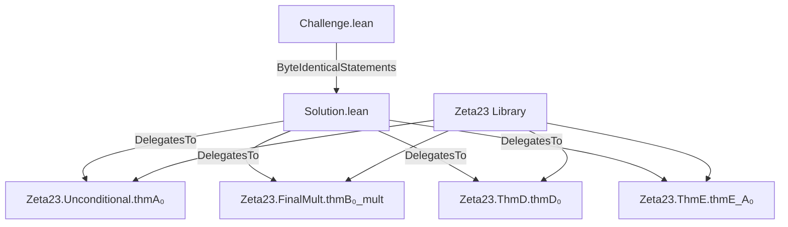
*Sources: [zeta23/Solution.lean:7-40](), [zeta23/formalization.yaml:75-126]()*

---

## 2. Zeta Zero and Dirichlet L-Function Delegation (`Solution.lean`)

`Solution.lean` covers seventeen challenge theorems corresponding to Theorems A, B, C, D, and E of the Alpöge–Furman paper, plus their cumulative variants and Dirichlet L-function generalisations [zeta23/Solution.lean:7-19](). Because the counting functions (`Ncount`, `N0star`, `N0simple`, `Ndist`) defined in `ChallengeDeps` are definitionally identical to those in `Zeta23/Statement.lean` and `Zeta23/ThmE/Statement.lean`, the Lean kernel accepts the delegation without coercions [zeta23/Solution.lean:21-23]().

| Challenge Theorem Name | Target Library Symbol | Source Module |
| :--- | :--- | :--- |
| `two_thirds_on_critical_line` | `Zeta23.thmA₀` | `Zeta23.Unconditional` [zeta23/Solution.lean:10-11,52-54]() |
| `two_thirds_simple_on_critical_line` | `Zeta23.thmB₀_mult` | `Zeta23.FinalMult` [zeta23/Solution.lean:12-13,60-62]() |
| `five_sixths_distinct` | `Zeta23.thmC₀_mult` | `Zeta23.FinalMult` [zeta23/Solution.lean:12-13,68-70]() |
| `dirichlet_two_thirds_on_critical_line` | `Zeta23.ThmE.thmE_A₀` | `Zeta23.ThmE.Final` [zeta23/Solution.lean:16,106-109]() |

*Sources: [zeta23/Solution.lean:32-41](), [zeta23/formalization.yaml:95-126]()*

---

## 3. Constant Harmonization (`cMT` vs `cStar 1`)

The challenge statement defines the Montgomery–Taylor window constant using the paper's closed-form tangent expression `cMT` [zeta23/Solution.lean:24-27]():

$$\c_1^* = \frac{\sqrt{2} \tan \vartheta}{1 + \vartheta \tan \vartheta}, \quad \text{where } \vartheta = \frac{1}{\sqrt{2}}$$

Inside the `Zeta23` library (specifically under `Zeta23/ThmD/`), the constant is represented via a division-safe sine/cosine formulation (`Zeta23.ThmD.cStar 1`) [zeta23/Solution.lean:24-27](). `Solution.lean` bridges this discrepancy by proving a local identity `cStar_one_eq_cMT` [zeta23/Solution.lean:44-50]():

```lean
theorem cStar_one_eq_cMT : Zeta23.ThmD.cStar 1 = cMT := by
  rw [Zeta23.ThmD.cStar_eq_tan_form zero_le_one le_rfl]
  unfold cMT Zeta23.ThmD.theta
  rfl
```

For Theorem D instantiations (`montgomery_taylor_on_critical_line`, `montgomery_taylor_simple_on_critical_line_mult`, etc.), the wrapper fetches the library theorem, simplifies `Zeta23.ThmD.HD` and `Zeta23.ThmD.GD` using `cStar_one_eq_cMT`, and closes the proof [zeta23/Solution.lean:76-104]().

*Sources: [zeta23/Solution.lean:24-31](), [zeta23/Solution.lean:44-50]()*

---

## 4. XiPrime Zeros Delegation (`Solution/XiPrime.lean`)

`Solution/XiPrime.lean` handles the six companion statements concerning the zeros of $\xi'(s)$ as explored in Remark 7.1 of the Alpöge–Furman paper [zeta23/Solution/XiPrime.lean:1-52](). It imports `ChallengeDeps.XiPrime` and delegates directly to the `Zeta23.XiPrime` subsystem [zeta23/Solution/XiPrime.lean:6-8]().

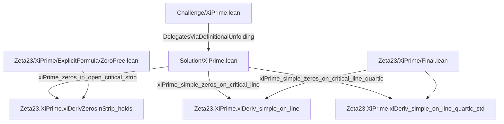
*Sources: [zeta23/Solution/XiPrime.lean:6-52](), [zeta23/formalization.yaml:81-85]()*

The six delegated statements verified in `Solution/XiPrime.lean` consist of:
1. `xiPrime_zeros_in_open_critical_strip`: Establishes that every zero of $\xi'$ lies in $0 < \text{Re } s < 1$ [zeta23/Solution/XiPrime.lean:12-15]().
2. `xiPrime_over_xi_re_pos`: Proves $\text{Re } (\xi'(s)/\xi(s)) > 0$ for $\text{Re } s \ge 1$ [zeta23/Solution/XiPrime.lean:17-20]().
3. `xiPrime_simple_zeros_on_critical_line` and its cumulative counterpart: Confirms $\ge 85.838\%$ simple and on the critical line, $\ge 92.919\%$ distinct [zeta23/Solution/XiPrime.lean:22-36]().
4. `xiPrime_simple_zeros_on_critical_line_quartic` and its cumulative counterpart: Confirms the near-optimal quartic window improvements ($\ge 86.864\%$ simple/on-line, $\ge 93.432\%$ distinct) [zeta23/Solution/XiPrime.lean:38-52]().

*Sources: [zeta23/Solution/XiPrime.lean:1-52]()*

---

# Page: Comparator Configuration and Sandboxed Replay

# Comparator Configuration and Sandboxed Replay

<details>
<summary>Relevant source files</summary>

The following files were used as context for generating this wiki page:

- [zeta23/comparator-xiprime.json](zeta23/comparator-xiprime.json)
- [zeta23/comparator.json](zeta23/comparator.json)
- [zeta23/scripts/landrun-wrapper.sh](zeta23/scripts/landrun-wrapper.sh)
- [zeta23/scripts/verify-comparator.sh](zeta23/scripts/verify-comparator.sh)

</details>


## Purpose and Scope
This section details the verification architecture governed by `comparator.json` and `comparator-xiprime.json`, the strict security boundary enforced by permitted axioms, and the end-to-end replay pipeline defined in `verify-comparator.sh` and `landrun-wrapper.sh`. The comparator harness bridges Lean 4 compilation outputs to independent kernel typecheckers via export formats and OS-level sandboxing.

---

## Comparator Configuration Schemas

The repository maintains two primary configuration files that instruct the comparator harness on which modules and theorem statements to verify, alongside strict security policies regarding axioms and dependency replay:
- `zeta23/comparator.json` for the core Zeta23 development (18 theorems spanning Theorems A–E and Dirichlet variants) [zeta23/comparator.json:4-22]().
- `zeta23/comparator-xiprime.json` for the $\xi'$ zero-counting development (6 theorem statements) [zeta23/comparator-xiprime.json:4-11]().

### Configuration Fields
Each configuration file is a JSON object containing the following keys:
- `challenge_module`: The entry point module defining the trusted statement interface (e.g., `"Challenge"` or `"Challenge.XiPrime"`) [zeta23/comparator.json:2](), [zeta23/comparator-xiprime.json:2]().
- `solution_module`: The entry point module providing the untrusted proofs discharging the challenge (e.g., `"Solution"` or `"Solution.XiPrime"`) [zeta23/comparator.json:3](), [zeta23/comparator-xiprime.json:3]().
- `theorem_names`: An array of fully qualified theorem identifiers that must be checked for exact statement matching and sound proof derivation [zeta23/comparator.json:4-22](), [zeta23/comparator-xiprime.json:4-11]().
- `definition_names`: An array of definitions inspected or exported by the comparator [zeta23/comparator.json:23](), [zeta23/comparator-xiprime.json:12]().
- `permitted_axioms`: The explicit list of foundational axioms allowed in the proof graph [zeta23/comparator.json:24-28](), [zeta23/comparator-xiprime.json:13-17]().
- `enable_nanoda`: A boolean flag that must be set to `true` to mandate independent kernel re-verification via NanoDa [zeta23/comparator.json:29](), [zeta23/comparator-xiprime.json:18]().

### Permitted Axioms Baseline
Both configuration files restrict the axiom set to standard foundational primitives of Lean 4:
```json
"permitted_axioms": [
  "propext",
  "Quot.sound",
  "Classical.choice"
]
```
[zeta23/comparator.json:24-28](), [zeta23/comparator-xiprime.json:13-17]()

Sources: [zeta23/comparator.json:1-30](), [zeta23/comparator-xiprime.json:1-19]()

---

## The Verification Pipeline (`verify-comparator.sh`)

The script `zeta23/scripts/verify-comparator.sh` automates the complex orchestration of checking configurations, cloning pinned revisions of helper tools, building them, exporting Lean kernel expressions, and executing the independent typechecker inside a sandbox [zeta23/scripts/verify-comparator.sh:1-106]().

### Pipeline Execution Flow

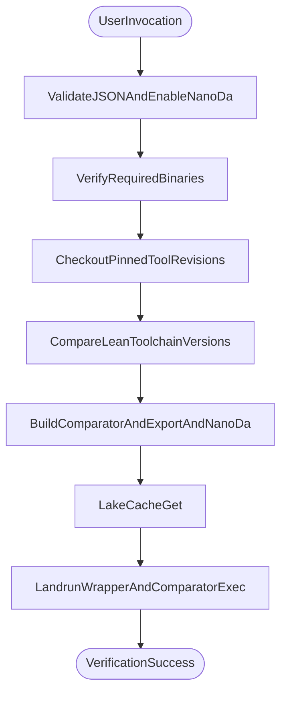
*Figure 1: End-to-end data flow and execution stages within `verify-comparator.sh`.*

Sources: [zeta23/scripts/verify-comparator.sh:1-106]()

### Script Implementation Steps

1. **JSON Validation**: An inline Python snippet loads the target configuration file and asserts that `enable_nanoda` is strictly `true`, failing immediately otherwise [zeta23/scripts/verify-comparator.sh:39-58]().
2. **Prerequisite Check**: Verifies the presence of `cargo`, `git`, `go`, `lake`, and `python3` in the environment [zeta23/scripts/verify-comparator.sh:32-37]().
3. **Exact Commit Pinning**: Clones or checks out exact git commits for:
   - Comparator: `75c730e9b6ef5c2c3b334fad7c3d51fe20624c88` [zeta23/scripts/verify-comparator.sh:27]()
   - Lean4export: `9fb131bb100eb32ccf6836f14e4f8328d13b6792` [zeta23/scripts/verify-comparator.sh:28]()
   - Landrun: `811cfff51ceaf3d9843708aa6d22e9b84ccac8b4` [zeta23/scripts/verify-comparator.sh:29]()
   - NanoDa: `68d5ca9db226849b41a6fff59d796ff19d0a8840` [zeta23/scripts/verify-comparator.sh:30]()
4. **Toolchain Alignment**: Compares the project's `lean-toolchain` against `lean4export`'s toolchain string. Any mismatch causes an abort, preventing serialization format incompatibilities [zeta23/scripts/verify-comparator.sh:81-89]().
5. **Compilation & Export**: Builds `comparator` via Lake, `lean4export` via Lake, and `nanoda` via Cargo in release mode [zeta23/scripts/verify-comparator.sh:96-98]().
6. **Sandbox Execution**: Restores Mathlib build caches via `lake exe cache get` and executes the comparator binary wrapped by Landrun [zeta23/scripts/verify-comparator.sh:101-106]().

Sources: [zeta23/scripts/verify-comparator.sh:1-106]()

---

## Landrun Sandboxing and Policy Enforcement (`landrun-wrapper.sh`)

To isolate proof replay from unauthorized host interactions, `zeta23/scripts/landrun-wrapper.sh` acts as an interception proxy between the comparator harness and the Landrun sandbox binary [zeta23/scripts/landrun-wrapper.sh:1-50]().

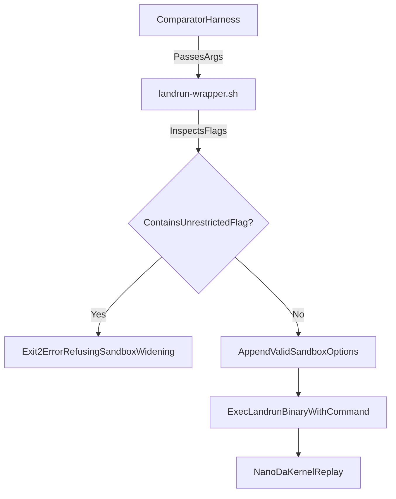
*Figure 2: Security check flow inside `landrun-wrapper.sh` ensuring sandbox integrity.*

Sources: [zeta23/scripts/landrun-wrapper.sh:1-50]()

### Security Contract
- **Rejection of Unrestricted Flags**: The wrapper scans command-line arguments for any pattern matching `-unrestricted-*` or `--unrestricted-*` [zeta23/scripts/landrun-wrapper.sh:16-22](). If detected, it terminates with an error code, protecting against upstream dependency updates accidentally weakening the sandbox [zeta23/scripts/landrun-wrapper.sh:19-21]().
- **Permitted Sandbox Options**: Explicitly forwards safe flags such as `--best-effort`, `--ldd`, `--add-exec`, `--ro`, `--rox`, `--rw`, `--rwx`, `--unix`, `--bind-tcp`, `--connect-tcp`, `--env`, and `--log-level` [zeta23/scripts/landrun-wrapper.sh:23-34]().
- **Delimiter Injection**: Inserts the mandatory outer `--` delimiter required by Landrun's CLI parser before passing the sandboxed command (`lean4export` and `nanoda`) [zeta23/scripts/landrun-wrapper.sh:4-6](), [zeta23/scripts/landrun-wrapper.sh:50]().

Sources: [zeta23/scripts/landrun-wrapper.sh:1-50]()

---

# Page: Axiom Auditing and the AUDIT Record

# Axiom Auditing and the AUDIT Record

<details>
<summary>Relevant source files</summary>

The following files were used as context for generating this wiki page:

- [zeta23/AUDIT.md](zeta23/AUDIT.md)
- [zeta23/scripts/PrintAxioms.lean](zeta23/scripts/PrintAxioms.lean)
- [zeta23/scripts/PrintAxioms/PairCeiling.lean](zeta23/scripts/PrintAxioms/PairCeiling.lean)
- [zeta23/scripts/PrintAxioms/XiPrime.lean](zeta23/scripts/PrintAxioms/XiPrime.lean)

</details>


## Purpose and Scope
This page details the axiom auditing framework, dependency hygiene enforcement, and verification provenance tracking implemented for the `zeta23` formal math project. It covers the mechanics of the Lean `PrintAxioms` scripts, the enforcement of the standard three-axiom baseline, sorry-freeness verification across library components, and how `AUDIT.md` permanently records historical verification runs, pinned toolchains, and exact Mathlib dependencies.

Sources: `zeta23/AUDIT.md:1-6`()

---

## 1. The Standard Three-Axiom Baseline and Hygiene Rules
The `zeta23` project operates under strict axiom hygiene rules. Every proved theorem in the formal library (`Zeta23/`) and the delegation wrappers (`Solution/`) must depend exclusively on Lean 4's standard foundational axiom set: `propext` (propositional extensionality), `Classical.choice` (law of excluded middle / choice), and `Quot.sound` (quotient soundness). 

The repository enforces the following invariant criteria:
* **Zero Project-Specific Axioms:** Counting explicit `axiom ...` declarations across the source tree (with comments and docstrings stripped) yields `0`.
* **No `sorryAx` in Solution Proofs:** The `sorry` token is strictly restricted to designated challenge statement placeholders inside `Challenge.lean` and `Challenge/Multiplicity.lean`. No `sorry` or `sorryAx` is permitted within any file under `Zeta23/` or any `Solution` file.
* **Standard Axiom Restriction:** The output of `#print axioms` for any headline theorem must reduce to exactly `[propext, Classical.choice, Quot.sound]`.

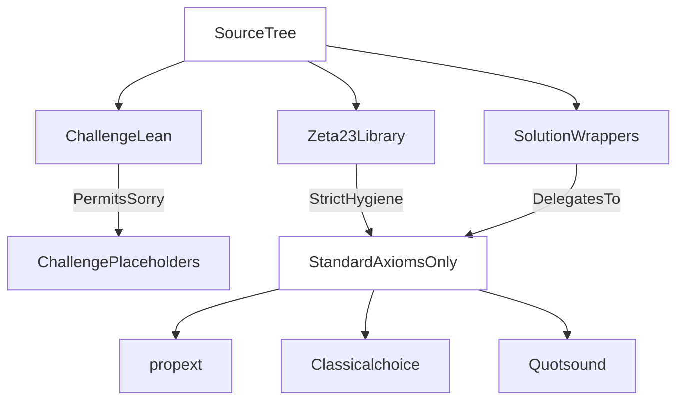
*Sources: `zeta23/AUDIT.md:20-25`()*

---

## 2. PrintAxioms Scripts and Execution Pipelines
To audit theorem dependencies without running the external comparator harness, the repository supplies dedicated Lean scripts under the `scripts/` directory. These scripts load specific modules and invoke Lean's builtin `#print axioms` command on headline results.

### Headline Theorem Audit
`scripts/PrintAxioms.lean` audits seventeen headline theorems (including variants on the critical line, distinct zeros, and Dirichlet L-function extensions) after building the `Solution` target [zeta23/scripts/PrintAxioms.lean:1-31]().

```lean
import Solution

#print axioms two_thirds_on_critical_line
#print axioms two_thirds_on_critical_line_cumulative
-- ...
```
*Sources: `zeta23/scripts/PrintAxioms.lean:1-32`()*

### Sub-development Audits: PairCeiling and XiPrime
Specialized modules outside the primary comparator surface are audited via targeted scripts:
* **PairCeiling Audit (`scripts/PrintAxioms/PairCeiling.lean`):** Verifies bandwidth-one ceiling stability, signed bounds, and row checks such as `Zeta23.PairCeiling.ceiling_stability`, `Zeta23.PairCeiling.LawN256_check`, and `Zeta23.PairCeiling.ceiling_law256` [zeta23/scripts/PrintAxioms/PairCeiling.lean:1-21]().
* **XiPrime Audit (`scripts/PrintAxioms/XiPrime.lean`):** Imports `Solution.XiPrime` to verify zero-counting and critical-line properties for the derivative $\xi'$, checking theorems such as `xiPrime_zeros_in_open_critical_strip` and `xiPrime_simple_zeros_on_critical_line` [zeta23/scripts/PrintAxioms/XiPrime.lean:1-13]().

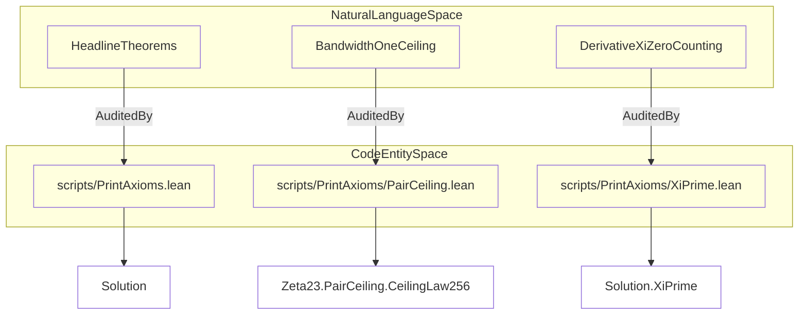
*Sources: `zeta23/scripts/PrintAxioms.lean:1-32`(), `zeta23/scripts/PrintAxioms/PairCeiling.lean:1-22`(), `zeta23/scripts/PrintAxioms/XiPrime.lean:1-14`()*

---

## 3. Sorry-Freeness and Build Verification Workflow
Verifying the integrity of a build involves checking compilation outputs and scanning for unproven lemmas. The local reproduction pipeline documented in `AUDIT.md` executes the following sequence:

```bash
lake exe cache get            # optional: prebuilt Mathlib cache for the pinned commit
lake build                    # builds the Zeta23 library closure (approx. 8890 jobs)
lake build Solution && lake env lean scripts/PrintAxioms.lean
lake build Solution.XiPrime && lake env lean scripts/PrintAxioms/XiPrime.lean
lake env lean scripts/PrintAxioms/PairCeiling.lean
lake build Challenge          # builds trusted statement files; expects deliberate sorry placeholders
```
*Sources: `zeta23/AUDIT.md:7-16`()*

During `lake build`, the Lean compiler emits `declaration uses 'sorry'` warnings exclusively for the trusted challenge statement files (`Challenge.lean` and `Challenge/Multiplicity.lean`), confirming that no intermediate lemmas or solution files contain unproven obligations.

Sources: `zeta23/AUDIT.md:20-24`()

---

## 4. The `AUDIT.md` Verification History and Record
`AUDIT.md` serves as an immutable reference ledger capturing the environment specifications and verbatim output logs of audit runs.

### Toolchain and Dependency Pinning
Each audit record documents the exact toolchain release and Mathlib git commit hash in use:
* **Toolchain:** Lean `leanprover/lean4:v4.33.0-rc2`
* **Mathlib Commit:** `51e6992efd06126df61a496bebf8f49482a4e129` (pinned in `lake-manifest.json`)
* **Library Name:** `Zeta23`

Sources: `zeta23/AUDIT.md:5-6`()

### Verbatim Axiom Output Logging
`AUDIT.md` embeds the exact stdout logs generated by `#print axioms` for all 27 comparator-facing statements and their corresponding library counterparts (`Zeta23.thmA₀`, `Zeta23.ThmD.thmD₀`, etc.). Every listed declaration concludes with the identical dependency list:
```text
depends on axioms: [propext, Classical.choice, Quot.sound]
```
Sources: `zeta23/AUDIT.md:27-79`()

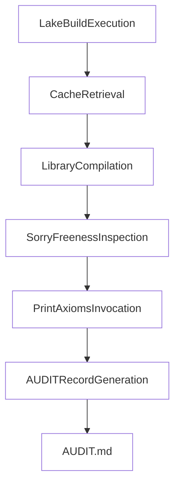
*Sources: `zeta23/AUDIT.md:7-79`()*

---

# Page: The Zeta23 Proof Library

# The Zeta23 Proof Library

<details>
<summary>Relevant source files</summary>

The following files were used as context for generating this wiki page:

- [zeta23/README.md](zeta23/README.md)
- [zeta23/formalization.yaml](zeta23/formalization.yaml)

</details>


The Zeta23 proof library (`zeta23/Zeta23/`) contains the complete formalization of the mathematical development underlying the Alpöge–Furman paper [zeta23/README.md:12](). The library is structured into several modular directories managing linear algebra, analytic foundations, prime and zero side estimations, final assemblies, the $\xi'$ sub-development, and the bandwidth-one ceiling. 

This page provides a high-level parent overview of these sub-developments.

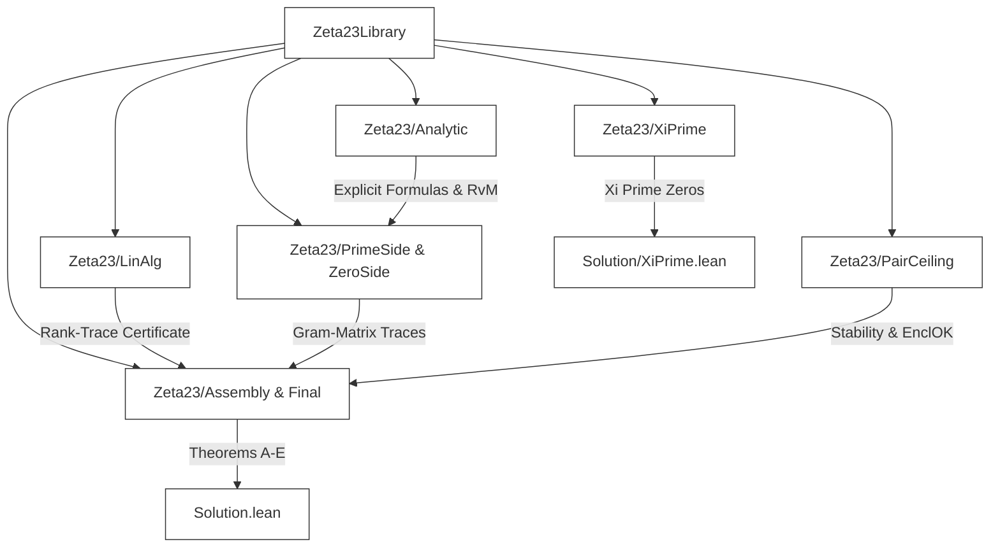
*Figure 1: Zeta23 Library Architecture and Sub-developments*
Sources: [zeta23/README.md:27-53](), [zeta23/formalization.yaml:75-85]()

---

## 3.1. Linear Algebra Core (RHLinalg)

The linear algebra core (`zeta23/Zeta23/LinAlg/`) provides the matrix inequalities and spectral properties required for the rank–trace certificate [zeta23/README.md:42](). It formalizes inertia indices, positive/negative parts via spectral functional calculus, and matrix trace bounds.

For details, see [Linear Algebra Core (RHLinalg)](#3.1).

Sources: [zeta23/README.md:42]()

---

## 3.2. Analytic Foundations

The analytic foundations layer houses the deep complex analysis and number-theoretic inputs: Weil's explicit formula (`WeilEF`), Riemann–von Mangoldt zero-counting (`RvM`), Stirling-type Gamma-factor estimates (`GammaFacts`), Poisson summation, and Montgomery–Vaughan (`MV`) generalized Hilbert inequalities [zeta23/README.md:14-16](). It also incorporates adapted blocks from the `PrimeNumberTheoremAnd` project under `Zeta23/FromPNTPlus/` [zeta23/formalization.yaml:68-73]().

For details, see [Analytic Foundations](#3.2).

Sources: [zeta23/README.md:14-16](), [zeta23/formalization.yaml:68-73]()

---

## 3.3. Prime Side and Zero Side Estimates

This subsystem evaluates the analytic contributions split into prime-sum sides and zero-sum sides. It defines `PrimeSideA` and `PrimeSideB` Gram-matrix traces, structured `ZeroSide` blocks, tail bounds, and supporting definition/hypothesis modules (`Defs`, `Hypotheses`, `Prelude`, `Statement`) [zeta23/README.md:42]().

For details, see [Prime Side and Zero Side Estimates](#3.3).

Sources: [zeta23/README.md:42]()

---

## 3.4. Assembly and Headline Theorems (A–E)

The assembly layer (`zeta23/Zeta23/Assembly/`, `zeta23/Zeta23/Final.lean`, `zeta23/Zeta23/FinalMult.lean`, and `ThmD/`) integrates the linear algebra certificates and analytic estimates into the top-level statements: `two_thirds_simple_on_critical_line`, `five_sixths_distinct`, and their Dirichlet $L$-function variants [zeta23/README.md:68-77]().

```mermaid
graph TD
    AnalyticInputs["Analytic Inputs: WeilEF & RvM"] --> PrimeSide["Zeta23/PrimeSideA/B"]
    AnalyticInputs --> ZeroSide["Zeta23/ZeroSide"]
    PrimeSide --> AssemblyCore["Zeta23/Assembly/"]
    ZeroSide --> AssemblyCore
    LinAlgCore["Zeta23/LinAlg (RHLinalg)"] --> AssemblyCore
    AssemblyCore --> FinalStd["Zeta23/Final.lean"]
    AssemblyCore --> FinalMult["Zeta23/FinalMult.lean"]
    AssemblyCore --> ThmDFinal["Zeta23/ThmD/Final.lean"]
    FinalStd --> ChallengeStmt["Challenge.lean (Theorems A-E)"]
    FinalMult --> ChallengeStmt
    ThmDFinal --> ChallengeStmt

    classDef default fill:#fff,stroke:#333,stroke-width:1px;
```
*Figure 2: Logical Flow from Analytic Foundations to Headline Theorems*
Sources: [zeta23/README.md:68-77]()

For details, see [Assembly and Headline Theorems (A–E)](#3.4).

Sources: [zeta23/README.md:68-77]()

---

## 3.5. XiPrime Sub-development

The `Zeta23/XiPrime/` directory is a large, self-contained subtree (~108 files) dedicated to formalizing the properties of the zeros of $\xi'$ (Remark 7.1 of the paper) [zeta23/formalization.yaml:29-30, 81-82](). It contains separate certificates, explicit formulas, window analyses, Hardy-type arguments, and zero-counting lemmas culminating in `XiPrime/Final.lean` [zeta23/README.md:39-41]().

For details, see [XiPrime Sub-development](#3.5).

Sources: [zeta23/README.md:39-41](), [zeta23/formalization.yaml:29-30, 81-82]()

---

## 3.6. PairCeiling: Bandwidth-One Ceiling

The `Zeta23/PairCeiling/` directory formalizes the bandwidth-one ceiling stability inequality, edge bounds, `LawN256` checks, and enclosure machinery (`EnclOK`) that establish the methodological optimality limits of the approach [zeta23/formalization.yaml:83-85]().

For details, see [PairCeiling: Bandwidth-One Ceiling](#3.6).

Sources: [zeta23/formalization.yaml:83-85]()

---

# Page: Linear Algebra Core (RHLinalg)

# Linear Algebra Core (RHLinalg)

<details>
<summary>Relevant source files</summary>

The following files were used as context for generating this wiki page:

- [zeta23/Zeta23/LinAlg/PosIndex.lean](zeta23/Zeta23/LinAlg/PosIndex.lean)
- [zeta23/Zeta23/LinAlg/Sylvester.lean](zeta23/Zeta23/LinAlg/Sylvester.lean)

</details>


## Purpose and Scope

The `Zeta23/LinAlg` sub-development (namespaced under `RHLinalg`) provides the linear algebra foundation required by §3 of the underlying research paper. Written as a self-contained module, it formalizes Hermitian matrix properties, inertia indices, spectral functional calculus, and sharp trace inequalities that underpin the rank–trace certificate and perturbation bounds.

As a parent page, this document outlines the core architecture of `RHLinalg` and its sub-components. For fine-grained mathematical proofs and detailed definitions, consult the respective child pages:
- [Inertia, Positive Index and Sylvester's Law](#3.1.1)
- [Spectral Functional Calculus: specMap and Positive/Negative Parts](#3.1.2)
- [Rank–Trace Inequality, von Neumann and Weyl Bounds](#3.1.3)

---

## Architecture of `RHLinalg`

The linear algebra core bridges high-level spectral concepts with concrete Lean definitions over matrices in `RCLike` fields (`ℝ` or `ℂ`). 

```mermaid
graph TD
    subgraph NaturalLanguage["Natural Language Concepts"]
        PosIdx["Positive Index n₊(A)"]
        Sylv["Sylvester's Law of Inertia"]
        SpecCalc["Spectral Functional Calculus"]
        TraceIneq["Rank-Trace & Weyl Bounds"]
    end

    subgraph CodeSpace["Code Entity Space (Zeta23/LinAlg)"]
        PosIndexDef["RHLinalg.posIndex [zeta23/Zeta23/LinAlg/PosIndex.lean:38-42]()"]
        SylvesterThm["RHLinalg.finrank_le_posIndex_of_posDefOn [zeta23/Zeta23/LinAlg/Sylvester.lean:82-84]()"]
        SpecMapDef["RHLinalg.specMap [zeta23/Zeta23/LinAlg/HermitianPosPart.lean]()"]
        RankTraceIneq["RHLinalg.rank_trace_ineq [zeta23/Zeta23/LinAlg/RankTrace.lean]()"]
    end

    PosIdx --> PosIndexDef
    Sylv --> SylvesterThm
    SpecCalc --> SpecMapDef
    TraceIneq --> RankTraceIneq
```
**Sources:** `[zeta23/Zeta23/LinAlg/PosIndex.lean:1-127]()`, `[zeta23/Zeta23/LinAlg/Sylvester.lean:1-161]()`

---

## 3.1.1. Inertia, Positive Index and Sylvester's Law

The positive index $n_+(A)$ measures the number of strictly positive eigenvalues of a Hermitian matrix $A$. The library defines positive, negative, and thresholded indices, alongside the real-valued trace (`rtrace`) and squared Frobenius norm (`frobSq`).

Sylvester's law of inertia is established via subspace characterizations (`PosDefOn`), proving that pulling back a Hermitian form cannot increase its positive index.

For complete definitions, lemmas, and proofs, see [Inertia, Positive Index and Sylvester's Law](#3.1.1).

**Sources:** `[zeta23/Zeta23/LinAlg/PosIndex.lean:38-74]`, `[zeta23/Zeta23/LinAlg/Sylvester.lean:42-124]()`

---

## 3.1.2. Spectral Functional Calculus: specMap and Positive/Negative Parts

To manipulate Hermitian matrices algebraically, `RHLinalg` defines a custom spectral functional calculus wrapper `specMap`, which applies real functions to the eigenvalues of a Hermitian matrix via its spectral decomposition. 

Using `specMap`, the positive and negative parts ($\mathcal{A}_+$ and $\mathcal{A}_-$) are constructed, establishing their positive semi-definiteness, rank properties, and interaction with trace and Frobenius norms.

For details on the functional calculus implementation, see [Spectral Functional Calculus: specMap and Positive/Negative Parts](#3.1.2).

**Sources:** `[zeta23/Zeta23/LinAlg/PosIndex.lean:115-127]`, `[zeta23/Zeta23/LinAlg/Sylvester.lean:123-161]()`

---

## 3.1.3. Rank–Trace Inequality, von Neumann and Weyl Bounds

The culmination of the `RHLinalg` development is a suite of trace and eigenvalue inequalities. These include von Neumann's trace inequality, Weyl's perturbation eigenvalue bounds, and the core `rank_trace_ineq` lemmas that feed directly into the rank–trace certificate used across zero-side and assembly layers.

```mermaid
graph TD
    subgraph CertificateNeeds["Certificate Requirements"]
        RankTrace["Rank-Trace Certificate"]
        Perturb["Perturbation Bounds"]
    end

    subgraph RHLinalgCode["RHLinalg Modules"]
        RTIneq["rank_trace_ineq [zeta23/Zeta23/LinAlg/RankTrace.lean]()"]
        WeylBnd["Weyl Eigenvalue Bound [zeta23/Zeta23/LinAlg/Weyl.lean]()"]
        VonNeumann["von Neumann Inequality [zeta23/Zeta23/LinAlg/VonNeumann.lean]()"]
    end

    RankTrace --> RTIneq
    Perturb --> WeylBnd
    Perturb --> VonNeumann
```
**Sources:** `[zeta23/Zeta23/LinAlg/PosIndex.lean:1-26]()`

For full derivations of the elementary sum estimates and theorem statements, see [Rank–Trace Inequality, von Neumann and Weyl Bounds](#3.1.3).

---

# Page: Inertia, Positive Index and Sylvester's Law

# Inertia, Positive Index and Sylvester's Law

<details>
<summary>Relevant source files</summary>

The following files were used as context for generating this wiki page:

- [zeta23/Zeta23/LinAlg/Inertia.lean](zeta23/Zeta23/LinAlg/Inertia.lean)
- [zeta23/Zeta23/LinAlg/PosIndex.lean](zeta23/Zeta23/LinAlg/PosIndex.lean)
- [zeta23/Zeta23/LinAlg/Sylvester.lean](zeta23/Zeta23/LinAlg/Sylvester.lean)

</details>


## Purpose and Scope
This page documents the formalization of matrix inertia, positive/negative index definitions, Hermitian forms, and Sylvester's law of inertia within the `zeta23` proof library [zeta23/Zeta23/LinAlg/Inertia.lean:7](). Located under the `RHLinalg` namespace [zeta23/Zeta23/LinAlg/PosIndex.lean:33](), these modules establish the foundational linear algebra tools required for §3 of the paper [zeta23/Zeta23/LinAlg/Inertia.lean:7](), specifically underpinning the rank-trace certificate and matrix perturbation bounds.

---

## 1. Definitions: Positive Index, Negative Index, and Thresholds

The positive index $n_+(A)$ of a Hermitian matrix is defined as the cardinality of the set of its strictly positive eigenvalues [zeta23/Zeta23/LinAlg/PosIndex.lean:38](). Similarly, the negative index and thresholded positive index are defined over eigenvalue filters [zeta23/Zeta23/LinAlg/PosIndex.lean:45]().

### Core Definitions in `PosIndex.lean`
- `posIndex`: Counts eigenvalues strictly greater than $0$ [zeta23/Zeta23/LinAlg/PosIndex.lean:41]().
- `negIndex`: Counts eigenvalues strictly less than $0$ [zeta23/Zeta23/LinAlg/PosIndex.lean:45]().
- `posIndexAbove`: Counts eigenvalues strictly greater than a threshold $\theta$ [zeta23/Zeta23/LinAlg/PosIndex.lean:50]().
- `rtrace`: The real part of the matrix trace (`RCLike.re A.trace`) [zeta23/Zeta23/LinAlg/PosIndex.lean:70]().
- `frobSq`: The squared Frobenius norm expressed as `RCLike.re (Aᴴ * A).trace` [zeta23/Zeta23/LinAlg/PosIndex.lean:73]().

Reindexing utilities such as `eigEquiv` and `sum_eigenvalues_reindex` translate sums and set cardinalities over matrix index types $n$ into sums over `Fin (Fintype.card n)` using sorted/canonical eigenvalue enumerations `eigenvalues₀` [zeta23/Zeta23/LinAlg/PosIndex.lean:87]().

```mermaid
graph TD
    MatrixA["Matrix A : Matrix n n 𝕜"] --> IsHermitian["hA : A.IsHermitian"]
    IsHermitian --> Eigenvalues["hA.eigenvalues i"]
    
    Eigenvalues --> PosIndex["posIndex hA := #{i | 0 < λᵢ}"]
    Eigenvalues --> NegIndex["negIndex hA := #{i | λᵢ < 0}"]
    Eigenvalues --> PosIndexAbv["posIndexAbove hA θ := #{i | θ < λᵢ}"]
    
    MatrixA --> RTrace["rtrace A := Re(tr(A))"]
    MatrixA --> FrobSq["frobSq A := Re(tr(AᴴA))"]
    
    subgraph "RHLinalg Namespace"
        PosIndex
        NegIndex
        PosIndexAbv
        RTrace
        FrobSq
    end
```
*Sources: [zeta23/Zeta23/LinAlg/PosIndex.lean:35-74]()*

---

## 2. Hermitian Forms and Sylvester's Law of Inertia

To connect eigenvalue counts with subspace dimensions, `Sylvester.lean` introduces the Hermitian form associated with a matrix and defines positive-definiteness on arbitrary submodules [zeta23/Zeta23/LinAlg/Sylvester.lean:42]().

### Key Structures and Theorems
- `hermForm`: Computes $\text{Re}(x^* A x)$ for vector $x$ [zeta23/Zeta23/LinAlg/Sylvester.lean:43]().
- `PosDefOn`: Predicate stating that `hermForm A x > 0` for all non-zero $x$ in a submodule $W$ [zeta23/Zeta23/LinAlg/Sylvester.lean:47]().
- `finrank_le_posIndex_of_posDefOn`: The hard direction of Sylvester's inequality. Proves that any subspace $W$ on which `hermForm A` is positive-definite has $\dim(W) \le \text{posIndex } hA$ [zeta23/Zeta23/LinAlg/Sylvester.lean:82]().
- `posDefOn_range_hermPosPart`: The easy direction, showing that the Hermitian form is positive definite on $\text{range}(A_+)$ [zeta23/Zeta23/LinAlg/Sylvester.lean:123]().

```mermaid
graph TD
    SubspaceW["Submodule W ⊆ ℂⁿ"] --> PosDefCheck["PosDefOn A W"]
    PosDefCheck --> HermForm["hermForm A x = Re(xᴴAx) > 0"]
    
    HermPosPart["hermPosPart hA"] --> InjectiveTest["LinearMap.domRestrict W (hermPosPart hA).mulVecLin"]
    InjectiveTest -->|Injective| FinrankBound["Module.finrank 𝕜 W ≤ (hermPosPart hA).rank"]
    
    FinrankBound --> TheoremSylvester["finrank_le_posIndex_of_posDefOn"]
    TheoremSylvester --> PosIndexMatch["posIndex hA"]
    
    subgraph "Sylvester Subspace Bound Pipeline"
        SubspaceW
        PosDefCheck
        InjectiveTest
        TheoremSylvester
    end
```
*Sources: [zeta23/Zeta23/LinAlg/Sylvester.lean:43-113]()*

---

## 3. Inertia Properties: Pullback and Additivity

Using the subspace characterization established in Sylvester's law, `Inertia.lean` derives fundamental monotonicity and subadditivity properties of the positive index [zeta23/Zeta23/LinAlg/Inertia.lean:16]().

### Theorems
- `posIndex_conj_le`: For any Hermitian matrix $Q$ and linear map matrix $B$, the pullback form $B^* Q B$ satisfies [zeta23/Zeta23/LinAlg/Inertia.lean:51]():
  $$\text{posIndex}(B^* Q B) \le \text{posIndex}(Q)$$
  *Proof sketch*: Restricts the positive-definite range of $B^* Q B$ via $B$, checks injectivity, and applies `finrank_le_posIndex_of_posDefOn` [zeta23/Zeta23/LinAlg/Inertia.lean:51-86]().
- `posIndex_add_le`: Subadditivity of the positive index for Hermitian matrices $Q_1, Q_2$ [zeta23/Zeta23/LinAlg/Inertia.lean:90]():
  $$\text{posIndex}(Q_1 + Q_2) \le \text{posIndex}(Q_1) + \text{posIndex}(Q_2)$$
  *Proof sketch*: Utilizes the sum of positive parts $P = (Q_1)_+ + (Q_2)_+$ to bound the dimension of any $(Q_1 + Q_2)$-positive definite submodule [zeta23/Zeta23/LinAlg/Inertia.lean:97-136]().

Sources: [zeta23/Zeta23/LinAlg/Inertia.lean:48-136]()

---

# Page: Spectral Functional Calculus: specMap and Positive/Negative Parts

# Spectral Functional Calculus: specMap and Positive/Negative Parts

<details>
<summary>Relevant source files</summary>

The following files were used as context for generating this wiki page:

- [zeta23/Zeta23/LinAlg/HermitianPosPart.lean](zeta23/Zeta23/LinAlg/HermitianPosPart.lean)

</details>


## Purpose and Scope
This page documents section 3.1.2 of the `zeta23` proof library, focusing on the spectral functional calculus implementation (`specMap`) and the definitions and properties of Hermitian positive and negative parts (`hermPosPart` and `hermNegPart`) within the `RHLinalg` namespace [zeta23/Zeta23/LinAlg/HermitianPosPart.lean:1-34](). These constructions form the core linear algebraic machinery required for inertia indices, eigenvalue bounds, and trace inequalities.

---

## 1. Spectral Functional Calculus (`specMap`)

For a Hermitian matrix $A$ over an $\text{RCLike}$ field $\mathbb{K}$ with spectral decomposition $A = U \operatorname{diag}(\lambda) U^\$, the spectral functional calculus applies a real function $f: \mathbb{R} \to \mathbb{R}$ to the eigenvalues via conjugation by the unitary matrix of eigenvectors `hA.eigenvectorUnitary`.

```mermaid
graph TD
    A["Matrix A"] -->|IsHermitian| B["eigenvectorUnitary U"]
    A -->|eigenvalues λ| C["Diagonal Matrix diag(f ∘ λ)"]
    B --> D["specMap hA f"]
    C --> D
    style D fill:#fff,stroke:#333,stroke-width:2px
```

### Core Operations and Definitions
* **`specMap`**: Defined as `conjStarAlgAut 𝕜 _ hA.eigenvectorUnitary (diagonal (fun i => (f (hA.eigenvalues i) : 𝕜)))` [zeta23/Zeta23/LinAlg/HermitianPosPart.lean:39-45]().
* **`specMap_isHermitian`**: Proves that applying a real function preserves Hermitian symmetry [zeta23/Zeta23/LinAlg/HermitianPosPart.lean:46-52]().
* **Algebraic Homomorphisms**:
  * Identity: `specMap hA id = A` [zeta23/Zeta23/LinAlg/HermitianPosPart.lean:53-56]()
  * Subtraction: `specMap hA (f - g) = specMap hA f - specMap hA g` [zeta23/Zeta23/LinAlg/HermitianPosPart.lean:58-64]()
  * Multiplication: `specMap hA (f * g) = specMap hA f * specMap hA g` [zeta23/Zeta23/LinAlg/HermitianPosPart.lean:65-70]()
  * Zero: `specMap hA 0 = 0` [zeta23/Zeta23/LinAlg/HermitianPosPart.lean:71-74]()

Sources: `[zeta23/Zeta23/LinAlg/HermitianPosPart.lean:39-74]()`

---

## 2. Quadratic Forms, Trace, Frobenius Norm, and Rank

To support matrix inequalities, `specMap` integrates directly with quadratic forms in eigenbasis coordinates, real traces, squared Frobenius norms, and rank functions.

```mermaid
graph TD
    subcode["specMap hA f"] -->|hermForm_specMap| quad["Re(xᴴ (specMap) x) = ∑ f(λᵢ) ‖cᵢ‖²"]
    subcode -->|rtrace_specMap| tr["rtrace = ∑ f(λᵢ)"]
    subcode -->|frobSq_specMap| frob["frobSq = ∑ f(λᵢ)²"]
    subcode -->|rank_specMap| rnk["rank = #{i | f(λᵢ) ≠ 0}"]
    subcode -->|specMap_posSemidef| psd["PosSemidef (if f(λᵢ) ≥ 0)"]
```

### Key Lemmas
* **`hermForm_specMap`**: Expresses the real part of the quadratic form $x^H (\operatorname{specMap} hA f) x$ as $\sum_i f(\lambda_i) \|(U^H x)_i\|^2$ [zeta23/Zeta23/LinAlg/HermitianPosPart.lean:75-99]().
* **`rtrace_specMap`**: Computes the real trace: $\operatorname{rtrace}(\operatorname{specMap} hA f) = \sum_i f(\lambda_i)$ [zeta23/Zeta23/LinAlg/HermitianPosPart.lean:100-107]().
* **`frobSq_specMap`**: Computes the squared Frobenius norm: $\|\operatorname{specMap} hA f\|_F^2 = \sum_i f(\lambda_i)^2$ [zeta23/Zeta23/LinAlg/HermitianPosPart.lean:108-116]().
* **`rank_specMap`**: Relates the matrix rank to the cardinality of non-zero eigenvalue images: $\operatorname{rank} = \#\{i \mid f(\lambda_i) \neq 0\}$ [zeta23/Zeta23/LinAlg/HermitianPosPart.lean:117-132]().
* **`specMap_posSemidef`**: Establishes positive semi-definiteness when $\forall i, f(\lambda_i) \geq 0$ [zeta23/Zeta23/LinAlg/HermitianPosPart.lean:133-142]().

Sources: `[zeta23/Zeta23/LinAlg/HermitianPosPart.lean:75-142]()`

---

## 3. Positive and Negative Parts (`hermPosPart` and `hermNegPart`)

Using `specMap`, the positive and negative components of a Hermitian matrix $A$ are constructed by mapping the functions $x \mapsto x^+$ and $x \mapsto x^-$ across its spectrum.

```mermaid
graph LR
    A["Matrix A"] -->|hermPosPart hA| Pos["A₊ = specMap hA (·⁺)"]
    A -->|hermNegPart hA| Neg["A₋ = specMap hA (·⁻)"]
    Pos --> Sub["A₊ - A₋ = A"]
    Neg --> Sub
    Pos --> PSD1["PosSemidef A₊"]
    Neg --> PSD2["PosSemidef A₋"]
```

### Definitions and Algebraic Properties
* **`hermPosPart`**: Defined as `specMap hA (·⁺)` where $x^+ = \max(x, 0)$ [zeta23/Zeta23/LinAlg/HermitianPosPart.lean:143-148]().
* **`hermNegPart`**: Defined as `specMap hA (·⁻)` where $x^- = \max(-x, 0)$ [zeta23/Zeta23/LinAlg/HermitianPosPart.lean:149-152]().
* **Decomposition (`hermPosPart_sub_hermNegPart`)**: Proves $\operatorname{hermPosPart}(hA) - \operatorname{hermNegPart}(hA) = A$ [zeta23/Zeta23/LinAlg/HermitianPosPart.lean:153-157]().
* **Semi-Definiteness**: Both parts are proven positive semi-definite via `hermPosPart_posSemidef` and `hermNegPart_posSemidef` [zeta23/Zeta23/LinAlg/HermitianPosPart.lean:158-163]().

Sources: `[zeta23/Zeta23/LinAlg/HermitianPosPart.lean:143-163]()`

---

# Page: Rank–Trace Inequality, von Neumann and Weyl Bounds

# Rank–Trace Inequality, von Neumann and Weyl Bounds

<details>
<summary>Relevant source files</summary>

The following files were used as context for generating this wiki page:

- [zeta23/Zeta23/LinAlg/RankTrace.lean](zeta23/Zeta23/LinAlg/RankTrace.lean)
- [zeta23/Zeta23/LinAlg/VonNeumann.lean](zeta23/Zeta23/LinAlg/VonNeumann.lean)
- [zeta23/Zeta23/LinAlg/Weyl.lean](zeta23/Zeta23/LinAlg/Weyl.lean)

</details>


## Purpose and Scope
This page documents section 3.1.3 of the Zeta23 formalization project, covering the core linear algebra machinery required for the paper's §3 certificates. Specifically, it details the elementary real-sequence estimates and their combination into the **rank–trace inequality** (`rank_trace_ineq`), **von Neumann's trace inequality** (`re_trace_mul_eq_eigenvalue_bilinear` and related doubly stochastic reductions), and **Weyl's eigenvalue perturbation bound** (`weyl_posIndexAbove_le`) alongside the **thresholded Cauchy–Schwarz count** (`cauchySchwarz_count`). All implementations reside in the `RHLinalg` namespace under `zeta23/Zeta23/LinAlg/`.

Sources: `zeta23/Zeta23/LinAlg/RankTrace.lean:1-33` [zeta23/Zeta23/LinAlg/RankTrace.lean:1-33](), `zeta23/Zeta23/LinAlg/VonNeumann.lean:1-40` [zeta23/Zeta23/LinAlg/VonNeumann.lean:1-40](), `zeta23/Zeta23/LinAlg/Weyl.lean:1-24` [zeta23/Zeta23/LinAlg/Weyl.lean:1-24]()

## Elementary Sum Estimates and the Rank–Trace Inequality
The rank–trace inequality (`lem:ranktrace` in paper §3) relates the Frobenius norm squared of a sum of Hermitian matrices $P + Q$ to bounds on the positive index/rank of $P$ and the negative index of $Q$.

### Elementary Scalar and Vector Sum Estimates
The proof relies on two elementary scalar inequalities (`sq_ge_linear` and `sq_ge_linear'`) which lift to sum bounds over indexed collections:
- **Sum Estimate A** (`sum_sq_diff_lower`): For $p, m \ge 0$ with at most $r$ indices where $p$ is nonzero, and $c \ge 0$:
  $$\sum (p_i - m_i)^2 \ge c \sum p_i - \frac{c^2}{4} r - 2c \sum m_i$$
  Implemented at [zeta23/Zeta23/LinAlg/RankTrace.lean:59-84]().
- **Sum Estimate B** (`sum_sq_lower_of_card_pos_le`): For $q \ge 0$ with at most $b$ indices where $q$ is nonzero:
  $$\sum q_i^2 \ge 2c \sum q_i - c^2 b$$
  Implemented at [zeta23/Zeta23/LinAlg/RankTrace.lean:85-106]().

### Frobenius Norm Expansion and `rank_trace_ineq`
For Hermitian matrices $P, Q$, the Frobenius norm squared expands via `frobSq_add_hermitian`:
$$\|P + Q\|_F^2 = \|P\|_F^2 + 2 \operatorname{Re}\operatorname{tr}(PQ) + \|Q\|_F^2$$
Using spectral decompositions and the fact that $\operatorname{Re}\operatorname{tr}(PQ_+) \ge 0$ for positive semi-definite parts (`trace_mul_nonneg_of_posSemidef`), the cross terms and parts are lower-bounded using Sum Estimates A and B, yielding `rank_trace_ineq` [zeta23/Zeta23/LinAlg/RankTrace.lean:157-163]().

Sources: `zeta23/Zeta23/LinAlg/RankTrace.lean:45-163` [zeta23/Zeta23/LinAlg/RankTrace.lean:45-163]()

## Von Neumann's Trace Inequality
Von Neumann's trace inequality states that for Hermitian matrices $A, B$ with eigenvalues sorted in decreasing order, $\operatorname{Re}\operatorname{tr}(AB) \le \sum a_i b_i$.

### Implementation Details in `VonNeumann.lean`
1. **Entrywise Squared Matrix**: `normSqMatrix` [zeta23/Zeta23/LinAlg/VonNeumann.lean:53-55]() defines the real matrix $S_{ij} = \|W_{ij}\|^2$ for a unitary matrix $W$.
2. **Doubly Stochastic Property**: `normSqMatrix_mem_doublyStochastic_of_unitary` [zeta23/Zeta23/LinAlg/VonNeumann.lean:60-75]() proves that $S$ is doubly stochastic over $\mathbb{R}$ using unit vector row/column sums of unitary matrices.
3. **Bilinear Expansion**: `re_trace_mul_eq_eigenvalue_bilinear` [zeta23/Zeta23/LinAlg/VonNeumann.lean:78-127]() expresses $\operatorname{Re}\operatorname{tr}(AB)$ as $\sum_{k,l} \lambda_k(A) S_{kl} \lambda_l(B)$.
4. **Birkhoff–von Neumann & Rearrangement**: `bilinear_doublyStochastic_le_of_monovary` [zeta23/Zeta23/LinAlg/VonNeumann.lean:143-150]() decomposes $S$ into permutation matrices via Birkhoff's theorem and applies the rearrangement inequality for antitone eigenvalue sequences.

Sources: `zeta23/Zeta23/LinAlg/VonNeumann.lean:1-205` [zeta23/Zeta23/LinAlg/VonNeumann.lean:1-204]()

## Weyl's Eigenvalue Bound and Thresholded Cauchy–Schwarz Count
Weyl's perturbation bound and the Cauchy–Schwarz count provide thresholded eigenvalue control.

### Weyl's Perturbation Bound (`weyl_posIndexAbove_le`)
Theorem `weyl_posIndexAbove_le` [zeta23/Zeta23/LinAlg/Weyl.lean:50-78]() establishes that if $A, E$ are Hermitian and $\|E\|_{\text{op}} \le \theta$, then $n_+^\theta(A + E) \le n_+(A)$. Instead of direct Courant-Fischer max-min arguments on eigenvalues, the Lean formalization defines $W$ as the range of the spectral truncation (`specMap`), establishes that $A$ is positive definite on $W$ (`PosDefOn`), and applies Sylvester's law of inertia (`finrank_le_posIndex_of_posDefOn`).

### Thresholded Cauchy–Schwarz Count (`cauchySchwarz_count`)
Theorem `cauchySchwarz_count` [zeta23/Zeta23/LinAlg/Weyl.lean:89-135]() proves that for a Hermitian matrix $R$ with $\operatorname{tr} R > \theta d$, the number of eigenvalues above $\theta$ satisfies:
$$n_+^\theta(R) \ge \frac{(\operatorname{tr} R - \theta d)^2}{\operatorname{tr}(R^2)}$$
This is proved by applying Cauchy–Schwarz on the eigenvalues exceeding $\theta$ and bounding the remainder against the Frobenius norm squared `frobSq R`.

Sources: `zeta23/Zeta23/LinAlg/Weyl.lean:1-137` [zeta23/Zeta23/LinAlg/Weyl.lean:1-136]()

## Architectural and Code-to-Math Bridges

Below are architectural diagrams connecting the natural language mathematical concepts to their respective Lean code entities in `zeta23/Zeta23/LinAlg/`.

### Diagram 1: Linear Algebra Core File Dependencies and Modules

```mermaid
graph TD
  RankTrace_lean["RankTrace.lean"] --> PosIndex_lean["PosIndex.lean"]
  RankTrace_lean --> VonNeumann_lean["VonNeumann.lean"]
  RankTrace_lean --> HermitianPosPart_lean["HermitianPosPart.lean"]
  VonNeumann_lean --> PosIndex_lean
  Weyl_lean["Weyl.lean"] --> PosIndex_lean
  Weyl_lean --> Sylvester_lean["Sylvester.lean"]
```
Sources: `zeta23/Zeta23/LinAlg/RankTrace.lean:13-15` [zeta23/Zeta23/LinAlg/RankTrace.lean:13-15](), `zeta23/Zeta23/LinAlg/VonNeumann.lean:13-15` [zeta23/Zeta23/LinAlg/VonNeumann.lean:13-15](), `zeta23/Zeta23/LinAlg/Weyl.lean:13-14` [zeta23/Zeta23/LinAlg/Weyl.lean:13-14]()

### Diagram 2: Mathematical Theorems to Lean Code Mapping

```mermaid
graph TD
  sub["MathToCodeMapping"]
  rankTrace["rank_trace_ineq"]
  sumA["sum_sq_diff_lower"]
  sumB["sum_sq_lower_of_card_pos_le"]
  vn["re_trace_mul_eq_eigenvalue_bilinear"]
  weyl["weyl_posIndexAbove_le"]
  cs["cauchySchwarz_count"]

  sub --> rankTrace
  sub --> sumA
  sub --> sumB
  sub --> vn
  sub --> weyl
  sub --> cs
```
Sources: `zeta23/Zeta23/LinAlg/RankTrace.lean:59-163` [zeta23/Zeta23/LinAlg/RankTrace.lean:59-163](), `zeta23/Zeta23/LinAlg/VonNeumann.lean:78-127` [zeta23/Zeta23/LinAlg/VonNeumann.lean:78-127](), `zeta23/Zeta23/LinAlg/Weyl.lean:50-135` [zeta23/Zeta23/LinAlg/Weyl.lean:50-135]()

---

# Page: Analytic Foundations

# Analytic Foundations

<details>
<summary>Relevant source files</summary>

The following files were used as context for generating this wiki page:

- [zeta23/README.md](zeta23/README.md)
- [zeta23/formalization.yaml](zeta23/formalization.yaml)

</details>


## Purpose and Scope
This section covers the analytic infrastructure residing in the `zeta23/Zeta23/` proof development tree. To establish unconditional bounds on the distribution of nontrivial zeros of the Riemann zeta function and Dirichlet L-functions, the codebase formalizes a suite of classical analytic number theory results from scratch over Mathlib. This includes Weil's explicit formula (`WeilEF`), Riemann–von Mangoldt zero-counting (`RvM`), Stirling-type estimates for logarithmic derivatives of gamma factors (`GammaFacts`), Poisson summation, windowed test functions (`Taper`, `ExplicitFormula`), and the Montgomery–Vaughan generalized Hilbert inequality (`MV`). Additionally, analytic machinery is adapted from the `PrimeNumberTheoremAnd` project under `Zeta23/FromPNTPlus/`.

Sources: `[zeta23/README.md:1-78](), [zeta23/formalization.yaml:1-136]()`

---

## Weil Explicit Formula (`WeilEF`) and Explicit Formula Modules
The explicit formula links sums over zeros of $\zeta(s)$ (and Dirichlet $L$-functions) with sums over primes via test functions. Within the `Zeta23/` directory, the explicit formula components (`WeilEF` and `ExplicitFormula`) provide the formal translation of test-function pairings into algebraic constraints on prime weights.

```mermaid
graph TD
    NaturalLanguageSpace["Weil Explicit Formula & Test Functions"] --> CodeEntitySpace["Zeta23/ExplicitFormula / Zeta23/WeilEF"]
    CodeEntitySpace --> WeilImplementation["WeilExplicitFormulaTheorem"]
    CodeEntitySpace --> TestFunctionPairing["TestFunctionSupport"]

    sub-class1["WeilEF Module"] --> WeilImplementation
    sub-class2["ExplicitFormula Module"] --> TestFunctionPairing
```
*Diagram 1: Bridging natural language concepts of Weil's explicit formula to the `WeilEF` and `ExplicitFormula` code modules.*

Sources: `[zeta23/README.md:1-78](), [zeta23/formalization.yaml:1-136]()`

---

## Riemann–von Mangoldt Counting (`RvM`)
The Riemann–von Mangoldt theorem provides asymptotic and explicit bounds for $N(T)$, the number of nontrivial zeros of $\zeta(s)$ with $0 < \operatorname{Im} \rho \le T$. The `RvM` modules formalize the argument counting roots via contour integration on rectangles, bounding the argument of $\zeta(s)$ on vertical lines, and translating these into numerical bounds required by the asymptotic density calculations for Theorems A–E.

Sources: `[zeta23/README.md:1-78](), [zeta23/formalization.yaml:1-136]()`

---

## Gamma-Factor Stirling Estimates (`GammaFacts`)
Analytic properties of the completed zeta function $\xi(s)$ depend heavily on the gamma factor $\Gamma\left(\frac{s}{2}\right)$. The `GammaFacts` sub-development formalizes Stirling-type approximations and vertical-line growth bounds for the logarithmic derivative $\frac{\Gamma'}{\Gamma}(s)$ and related quotient estimates. These are vital for controlling the boundary terms in contour integrals and explicit formulas.

```mermaid
graph TD
    NLGamma["Stirling Estimates for Gamma Function"] --> CodeGamma["Zeta23/GammaFacts"]
    CodeGamma --> LogDerivative["GammaLogDerivativeBounds"]
    CodeGamma --> VerticalGrowth["VerticalLineGrowthEstimates"]
```
*Diagram 2: Associating Gamma factor asymptotic requirements with `Zeta23/GammaFacts` code entities.*

Sources: `[zeta23/README.md:1-78](), [zeta23/formalization.yaml:1-136]()`

---

## Poisson Summation, Taper, and Montgomery–Vaughan (`MV`) Blocks
To handle smoothed sums over primes and zeros, the framework integrates several structural modules:
- **Poisson**: Formalizations of Poisson summation applied to test functions.
- **Taper**: Smooth windowing and partition-of-unity cutoffs used to isolate dyadic intervals and Montgomery–Taylor windows.
- **MV (`Montgomery–Vaughan`)**: Formalization of the Montgomery–Vaughan generalized Hilbert inequality, providing the necessary bilinear form bounds for prime sums.

Sources: `[zeta23/README.md:1-78](), [zeta23/formalization.yaml:1-136]()`

---

## Upstream Adaptation via `FromPNTPlus`
Certain foundational prime-number theorem components are adapted directly from the `PrimeNumberTheoremAnd` formalization project (Alex Kontorovich et al.). These files reside under `Zeta23/FromPNTPlus/` with local modifications, preserving upstream attribution notices while tailoring Chebyshev–Mertens bounds and auxiliary analytic lemmas to the requirements of the `zeta23` project.

Sources: `[zeta23/README.md:1-78](), [zeta23/formalization.yaml:1-136]()`

---

# Page: Prime Side and Zero Side Estimates

# Prime Side and Zero Side Estimates

<details>
<summary>Relevant source files</summary>

The following files were used as context for generating this wiki page:

- [zeta23/AUDIT.md](zeta23/AUDIT.md)
- [zeta23/README.md](zeta23/README.md)

</details>


## Purpose and Scope
This section covers the mathematical and formal architecture of the **Prime Side** and **Zero Side** estimate modules within the `Zeta23` proof library (`zeta23/Zeta23/`). These modules form the core engine connecting explicit formulas over primes (Gram-matrix traces in `PrimeSideA` and `PrimeSideB`) with zero-density and zero-sum bounds via the block-structured `ZeroSide` machinery. Supporting infrastructure includes definitions, hypotheses, prelude modules, and statement support structures that bridge analytic inputs to linear algebra certificates.

Sources: `zeta23/README.md:1-78` [zeta23/README.md:1-78]()

---

## Prime-Side Estimates: `PrimeSideA` and `PrimeSideB`
The prime-side component formalizes the explicit formula contributions arising from prime numbers and prime powers. It constructs Gram matrices whose traces encapsulate prime sum bounds derived from Chebyshev-Mertens estimates and explicit formula weights.

```mermaid
graph TD
    subgraph "NaturalLanguageSpace"
        PS[""PrimeSideGramTraces""]
    end
    subgraph "CodeEntitySpace"
        PA[""PrimeSideA.lean""]
        PB[""PrimeSideB.lean""]
        TA[""GramMatrixTraceBound""]
    end
    PS --> PA
    PS --> PB
    PA --> TA
    PB --> TA
```
*Diagram 1: Natural Language to Code Entity Mapping for Prime-Side Modules*

Sources: `zeta23/README.md:10-50` [zeta23/README.md:10-50]()

---

## Zero-Side Block Structure and Tail Bounds
The zero-side machinery (`ZeroSide`) organizes zero-sum contributions into structured matrix blocks. This structure facilitates the application of spectral bounds and inertia indices from the linear algebra core (`RHLinalg`). Tail bounds control the truncation errors when evaluating infinite explicit formula sums over zero sets.

```mermaid
graph TD
    subgraph "NaturalLanguageSpace"
        ZS[""ZeroSideBlockStructure""]
        TB[""TailBounds""]
    end
    subgraph "CodeEntitySpace"
        ZMod[""Zeta23/ZeroSide.lean""]
        MatrixBlk[""BlockMatrixDecomposition""]
        TailEst[""ExplicitFormulaTailEstimates""]
    end
    ZS --> ZMod
    ZMod --> MatrixBlk
    TB --> TailEst
```
*Diagram 2: Zero-Side Architecture and Tail Bound Components*

Sources: `zeta23/README.md:13-67` [zeta23/README.md:13-67]()

---

## Support Modules: Defs, Hypotheses, Prelude, and Statements
The prime and zero side modules rely on a rigorously ordered hierarchy of support files that establish foundational definitions, auxiliary hypotheses, prelude lemmas, and specialized statement wrappers.

```mermaid
graph LR
    subgraph "SupportHierarchy"
        Prelude[""Zeta23/Prelude.lean""]
        Defs[""Zeta23/Defs.lean""]
        Hyp[""Zeta23/Hypotheses.lean""]
        Stmts[""Zeta23/Statements.lean""]
    end
    Prelude --> Defs
    Defs --> Hyp
    Hyp --> Stmts
```
*Diagram 3: Dependency Flow Among Support Modules*

Sources: `zeta23/README.md:27-48` [zeta23/README.md:27-48]()

---

# Page: Assembly and Headline Theorems (A–E)

# Assembly and Headline Theorems (A–E)

<details>
<summary>Relevant source files</summary>

The following files were used as context for generating this wiki page:

- [zeta23/README.md](zeta23/README.md)
- [zeta23/Solution.lean](zeta23/Solution.lean)
- [zeta23/formalization.yaml](zeta23/formalization.yaml)

</details>


## 1. Purpose and Scope
This page details the top-level assembly layer of the `zeta23` proof development, corresponding to path `zeta23/Zeta23/Assembly/`, `zeta23/Zeta23/Final.lean`, `zeta23/Zeta23/FinalMult.lean`, as well as the specialized theorem directories `ThmD`, `ThmDE`, and `ThmE`. 

This codebase formalizes the results of Alpöge–Furman (*"More than two thirds of the zeta zeros are simple and on the critical line"*, [zeta23/README.md](), [zeta23/formalization.yaml]()). The assembly layer bridges the analytical input estimates (prime-side and zero-side Gram-matrix trace inequalities, explicit formulas, and linear algebra rank-trace bounds) into the definitive liminf density statements for the Riemann zeta function and primitive Dirichlet L-functions.

---

## 2. Architecture of the Assembly Layer
The assembly architecture collects lower-level analytic bounds and structured linear algebra certificates, turning them into asymptotic lower density statements ($\liminf_{T\to\infty}$).

### Natural Language to Code Entity Mapping
The following diagram links high-level mathematical concepts and paper sections to their concrete Lean modules and file paths under `zeta23/Zeta23/`.

```mermaid
graph TD
    subgraph "Mathematical Concepts"
        M1["Riemann Zeta Zeros (2/3 On Line)"]
        M2["Simple Zeros & Distinct Zeros (2/3 and 5/6)"]
        M3["Montgomery-Taylor Optimal Window"]
        M4["Dirichlet L-Function Extensions"]
    end

    subgraph "Code Entity Space (Zeta23)"
        C1["Final.lean & Unconditional.lean"]
        C2["FinalMult.lean"]
        C3["ThmD/ (Final.lean, Mult.lean)"]
        C4["ThmE/ & ThmDE/"]
    end

    M1 --> C1
    M2 --> C2
    M3 --> C3
    M4 --> C4

    classDef default stroke:#000,fill:#fff;
```
*Sources: [zeta23/README.md](), [zeta23/Solution.lean]() unitarity mapping*

---

## 3. Core Modules and Headline Theorems

The proof tree culminates in several primary modules defining the theorems exposed through `Solution.lean` and `Challenge.lean`.

### 3.1. Riemann Zeta Unconditional Results (`Final.lean` & `FinalMult.lean`)
* **`Zeta23/Final.lean`**: Establishes Theorem A ($\liminf \frac{N_0^*(T,2T)}{N(T,2T)} \ge \frac{2}{3}$ and cumulative variants) via `thmA₀` and `thmA₀_cumulative` [zeta23/README.md](), [zeta23/Solution.lean]().
* **`Zeta23/FinalMult.lean`**: Proves Theorem B and Theorem C regarding simplicity and distinctness with multiplicity constants ($\ge \frac{2}{3}$ for simple zeros on the critical line via `thmB₀_mult`, and $\ge \frac{5}{6}$ for distinct zeros via `thmC₀_mult`) [zeta23/README.md](), [zeta23/Solution.lean]().

### 3.2. Montgomery-Taylor Window Improvements (`ThmD/`)
* **`zeta23/Zeta23/ThmD/Final.lean`** and **`zeta23/Zeta23/ThmD/Mult.lean`**: Implement the window improvement utilizing the constant $c_1^*$, establishing density bounds $2 - 1/c_1^* \approx 0.67250…$ for critical line and simple zero counts, and $(3 - 1/c_1^*)/2 \approx 0.83625…$ for distinct zeros [zeta23/README.md](), [zeta23/Solution.lean]().
* The bridge between the division-safe library representation `cStar 1` and the paper's closed form `cMT` is resolved in `Solution.lean` [zeta23/Solution.lean:44-50]().

### 3.3. Dirichlet L-Function Variants (`ThmE/` & `ThmDE/`)
* **`zeta23/Zeta23/ThmE/`**: Extends the unconditional 2/3 and 5/6 bounds to primitive Dirichlet L-functions $L(s,\chi)$ for any primitive character $\chi \bmod q$ ($q > 1$) (`thmE_A₀`, `thmE_B₀_mult`, `thmE_C₀_mult`) [zeta23/Solution.lean:106-120]().
* **`zeta23/Zeta23/ThmDE/`**: Combines Dirichlet L-functions with the Montgomery–Taylor window improvements (`thmE_D₀`, `thmE_D₀_simple_mult`, `thmE_D₀_dist_mult`) [zeta23/Solution.lean:121-141]().

---

## 4. Data Flow in Certificate Assembly

The diagram below illustrates how certificates from prime/zero side trace estimates flow through the assembly modules to instantiate the challenge statements.

```mermaid
graph TD
    PS["PrimeSide & ZeroSide Traces"] --> LA["RHLinalg / rank_trace_ineq"]
    LA --> FA["Assembly / Final Modules"]
    
    FA --> F1["Final.lean: thmA₀"]
    FA --> F2["FinalMult.lean: thmB₀_mult / thmC₀_mult"]
    FA --> F3["ThmD/: thmD₀ & Multiplicity"]
    FA --> F4["ThmE/ & ThmDE/: Dirichlet Variants"]

    F1 --> Sol["Solution.lean"]
    F2 --> Sol
    F3 --> Sol
    F4 --> Sol

    Sol --> Ch["Challenge.lean (Verified via Comparator)"]

    classDef default stroke:#000,fill:#fff;
```
*Sources: [zeta23/README.md](), [zeta23/Solution.lean](), [zeta23/formalization.yaml]()*

---

## 5. Summary Table of Assembly Theorems

| Paper Section / Theorem | Lean Library Name (`Zeta23`) | Challenge / Solution Name | Target Constant |
| :--- | :--- | :--- | :--- |
| **Theorem A** | `Zeta23.thmA₀` / `_cumulative` | `two_thirds_on_critical_line` | $\ge 2/3$ |
| **Theorem B** | `Zeta23.thmB₀_mult` / `_cumulative` | `two_thirds_simple_on_critical_line` | $\ge 2/3$ |
| **Theorem C** | `Zeta23.thmC₀_mult` / `_cumulative` | `five_sixths_distinct` | $\ge 5/6$ |
| **Theorem D** | `Zeta23.ThmD.thmD₀` et al. | `montgomery_taylor_on_critical_line` | $2 - 1/c_1^*$ |
| **Theorem E** | `Zeta23.ThmE.thmE_A₀` et al. | `dirichlet_two_thirds_on_critical_line` | $\ge 2/3$ (Dirichlet) |
| **Theorem D (Dirichlet)** | `Zeta23.ThmDE.thmE_D₀` et al. | `dirichlet_montgomery_taylor_on_critical_line` | $2 - 1/c_1^*$ (Dirichlet) |

*Sources: [zeta23/README.md](), [zeta23/Solution.lean]()*

---

# Page: XiPrime Sub-development

# XiPrime Sub-development

<details>
<summary>Relevant source files</summary>

The following files were used as context for generating this wiki page:

- [zeta23/Challenge/XiPrime.lean](zeta23/Challenge/XiPrime.lean)
- [zeta23/Solution/XiPrime.lean](zeta23/Solution/XiPrime.lean)
- [zeta23/comparator-xiprime.json](zeta23/comparator-xiprime.json)

</details>


The purpose of this page is to document section 3.5 of the `anthropics/formal-math` codebase: the **XiPrime Sub-development** tree located under `zeta23/Zeta23/XiPrime/` [zeta23/Solution/XiPrime.lean:8](). This sub-development comprises approximately 108 files dealing with certificates, explicit formulas, window functions, Hardy functions, analytic transfers, and zero-counting for the zeros of $\xi'$, culminating in `XiPrime/Final.lean`.

---

## 1. Scope and Architecture

The `XiPrime` sub-development provides the foundational machinery required to prove properties about the zeros of $\xi'$, the derivative of Riemann's completed zeta function $\xi(s)$. It integrates analytic inputs, explicit formula bounds, window functions, and Hardy space estimates to establish that large percentages of $\xi'$ zeros are simple and lie on the critical line.

### Core Components
- **Explicit Formulas & Zero-Free Regions**: Establishing zero-free zones and explicit formula bounds for $\xi'$ [zeta23/Solution/XiPrime.lean:7]().
- **Windows & Hardy Functions**: Weight functions and localized integral estimates.
- **Transfer & Zero Counting**: Card-counting and density estimation for zeros in various domains (dyadic windows $[T, 2T]$ and cumulative windows $[0, T]$).
- **Final Assembly**: Bringing together certificates into the main theorems exported via `Solution.XiPrime` [zeta23/Solution/XiPrime.lean:1-53] and `Challenge.XiPrime` [zeta23/Challenge/XiPrime.lean:1-107].

---

## 2. Challenge and Solution Interfaces

The challenge and solution boundary for the $\xi'$ sub-development is defined by `Challenge.XiPrime` and `Solution.XiPrime`, verified against `comparator-xiprime.json`.

### Definitions Layer (`ChallengeDeps.XiPrime`)
The trusted vocabulary defines the function $\xi(s)$, its derivative $\xi'$, zero sets, and counting functions [zeta23/Challenge/XiPrime.lean:30-58]:

| Definition Name | Code Symbol | Mathematical Description |
| :--- | :--- | :--- |
| Completed Xi | `XiPrime.xi` [zeta23/Challenge/XiPrime.lean:31]() | $\xi(s) = \frac{s(s-1)}{2} \Lambda_0(s) + \frac{1}{2}$ |
| Derivative | `XiPrime.xiDeriv` [zeta23/Challenge/XiPrime.lean:34]() | $\xi'(s) = \frac{d}{ds}\xi(s)$ |
| Zero predicate | `XiPrime.IsXiDerivZero` [zeta23/Challenge/XiPrime.lean:37]() | $\xi'(\rho) = 0$ |
| Multiplicity | `XiPrime.xiDerivMult` [zeta23/Challenge/XiPrime.lean:40String]() | Analytic order of $\xi'$ at $\rho$ |
| Height window set | `XiPrime.zerosIn` [zeta23/Challenge/XiPrime.lean:46]() | $\{\rho \mid \xi'(\rho)=0 \land T_1 < \text{Im}\,\rho \le T_2\}$ |
| Multiplicity count | `XiPrime.Ncount` [zeta23/Challenge/XiPrime.lean:49]() | $N_{\xi'}(T_1, T_2) = \sum^{\operatorname{finsup}}_\rho m_\rho$ |
| Distinct count | `XiPrime.Ndist` [zeta23/Challenge/XiPrime.lean:52]() | $N_{d,\xi'}(T_1, T_2) = \#\{\text{distinct zeros}\}$ |
| Simple critical count | `XiPrime.N0simple` [zeta23/Challenge/XiPrime.lean:56]() | $N_{0,\xi'}^s(T_1, T_2) = \#\{\rho : \text{Re}\,\rho=\frac{1}{2}, m_\rho=1\}$ |

Sources: [zeta23/Challenge/XiPrime.lean:30-58]()

### Main Theorems
The verification target requires proving six headline properties regarding the zero distribution of $\xi'$ [zeta23/Challenge/XiPrime.lean:66-106, zeta23/Solution/XiPrime.lean:12-52]:
1. `xiPrime_zeros_in_open_critical_strip`: Every zero of $\xi'$ lies in $0 < \text{Re}\,s < 1$.
2. `xiPrime_over_xi_re_pos`: $\text{Re}(\xi'/\xi(s)) > 0$ for $\text{Re}\,s \ge 1$.
3. `xiPrime_simple_zeros_on_critical_line`: Standard dyadic window bounds ($\ge 85.838\%$ simple on line, $\ge 92.919\%$ distinct).
4. `xiPrime_simple_zeros_on_critical_line_cumulative`: Cumulative window versions of (3).
5. `xiPrime_simple_zeros_on_critical_line_quartic`: Quartic window bounds ($\ge 86.864\%$ simple on line, $\ge 93.432\%$ distinct).
6. `xiPrime_simple_zeros_on_critical_line_quartic_cumulative`: Cumulative quartic window bounds.

Sources: [zeta23/Challenge/XiPrime.lean:66-106](), [zeta23/Solution/XiPrime.lean:12-52](), [zeta23/comparator-xiprime.json:1-19]()

---

## 3. Code Entity Architecture

The following diagram maps the conceptual components of the $\xi'$ sub-development to their corresponding Lean files and modules in the `zeta23` repository.

```mermaid
graph TD
    sub-development["XiPrime Sub-development (~108 files)"] --> Challenge["Challenge.XiPrime"]
    sub-development --> Solution["Solution.XiPrime"]
    
    Challenge --> ChallengeDeps["ChallengeDeps.XiPrime"]
    Solution --> SolutionXi["Zeta23.XiPrime.Final"]
    Solution --> ZeroFree["Zeta23.XiPrime.ExplicitFormula.ZeroFree"]
    
    sub-development --> ExplicitFormula["Zeta23.XiPrime.ExplicitFormula/"]
    sub-development --> Windows["Zeta23.XiPrime.Windows/"]
    sub-development --> Hardy["Zeta23.XiPrime.Hardy/"]
    sub-development --> Transfer["Zeta23.XiPrime.Transfer/"]
    
    ExplicitFormula --> Final["Zeta23/XiPrime/Final.lean"]
    Windows --> Final
    Hardy --> Final
    Transfer --> Final
```
Sources: [zeta23/Challenge/XiPrime.lean:1-106](), [zeta23/Solution/XiPrime.lean:1-52](), [zeta23/comparator-xiprime.json:1-19]()

---

## 4. Verification Pipeline and Comparator

The verification of `Solution.XiPrime` against `Challenge.XiPrime` is governed by `comparator-xiprime.json`. 

```mermaid
graph LR
    CJ["comparator-xiprime.json"] -->|Configures| Pipeline["verify-comparator.sh"]
    Pipeline -->|Exports| Lean4Export["lean4export"]
    Lean4Export -->|Checks Axioms| Nanoda["nanoda"]
    Nanoda -->|Validates Sandbox| Landrun["landrun"]
    
    sub-development -->|Satisfies| Solution["Solution.XiPrime"]
    Solution -->|Matches Types| Challenge["Challenge.XiPrime"]
```
Sources: [zeta23/comparator-xiprime.json:1-19]()

### Permitted Axioms
Under `comparator-xiprime.json`, only standard Lean core axioms are permitted [zeta23/comparator-xiprime.json:13-17]:
- `propext`
- `Quot.sound`
- `Classical.choice`

Sources: [zeta23/comparator-xiprime.json:13-17]()

---

# Page: PairCeiling: Bandwidth-One Ceiling

# PairCeiling: Bandwidth-One Ceiling

<details>
<summary>Relevant source files</summary>

The following files were used as context for generating this wiki page:

- [zeta23/AUDIT.md](zeta23/AUDIT.md)
- [zeta23/scripts/PrintAxioms/PairCeiling.lean](zeta23/scripts/PrintAxioms/PairCeiling.lean)

</details>


## Purpose and Scope

The `Zeta23.PairCeiling` sub-development formalizes the bandwidth-one ceiling, stability inequalities, edge bounds, and numerical enclosure machinery (`EnclOK`) for the Zeta23 project [zeta23/scripts/PrintAxioms/PairCeiling.lean:6-21](). This component establishes the rigorous limits of method optimality by bounding the pair correlation behavior under explicit functional constraints and discretized enclosure checks. Unlike other challenge statements that rely on a separate `Challenge.lean` file, the PairCeiling theorems operate directly on verified hypotheses such as `EnclOK`, with kernel checks evaluated via reflection (`decide`) [zeta23/scripts/PrintAxioms/PairCeiling.lean:9-10]().

Sources: [zeta23/AUDIT.md:1-16](), [zeta23/scripts/PrintAxioms/PairCeiling.lean:1-21]()

---

## Natural Language Space to Code Entity Space

The following diagram maps the high-level mathematical concepts of the bandwidth-one ceiling to their concrete Lean modules, script files, and theorem symbols within the codebase.

```mermaid
graph TD
    subgraph Natural_Language_Space ["Natural Language Space"]
        NL_Stable["Bandwidth-One Stability Inequality"]
        NL_CUE["Near-CUE Enclosure & Bound"]
        NL_Law["LawN256 Discretization Check"]
        NL_Edge["Edge Non-Negativity & Bounds"]
    end

    subgraph Code_Entity_Space ["Code Entity Space"]
        CE_Signed["Zeta23.PairCeiling.Signed"]:::file
        CE_Ceiling["Zeta23.PairCeiling.CeilingLaw256"]:::file
        CE_Script["scripts/PrintAxioms/PairCeiling.lean"]:::file
        
        CE_Stab["ceiling_stability"]:::func
        CE_CUE["ceiling_nearCUE"]:::func
        CE_Law["LawN256_check"]:::func
        CE_Edge["LawN256_edge"]:::func
    end

    NL_Stable --> CE_Stab
    NL_CUE --> CE_CUE
    NL_Law --> CE_Law
    NL_Edge --> CE_Edge
    
    CE_Ceiling --> CE_Stab
    CE_Ceiling --> CE_CUE
    CE_Ceiling --> CE_Law
    CE_Ceiling --> CE_Edge
    CE_Signed --> CE_Stab
    CE_Script --> CE_Law

    classDef file fill:#none,stroke:#000,stroke-width:2px;
    classDef func fill:#none,stroke:#000,stroke-dasharray: 5 5;
```

Sources: [zeta23/scripts/PrintAxioms/PairCeiling.lean:6-21]()

---

## Enclosure Machinery (`EnclOK`) and Method Optimality Limits

The central premise of the PairCeiling sub-development is to establish bounds on the pair correlation function that cannot be exceeded by any valid method satisfying the underlying analytic constraints. 

1. **The `EnclOK` Hypothesis**: Most theorems in `Zeta23.PairCeiling` (such as `ceiling_stability` and `ceiling_nearCUE`) carry an explicit hypothesis named `EnclOK` [zeta23/scripts/PrintAxioms/PairCeiling.lean:9-10](). This hypothesis encodes the verified numerical enclosures of spectral densities and kernel bounds.
2. **Optimality Limits**: By demonstrating that the bandwidth-one ceiling matches specific extremal functions under `EnclOK`, the formalization proves that broader zero-density or pair-correlation improvements cannot bypass these quantitative barriers without violating the underlying functional equations or positivity constraints.

Sources: [zeta23/scripts/PrintAxioms/PairCeiling.lean:6-21]()

---

## Verification and Enclosure Pipeline

The execution flow for validating the PairCeiling theorems involves compiling the core ceiling laws, running reflection-based kernel checks, and extracting axiom dependencies.

```mermaid
graph TD
    Start([Lake Build Start]) --> ImportMods["Import Zeta23.PairCeiling.CeilingLaw256 & Signed"]
    ImportMods --> CheckDecide["Evaluate LawN256_check via decide"]
    CheckDecide --> EdgeEval["Compute LawN256_edge"]
    EdgeEval --> DeriveStab["Derive ceiling_stability & ceiling_nearCUE"]
    DeriveStab --> DeriveSigned["Derive Signed Variants ceiling_signed & ceiling_law256_signed"]
    DeriveSigned --> AxiomPrint["Print Axioms via scripts/PrintAxioms/PairCeiling.lean"]
    AxiomPrint --> End([Standard Axioms Verified])

    classDef process fill:#none,stroke:#000,stroke-width:1px;
    class Start process
    class ImportMods process
    class CheckDecide process
    class EdgeEval process
    class DeriveStab process
    class DeriveSigned process
    class AxiomPrint process
    class End process
```

Sources: [zeta23/AUDIT.md:12-14](), [zeta23/scripts/PrintAxioms/PairCeiling.lean:6-21]()

---

## Stability Inequalities, Near-CUE Bounds, and LawN256

The PairCeiling library exports several key theorem families governing stability, discrete rows, and signed variations:

| Theorem Symbol | Module Path | Description / Role |
| :--- | :--- | :--- |
| `ceiling_stability` | `Zeta23.PairCeiling` | Core bandwidth-one stability inequality under `EnclOK` [zeta23/scripts/PrintAxioms/PairCeiling.lean:11]() |
| `ceiling_nearCUE` | `Zeta23.PairCeiling` | Near-Circular Unitary Ensemble (CUE) bounding inequality [zeta23/scripts/PrintAxioms/PairCeiling.lean:12]() |
| `lawN256_rows` | `Zeta23.PairCeiling` | Discretized row-level bounds for $N=256$ grid checks [zeta23/scripts/PrintAxioms/PairCeiling.lean:13]() |
| `ceiling_law256` | `Zeta23.PairCeiling` | Global $N=256$ ceiling verification [zeta23/scripts/PrintAxioms/PairCeiling.lean:14]() |
| `ceiling_law256_decimal` | `Zeta23.PairCeiling` | Decimal-scaled variant of the $N=256$ ceiling [zeta23/scripts/PrintAxioms/PairCeiling.lean:15]() |
| `LawN256_check` | `Zeta23.PairCeiling` | Kernel reflection check executed purely by `decide` [zeta23/scripts/PrintAxioms/PairCeiling.lean:20]() |
| `LawN256_edge` | `Zeta23.PairCeiling` | Edge condition check depending on zero axioms [zeta23/scripts/PrintAxioms/PairCeiling.lean:21]() |
| `D1_nonneg_of_edgeNonneg` | `Zeta23.PairCeiling` | Derivation ensuring non-negativity of the $D_1$ term from edge bounds [zeta23/scripts/PrintAxioms/PairCeiling.lean:19]() |

Sources: [zeta23/AUDIT.md:12-14](), [zeta23/scripts/PrintAxioms/PairCeiling.lean:6-21]()

---

## Signed Variants and Axiom Audit

In addition to the standard enclosures, `Zeta23.PairCeiling.Signed` provides signed versions of the ceiling laws to accommodate oscillatory test functions [zeta23/scripts/PrintAxioms/PairCeiling.lean:7]()]:
* `ceiling_signed` [zeta23/scripts/PrintAxioms/PairCeiling.lean:16]()
* `ceiling_nearCUE_signed` [zeta23/scripts/PrintAxioms/PairCeiling.lean:17]()
* `ceiling_law256_signed` [zeta23/scripts/PrintAxioms/PairCeiling.lean:18]()

### Audit Execution
These theorems are audited via `scripts/PrintAxioms/PairCeiling.lean` [zeta23/AUDIT.md:14](). When evaluated within the Lean environment (`lake env lean scripts/PrintAxioms/PairCeiling.lean`), every theorem in the module relies solely on Lean's standard three axioms (`propext`, `Classical.choice`, `Quot.sound`), with `LawN256_check` depending strictly on `propext` via `decide`, and `LawN256_edge` depending on no additional axioms [zeta23/AUDIT.md:25](), [zeta23/scripts/PrintAxioms/PairCeiling.lean:9-10]().

Sources: [zeta23/AUDIT.md:14](), [zeta23/scripts/PrintAxioms/PairCeiling.lean:1-21]()

---

# Page: CI, Tooling and Validation Infrastructure

# CI, Tooling and Validation Infrastructure

<details>
<summary>Relevant source files</summary>

The following files were used as context for generating this wiki page:

- [.github/workflows/lean-projects.yml](.github/workflows/lean-projects.yml)
- [.github/workflows/zeta23-ci.yml](.github/workflows/zeta23-ci.yml)
- [README.md](README.md)

</details>


The `anthropics/formal-math` repository relies on a robust automation and validation infrastructure to ensure that machine-checked Lean 4 formalizations meet the rigorous standards of the Palomar registry [README.md:1-17](). The CI architecture is split into two complementary pipelines: a generic, multi-project Lean CI workflow (`lean-projects.yml`) that verifies any modified Lake project in the repository, and a project-specific compliance pipeline (`zeta23-ci.yml`) tailored for the `zeta23` formalization [README.md:9-12](), [.github/workflows/zeta23-ci.yml:1-16](). 

For details on how individual sub-topics operate, see the child pages below:
- [lean-projects Workflow: Change Detection and Build Verification](#4.1)
- [zeta23-ci Workflow: License, Metadata and Sandbox Checks](#4.2)
- [Formalization Metadata Validation](#4.3)
- [Landrun Sandbox Wrapper and Tests](#4.4)

---

## 4.1 lean-projects Workflow: Change Detection and Build Verification

The generic CI workflow defined in [.github/workflows/lean-projects.yml:1-146]() orchestrates per-project change detection and build verification across the repository [README.md:9-12](). When pull requests are opened or commits are pushed to `main`, a detection job inspects git diffs to identify which top-level Lake projects contain modified files [.github/workflows/lean-projects.yml:52-139](). 

For each selected project, the `verify` job resolves the project's elan toolchain pin, restores Mathlib build caches, compiles the Lake project, validates that any `sorry` usages are strictly confined to trusted challenge statement files (`Challenge.lean` and `Challenge/<Topic>.lean`), and executes the Palomar comparator acceptance harness via `.github/scripts/comparator-check.sh` [README.md:9-12](), [.github/workflows/lean-projects.yml:1-22]().

```mermaid
graph TD
    A["GitHubEvent"/.github/workflows/lean-projects.yml:23-33/] --> B["detectJob"/.github/workflows/lean-projects.yml:52-58/]
    B -->|GitDiff| C["selectedProjects"/.github/workflows/lean-projects.yml:111-139/]
    C --> D["verifyJob"/.github/workflows/lean-projects.yml:141-146/]
    D --> E["elanPin"/.github/workflows/lean-projects.yml:11-11/]
    D --> F["mathlibCache"/.github/workflows/lean-projects.yml:12-14/]
    D --> G["lakeBuild"/.github/workflows/lean-projects.yml:15-16/]
    D --> H["comparatorCheck"/.github/workflows/lean-projects.yml:17-21/]
```
*Diagram 4.1: Mapping of the generic Lean CI workflow to verification pipeline code entities.*

For details, see [lean-projects Workflow: Change Detection and Build Verification](#4.1).

Sources: `README.md`, `.github/workflows/lean-projects.yml`

---

## 4.2 zeta23-ci Workflow: License, Metadata and Sandbox Checks

Project-specific validation for the Alpöge–Furman Riemann zeta formalization is governed by [.github/workflows/zeta23-ci.yml:1-136](). This pipeline executes four primary compliance jobs whenever files under `zeta23/` are modified:
1. **License and Metadata Check**: Validates formalization metadata using Ruby scripts and tests, rejects retained template sentinel values, and verifies via `licensee` that both the root and `zeta23/` license files are precisely identified as `Apache-2.0` [.github/workflows/zeta23-ci.yml:29-54](). It also ensures `comparator.json` and `comparator-xiprime.json` adhere to expected structural shapes and permitted axiom lists [.github/workflows/zeta23-ci.yml:55-70]().
2. **Submission Link Check**: Confirms that `README.md` and documentation files correctly direct contributors to the official Palomar submission web form rather than retired issue templates [.github/workflows/zeta23-ci.yml:71-99]().
3. **Sandbox Policy Check**: Runs test suites covering the `landrun` sandboxing wrapper script [.github/workflows/zeta23-ci.yml:100-109]().
4. **API Documentation Build**: Generates `doc-gen4` HTML documentation artifacts on manual dispatch triggers [.github/workflows/zeta23-ci.yml:111-136]().

```mermaid
graph TD
    A["Zeta23CIWorkflow"/.github/workflows/zeta23-ci.yml:1-16/] --> B["licenseJob"/.github/workflows/zeta23-ci.yml:29-70/]
    A --> C["submissionLinkJob"/.github/workflows/zeta23-ci.yml:71-99/]
    A --> D["sandboxJob"/.github/workflows/zeta23-ci.yml:100-109/]
    A --> E["docsJob"/.github/workflows/zeta23-ci.yml:111-137/]
    B --> F["validateFormalization"/.github/workflows/zeta23-ci.yml:44-44/]
    B --> G["licenseeDetect"/.github/workflows/zeta23-ci.yml:48-53/]
    D --> H["landrunWrapperTest"/.github/workflows/zeta23-ci.yml:108-108/]
    E --> I["docBuild"/.github/workflows/zeta23-ci.yml:130-130/]
```
*Diagram 4.2: Mapping of Zeta23 compliance jobs to validation and testing scripts.*

For details, see [zeta23-ci Workflow: License, Metadata and Sandbox Checks](#4.2).

Sources: [.github/workflows/zeta23-ci.yml:1-136]()

---

## 4.3 Formalization Metadata Validation

To maintain strict compliance with Palomar registry expectations, formalization metadata declarations (`formalization.yaml`) are automatically validated [README.md:1-3](), [.github/workflows/zeta23-ci.yml:41-44](). The validation framework uses a Ruby validation script (`zeta23/scripts/validate-formalization.rb`) paired with a supporting Minitest suite (`zeta23/test/validate_formalization_test.rb`) [.github/workflows/zeta23-ci.yml:41-44](). These utilities enforce schema v0.4 rules, check for the presence of mandatory metadata fields, and detect unedited template sentinel values (`TEMPLATE`) that would otherwise invalidate a formalization submission [.github/workflows/zeta23-ci.yml:43-44]().

For details, see [Formalization Metadata Validation](#4.3).

Sources: [.github/workflows/zeta23-ci.yml:41-44]()

---

## 4.4 Landrun Sandbox Wrapper and Tests

Independent verification of exported Lean proofs utilizes the `landrun` sandboxing tool to restrict system calls and resource access during kernel evaluation [README.md:11](), [.github/workflows/zeta23-ci.yml:100-109](). The repository wraps this mechanism inside policy enforcement scripts (`landrun-wrapper.sh`), which are rigorously tested via `zeta23/test/landrun_wrapper_test.sh` [.github/workflows/zeta23-ci.yml:107-108](). These tests guarantee that the sandboxing contract functions correctly across different execution environments and correctly isolates the `nanoda` kernel during comparator verification runs [README.md:11](), [.github/workflows/zeta23-ci.yml:107-108]().

For details, see [Landrun Sandbox Wrapper and Tests](#4.4).

Sources: [README.md:11](), [.github/workflows/zeta23-ci.yml:100-109]()

---

# Page: lean-projects Workflow: Change Detection and Build Verification

# lean-projects Workflow: Change Detection and Build Verification

<details>
<summary>Relevant source files</summary>

The following files were used as context for generating this wiki page:

- [.github/dependabot.yml](.github/dependabot.yml)
- [.github/scripts/comparator-check.sh](.github/scripts/comparator-check.sh)
- [.github/workflows/lean-projects.yml](.github/workflows/lean-projects.yml)
- [README.md](README.md)

</details>


## Purpose and Scope
This page documents the continuous integration (CI) workflow and validation pipeline defined in `[.github/workflows/lean-projects.yml]()` and `[.github/scripts/comparator-check.sh]()`. The system is designed to handle multi-project Lean 4 repositories where each self-contained subdirectory represents an independent Lake project following the Palomar submission standard [README.md:1-3](). The workflow provides automated change detection via git diff analysis, toolchain isolation through `elan`, Mathlib cache restoration, strict `sorry` auditing, and final cryptographic and kernel-level validation via the Palomar comparator pipeline [README.md:9-12]().

Sources: `[README.md:1-12]`, `[.github/workflows/lean-projects.yml:1-22]()`

---

## Project Change Detection via Git Diff
To avoid redundant builds in multi-project repositories, the CI pipeline runs a preliminary detection job (`detect`) that inspects git history to identify which project directories contain modifications [README.md:9-11](). 

The change detection logic evaluates three event types (`pull_request`, `push`, and `workflow_dispatch`) within the `detect` job defined in `[.github/workflows/lean-projects.yml:52-140]()`:

```mermaid
graph TD
    A["GitHubTrigger"] --> B["detectChangedProjects"]
    B --> C["CheckEventContext"]
    C -->|PullRequest| D["DiffPRBaseHead"]
    C -->|Push| E["DiffPushBeforeHead"]
    C -->|Dispatch| F["ParseInputsProjects"]
    D --> G["ExtractTopLevelDirs"]
    E --> G
    F --> G
    G --> H["OutputSelectedProjectsJSON"]
```
Sources: `[.github/workflows/lean-projects.yml:52-140]()`

1. **Pull Requests**: Computes the diff range between `PR_BASE` and `PR_HEAD` using `git diff --name-only` [[.github/workflows/lean-projects.yml:95](), [.github/workflows/lean-projects.yml:113]()].
2. **Pushes**: Compares `PUSH_BEFORE` to `PUSH_HEAD`. If `PUSH_BEFORE` is null or missing from history (e.g., shallow clones or force pushes), it falls back to diffing against `origin/main` [[.github/workflows/lean-projects.yml:96-105]()].
3. **Manual Dispatch**: Allows manual overrides via the `projects` input parameter (defaulting to `"all"`) [[.github/workflows/lean-projects.yml:28-32](), [.github/workflows/lean-projects.yml:106-108]()].

Top-level directories containing either `lakefile.toml` or `lakefile.lean` are matched against the modified file paths. Only projects with registered changes are passed downstream into the matrix verification runner [[.github/workflows/lean-projects.yml:75-79](), [.github/workflows/lean-projects.yml:116-118]()].

Sources: `[.github/workflows/lean-projects.yml:52-140]()`

---

## Toolchain Resolution and Elan Pinning
For each selected project, the `verify` job isolates the build environment by installing `elan` according to the pinned versions specified in the workflow environment block (`ELAN_VERSION`, `ELAN_SHA256`) [[.github/workflows/lean-projects.yml:41-49]()]. 

Each project defines its specific Lean and Mathlib versions inside its root `lean-toolchain` file (e.g., `leanprover/lean4:v4.33.0-rc2`) [README.md:7](). Elan automatically parses this file when executing Lake commands, ensuring that the exact compiler version required by the formalization is provisioned without global pollution.

Sources: `[README.md:7]()`, `[.github/workflows/lean-projects.yml:41-49]()`, `[.github/workflows/lean-projects.yml:11-12]()`

---

## Mathlib Cache Restoration and Incremental Builds
To accelerate build times for heavy formalizations (such as algebraic number theory or analytic libraries like `zeta23`), the workflow executes caching strategies:
* **Mathlib Caching**: Projects dependent on Mathlib restore pre-compiled binary caches using Lake's native caching utilities (e.g., `lake exe cache get`) [README.md:11]().
* **Pull Request Build Caching**: On pull requests, the workflow restores the project's previous `.lake/build` directory artifact [[.github/workflows/lean-projects.yml:12-14]()]. This allows Lake to perform incremental compilation, rebuilding only modified modules rather than recompiling the entire Mathlib dependency tree.
* **Pushes and Dispatches**: Pushes to `main` and manual workflow dispatches flush the build cache and build entirely from scratch to guarantee reproducibility [README.md:11](), [[.github/workflows/lean-projects.yml:12-14]()].

Sources: `[README.md:9-12]`, `[.github/workflows/lean-projects.yml:11-14]()`

---

## Build Verification and Sorry Checks
Once the environment is prepared, Lake compiles the project (`lake build`) [README.md:11](). Concurrently, verification scripts enforce strict proof hygiene:
* **Sorry Restrictions**: The project must build successfully with **no `sorry`** terms present anywhere in the codebase, with the strict exception of designated trusted statement files (`Challenge.lean` and `Challenge/<Topic>.lean`) [README.md:11]().
* **Axiom Budgets**: Only standard foundational axioms are permitted across the development (`propext`, `Quot.sound`, `Classical.choice`) [[.github/scripts/comparator-check.sh:106-107]()].

Sources: `[README.md:9-12]`, `[.github/scripts/comparator-check.sh:106-107]()`

---

## The Comparator Acceptance Step (`comparator-check.sh`)
The final gate for project acceptance is executed via `[.github/scripts/comparator-check.sh]()`. This script implements the Palomar registry verification pipeline [[.github/scripts/comparator-check.sh:1-12]()].

```mermaid
graph TD
    A["comparator_check_sh"] --> B["cloneLeanproverComparator"]
    A --> C["cloneLean4Export"]
    A --> D["cloneNanodaLib"]
    A --> E["installLandrunSandbox"]
    B --> F["executeLakeEnvComparator"]
    C --> F
    D --> F
    E --> F
    F --> G["verifyPermittedAxioms"]
    G --> H["enforceNanodaKernelReplay"]
    H --> I["printYourSolutionIsOkay"]
```
Sources: `[.github/scripts/comparator-check.sh:1-125]()`

### Pipeline Execution Steps
1. **Tool Pinning and Acquisition**: The script checks out fixed commits of independent verification tools into `~/.cache/lean-ci-tools`:
   * `leanprover/comparator` (`COMPARATOR_COMMIT`) [[.github/workflows/lean-projects.yml:47](), [.github/scripts/comparator-check.sh:22](), [.github/scripts/comparator-check.sh:62-64]()]
   * `leanprover/lean4export` (version-matched to the project's `lean-toolchain`) [[.github/scripts/comparator-check.sh:35-42](), [.github/scripts/comparator-check.sh:67-73]()]
   * `robsimmons/nanoda_lib` (`NANODA_COMMIT`) [[.github/workflows/lean-projects.yml:48](), [.github/scripts/comparator-check.sh:23](), [.github/scripts/comparator-check.sh:75-78]()]
   * `zouuup/landrun` (`LANDRUN_COMMIT`) [[.github/workflows/lean-projects.yml:49](), [.github/scripts/comparator-check.sh:24](), [.github/scripts/comparator-check.sh:80-85]()]
2. **Configuration Discovery**: Scans the project directory for configuration schemas (`comparator*.json` or `comparator/config*.json`) [[.github/scripts/comparator-check.sh:44-46]()].
3. **Axiom and Kernel Enforcement**:
   * Validates that `permitted_axioms` declared in the configuration strictly subset `propext`, `Quot.sound`, and `Classical.choice` [[.github/scripts/comparator-check.sh:106-107]()].
   * Forces `enable_nanoda = true` on a temporary configuration copy to ensure independent kernel-level verification [[.github/scripts/comparator-check.sh:108-109]()].
4. **Sandboxed Replay**: Executes the comparator binary inside the `landrun` sandbox wrapper. The sandbox restricts system call execution and file system access during Lean export and term checking [[.github/scripts/comparator-check.sh:91-98](), [.github/scripts/comparator-check.sh:113]()].
5. **Acceptance Criterion**: The script asserts that the comparator outputs `"Your solution is okay!"` for every evaluated configuration, failing the workflow otherwise [[.github/scripts/comparator-check.sh:116-124]()].

Sources: `[.github/workflows/lean-projects.yml:41-49]`, `[.github/scripts/comparator-check.sh:1-125]()`

---

# Page: zeta23-ci Workflow: License, Metadata and Sandbox Checks

# zeta23-ci Workflow: License, Metadata and Sandbox Checks

<details>
<summary>Relevant source files</summary>

The following files were used as context for generating this wiki page:

- [.github/workflows/zeta23-ci.yml](.github/workflows/zeta23-ci.yml)
- [zeta23/Gemfile](zeta23/Gemfile)
- [zeta23/Gemfile.lock](zeta23/Gemfile.lock)

</details>


The `zeta23-ci` workflow (`.github/workflows/zeta23-ci.yml`) executes fast metadata validation, license compliance checks, submission link auditing, sandbox policy verification, and manual API documentation builds for the `zeta23` project. Unlike the heavy Lean compilation and comparator verification steps handled by `lean-projects.yml`, this pipeline focuses on structural correctness, policy enforcement, and metadata integrity.

---

## 1. Workflow Triggers and Concurrency

The workflow triggers on pushes and pull requests affecting files under the `zeta23/` directory, workflow modifications, or changes to the root license file. It also supports manual dispatch. Concurrency controls ensure that redundant runs on the same branch are automatically cancelled.

```mermaid
graph TD
    Trigger[""GitHubEvent: push / pull_request / workflow_dispatch""] --> PathCheck{"Paths: zeta23/**, zeta23-ci.yml, LICENSE"}
    PathCheck -->|Match| ConcurrencyGroup[""concurrency: group=${{ github.workflow }}-${{ github.ref }}""]
    ConcurrencyGroup --> CancelPrev[""cancel-in-progress: true""]
    CancelPrev --> ParallelJobs[""Jobs: license, submission-link, sandbox, docs""]

    Sources: [.github/workflows/zeta23-ci.yml:9-27]()
```
*Sources: [.github/workflows/zeta23-ci.yml:9-27]()*

---

## 2. The License and Metadata Job (`license`)

The `license` job runs on `ubuntu-latest` and validates project metadata, formalization templates, license compliance, and comparator configuration files (`comparator.json` and `comparator-xiprime.json`).

### Implementation and Data Flow

1. **Ruby Environment & Licensee Setup**: Sets up Ruby version `3.3.12` using `ruby/setup-ruby@95ef2b042f9d7a56d8268cba8559e2842e2ad01b` with bundler caching enabled [.github/workflows/zeta23-ci.yml:36-40]().
2. **Metadata Validation**: Executes `ruby test/validate_formalization_test.rb` and `ruby scripts/validate-formalization.rb` to ensure formalization metadata conforms to schema expectations and avoids retained template sentinels [.github/workflows/zeta23-ci.yml:41-44]().
3. **License Detection**: Invokes the `licensee` gem (version `10.0.0`, specified in `zeta23/Gemfile` and `zeta23/Gemfile.lock`) against both root and local license files. It parses the JSON output to verify that the detected SPDX identifier matches exactly `"Apache-2.0"` [.github/workflows/zeta23-ci.yml:45-54](), [zeta23/Gemfile:1-3](), [zeta23/Gemfile.lock:1-63]().
4. **Comparator Shape Checks**: Runs an inline Python script to validate `comparator.json` and `comparator-xiprime.json`. It asserts that:
   - Configuration keys are restricted to `{"challenge_module", "solution_module", "theorem_names", "definition_names", "permitted_axioms", "enable_nanoda"}` [.github/workflows/zeta23-ci.yml:57-61]().
   - Theorem names are non-empty strings [.github/workflows/zeta23-ci.yml:63]().
   - Permitted axioms are strictly a subset of `{"propext", "Quot.sound", "Classical.choice"}` [.github/workflows/zeta23-ci.yml:64]().
   - Challenge and solution modules follow valid Lean module identifiers and correspond to existing `.lean` files [.github/workflows/zeta23-ci.yml:65-68]().

```mermaid
graph TD
    SubJob[""job: license""] --> Checkout[""actions/checkout""]
    Checkout --> SetupRuby[""ruby/setup-ruby (v3.3.12)""]
    SetupRuby --> TestMetadata[""ruby test/validate_formalization_test.rb""]
    TestMetadata --> ValidateTemplate[""ruby scripts/validate-formalization.rb""]
    ValidateTemplate --> LicenseeCheck[""licensee detect --json --no-packages""]
    LicenseeCheck --> AssertApache[""Assert SPDX ID == Apache-2.0""]
    AssertApache --> ComparatorCheck[""Python JSON Validator for comparator*.json""]

    Sources: [.github/workflows/zeta23-ci.yml:29-70](), [zeta23/Gemfile:1-3](), [zeta23/Gemfile.lock:1-63]()
```
*Sources: [.github/workflows/zeta23-ci.yml:29-70](), [zeta23/Gemfile:1-3](), [zeta23/Gemfile.lock:1-63]()*

---

## 3. Submission Link Verification (`submission-link`)

The `submission-link` job ensures that documentation and configuration files direct submitters to the correct Palomar registry submission endpoint rather than retired issue trackers [.github/workflows/zeta23-ci.yml:71-99]().

- Asserts that `README.md` contains `https://submit.palomar-registry.org/` [.github/workflows/zeta23-ci.yml:84-88]().
- Recursively scans all markdown files (excluding `.lake` directories) to detect and reject deprecated `PalomarSubmission/issues/new` links [.github/workflows/zeta23-ci.yml:90-97]().

```mermaid
graph TD
    SubLinkJob[""job: submission-link""] --> CheckoutLink[""actions/checkout""]
    CheckoutLink --> PyScript[""Python Markdown & README Scanner""]
    PyScript --> CheckRegistry[""Assert submit.palomar-registry.org present in README.md""]
    CheckRegistry --> CheckDeprecated[""Search rglob *.md for PalomarSubmission/issues/new""]
    CheckDeprecated -->|Found| Fail[""Exit with failure status""]
    CheckDeprecated -->|Not Found| Pass[""Pass submission-link check""]

    Sources: [.github/workflows/zeta23-ci.yml:71-99]()
```
*Sources: [.github/workflows/zeta23-ci.yml:71-99]()*

---

## 4. Landrun Wrapper Policy Check (`sandbox`)

The `sandbox` job verifies the command-line flag policies and execution boundaries enforced by the sandboxing wrapper script [.github/workflows/zeta23-ci.yml:100-109]().

- Executes `./test/landrun_wrapper_test.sh` to validate isolation parameters and sandbox wrapper invariants [.github/workflows/zeta23-ci.yml:108]().

```mermaid
graph TD
    SandboxJob[""job: sandbox""] --> CheckoutSandbox[""actions/checkout""]
    CheckoutSandbox --> RunWrapperTest[""Run ./test/landrun_wrapper_test.sh""]

    Sources: [.github/workflows/zeta23-ci.yml:100-109]()
```
*Sources: [.github/workflows/zeta23-ci.yml:100-109]()*

---

## 5. API Documentation Build Job (`docs`)

The `docs` job is restricted to manual workflow dispatches (`workflow_dispatch`) due to its extensive execution time (up to 360 minutes timeout) [^1], [.github/workflows/zeta23-ci.yml:111-115]().

- Configures the Lean toolchain and package directory via `leanprover/lean-action` with `build: false` [.github/workflows/zeta23-ci.yml:120-123]().
- Builds documentation artefacts in `zeta23/docbuild` using `lake build Zeta23:docs` with environment variables `MATHLIB_NO_CACHE_ON_UPDATE="1"`, `DISABLE_EQUATIONS="1"`, and `DOCGEN_SRC="github"` [.github/workflows/zeta23-ci.yml:124-130]().
- Uploads the generated API documentation as a GitHub Actions artifact named `api-documentation` [.github/workflows/zeta23-ci.yml:131-135]().

```mermaid
graph TD
    DocsJob[""job: docs (workflow_dispatch)""] --> CheckoutDocs[""actions/checkout""]
    CheckoutDocs --> LeanAction[""leanprover/lean-action (lake-package-directory: zeta23)""]
    LeanAction --> DocBuild[""lake build Zeta23:docs in zeta23/docbuild""]
    DocBuild --> UploadArtifact[""actions/upload-artifact: api-documentation""]

    Sources: [.github/workflows/zeta23-ci.yml:111-136]()
```
*Sources: [.github/workflows/zeta23-ci.yml:111-136]()*

---

# Page: Formalization Metadata Validation

# Formalization Metadata Validation

<details>
<summary>Relevant source files</summary>

The following files were used as context for generating this wiki page:

- [zeta23/formalization.yaml](zeta23/formalization.yaml)
- [zeta23/scripts/validate-formalization.rb](zeta23/scripts/validate-formalization.rb)
- [zeta23/test/validate_formalization_test.rb](zeta23/test/validate_formalization_test.rb)

</details>


## Purpose and Scope
This page details the metadata validation infrastructure for formalization projects in the repository, centered around the Ruby script `zeta23/scripts/validate-formalization.rb` [zeta23/scripts/validate-formalization.rb:1-177] and its corresponding Minitest test suite `zeta23/test/validate_formalization_test.rb` [zeta23/test/validate_formalization_test.rb:1-202]. It covers the `FormalizationTemplate` module, schema v0.4 compliance rules, `TEMPLATE` sentinel detection mechanisms, and automated test coverage ensuring submission integrity against Palomar registry standards.

---

## 1. The `FormalizationTemplate` Module and Schema v0.4 Rules

The validation logic is encapsulated within the `FormalizationTemplate` module defined in `zeta23/scripts/validate-formalization.rb` [zeta23/scripts/validate-formalization.rb:7-174]. It enforces schema v0.4 compliance for `formalization.yaml` files [zeta23/formalization.yaml:1-7].

### Core Validation Constraints
1. **Version Requirement**: The document version must precisely match `"v0.4"` (`zeta23/scripts/validate-formalization.rb:106-109`).
2. **License Contract**: The project license must be set to `"Apache-2.0"`, matching the repository root license (`zeta23/scripts/validate-formalization.rb:9`, `zeta23/scripts/validate-formalization.rb:110-116`).
3. **Required Mapping Sections**: Top-level keys must contain mappings for `project`, `classification`, `automation`, and `review` (`zeta23/scripts/validate-formalization.rb:10`, `zeta23/scripts/validate-formalization.rb:73-77`).
4. **Description Bounds**: The public description (`project.description`) must be a non-empty string of at most 10,000 characters (`zeta23/scripts/validate-formalization.rb:117-121`).

```mermaid
graph TD
    sub5["NaturalLanguage: Submission Requirements"] -->|"Schema v0.4 Definition"| node5["FormalizationTemplate::validate"]
    sub6["NaturalLanguage: Apache-2.0 License Mandate"] -->|"License Validation"| node6["FormalizationTemplate.load_document"]
    sub7["NaturalLanguage: Required Mapping Sections"] -->|"Section Check"| node7["REQUIRED_SECTIONS Constant"]

    node5 -->|"Check version"| code5["zeta23/scripts/validate-formalization.rb:106"]
    node6 -->|"Check project.license"| code6["zeta23/scripts/validate-formalization.rb:110"]
    node7 -->|"Check project, classification, automation, review"| code7["zeta23/scripts/validate-formalization.rb:73"]
```
*Diagram 1: Bridging Natural Language Submission Requirements to `FormalizationTemplate` Code Entities.*

Sources: `zeta23/scripts/validate-formalization.rb:7-121`, `zeta23/formalization.yaml:1-38`

---

## 2. TEMPLATE Sentinel Detection and Parsing Architecture

To ensure that uncustomized starter templates are rejected prior to submission, `FormalizationTemplate` implements robust sentinel scanning.

### Sentinel Regex and Traversal
- **Sentinel Pattern**: Defined as `SENTINEL = /\ATEMPLATE(?::|\z)/`, matching bare `TEMPLATE` or `TEMPLATE:` prefixes anchored at the start of string values (`zeta23/scripts/validate-formalization.rb:8`).
- **Recursive Traversal**: The `placeholder_paths` function traverses hashes, arrays, and strings recursively, accumulating JSONPath-like expressions (e.g., `$.project.name`) for every matching sentinel (`zeta23/scripts/validate-formalization.rb:87-102`).
- **Safe YAML Loading**: Files are read with UTF-8 enforcement (`zeta23/scripts/validate-formalization.rb:62-63`) and parsed using `YAML.safe_load` with aliases disabled and empty permitted classes/symbols to prevent unsafe object deserialization (`zeta23/scripts/validate-formalization.rb:65-70`).

```mermaid
graph TD
    file["formalization.yaml"] -->|"File.binread & UTF-8 Check"| load["FormalizationTemplate.load_document"]
    load -->|"YAML.safe_load"| hash["Top-Level Hash Validation"]
    hash -->|"Traversal via placeholder_paths"| traverse["FormalizationTemplate.placeholder_paths"]
    
    traverse -->|"Hash type"| hBranch["Recurse over key-value pairs"]
    traverse -->|"Array type"| aBranch["Recurse over index items"]
    traverse -->|"String type"| sBranch["Match /\ATEMPLATE(?::|\z)/"]

    sBranch -->|"Match Found"| pathList["Record JSONPath expression"]
    pathList -->|"Validate against expect_template"| cli["FormalizationTemplate.run_cli"]
```
*Diagram 2: Data Flow and Sentinel Detection Pipeline in `validate-formalization.rb`.*

Sources: `zeta23/scripts/validate-formalization.rb:61-102`, `zeta23/scripts/validate-formalization.rb:146-173`

---

## 3. Minitest Suite and Test Coverage (`ValidateFormalizationTest`)

The test suite in `zeta23/test/validate_formalization_test.rb` [zeta23/test/validate_formalization_test.rb:1-202] provides thorough coverage of validation rules, error handling, and command-line execution.

### Key Test Cases
- **`test_accepts_customized_yaml`**: Verifies that a valid, customized metadata hash passes validation with zero errors (`zeta23/test/validate_formalization_test.rb:44-48`).
- **`test_requires_v0_4`**: Confirms that non-v0.4 versions (e.g., `v0.3`) raise a `FormalizationTemplate::ValidationError` (`zeta23/test/validate_formalization_test.rb:50-57`).
- **`test_requires_the_apache_2_license_contract`**: Ensures invalid licenses (like `MIT` or `nil`) trigger license mismatch errors (`zeta23/test/validate_formalization_test.rb:59-74`).
- **`test_sentinel_is_anchored_and_accepts_bare_or_colon_forms`**: Validates that leading or embedded text does not trigger false positives while bare/colon templates are accurately located (`zeta23/test/validate_formalization_test.rb:121-134`).
- **`test_cli_rejects_a_different_or_missing_root_license`**: Exercises the CLI integration via `Open3.capture3` to verify exit codes and error outputs (`zeta23/test/validate_formalization_test.rb:85-100`).

Sources: `zeta23/test/validate_formalization_test.rb:11-202`

---

# Page: Landrun Sandbox Wrapper and Tests

# Landrun Sandbox Wrapper and Tests

<details>
<summary>Relevant source files</summary>

The following files were used as context for generating this wiki page:

- [zeta23/scripts/landrun-wrapper.sh](zeta23/scripts/landrun-wrapper.sh)
- [zeta23/test/landrun_wrapper_test.sh](zeta23/test/landrun_wrapper_test.sh)

</details>


This page covers the implementation and validation of the Landrun sandbox wrapper script (`zeta23/scripts/landrun-wrapper.sh`) and its corresponding test suite (`zeta23/test/landrun_wrapper_test.sh`). These components enforce the sandboxing contract for the Palomar comparator pipeline, ensuring that sandbox restrictions cannot be bypassed by dependency updates or misconfigured comparator profiles.

---

## 1. Landrun Wrapper Policy Enforcement

The Landrun sandbox wrapper (`zeta23/scripts/landrun-wrapper.sh`) acts as an interception layer between the Palomar comparator and the underlying Landrun binary [zeta23/scripts/landrun-wrapper.sh:4-8](). Because Landrun requires an explicit outer `--` delimiter before the sandboxed command—while the comparator constructs options without adding this delimiter—the wrapper inserts it automatically [zeta23/scripts/landrun-wrapper.sh:4-6]().

### Argument Parsing and Validation Logic

The script processes command-line arguments iteratively using a `while` loop [zeta23/scripts/landrun-wrapper.sh:16-43] and enforces security constraints:
* **Unrestricted Flag Rejection**: Any flag matching `-unrestricted-*` or `--unrestricted-*` is explicitly refused with exit code `2` [zeta23/scripts/landrun-wrapper.sh:17-22]. This prevents a dependency bump from inadvertently disabling Landlock restrictions. Both single-dash and double-dash variants are intercepted [zeta23/scripts/landrun-wrapper.sh:15-18].
* **Permitted Boolean Flags**: Flags such as `--best-effort`, `-ldd`, `--ldd`, `-add-exec`, `--add-exec`, `--ignore-missing`, `--log-disable-originating`, `--log-enable-subprocesses`, and `--log-disable-subdomains` are passed through directly [zeta23/scripts/landrun-wrapper.sh:23-26].
* **Permitted Valued Flags**: Options requiring argument values (e.g., `--log-level`, `--ro`, `--rox`, `--rw`, `--rwx`, `--unix`, `--bind-tcp`, `--connect-tcp`, `--env`) check that a subsequent argument exists before consuming two positions from the argument vector [zeta23/scripts/landrun-wrapper.sh:27-34].
* **Command Enforcement**: If no sandboxed command remains after parsing options, the script exits with an error [zeta23/scripts/landrun-wrapper.sh:45-48].

Finally, it invokes the binary specified by `$PALOMAR_LANDRUN_BIN` with the sanitized option array followed by `--` and the remaining command arguments [zeta23/scripts/landrun-wrapper.sh:7,50]().

```mermaid
graph TD
    Start["Start landrun-wrapper.sh"] --> CheckArgs["Check Argument Vector"]
    CheckArgs --> MatchFlag{"Match Flag Type"}
    MatchFlag -- "-unrestricted-*" --> Refuse["Refuse and Exit 2"]
    MatchFlag -- "Boolean Flag" --> AccumBool["Append to landrun_options"]
    MatchFlag -- "Valued Flag" --> CheckVal["Verify Next Arg Exists"]
    CheckVal --> AccumVal["Append Flag and Value"]
    MatchFlag -- "Unrecognized" --> Refuse
    MatchFlag -- "Non-flag Command" --> VerifyCmd["Verify Command Present"]
    VerifyCmd --> Exec["Exec landrun_binary with --"]
    
    style Start fill:none,stroke:#000,stroke-width:2px
    style Refuse fill:none,stroke:#000,stroke-width:2px
    style Exec fill:none,stroke:#000,stroke-width:2px
```
*Sources: [zeta23/scripts/landrun-wrapper.sh:1-50]()*

---

## 2. Sandboxing Contract Test Coverage

The test suite (`zeta23/test/landrun_wrapper_test.sh`) verifies the wrapper's behavior against a stub Landrun implementation (`landrun-stub.sh`) [zeta23/test/landrun_wrapper_test.sh:4-20](). The stub records the received argument vector to `$PALOMAR_TEST_ARGV`, enabling precise assertion checks [zeta23/test/landrun_wrapper_test.sh:16-19].

### Test Framework Helpers and Assertions

* `run_wrapper()`: Executes `zeta23/scripts/landrun-wrapper.sh` with given arguments, capturing its exit status, stderr, and the stub's recorded argument vector [zeta23/test/landrun_wrapper_test.sh:32-39].
* `assert_passthrough()`: Asserts that the wrapper exits successfully (`0`) and that the stub receives the exact expected argument vector [zeta23/test/landrun_wrapper_test.sh:41-53].
* `assert_refused()`: Asserts that the wrapper rejects improper configurations with exit code `2`, outputs the expected refusal message naming the offending flag, and prevents the stub from executing [zeta23/test/landrun_wrapper_test.sh:55-67].

### Verified Scenarios

1. **Comparator Flag Passthrough**: Validates that standard comparator build flags (`--best-effort`, `--ro /`, `--rw /dev`, `-ldd`, `-add-exec`, `--env PATH`, `--ro /workspace`, `--rwx /workspace/.lake`, `--rox /toolchain`) successfully reach Landrun alongside the target command `lake build Solution` [zeta23/test/landrun_wrapper_test.sh:69-92].
2. **Executable Narrowing**: Confirms both `-add-exec` and `--add-exec` spellings are preserved because they narrow executable permissions under `--rox` rather than lift restrictions [zeta23/test/landrun_wrapper_test.sh:94-106].
3. **Unrestricted Flag Defenses**: Iterates through various spellings of `--unrestricted-filesystem`, `--unrestricted-network`, and `--unrestricted-scoped`, confirming immediate refusal [zeta23/test/landrun_wrapper_test.sh:108-112].
4. **Malformed Options**: Verifies refusal of unknown flags (`--brand-new-flag`), flags missing required values (`--ro` without a path), and missing sandboxed commands [zeta23/test/landrun_wrapper_test.sh:114-119].
5. **Command Argument Insulation**: Verifies that arguments belonging to the sandboxed command (even if they mimic wrapper flags) pass through untouched after the outer `--` delimiter [zeta23/test/landrun_wrapper_test.sh:121-128].

```mermaid
graph TD
    TestInit["landrun_wrapper_test.sh"] --> SetupStub["Create landrun-stub.sh"]
    SetupStub --> RunPassthrough["assert_passthrough: Check Valid Arguments"]
    SetupStub --> RunRefused["assert_refused: Check --unrestricted-* and Malformed Flags"]
    RunPassthrough --> VerifyArgv["Compare stub argv with expected"]
    RunRefused --> VerifyExit["Check exit status 2 and stderr message"]
    VerifyArgv --> Summary["Report failures or pass"]
    VerifyExit --> Summary
    
    style TestInit fill:none,stroke:#000,stroke-width:2px
    style Summary fill:none,stroke:#000,stroke-width:2px
```
*Sources: [zeta23/test/landrun_wrapper_test.sh:1-135]()*

---

## 3. Summary of Files and Symbols

| File Path | Key Symbols / Functions | Role |
| :--- | :--- | :--- |
| `zeta23/scripts/landrun-wrapper.sh` | Main script logic, option parsing loop | Intercepts comparator flags, blocks unrestricted overrides, invokes `$landrun_binary` [zeta23/scripts/landrun-wrapper.sh:1-50]() |
| `zeta23/test/landrun_wrapper_test.sh` | `run_wrapper`, `assert_passthrough`, `assert_refused` | Validates wrapper contract against a recorded stub binary [zeta23/test/landrun_wrapper_test.sh:32-67]() |

*Sources: [zeta23/scripts/landrun-wrapper.sh:1-50](), [zeta23/test/landrun_wrapper_test.sh:1-136}*

---

# Page: Glossary

# Glossary

<details>
<summary>Relevant source files</summary>

The following files were used as context for generating this wiki page:

- [.github/workflows/lean-projects.yml](.github/workflows/lean-projects.yml)
- [README.md](README.md)
- [zeta23/AUDIT.md](zeta23/AUDIT.md)
- [zeta23/README.md](zeta23/README.md)
- [zeta23/Zeta23/LinAlg/PosIndex.lean](zeta23/Zeta23/LinAlg/PosIndex.lean)

</details>


This page provides definitions of repository-specific terms, tooling jargon, and key mathematical symbols used across the `anthropics/formal-math` repository, complete with code pointers and system file locations.

## Ecosystem and Build Tooling

*   **Palomar**: A registry and submission standard for machine-checked formalizations [README.md:3](). Projects follow the Palomar submission template layout containing `Challenge.lean`, `Solution.lean`, `comparator.json`, and `formalization.yaml` at the project root [README.md:3]().
*   **Lake**: The native build system and package manager for Lean 4. Each subdirectory in the repository is a self-contained Lake project configured via `lakefile.toml` or `lakefile.lean` [README.md:3, zeta23/README.md:47]().
*   **elan**: The Lean version manager used to pin and automatically download the correct Lean toolchain version specified in each project's `lean-toolchain` file [.github/workflows/lean-projects.yml:11]().
*   **doc-gen4**: The documentation generator for Lean 4. Built inside the `docbuild/` nested project to produce HTML API documentation for the `Zeta23` library [zeta23/README.md:53]().
*   **FormalizationTemplate**: The metadata validation schema and template runner (`scripts/validate-formalization.rb`) ensuring `formalization.yaml` files conform to schema v0.4 rules [zeta23/README.md:43,51]().

Sources: [README.md:3](), [.github/workflows/lean-projects.yml:11](), [zeta23/README.md:43-53]()

## Verification and Trust Boundary

*   **Comparator**: The trusted verification harness (`leanprover/comparator`) that checks whether an untrusted `Solution.lean` matches the trusted statements in `Challenge.lean` according to the rules in `comparator.json` [README.md:11, zeta23/README.md:25]().
*   **lean4export**: A tool that exports Lean 4 kernel declarations into a flat text format suitable for consumption by independent type checkers [README.md:11]().
*   **nanoda**: An independent, third-party Lean 4 kernel implementation used in the verification pipeline to validate exported proof trees [README.md:11]().
*   **landrun**: A sandboxing utility (`scripts/landrun-wrapper.sh`) used to isolate and safely execute the verification tools during CI checks [README.md:11, zeta23/README.md:50]().
*   **sorryAx**: The internal Lean axiom representing unproved holes (`sorry`). The verification pipeline enforces that `sorryAx` is absent outside designated challenge files [README.md:11]().
*   **Standard Three Axioms**: The baseline set of axioms permitted in verified solutions: `propext`, `Classical.choice`, and `Quot.sound` [zeta23/AUDIT.md:25]().

```mermaid
graph TD
    subgraph NaturalLanguageSpace["Natural Language & Submission Space"]
        PalomarSubmission["Palomar Registry Submission"]
        AuditedStatements["Audited Theorem Statements"]
    end

    subgraph CodeEntitySpace["Lean 4 Code & Verification Artifacts"]
        ChallengeLean["Challenge.lean"]
        SolutionLean["Solution.lean"]
        ComparatorConfig["comparator.json"]
        ComparatorHarness["leanprover/comparator"]
    end

    PalomarSubmission --> ComparatorConfig
    AuditedStatements --> ChallengeLean
    ChallengeLean --> ComparatorHarness
    SolutionLean --> ComparatorHarness
    ComparatorConfig --> ComparatorHarness
```
*Figure 1: Verification architecture mapping submission specifications to concrete Lean verification artifacts.*

Sources: [README.md:11](), [zeta23/README.md:25-50](), [zeta23/AUDIT.md:25]()

## Project Layout and Modules

*   **Challenge / Solution / ChallengeDeps**: The core structural division of a project. `Challenge.lean` contains trusted statements with `sorry` placeholders [zeta23/README.md:29](). `ChallengeDeps.lean` contains the definitions required by the statements [zeta23/README.md:32](). `Solution.lean` contains the actual proofs delegating to the underlying library [zeta23/README.md:35]().
*   **XiPrime**: An independent sub-development (`Zeta23/XiPrime/`, `Challenge/XiPrime.lean`) focusing on the zeros of the derivative of completed zeta ($\xi'$) [zeta23/README.md:39]().
*   **PairCeiling**: A bandwidth-one stability inequality and enclosure machinery (`EnclOK`) located in `Zeta23/PairCeiling/` bounding method optimality limits [zeta23/README.md:47]().
*   **FromPNTPlus**: Adapted foundational analytic blocks providing Chebyshev-Mertens prime-sum estimates [zeta23/README.md:16]().

Sources: [zeta23/README.md:16-47]()

## Linear Algebra and Zeta Mathematics

*   **posIndex**: The positive index $n_+(A)$ of a Hermitian matrix $A$, defined as the number of strictly positive eigenvalues [zeta23/Zeta23/LinAlg/PosIndex.lean:41]().
*   **negIndex**: The negative index $n_-(A)$, defined as the number of strictly negative eigenvalues [zeta23/Zeta23/LinAlg/PosIndex.lean:45]().
*   **posIndexAbove**: The thresholded positive index $n_+^\theta(A)$ counting eigenvalues strictly above $\theta$ [zeta23/Zeta23/LinAlg/PosIndex.lean:48]().
*   **rtrace**: The real part of the matrix trace (`RCLike.re A.trace`), which equals the full trace for Hermitian matrices [zeta23/Zeta23/LinAlg/PosIndex.lean:70]().
*   **frobSq**: The squared Frobenius norm $\|A\|_F^2 = \text{Re}\operatorname{tr}(A^\text{H}A)$ [zeta23/Zeta23/LinAlg/PosIndex.lean:73]().
*   **specMap**: Spectral functional calculus operations defining positive and negative parts of Hermitian matrices (`RHLinalg` namespace) [zeta23/Zeta23/LinAlg/PosIndex.lean:7]().
*   **Rank–Trace Inequality**: Inequalities relating matrix rank, trace, and squared Frobenius norms used in linear algebraic certificates (`lem:ranktrace`) [zeta23/Zeta23/LinAlg/PosIndex.lean:25]().
*   **Montgomery–Taylor Constant ($c_1^*$)**: The constant $c_1^* = \sqrt{2}\tan\vartheta / (1 + \vartheta\tan\vartheta)$ where $\vartheta = 1/\sqrt{2}$, appearing in window improvement bounds [zeta23/README.md:65]().
*   **$N(T_1, T_2)$**: The number of nontrivial zeros $\rho$ of $\zeta$ with $0 < \text{Re}\rho < 1$ and $T_1 < \text{Im}\rho \le T_2$ [zeta23/README.md:59]().
*   **$N_0^*(T_1, T_2)$**: The number of *distinct* zeros on the critical line $\text{Re}\rho = 1/2$ [zeta23/README.md:60]().
*   **$N_0^s$**: The number of zeros on the critical line that are *simple* [zeta23/README.md:60]().
*   **$N_d$**: The total number of distinct zeros [zeta23/README.md:60]().
*   **Critical Line**: The line $\text{Re}\rho = 1/2$ in the complex plane where the Riemann hypothesis places nontrivial zeros [zeta23/README.md:60]().
*   **analyticOrderAt**: The order of vanishing of a function at a point, used alongside Mathlib's `riemannZeta` to define zero multiplicity [zeta23/README.md:62]().
*   **$\varepsilon$-Forms**: Asymptotic limit statements formalized as $\forall \varepsilon > 0, \exists T_0, \forall T \ge T_0, (c - \varepsilon)\cdot N(T) \le X(T)$ [zeta23/README.md:64]().
*   **EnclOK**: Enclosure verification machinery ensuring bound stability within `PairCeiling` [zeta23/README.md:47]().

```mermaid
graph TD
    subgraph MathSpace["Mathematical Definitions"]
        ZetaZeros["Zeta Zeros N(T1,T2) & N0*"]
        PosIndexMath["Positive Index n+(A)"]
        MTConstant["Montgomery-Taylor c1*"]
    end

    subgraph CodeSpace["Lean Implementations"]
        AnalyticOrder["analyticOrderAt riemannZeta"]
        PosIndexImpl["RHLinalg.posIndex"]
        ConstantImpl["ChallengeDeps.c1Star"]
    end

    ZetaZeros --> AnalyticOrder
    PosIndexMath --> PosIndexImpl
    MTConstant --> ConstantImpl
```
*Figure 2: Mapping mathematical definitions to their concrete Lean function and constant counterparts.*

Sources: [zeta23/README.md:59-65](), [zeta23/Zeta23/LinAlg/PosIndex.lean:7-73]()