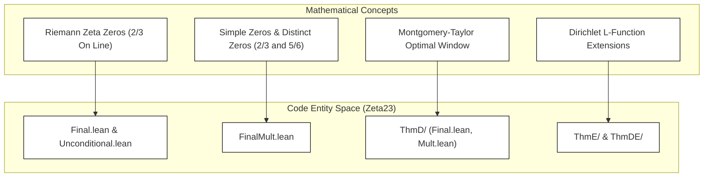
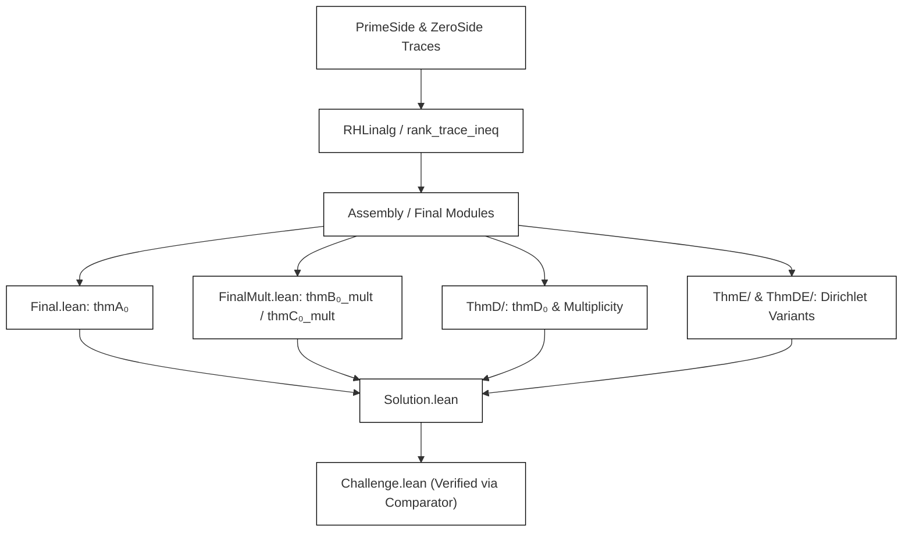

<!-- source: DeepWiki mcp.deepwiki.com · repo anthropics/formal-math · page 3.4 Assembly and Headline Theorems (A–E) · patched3 2026-10-26 -->

# Assembly and Headline Theorems (A–E)
# Assembly and Headline Theorems (A–E)

Relevant source files

The following files were used as context for generating this wiki page:

- [zeta23/README.md](zeta23/README.md)
- [zeta23/Solution.lean](zeta23/Solution.lean)
- [zeta23/formalization.yaml](zeta23/formalization.yaml)

## 1. Purpose and Scope
This page details the top-level assembly layer of the `zeta23` proof development, corresponding to path `zeta23/Zeta23/Assembly/`, `zeta23/Zeta23/Final.lean`, `zeta23/Zeta23/FinalMult.lean`, as well as the specialized theorem directories `ThmD`, `ThmDE`, and `ThmE`. 

This codebase formalizes the results of Alpöge–Furman (*"More than two thirds of the zeta zeros are simple and on the critical line"*, [zeta23/README.md](), [zeta23/formalization.yaml]()). The assembly layer bridges the analytical input estimates (prime-side and zero-side Gram-matrix trace inequalities, explicit formulas, and linear algebra rank-trace bounds) into the definitive liminf density statements for the Riemann zeta function and primitive Dirichlet L-functions.

---

## 2. Architecture of the Assembly Layer
The assembly architecture collects lower-level analytic bounds and structured linear algebra certificates, turning them into asymptotic lower density statements ($\liminf_{T\to\infty}$).

### Natural Language to Code Entity Mapping
The following diagram links high-level mathematical concepts and paper sections to their concrete Lean modules and file paths under `zeta23/Zeta23/`.

*Sources: [zeta23/README.md](), [zeta23/Solution.lean]() unitarity mapping*

---

## 3. Core Modules and Headline Theorems

The proof tree culminates in several primary modules defining the theorems exposed through `Solution.lean` and `Challenge.lean`.

### 3.1. Riemann Zeta Unconditional Results (`Final.lean` & `FinalMult.lean`)
* **`Zeta23/Final.lean`**: Establishes Theorem A ($\liminf \frac{N_0^*(T,2T)}{N(T,2T)} \ge \frac{2}{3}$ and cumulative variants) via `thmA₀` and `thmA₀_cumulative` [zeta23/README.md](), [zeta23/Solution.lean]().
* **`Zeta23/FinalMult.lean`**: Proves Theorem B and Theorem C regarding simplicity and distinctness with multiplicity constants ($\ge \frac{2}{3}$ for simple zeros on the critical line via `thmB₀_mult`, and $\ge \frac{5}{6}$ for distinct zeros via `thmC₀_mult`) [zeta23/README.md](), [zeta23/Solution.lean]().

### 3.2. Montgomery-Taylor Window Improvements (`ThmD/`)
* **`zeta23/Zeta23/ThmD/Final.lean`** and **`zeta23/Zeta23/ThmD/Mult.lean`**: Implement the window improvement utilizing the constant $c_1^*$, establishing density bounds $2 - 1/c_1^* \approx 0.67250…$ for critical line and simple zero counts, and $(3 - 1/c_1^*)/2 \approx 0.83625…$ for distinct zeros [zeta23/README.md](), [zeta23/Solution.lean]().
* The bridge between the division-safe library representation `cStar 1` and the paper's closed form `cMT` is resolved in `Solution.lean` [zeta23/Solution.lean:44-50]().

### 3.3. Dirichlet L-Function Variants (`ThmE/` & `ThmDE/`)
* **`zeta23/Zeta23/ThmE/`**: Extends the unconditional 2/3 and 5/6 bounds to primitive Dirichlet L-functions $L(s,\chi)$ for any primitive character $\chi \bmod q$ ($q > 1$) (`thmE_A₀`, `thmE_B₀_mult`, `thmE_C₀_mult`) [zeta23/Solution.lean:106-120]().
* **`zeta23/Zeta23/ThmDE/`**: Combines Dirichlet L-functions with the Montgomery–Taylor window improvements (`thmE_D₀`, `thmE_D₀_simple_mult`, `thmE_D₀_dist_mult`) [zeta23/Solution.lean:121-141]().

---

## 4. Data Flow in Certificate Assembly

The diagram below illustrates how certificates from prime/zero side trace estimates flow through the assembly modules to instantiate the challenge statements.

*Sources: [zeta23/README.md](), [zeta23/Solution.lean](), [zeta23/formalization.yaml]()*

---

## 5. Summary Table of Assembly Theorems

| Paper Section / Theorem | Lean Library Name (`Zeta23`) | Challenge / Solution Name | Target Constant |
| :--- | :--- | :--- | :--- |
| **Theorem A** | `Zeta23.thmA₀` / `_cumulative` | `two_thirds_on_critical_line` | $\ge 2/3$ |
| **Theorem B** | `Zeta23.thmB₀_mult` / `_cumulative` | `two_thirds_simple_on_critical_line` | $\ge 2/3$ |
| **Theorem C** | `Zeta23.thmC₀_mult` / `_cumulative` | `five_sixths_distinct` | $\ge 5/6$ |
| **Theorem D** | `Zeta23.ThmD.thmD₀` et al. | `montgomery_taylor_on_critical_line` | $2 - 1/c_1^*$ |
| **Theorem E** | `Zeta23.ThmE.thmE_A₀` et al. | `dirichlet_two_thirds_on_critical_line` | $\ge 2/3$ (Dirichlet) |
| **Theorem D (Dirichlet)** | `Zeta23.ThmDE.thmE_D₀` et al. | `dirichlet_montgomery_taylor_on_critical_line` | $2 - 1/c_1^*$ (Dirichlet) |

*Sources: [zeta23/README.md](), [zeta23/Solution.lean]()*

---

