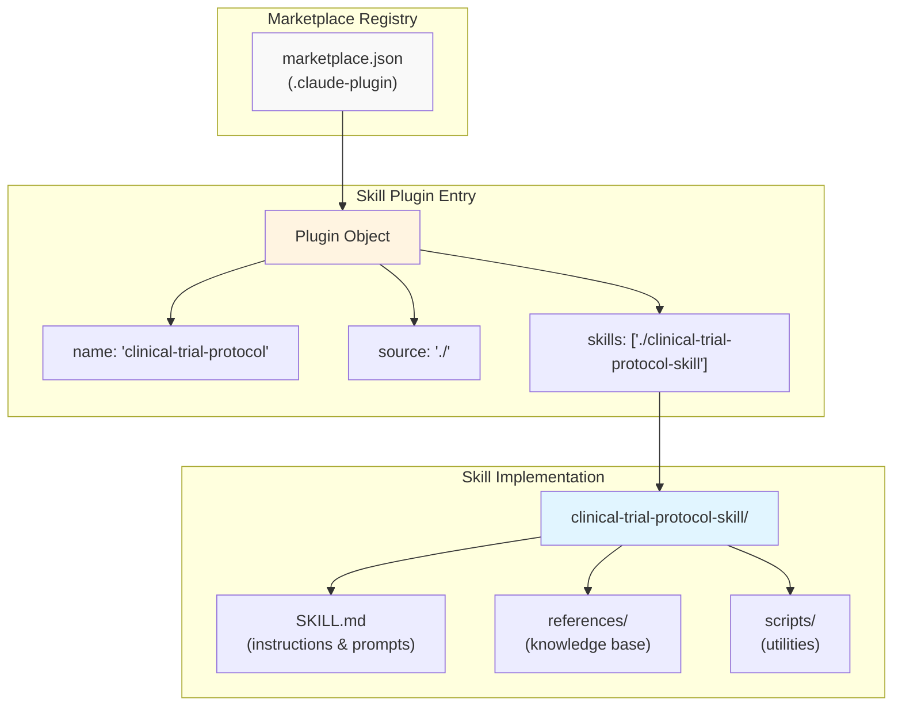
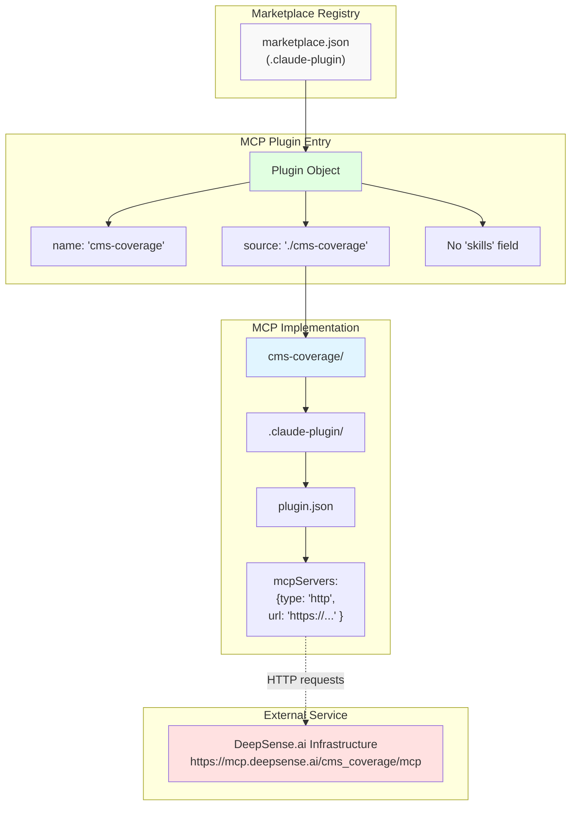
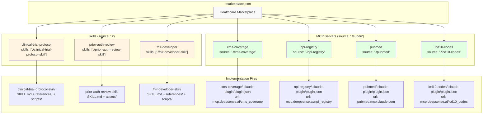
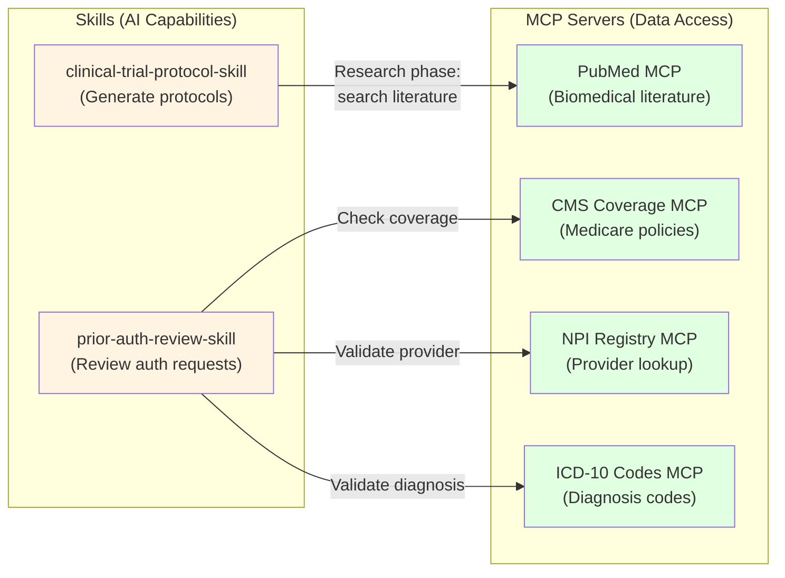

<!-- source: DeepWiki mcp.deepwiki.com · repo anthropics/healthcare · page 2.1 Skills vs MCP Servers · fetched 2026-10-26 -->

# Skills vs MCP Servers

<details>
<summary>Relevant source files</summary>

The following files were used as context for generating this wiki page:

- [.claude-plugin/marketplace.json](.claude-plugin/marketplace.json)
- [.github/workflows/release.yml](.github/workflows/release.yml)
- [README.md](README.md)
- [cms-coverage/.claude-plugin/plugin.json](cms-coverage/.claude-plugin/plugin.json)
- [icd10-codes/.claude-plugin/plugin.json](icd10-codes/.claude-plugin/plugin.json)
- [npi-registry/.claude-plugin/plugin.json](npi-registry/.claude-plugin/plugin.json)
- [pubmed/.claude-plugin/plugin.json](pubmed/.claude-plugin/plugin.json)

</details>


## Purpose and Scope

This document clarifies the architectural distinction between **Skills** and **MCP Servers** in the Healthcare Marketplace. Skills are AI-powered capabilities that extend Claude's functionality for specific healthcare workflows, while MCP Servers are external data connectors that provide access to healthcare databases and APIs. Understanding this separation is critical for developers contributing to the marketplace and users deciding which components to install.

For information about installing these components, see [Installation and Usage](#2.2). For detailed documentation of individual skills, see [Healthcare Skills](#3). For MCP server details, see [MCP Servers and External Data](#4).

## Core Distinction

Skills and MCP Servers serve fundamentally different roles in the Healthcare Marketplace architecture:

| Aspect | Skills | MCP Servers |
|--------|--------|-------------|
| **Purpose** | Provide AI-powered capabilities and workflows | Expose external data sources and APIs |
| **Execution** | Run as Claude Code skills within Claude's environment | Run as HTTP services on external infrastructure |
| **Primary Content** | Instructions, prompts, reference documents, scripts | API endpoint configurations and connection metadata |
| **Installation Command** | `/plugin install <name>@healthcare` | `claude mcp add-from-marketplace anthropics/healthcare/<name>` |
| **Configuration File** | `SKILL.md` in skill directory | `plugin.json` in MCP subdirectory |
| **Source Pattern** | Inline (`"source": "./"`) with explicit skill paths | Subdirectory (`"source": "./subdirectory"`) |
| **Dependencies** | Can depend on MCP servers for data access | Independent, no dependencies |
| **Hosting Location** | Code files in this repository | External services (DeepSense.ai, Claude infrastructure) |

**Sources:** [.claude-plugin/marketplace.json:1-74](), [README.md:1-63]()

## Configuration Architecture

### Skills Configuration Pattern

Skills use a two-level configuration structure. The marketplace registry points to skill directories, which contain `SKILL.md` files defining the AI capabilities.



**Diagram: Skill Configuration Structure**

The marketplace entry for the `clinical-trial-protocol` skill demonstrates this pattern:

```json
{
  "name": "clinical-trial-protocol",
  "source": "./",
  "description": "Generate FDA/NIH-compliant clinical trial protocols...",
  "category": "healthcare",
  "tags": ["clinical-trials", "fda", "protocol", "regulatory"],
  "strict": false,
  "skills": [
    "./clinical-trial-protocol-skill"
  ]
}
```

**Sources:** [.claude-plugin/marketplace.json:12-22]()

Key characteristics:
- **Inline Source**: The `"source": "./"` field indicates the skill code is in the same repository
- **Skills Array**: The `"skills"` field explicitly lists directories containing `SKILL.md` files
- **No URL**: Skills have no external endpoint configuration
- **Local Execution**: All skill logic runs within Claude Code's environment

### MCP Server Configuration Pattern

MCP Servers use a three-level configuration structure. The marketplace points to subdirectories, which contain `plugin.json` files defining HTTP endpoints.



**Diagram: MCP Server Configuration Structure**

The marketplace entry for the `cms-coverage` MCP server demonstrates this pattern:

```json
{
  "name": "cms-coverage",
  "source": "./cms-coverage",
  "description": "Access the CMS Coverage Database",
  "category": "healthcare",
  "tags": ["medicare", "coverage", "cms", "policy", "ncd", "lcd"]
}
```

The corresponding `plugin.json` file in the subdirectory:

```json
{
  "name": "cms-coverage",
  "version": "1.0.0",
  "description": "The CMS Coverage Connector gives Claude access to Medicare Part B coverage policies...",
  "author": {
    "name": "deepsense.ai",
    "url": "https://deepsense.ai"
  },
  "mcpServers": {
    "CMS Coverage": {
      "type": "http",
      "url": "https://mcp.deepsense.ai/cms_coverage/mcp"
    }
  }
}
```

**Sources:** [.claude-plugin/marketplace.json:45-51](), [cms-coverage/.claude-plugin/plugin.json:1-15]()

Key characteristics:
- **Subdirectory Source**: The `"source": "./cms-coverage"` field points to a subdirectory
- **No Skills Field**: MCP entries omit the `"skills"` array entirely
- **External URL**: The `plugin.json` file contains `mcpServers` with HTTP endpoints
- **Remote Execution**: Data access happens via HTTP requests to external services

## Complete Marketplace Registry Structure

The following diagram maps all plugins in the marketplace registry, showing the clear separation between Skills and MCP Servers:



**Diagram: Complete Marketplace Plugin Registry**

**Sources:** [.claude-plugin/marketplace.json:11-73]()

## Installation and Discovery Workflow

Skills and MCP Servers use different commands for installation, reflecting their distinct execution models:

### Skills Installation

```bash
# Add marketplace to Claude Code
/plugin marketplace add anthropics/healthcare

# Install a skill
/plugin install clinical-trial-protocol@healthcare
/plugin install prior-auth-review@healthcare
/plugin install fhir-developer@healthcare
```

When installing a skill:
1. Claude Code reads the marketplace registry at `.claude-plugin/marketplace.json`
2. Locates the plugin entry with matching `name`
3. Resolves the `"source": "./"` to the repository root
4. Loads each directory listed in the `skills` array
5. Reads the `SKILL.md` file to understand the skill's capabilities
6. Makes the skill available for activation during conversations

**Sources:** [README.md:7-15](), [.claude-plugin/marketplace.json:12-43]()

### MCP Server Installation

```bash
# Add MCP servers from the marketplace
claude mcp add-from-marketplace anthropics/healthcare/cms-coverage
claude mcp add-from-marketplace anthropics/healthcare/npi-registry
claude mcp add-from-marketplace anthropics/healthcare/pubmed
claude mcp add-from-marketplace anthropics/healthcare/icd10-codes
```

When installing an MCP server:
1. Claude Code reads the marketplace registry at `.claude-plugin/marketplace.json`
2. Locates the plugin entry with matching `name`
3. Resolves the `"source"` to the subdirectory (e.g., `./cms-coverage`)
4. Reads the `plugin.json` file in the subdirectory's `.claude-plugin/` folder
5. Extracts the `mcpServers` configuration with HTTP endpoint URLs
6. Configures the MCP client to make HTTP requests to the external service
7. Makes the MCP server's tools available to Claude

**Sources:** [README.md:52-58](), [cms-coverage/.claude-plugin/plugin.json:9-14](), [npi-registry/.claude-plugin/plugin.json:9-14](), [pubmed/.claude-plugin/plugin.json:9-14](), [icd10-codes/.claude-plugin/plugin.json:9-14]()

## How Skills and MCP Servers Complement Each Other

Skills frequently depend on MCP Servers to access external data, creating a composition pattern where AI capabilities leverage data connectors:



**Diagram: Skill-MCP Dependency Patterns**

### Dependency Examples

**Clinical Trial Protocol Skill** uses PubMed MCP:
- Step 1 (Research phase) searches PubMed for relevant clinical studies
- The skill provides protocol generation logic
- The MCP provides access to 35+ million biomedical citations

**Prior Authorization Review Skill** uses three MCP servers:
- NPI Registry MCP validates healthcare provider credentials
- ICD-10 Codes MCP validates diagnosis codes
- CMS Coverage MCP checks Medicare coverage policies
- The skill provides the review workflow and decision logic
- The MCPs provide the authoritative data sources

**FHIR Developer Skill** is self-contained:
- Contains knowledge base in `references/` directory
- Includes scaffolding script in `scripts/setup_fhir_project.py`
- Does not depend on any MCP servers
- Demonstrates that skills can function independently

**Sources:** [README.md:19-43](), High-Level System Architecture Diagrams (Diagram 3)

## Technical Implementation Differences

### Skills: File-Based Knowledge and Code

Skills are implemented as directories containing:

```
clinical-trial-protocol-skill/
├── SKILL.md                          # Main skill definition
├── references/                        # Knowledge base
│   ├── FDA-Clinical-Protocol-Template.md
│   ├── clinical-trials-gov-schema.md
│   └── statistical-methods.md
└── scripts/                           # Utility scripts
    └── sample_size_calculator.py
```

The `SKILL.md` file contains:
- Natural language instructions for Claude
- Workflow steps and decision trees
- Reference document pointers
- Script execution patterns
- Human-in-the-loop requirements

### MCP Servers: HTTP Endpoint Configurations

MCP servers are implemented as configuration files:

```
cms-coverage/
└── .claude-plugin/
    └── plugin.json                    # HTTP endpoint config
```

The `plugin.json` file contains:
- Server name and version metadata
- Author information
- `mcpServers` object with:
  - `type`: Always `"http"` for remote servers
  - `url`: Full HTTPS endpoint (e.g., `https://mcp.deepsense.ai/cms_coverage/mcp`)

**Sources:** [cms-coverage/.claude-plugin/plugin.json:1-15](), [npi-registry/.claude-plugin/plugin.json:1-15](), [pubmed/.claude-plugin/plugin.json:1-15](), [icd10-codes/.claude-plugin/plugin.json:1-15]()

## MCP Server HTTP Endpoints

The Healthcare Marketplace integrates with two external MCP hosting providers:

| MCP Server | URL | Provider | Purpose |
|------------|-----|----------|---------|
| CMS Coverage | `https://mcp.deepsense.ai/cms_coverage/mcp` | DeepSense.ai | Medicare policies |
| NPI Registry | `https://mcp.deepsense.ai/npi_registry/mcp` | DeepSense.ai | Provider lookups |
| ICD-10 Codes | `https://mcp.deepsense.ai/icd10_codes/mcp` | DeepSense.ai | Diagnosis codes |
| PubMed | `https://pubmed.mcp.claude.com/mcp` | Anthropic | Literature search |

These URLs are embedded in the respective `plugin.json` files and represent live HTTP services that Claude's MCP client communicates with at runtime.

**Sources:** [cms-coverage/.claude-plugin/plugin.json:12](), [npi-registry/.claude-plugin/plugin.json:12](), [icd10-codes/.claude-plugin/plugin.json:12](), [pubmed/.claude-plugin/plugin.json:12]()

## Release and Distribution

Skills and MCP Servers follow different release workflows:

### Skills: Packaged as Artifacts

The release workflow packages skills into distributable zip files:

```yaml
- name: Create skill zip files
  run: |
    for skill_dir in *-skill/; do
      if [ -d "$skill_dir" ]; then
        skill_name="${skill_dir%/}"
        echo "Packaging $skill_name..."
        cd "$skill_name"
        zip -r "../${skill_name}-${GITHUB_REF_NAME}.zip" .
        cd ..
      fi
    done
```

This creates artifacts like:
- `clinical-trial-protocol-skill-v1.0.0.zip`
- `prior-auth-review-skill-v1.0.0.zip`
- `fhir-developer-skill-v1.0.0.zip`

**Sources:** [.github/workflows/release.yml:18-29]()

### MCP Servers: Configuration-Only Distribution

MCP servers are not packaged as artifacts. Their distribution consists of:
1. The `plugin.json` configuration file in the repository
2. The external HTTP service (already running on DeepSense.ai or Anthropic infrastructure)

When users install an MCP server, they receive the connection configuration, not the server code itself. The actual MCP server implementation runs on external infrastructure and is maintained separately from this repository.

**Sources:** [.github/workflows/release.yml:1-43]() (note: only packages `*-skill/` directories, not MCP subdirectories)

## Summary

| Characteristic | Skills | MCP Servers |
|----------------|--------|-------------|
| **Definition** | AI-powered workflows and capabilities | External data connectors |
| **Registry Entry** | `"source": "./"` with `"skills"` array | `"source": "./subdirectory"` without skills |
| **Configuration** | `SKILL.md` in skill directory | `plugin.json` with `mcpServers` object |
| **Content** | Instructions, reference docs, scripts | HTTP endpoint URLs |
| **Execution** | Runs in Claude Code environment | HTTP requests to external services |
| **Installation** | `/plugin install <name>@healthcare` | `claude mcp add-from-marketplace` |
| **Dependencies** | May depend on MCP servers | Independent |
| **Distribution** | Zip files in GitHub releases | Configuration only |
| **Examples** | `clinical-trial-protocol`, `prior-auth-review`, `fhir-developer` | `cms-coverage`, `npi-registry`, `pubmed`, `icd10-codes` |

This architectural separation enables modular healthcare workflows where AI capabilities (Skills) compose external data sources (MCP Servers) without tight coupling.

**Sources:** [.claude-plugin/marketplace.json:1-74](), [README.md:1-63](), all MCP `plugin.json` files

---

