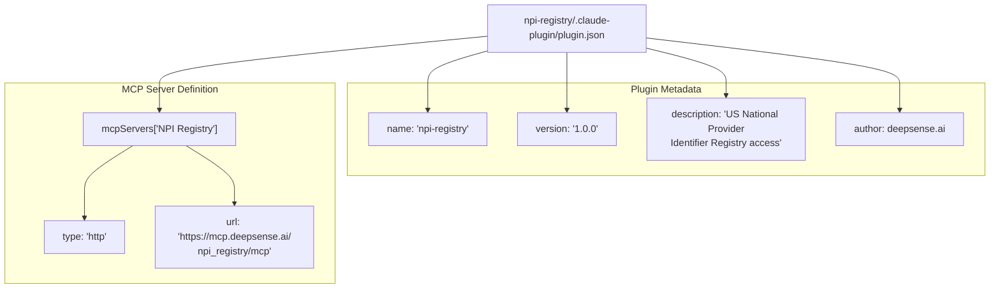
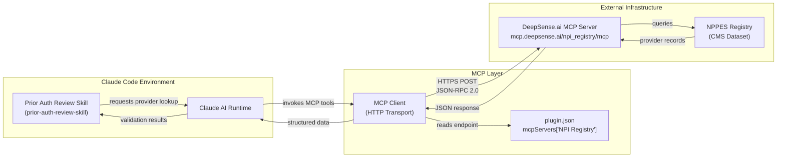
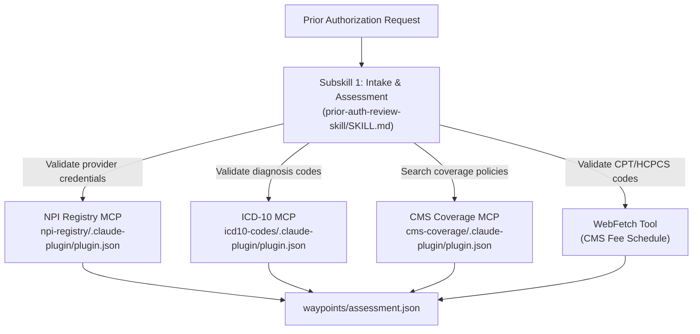

<!-- source: DeepWiki mcp.deepwiki.com · repo anthropics/healthcare · page 4.2 NPI Registry · fetched 2026-10-26 -->

# NPI Registry

<details>
<summary>Relevant source files</summary>

The following files were used as context for generating this wiki page:

- [.github/workflows/release.yml](.github/workflows/release.yml)
- [README.md](README.md)
- [clinical-trial-protocol-skill/README.md](clinical-trial-protocol-skill/README.md)
- [cms-coverage/.claude-plugin/plugin.json](cms-coverage/.claude-plugin/plugin.json)
- [npi-registry/.claude-plugin/plugin.json](npi-registry/.claude-plugin/plugin.json)
- [prior-auth-review-skill/README.md](prior-auth-review-skill/README.md)
- [pubmed/.claude-plugin/plugin.json](pubmed/.claude-plugin/plugin.json)

</details>


## Purpose and Scope

This document describes the NPI Registry MCP Server, which provides Claude Code skills with access to the US National Provider Identifier (NPI) Registry. The NPI Registry contains information about all HIPAA-covered healthcare providers in the United States, including individual practitioners, healthcare organizations, and their credentials, specialties, and practice locations.

For information about how skills integrate with MCP servers in general, see [MCP Servers and External Data](#4). For the Prior Authorization Review skill that uses this registry to validate providers, see [Prior Authorization Review](#3.2). For other healthcare data sources, see [CMS Coverage Database](#4.1), [PubMed Literature Search](#4.3), and [ICD-10 Codes](#4.4).

**Sources:** [README.md:1-63](), [npi-registry/.claude-plugin/plugin.json:1-16]()

---

## Overview

The NPI Registry MCP Server is an HTTP-based Model Context Protocol server that provides programmatic access to the National Plan and Provider Enumeration System (NPPES) dataset maintained by the Centers for Medicare & Medicaid Services (CMS). Every healthcare provider who conducts electronic health transactions covered by HIPAA must have a National Provider Identifier, making this registry the authoritative source for provider verification in the United States.

### Key Capabilities

| Capability | Description | Use Case |
|------------|-------------|----------|
| Provider Lookup | Search providers by NPI, name, or taxonomy | Validate provider credentials in prior authorization requests |
| Organization Search | Find healthcare organizations and facilities | Verify institutional provider information |
| Credential Verification | Retrieve provider specialties, licenses, and identifiers | Confirm provider qualifications for specific procedures |
| Practice Location | Access provider addresses and contact information | Support provider network validation and communication |

The NPI Registry server is hosted externally by DeepSense.ai and accessed via HTTPS, following the distributed MCP architecture pattern where data sources are maintained separately from the skills repository.

**Sources:** [README.md:46-58](), [npi-registry/.claude-plugin/plugin.json:1-16]()

---

## Technical Architecture

### Plugin Configuration Structure

The NPI Registry MCP Server follows the standard MCP plugin architecture, with configuration stored in a dedicated directory structure:

```
npi-registry/
└── .claude-plugin/
    └── plugin.json
```

The `plugin.json` file defines the MCP server endpoint and metadata:

**Diagram: NPI Registry Plugin Configuration**



**Sources:** [npi-registry/.claude-plugin/plugin.json:1-16]()

### Service Architecture

**Diagram: NPI Registry Service Flow**



The NPI Registry server implements the Model Context Protocol over HTTP, using JSON-RPC 2.0 for request/response communication. The external server at `mcp.deepsense.ai` maintains the connection to CMS's NPPES data, handling queries and returning structured provider information.

**Sources:** [npi-registry/.claude-plugin/plugin.json:9-14](), [README.md:46-58]()

---

## Integration with Prior Authorization Review Skill

The Prior Authorization Review skill is the primary consumer of the NPI Registry MCP server. It uses provider lookup to validate that healthcare providers submitting prior authorization requests have valid credentials and appropriate specialties.

### Provider Validation Workflow

**Diagram: NPI Validation in Prior Auth Workflow**

```mermaid
sequenceDiagram
    participant User
    participant Subskill1["Subskill 1: Intake & Assessment<br/>(prior-auth-review-skill/SKILL.md)"]
    participant NPIRegistry["NPI Registry MCP<br/>(mcp.deepsense.ai/npi_registry)"]
    participant Assessment["waypoints/assessment.json"]
    
    User->>Subskill1: "Provide PA request with<br/>Rendering Provider NPI"
    Subskill1->>NPIRegistry: "Lookup provider by NPI"
    
    alt Provider Found
        NPIRegistry-->>Subskill1: "Provider record:<br/>name, specialty, address"
        Subskill1->>Subskill1: "Validate specialty matches<br/>requested procedure"
        Subskill1->>Assessment: "Write validated_provider"
    else Provider Not Found
        NPIRegistry-->>Subskill1: "NPI not found error"
        Subskill1->>Assessment: "Write validation_error"
        Subskill1->>User: "PEND - Invalid provider NPI"
    end
```

The validation occurs early in the Prior Auth Review workflow, during the Intake & Assessment phase. The skill collects the rendering provider's NPI from the authorization request and queries the NPI Registry to:

1. Confirm the NPI is valid and active
2. Retrieve the provider's name and credentials
3. Verify the provider's specialty taxonomy matches the requested procedure type
4. Document the provider's practice location for audit purposes

**Sources:** [prior-auth-review-skill/README.md:27-44]()

### Code Integration Points

The Prior Authorization Review skill references NPI validation in its workflow documentation. When the skill executes Subskill 1 (Intake & Assessment), it:

- Collects provider NPI from the authorization request
- Invokes the NPI Registry MCP server through Claude's MCP client
- Validates the returned provider record against the request
- Stores validation results in `waypoints/assessment.json`

The skill documentation explicitly lists "Validates provider credentials via NPI MCP Connector" as a core capability of Subskill 1 [prior-auth-review-skill/README.md:34]().

### Sample Data Handling

The Prior Auth Review skill includes sample case files in `assets/sample/` for demonstration purposes. When operating in demo mode with sample data, the skill skips NPI MCP lookups for the sample provider only, while executing all other MCP calls (ICD-10, CMS Coverage) normally [prior-auth-review-skill/README.md:73-77](). This allows users to test the workflow without requiring live NPI Registry access.

**Sources:** [prior-auth-review-skill/README.md:27-78]()

---

## Installation and Configuration

### Adding the NPI Registry to Claude Code

The NPI Registry MCP server is added to Claude Code through the marketplace system. Users install it from the Healthcare marketplace using the MCP add command:

```bash
claude mcp add-from-marketplace anthropics/healthcare/npi-registry
```

This command:
1. Resolves the marketplace path to the plugin configuration
2. Reads [npi-registry/.claude-plugin/plugin.json:1-16]()
3. Registers the HTTP MCP server endpoint with Claude Code
4. Makes NPI Registry tools available to all skills

**Sources:** [README.md:52-58]()

### Marketplace Registration

The NPI Registry is registered in the Healthcare marketplace's central registry at `.claude-plugin/marketplace.json` (not included in the provided files but referenced in system architecture). The marketplace entry defines:

| Property | Value |
|----------|-------|
| Name | `npi-registry` |
| Type | MCP Server |
| Source Path | `./npi-registry` |
| Description | Access US National Provider Identifier Registry |

Skills that depend on the NPI Registry should document it as a requirement, as the Prior Authorization Review skill does in its README [prior-auth-review-skill/README.md:34]().

**Sources:** [README.md:44-58](), [npi-registry/.claude-plugin/plugin.json:1-16]()

---

## Provider Data Structure

### NPI Registry Fields

While the exact API schema is maintained by the external DeepSense.ai server, the NPI Registry provides access to NPPES fields including:

**Individual Providers:**
- NPI number (10-digit unique identifier)
- Provider name (first, middle, last, credentials)
- Taxonomy codes (specialty classifications)
- License numbers and issuing states
- Practice locations (primary and secondary addresses)
- Contact information (phone, fax)

**Organizational Providers:**
- NPI number
- Organization name (legal business name)
- Organization taxonomy codes
- Authorized official information
- Practice locations
- Subpart organization indicators

### Taxonomy Codes

Healthcare Provider Taxonomy codes are used to classify provider types and specialties. Common taxonomies relevant to prior authorization include:

| Taxonomy Code | Classification | Example Use Case |
|---------------|----------------|------------------|
| 207Q00000X | Family Medicine | Primary care services |
| 207RC0000X | Cardiovascular Disease | Cardiac procedures |
| 208D00000X | General Practice | General medical services |
| 261QR0200X | Radiology Clinic | Imaging procedures |

The NPI Registry returns taxonomy codes that the Prior Authorization Review skill uses to validate that the rendering provider's specialty is appropriate for the requested procedure.

**Sources:** [prior-auth-review-skill/README.md:34](), [npi-registry/.claude-plugin/plugin.json:4]()

---

## Usage Patterns and Best Practices

### Provider Validation Pattern

When validating providers using the NPI Registry, skills should follow this pattern:

1. **Extract NPI** from authorization request or clinical documentation
2. **Query NPI Registry** using the provider's NPI number
3. **Verify Response** confirms provider is active and valid
4. **Check Taxonomy** ensures provider specialty matches requested service
5. **Document Results** in waypoint or output files for audit trail

### Error Handling

Skills integrating with the NPI Registry should handle common error conditions:

| Error Condition | Handling Strategy | Example Response |
|-----------------|-------------------|------------------|
| NPI not found | Recommend PEND status | Request valid provider NPI from submitter |
| Multiple matches | Use additional filters | Match by provider name and location |
| Inactive provider | Flag validation error | Provider NPI is inactive in registry |
| Service unavailable | Retry with backoff | Temporary connectivity issue with NPI Registry |

The Prior Authorization Review skill implements error handling by documenting validation errors in `waypoints/assessment.json` and recommending PEND status when provider validation fails [prior-auth-review-skill/README.md:41-44]().

### Performance Considerations

The NPI Registry is accessed via HTTPS, which introduces network latency. Skills should:

- Cache provider lookups within a session when the same NPI appears multiple times
- Batch validate multiple providers if the MCP server supports batch operations
- Display progress indicators for user-facing workflows
- Implement timeouts for external service calls

**Sources:** [prior-auth-review-skill/README.md:27-44](), [npi-registry/.claude-plugin/plugin.json:11-14]()

---

## Relationship to Other MCP Servers

**Diagram: MCP Servers in Prior Authorization Workflow**



The NPI Registry works alongside other MCP servers in the Healthcare marketplace to support comprehensive prior authorization workflows:

- **NPI Registry** validates healthcare providers
- **ICD-10 Codes** ([#4.4](#4.4)) validates diagnosis codes
- **CMS Coverage** ([#4.1](#4.1)) retrieves Medicare coverage policies
- **PubMed** ([#4.3](#4.3)) provides clinical literature for protocol generation

Each MCP server is independently maintained and accessed through the same MCP protocol, allowing skills to compose multiple data sources without tight coupling.

**Sources:** [prior-auth-review-skill/README.md:33-41](), [README.md:44-58](), [npi-registry/.claude-plugin/plugin.json:1-16](), [cms-coverage/.claude-plugin/plugin.json:1-16]()

---

## External Infrastructure

The NPI Registry MCP server is hosted by DeepSense.ai at `https://mcp.deepsense.ai/npi_registry/mcp` [npi-registry/.claude-plugin/plugin.json:12](). This external hosting model provides several benefits:

1. **Centralized Data Management**: DeepSense.ai maintains the connection to CMS's NPPES dataset and handles updates
2. **Scalability**: The external server can handle multiple concurrent requests from different Claude Code users
3. **No Local Dependencies**: Skills don't need to download or maintain the ~7GB NPPES dataset locally
4. **Consistent API**: All users access the same standardized interface regardless of their local environment

The external server infrastructure is separate from the Anthropic-hosted PubMed MCP server (`https://pubmed.mcp.claude.com/mcp`) [pubmed/.claude-plugin/plugin.json:12](), demonstrating the flexible hosting model for MCP servers.

**Sources:** [npi-registry/.claude-plugin/plugin.json:11-14](), [pubmed/.claude-plugin/plugin.json:11-14](), [README.md:46-51]()

---

