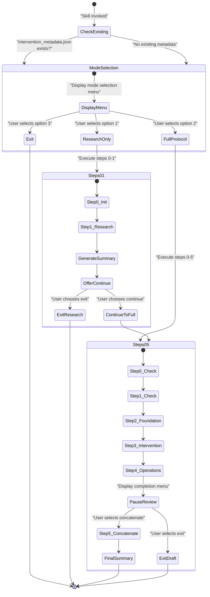
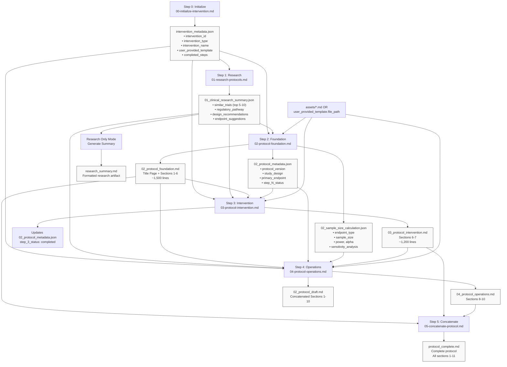
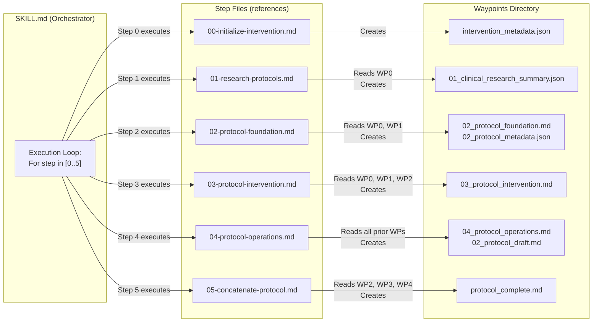

<!-- source: DeepWiki mcp.deepwiki.com · repo anthropics/healthcare · extra page Workflow Steps and Waypoints · fetched 2026-10-26 -->

# Workflow Steps and Waypoints

<details>
<summary>Relevant source files</summary>

The following files were used as context for generating this wiki page:

- [clinical-trial-protocol-skill/README.md](clinical-trial-protocol-skill/README.md)
- [clinical-trial-protocol-skill/SKILL.md](clinical-trial-protocol-skill/SKILL.md)
- [clinical-trial-protocol-skill/references/00-initialize-intervention.md](clinical-trial-protocol-skill/references/00-initialize-intervention.md)
- [clinical-trial-protocol-skill/references/01-research-protocols.md](clinical-trial-protocol-skill/references/01-research-protocols.md)
- [clinical-trial-protocol-skill/references/02-protocol-foundation.md](clinical-trial-protocol-skill/references/02-protocol-foundation.md)
- [clinical-trial-protocol-skill/references/03-protocol-intervention.md](clinical-trial-protocol-skill/references/03-protocol-intervention.md)
- [clinical-trial-protocol-skill/scripts/sample_size_calculator.py](clinical-trial-protocol-skill/scripts/sample_size_calculator.py)
- [prior-auth-review-skill/README.md](prior-auth-review-skill/README.md)

</details>


## Purpose and Scope

This document provides a detailed technical reference for the Clinical Trial Protocol Generator skill's workflow architecture, including the six sequential steps, the waypoint files they produce, and the resume/restart mechanisms. This covers the modular execution flow, step-by-step waypoint generation, and the on-demand subskill loading pattern.

For overall skill architecture and prerequisites, see [Clinical Trial Protocol Generator](#3.1). For the sample size calculator script, see [Sample Size Calculator](#3.1.2). For the FDA protocol template, see [FDA Protocol Template](#3.1.3).

---

## Workflow Overview

The Clinical Trial Protocol Generator uses a **waypoint-based architecture** where each step produces persistent JSON or Markdown files in the `waypoints/` directory. This design enables:

- **Resume capability**: Users can restart from any completed step
- **Memory efficiency**: Each step only loads required data from waypoints, not conversation history
- **Step independence**: Steps read only from waypoint files, not prior Claude responses
- **Token optimization**: Large protocol sections split across multiple files

The skill supports two execution modes:
1. **Research Only Mode**: Executes steps 0-1, generates research summary artifact
2. **Full Protocol Mode**: Executes all steps 0-5, generates complete protocol document

Sources: [clinical-trial-protocol-skill/SKILL.md:22-43](), [clinical-trial-protocol-skill/README.md:35-44]()

---

## Execution Modes and Step Mapping

### Mode Selection Flow



Sources: [clinical-trial-protocol-skill/SKILL.md:156-195](), [clinical-trial-protocol-skill/SKILL.md:198-300]()

---

## Step-by-Step Breakdown

### Step 0: Initialize Intervention

**Subskill File**: `references/00-initialize-intervention.md`

**Purpose**: Collects intervention metadata and creates the foundational waypoint file used by all subsequent steps.

**Execution Logic**:
1. Determines intervention type (device or drug)
2. Collects intervention details through user prompts
3. Optional: Accepts custom protocol template upload
4. Optional: Asks clarifying questions (max 3-5, only if needed)
5. Generates filesystem-safe `intervention_id`
6. Creates `waypoints/intervention_metadata.json`

**Waypoint Created**:

| File | Structure | Key Fields |
|------|-----------|------------|
| `waypoints/intervention_metadata.json` | JSON object | `intervention_id`, `intervention_type` (device/drug), `intervention_name`, `intervention_description`, `indication`, `target_population`, `initial_context`, `user_provided_template`, `discovery_clarifications`, `completed_steps` |

**Template Handling**: If user provides a custom template, it is stored in:
```json
{
  "user_provided_template": {
    "provided": true,
    "file_path": "path/to/user/template.md",
    "file_name": "template.md"
  }
}
```

This template path is used by steps 2-3 instead of default `assets/` templates.

Sources: [clinical-trial-protocol-skill/references/00-initialize-intervention.md:1-201](), [clinical-trial-protocol-skill/SKILL.md:46-63]()

---

### Step 1: Research Protocols

**Subskill File**: `references/01-research-protocols.md`

**Purpose**: Conducts regulatory research and clinical trial analysis using MCP servers and FDA databases to inform protocol design.

**Execution Logic**:

#### For Devices
1. Query **Product Classification Database** for device class (I/II/III) and product code
2. Based on class, execute pathway-specific research:
   - **Class III**: PMA Database research (3-5 approved PMAs)
   - **Class I/II**: 510(k) Database research (3-5 predicates)
   - **Novel devices**: De Novo Database research
3. Assess IDE risk (Significant Risk vs Non-Significant Risk per 21 CFR 812.3(m))
4. Search ClinicalTrials.gov for similar trials

#### For Drugs/Biologics
1. Query **Drugs@FDA** and **Orange Book** for drug classification
2. Based on classification, execute pathway-specific research:
   - **Generic**: ANDA research (reference listed drug from Orange Book)
   - **Modified product**: 505(b)(2) research
   - **New chemical entity**: NDA research
   - **Biologic**: BLA research (Purple Book)
3. Assess IND requirements and clinical hold risks per 21 CFR 312.42
4. Search ClinicalTrials.gov for similar trials

#### All Interventions
5. Search for published protocols (via ClinicalTrials.gov MCP only)
6. Synthesize findings into recommendations

**MCP Tools Used**:
- `search_clinical_trials(condition, intervention, status, phase, max_results)`
- `get_trial_details(nct_id)`

**Waypoint Created**:

| File | Size | Key Content |
|------|------|-------------|
| `waypoints/01_clinical_research_summary.json` | ~10-15KB | Top 5-10 similar trials, regulatory pathway determination, design recommendations, endpoint suggestions, sample size considerations |

**Data Minimization Strategy**:
- **Keep**: Top 5-10 trials (NCT IDs, structured summaries), regulatory pathway info, design/endpoint recommendations
- **Discard**: Full trial details, raw MCP results, lower-ranked search results

Sources: [clinical-trial-protocol-skill/references/01-research-protocols.md:1-414](), [clinical-trial-protocol-skill/SKILL.md:217-220]()

---

### Step 2: Protocol Foundation (Sections 1-6)

**Subskill File**: `references/02-protocol-foundation.md`

**Purpose**: Generates title page and protocol sections 1-6 (Summary, Introduction, Objectives, Design, Population).

**Execution Logic**:
1. Loads `intervention_metadata.json` and `01_clinical_research_summary.json`
2. Discovers protocol template:
   - **Priority 1**: User-provided template (if `user_provided_template.provided === true`)
   - **Priority 2**: Template(s) in `assets/` directory
   - If multiple in `assets/`, prompts user to select
3. Reads selected template for structure guidance
4. Generates comprehensive content (~1,500 lines):
   - **Title Page**: Metadata table, protocol ID, sponsor info, regulatory identifiers
   - **Statement of Compliance**: ICH GCP, CFR references, IRB requirements
   - **Section 1**: Synopsis table (20 rows), Schema diagram, Schedule of Activities (20-30 rows × 12-20 columns)
   - **Section 2**: Introduction (rationale, background, risk/benefit assessment) - 400 lines
   - **Section 3**: Objectives & Endpoints table
   - **Section 4**: Study Design (overall design, rationale, dose justification)
   - **Section 5**: Study Population (10-15 inclusion criteria, 15-30 exclusion criteria with detailed tables)

**Template Structure Extraction**: The subskill extracts and includes the exact Table of Contents structure from the template (lines 188-368 in the template).

**Waypoints Created**:

| File | Size | Content |
|------|------|---------|
| `waypoints/02_protocol_foundation.md` | ~100KB (~1,500 lines) | Title Page + Sections 1-6 in markdown |
| `waypoints/02_protocol_metadata.json` | ~1KB | Protocol version, study design, enrollment target, primary endpoint, completion status tracking |

**Quality Requirements**:
- Synopsis table must match objectives/endpoints table
- Schedule of Activities: 20-30 rows, 12-20 columns with visit windows
- Inclusion criteria: 10-15 detailed items with specific lab value tables
- Exclusion criteria: 15-30 items covering all categories (prior therapy, infections, contraindications, etc.)

Sources: [clinical-trial-protocol-skill/references/02-protocol-foundation.md:1-837](), [clinical-trial-protocol-skill/SKILL.md:321-322]()

---

### Step 3: Protocol Intervention (Sections 6-7)

**Subskill File**: `references/03-protocol-intervention.md`

**Purpose**: Generates intervention-specific protocol sections 6-7 (Intervention Administration, Discontinuation).

**Prerequisite Check**: Verifies `waypoints/02_protocol_metadata.json` shows `step_2_status === "completed"`.

**Execution Logic**:
1. Loads protocol template path from `intervention_metadata.json` (uses same template as Step 2)
2. Reads `02_protocol_foundation.md` for context
3. Generates intervention-specific content (~1,200 lines):

#### Section 6: Study Intervention
- **For Devices** (300 lines):
  - Device identification & regulatory status (FDA class, K-number/PMA/IDE)
  - Detailed device description (physical characteristics, materials, components, mechanism)
  - Instructions for Use summary (patient selection, pre-procedure, procedure steps, post-procedure)
  - Device training requirements
  
- **For Drugs/Biologics** (300 lines):
  - Drug identification & regulatory status (IND/NDA/BLA)
  - Formulation details
  - Mechanism of action (100 lines: target, interaction, downstream effects)
  - Pharmacokinetics/pharmacodynamics summary
  - Dosing details (dose calculation, administration, pre-medications)

- **Dose Modifications** (300 lines, if applicable):
  - Dose level table (Level 0, -1, -2, -3)
  - Toxicity-specific modification tables:
    - Hematologic toxicity (neutropenia, thrombocytopenia, anemia)
    - Hepatic toxicity (ALT/AST, bilirubin)
    - Renal toxicity (creatinine, CrCl)
    - Intervention-specific toxicity (immune-related for immunotherapy, neuropathy for chemo, etc.)
  - General toxicity management guidelines

- **Preparation/Handling/Storage** (100 lines)
- **Randomization & Blinding** (50 lines)
- **Compliance Monitoring** (30 lines)
- **Concomitant Therapy** (50 lines)

#### Section 7: Discontinuation
- Discontinuation of intervention (criteria, post-discontinuation procedures)
- Participant withdrawal (criteria, procedures)
- Lost to follow-up (definition, contact attempt procedures)

**Waypoint Created**:

| File | Size | Content |
|------|------|---------|
| `waypoints/03_protocol_intervention.md` | ~1,200 lines | Sections 6-7 only |

**Metadata Update**: Sets `step_3_status: "completed"` in `02_protocol_metadata.json`.

Sources: [clinical-trial-protocol-skill/references/03-protocol-intervention.md:1-742](), [clinical-trial-protocol-skill/SKILL.md:323-324]()

---

### Step 4: Protocol Operations (Sections 8-10)

**Subskill File**: `references/04-protocol-operations.md` (referenced but not provided in context)

**Purpose**: Generates operational protocol sections 8-10 (Assessments, Statistics, Regulatory/Operational).

**Expected Content** (based on template structure):
- **Section 8**: Study Assessments and Procedures (efficacy assessments, safety assessments, AE/SAE definitions and reporting)
- **Section 9**: Statistical Considerations (hypotheses, sample size determination, analysis populations, statistical analyses)
- **Section 10**: Supporting Documentation (regulatory/ethical considerations, monitoring, QA/QC, data handling)

**Sample Size Calculation Integration**: Step 4 invokes `scripts/sample_size_calculator.py` for statistical power analysis (see [Sample Size Calculator](#3.1.2)).

**Waypoint Expected**:

| File | Content |
|------|---------|
| `waypoints/04_protocol_operations.md` | Sections 8-10 |
| `waypoints/02_protocol_draft.md` | Concatenated Sections 1-10 (complete protocol) |

**Pause Point**: After Step 4 completes, the orchestrator displays the Protocol Completion Menu with options:
1. Review protocol in artifact
2. Continue to Step 5 (concatenation)
3. Exit and review later

Sources: [clinical-trial-protocol-skill/SKILL.md:324](), [clinical-trial-protocol-skill/SKILL.md:332-369]()

---

### Step 5: Generate Final Protocol

**Subskill File**: `references/05-concatenate-protocol.md` (referenced but not provided in context)

**Purpose**: Concatenates all protocol sections into a single final document.

**Execution Logic**:
1. Reads all section files:
   - `02_protocol_foundation.md` (Sections 1-6)
   - `03_protocol_intervention.md` (Sections 6-7)
   - `04_protocol_operations.md` (Sections 8-10)
2. Concatenates in order
3. Adds References section (Section 11)
4. Applies final formatting

**Waypoint Created**:

| File | Expected Size | Content |
|------|---------------|---------|
| `waypoints/protocol_complete.md` | ~150-200KB | Complete protocol with all sections 1-11 |

Sources: [clinical-trial-protocol-skill/SKILL.md:362-364](), [clinical-trial-protocol-skill/README.md:44]()

---

## Waypoint Architecture

### Directory Structure

```
clinical-trial-protocol-skill/
├── waypoints/
│   ├── intervention_metadata.json          # Step 0 output
│   ├── 01_clinical_research_summary.json   # Step 1 output
│   ├── 02_protocol_foundation.md           # Step 2 output (Sections 1-6)
│   ├── 02_protocol_metadata.json           # Step 2 metadata
│   ├── 02_sample_size_calculation.json     # Step 2 statistical calc
│   ├── 03_protocol_intervention.md         # Step 3 output (Sections 6-7)
│   ├── 04_protocol_operations.md           # Step 4 output (Sections 8-10)
│   ├── 02_protocol_draft.md                # Step 4 concatenation
│   ├── protocol_complete.md                # Step 5 final output
│   └── research_summary.md                 # Research Only mode artifact
```

Sources: [clinical-trial-protocol-skill/SKILL.md:48-59]()

---

### Waypoint Dependency Graph



Sources: [clinical-trial-protocol-skill/SKILL.md:46-59](), [clinical-trial-protocol-skill/README.md:35-44]()

---

## Resume Capability

### How Resume Works

The orchestrator checks `waypoints/intervention_metadata.json` at startup to determine which steps have been completed:

```json
{
  "intervention_id": "cardiosync-pacemaker",
  "protocol_status": "intervention_complete",
  "completed_steps": [0, 1, 2, 3]
}
```

**Resume Logic**:
1. Read `intervention_metadata.json`
2. Check `completed_steps` array
3. Determine next incomplete step
4. Display resume message showing:
   - Intervention name and type
   - Completed steps list
   - Next step to execute
5. Skip completed steps, execute from next step

**Example Resume Message** (from orchestrator):
```
✓ Found existing protocol in progress: CardioSync Pacemaker
  Type: Device
  Completed: Steps 0, 1, 2, 3
  Next: Step 4 (Protocol Operations)
```

Sources: [clinical-trial-protocol-skill/SKILL.md:165-169](), [clinical-trial-protocol-skill/SKILL.md:305-307]()

---

## Step Independence and On-Demand Loading

### Lazy Loading Pattern

The orchestrator follows a **strict on-demand loading** pattern to minimize context usage:

**❌ INCORRECT** (Pre-loading):
```
1. Read all subskill files (00-initialize through 05-concatenate)
2. Execute steps in sequence
```

**✅ CORRECT** (On-demand):
```
1. For each step N:
   a. Check if step N is completed (skip if yes)
   b. Read ONLY references/0N-*.md at execution time
   c. Execute subskill instructions
   d. Mark step N complete
```

**Code Reference**: The orchestrator explicitly warns against pre-reading:
> "Do NOT pre-read subskill files - Subskills are loaded on-demand only when their step executes"

**Why this matters**:
- Pre-reading all 6 subskill files (~5,000 lines total) wastes context
- Each step file is 500-1,000 lines
- Steps only need their specific instructions when executing
- Subskills read from waypoints, not conversation history

Sources: [clinical-trial-protocol-skill/SKILL.md:8-20](), [clinical-trial-protocol-skill/SKILL.md:479-486]()

---

### Step-to-File Mapping



Sources: [clinical-trial-protocol-skill/SKILL.md:317-325](), [clinical-trial-protocol-skill/SKILL.md:479-486]()

---

## Data Flow Through Waypoints

### Information Propagation

Each step reads specific waypoint fields and passes data forward:

| Step | Reads From | Writes To | Key Data Passed Forward |
|------|-----------|-----------|-------------------------|
| 0 | User input | `intervention_metadata.json` | `intervention_type`, `intervention_name`, `indication`, `user_provided_template` |
| 1 | `intervention_metadata.json` | `01_clinical_research_summary.json` | Regulatory pathway, similar trials (NCT IDs), design recommendations, endpoint suggestions |
| 2 | `intervention_metadata.json`<br/>`01_clinical_research_summary.json`<br/>Template file | `02_protocol_foundation.md`<br/>`02_protocol_metadata.json`<br/>`02_sample_size_calculation.json` | Protocol structure, study design, primary endpoint, sample size, inclusion/exclusion criteria |
| 3 | All Step 2 waypoints<br/>Template file | `03_protocol_intervention.md` | Intervention details, dose modifications, discontinuation criteria |
| 4 | All prior waypoints | `04_protocol_operations.md`<br/>`02_protocol_draft.md` | Assessments, statistics, operational procedures |
| 5 | `02_protocol_foundation.md`<br/>`03_protocol_intervention.md`<br/>`04_protocol_operations.md` | `protocol_complete.md` | Final concatenated protocol |

### Critical Data Transformations

**Step 0 → Step 1**:
- `intervention_type` determines research pathway (device vs drug regulatory research)
- `indication` drives ClinicalTrials.gov search queries

**Step 1 → Step 2**:
- `similar_trials` inform study design selection and endpoint choices
- `regulatory_pathway` determines terminology (IDE vs IND, 510(k) vs NDA)
- `design_recommendations` populate Section 4 (Study Design)

**Step 2 → Step 3**:
- `primary_endpoint` from Section 3 determines dose modification criteria
- `study_design` (RCT vs single-arm) determines randomization/blinding content
- `user_provided_template` path determines which template to use

**Step 3 → Step 4**:
- Intervention administration details inform assessment timing in Schedule of Activities
- Dose modification tables inform safety monitoring frequency

Sources: [clinical-trial-protocol-skill/SKILL.md:46-59](), [clinical-trial-protocol-skill/references/02-protocol-foundation.md:25-29](), [clinical-trial-protocol-skill/references/03-protocol-intervention.md:40-48]()

---

## Sample Size Calculation Integration

### Invocation Point

The sample size calculator is invoked during **Step 2** when generating the Protocol Foundation (specifically Section 9: Statistical Considerations).

**Script Path**: `scripts/sample_size_calculator.py`

**Command-Line Interface**:
```bash
python sample_size_calculator.py --type [continuous|binary] \
    --effect-size X --std-dev Y \
    --alpha 0.05 --power 0.80 --dropout 0.15 \
    --output waypoints/02_sample_size_calculation.json
```

**Function Calls**:
- `calculate_continuous_sample_size()` for continuous endpoints (e.g., mean change in lab value)
- `calculate_binary_sample_size()` for binary endpoints (e.g., response rate, event occurrence)

**Output Fields** (saved to `waypoints/02_sample_size_calculation.json`):
```json
{
  "endpoint_type": "continuous",
  "study_design": "superiority",
  "statistical_test": "Two-sample t-test (two-sided)",
  "effect_size": 5.0,
  "standard_deviation": 15.0,
  "cohens_d": 0.333,
  "alpha": 0.05,
  "power": 0.80,
  "allocation_ratio": "1:1",
  "dropout_rate": 0.15,
  "sample_size": {
    "treatment_arm": 142,
    "control_arm": 142,
    "total": 284,
    "total_with_dropout": 335
  },
  "sensitivity_analysis": {
    "power_90_percent": { "total": 356, "total_with_dropout": 420 },
    "effect_size_reduced_10_percent": { "total": 351, "total_with_dropout": 414 }
  }
}
```

This waypoint is read by Step 2 to populate Section 9.2 (Sample Size Determination) with calculated values and sensitivity analyses.

Sources: [clinical-trial-protocol-skill/scripts/sample_size_calculator.py:1-459](), [clinical-trial-protocol-skill/SKILL.md:58]()

---

## Error Handling and Validation

### Step Prerequisite Validation

Each step validates that prior steps are completed before executing:

**Step 2 Validation** (from `02-protocol-foundation.md`):
```
Check if waypoints/intervention_metadata.json exists
Check if waypoints/01_clinical_research_summary.json exists
If missing → Error: "Cannot draft protocol without previous phase data"
```

**Step 3 Validation** (from `03-protocol-intervention.md`):
```
Read waypoints/02_protocol_metadata.json
Verify step_2_status === "completed"
Verify waypoints/02_protocol_foundation.md exists
If not completed → Error: "Step 2 must be completed before Step 3"
```

### Existing Waypoint Handling

If a step's waypoint file already exists:

**Option 1**: Skip step with message `"✓ Step [X] already complete"`

**Option 2**: Prompt user:
```
Warning: Step N appears to be already completed.
Would you like to:
  1. Skip Step N and continue
  2. Regenerate Step N (will overwrite existing content)
  3. Exit
```

### MCP Server Unavailability

**Detection Point**: Step 1 (when attempting to call `search_clinical_trials`)

**Error Handling**:
```
Error: ClinicalTrials.gov MCP Server not available
Installation instructions: [display MCP installation steps]
Action: Retry step? (Yes/No)
```

**No Fallback**: MCP server is required; step cannot proceed without it.

Sources: [clinical-trial-protocol-skill/SKILL.md:419-435](), [clinical-trial-protocol-skill/references/03-protocol-intervention.md:25-38](), [clinical-trial-protocol-skill/references/02-protocol-foundation.md:792-815]()

---

## Quality Checks Per Step

### Step 2 Quality Requirements

From `02-protocol-foundation.md`:

- [ ] Title page includes all required elements (metadata table, protocol ID, confidentiality statement, sponsor info, regulatory IDs)
- [ ] Synopsis table matches objectives/endpoints table exactly
- [ ] Schedule of Activities: 20-30 rows × 12-20 columns with proper visit windows
- [ ] Inclusion criteria: 10-15 detailed items with specific lab value tables
- [ ] Exclusion criteria: 15-30 items covering all categories
- [ ] Study design rationale references Step 1 findings
- [ ] Background section leverages Step 1 research extensively
- [ ] Intervention-specific terminology (device vs drug) used correctly
- [ ] Protocol foundation length: ~1,500 lines
- [ ] File created successfully at `waypoints/02_protocol_foundation.md`

### Step 3 Quality Requirements

From `03-protocol-intervention.md`:

- [ ] Section 6 includes all required subsections (6.1-6.6)
- [ ] Intervention-specific content (device vs drug terminology)
- [ ] Dose modifications section appropriate for intervention type
- [ ] Section 7 includes all three subsections (7.1-7.3)
- [ ] Content length: ~1,200 lines
- [ ] File created at `waypoints/03_protocol_intervention.md`
- [ ] Protocol metadata updated correctly

### Step 1 Quality Requirements

From `01-research-protocols.md`:

**All Interventions**:
- [ ] At least 3-5 similar trials identified
- [ ] Study designs appropriate for intervention type
- [ ] Primary endpoint recommendations clear
- [ ] Sample size considerations provided
- [ ] FDA guidance relevant to intervention/indication

**Devices Only**:
- [ ] Device classification (Class I/II/III) determined
- [ ] Product code found
- [ ] Regulatory pathway identified (510(k)/De Novo/PMA/Exempt)
- [ ] Predicates identified (3-5 for 510(k)) OR De Novo/PMA precedents
- [ ] IDE risk determination (SR/NSR) with rationale

**Drugs/Biologics Only**:
- [ ] Classification complete (OTC/Rx, controlled schedule, NCE status)
- [ ] Regulatory pathway identified (NDA/ANDA/505(b)(2)/BLA)
- [ ] Reference drug identified (Orange Book/Purple Book)
- [ ] IND requirements and clinical hold risks assessed
- [ ] ICH guideline requirements documented

Sources: [clinical-trial-protocol-skill/references/02-protocol-foundation.md:817-831](), [clinical-trial-protocol-skill/references/03-protocol-intervention.md:726-736](), [clinical-trial-protocol-skill/references/01-research-protocols.md:375-413]()

---

