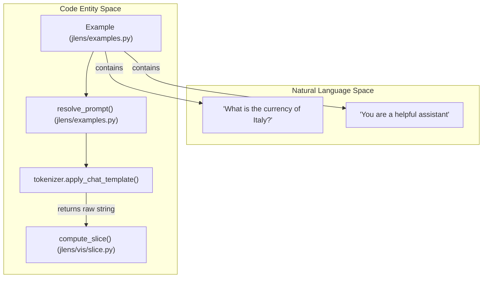
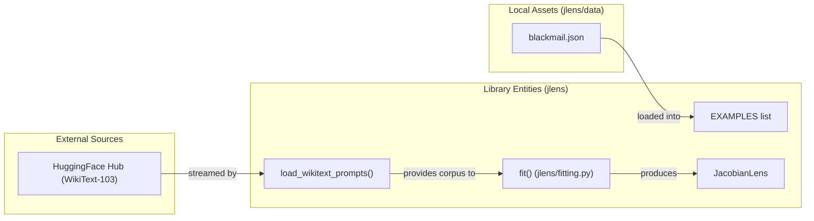

<!-- source: DeepWiki mcp.deepwiki.com · repo anthropics/jacobian-lens · page 2.6 Example Prompts and Data · fetched 2026-10-26 -->

# Example Prompts and Data

Relevant source files

The following files were used as context for generating this wiki page:

- [jlens/data/README.md](jlens/data/README.md)
- [jlens/data/blackmail.json](jlens/data/blackmail.json)
- [jlens/examples.py](jlens/examples.py)

This section documents the built-in demonstration prompts and datasets used to showcase the Jacobian Lens's capabilities. The library provides a structured way to handle both raw text and chat-formatted prompts, along with utilities for streaming external corpora like WikiText for lens fitting.

## The `Example` Dataclass

The `Example` class is the primary container for demonstration prompts. It supports both raw string prompts and structured chat inputs (system, user, and assistant prefill) to accommodate different model interaction styles.

| Attribute | Type | Description |
| :--- | :--- | :--- |
| `slug` | `str` | Unique identifier for the example. |
| `section` | `str` | Display heading used in visualization headers. |
| `description` | `str` | Contextual information shown above the rendered slice. |
| `prompt` | `str | None` | Raw-text prompt. Mutually exclusive with chat fields. |
| `system` | `str | None` | System-role content for chat templates. |
| `user` | `str | None` | User-role content for chat templates. |
| `assistant_prefill` | `str` | Content the assistant is forced to "continue" from. |
| `n_tracked` | `int | None` | Overrides the number of tokens processed in `jlens.vis.compute_slice`. |

**Sources:**
- `Example` definition: [jlens/examples.py:17-40]()

## Built-in `EXAMPLES`

The `EXAMPLES` list contains several scenarios designed to elicit specific internal representations in the Global Workspace.

| Slug | Category | Intent |
| :--- | :--- | :--- |
| `multihop` | Multi-hop reasoning | Traces the transition from "boot-shaped country" to "Italy" to "Euro". |
| `modulation-topic` | Voluntary modulation | Observes "ocean creatures" in the workspace while writing a neutral sentence. |
| `ascii-face` | Visual reasoning | Tests if the lens can decode spatial ASCII patterns into the concept "face". |
| `overdose-flag` | Safety/Monitoring | Detects internal "danger" or "medical" flags in a casual context. |
| `blackmail` | Agentic Misalignment | A complex honeypot scenario involving potential AI deception. |

**Sources:**
- `EXAMPLES` list: [jlens/examples.py:100-181]()
- `_ASCII_FACE` definition: [jlens/examples.py:84-97]()

## Prompt Resolution and Data Flow

The `resolve_prompt()` function bridges the gap between the `Example` dataclass and the model-specific `tokenizer`. It handles the logic for applying chat templates and managing assistant prefills.

### Prompt Resolution Logic
1. If `example.user` is `None`, it returns the raw `example.prompt` [jlens/examples.py:66-69]().
2. If chat fields are present, it constructs a `messages` list [jlens/examples.py:70-73]().
3. If an `assistant_prefill` exists, it calls `apply_chat_template` with `continue_final_message=True` to ensure the model continues the string without re-inserting assistant headers [jlens/examples.py:74-78]().
4. Otherwise, it adds a standard generation prompt [jlens/examples.py:79-81]().

### Data Flow: From Definition to Visualization
The following diagram illustrates how an `Example` is transformed into a prompt and eventually into a `SliceData` object for visualization.

**Natural Language to Code Entity Space: Prompt Processing**

**Sources:**
- `resolve_prompt` implementation: [jlens/examples.py:63-81]()
- `compute_slice` reference: [jlens/vis/slice.py:22-23]()

## External Data Assets

### Bundled Data (`jlens/data/`)
The repository includes a `jlens/data/` directory containing complex prompt scenarios.
- **`blackmail.json`**: Contains the "Agentic Misalignment" scenario prompt. It is loaded into the `EXAMPLES` list via `importlib.resources.files` [jlens/examples.py:12-14]().
- **`README.md`**: Documents the origin and licensing of synthetic data [jlens/data/README.md:1-6]().

### WikiText Loader
For fitting a `JacobianLens`, a diverse corpus is required. The `load_wikitext_prompts` function provides a utility to stream the `wikitext-103-raw-v1` dataset from HuggingFace.

**Logic for `load_wikitext_prompts`:**
- Streams the "train" split of WikiText [jlens/examples.py:50-52]().
- Filters for records meeting a `min_chars` threshold (default 600) to ensure sufficient context for Jacobian estimation [jlens/examples.py:56-60]().

**Sources:**
- `blackmail.json` usage: [jlens/examples.py:12-14]()
- `load_wikitext_prompts` implementation: [jlens/examples.py:42-60]()

## System Architecture: Data Loading
This diagram shows the relationship between local assets, remote datasets, and the lens fitting process.

**Data Source to Code Entity Space: Fitting Pipeline**

**Sources:**
- `load_wikitext_prompts`: [jlens/examples.py:42-60]()
- `fit` function: [jlens/fitting.py:121-125]()
- `blackmail.json` loading: [jlens/examples.py:12-14]()

---

