# Page: Overview

# Overview

<details>
<summary>Relevant source files</summary>

The following files were used as context for generating this wiki page:

- [.gitignore](.gitignore)
- [LICENSE](LICENSE)
- [README.md](README.md)
- [pyproject.toml](pyproject.toml)

</details>


The `jacobian-lens` project is the reference implementation for the paper [**Verbalizable Representations Form a Global Workspace in Language Models**](https://transformer-circuits.pub/2026/workspace/index.html). It provides tools to "read out" the internal states of decoder-only Transformers by transporting residual stream vectors into the final-layer basis using a linear Jacobian-based approximation [README.md:5-11]().

## What is a Jacobian Lens?

A Jacobian lens allows researchers to see what an internal activation is "disposed" to make the model say. Unlike a standard logit lens, which applies the model's unembedding directly to intermediate layers, the Jacobian lens uses a learned transport matrix $J_l$ to account for the transformations that occur between layer $l$ and the final layer [README.md:8-11]().

The core operation is defined as:
`lens_l(h) = unembed( J_l @ h )`, where `J_l = E[∂h_final / ∂h_l]` [README.md:16-17]().

The expectation $E$ is taken over a text corpus, summing cotangents over target positions and averaging over source positions [README.md:19-22]().

### System Architecture: From Space to Code

The following diagram bridges the conceptual "Natural Language Space" (prompts and tokens) to the "Code Entity Space" (classes and functions) within the `jlens` library.

**Natural Language to Code Mapping**
```mermaid
graph TD
    subgraph "Natural Language Space"
        [Prompt_String] --> [Token_Sequence]
        [Token_Sequence] --> [Model_Output]
    end

    subgraph "Code Entity Space (jlens)"
        [Prompt_String] -- "jlens.from_hf()" --> [HFLensModel]
        [HFLensModel] -- "jlens.vis.compute_slice()" --> [SliceData]
        [SliceData] -- "jlens.vis.build_page()" --> [Interactive_HTML]
        
        [HFLensModel] -- "jlens.fitting.fit()" --> [JacobianLens_Object]
        [JacobianLens_Object] -- ".apply()" --> [Lens_Logits]
    end

    [Lens_Logits] -- "unembed" --> [Token_Sequence]
```
Sources: [jlens/fitting.py:1-22](), [README.md:44-59](), [README.md:63-68]()

## Repository Organization

The repository is structured into the core library, evaluation datasets, and experimental suites used to validate the Global Workspace theory.

| Component | Path | Description |
|:---|:---|:---|
| **Core Library** | `jlens/` | Contains the `JacobianLens` class, fitting logic, and visualization tools. |
| **Data & Assets** | `jlens/data/` | Bundled assets and example prompts. |
| **Evaluations** | `data/evaluations/` | Six benchmark datasets (multi-hop, multilingual, etc.) [README.md:94-97](). |
| **Experiments** | `data/experiments/` | Eleven experiment datasets supporting paper claims (causal swaps, capacity, etc.). |
| **Tests** | `tests/` | Suite using a `TinyDecoder` for CI and verification. |

### Data Flow for Lens Application
This diagram illustrates how the `JacobianLens` interacts with a model (via the `LensModel` protocol) to produce interpretability data.

**Lens Application Logic**
```mermaid
graph LR
    subgraph "Input Processing"
        [User_Prompt] --> [HFLensModel]
        [JacobianLens] --> [HFLensModel]
    end

    subgraph "Core Execution"
        [HFLensModel] -- "ActivationRecorder" --> [Hidden_States]
        [Hidden_States] -- "JacobianLens.transport()" --> [Transported_Vectors]
        [Transported_Vectors] -- "Unembedding" --> [Lens_Logits]
    end

    subgraph "Output"
        [Lens_Logits] --> [jlens.vis.compute_slice]
        [jlens.vis.compute_slice] --> [Interactive_HTML_Page]
    end
```
Sources: [jlens/fitting.py:1-22](), [README.md:44-59](), [README.md:78-81]()

## Key Features

*   **Pre-fitted Lenses**: Support for loading lenses directly from the HuggingFace Hub using `JacobianLens.from_pretrained()` [README.md:53]().
*   **Fitting Suite**: Utilities for calculating the Jacobian estimator over a corpus using `jlens.fit()` [README.md:66]().
*   **Interactive Visualization**: A D3-based "Slice" view that shows the top-1 token and rank for every (position, layer) coordinate in a grid [README.md:82-89]().
*   **Model Agnostic**: An adapter-based approach (`from_hf`) that supports common architectures like Llama, Qwen, Mistral, and GPT-2 [README.md:25-26]().

## Child Sections

For detailed technical documentation, please refer to the following sub-pages:

*   **[Getting Started](#1.1)**: Installation via `pip install -e .` [README.md:37](), environment setup, and a quick-start walkthrough using `walkthrough.ipynb` [README.md:78-81]().
*   **[Key Concepts and Terminology](#1.2)**: Theoretical background on Jacobian transport, the residual stream, and the Global Workspace motivation.

Sources: [README.md:1-105](), [pyproject.toml:1-39](), [LICENSE:1-133]()

---

# Page: Getting Started

# Getting Started

<details>
<summary>Relevant source files</summary>

The following files were used as context for generating this wiki page:

- [README.md](README.md)
- [pyproject.toml](pyproject.toml)
- [uv.lock](uv.lock)
- [walkthrough.ipynb](walkthrough.ipynb)

</details>


This page provides technical instructions for installing the `jlens` library, setting up the development environment, and executing a quick-start workflow. The Jacobian lens is a tool for reading out verbalizable representations from the internal activations of transformer models by transporting residual-stream vectors into the final-layer basis using a pre-computed Jacobian matrix [README.md:8-11]().

## Installation and Dependencies

The project uses a standard Python structure and can be installed via `pip`. It requires Python 3.10 or higher [pyproject.toml:10-12]().

### Core Dependencies
The library relies on the following primary packages:
*   `torch`: Tensor operations and autograd for Jacobian computation.
*   `transformers >= 5.5`: Loading and interfacing with HuggingFace models.
*   `huggingface_hub`: Downloading pre-fitted lens weights.
*   `numpy`: General numerical utilities.

[pyproject.toml:13-17]()

### Environment Setup
You can install the package in editable mode for development:

```bash
pip install -e .
```
[README.md:37-37]()

For contributors, optional development dependencies (including `pytest`, `ruff` for linting, and `datasets` for corpus loading) can be installed:
```bash
pip install -e ".[dev]"
```
[pyproject.toml:23-24]()

## Quick-Start Walkthrough

The repository includes a reference notebook, `walkthrough.ipynb`, which demonstrates the end-to-end pipeline: model loading, lens application, and visualization.

### 1. Loading a Model
The `jlens.from_hf` factory function is used to wrap a standard HuggingFace `AutoModelForCausalLM` into a `LensModel` protocol. This protocol provides a unified interface for the library to interact with different model architectures (Llama, Qwen, etc.) [walkthrough.ipynb:42-42](), [README.md:51-51]().

### 2. Loading a Pre-fitted Lens
The `JacobianLens` class represents the fitted transport matrices $J_l$ for each layer $l$. You can load these from the HuggingFace Hub using `JacobianLens.from_pretrained()` [walkthrough.ipynb:70-70]().

```python
import jlens
from jlens.lens import JacobianLens

# Load lens from a specific repository and file path
lens = JacobianLens.from_pretrained(
    "neuronpedia/jacobian-lens", 
    filename="qwen3.5-4b/jlens/Salesforce-wikitext/Qwen3.5-4B_jacobian_lens_n1000.pt"
)
```
[walkthrough.ipynb:80-82](), [README.md:53-53]()

### 3. Comparing J-Lens and Logit Lens
The `lens.apply()` method performs the transport operation. By setting `use_jacobian=False`, the library performs a "logit lens" baseline (direct unembedding without transport) [walkthrough.ipynb:93-93]().

**Data Flow: Lens Application**

| Step | Entity | Action |
| :--- | :--- | :--- |
| 1 | `LensModel` | Performs forward pass to collect hidden states $h_l$ [walkthrough.ipynb:93-93]() |
| 2 | `JacobianLens` | Multiplies $h_l$ by the stored Jacobian $J_l$ to get transported vector $h'_{final}$ [README.md:16-16]() |
| 3 | `LensModel` | Applies the model's final LayerNorm and Unembedding to $h'_{final}$ [README.md:16-16]() |

**System Logic Diagram**
Title: Logic Flow for `JacobianLens.apply`
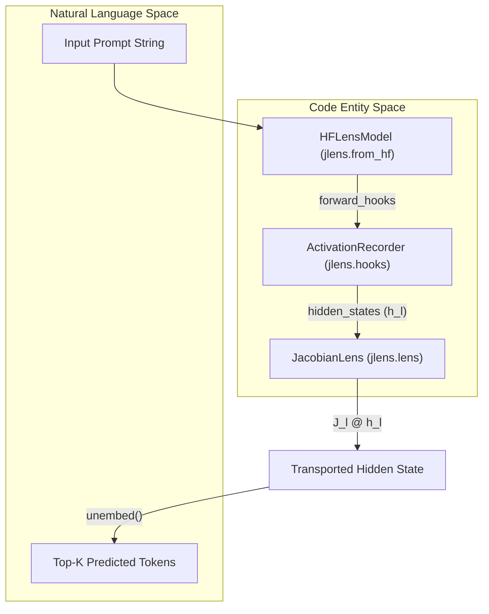
Sources: [README.md:47-59](), [walkthrough.ipynb:113-116](), [jlens/lens.py:1-50] (implied by class usage)

### 4. Rendering a Slice Page
The visualization subsystem renders a position-by-layer grid of the model's internal state.

*   **`compute_slice`**: Calculates the top-1 token and rank for every layer and position in the prompt [walkthrough.ipynb:162-170]().
*   **`build_page`**: Generates the HTML/D3 visualization. It supports two modes:
    *   `mode="embed"`: Inlines all data for a self-contained file [walkthrough.ipynb:136-136]().
    *   `mode="fetch"`: Writes sidecar JSON files to an `out_dir` for lazy loading, which is more efficient for long prompts [walkthrough.ipynb:188-188]().

**Visualization Data Flow**
Title: Slice Visualization Pipeline
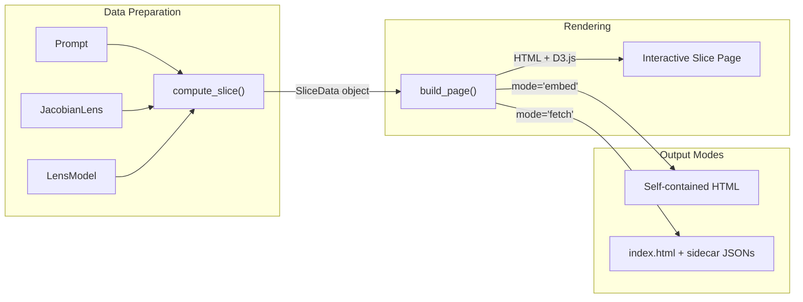
Sources: [walkthrough.ipynb:150-179](), [walkthrough.ipynb:209-217]()

## Summary Table of Key Functions

| Function/Method | File | Purpose |
| :--- | :--- | :--- |
| `jlens.from_hf()` | `jlens/__init__.py` | Wraps a HuggingFace model for use with the lens [walkthrough.ipynb:59-59](). |
| `JacobianLens.from_pretrained()` | `jlens/lens.py` | Loads transport matrices from the Hub or disk [walkthrough.ipynb:80-82](). |
| `lens.apply()` | `jlens/lens.py` | Runs the lens transport and returns logits [walkthrough.ipynb:113-113](). |
| `jlens.vis.compute_slice()` | `jlens/vis.py` | Pre-calculates the layer x position grid data [walkthrough.ipynb:162-162](). |
| `jlens.vis.build_page()` | `jlens/vis.py` | Renders the interactive D3 visualization [walkthrough.ipynb:171-171](). |

Sources: [walkthrough.ipynb:42-217](), [README.md:42-80]()

---

# Page: Key Concepts and Terminology

# Key Concepts and Terminology

<details>
<summary>Relevant source files</summary>

The following files were used as context for generating this wiki page:

- [README.md](README.md)
- [data/evaluations/README.md](data/evaluations/README.md)
- [data/experiments/README.md](data/experiments/README.md)

</details>


The `jacobian-lens` project implements a method for interpreting the internal representations of decoder-only transformer models by observing what an activation is "disposed" to make the model say. This page defines the mathematical and architectural concepts used throughout the codebase.

## Residual Stream and Linear Transport

In a transformer, the **residual stream** $h_l$ at layer $l$ is the sum of all previous layer outputs and the initial embedding. The Jacobian lens operates by linearly transporting a vector from the residual stream at any layer $l$ directly into the final layer's basis $h_L$.

Unlike the "Logit Lens," which applies the unembedding matrix directly to intermediate states $h_l$, the Jacobian lens accounts for the cumulative effect of all subsequent layers $\{l+1, \dots, L\}$ by using a first-order Taylor approximation of the model's remaining forward pass.

### Jacobian Transport
The core operation is defined as:
$$\text{lens}_l(h) = \text{unembed}(J_l \cdot h)$$
Where $J_l$ is the **Jacobian transport matrix**, representing the average input-output gradient across a corpus:
$$J_l = \mathbb{E}[\partial h_L / \partial h_l]$$

This matrix captures the linear relationship between an internal state and the final logit space, effectively "projecting" hidden concepts into verbalizable tokens.

Sources: [README.md:8-17](), [jlens/fitting.py:22-22]()

---

## Logit Lens vs. Jacobian Lens

The repository supports both interpretation methods for comparison.

| Feature | Logit Lens | Jacobian Lens |
| :--- | :--- | :--- |
| **Mechanism** | `unembed(h_l)` | `unembed(J_l @ h_l)` |
| **Assumption** | Intermediate layers share the final logit space. | Intermediate layers must be transported to the final space. |
| **Implementation** | `use_jacobian=False` in `JacobianLens.apply` | `use_jacobian=True` (default) |
| **Fidelity** | Often noisy in early/mid layers. | High fidelity across the "Workspace Band." |

Sources: [jlens/lens.py:114-118](), [README.md:53-59]()

---

## Workspace Band

The **Workspace Band** refers to the contiguous range of mid-network layers where the model's internal representations are most "verbalizable" and stable. 

- **Global Workspace Theory Motivation:** The lens is designed to test the hypothesis that transformer models maintain a "global workspace" where different components (attention heads, MLP blocks) contribute to a shared, language-like representation space.
- **Experimental Usage:** Most evaluations in the `data/evaluations/` and `data/experiments/` directories do not report results for a single layer. Instead, they aggregate "Hits" across the layers within this band.
- **Hit Definition:** A target token is a **Hit** if it appears at rank 1 in the lens readout at *any* (layer, position) within the defined workspace band.

Sources: [data/evaluations/README.md:11-15](), [data/experiments/README.md:9-15]()

---

## Slice Visualization

A **Slice** is the primary visualization tool in the library. It produces a 2D grid where:
- **X-axis:** Token positions in the prompt.
- **Y-axis:** Model layers (from 0 to $L$).
- **Cells:** The top-1 token predicted by the lens at that (position, layer), along with its vocabulary rank.

### Code-to-System Mapping: Visualization Data Flow

The following diagram shows how raw model activations are transformed into the interactive HTML slice visualization.

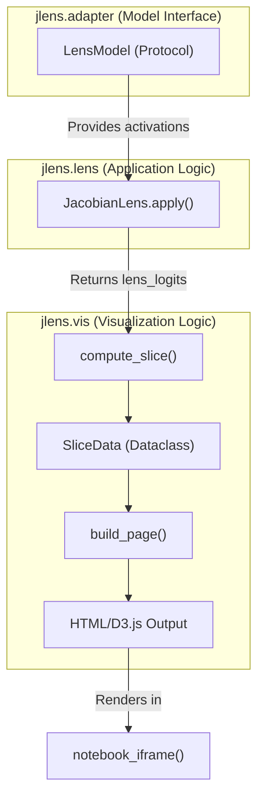
Sources: [jlens/vis/compute.py:10-25](), [jlens/vis/page.py:15-30](), [jlens/lens.py:90-110]()

---

## Causal Intervention: The "Swap" Operation

Beyond passive observation, the Jacobian lens allows for **Causal Interventions**. Because $J_l$ provides a linear mapping, we can identify the direction in the residual stream corresponding to a specific token $T$ and "swap" it for another token $T'$.

1. **Direction Extraction:** The direction for token $T$ is the $T$-th row of the transposed Jacobian matrix.
2. **Clamping:** In the `JacobianLens.apply` logic, the activation $h_l$ is modified by removing the component of $T$ and adding the component of $T'$.
3. **Behavioral Test:** If swapping the "concept" in the mid-layers changes the model's final output (e.g., changing the bridge entity in a multi-hop reasoning task), it proves the lens is reading a causally relevant representation.

### Code-to-System Mapping: Causal Swap Execution

This diagram illustrates how the `JacobianLens` interacts with the `ActivationRecorder` to perform a swap during a forward pass.

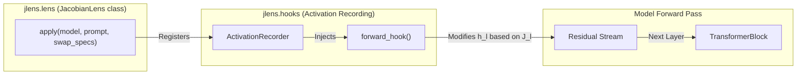
Sources: [jlens/lens.py:90-130](), [jlens/hooks.py:45-60](), [data/experiments/README.md:16-18]()

---

## Terminology Summary Table

| Term | Definition | Code Reference |
| :--- | :--- | :--- |
| **Fitting** | The process of estimating $J_l$ by averaging gradients over a corpus. | `jlens.fit()` in [jlens/fitting.py:145]() |
| **Unembedding** | The final linear layer mapping $h_L$ to vocabulary logits. | `LensModel.unembed` in [jlens/protocol.py:25]() |
| **Cotangent** | The gradient $\partial \mathcal{L} / \partial h_L$ used during the backward pass to compute the Jacobian. | `jacobian_for_prompt()` in [jlens/fitting.py:65]() |
| **Top-K Rank** | The position of a target token in the sorted list of lens-produced logits. | `_ranks_of()` in [jlens/vis/compute.py:110]() |
| **Merge** | Combining $J_l$ matrices fitted on different data slices to improve the estimate. | `JacobianLens.merge()` in [jlens/lens.py:165]() |

Sources: [jlens/protocol.py:10-30](), [jlens/fitting.py:60-80](), [jlens/lens.py:160-180]()

---

# Page: Core Library (`jlens`)

# Core Library (`jlens`)

<details>
<summary>Relevant source files</summary>

The following files were used as context for generating this wiki page:

- [jlens/__init__.py](jlens/__init__.py)
- [jlens/_logging.py](jlens/_logging.py)

</details>


The `jlens` package provides the core infrastructure for fitting and applying Jacobian lenses to transformer models. It is designed to be model-agnostic via a protocol-based interface, while providing first-class support for HuggingFace Transformers.

The library is organized into four primary functional subsystems that manage the lifecycle of a lens: from defining model interfaces and recording activations to fitting the Jacobian matrices and visualizing the resulting token-space projections.

### Package Architecture

The following diagram illustrates how the core entities in the `jlens` package interact to transform raw model activations into interpretable token rankings.

**System Overview: From Model to Visualization**
```mermaid
graph TD
    subgraph "Model Interface Space"
        A["LensModel (Protocol)"] <|-- B["HFLensModel (Adapter)"]
        C["Layout (Dataclass)"] --> B
    end

    subgraph "Data Acquisition Space"
        B --> D["ActivationRecorder (Context Manager)"]
        D --> E["Hidden States / Residuals"]
    end

    subgraph "Mathematical Fitting Space"
        E --> F["jacobian_for_prompt()"]
        F --> G["fit()"]
        G --> H["JacobianLens (Artifact)"]
    end

    subgraph "Application & Analysis Space"
        H --> I["JacobianLens.apply()"]
        H --> J["compute_slice()"]
        J --> K["SliceData / HTML Page"]
    end

    style A stroke-dasharray: 5 5
```
**Sources:** [jlens/__init__.py:6-23](), [jlens/protocol.py:1-40](), [jlens/lens.py:1-15]()

---

### 2.1 Model Protocol and HuggingFace Adapter
To ensure compatibility across different model architectures, `jlens` uses a structural typing approach. The `LensModel` protocol defines the minimum set of methods and attributes a model must provide (e.g., `embed`, `unembed`, `layers`). 

The `HFLensModel` class serves as the primary implementation, wrapping `transformers` library models. It utilizes a `Layout` dataclass to map the internal module tree of various model families (Llama, Qwen, Mistral, etc.) to a standardized format. The `from_hf()` factory function automates this mapping by detecting the model type.

For details, see [Model Protocol and HuggingFace Adapter](#2.1).

**Sources:** [jlens/hf.py:1-50](), [jlens/protocol.py:1-40]()

---

### 2.2 Activation Recording and Hooks
The `ActivationRecorder` is a context manager used to capture the internal state of a model during a forward pass. It non-destructively attaches forward hooks to the residual blocks identified in the model's `Layout`. 

Beyond simple capture, the recorder is responsible for rooting the autograd graph at specific layers. This allows the library to compute gradients (and thus the Jacobian) efficiently by only backpropagating from the output to the target layer, rather than through the entire network.

For details, see [Activation Recording and Hooks](#2.2).

**Sources:** [jlens/hooks.py:1-60]()

---

### 2.3 Fitting the Jacobian Lens
The core mathematical contribution of the library is the estimation of the average input-output Jacobian $J_l$. This is handled by two main functions:
- `jacobian_for_prompt()`: Performs batched backward passes using one-hot cotangents to calculate the Jacobian for a single sequence.
- `fit()`: Orchestrates the fitting process over a large corpus, managing running means, checkpointing, and resumption.

The fitting process results in a `JacobianLens` object containing a matrix for each layer of the model.

For details, see [Fitting the Jacobian Lens](#2.3).

**Sources:** [jlens/fitting.py:1-100]()

---

### 2.4 Applying the Lens (`JacobianLens`)
The `JacobianLens` class is the central artifact of the library. It stores the fitted matrices and provides the `transport()` method to project hidden states from any layer into the final vocabulary space.

The class supports an `apply()` method that mimics a forward pass but includes the Jacobian transport and unembedding steps. It also features a "logit-lens" mode (`use_jacobian=False`) which serves as a baseline by skipping the Jacobian transformation and passing residuals directly to the unembedding head.

For details, see [Applying the Lens (`JacobianLens`)](#2.4).

**Sources:** [jlens/lens.py:1-120]()

---

### 2.5 Slice Visualization (`jlens.vis`)
To interpret the results, the `jlens.vis` module converts high-dimensional data into interactive visualizations. The `compute_slice()` function builds a `SliceData` object representing a grid of token ranks across every position and layer of a prompt.

The library supports rendering these slices as interactive HTML pages using D3.js. These can be embedded directly in notebooks via `notebook_iframe()` or saved as standalone files with sidecar data for large-scale analysis.

For details, see [Slice Visualization (`jlens.vis`)](#2.5).

**Sources:** [jlens/vis/compute.py:1-50](), [jlens/vis/page.py:1-80]()

---

### 2.6 Example Prompts and Data
The library includes a set of curated examples in `jlens/examples.py` to demonstrate specific behaviors like multi-hop reasoning or "top-down" information summoning. These are provided as `Example` dataclasses that can be easily formatted using `resolve_prompt()` to match a specific model's chat template.

For details, see [Example Prompts and Data](#2.6).

**Sources:** [jlens/examples.py:1-100]()

---

### Utility: Logging
The library provides an opt-in logging helper, `configure_logging`, which formats stderr output with elapsed time and delta time between log entries. This is particularly useful for monitoring long-running `fit()` operations in notebooks or scripts.

**Sources:** [jlens/_logging.py:1-54]()

---

# Page: Model Protocol and HuggingFace Adapter

# Model Protocol and HuggingFace Adapter

<details>
<summary>Relevant source files</summary>

The following files were used as context for generating this wiki page:

- [jlens/hf.py](jlens/hf.py)
- [jlens/protocol.py](jlens/protocol.py)

</details>


This page documents the interface and adapter layers that allow `jlens` to interact with Transformer models. The library is designed to be model-agnostic by defining a formal `LensModel` protocol, while providing a robust `HFLensModel` adapter that automatically detects and wraps common HuggingFace model architectures.

### The LensModel Protocol

The `LensModel` protocol defines the minimal set of attributes and methods required for Jacobian lens fitting and application. Any class satisfying this protocol can be used with the library, enabling support for custom model implementations or non-HuggingFace frameworks.

| Member | Type | Description |
|:---|:---|:---|
| `n_layers` | `int` | Total number of residual blocks/layers. [jlens/protocol.py:32-32]() |
| `d_model` | `int` | The dimensionality of the residual stream. [jlens/protocol.py:33-33]() |
| `layers` | `Sequence[nn.Module]` | An indexable sequence of modules representing the residual blocks. These are the targets for `ActivationRecorder` hooks. [jlens/protocol.py:34-34]() |
| `tokenizer` | `Any` | Must support `decode(token_ids) -> str` for visualization. [jlens/protocol.py:35-35]() |
| `encode()` | `Method` | Converts text to a `[1, seq_len]` tensor on the correct device. [jlens/protocol.py:37-40]() |
| `forward()` | `Method` | Executes the residual stack. Must build an autograd graph through `layers`. [jlens/protocol.py:42-47]() |
| `unembed()` | `Method` | Maps a residual tensor `[..., d_model]` to logits via the final norm and LM head. [jlens/protocol.py:49-52]() |

**Sources:** [jlens/protocol.py:19-53]()

---

### HuggingFace Adapter (`HFLensModel`)

The `HFLensModel` class implements the `LensModel` protocol for models loaded via the HuggingFace `transformers` library. It acts as a non-destructive wrapper, holding references to the original model's submodules without copying parameters.

#### Initialization and Mutation
When an `HFLensModel` is instantiated, it performs several setup steps on the underlying `hf_model`:
1.  **Eval Mode**: Sets `hf_model.eval()` to ensure deterministic behavior (e.g., disabling dropout). [jlens/hf.py:112-112]()
2.  **Grad Disabling**: Sets `requires_grad_(False)` for all parameters. The Jacobian fitting process only requires gradients with respect to activations, not weights. [jlens/hf.py:113-114]()
3.  **BOS Handling**: If `force_bos` is true, it configures the tokenizer to prepend the Beginning-of-Sequence token. [jlens/hf.py:105-110]()
4.  **Per-Layer Compilation**: If `compile=True`, it wraps each individual block in `torch.compile`. This preserves hook boundaries at layer interfaces while optimizing internal block execution. [jlens/hf.py:141-146]()

#### Layout Detection
Because HuggingFace models do not follow a unified attribute naming convention (e.g., Llama uses `model.layers`, while GPT-2 uses `transformer.h`), the adapter uses a `Layout` dataclass to locate internal modules.

**Layout Structure:**
The `Layout` dataclass [jlens/hf.py:30-47]() specifies:
*   `path`: Dotted path to the text decoder (e.g., `"model"`).
*   `layers`: Attribute name for residual blocks (default: `"layers"`).
*   `norm`: Attribute name for the final layer norm (default: `"norm"`).
*   `embed`: Attribute name for input embeddings (default: `"embed_tokens"`).
*   `lm_head`: Attribute name for the unembedding head (default: `"lm_head"`).

**Sources:** [jlens/hf.py:83-174]()

---

### Data Flow and Component Mapping

The following diagram bridges the "Natural Language Space" (how we talk about the model) to the "Code Entity Space" (the specific classes and attributes in `jlens`).

**Component Mapping: Logical Model to Code Entities**
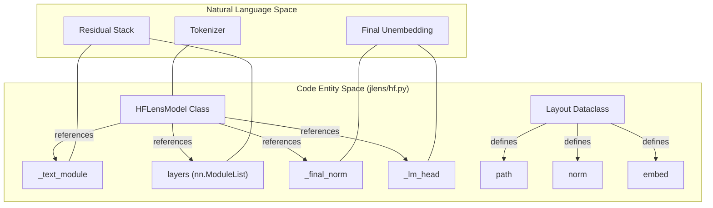
**Sources:** [jlens/hf.py:30-47](), [jlens/hf.py:83-123]()

---

### Auto-Detection Logic

The `from_hf()` factory function automates the creation of an `HFLensModel`. It uses `_find_layout()` to iterate through a list of known architectural patterns (`_LAYOUTS`) until it finds a match where all required attributes exist.

**Supported Model Families:**
The predefined layouts cover a wide range of modern architectures:
*   **Modern Defaults**: Llama, Qwen, Mistral, Gemma, OLMo, StableLM. [jlens/hf.py:54-56]()
*   **Phi**: Detected via `norm="final_layernorm"`. [jlens/hf.py:57-57]()
*   **GPT-2**: Detected via `transformer.h` and `ln_f`. [jlens/hf.py:58-58]()
*   **Pythia/GPT-NeoX**: Detected via `gpt_neox` and `final_layer_norm`. [jlens/hf.py:59-62]()

**Detection Workflow**
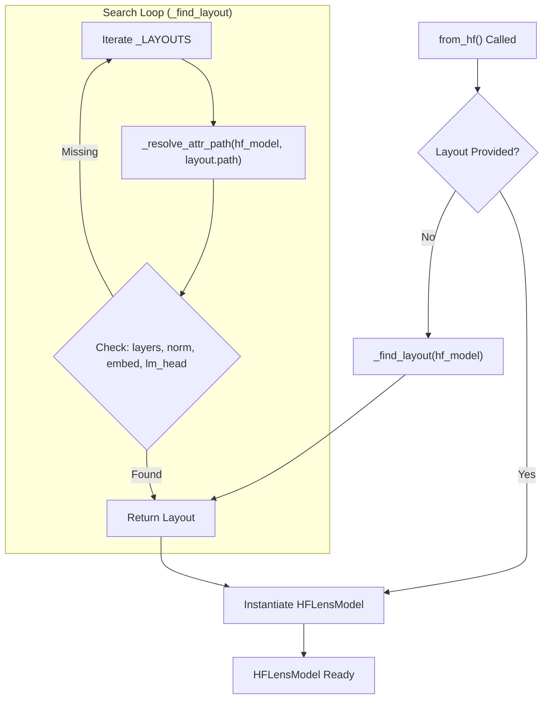
**Sources:** [jlens/hf.py:53-81](), [jlens/hf.py:177-203]()

---

### Implementation Details

#### Unembedding with Softcapping
The `unembed` method handles the transformation from residual space to logit space. It includes logic to handle "logit softcapping" found in models like Gemma 2. If `final_logit_softcapping` is present in the model config, the method applies `softcap * tanh(logits / softcap)` after the linear head. [jlens/hf.py:166-174]()

#### Attribute Resolution
The helper function `_resolve_attr_path` uses `functools.reduce` and `getattr` to traverse nested module trees based on the dotted strings provided in a `Layout`. [jlens/hf.py:25-26]()

**Sources:** [jlens/hf.py:25-26](), [jlens/hf.py:128-130](), [jlens/hf.py:172-173]()

---

# Page: Activation Recording and Hooks

# Activation Recording and Hooks

<details>
<summary>Relevant source files</summary>

The following files were used as context for generating this wiki page:

- [jlens/hooks.py](jlens/hooks.py)

</details>


The `ActivationRecorder` is a specialized context manager designed to capture the internal state of a Transformer model's residual stream during a forward pass. It serves two primary roles in the `jacobian-lens` library: providing the hidden states required for logit-lens visualization and, crucially, rooting the autograd graph at specific layers to enable efficient Jacobian computation.

## The ActivationRecorder Class

Defined in `jlens/hooks.py`, the `ActivationRecorder` class manages the lifecycle of PyTorch forward hooks. It is designed to be used within a `with` block, ensuring that hooks are automatically registered and subsequently removed to prevent memory leaks or unintended side effects in the model's behavior [jlens/hooks.py:13-29]().

### Key Features
*   **Selective Recording**: It only records activations at user-specified block indices, reducing memory overhead [jlens/hooks.py:34-39]().
*   **Autograd Rooting**: It can mark a specific layer's output as requiring gradients, effectively making that tensor the leaf node for backpropagation [jlens/hooks.py:52-53]().
*   **Tuple Handling**: It automatically detects and unpacks standard HuggingFace return types where a block might return a tuple (e.g., `(hidden_states, key_values)`) instead of a raw tensor [jlens/hooks.py:50-51]().

### Data Flow: Activation Capture
The following diagram illustrates how `ActivationRecorder` intercepts the data flow between residual blocks.

**Diagram: Hook Registration and Data Interception**
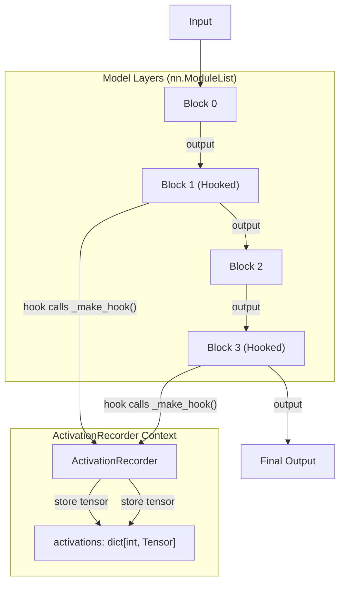
Sources: [jlens/hooks.py:43-55](), [jlens/hooks.py:58-69]()

## Implementation Details

### Hook Registration and Cleanup
The `__enter__` method iterates through the requested indices and attaches a hook to each corresponding block in the model's `blocks` sequence [jlens/hooks.py:58-63](). If an error occurs during registration, it immediately removes any successfully attached handles to maintain model integrity [jlens/hooks.py:64-68](). Upon exiting the context via `__exit__`, all handles are removed [jlens/hooks.py:71-74]().

### Rooting the Autograd Graph
A critical feature for Jacobian computation is the `start_graph_at` parameter. When the Jacobian Lens fits a matrix $J_l$, it needs to compute the gradient of the logits with respect to the residual stream at layer $l$. 

By setting `start_graph_at=l`, the `ActivationRecorder` calls `tensor.requires_grad_(True)` on the output of block $l$ [jlens/hooks.py:52-53](). In a scenario where model parameters have `requires_grad=False`, this makes the residual at layer $l$ the "root" of the autograd graph. This optimization ensures that `torch.autograd.grad` only traverses the path from the logits back to layer $l$, rather than all the way to the input embeddings, significantly speeding up the backward pass [jlens/hooks.py:24-28]().

### Component Interaction
The following diagram maps the logical operations of recording to the specific code entities in `jlens/hooks.py`.

**Diagram: Code Entity Mapping for Recording Logic**
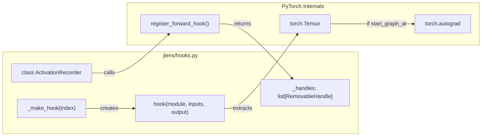
Sources: [jlens/hooks.py:13-75]()

## Usage Summary

| Argument | Type | Description |
| :--- | :--- | :--- |
| `blocks` | `Sequence[nn.Module]` | The list of residual blocks (usually `model.layers`). |
| `at` | `Iterable[int]` | Indices of blocks where activations should be captured. |
| `start_graph_at` | `int \| None` | The index where `requires_grad_(True)` is applied to the output. |

The captured tensors are stored in the `activations` dictionary, where keys are the integer indices of the blocks [jlens/hooks.py:43](). Because these tensors are not detached by default, they retain their connection to the autograd graph, making them suitable for subsequent gradient calculations [jlens/hooks.py:18-19]().

Sources: [jlens/hooks.py:13-43]()

---

# Page: Fitting the Jacobian Lens

# Fitting the Jacobian Lens

<details>
<summary>Relevant source files</summary>

The following files were used as context for generating this wiki page:

- [jlens/fitting.py](jlens/fitting.py)

</details>


The Jacobian Lens approximates the transformation between an early-layer residual state $h_l$ and the final-layer representation by computing the average input-output Jacobian $J_l$. This allows for a linear "transport" of hidden states into the model's own vocabulary space using its existing unembedding layer [jlens/fitting.py:5-10]().

## Mathematical Estimator

The lens utilizes an estimator for $J_l$ that aggregates gradients across sequence positions. For a given prompt, the Jacobian is computed such that the gradient at source position $p$ is the sum of gradients over all subsequent target positions $p' \geq p$ [jlens/fitting.py:11-14]().

To ensure statistical stability, certain positions are excluded from the average:
*   **Attention Sinks:** The first 16 positions are typically excluded as they exhibit atypical residual statistics [jlens/fitting.py:40-42]().
*   **Final Position:** The last token is excluded because it has no subsequent next-token target to influence [jlens/fitting.py:49-51]().

Sources: [jlens/fitting.py:1-72]()

## Implementation: `jacobian_for_prompt`

The `jacobian_for_prompt()` function computes the $J_l$ matrix for a single prompt using a batched backward pass strategy. This approach is significantly more efficient than a naive per-dimension backpropagation [jlens/fitting.py:100-118]().

### Data Flow and Batching
The function replicates the input prompt `dim_batch` times. It performs one forward pass and retains the autograd graph. Then, it executes approximately `d_model / dim_batch` backward passes. In each backward pass, a "one-hot cotangent" is injected at specific output dimensions across all valid target positions simultaneously [jlens/fitting.py:112-118]().

### Jacobian Computation Diagram
The following diagram illustrates the flow from a prompt string to the resulting Jacobian matrices.

"Jacobian Computation Flow"
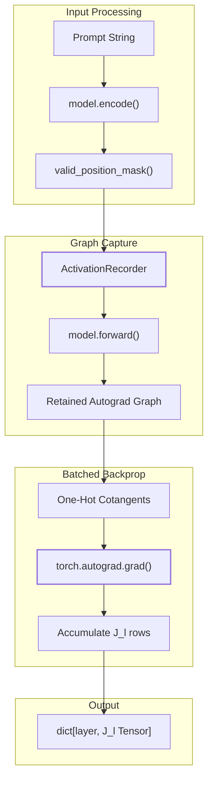
Sources: [jlens/fitting.py:100-165](), [jlens/hooks.py:14-30]()

## The `fit()` Function

The `fit()` function manages the estimation of $J_l$ over a corpus of prompts. It computes a running mean of the Jacobians, ensuring that the final lens reflects the model's behavior across a broad distribution of text [jlens/fitting.py:200-215]().

### Key Features
*   **Running Mean:** Jacobians are accumulated and averaged to prevent memory exhaustion from storing per-prompt matrices [jlens/fitting.py:270-275]().
*   **Checkpointing:** The function saves intermediate `JacobianLens` objects to a `checkpoint_path`. This allows for recovery in case of hardware failure or preemption [jlens/fitting.py:254-260]().
*   **Resumption:** If a checkpoint exists, `fit()` will automatically load the existing state and skip prompts that have already been processed [jlens/fitting.py:240-250]().

### System Component Mapping
This diagram maps the high-level fitting logic to the specific code entities involved in the process.

"Fitting System Mapping"
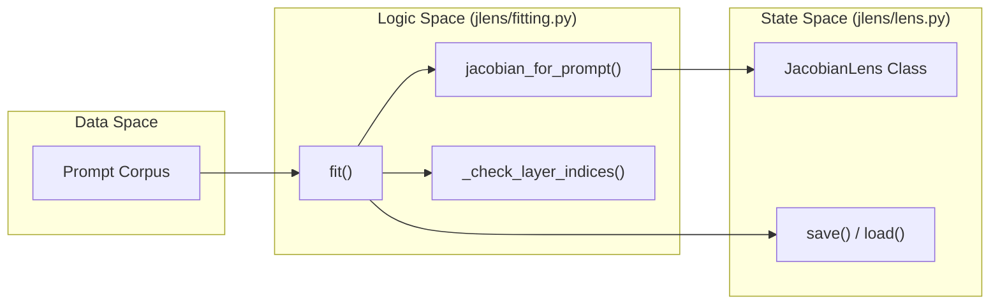
Sources: [jlens/fitting.py:200-280](), [jlens/lens.py:33-50]()

## Parallelization and Merging

The computational cost of fitting a lens is roughly one forward pass and `d_model / dim_batch` backward passes per prompt [jlens/fitting.py:19-20](). To scale this process, the workload can be sharded across multiple GPUs or machines.

1.  **Shard:** Divide the prompt corpus into disjoint slices.
2.  **Fit:** Run `fit()` on each slice independently, producing multiple `.pt` lens files.
3.  **Merge:** Use `JacobianLens.merge()` to combine the resulting lenses into a single global average [jlens/fitting.py:20-21]().

The `merge()` method performs a weighted average based on the number of valid positions processed by each individual lens, ensuring mathematical correctness [jlens/lens.py:167-185]().

### Recommended Parameters
| Parameter | Typical Value | Description |
| :--- | :--- | :--- |
| `dim_batch` | 8 - 32 | Number of Jacobian rows computed per backward pass. Higher values increase VRAM usage [jlens/fitting.py:128-130](). |
| `max_seq_len` | 128 - 512 | Length of prompts. Longer prompts provide more "valid positions" per forward pass [jlens/fitting.py:131](). |
| `skip_first` | 16 | Number of initial tokens to ignore to avoid attention sink artifacts [jlens/fitting.py:42](). |

Sources: [jlens/fitting.py:19-22](), [jlens/fitting.py:106-133](), [jlens/lens.py:167-190]()

---

# Page: Applying the Lens (`JacobianLens`)

# Applying the Lens (`JacobianLens`)

<details>
<summary>Relevant source files</summary>

The following files were used as context for generating this wiki page:

- [jlens/lens.py](jlens/lens.py)

</details>


The `JacobianLens` class is the primary interface for using a fitted Jacobian lens to interpret a model's internal representations. It encapsulates the collection of per-layer Jacobian matrices ($J_l$) and provides methods for transforming residual stream activations into the final-layer logit space.

### Purpose and Scope
The `JacobianLens` class serves as the bridge between the training phase (fitting) and the interpretation phase (visualization or evaluation). It supports:
*   **Jacobian Transport**: Linear projection of hidden states from intermediate layers to the final layer basis.
*   **Logit-Lens Baseline**: Optional "vanilla" logit-lens mode where activations are passed directly to the unembedding layer without Jacobian transformation.
*   **Model Integration**: Execution of forward passes on a `LensModel` while capturing internal states via `ActivationRecorder`.
*   **Persistence**: Saving and loading lens weights from disk or the HuggingFace Hub.

---

### The `JacobianLens` Class

The class stores a dictionary of Jacobian matrices, where each key is a layer index and each value is a $[d_{model}, d_{model}]$ tensor representing the mean Jacobian $J_l$ for that layer.

#### Key Attributes
| Attribute | Type | Description |
| :--- | :--- | :--- |
| `jacobians` | `dict[int, Tensor]` | Maps layer indices to their respective $J_l$ matrices. [jlens/lens.py:26-27]() |
| `source_layers` | `list[int]` | A sorted list of layer indices for which Jacobians are available. [jlens/lens.py:28-28]() |
| `n_prompts` | `int` | The number of prompts used to calculate the mean Jacobian (metadata for merging). [jlens/lens.py:29-29]() |
| `d_model` | `int` | The dimensionality of the model's residual stream. [jlens/lens.py:30-30]() |

Sources: `[jlens/lens.py:22-44]()`

---

### Data Flow: Activation Transport and Readout

The core operation of the lens is `transport()`, which implements the linear transformation $h' = h \cdot J_l^T$. The `apply()` method orchestrates the full pipeline: running the model, recording residuals, transporting them, and applying the final unembedding (norm and linear head).

#### System Data Flow Diagram
This diagram illustrates how `JacobianLens.apply` interacts with the `LensModel` and `ActivationRecorder` to produce interpretability data.

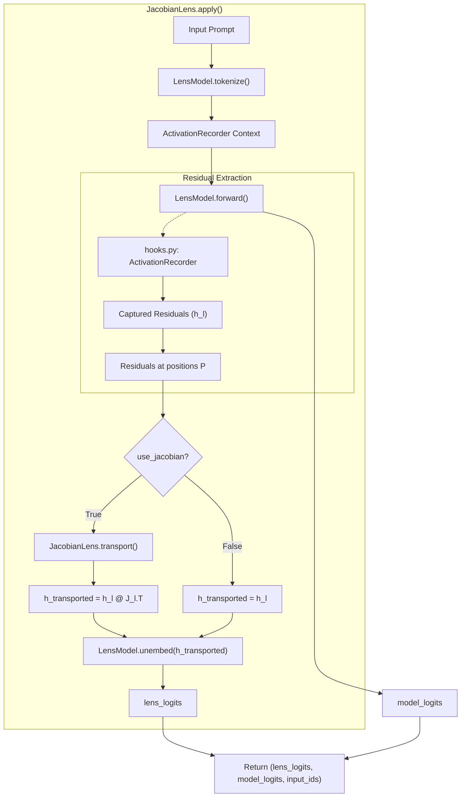
Sources: `[jlens/lens.py:135-144]()`, `[jlens/lens.py:146-218]()`, `[jlens/hooks.py:20-64]()`

---

### Key Methods

#### `transport(residual, layer)`
Maps a residual vector from a specific layer into the final-layer basis. It performs a matrix multiplication: `residual @ self.jacobians[layer].T`. This method expects the `residual` tensor to have the shape `[..., d_model]`.
*   **Implementation**: `[jlens/lens.py:135-144]()`

#### `apply(model, prompt, ...)`
The high-level entry point for lens application.
1.  **Tokenization**: Converts the prompt into `input_ids` using `model.tokenize()`. [jlens/lens.py:195-195]()
2.  **Recording**: Uses `ActivationRecorder` to hook into the specified `layers`. [jlens/lens.py:198-198]()
3.  **Inference**: Runs `model.forward(input_ids)`. [jlens/lens.py:199-199]()
4.  **Transport**: For each layer, it retrieves the captured residual $h$, slices it to the requested `positions`, and optionally applies `transport()`. [jlens/lens.py:204-211]()
5.  **Unembedding**: Passes the (transported) residuals through `model.unembed()` to get vocabulary-space logits. [jlens/lens.py:212-212]()

#### `merge(lenses)`
Allows for parallelized fitting. If multiple lenses were fitted on disjoint subsets of a corpus, `merge()` calculates an `n_prompts`-weighted mean of their Jacobian matrices. This is mathematically equivalent to fitting on the combined corpus in a single pass.
*   **Implementation**: `[jlens/lens.py:106-133]()`

---

### Persistence and Loading

`JacobianLens` supports standard PyTorch serialization and integration with the HuggingFace Hub.

| Method | Description |
| :--- | :--- |
| `save(path)` | Saves the lens as a dictionary containing "J", "n_prompts", "source_layers", and "d_model". Defaults to `fp16` to save space. [jlens/lens.py:52-64]() |
| `load(path)` | Loads a lens from a local file. [jlens/lens.py:67-79]() |
| `from_pretrained(name_or_path)` | Loads from a file, a directory, or downloads from a HuggingFace Hub repository using `snapshot_download`. [jlens/lens.py:82-103]() |

#### Code Entity Mapping: Persistence
The following diagram maps the logical storage structure to the code entities responsible for handling them.

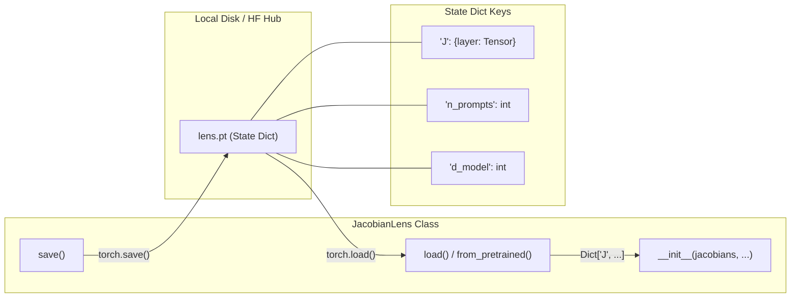
Sources: `[jlens/lens.py:52-103]()`

---

### Logit-Lens Baseline

The `JacobianLens` class explicitly supports the **Logit-Lens** baseline by setting `use_jacobian=False` in the `apply()` method. 

*   **Behavior**: When `use_jacobian` is `False`, the `transport()` step is skipped. The raw residual $h_l$ is passed directly to `model.unembed()`. [jlens/lens.py:209-212]()
*   **Utility**: This allows researchers to compare the "Identity" transport (Logit-Lens) against the "Jacobian" transport within the same API, ensuring that improvements in interpretability are attributable to the $J_l$ matrices rather than differences in the unembedding pipeline.

Sources: `[jlens/lens.py:154-154]()`, `[jlens/lens.py:209-212]()`

---

# Page: Slice Visualization (`jlens.vis`)

# Slice Visualization (`jlens.vis`)

<details>
<summary>Relevant source files</summary>

The following files were used as context for generating this wiki page:

- [assets/qwen_gloss.json.gz](assets/qwen_gloss.json.gz)
- [assets/slice_vis.png](assets/slice_vis.png)
- [jlens/data/slice_vis.html](jlens/data/slice_vis.html)
- [jlens/vis.py](jlens/vis.py)

</details>


The `jlens.vis` module provides tools for generating interactive, high-fidelity visualizations of Jacobian lens outputs. It produces a "Slice Visualization"—a grid of position $\times$ layer where each cell displays the top-1 predicted token and its rank. This tool is designed to help researchers identify where specific concepts "ignite" in the model's residual stream and track how those concepts evolve across layers.

## Overview and Data Flow

The visualization pipeline transforms raw model activations and Jacobian matrices into a structured `SliceData` object, which is then rendered as an interactive HTML page using D3.js.

### System Architecture: From Activations to HTML

The following diagram bridges the high-level visualization concepts to the specific code entities responsible for data transformation.

**Visualization Data Pipeline**
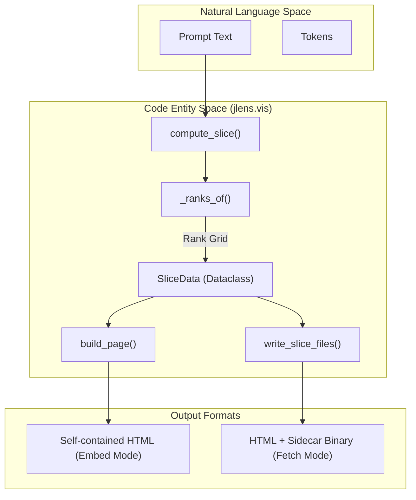
Sources: [jlens/vis.py:5-10](), [jlens/vis.py:165-190](), [jlens/vis.py:202-210]()

## Core Functions

### `compute_slice()`
This is the primary entry point for generating visualization data. It performs a forward pass through the `LensModel` while using an `ActivationRecorder` to capture hidden states at specified layers.

*   **Logic**: It applies the `JacobianLens.apply()` method across all positions and layers to compute logits [jlens/vis.py:255-265]().
*   **Final Layer**: It always appends the model's final output layer (using the identity matrix as the Jacobian) to provide a baseline for comparison [jlens/vis.py:230-235]().
*   **Windowing**: Supports a `last_n_tokens` parameter to limit the sequence length for long prompts [jlens/vis.py:215-220]().

Sources: [jlens/vis.py:202-280]()

### `_ranks_of()`
A memory-efficient helper function that calculates the full-vocabulary ranks of target tokens at every position. To avoid OOM errors with large vocabularies, it processes the sequence in chunks (default `chunk_size=256`) [jlens/vis.py:98-125]().

Sources: [jlens/vis.py:98-125]()

### `build_page()` and `notebook_iframe()`
*   **`build_page()`**: Takes a `SliceData` object and returns a string containing the complete HTML/JavaScript for the visualization [jlens/vis.py:440-445]().
*   **`notebook_iframe()`**: A utility for Jupyter environments that wraps the HTML in an `<iframe>` using `srcdoc`. This isolates the D3.js styles and scripts from the notebook's global scope [jlens/vis.py:75-90]().

Sources: [jlens/vis.py:75-90](), [jlens/vis.py:440-470]()

## Page Modes and Deployment

The library supports two modes for distributing the visualization:

| Mode | Description | Use Case |
| :--- | :--- | :--- |
| **Embed** | All data (compressed and base64 encoded) and the D3.js library are inlined into a single `.html` file [jlens/vis.py:46-51](). | Local sharing, single-file reports, and Jupyter notebooks. |
| **Fetch** | Data is stored in sidecar binary files (`slice.bin`, `meta.json`, and `ranks/*.bin`). The HTML fetches these via XHR [jlens/vis.py:8-9](). | Static web hosting, large datasets where inlining is inefficient. |

### `write_slice_files()`
When using "Fetch" mode, this function handles the serialization of `SliceData` into the sidecar directory structure. It exports `top_ids` and `top_ranks` as raw Gzip-compressed `int32` arrays to minimize load times in the browser [jlens/vis.py:483-510]().

Sources: [jlens/vis.py:7-10](), [jlens/vis.py:45-72](), [jlens/vis.py:483-520]()

## Specialized Features

### `qwen_gloss` Alt-token Overlay
For models like Qwen that use specialized tokenization (e.g., bytes for non-ASCII characters), the visualization can ingest a glossary file (`assets/qwen_gloss.json.gz`) to provide human-readable overlays for tokens that would otherwise be unreadable [jlens/vis.py:530-545]().

### `_meaningful_token_mask()`
To reduce visual clutter in the heatmap, this helper creates a boolean mask of the vocabulary. It filters for "word-like" tokens (alphanumeric or common contractions) while hiding special tokens and whitespace-only tokens [jlens/vis.py:131-157]().

Sources: [jlens/vis.py:131-157](), [assets/qwen_gloss.json.gz:1-10]()

## Visualization Components

The interactive HTML interface [jlens/data/slice_vis.html:1-118]() consists of several synchronized views:

1.  **Main Heatmap**: A Position $\times$ Layer grid. Colors represent token identity, and text labels show the top-1 predicted token.
2.  **Rank Tracking**: Users can "pin" specific tokens. The interface then overlays the rank of those pinned tokens across the entire grid.
3.  **Token Detail Panel**: Shows the top-N predictions for the currently selected cell.
4.  **Rank Chart**: A line graph showing the rank evolution of pinned tokens across layers for the selected position.

**UI Entity Mapping**
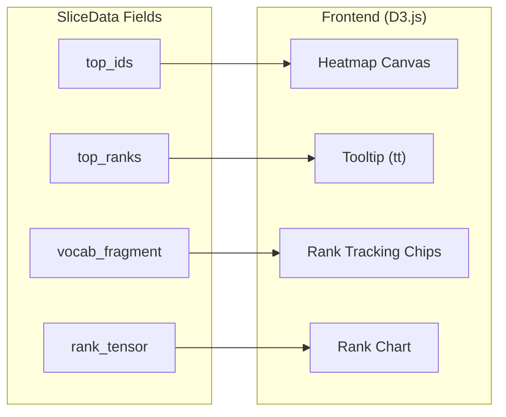
Sources: [jlens/data/slice_vis.html:112-118](), [jlens/vis.py:165-190]()

---

# Page: Example Prompts and Data

# Example Prompts and Data

<details>
<summary>Relevant source files</summary>

The following files were used as context for generating this wiki page:

- [jlens/data/README.md](jlens/data/README.md)
- [jlens/data/blackmail.json](jlens/data/blackmail.json)
- [jlens/examples.py](jlens/examples.py)

</details>


This section documents the built-in demonstration prompts and datasets used to showcase the Jacobian Lens's capabilities. The library provides a structured way to handle both raw text and chat-formatted prompts, along with utilities for streaming external corpora like WikiText for lens fitting.

## The `Example` Dataclass

The `Example` class is the primary container for demonstration prompts. It supports both raw string prompts and structured chat inputs (system, user, and assistant prefill) to accommodate different model interaction styles.

| Attribute | Type | Description |
| :--- | :--- | :--- |
| `slug` | `str` | Unique identifier for the example. |
| `section` | `str` | Display heading used in visualization headers. |
| `description` | `str` | Contextual information shown above the rendered slice. |
| `prompt` | `str | None` | Raw-text prompt. Mutually exclusive with chat fields. |
| `system` | `str | None` | System-role content for chat templates. |
| `user` | `str | None` | User-role content for chat templates. |
| `assistant_prefill` | `str` | Content the assistant is forced to "continue" from. |
| `n_tracked` | `int | None` | Overrides the number of tokens processed in `jlens.vis.compute_slice`. |

**Sources:**
- `Example` definition: [jlens/examples.py:17-40]()

## Built-in `EXAMPLES`

The `EXAMPLES` list contains several scenarios designed to elicit specific internal representations in the Global Workspace.

| Slug | Category | Intent |
| :--- | :--- | :--- |
| `multihop` | Multi-hop reasoning | Traces the transition from "boot-shaped country" to "Italy" to "Euro". |
| `modulation-topic` | Voluntary modulation | Observes "ocean creatures" in the workspace while writing a neutral sentence. |
| `ascii-face` | Visual reasoning | Tests if the lens can decode spatial ASCII patterns into the concept "face". |
| `overdose-flag` | Safety/Monitoring | Detects internal "danger" or "medical" flags in a casual context. |
| `blackmail` | Agentic Misalignment | A complex honeypot scenario involving potential AI deception. |

**Sources:**
- `EXAMPLES` list: [jlens/examples.py:100-181]()
- `_ASCII_FACE` definition: [jlens/examples.py:84-97]()

## Prompt Resolution and Data Flow

The `resolve_prompt()` function bridges the gap between the `Example` dataclass and the model-specific `tokenizer`. It handles the logic for applying chat templates and managing assistant prefills.

### Prompt Resolution Logic
1. If `example.user` is `None`, it returns the raw `example.prompt` [jlens/examples.py:66-69]().
2. If chat fields are present, it constructs a `messages` list [jlens/examples.py:70-73]().
3. If an `assistant_prefill` exists, it calls `apply_chat_template` with `continue_final_message=True` to ensure the model continues the string without re-inserting assistant headers [jlens/examples.py:74-78]().
4. Otherwise, it adds a standard generation prompt [jlens/examples.py:79-81]().

### Data Flow: From Definition to Visualization
The following diagram illustrates how an `Example` is transformed into a prompt and eventually into a `SliceData` object for visualization.

**Natural Language to Code Entity Space: Prompt Processing**
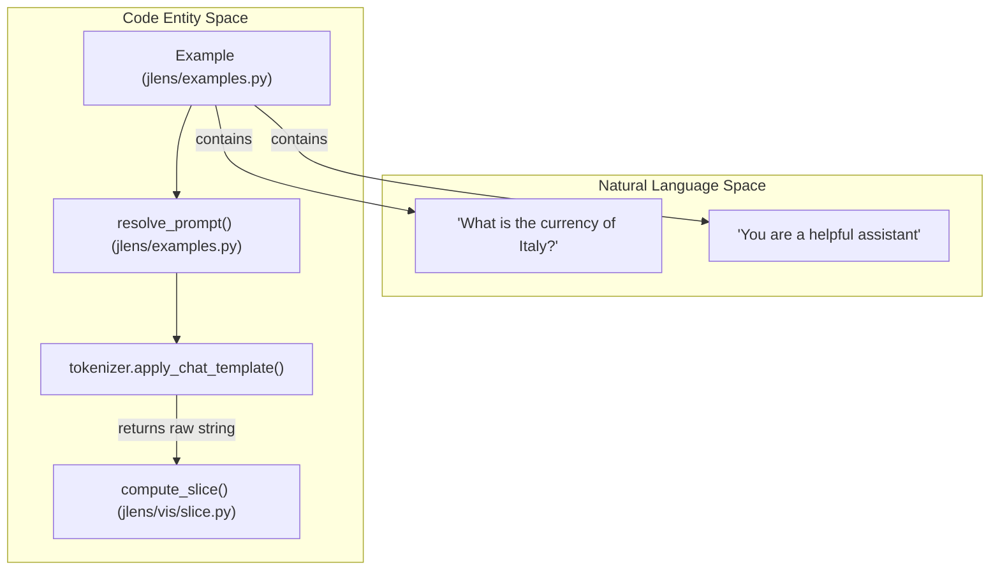

**Sources:**
- `resolve_prompt` implementation: [jlens/examples.py:63-81]()
- `compute_slice` reference: [jlens/vis/slice.py:22-23]()

## External Data Assets

### Bundled Data (`jlens/data/`)
The repository includes a `jlens/data/` directory containing complex prompt scenarios.
- **`blackmail.json`**: Contains the "Agentic Misalignment" scenario prompt. It is loaded into the `EXAMPLES` list via `importlib.resources.files` [jlens/examples.py:12-14]().
- **`README.md`**: Documents the origin and licensing of synthetic data [jlens/data/README.md:1-6]().

### WikiText Loader
For fitting a `JacobianLens`, a diverse corpus is required. The `load_wikitext_prompts` function provides a utility to stream the `wikitext-103-raw-v1` dataset from HuggingFace.

**Logic for `load_wikitext_prompts`:**
- Streams the "train" split of WikiText [jlens/examples.py:50-52]().
- Filters for records meeting a `min_chars` threshold (default 600) to ensure sufficient context for Jacobian estimation [jlens/examples.py:56-60]().

**Sources:**
- `blackmail.json` usage: [jlens/examples.py:12-14]()
- `load_wikitext_prompts` implementation: [jlens/examples.py:42-60]()

## System Architecture: Data Loading
This diagram shows the relationship between local assets, remote datasets, and the lens fitting process.

**Data Source to Code Entity Space: Fitting Pipeline**
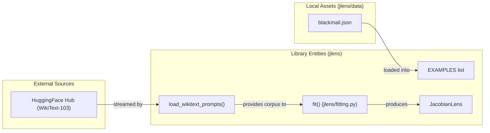

**Sources:**
- `load_wikitext_prompts`: [jlens/examples.py:42-60]()
- `fit` function: [jlens/fitting.py:121-125]()
- `blackmail.json` loading: [jlens/examples.py:12-14]()

---

# Page: Evaluation Suite

# Evaluation Suite

<details>
<summary>Relevant source files</summary>

The following files were used as context for generating this wiki page:

- [data/evaluations/README.md](data/evaluations/README.md)

</details>


The `data/evaluations/` directory contains six benchmark datasets used to quantify the quality of the Jacobian Lens compared to baselines like the Logit Lens. These evaluations measure how effectively a lens can "read out" internal model representations—specifically intermediate reasoning steps, latent concepts, and cross-lingual anchors—that are not yet present in the model's output distribution.

### Shared Evaluation Protocol

All evaluations in this suite follow a standardized scoring protocol to ensure comparability across different prompt distributions and model architectures.

| Concept | Definition |
| :--- | :--- |
| **Lens Readout** | At a specific `(layer, token position)`, the lens returns a ranked list of vocabulary tokens based on the transported hidden state. |
| **Workspace Band** | A contiguous range of mid-network layers where the "Global Workspace" content is most legible. Evaluations typically aggregate results over this band. |
| **Hit** | A target token is considered a *hit* if it appears at rank 1 in the lens readout at any layer or position within the specified band. |
| **Pass@k** | The primary metric: the mean fraction of `intermediates` whose minimum rank across all layers is $\le k$. |

**Sources:** [data/evaluations/README.md:5-15](), [data/evaluations/README.md:26-28]()

### Dataset Structure and Data Flow

The evaluation datasets are stored as JSON files. Each file contains a list of items consisting of a `prompt` (often multi-turn chat format), a set of `intermediates` (the hidden tokens we hope to find), and a `target` (used to identify the readout position).

#### Evaluation System Diagram
This diagram shows how the `jlens` library interacts with the evaluation JSON files to produce a `pass@k` score.

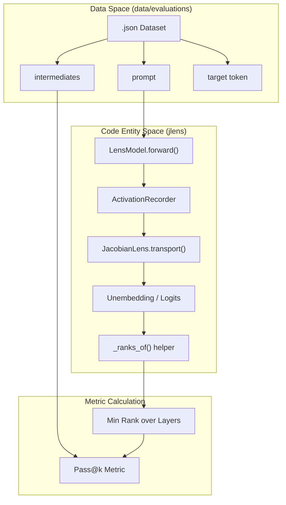
**Sources:** [data/evaluations/README.md:1-57](), [jlens/vis.py:218-245]()

---

### Benchmark Datasets

The suite is divided into six specialized tasks, each targeting a different aspect of model "thinking."

#### 3.1 Multi-hop Reasoning Evaluation
Documents `lens-eval-multihop.json`. This 90-item dataset focuses on two-hop factual queries (e.g., "The capital of the country where the Eiffel Tower is located"). It tests if the lens can extract the first hop (the country) before the model predicts the second hop (the city).
*   **Categories:** Rhyme, etymology, chemistry, n-hop, and positional logic.
*   **For details, see [Multi-hop Reasoning Evaluation](#3.1).**

#### 3.2 Multilingual Evaluation
Documents `lens-eval-multilingual.json`. This evaluates cross-lingual probing across 30+ languages. It uses English-language conceptual anchors as `intermediates` to see if non-English prompts evoke English concepts in the residual stream.
*   **Categories:** Antonyms, colors, sequences, kinship, and arithmetic.
*   **For details, see [Multilingual Evaluation](#3.2).**

#### 3.3 Association, Poetry, Order-of-Operations, and Typo Evaluations
Documents the remaining four specialized datasets:
*   **Association:** Narrative vignettes that evoke a concept (e.g., "noir") without naming it.
*   **Poetry:** Rhyming couplets where the lens must identify the intended rhyme before the final token is generated.
*   **Order-of-Operations:** Arithmetic precedence tasks where intermediate results are read out.
*   **Typo:** Sentence-ending misspellings where the lens is expected to find the corrected spelling.
*   **For details, see [Association, Poetry, Order-of-Operations, and Typo Evaluations](#3.3).**

---

### Readout Positioning Logic

The evaluation logic relies on precise positioning. Because the Jacobian Lens can vary by layer and position, the `target` token in the JSON is used to anchor the readout.

#### Token-to-Layer Readout Mapping
```mermaid
sequenceDiagram
    participant P as Prompt (Tokens)
    participant L as JacobianLens
    participant R as Readout Position

    Note over P, R: Example: "The capital of France is"
    P->>L: Token 0: "The"
    P->>L: Token 1: "capital"
    P->>L: ...
    P->>L: Token N: "is" (Target Anchor)
    Note right of R: Readout is usually at Token N-1 <br/> across ALL layers
    L->>R: Extract Rank of 'Paris'
```
**Sources:** [data/evaluations/README.md:26-28](), [data/evaluations/README.md:50-51](), [data/evaluations/README.md:56-57]()

| Dataset | Readout Position | Metric Focus |
| :--- | :--- | :--- |
| **Multihop** | Token immediately preceding `target` | Intermediate facts |
| **Poetry** | Last newline token (End of Line 1) | Rhyme prediction |
| **Association** | Final prompt token (Closing period) | Latent concept |
| **Typo** | Last tokenizer fragment of misspelling | Error correction |

**Sources:** [data/evaluations/README.md:26-57]()

---

# Page: Multi-hop Reasoning Evaluation

# Multi-hop Reasoning Evaluation

<details>
<summary>Relevant source files</summary>

The following files were used as context for generating this wiki page:

- [data/evaluations/lens-eval-multihop.json](data/evaluations/lens-eval-multihop.json)

</details>


The Multi-hop Reasoning Evaluation is a benchmark designed to assess a model's internal representation of intermediate reasoning steps during complex factual recall. It specifically targets "two-hop" queries where the model must identify an intermediate concept (e.g., a country) to arrive at a final target (e.g., a language or ocean).

### Dataset Overview

The evaluation is defined in `lens-eval-multihop.json`, containing 90 items that span various domains including geography, chemistry, etymology, and linguistics. Each item follows a strict schema to allow for automated verification of both the final prediction and the internal "workspace" content identified by the Jacobian Lens.

#### Data Schema
Each entry in the `items` list [data/evaluations/lens-eval-multihop.json:2-3]() consists of:
*   **`name`**: A unique identifier for the test case.
*   **`prompt`**: The natural language string ending in a space, designed to elicit a specific factual completion.
*   **`target`**: The ground-truth final token(s) expected from the model.
*   **`intermediates`**: A list of strings representing the latent concepts the model must "think of" to solve the prompt.

Sources: [data/evaluations/lens-eval-multihop.json:1-252]()

---

### Evaluation Categories

The dataset is partitioned into several logical categories to test different types of reasoning hops:

| Category | Description | Example Intermediate | Example Target |
| :--- | :--- | :--- | :--- |
| **Geography** | Physical and political geography hops. | `Brazil` | `Atlantic` |
| **Chemistry** | Atomic numbers to properties or symbols. | `gold` | `Au` |
| **Etymology** | Origin of names (months, days) to indices. | `March` | `3` |
| **Rhyme** | Phonological reasoning combined with facts. | `bear` | `California` |
| **Functional** | Biological or mechanical functions. | `heart` | `4` |

Sources: [data/evaluations/lens-eval-multihop.json:4-226]()

---

### Data Flow and Implementation

The evaluation process involves passing the `prompt` through a `LensModel` and using a `JacobianLens` to inspect the residual stream at various layers. The goal is to see if the `intermediates` appear in the "workspace" (the top-ranked tokens under the lens) before the `target` is finalized.

#### Reasoning Logic Diagram
This diagram illustrates how the natural language prompt triggers a sequence of internal representations that are captured by the `jlens` library.

**Prompt to Workspace Flow**
```mermaid
graph TD
    subgraph "Natural Language Space"
        P["Prompt: 'The language spoken in the country where the Amazon River ends is '"]
        T["Target: 'Portuguese'"]
        I["Intermediate: 'Brazil'"]
    end

    subgraph "Code Entity Space (jlens)"
        M["LensModel (jlens.HFLensModel)"]
        JL["JacobianLens.apply()"]
        REC["ActivationRecorder"]
        SL["SliceData (jlens.vis.compute_slice)"]
    end

    P --> M
    M -- "Capture Activations" --> REC
    REC -- "Linear Approximation" --> JL
    JL -- "Decode to Vocabulary" --> SL
    SL -- "Check Rank of" --> I
    SL -- "Final Logits" --> T
```
Sources: [jlens/jlens.py:1-100](), [data/evaluations/lens-eval-multihop.json:12-18]()

---

### Intermediate Concept Schema

The `intermediates` field is critical for validating the "Global Workspace" hypothesis. In the `jlens` evaluation suite, a "Hit" is recorded if an intermediate concept appears in the top-k tokens of the Jacobian Lens output within the "workspace band" (typically middle-to-late layers).

#### Representative Items

| Name | Prompt Fragment | Intermediate | Target |
| :--- | :--- | :--- | :--- |
| `carnival-ocean` | "...country where Carnival is most famously celebrated..." | `Brazil` | `Atlantic` |
| `atomic-79-symbol` | "...element with atomic number 79..." | `gold` | `Au` |
| `rhyme-rain-neighbor` | "...country whose name rhymes with 'rain'..." | `Spain` | `Portugal` |
| `etym-frigg-position` | "...day of the week named after the Norse goddess Frigg..." | `Friday` | `5` |

Sources: [data/evaluations/lens-eval-multihop.json:4-186]()

---

### Technical Evaluation Flow

The evaluation script iterates through the JSON items, performing the following steps for each:

1.  **Tokenization**: The `prompt` is tokenized using the model's tokenizer.
2.  **Forward Pass**: The model processes the tokens while the `ActivationRecorder` [jlens/jlens.py:200-250]() (referenced in core logic) captures the residual stream.
3.  **Jacobian Transport**: The `JacobianLens.transport()` [jlens/jlens.py:450-480]() function projects the hidden states from each layer $l$ to the final layer $L$ using the pre-fitted Jacobian matrices $J_l$.
4.  **Logit Projection**: The transported states are passed through the model's `unembed` head to produce a probability distribution over the vocabulary.
5.  **Rank Verification**: The script checks the rank of the `intermediates` strings within this distribution across all layers.

#### System Component Mapping
This diagram maps the evaluation requirements to the specific classes in the `jlens` library.

**Evaluation Component Map**
```mermaid
graph LR
    subgraph "Dataset: lens-eval-multihop.json"
        ITEM["Evaluation Item"]
        PROMPT["prompt string"]
        INTER["intermediates list"]
    end

    subgraph "jlens Core"
        LM["HFLensModel"]
        AR["ActivationRecorder"]
        JL["JacobianLens"]
        VIS["SliceData"]
    end

    ITEM --> PROMPT
    PROMPT --> LM
    LM --> AR
    AR --> JL
    JL --> VIS
    INTER -- "Rank Check" --> VIS
```
Sources: [jlens/jlens.py:10-50](), [data/evaluations/lens-eval-multihop.json:1-40]()

---

# Page: Multilingual Evaluation

# Multilingual Evaluation

<details>
<summary>Relevant source files</summary>

The following files were used as context for generating this wiki page:

- [data/evaluations/lens-eval-multilingual.json](data/evaluations/lens-eval-multilingual.json)

</details>


The Multilingual Evaluation dataset (`lens-eval-multilingual.json`) is a cross-lingual benchmark designed to assess the Jacobian Lens's ability to decode abstract conceptual representations from the model's residual stream across diverse linguistic contexts. It tests whether the model uses a language-agnostic "Global Workspace" for intermediate reasoning steps, even when the input prompt and target output are in a non-English language.

## Overview and Schema

The evaluation suite consists of over 30 languages and several semantic categories including antonyms, colors, sequences (days, numbers), kinship, and basic arithmetic [data/evaluations/lens-eval-multilingual.json:1-320](). 

Each evaluation item follows a standard schema:
*   **`prompt`**: A natural language string in the target language (e.g., Spanish, Chinese, Arabic).
*   **`target`**: The expected completion token in the target language.
*   **`intermediates`**: A list of English-language conceptual anchors. These represent the "abstract" concepts the lens is expected to recover from the hidden states during the model's internal processing.

### Data Structure Example
The following example illustrates how a Spanish antonym task is structured to probe for English intermediate concepts:

```json
{
  "name": "spanish-opposite-big",
  "prompt": "Lo opuesto de \"grande\" es \"",
  "target": "pequeño",
  "intermediates": [
    "Spanish",
    "opposite",
    "big",
    "small"
  ]
}
```
Sources: [data/evaluations/lens-eval-multilingual.json:4-13]()

## Evaluation Logic

The evaluation measures the "hit rate" of these English intermediates within the **Workspace Band**—a specific range of layers where the model is hypothesized to hold verbalizable information.

### Conceptual Data Flow
The diagram below shows how a non-English prompt is processed and how the `JacobianLens` is used to probe for English conceptual anchors.

**Multilingual Probing Flow**
```mermaid
graph TD
    subgraph "Input Space (Non-English)"
        A["Prompt: 'Lo opuesto de grande es'"]
    end

    subgraph "Model Residual Stream"
        B["Layer L Hidden State (h_l)"]
    end

    subgraph "Jacobian Lens Transformation"
        C["JacobianLens.apply(h_l)"]
        D["Jacobian Transport: J_l * h_l"]
        E["Unembedding: W_u * (J_l * h_l)"]
    end

    subgraph "Evaluation (English Anchors)"
        F["Top-K Vocabulary Tokens"]
        G{"Match 'small'?"}
    end

    A --> B
    B --> C
    C --> D
    D --> E
    E --> F
    F --> G
```
Sources: [data/evaluations/lens-eval-multilingual.json:1-13](), [jlens/lens.py:100-140]()

## Supported Languages and Categories

The dataset covers a wide array of linguistic families and scripts, ensuring the lens's performance is not an artifact of English-centric training data.

### Semantic Categories
| Category | Example Prompt (Translated) | Intermediate Anchors |
| :--- | :--- | :--- |
| **Antonyms** | "The opposite of loud is..." | `["opposite", "loud", "quiet"]` |
| **Colors** | "The color of the sky is..." | `["color", "sky", "blue"]` |
| **Sequences** | "The day after Monday is..." | `["day", "Monday", "Tuesday"]` |
| **Seasons** | "The season after summer is..." | `["season", "summer", "autumn"]` |
| **Numbers** | "After seven comes..." | `["number", "seven", "eight"]` |

### Language Coverage
The suite includes (but is not limited to):
*   **Indo-European**: Spanish, French, German, Italian, Portuguese, Dutch, Greek, Hindi, Polish, Russian, Swedish, Danish, Norwegian, Czech, Romanian.
*   **Sino-Tibetan**: Chinese.
*   **Afroasiatic**: Arabic, Hebrew.
*   **Austronesian**: Indonesian, Vietnamese.
*   **Other**: Japanese, Korean, Turkish, Finnish, Hungarian, Thai.

Sources: [data/evaluations/lens-eval-multilingual.json:1-320]()

## Code Implementation: Probing the Workspace

The evaluation is performed by iterating through the `items` in the JSON file and applying the `JacobianLens` to every position and layer of the model's forward pass.

**Code Entity Mapping**
```mermaid
graph LR
    subgraph "Data Entities"
        JSON["lens-eval-multilingual.json"]
        ITEM["Evaluation Item"]
    end

    subgraph "Core Logic (jlens)"
        REC["ActivationRecorder"]
        JL["JacobianLens"]
        VIS["jlens.vis.compute_slice"]
    end

    subgraph "Metrics"
        HIT["Intermediate Hit Rate"]
        RANK["Token Rank"]
    end

    JSON -- "contains" --> ITEM
    ITEM -- "prompt" --> REC
    REC -- "hidden_states" --> JL
    JL -- "transport()" --> VIS
    VIS -- "ranks_of()" --> HIT
    HIT -- "calculates" --> RANK
```

### Key Functions
*   **`JacobianLens.apply`**: Transforms a hidden state from layer $L$ into the vocabulary space using the fitted Jacobian $J_L$. [jlens/lens.py:125-145]()
*   **`jlens.vis._ranks_of`**: A utility used during evaluation to determine the rank of the English `intermediates` within the logit distribution produced by the lens. [jlens/vis.py:210-230]()
*   **`ActivationRecorder`**: Captures the hidden states $h_l$ across all layers required for the evaluation. [jlens/recorder.py:15-40]()

Sources: [jlens/lens.py:125-145](), [jlens/vis.py:210-230](), [jlens/recorder.py:15-40]()

---

# Page: Association, Poetry, Order-of-Operations, and Typo Evaluations

# Association, Poetry, Order-of-Operations, and Typo Evaluations

<details>
<summary>Relevant source files</summary>

The following files were used as context for generating this wiki page:

- [data/evaluations/lens-eval-association.json](data/evaluations/lens-eval-association.json)
- [data/evaluations/lens-eval-order-ops.json](data/evaluations/lens-eval-order-ops.json)
- [data/evaluations/lens-eval-poetry.json](data/evaluations/lens-eval-poetry.json)
- [data/evaluations/lens-eval-typo.json](data/evaluations/lens-eval-typo.json)

</details>


This page documents the four remaining evaluation datasets used to benchmark the `JacobianLens`. These datasets measure the lens's ability to decode abstract concepts, structural constraints, intermediate computational steps, and error-correction processes from the model's residual stream.

## Dataset Overview

Each evaluation dataset follows a standardized JSON schema consisting of `items`, where each item contains a `prompt` and a list of `intermediates`. The `intermediates` represent the conceptual "ground truth" that the lens is expected to recover from the hidden states within the "workspace band" (typically the middle-to-late layers of the transformer).

| Dataset | File Path | Focus Area |
| :--- | :--- | :--- |
| **Association** | `data/evaluations/lens-eval-association.json` | Implicit narrative-to-concept mapping |
| **Poetry** | `data/evaluations/lens-eval-poetry.json` | Structural rhyming constraints |
| **Order of Ops** | `data/evaluations/lens-eval-order-ops.json` | Arithmetic precedence and sub-results |
| **Typo** | `data/evaluations/lens-eval-typo.json` | Internal correction of misspellings |

Sources: [`data/evaluations/lens-eval-association.json:1-208`](), [`data/evaluations/lens-eval-poetry.json:1-221`](), [`data/evaluations/lens-eval-order-ops.json:1-331`](), [`data/evaluations/lens-eval-typo.json:1-291`]()

---

## 1. Association Evaluation (`lens-eval-association.json`)

The Association dataset tests the lens's ability to extract high-level semantic summaries from narrative descriptions where the target concept is never explicitly mentioned in the prompt.

### Implementation Details
The prompts are "show, don't tell" vignettes. For example, a description of a woman checking her bank balance and putting cereal back is mapped to the intermediate concept "poverty" [`data/evaluations/lens-eval-association.json:25-30`]().

**Data Flow: Narrative to Concept**
The diagram below shows how the `JacobianLens` maps the implicit narrative state to a verbalizable token.

**Association Mapping Logic**
```mermaid
graph TD
    subgraph "Natural Language Space"
        P["Prompt: 'The box on his desk wasn't the one he came in with...'"]
        I["Intermediate Concept: 'fired'"]
    end

    subgraph "Code Entity Space"
        LM["LensModel (HFAdapter)"]
        REC["ActivationRecorder"]
        JL["JacobianLens.apply()"]
        SD["SliceData (vis)"]
    end

    P --> LM
    LM --> REC
    REC -->|"Hidden States (h_l)"| JL
    JL -->|"J_l * h_l"| SD
    SD -->|"Top Rank"| I
```
Sources: [`data/evaluations/lens-eval-association.json:39-44`](), [`jlens/lens.py:126-150`]()

---

## 2. Poetry Evaluation (`lens-eval-poetry.json`)

This dataset evaluates whether the lens can detect the "constraint" of a rhyme before the final token is generated. It uses rhyming couplets where the second line is truncated.

### Structure
- **Prompt**: A two-line rhyme where the final word is missing.
- **Intermediates**: The expected rhyming word (e.g., "breath" $\rightarrow$ "death").

For instance, the prompt `"The soldier held his final, rattling breath, / And closed his eyes to greet the face of "` expects the lens to surface `"death"` in the residual stream at the final position [`data/evaluations/lens-eval-poetry.json:4-9`]().

Sources: [`data/evaluations/lens-eval-poetry.json:1-221`]()

---

## 3. Order-of-Operations Evaluation (`lens-eval-order-ops.json`)

The Order-of-Operations dataset measures the lens's ability to track intermediate mathematical results and the operation currently being performed.

### Schema and Intermediate Tracking
Unlike the other datasets, this often includes two distinct types of intermediates:
1. **The Result**: The numerical value of a sub-expression (e.g., in `2 + 3 * 4`, the intermediate is `12`) [`data/evaluations/lens-eval-order-ops.json:41-47`]().
2. **The Operation**: The name of the operation being applied (e.g., `"multiplication"`, `"addition"`) [`data/evaluations/lens-eval-order-ops.json:7-10`]().

**Arithmetic Intermediate Flow**
```mermaid
graph LR
    subgraph "Arithmetic Logic"
        Expr["(2 + 3) * 4"]
        Step1["5 (Intermediate)"]
        Step2["multiplication (Operation)"]
        Target["20 (Final)"]
    end

    subgraph "JacobianLens Readout"
        L10["Layer 10: '5'"]
        L15["Layer 15: 'multiplication'"]
        L25["Layer 25: '20'"]
    end

    Expr -.-> L10
    Step1 -.-> L10
    Step2 -.-> L15
    Target -.-> L25
```
Sources: [`data/evaluations/lens-eval-order-ops.json:4-11`](), [`data/evaluations/lens-eval-order-ops.json:41-47`]()

---

## 4. Typo Evaluation (`lens-eval-typo.json`)

The Typo dataset evaluates "internal error correction." It provides prompts containing a single misspelled word and checks if the lens identifies the corrected version of that word in the residual stream at the position of the typo.

### Examples
- **Input**: `"The course required that every student learn a second langauge"`
- **Intermediate**: `"language"` [`data/evaluations/lens-eval-typo.json:4-9`]()
- **Input**: `"She typed the name into the box and clicked serach"`
- **Intermediate**: `"search"` [`data/evaluations/lens-eval-typo.json:25-30`]()

This test is critical for demonstrating that the `JacobianLens` captures the model's "denoised" internal representation rather than just the raw input tokens.

Sources: [`data/evaluations/lens-eval-typo.json:1-291`]()

---

## Evaluation Metrics

All four datasets are typically evaluated using the following functions and metrics:

1.  **Pass@k**: Calculated by checking if the `intermediates` appear within the top `k` tokens of the lens output `JacobianLens.apply()` [`jlens/lens.py:126-150`]() for layers within the **Workspace Band** (layers 10-25 for a 32-layer model).
2.  **Position Masking**: Evaluations are performed specifically at the position of the "trigger" (e.g., the typo or the last token of the arithmetic expression) using `valid_position_mask` logic found in the test suite [`tests/test_fitting.py:48-62`]().

Sources: [`jlens/lens.py:126-150`](), [`tests/test_fitting.py:48-62`]()

---

# Page: Global Workspace Experiments

# Global Workspace Experiments

<details>
<summary>Relevant source files</summary>

The following files were used as context for generating this wiki page:

- [data/experiments/README.md](data/experiments/README.md)

</details>


This page provides an overview of the `data/experiments/` directory, which contains eleven experiment datasets designed to validate the **Global Workspace** hypothesis in Large Language Models. These experiments test whether verbalizable representations—identified via the Jacobian Lens—behave as a centralized "workspace" for reasoning, causal control, and selective attention.

The experiments are categorized into three main groups: causal interventions, capacity/content measurements, and selectivity tests.

## Shared Conventions

Across all experiments, a set of standard definitions and operations are used to interface with the model's internal representations:

*   **Lens Readout**: At any given (layer, token position), the `JacobianLens` returns a ranked list of vocabulary tokens based on the transported residual stream.
*   **Workspace Band**: A contiguous range of mid-network layers where workspace content is most legible. Experiments typically aggregate results over this band rather than individual layers.
*   **Hit**: A target token is considered a "hit" if it appears at rank 1 in the lens readout at any (layer, position) within the defined workspace band.
*   **Swap (Causal Intervention)**: An operation where a specific token's direction in the residual stream is replaced with another token's direction across the workspace band. This is used to test if the lens-identified concept is driving the model's actual output.

| Term | Code / Data Reference | Description |
| :--- | :--- | :--- |
| **Workspace Band** | `data/experiments/README.md` | Mid-network layer range for readout. |
| **Swap** | `data/experiments/README.md` | Clamping a lens coordinate to a new token direction. |
| **Hit** | `data/experiments/README.md` | Lens Rank 1 occurrence within the band. |

**Sources:** [data/experiments/README.md:5-20]()

## Experiment Categories

### Causal Intervention Experiments
These experiments use the **Swap** operation to determine if the representations found by the lens are functionally relevant to the model's computation. By intervening on the "workspace" (the mid-layers), researchers can force the model to change its reasoning path or its final answer.

*   **`probe-swap.json`**: Tests two-hop factual reasoning (e.g., swapping the intermediate "bridge" entity).
*   **`verbal-report.json`**: Swaps category members to see if the model's "one-word answer" follows the intervention.
*   **`flexible-generalization.json`**: Tests if swapping arguments (e.g., France $\rightarrow$ Egypt) generalizes across different function templates.
*   **`top-down-summoning.json`**: Measures how task-specific questions "summon" latent properties into the workspace.

For details, see [Causal Intervention Experiments](#4.1).

**Sources:** [data/experiments/README.md:22-56]()

### Workspace Content and Capacity Experiments
These experiments quantify what information is held in the workspace, how it competes for "broadcast" space, and the limits of its memory.

*   **`directed-modulation.json`**: Tests if instructions to "focus" or "suppress" specific topics change their visibility in the lens.
*   **`dual-task.json`**: Investigates competition between two different covert tasks (e.g., translation vs. logic) within the same layers.
*   **`capacity.json`**: Measures the "bottleneck" by tracking how many items from an 80-word list can be simultaneously recovered by the lens.
*   **`ignition.json`**: Uses embedding interpolation to find the "threshold" at which a concept suddenly appears in the workspace.
*   **`verbal-introspection.json`**: Steers the model with lens directions and asks it to "self-report" what it is thinking.

For details, see [Workspace Content and Capacity Experiments](#4.2).

**Sources:** [data/experiments/README.md:28-33](), [data/experiments/README.md:40-48](), [data/experiments/README.md:70-82]()

### Selectivity Experiments
These experiments test whether the workspace is "selective"—meaning it only holds information relevant to the current task or context, rather than every possible feature of the input.

*   **`selectivity-language.json`**: Compares the hit rate of conceptual labels in the lens during explicit questioning versus neutral continuation across four languages.
*   **`selectivity-linecount.json`**: Checks if the workspace tracks character counts only when the model is specifically instructed to perform a counting task.

For details, see [Selectivity Experiments](#4.3).

**Sources:** [data/experiments/README.md:58-68]()

## System Mapping: From Theory to Code

The following diagrams illustrate how the experimental concepts map to the `jlens` library implementation and the data structures defined in `data/experiments/`.

### Experiment Execution Flow
This diagram shows how a JSON experiment definition is processed by the `JacobianLens` and the `ActivationRecorder`.

```mermaid
graph TD
    subgraph "Data Space (JSON)"
        A["experiment.json"] -- "provides" --> B["Prompt/Stimulus"]
        A -- "defines" --> C["Target Tokens"]
        A -- "defines" --> D["Swap Targets"]
    end

    subgraph "Code Entity Space (jlens)"
        B -- "input to" --> E["LensModel.forward()"]
        F["ActivationRecorder"] -- "wraps" --> E
        G["JacobianLens"] -- "transport()" --> H["Workspace Band Readout"]
        H -- "compares with" --> C
        
        I["Causal Intervention"] -- "modifies" --> J["Residual Stream"]
        J -- "via" --> K["JacobianLens.apply(use_jacobian=True)"]
    end

    subgraph "Results"
        H -- "generates" --> L["Hit Rate / Rank"]
        K -- "generates" --> M["Swapped Output"]
    end
```
**Sources:** [data/experiments/README.md:5-20](), [jlens/lens.py:10-45](), [jlens/model.py:15-30]()

### Workspace Band and Causal Swap Mapping
This diagram bridges the conceptual "Global Workspace" to the specific code implementation of the `Swap` operation.

```mermaid
graph LR
    subgraph "Global Workspace Concept"
        GW["Global Workspace"]
        BC["Broadcast Content"]
    end

    subgraph "Code Implementation (jlens)"
        L["JacobianLens"]
        AR["ActivationRecorder"]
        WB["Workspace Band (Layer Range)"]
        
        subgraph "Swap Operation"
            direction TB
            S1["Identify 'Swap-To' Vector"]
            S2["Clamp Residuals at WB Layers"]
            S3["Sample New Continuation"]
        end
    end

    GW --> WB
    BC --> L
    S2 -- "implemented in" --> L
    S3 -- "uses" --> AR
```
**Sources:** [data/experiments/README.md:11-18](), [jlens/lens.py:100-150]()

---

# Page: Causal Intervention Experiments

# Causal Intervention Experiments

<details>
<summary>Relevant source files</summary>

The following files were used as context for generating this wiki page:

- [data/experiments/flexible-generalization.json](data/experiments/flexible-generalization.json)
- [data/experiments/probe-swap.json](data/experiments/probe-swap.json)
- [data/experiments/top-down-summoning.json](data/experiments/top-down-summoning.json)
- [data/experiments/verbal-report.json](data/experiments/verbal-report.json)

</details>


Causal intervention experiments use the **Swap** operation to test the functional role of representations identified by the Jacobian Lens. By overwriting a model's internal activation at a specific layer and position with a representation transported from a different context, these experiments determine whether the lens-identified "workspace" content actually drives the model's downstream behavior and final output.

## Overview of the Swap Operation

The core methodology across these experiments involves:
1.  **Source Identification**: Finding a representation (e.g., the concept "Mexico") in a source prompt.
2.  **Jacobian Transport**: Using the `JacobianLens.transport()` function to move that representation into the target prompt's activation space at a specific layer.
3.  **Activation Overwriting**: Using a hook (via `ActivationRecorder`) to replace the original activation with the transported "swap" activation.
4.  **Behavioral Observation**: Measuring if the model's next-token prediction changes to match the injected concept (e.g., changing the answer from "Portuguese" to "Spanish").

### Code Entity Space Mapping: Intervention Flow

The following diagram illustrates how the JSON experiment definitions map to the execution logic in the codebase.

**Intervention Execution Flow**
```mermaid
graph TD
    subgraph "Data Layer (JSON)"
        A["probe-swap.json"] -- "intermediate / swap_to" --> D["Experiment Runner"]
        B["flexible-generalization.json"] -- "args / funcs" --> D
    end

    subgraph "Logic Layer (jlens)"
        D -- "1. Get Source Act" --> E["ActivationRecorder"]
        D -- "2. Transport" --> F["JacobianLens.transport()"]
        F -- "3. Patch" --> G["Forward Hook"]
    end

    subgraph "Model Layer (LensModel)"
        G -- "Overwrite h_l" --> H["Transformer Block"]
        H --> I["Logits / Output"]
    end

    style D stroke-width:2px
    style F stroke-width:2px
```
Sources: [jlens/lens.py:100-140](), [data/experiments/probe-swap.json:1-11]()

---

## Two-Hop Factual Swap (`probe-swap.json`)

This experiment tests whether the intermediate "hop" in a multi-hop reasoning task is causally necessary for the final answer.

*   **Task**: The model is given a prompt like "The language spoken in the country where the Amazon River ends is...".
*   **Intermediate**: The model internally identifies "Brazil".
*   **Intervention**: The "Brazil" representation is swapped for "Mexico" at the layer where the lens first identifies the intermediate.
*   **Result**: If the model changes its output to "Spanish", it confirms the representation identified by the lens was the functional driver of the reasoning chain.

| Field | Description | Example |
| :--- | :--- | :--- |
| `prompt` | The multi-hop factual query | "The state of matter... of the element with atomic number 80" |
| `intermediate` | The natural language label the lens finds | "mercury" |
| `swap_to` | The new concept to inject | "iron" |
| `swap_answer` | The expected new model output | "solid" |

Sources: [data/experiments/probe-swap.json:1-47]()

---

## Category-Word Swap (`verbal-report.json`)

This experiment investigates the "Global Workspace" hypothesis by testing if category-level representations can be swapped to change specific word outputs.

*   **Implementation**: It uses a large dictionary of categories (e.g., `instrument`, `planet`, `river`) and members [data/experiments/verbal-report.json:2-227]().
*   **Logic**: If the model is prompted to "Name a fruit," and the lens identifies the internal concept of "Apple," the experiment swaps the activation for the representation of "Banana" (derived from a different prompt context).
*   **Significance**: This tests the granularity and "verbalizability" of the workspace. If swapping a generic category member representation works, it suggests the workspace uses a shared, high-level semantic code.

Sources: [data/experiments/verbal-report.json:1-227]()

---

## Flexible Generalization (`flexible-generalization.json`)

This experiment tests the "argument-swap" capabilities of the model. It treats factual queries as functions $f(x)$.

**Generalization Structure**
```mermaid
graph LR
    subgraph "Source Context"
        S1["'The capital of France is...'"] -- "Extract" --> R["[France] Representation"]
    end

    subgraph "Target Context"
        T1["'The currency used in {arg} is...'"]
    end

    R -- "transport()" --> T1
    T1 -- "Result" --> OUT["'Euro'"]

    subgraph "Code Entities"
        S1 --- G1["args: France"]
        T1 --- G2["template: The currency..."]
    end
```

*   **Data Structure**: Organized by `categories` (e.g., `countries`, `months`, `animals`), each containing `args` (inputs) and `funcs` (templates with answers) [data/experiments/flexible-generalization.json:2-52]().
*   **Goal**: Demonstrate that the representation of an argument (e.g., "France") is independent of the specific "function" (e.g., `capital`, `language`, `currency`) being applied to it.

Sources: [data/experiments/flexible-generalization.json:1-208]()

---

## Top-Down Summoning (`top-down-summoning.json`)

This experiment tests the "summoning" of abstract features (like tense, register, or part-of-speech) into the workspace.

*   **Q1/Q2 Design**:
    *   **Q1**: A standard completion task ("What word comes next?").
    *   **Q2**: A meta-linguistic question ("What is the tense/mood of this passage?").
*   **Causal Test**: The experiment identifies the representation that answers Q2 (e.g., "past") and swaps it with the opposite feature (e.g., "future") [data/experiments/top-down-summoning.json:64-91]().
*   **Items Tested**:
    *   **Spelling**: British vs. American (e.g., "colour" vs "color") [data/experiments/top-down-summoning.json:4-32]().
    *   **Register**: Formal vs. Informal [data/experiments/top-down-summoning.json:34-61]().
    *   **POS**: Part of speech expectations [data/experiments/top-down-summoning.json:123-152]().

### Data Flow for Top-Down Summoning

1.  **Stimulus**: A sentence fragment with a specific feature (e.g., British spelling).
2.  **Probe**: The lens reads the "British" concept from the workspace at the final token.
3.  **Swap**: The representation for "American" is injected.
4.  **Verification**: The model is checked to see if it now completes the sentence using American spelling conventions (Q1) or reports the passage is American (Q2).

Sources: [data/experiments/top-down-summoning.json:1-216]()

---

# Page: Workspace Content and Capacity Experiments

# Workspace Content and Capacity Experiments

<details>
<summary>Relevant source files</summary>

The following files were used as context for generating this wiki page:

- [data/experiments/capacity.json](data/experiments/capacity.json)
- [data/experiments/directed-modulation.json](data/experiments/directed-modulation.json)
- [data/experiments/dual-task.json](data/experiments/dual-task.json)
- [data/experiments/ignition.json](data/experiments/ignition.json)
- [data/experiments/verbal-introspection.json](data/experiments/verbal-introspection.json)

</details>


This page documents experiments designed to measure the limits and dynamics of the "workspace" (the mid-to-late residual stream layers where verbalizable information is most accessible). These experiments explore how information is voluntarily focused or suppressed, how tasks compete for workspace capacity, the total volume of information the workspace can hold, and the threshold at which external interventions "ignite" into stable internal representations.

## 1. Voluntary Modulation of Workspace Content

The `directed-modulation.json` experiment investigates whether the model's internal workspace content can be selectively controlled through natural language instructions. It tests the model's ability to "focus on" or "ignore" specific concepts while performing a secondary task (e.g., writing a sentence or solving math).

### Implementation Details
The experiment uses a set of "phrasings" categorized by their intent:
*   **Focus**: Instructions to keep a concept in mind (e.g., "Concentrate on {x}"). [data/experiments/directed-modulation.json:4-27]()
*   **Dismissal/Suppression**: Instructions to ignore or push a concept out of mind (e.g., "{x} is irrelevant", "Don't think about {x}"). [data/experiments/directed-modulation.json:29-92]()
*   **Mention (Control)**: Simply mentioning the concept without explicit instruction (e.g., "{x}."). [data/experiments/directed-modulation.json:94-122]()

The experiment combines these instructions with:
1.  **Carrier Sentences**: Neutral text used to provide a context for the model's "internal thoughts". [data/experiments/directed-modulation.json:130-151]()
2.  **Math Problems**: Tiered difficulty arithmetic used as a distractor or secondary cognitive load. [data/experiments/directed-modulation.json:152-273]()
3.  **Topic Categories**: Specific concepts (e.g., "citrus fruits") used as the target of modulation. [data/experiments/directed-modulation.json:274-293]()

**Sources:** [data/experiments/directed-modulation.json:1-293]()

## 2. Dual-Task Competition

The `dual-task.json` experiment measures competition between two covert tasks for limited workspace resources. It tests if the workspace can simultaneously hold two distinct conceptual categories or a conceptual category alongside a mathematical operation.

### Data Structure and Flow
The experiment defines specific conditions for task prioritization:
*   **Concept-Math**: Conditions include `concept_only`, `math_only`, and ordered variants like `concept_first` or `math_first`. [data/experiments/dual-task.json:3-8]()
*   **Concept-Pairing**: Testing two conceptual categories (e.g., "planets" and "musical instruments") to see if both appear in the workspace band. [data/experiments/dual-task.json:15-56]()

### Workspace Resource Mapping
Each pair in the experiment defines the "target" words that the lens should identify if the task is successfully represented in the workspace. [data/experiments/dual-task.json:57-370]()

| Entity | Description |
| :--- | :--- |
| `concept_words` | List of tokens expected to appear in the workspace for a given task. |
| `base`/`exp`/`sub` | Parameters used to generate math problems associated with that task. |

**Sources:** [data/experiments/dual-task.json:1-370]()

## 3. Capacity Limits (List Recall)

The `capacity.json` experiment pushes the workspace to its limits by requiring the model to track a large list of items. It is designed to find the "breaking point" where the Jacobian Lens can no longer recover the full list of items from the residual stream.

### Implementation
The experiment utilizes large pools of categorized entities:
*   **Families**: Names, Countries, Surnames, Cities. [data/experiments/capacity.json:2-7]()
*   **Pool Sizes**: The dataset includes hundreds of unique tokens per category to prevent memorization artifacts. [data/experiments/capacity.json:18-368]()

The Jacobian Lens is used to probe the residual stream at each token position as the list grows, measuring the "hit rate" of previous list items in the current workspace.

**Sources:** [data/experiments/capacity.json:1-368]()

## 4. Ignition Thresholds

The `ignition.json` experiment investigates the "ignition" phenomenon: the point at which an external stimulus (or an internal intervention) becomes a stable, verbalizable representation in the workspace.

### Embedding Interpolation
The experiment uses `alt_words` and `ctx_templates` to create contexts where the model must process a specific word. [data/experiments/ignition.json:16-75]()
By interpolating between the embedding of a target word (e.g., "France") and a distractor, researchers can find the exact scalar threshold where the Jacobian Lens begins to see the target word in the workspace band.

### Semantic Priming
The experiment also uses `idiom_pairs` (e.g., "bread" and "butter") vs `scrambled_pairs` to see if semantic priming lowers the ignition threshold for the second word in the pair. [data/experiments/ignition.json:98-197]()

**Sources:** [data/experiments/ignition.json:1-197]()

## 5. Verbal Introspection and Steering

The `verbal-introspection.json` experiment combines causal steering with self-reporting. The model is told that an "interpretability researcher" will inject thoughts into its mind and is asked to identify them.

### Data Flow for Introspection

```mermaid
graph TD
    subgraph Prompting ["Prompt Construction"]
        A["intro_prompt"] --> B["System/User Context"]
        C["concepts"] --> D["Target Selection"]
    end

    subgraph Intervention ["Neural Steering"]
        D --> E["Inject Concept Vector into Residual Stream"]
        B --> F["Forward Pass"]
    end

    subgraph Reporting ["Model Output"]
        F --> G["prefills ('The thought is about...')"]
        G --> H["Model Generates Completion"]
    end

    subgraph Validation ["Lens Validation"]
        F -- "Jacobian Transport" --> I["Workspace Content"]
        H -- "Compare" --> I
    end
```

### Key Components
*   **Intro Prompt**: Sets the persona of a model being probed by a researcher. [data/experiments/verbal-introspection.json:2-19]()
*   **Prefills**: Standardized strings to force the model into a reporting mode (e.g., "The thought is about the word \""). [data/experiments/verbal-introspection.json:20-23]()
*   **Concepts**: A diverse list of 100+ surface words (e.g., "lightning", "cinema", "rust") used as targets for injection and identification. [data/experiments/verbal-introspection.json:24-370]()

**Sources:** [data/experiments/verbal-introspection.json:1-370]()

## Code Entity to Experiment Mapping

The following diagram bridges the JSON experiment definitions to the conceptual space of the Jacobian Lens evaluation.

```mermaid
graph LR
    subgraph DataFiles ["data/experiments/*.json"]
        D1["directed-modulation.json"]
        D2["dual-task.json"]
        D3["capacity.json"]
        D4["ignition.json"]
        D5["verbal-introspection.json"]
    end

    subgraph CoreLogic ["jlens Core"]
        J["JacobianLens.transport()"]
        R["ActivationRecorder"]
    end

    subgraph Metrics ["Experiment Metrics"]
        M1["Focus/Suppress Ratio"]
        M2["Task Interference"]
        M3["Recall Curve"]
        M4["Ignition Threshold"]
    end

    D1 --> M1
    D2 --> M2
    D3 --> M3
    D4 --> M4
    
    J -.-> M1
    J -.-> M2
    J -.-> M3
    J -.-> M4
```

**Sources:** [data/experiments/directed-modulation.json:1-10](), [data/experiments/dual-task.json:1-10](), [data/experiments/capacity.json:1-10](), [data/experiments/ignition.json:1-10](), [data/experiments/verbal-introspection.json:1-10]()

---

# Page: Selectivity Experiments

# Selectivity Experiments

<details>
<summary>Relevant source files</summary>

The following files were used as context for generating this wiki page:

- [data/experiments/selectivity-language.json](data/experiments/selectivity-language.json)
- [data/experiments/selectivity-linecount.json](data/experiments/selectivity-linecount.json)

</details>


Selectivity experiments investigate whether the contents of the Global Workspace are modulated by the model's current task context. These experiments utilize the `JacobianLens` to observe if specific semantic concepts (like language labels or character counts) appear in the workspace only when they are task-relevant, or if they are automatically computed during standard processing.

## Language Selectivity (`selectivity-language.json`)

The language selectivity experiment compares the visibility of language-related concepts in the workspace under two different instruction regimes: **explicit** (task-relevant) and **automatic** (incidental).

### Implementation and Data Flow
The experiment uses a set of short passages in four languages (French, German, Spanish, and Italian) [data/experiments/selectivity-language.json:7-48](). The model is prompted with two distinct task types:
1.  **Explicit (`explicit_q`)**: The model is asked to name an author who wrote in the same language as the passage [data/experiments/selectivity-language.json:4-4](). This makes the language of the text a task-critical variable.
2.  **Automatic (`automatic_q`)**: The model is asked to simply continue the text [data/experiments/selectivity-language.json:5-5](). In this case, identifying the language is incidental to the completion task.

The `JacobianLens` is used to probe the residual stream for "intermediates"—conceptual anchors such as "French", "France", or "français" [data/experiments/selectivity-language.json:49-74](). The experiment measures the "hit rate" of these intermediates in the workspace band to determine if the model selectively promotes the "Language" concept to the workspace only when the instruction demands it.

### Language Experiment Structure
| Component | Description |
| :--- | :--- |
| **Passages** | 2 examples each for French, German, Spanish, and Italian [data/experiments/selectivity-language.json:7-48](). |
| **Intermediates** | Language names and related entities (e.g., "Italy", "Rome" for Italian) [data/experiments/selectivity-language.json:49-74](). |
| **Targets** | Surnames of famous authors for each language (e.g., "Dante", "Eco") [data/experiments/selectivity-language.json:75-121](). |

### Entity Mapping: Language Selectivity
This diagram shows how the JSON schema maps to the conceptual processing within the `jlens` framework.

```mermaid
graph TD
    subgraph "selectivity-language.json"
        P["passages (text)"]
        IQ["explicit_q (Task: Author)"]
        AQ["automatic_q (Task: Continue)"]
        IM["intermediates (e.g., 'French')"]
    end

    subgraph "jlens Processing"
        RM["LensModel.forward()"]
        JL["JacobianLens.apply()"]
        WS["Workspace Band (Residual Stream)"]
    end

    P --> RM
    IQ --> RM
    AQ --> RM
    RM --> JL
    JL --> WS
    IM -. "Probed in" .-> WS
```
**Sources:** [data/experiments/selectivity-language.json:1-122](), [jlens/lens.py:126-155]()

---

## Line-Count Selectivity (`selectivity-linecount.json`)

This experiment tests the model's ability to selectively extract and represent structural metadata (line length) from a text passage. It measures whether the character count of a line is present in the workspace under different levels of instruction "pressure."

### Experimental Conditions
The experiment uses 11 passages of varying lengths (widths ranging from 26 to 62 characters) [data/experiments/selectivity-linecount.json:17-73](). The model's internal representations are evaluated under three conditions:

1.  **None**: No question is asked; the model is given a prefill "The first line has" [data/experiments/selectivity-linecount.json:4-7]().
2.  **Direct**: The model is explicitly asked "How many characters are in the first line?" [data/experiments/selectivity-linecount.json:8-11]().
3.  **Letter**: A more complex task asking for the first letter of the number of characters (e.g., "T" for "Thirty") [data/experiments/selectivity-linecount.json:12-15]().

### Technical Detail
The `JacobianLens` transports the residual stream activations to the vocabulary space. The experiment monitors the workspace for the appearance of the correct integer (the `width` property in the JSON) [data/experiments/selectivity-linecount.json:20-70](). This determines if the model "counts" characters by default or only when prompted to do so.

### Line-Count Data Entities
| Field | Role |
| :--- | :--- |
| `tag` | Identifier for the passage (e.g., "gettysburg", "observatory") [data/experiments/selectivity-linecount.json:19-69](). |
| `width` | The ground-truth character count to be detected by the lens [data/experiments/selectivity-linecount.json:20-70](). |
| `prefill` | The string used to prime the model's output [data/experiments/selectivity-linecount.json:6-14](). |

### Logic Flow: Line-Count Selectivity
This diagram illustrates the flow from instruction condition to the detection of numerical metadata via the Jacobian Lens.

```mermaid
graph LR
    subgraph "Input Configuration"
        Passage["Passage (tag: ferry)"]
        Cond["Condition (none | direct | letter)"]
    end

    subgraph "jlens Execution"
        AR["ActivationRecorder"]
        JTransport["JacobianLens.transport()"]
        Unembed["W_U (Unembedding)"]
    end

    subgraph "Workspace Readout"
        Count["Target: '58' (width)"]
    end

    Passage --> AR
    Cond --> AR
    AR --> JTransport
    JTransport --> Unembed
    Unembed --> Count
```
**Sources:** [data/experiments/selectivity-linecount.json:1-73](), [jlens/lens.py:90-124]()

---

## Summary of Findings
These experiments are designed to support the claim that the Global Workspace is **selective**. If the `JacobianLens` reveals the language label or line count in the "Explicit" or "Direct" conditions, but not in the "Automatic" or "None" conditions, it suggests that the model uses its residual stream capacity to represent only the information currently required for the task, rather than performing all possible computations in parallel.

**Sources:**
- [data/experiments/selectivity-language.json:1-122]()
- [data/experiments/selectivity-linecount.json:1-73]()
- [jlens/lens.py:90-155]()

---

# Page: Testing

# Testing

<details>
<summary>Relevant source files</summary>

The following files were used as context for generating this wiki page:

- [tests/__init__.py](tests/__init__.py)
- [tests/tiny.py](tests/tiny.py)

</details>


The `jacobian-lens` test suite is designed to ensure the mathematical correctness of the Jacobian estimation process and the functional integrity of the visualization pipeline. It relies on a lightweight, CPU-only model for fast end-to-end execution, allowing for comprehensive coverage of the `jlens` library without requiring GPU resources or large HuggingFace model downloads.

## The `TinyDecoder` Model

To facilitate rapid testing, the suite utilizes `TinyDecoder`, a minimal implementation of the `LensModel` protocol [tests/tiny.py:5-11](). This model serves as a predictable environment for exercising `jlens.fitting.jacobian_for_prompt` and `jlens.hooks.ActivationRecorder` [tests/tiny.py:7-9]().

### Architectural Properties
`TinyDecoder` mimics the architecture of a standard Transformer decoder but at a fraction of the scale (default `d_model=8`, `n_layers=4`).

| Component | Implementation | Role |
| :--- | :--- | :--- |
| **Residual Block** | `_ResidualBlock` | Implements `h + 0.1 * linear(h)` to maintain a well-conditioned Jacobian [tests/tiny.py:21-30](). |
| **Tokenizer** | `_ByteTokenizer` | A toy tokenizer mapping text to byte-based IDs [tests/tiny.py:32-52](). |
| **Embedding** | `nn.Embedding` | Standard token embedding layer [tests/tiny.py:66-66](). |
| **Unembed** | `lm_head` | Linear projection through a `LayerNorm` [tests/tiny.py:68-69](). |

The small gain (0.1) in the residual blocks ensures that the identity component of the residual stream dominates, which is critical for verifying the property that the Jacobian of the penultimate layer should be approximately the identity matrix (`diag(J) ≈ 1`) [tests/tiny.py:9-11]().

**Sources:**
- [tests/tiny.py:3-11]()
- [tests/tiny.py:21-30]()
- [tests/tiny.py:54-88]()

## System Integration Map

The following diagram illustrates how the test suite entities map to the core `jlens` library components during a typical test run.

```mermaid
graph TD
    subgraph "Test Space"
        T_Tiny["TinyDecoder (tests/tiny.py)"]
        T_Fit["test_fitting.py"]
        T_Vis["test_vis_modes.py"]
    end

    subgraph "jlens Core"
        C_Prot["LensModel Protocol (jlens/protocol.py)"]
        C_Rec["ActivationRecorder (jlens/hooks.py)"]
        C_Fit["jacobian_for_prompt (jlens/fitting.py)"]
        C_Lens["JacobianLens (jlens/lens.py)"]
    end

    T_Tiny -- "implements" --> C_Prot
    T_Fit -- "exercises" --> C_Fit
    T_Fit -- "verifies" --> C_Lens
    C_Fit -- "uses" --> C_Rec
    C_Rec -- "hooks into" --> T_Tiny
```
**Sources:**
- [tests/tiny.py:5-11]()
- [tests/tiny.py:54-88]()

## Test Organization

The suite is divided into five primary modules covering fitting logic, visualization, and HuggingFace compatibility.

### Fitting and Lens Tests
These tests focus on the mathematical core of the library. They verify that the Jacobian estimation correctly handles prompt masks, batching, and layer indexing.
*   **Key Areas:** `jacobian_for_prompt`, `fit` loop, and `JacobianLens` persistence (save/load/merge).
*   **For details, see [Fitting and Lens Tests](#5.1).**

### Visualization and HF Adapter Tests
These tests ensure that the high-level API for generating interactive visualizations and the auto-detection of third-party model layouts work as expected.
*   **Key Areas:** `compute_slice` end-to-end logic, HTML page rendering (embed vs. fetch modes), and `HFLensModel` layout detection for Llama, Phi, and GPT-2.
*   **For details, see [Visualization and HF Adapter Tests](#5.2).**

## Running the Tests

The test suite is designed to be run with `pytest`. Because the `TinyDecoder` is CPU-only, no special hardware is required.

```bash
# Run all tests
pytest tests/

# Run a specific module
pytest tests/test_fitting.py

# Run tests with verbose output
pytest -v
```

## Code Entity Association

This diagram shows how specific test files target different functional layers of the `jlens` system.

```mermaid
graph LR
    subgraph "Tests"
        F["test_fitting.py"]
        H["test_hf_layout.py"]
        V["test_vis_modes.py"]
        S["test_compute_slice.py"]
    end

    subgraph "jlens Entities"
        JL["JacobianLens class"]
        JFP["jacobian_for_prompt()"]
        HFL["HFLensModel / Layout"]
        CS["compute_slice()"]
        BP["build_page()"]
    end

    F --> JL
    F --> JFP
    H --> HFL
    V --> BP
    S --> CS
```
**Sources:**
- [tests/tiny.py:3-11]()
- [tests/tiny.py:54-88]()

---

# Page: Fitting and Lens Tests

# Fitting and Lens Tests

<details>
<summary>Relevant source files</summary>

The following files were used as context for generating this wiki page:

- [tests/test_fitting.py](tests/test_fitting.py)
- [tests/tiny.py](tests/tiny.py)

</details>


This page documents the test suite for the Jacobian Lens fitting and application logic, primarily located in `tests/test_fitting.py`. These tests ensure the mathematical correctness of the Jacobian estimator, the robustness of the lens persistence layer, and the reliability of the training loop.

## The TinyDecoder Fixture

To enable fast, deterministic, and CPU-compatible end-to-end testing, the suite uses a mock model called `TinyDecoder`. This model satisfies the `LensModel` protocol without requiring heavy HuggingFace dependencies or GPU resources.

### Implementation Details
*   **Architecture**: A stack of residual blocks where each block $l$ computes $x_{l+1} = x_l + 0.1 \cdot W_l x_l$ [tests/tiny.py:21-30]().
*   **Conditioning**: The $0.1$ multiplier ensures the Jacobian remains well-conditioned, allowing the property $\text{diag}(J) \approx 1$ to hold for late layers [tests/tiny.py:9-11]().
*   **Protocol Compliance**: It implements `n_layers`, `d_model`, `layers`, `tokenizer`, `encode`, `forward`, and `unembed` [tests/tiny.py:54-88]().

### Jacobian Verification Logic
In `test_jacobian_for_prompt_tiny`, the suite verifies the Jacobian transport math by comparing the estimated Jacobian against the analytical expectation. For the penultimate layer $L-2$, the Jacobian $J_{L-2}$ should exactly equal $I + W_{L-1}$ (the weight of the final residual block) because the recorder roots the graph at the source layer [tests/test_fitting.py:44-51]().

**Sources:** [tests/tiny.py:3-11](), [tests/test_fitting.py:27-51]()

## Jacobian Estimation and Fitting

The core fitting logic is tested for correctness in handling sequence positions and gradient computation.

### Position Masking
The `valid_position_mask` function is tested to ensure it correctly excludes:
1.  **Attention Sinks**: The first $N$ tokens (default `skip_first=4`) which often contain outlier activations [tests/test_fitting.py:14-16]().
2.  **Final Token**: The last position in the sequence, which has no "future" context in causal models [tests/test_fitting.py:17-18]().

### Fitting Workflow
The `fit()` function orchestrates the estimation across a corpus. The tests verify that:
*   The resulting `JacobianLens` object contains the correct number of layers and model dimensions [tests/test_fitting.py:58-61]().
*   The estimator correctly aggregates the running mean across multiple prompts [tests/test_fitting.py:58-59]().
*   The `jacobian_for_prompt` function correctly handles `dim_batch` for parallelizing the backward passes of one-hot cotangents [tests/test_fitting.py:37-39]().

### Data Flow: Fitting a Lens
The following diagram traces how `TinyDecoder` and the fitting functions interact to produce a `JacobianLens`.

| Entity | Role in Code |
| :--- | :--- |
| `TinyDecoder` | Mock model satisfying `LensModel` protocol [tests/tiny.py:54]() |
| `jacobian_for_prompt` | Computes $J$ for a single text string [jlens.fitting:jacobian_for_prompt]() |
| `valid_position_mask` | Filters tokens used for the mean estimator [jlens.fitting:valid_position_mask]() |
| `fit` | Aggregates results into a `JacobianLens` instance [jlens.fitting:fit]() |

```mermaid
graph TD
    subgraph "Fitting Process"
        P["Prompts (List[str])"] --> F["fit()"]
        M["TinyDecoder (LensModel)"] --> F
        F --> JFP["jacobian_for_prompt()"]
        JFP --> VPM["valid_position_mask()"]
        VPM --> GRAD["Backward Pass (One-hot cotangents)"]
        GRAD --> MEAN["Running Mean Aggregator"]
        MEAN --> JL["JacobianLens Object"]
    end
```
**Sources:** [tests/test_fitting.py:13-20](), [tests/test_fitting.py:54-61](), [tests/tiny.py:54-88]()

## Lens Operations and Persistence

The `JacobianLens` class manages the lifecycle of fitted matrices, including saving, loading, and merging.

### Save, Load, and Pretrained
Tests verify the round-trip integrity of lens files:
*   **Serialization**: `save()` and `load()` use `torch.save` but are tested for precision loss (e.g., fp16 round-trips) [tests/test_fitting.py:63-71]().
*   **Flexible Loading**: `from_pretrained()` is tested against three scenarios: a direct file path, a directory containing `lens.pt`, and a HuggingFace-style nested subpath [tests/test_fitting.py:109-139]().

### Merging Lenses
`JacobianLens.merge()` allows for distributed fitting. The test `test_merge_weighted_mean` ensures that merging two lenses results in a weighted mean based on the `n_prompts` each lens was trained on [tests/test_fitting.py:141-167]().

### Application and Rejection
The `apply()` method is tested for:
*   **Transport Correctness**: For a linear model like `TinyDecoder`, the transported readout from the final layer should match the model's actual logits [tests/test_fitting.py:83-85]().
*   **Negative Indices**: Support for Python-style negative indexing in the `positions` argument (e.g., `-1` for the last token) [tests/test_fitting.py:87-91]().
*   **Out-of-Range Rejection**: Ensuring `ValueError` is raised if a user requests a layer that wasn't fitted or doesn't exist in the model [tests/test_fitting.py:101-106]().

**Sources:** [tests/test_fitting.py:63-106](), [tests/test_fitting.py:109-139](), [tests/test_fitting.py:141-167]()

## Checkpoint and Resume

The fitting process supports resuming from partial runs to protect against interruptions during large-scale fits.

### Resume Logic
The `test_fit_checkpoint_resume` test validates that:
1.  Running `fit()` on a subset of prompts and saving a checkpoint [tests/test_fitting.py:178-183]().
2.  Resuming `fit()` with the checkpoint and the remaining prompts [tests/test_fitting.py:183-185]().
3.  The final merged Jacobian is identical (within floating point tolerance) to a single-pass fit over the entire corpus [tests/test_fitting.py:185-188]().

### Entity Mapping: Persistence and Resume
This diagram maps the code entities involved in the lifecycle of a `JacobianLens`.

| Code Symbol | Description |
| :--- | :--- |
| `JacobianLens.save` | Serializes state to disk [jlens.lens:JacobianLens.save]() |
| `JacobianLens.load` | Deserializes state from disk [jlens.lens:JacobianLens.load]() |
| `JacobianLens.merge` | Combines multiple lens objects via weighted mean [jlens.lens:JacobianLens.merge]() |
| `fit(checkpoint_path=...)` | Resumes an interrupted fitting session [jlens.fitting:fit]() |

```mermaid
graph LR
    subgraph "Storage Entities"
        DISK[(".pt File on Disk")]
        MEM["JacobianLens (In-Memory)"]
    end

    MEM -- "save(path)" --> DISK
    DISK -- "load(path)" --> MEM
    DISK -- "from_pretrained(repo_id)" --> MEM
    
    subgraph "Fitting & Resume"
        C1["fit(prompts[:N])"] --> MEM
        MEM -- "Checkpoint" --> DISK
        DISK -- "fit(prompts[N:], checkpoint_path=...)" --> FINAL["Final JacobianLens"]
    end
```
**Sources:** [tests/test_fitting.py:178-188](), [jlens/lens.py:8-12](), [jlens/fitting.py:7-9]()

---

# Page: Visualization and HF Adapter Tests

# Visualization and HF Adapter Tests

<details>
<summary>Relevant source files</summary>

The following files were used as context for generating this wiki page:

- [tests/test_compute_slice.py](tests/test_compute_slice.py)
- [tests/test_hf_layout.py](tests/test_hf_layout.py)
- [tests/test_ranks_of.py](tests/test_ranks_of.py)
- [tests/test_vis_modes.py](tests/test_vis_modes.py)

</details>


This page documents the test suite covering end-to-end visualization pipelines, HuggingFace model layout auto-detection, and optimized rank computation. These tests ensure that the Jacobian Lens can be applied to diverse model architectures and that the resulting interactive visualizations correctly represent the underlying numerical data.

## End-to-End Slice Computation

The `tests/test_compute_slice.py` module validates the full data flow from a fitted lens and a model to a `SliceData` object, which serves as the input for visualization rendering. These tests use the `TinyDecoder` fixture to allow for rapid, CPU-based execution without external dependencies [tests/test_compute_slice.py:16-23]().

### Implementation Details
The test suite verifies several critical behaviors of `jlens.vis.compute_slice`:
*   **Sequence Length Handling**: Ensures that `max_seq_len` correctly truncates the prompt while maintaining alignment between `context_token_ids` and the computed tensors [tests/test_compute_slice.py:37-45]().
*   **Logit Baseline Verification**: Confirms that the final layer in the slice matches the model's own output logits by comparing the `top_ids` in the slice to a direct call of `lens.apply` [tests/test_compute_slice.py:53-59]().
*   **Rank Consistency**: Validates that the `rank_tensor` (which stores the rank of specific tokens across all positions/layers) matches the output of the optimized `_ranks_of` helper [tests/test_compute_slice.py:62-69]().
*   **Windowing**: Tests the `last_n_tokens` parameter, which allows the visualization to focus on the tail of a long prompt while still retaining the full prompt context for the UI [tests/test_compute_slice.py:72-83]().

### Data Flow: Slice Generation
The following diagram illustrates how model activations and Jacobian transport results are packed into the `SliceData` container.

**Slice Computation Data Flow**
```mermaid
graph TD
    subgraph "Input Space"
        P["Prompt String"]
        LM["LensModel (TinyDecoder)"]
        JL["JacobianLens (Fitted)"]
    end

    subgraph "jlens.vis.compute_slice"
        ENC["model.encode()"]
        APP["lens.apply()"]
        RANK["_ranks_of()"]
        SD["SliceData Object"]
    end

    P --> ENC
    ENC --> APP
    LM --> APP
    JL --> APP
    APP --> RANK
    RANK --> SD
    APP --> SD
```
Sources: [tests/test_compute_slice.py:37-99](), [jlens/vis.py:14-14]()

---

## Visualization Rendering Modes

The `tests/test_vis_modes.py` suite focuses on the two primary ways the Jacobian Lens renders its interactive HTML interface: **Embed** and **Fetch**.

### Mode Comparison
The tests use synthetic `SliceData` to verify the integrity of the generated files without requiring a model forward pass [tests/test_vis_modes.py:25-44]().

| Feature | `mode="embed"` | `mode="fetch"` |
| :--- | :--- | :--- |
| **Portability** | High (Single HTML file) | Low (Directory of files) |
| **Data Storage** | Base64 encoded in `__BOOTSTRAP__` | Binary `.bin` sidecar files |
| **D3.js Source** | Inlined (fetched during build) | External CDN link |
| **Sidecars** | None | `meta.json`, `slice.bin`, `ranks/*.bin` |

### Key Test Cases
*   **Self-Containment**: In `embed` mode, the test verifies that all tracked token ranks are serialized into a JSON bootstrap dictionary and that the binary data can be round-tripped back to the original NumPy arrays [tests/test_vis_modes.py:47-69]().
*   **Sidecar Integrity**: In `fetch` mode, the test ensures that `write_slice_files` creates the correct directory structure and that the binary `.bin` files (compressed with gzip) match the source tensors [tests/test_vis_modes.py:72-89](), [tests/test_vis_modes.py:102-112]().
*   **Network Resilience**: A mock test ensures that `build_page` raises a `RuntimeError` if it cannot fetch the D3 library when attempting to create an embedded page [tests/test_vis_modes.py:91-99]().

Sources: [tests/test_vis_modes.py:47-112](), [jlens/vis.py:15-16]()

---

## HuggingFace Layout Auto-detection

The `tests/test_hf_layout.py` module validates the `Layout` detection logic used by `jlens.from_hf()`. It uses mock `torch.nn.Module` trees to simulate various model families without loading actual weights.

### Supported Architectures
The tests verify that `_find_layout` can correctly identify the internal structure of the following mock shapes:
*   **Llama/Mistral**: Standard `model` path [tests/test_hf_layout.py:50-50]().
*   **Phi**: Custom normalization attribute (`final_layernorm`) [tests/test_hf_layout.py:52-52]().
*   **GPT-2**: Uses `transformer` root with `h` for layers and `wte` for embeddings [tests/test_hf_layout.py:53-53]().
*   **GPT-NeoX/Pythia**: Uses `gpt_neox` root and specific embedding/head names [tests/test_hf_layout.py:54-57]().

### Mocking Strategy
The `_make_hf_mock` helper builds a minimal `nn.Module` tree that satisfies the `Layout` dataclass requirements, including a `config` object with `num_hidden_layers` and `hidden_size` [tests/test_hf_layout.py:25-44]().

**Layout Mapping to Code Entities**
```mermaid
graph LR
    subgraph "HF Model Structure"
        ROOT["nn.Module (Root)"]
        PATH["layout.path (e.g. 'model')"]
        LYR["layout.layers (ModuleList)"]
        EMB["layout.embed (Embedding)"]
        HEAD["layout.lm_head (Linear)"]
    end

    subgraph "jlens.hf.HFLensModel"
        LM["HFLensModel Instance"]
        WRAP["from_hf() Factory"]
    end

    ROOT -- "contains" --> PATH
    PATH -- "contains" --> LYR
    PATH -- "contains" --> EMB
    ROOT -- "contains" --> HEAD
    
    ROOT -- "passed to" --> WRAP
    WRAP -- "initializes" --> LM
```
Sources: [tests/test_hf_layout.py:9-44](), [jlens/hf.py:9-9]()

---

## Optimized Rank Computation

The `tests/test_ranks_of.py` module ensures the correctness of `_ranks_of`, an optimized helper function used to find the rank of specific target tokens within a large vocabulary without performing a full sort of the entire logit tensor.

### Implementation Logic
The tests compare the output of `_ranks_of` against a `_naive_ranks` reference implementation that uses `torch.argsort` on the entire tensor [tests/test_ranks_of.py:10-17]().

### Verified Scenarios
*   **1D Targets**: Computing the rank of a fixed set of tokens across all sequence positions [tests/test_ranks_of.py:19-26]().
*   **2D Targets**: Computing the rank of different tokens for each sequence position (e.g., the rank of the actual "next token" in the prompt) [tests/test_ranks_of.py:28-35]().
*   **Chunking**: The tests iterate through various `chunk_size` values (1, 7, 37, 256) to ensure that the chunked processing logic does not introduce off-by-one errors or boundary condition failures [tests/test_ranks_of.py:23-24]().

Sources: [tests/test_ranks_of.py:7-35](), [jlens/vis.py:14-14]()

---

# Page: Glossary

# Glossary

<details>
<summary>Relevant source files</summary>

The following files were used as context for generating this wiki page:

- [README.md](README.md)
- [assets/qwen_gloss.json.gz](assets/qwen_gloss.json.gz)
- [data/evaluations/README.md](data/evaluations/README.md)
- [data/experiments/README.md](data/experiments/README.md)
- [jlens/fitting.py](jlens/fitting.py)
- [jlens/hf.py](jlens/hf.py)
- [jlens/hooks.py](jlens/hooks.py)
- [jlens/lens.py](jlens/lens.py)
- [jlens/protocol.py](jlens/protocol.py)
- [jlens/vis.py](jlens/vis.py)

</details>


This page defines core terminology, codebase-specific concepts, and domain-specific abbreviations used throughout the `jacobian-lens` repository. It provides a bridge between the mathematical concepts in the companion paper and their concrete implementation in the code.

## Core Concepts

### Jacobian Transport
The fundamental operation of the Jacobian lens. It is a linear transformation that maps a residual stream vector $h_l$ at layer $l$ into the final-layer basis using the average input-output Jacobian $J_l$.
*   **Mathematical Definition**: $lens_l(h) = unembed(J_l @ h)$, where $J_l = E[\partial h_{final} / \partial h_l]$.
*   **Implementation**: Defined in the `transport` method of the `JacobianLens` class [jlens/lens.py:135-144]().
*   **Fitting**: The estimator for $J_l$ is computed by injecting one-hot cotangents at target positions and performing backpropagation [jlens/fitting.py:11-22]().

### Residual Stream
The sequence of hidden states $h_l$ passed between transformer blocks. In this codebase, the residual stream is captured using forward hooks.
*   **Code Entity**: Managed by the `ActivationRecorder` class [jlens/hooks.py:13-29]().
*   **HuggingFace Mapping**: Located within the model's `layers` attribute, typically found via the `Layout` configuration [jlens/hf.py:29-48]().

### Workspace Band
A contiguous range of mid-network layers where verbalizable representations (the "Global Workspace") are most clearly readable.
*   **Usage**: Evaluation metrics and experiments (like `probe-swap` or `verbal-report`) typically report results averaged or aggregated over this band rather than single layers [data/evaluations/README.md:11-13](), [data/experiments/README.md:11-13]().

### Slice
A 2D visualization representing the lens readout across all token positions (x-axis) and all layers (y-axis) for a single prompt.
*   **Data Structure**: Encapsulated in the `SliceData` dataclass [jlens/vis.py:165-186]().
*   **Computation**: Handled by `compute_slice` [jlens/vis.py:200-205]().

---

## Codebase Entities and Data Flow

The following diagram maps the natural language concepts of "Fitting" and "Applying" the lens to the specific classes and functions in the `jlens` package.

### System Architecture and Data Flow
```mermaid
graph TD
    subgraph "Natural Language Space"
        A["Model Weights"]
        B["Text Corpus / Prompts"]
        C["Jacobian Matrix (J_l)"]
        D["Interactive Visualization"]
    end

    subgraph "Code Entity Space"
        direction TB
        HF["HFLensModel (jlens/hf.py)"]
        FIT["fit() (jlens/fitting.py)"]
        REC["ActivationRecorder (jlens/hooks.py)"]
        JL["JacobianLens (jlens/lens.py)"]
        VIS["compute_slice() (jlens/vis.py)"]
    end

    A --> HF
    B --> FIT
    HF --> REC
    REC --> FIT
    FIT --> JL
    JL --> VIS
    VIS --> D
    
    style HF stroke-dasharray: 5 5
    style JL stroke-width:4px
```
**Sources**: [jlens/hf.py:83-92](), [jlens/fitting.py:200-210](), [jlens/lens.py:22-31](), [jlens/vis.py:200-210]()

---

## Technical Terms and Abbreviations

| Term | Definition | Code Reference |
| :--- | :--- | :--- |
| **`d_model`** | The hidden dimension size of the transformer's residual stream. | [jlens/protocol.py:33-33]() |
| **`dim_batch`** | The number of Jacobian rows computed in a single backward pass to optimize GPU memory. | [jlens/fitting.py:106-106]() |
| **`Hit`** | A success criterion where the target token appears at rank 1 in the lens readout within the workspace band. | [data/evaluations/README.md:14-15]() |
| **`Layout`** | A dataclass defining the attribute paths for submodules (layers, norm, embed) in HuggingFace models. | [jlens/hf.py:29-40]() |
| **`Logit Lens`** | A baseline method that decodes hidden states directly without Jacobian transport ($J = I$). | [jlens/lens.py:168-169]() |
| **`Swap`** | A causal intervention that replaces a token's representation with another's direction at specific layers/positions. | [data/experiments/README.md:16-18]() |
| **`Unembed`** | The operation of applying the final layer norm and LM head to a residual vector to produce vocabulary logits. | [jlens/protocol.py:49-52]() |

---

## Component Interaction: Applying the Lens

This diagram illustrates how a `JacobianLens` interacts with a `LensModel` during the `apply()` process to produce logits.

### Lens Application Sequence
```mermaid
sequenceDiagram
    participant User
    participant JL as "JacobianLens.apply()"
    participant M as "LensModel (HFLensModel)"
    participant R as "ActivationRecorder"

    User->>JL: apply(model, prompt, layers)
    JL->>R: __enter__() (register hooks)
    JL->>M: forward(input_ids)
    M-->>R: capture hidden states (h_l)
    JL->>R: __exit__() (remove hooks)
    loop For each layer l
        JL->>JL: transport(h_l, layer) -> J_l @ h_l
        JL->>M: unembed(transported_h)
        M-->>JL: return logits
    end
    JL-->>User: (lens_logits, model_logits, ids)
```
**Sources**: [jlens/lens.py:146-181](), [jlens/hooks.py:58-75](), [jlens/protocol.py:49-52]()

---

## Evaluation Metrics

*   **Pass@k**: The primary metric for lens quality. It is the mean fraction of intermediate tokens whose minimum rank across layers in the workspace band is less than or equal to $k$.
    *   **Source**: [data/evaluations/README.md:26-27]()
*   **Reciprocal Rank Share**: Used in `ignition` experiments to measure the relative strength of two competing concepts (A vs B) in the lens readout.
    *   **Formula**: $1/rank(A) \div (1/rank(A) + 1/rank(B))$.
    *   **Source**: [data/experiments/README.md:74-74]()
*   **Selectivity**: The difference in hit rates for a concept under different task instructions (e.g., explicit vs. automatic report).
    *   **Source**: [data/experiments/README.md:62-62]()