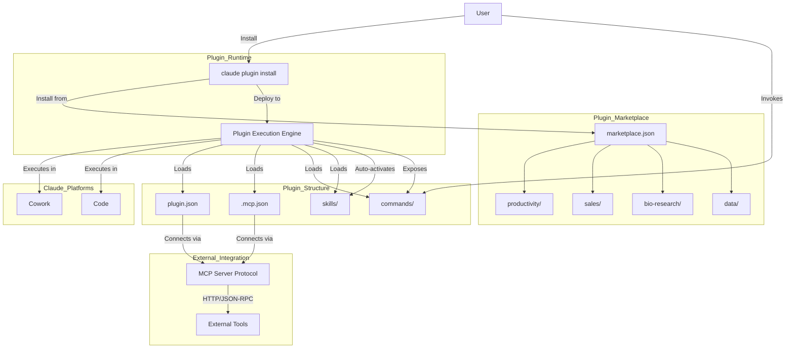
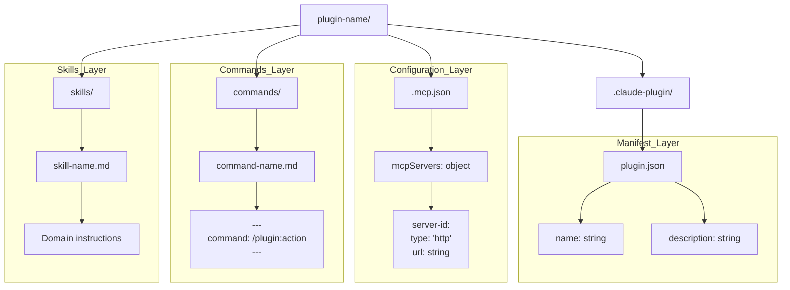
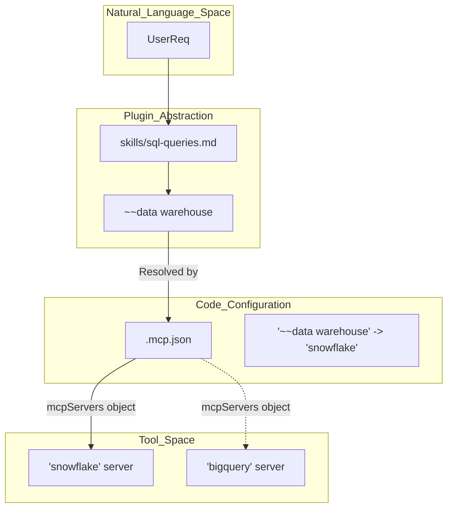

<!-- source: DeepWiki mcp.deepwiki.com · repo anthropics/knowledge-work-plugins · page 1.1 What are Knowledge Work Plugins? · fetched 2026-10-26 -->

# What are Knowledge Work Plugins?

Relevant source files

The following files were used as context for generating this wiki page:

- [README.md](README.md)
- [data/.mcp.json](data/.mcp.json)
- [data/CONNECTORS.md](data/CONNECTORS.md)

## Purpose and Scope

This page explains the concept of knowledge work plugins, their purpose in extending Claude's capabilities, and the overall system architecture. Knowledge work plugins are file-based extensions that transform Claude into a domain specialist for specific job functions, teams, and organizational workflows.

Sources: [README.md:1-10]()

## What are Knowledge Work Plugins?

A knowledge work plugin is a collection of markdown files and JSON configuration that gives Claude role-specific capabilities by providing:
- **Domain knowledge**: Skills that Claude draws on automatically when relevant [README.md:61]().
- **Tool connections**: Integration with external systems via MCP (Model Context Protocol) servers [README.md:63]().
- **Explicit commands**: Slash commands that users can invoke for specific workflows [README.md:62]().
- **Company-specific context**: Customizable instructions regarding terminology, processes, and organizational structure [README.md:72-73]().

Plugins are designed for non-technical customization—no code, no infrastructure, and no build steps are required. All plugin components are human-readable markdown and JSON files [README.md:65]().

Sources: [README.md:1-10](), [README.md:49-65]()

## Core Architecture

### System Overview

The plugin system operates within Claude's runtime environment (Claude Cowork or Claude Code) and follows a structured execution model.

**Diagram 1: Plugin System Architecture**

Sources: [README.md:3-47]()

### Plugin Lifecycle

1.  **Installation**: Users install plugins via `claude plugin install [name]@knowledge-work-plugins` [README.md:44]().
2.  **Activation**: Plugins activate automatically once installed [README.md:47]().
3.  **Skill Activation**: Skills fire automatically when relevant to the user's request [README.md:47](), [README.md:61]().
4.  **Command Invocation**: Users explicitly trigger commands like `/sales:call-prep` or `/data:write-query` [README.md:47](), [README.md:62]().
5.  **Tool Access**: When skills or commands need external data, they connect via MCP servers defined in configuration [README.md:63]().

Sources: [README.md:31-47](), [README.md:61-63]()

## Plugin Components

### File Structure and Code Entity Mapping

Every plugin follows a standardized directory layout that maps directly to Claude's execution logic.

**Diagram 2: Plugin Directory Structure (Code Entity Mapping)**

Sources: [README.md:51-59]()

### Component Definitions

| Component | File/Path | Role |
| :--- | :--- | :--- |
| **Manifest** | `.claude-plugin/plugin.json` | Defines metadata like `name` and `description` [README.md:55](). |
| **MCP Config** | `.mcp.json` | Maps tool connections to [MCP servers](https://modelcontextprotocol.io) [README.md:56](). |
| **Commands** | `commands/` | Explicit slash commands (e.g., `/data:analyze`) that users invoke [README.md:57](). |
| **Skills** | `skills/` | Domain expertise (e.g., `sql-queries`) Claude draws on automatically [README.md:58](). |

Sources: [README.md:49-63]()

## Connector System and Tool Abstraction

Plugins are **tool-agnostic**. They describe workflows in terms of abstract categories rather than specific products. This is achieved through a placeholder system.

**Diagram 3: Natural Language to Code Entity (Connectors)**

- **Placeholders**: Plugin files use `~~category` (e.g., `~~data warehouse`) as a placeholder for user-connected tools [data/CONNECTORS.md:5]().
- **Mapping**: The `.mcp.json` file resolves these placeholders to specific MCP server URLs and types [data/CONNECTORS.md:7](), [data/.mcp.json:1-36]().
- **Flexibility**: Users can swap a tool (e.g., from Snowflake to BigQuery) by updating the `mcpServers` object in `.mcp.json` without changing the underlying skill logic [README.md:71](), [data/.mcp.json:2-14]().

Sources: [data/CONNECTORS.md:1-17](), [data/.mcp.json:1-36](), [README.md:71]()

## Plugin Customization

Plugins are designed to be "generic starting points" that become powerful when customized for a specific company [README.md:69]().

- **Swap Connectors**: Edit `.mcp.json` to point at a specific tool stack, such as updating the `url` for `snowflake` or `databricks` [README.md:71](), [data/.mcp.json:3-10]().
- **Add Company Context**: Drop terminology, org structure, and processes into skill files within the `skills/` directory [README.md:72]().
- **Adjust Workflows**: Modify markdown instructions in `skills/` or `commands/` to match internal team procedures [README.md:73]().

Sources: [README.md:67-76](), [data/.mcp.json:1-36]()

---

