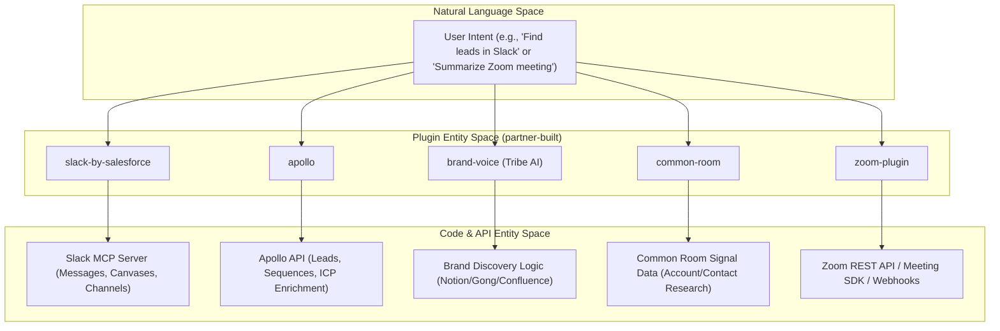

<!-- source: DeepWiki mcp.deepwiki.com · repo anthropics/knowledge-work-plugins · page 5 Partner-Built Plugins · fetched 2026-10-26 -->

# Partner-Built Plugins

Relevant source files

The following files were used as context for generating this wiki page:

- [partner-built/apollo/.claude-plugin/plugin.json](partner-built/apollo/.claude-plugin/plugin.json)
- [partner-built/brand-voice/.claude-plugin/plugin.json](partner-built/brand-voice/.claude-plugin/plugin.json)
- [partner-built/slack/.claude-plugin/plugin.json](partner-built/slack/.claude-plugin/plugin.json)

The Knowledge Work Plugins ecosystem includes a suite of high-quality integrations developed in collaboration with industry partners. These plugins extend Claude's capabilities into specific platforms like Slack, Apollo, Common Room, Zoom, and specialized brand management workflows. While core plugins focus on general business functions, partner-built plugins provide deep, first-party integrations with the tools teams use daily.

The marketplace manifest `[.claude-plugin/marketplace.json]()` defines these external contributions alongside internal plugins, often pointing to dedicated repositories or specific subdirectories within the `partner-built/` path.

### Partner Ecosystem Overview

The following diagram illustrates how partner-built plugins bridge the gap between Natural Language requests and specific third-party API entities.

**Partner Plugin Architecture Mapping**

Sources: [.claude-plugin/marketplace.json:88-154](), [partner-built/brand-voice/.claude-plugin/plugin.json:1-9](), [partner-built/apollo/.claude-plugin/plugin.json:1-12](), [partner-built/slack/.claude-plugin/plugin.json:1-11]()

---

### Brand Voice Plugin (Tribe AI)
Developed by **Tribe AI**, the Brand Voice plugin transforms scattered brand materials into enforceable AI guardrails. It performs "brand discovery" by scanning existing documentation and communication channels to distill a single source of truth for AI-generated content.

*   **Discovery**: Searches across Notion, Google Drive, Confluence, Gong, Slack, and meeting transcripts to identify brand signals [partner-built/brand-voice/.claude-plugin/plugin.json:4-4]().
*   **Enforcement**: Distills signals into guidelines that Claude applies to every piece of generated content to ensure consistency [partner-built/brand-voice/.claude-plugin/plugin.json:4-4]().

For details, see [Brand Voice Plugin (Tribe AI)](#5.1).

Sources: [.claude-plugin/marketplace.json:145-151](), [partner-built/brand-voice/.claude-plugin/plugin.json:1-9]()

---

### Slack and Apollo Partner Plugins
These plugins focus on communication and sales intelligence, providing direct hooks into the Salesforce and Apollo.io ecosystems.

*   **Slack (by Salesforce)**: The official Slack MCP server for interactive workflows. It allows Claude to surface insights, draft messages, and engage teams directly within Slack [partner-built/slack/.claude-plugin/plugin.json:2-3]().
*   **Apollo (by Apollo.io)**: Chains multiple Apollo APIs into complete sales workflows. Key features include contact enrichment from LinkedIn URLs, ICP-based prospecting in plain English, and loading contacts into sequences in a single step [partner-built/apollo/.claude-plugin/plugin.json:4-4]().

For details, see [Slack and Apollo Partner Plugins](#5.2).

Sources: [.claude-plugin/marketplace.json:88-95](), [.claude-plugin/marketplace.json:97-104](), [partner-built/slack/.claude-plugin/plugin.json:1-11](), [partner-built/apollo/.claude-plugin/plugin.json:1-12]()

---

### Common Room Plugin
The Common Room plugin transforms the platform into a GTM (Go-To-Market) copilot. It leverages Common Room's signal data to help sales and success teams research accounts and prepare for interactions.

*   **GTM Intelligence**: Automates account and contact research based on community and product signals [[.claude-plugin/marketplace.json:109-109]()].
*   **Outreach**: Assists in drafting personalized messages and preparing weekly briefs powered by signal data [[.claude-plugin/marketplace.json:109-109]()].

For details, see [Common Room Plugin](#5.3).

Sources: [.claude-plugin/marketplace.json:106-113]()

---

### Zoom Plugin
The Zoom partner plugin provides a comprehensive suite of integrations across the Zoom platform, including REST APIs, Meeting SDK, and Team Chat.

*   **Workflow Integration**: Supports over 15 slash workflows for planning and managing meetings.
*   **Internal Routing**: Includes specialized skills for internal routing and a deep reference library for Zoom-specific workflows.

For details, see [Zoom Plugin](#5.4).

Sources: [.claude-plugin/marketplace.json:153-154]()

---

### Marketplace Summary

| Plugin Name | Author | Primary Use Case |
| :--- | :--- | :--- |
| `slack-by-salesforce` | Salesforce | Team communication, message drafting, and interactive workflows. |
| `apollo` | Apollo.io | Lead enrichment, ICP prospecting, and sequence management. |
| `brand-voice` | Tribe AI | Multi-source brand discovery and AI content style enforcement. |
| `common-room` | Common Room | GTM intelligence, account research, and signal-based outreach. |
| `zoom-plugin` | Zoom | Meeting management, REST API integration, and Team Chat workflows. |

Sources: [.claude-plugin/marketplace.json:88-154](), [partner-built/brand-voice/.claude-plugin/plugin.json:1-9](), [partner-built/apollo/.claude-plugin/plugin.json:1-12](), [partner-built/slack/.claude-plugin/plugin.json:1-11]()

---

