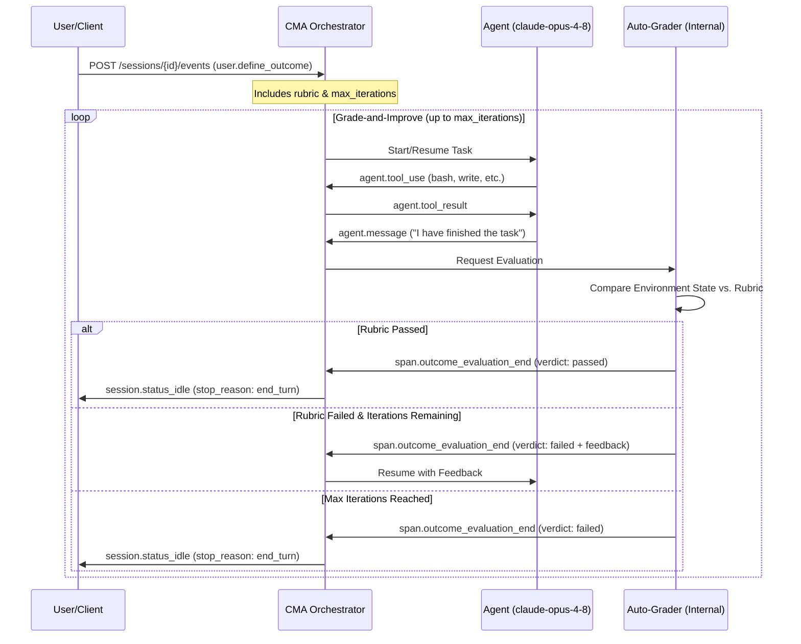
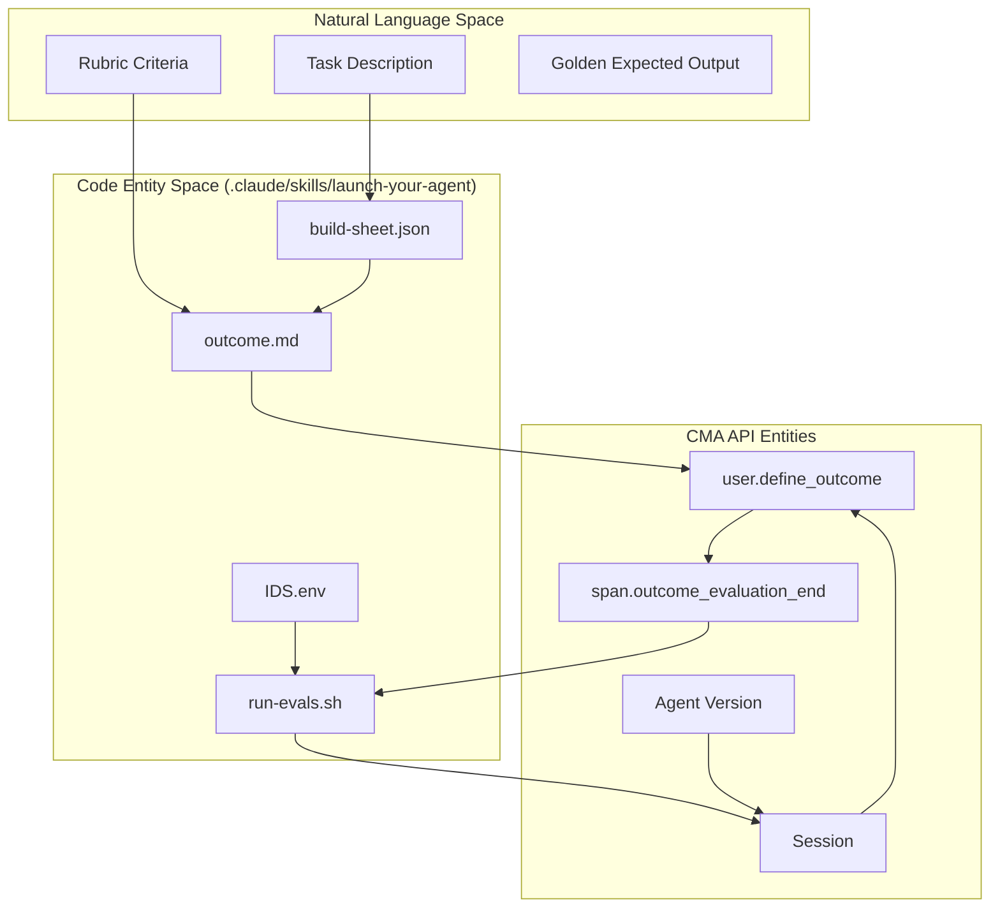

<!-- source: DeepWiki mcp.deepwiki.com · repo anthropics/launch-your-agent · page 2.2 Outcomes, Evals & the Grade-and-Improve Loop · fetched 2026-10-26 -->

# Outcomes, Evals & the Grade-and-Improve Loop

<details>
<summary>Relevant source files</summary>

The following files were used as context for generating this wiki page:

- [.claude/skills/launch-your-agent/references/build-sheet.example.json](.claude/skills/launch-your-agent/references/build-sheet.example.json)
- [.claude/skills/launch-your-agent/references/cma-api.md](.claude/skills/launch-your-agent/references/cma-api.md)
- [cma-primitives.md](cma-primitives.md)

</details>


This page details the mechanisms for defining success, automated grading, and systematic evaluation within the Claude Managed Agents (CMA) framework. It covers the `Outcome` primitive, the execution loop that drives an agent toward a defined rubric, and the regression testing infrastructure provided by the `launch-your-agent` skill.

## The Outcome Primitive

The `Outcome` is a high-level CMA primitive that transforms a standard session into an objective-driven execution loop. Instead of a single turn, the agent is given a task, a rubric, and a retry budget.

### user.define_outcome
To initiate an objective-driven run, a `user.define_outcome` event is sent to a session [[cma-primitives.md:81-81]()] [[.claude/skills/launch-your-agent/references/cma-api.md:111-115]()]. This event contains three key components:

1.  **Description**: The high-level task the agent must perform (e.g., "Produce this week's competitor digest") [[.claude/skills/launch-your-agent/references/build-sheet.example.json:21-21]()].
2.  **Rubric**: A structured set of criteria used by the auto-provisioned grader to evaluate the agent's work [[.claude/skills/launch-your-agent/references/build-sheet.example.json:22-28]()].
3.  **Max Iterations**: The number of "Grade-and-Improve" cycles allowed before the session terminates [[.claude/skills/launch-your-agent/references/build-sheet.example.json:29-29]()].

### The Auto-Provisioned Grader
When an outcome is defined, CMA automatically provisions a background grader (typically an Opus-class model) that is independent of the agent performing the task. This grader:
*   Monitors the agent's progress and tool outputs.
*   Evaluates the final state of the environment (e.g., checking files in `/mnt/session/outputs/`) against the rubric.
*   Issues a verdict: `passed` or `failed`.
*   Provides feedback to the agent if the verdict is `failed`, triggering a new iteration.

### Data Flow: Outcome Execution Loop

The following diagram illustrates the lifecycle of a session driven by the `user.define_outcome` primitive.

**Outcome Execution Lifecycle**

**Sources:** [[cma-primitives.md:81-81](), [.claude/skills/launch-your-agent/references/cma-api.md:111-120](), [.claude/skills/launch-your-agent/references/build-sheet.example.json:20-30]()]

---

## Evals Sub-system & Regression Testing

The `launch-your-agent` skill implements a systematic evaluation framework to ensure agent quality and prevent regressions during version promotion.

### Golden Sets and Eval Cases
Evaluation cases are defined in the `build-sheet.json` under the `evals` key [[.claude/skills/launch-your-agent/references/build-sheet.example.json:68-75]()].
*   **Input**: A directory or set of files representing the starting state for the test (e.g., `evals/week-of-may-25/`).
*   **Expected**: The "Golden" output (e.g., a hand-written digest) used to measure success [[.claude/skills/launch-your-agent/references/build-sheet.example.json:70-72]()].
*   **Verdict**: The result of the last evaluation run against a specific agent version.

### run-evals.sh
The repository provides a standard script, `run-evals.sh`, to automate the execution of these cases [[.claude/skills/launch-your-agent/references/build-sheet.example.json:103-103]()]. This script:
1.  Iterates through all defined cases in the `evals/` directory.
2.  Creates a fresh `Session` for each case.
3.  Injects the case-specific input files into the session sandbox.
4.  Sends a `user.define_outcome` event using the production rubric.
5.  Collects the `span.outcome_evaluation_end` results and reports a pass/fail summary.

### The Version Promotion Loop
The "Grade-and-Improve" loop occurs at two levels:
1.  **Inner Loop (Automatic)**: The CMA grader drives the agent through iterations within a single session based on the rubric [[.claude/skills/launch-your-agent/references/build-sheet.example.json:77-77]()].
2.  **Outer Loop (Manual/Dev)**: The developer modifies the `Agent` (system prompt, tools) or the `Rubric`, runs `run-evals.sh`, and only promotes the agent version to the production `Deployment` once all eval cases pass [[.claude/skills/launch-your-agent/references/build-sheet.example.json:101-104]()].

**Code Entity Mapping: Eval Sub-system**

**Sources:** [[.claude/skills/launch-your-agent/references/build-sheet.example.json:20-30, 68-75, 101-104](), [.claude/skills/launch-your-agent/references/cma-api.md:22-26, 111-120]()]

---

## Technical Implementation Details

### Outcome Event Schema
When constructing the `user.define_outcome` event, the skill utilizes `jq` to safely embed the rubric text into the JSON payload:

```bash
# Example from cma-api.md
EVT=$(jq -n --rawfile task first_prompt.txt --rawfile rubric outcome.md \
  '{type:"user.define_outcome", description:$task, \
    rubric:{type:"text", content:$rubric}, max_iterations:3}')
```
**Sources:** [[.claude/skills/launch-your-agent/references/cma-api.md:113-115]()]

### Monitoring Results
To programmatically determine if an outcome was successful, the client must poll the session or listen to the SSE stream for the `span.outcome_evaluation_end` event.

| Field | Description |
| :--- | :--- |
| `verdict` | `passed` or `failed`. |
| `reasoning` | The grader's explanation for the verdict, citing specific rubric points. |
| `iteration` | The current iteration count (1 to `max_iterations`). |

**Sources:** [[cma-primitives.md:89-89](), [.claude/skills/launch-your-agent/references/cma-api.md:105-105]()]

### Regression Testing Workflow
1.  **Modify Agent**: Update the system prompt or tools via `POST /v1/agents/{id}` [[.claude/skills/launch-your-agent/references/cma-api.md:47-52]()].
2.  **Capture Version**: Note the new `AGENT_VERSION` returned by the API [[.claude/skills/launch-your-agent/references/cma-api.md:53-53]()].
3.  **Run Evals**: Execute `./evals/run-evals.sh`. This script creates sessions pinned to the new version [[.claude/skills/launch-your-agent/references/cma-api.md:101-101]()].
4.  **Analyze Verdicts**: If `span.outcome_evaluation_end` returns `passed` for all cases, the version is considered stable.
5.  **Promote**: Update the production `Deployment` to use the new `agent_version` [[.claude/skills/launch-your-agent/references/build-sheet.example.json:103-104]()].

**Sources:** [[.claude/skills/launch-your-agent/references/cma-api.md:47-53, 101-101](), [.claude/skills/launch-your-agent/references/build-sheet.example.json:101-104]()]

---

