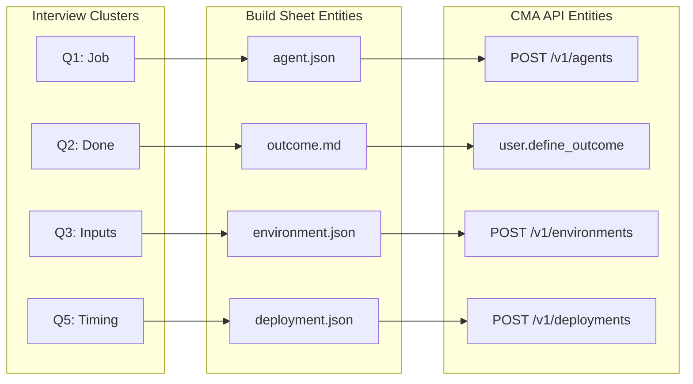

<!-- source: DeepWiki mcp.deepwiki.com · repo anthropics/launch-your-agent · page 3.1 Phase 1 — Interview & Scoping · fetched 2026-10-26 -->

# Phase 1 — Interview & Scoping

<details>
<summary>Relevant source files</summary>

The following files were used as context for generating this wiki page:

- [.claude/skills/launch-your-agent/SKILL.md](.claude/skills/launch-your-agent/SKILL.md)
- [.claude/skills/launch-your-agent/references/interview.md](.claude/skills/launch-your-agent/references/interview.md)
- [CLAUDE.md](CLAUDE.md)

</details>


Phase 1 is the discovery and configuration engine of the `launch-your-agent` skill. It facilitates an iterative, technical dialogue designed to map a founder's intent to specific **Claude Managed Agents (CMA)** primitives. Rather than using a static form, the process uses a series of "question clusters" that populate a `build-sheet.json` file, which serves as the source of truth for the subsequent building and launching phases.

## The Interview Logic

The interview follows the "Open light, boundaries in context" principle [ .claude/skills/launch-your-agent/SKILL.md:21-21](). It begins with a warm welcome and 2–3 concrete archetypes from the `examples-bank.md` to ground the conversation [ .claude/skills/launch-your-agent/SKILL.md:21-21]().

### Iterative Clustering
To avoid overwhelming the user, the skill never asks the entire questionnaire upfront. It uses `AskUserQuestion` to present enumerable choices (e.g., model selection, schedule times, or connector types) and limits itself to at most one open-ended question per turn [ .claude/skills/launch-your-agent/SKILL.md:25-25]().

### Data Flow: Natural Language to Build Sheet
As the user provides answers, the skill performs a mapping exercise [ .claude/skills/launch-your-agent/references/interview.md:11-11]().

| User Input Area | Targeted CMA Primitive | `build-sheet.json` Field |
| :--- | :--- | :--- |
| Who the agent is / Job description | **Agent** | `agent.name`, `agent.system_summary` |
| What "done" looks like | **Outcome** | `outcome.description`, `outcome.rubric_criteria` |
| Software dependencies | **Environment** | `environment.packages` |
| When it runs | **Session / Deployment** | `schedule.cron` |
| External data/logins | **Vault / MCP / Memory** | `connections.mcp_servers`, `memory` |

**Sources:** [ .claude/skills/launch-your-agent/references/interview.md:13-24](), [ .claude/skills/launch-your-agent/references/interview.md:32-35]()

---

## Question Clusters (Q1–Q8)

The interview is organized into eight logical clusters. The skill starts with defaults (e.g., Opus-class model, cloud environment) and only probes for deeper configuration if the job requires it [ .claude/skills/launch-your-agent/references/interview.md:26-26]().

1.  **Q1: The Job (Agent)** – Identifying the core persona and system instructions.
2.  **Q2: Definition of Done (Outcome)** – Defining the success criteria for the `user.define_outcome` event [ .claude/skills/launch-your-agent/references/interview.md:50-50]().
3.  **Q3: Inputs & Tools (Environment/MCP)** – Determining what the agent needs to read and what packages (Python/Node) must be in the container [ .claude/skills/launch-your-agent/references/interview.md:47-47]().
4.  **Q4: Outputs & Skills (Skills/Custom Tools)** – Deciding if the agent produces specialized files (xlsx, pdf) or needs to trigger external webhooks [ .claude/skills/launch-your-agent/references/interview.md:43-45]().
5.  **Q5: Trigger (Session/Deployment)** – Deciding between on-demand runs or a recurring cron schedule [ .claude/skills/launch-your-agent/references/interview.md:53-53]().
6.  **Q6: Boundaries (Permissions)** – Establishing "never-dos" and networking allowlists [ .claude/skills/launch-your-agent/references/interview.md:21-21]().
7.  **Q7: Memory (Memory Store)** – Determining if the agent needs to persist state across sessions [ .claude/skills/launch-your-agent/references/interview.md:52-52]().
8.  **Q8: Architecture (Multi-Agent/Model)** – Selecting the model (Opus vs Sonnet) or upgrading to a coordinator+roster pattern if the task is sufficiently complex [ .claude/skills/launch-your-agent/references/interview.md:46-46]().

**Sources:** [ .claude/skills/launch-your-agent/references/interview.md:41-57]()

---

## Technical Implementation: Mapping to Code Entities

The following diagrams illustrate how the interview process bridges the gap between the user's natural language descriptions and the underlying code structures and CMA primitives.

### Diagram 1: Scoping Logic & State Accumulation
This diagram shows how the `launch-your-agent` skill processes user input to populate the `build-sheet.json`.

```mermaid
graph TD
    subgraph "Natural Language Space"
        User["User Input (Technical Founder)"]
        Archetypes["examples-bank.md"]
    end

    subgraph "Skill Logic (.claude/skills/launch-your-agent)"
        Skill["SKILL.md (Phase 1 Logic)"]
        InterviewRef["references/interview.md"]
        AskUser["AskUserQuestion (Tool)"]
    end

    subgraph "Code Entity Space (State)"
        BuildSheet["build-sheet.json"]
        NextDirs["NEXT-DIRECTIONS.md"]
    end

    User -->| "Describes Agent Job" | Skill
    Archetypes -->| "Grounds Conversation" | Skill
    Skill -->| "Iterative Probing" | AskUser
    AskUser -->| "Enumerable Choices" | User
    Skill -->| "Maps to Primitives" | InterviewRef
    InterviewRef -->| "Update Schema" | BuildSheet
    Skill -->| "Defer to v1/v2" | NextDirs
```
**Sources:** [ .claude/skills/launch-your-agent/SKILL.md:21-25](), [ .claude/skills/launch-your-agent/references/interview.md:11-11](), [ .claude/skills/launch-your-agent/references/interview.md:31-31]()

### Diagram 2: Primitive Mapping Table
This diagram maps the specific clusters and decisions to the CMA API entities that will be invoked in Phase 2.


**Sources:** [ .claude/skills/launch-your-agent/references/interview.md:39-57](), [ .claude/skills/launch-your-agent/SKILL.md:32-32]()

---

## Connector Strategy: Mocking vs. Wiring

A key decision in Phase 1 is whether to wire a real connector (e.g., Slack, Gmail) or mock it. Because delivery connectors require complex setup (OAuth, Vaults, Webhooks), the skill defaults to **Mock-in-v0** [ .claude/skills/launch-your-agent/SKILL.md:29-29]().

*   **Mocking:** The agent produces schema-true payloads in an "outbox" directory (`/mnt/session/outputs/outbox/`) or uses a custom tool that acts as a stub [ .claude/skills/launch-your-agent/references/interview.md:69-69]().
*   **Wiring:** If the founder has credentials ready, the skill pulls documentation for the specific MCP server and stages the `vault` configuration [ .claude/skills/launch-your-agent/SKILL.md:29-29]().

**Sources:** [ .claude/skills/launch-your-agent/SKILL.md:29-29](), [ .claude/skills/launch-your-agent/references/interview.md:69-69]()

## Output Artifacts of Phase 1

By the end of the interview, the skill has generated or updated:
1.  `build-sheet.json`: The machine-readable plan [ .claude/skills/launch-your-agent/references/interview.md:11-11]().
2.  `NEXT-DIRECTIONS.md`: A list of deferred features (v1, v2) to ensure the founder knows "not now" means "next" [ .claude/skills/launch-your-agent/SKILL.md:31-31]().
3.  **Credential Heads-up**: A notification of which API keys or tokens will be needed for Phase 2 [ .claude/skills/launch-your-agent/SKILL.md:28-28]().

**Sources:** [ .claude/skills/launch-your-agent/SKILL.md:28-31](), [ .claude/skills/launch-your-agent/references/interview.md:11-11]()

---

