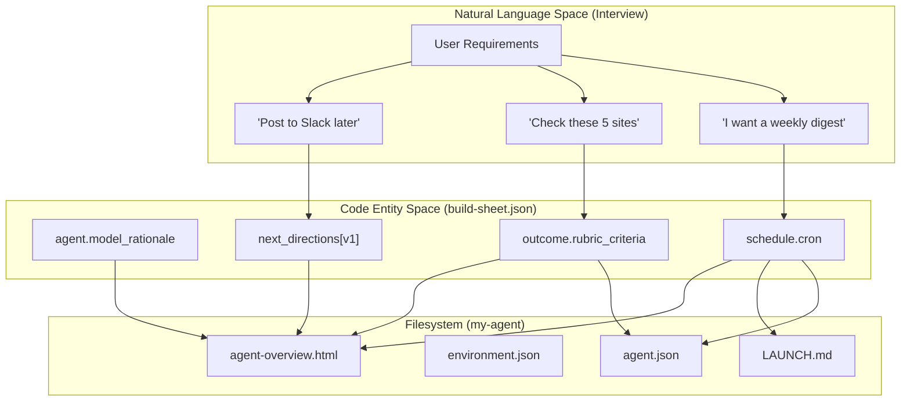
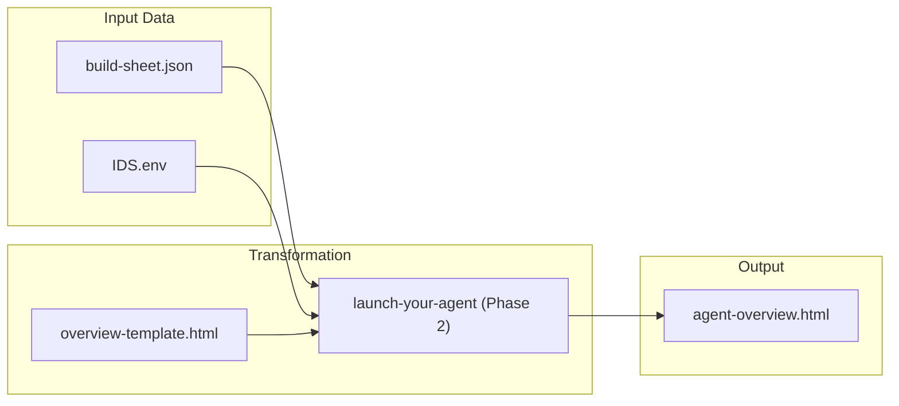

<!-- source: DeepWiki mcp.deepwiki.com · repo anthropics/launch-your-agent · page 3.2 Phase 2 — Briefing & Staging · fetched 2026-10-26 -->

# Phase 2 — Briefing & Staging

Relevant source files

The following files were used as context for generating this wiki page:

- [.claude/skills/launch-your-agent/SKILL.md](.claude/skills/launch-your-agent/SKILL.md)
- [.claude/skills/launch-your-agent/references/build-sheet.example.json](.claude/skills/launch-your-agent/references/build-sheet.example.json)
- [.claude/skills/launch-your-agent/references/overview-template.html](.claude/skills/launch-your-agent/references/overview-template.html)
- [CLAUDE.md](CLAUDE.md)

The Briefing & Staging phase serves as the bridge between the conceptual interview and the technical execution. During this phase, the skill synthesizes the gathered requirements into a "CMA-shaped brief" and simultaneously prepares the local filesystem with a complete build kit. This phase is designed to be highly efficient, using parallel processing where the agent prepares the environment while the user performs credential-gathering tasks.

## The CMA-Shaped Brief

Before any code is executed or agents are provisioned, the skill presents a formal brief for user approval. This brief translates the natural language requirements into specific Claude Managed Agents (CMA) primitives.

### Primitives Table
The brief begins with a table mapping the agent's requirements to CMA technical entities:
*   **Agent (🤖):** Model selection (defaulting to Opus-class) and system instructions [CLAUDE.md:20-20]().
*   **Environment (📦):** Networking and package requirements [references/build-sheet.example.json:54-60]().
*   **Outcome (🎯):** The `user.define_outcome` definition, rubric, and iteration bounds [references/build-sheet.example.json:20-30]().
*   **Schedule (🗓️):** Cron expressions and timezones for the Deployment primitive [references/build-sheet.example.json:61-67]().
*   **Memory (🧠):** Persistence configuration and store names [references/build-sheet.example.json:45-53]().

### Versioning (v1/v2) Section
The skill maintains an iterative lens by scoping the smallest viable agent (v0) and explicitly deferring complex features to a numbered sequence (v1, v2, etc.) in the brief and the `NEXT-DIRECTIONS.md` file [.claude/skills/launch-your-agent/SKILL.md:27-27]().

### Eval Table
A golden set of evaluation cases is established. Case 1 is typically the build input, while subsequent cases are held back for regression testing [.claude/skills/launch-your-agent/SKILL.md:29-29]().

**Sources:** [.claude/skills/launch-your-agent/SKILL.md:27-32](), [CLAUDE.md:20-27](), [references/build-sheet.example.json:1-107]()

---

## Parallel Credential Handling

To minimize downtime, the skill uses a "grab these while I stage" pattern. As soon as a design choice makes a credential (like an API key or Slack webhook) inevitable, the skill provides a table with direct links to the provider's credential pages [.claude/skills/launch-your-agent/SKILL.md:28-28]().

### Implementation Logic
1.  **Check Environment:** The skill first checks the shell for an existing `ANTHROPIC_API_KEY` [.claude/skills/launch-your-agent/SKILL.md:30-30]().
2.  **Staging:** While the user fetches keys, the skill proceeds to create the `my-agent/` directory and populate it with non-sensitive configuration files [.claude/skills/launch-your-agent/SKILL.md:28-28]().
3.  **Isolation:** Credentials are never requested in the chat. They are placed in `my-agent/.env` (chmod 600) which is ignored by git [.claude/skills/launch-your-agent/SKILL.md:30-30]().

**Sources:** [.claude/skills/launch-your-agent/SKILL.md:28-30](), [CLAUDE.md:24-24]()

---

## The Build Kit Directory Structure

The skill generates a standardized directory, `my-agent/`, which contains all the artifacts necessary to launch, manage, and iterate on the agent.

### Generated Files
| File | Purpose |
| :--- | :--- |
| `agent.json` | The JSON payload for `POST /v1/agents`, containing `model` and `system_instructions`. |
| `environment.json` | Configuration for the sandboxed runtime (packages, networking). |
| `outcome.md` | The definition of done and rubric for the `user.define_outcome` tool call. |
| `LAUNCH.md` | Step-by-step instructions and raw `curl` commands for manual intervention. |
| `agent-overview.html` | A locally rendered dashboard showing the agent's "live schema". |
| `build-sheet.json` | The internal source of truth for the skill's state. |

**Sources:** [CLAUDE.md:9-16](), [references/build-sheet.example.json:1-107]()

---

## Technical Data Flow: From Brief to Staging

The following diagram illustrates how the natural language interview results are transformed into technical entities and local files.

### Mapping Interview to Code Entities
"Mapping Natural Language Space to Code Entity Space"

**Sources:** [.claude/skills/launch-your-agent/SKILL.md:25-32](), [references/build-sheet.example.json:1-107]()

---

## Generation of the Agent Overview

The `agent-overview.html` is a key artifact generated during Phase 2 and updated in later phases. It is created by populating the `overview-template.html` with data from `build-sheet.json` [CLAUDE.md:30-30]().

### Visualization Components
*   **Warm-Light Schematic:** The layout visualizes the flow from Trigger (Schedule/Kickoff) → Worker (Agent in Environment) → Output (Outcome & Grading) [references/overview-template.html:53-60]().
*   **Primitive Recap:** A table mapping every configured CMA primitive to its live ID and status [references/overview-template.html:102-110]().
*   **Version Rail:** Displays the current version and planned increments from `NEXT-DIRECTIONS.md` [references/overview-template.html:112-120]().

### Implementation: Overview Generation
The skill (and later the `/wrap-up` skill) reads the `build-sheet.json` and uses Bash to perform string replacements or DOM manipulations on `overview-template.html` to produce the final `agent-overview.html` [.claude/skills/wrap-up/SKILL.md:16-16]().

**Sources:** [references/overview-template.html:1-125](), [CLAUDE.md:30-30](), [.claude/skills/launch-your-agent/SKILL.md:32-32]()

---

