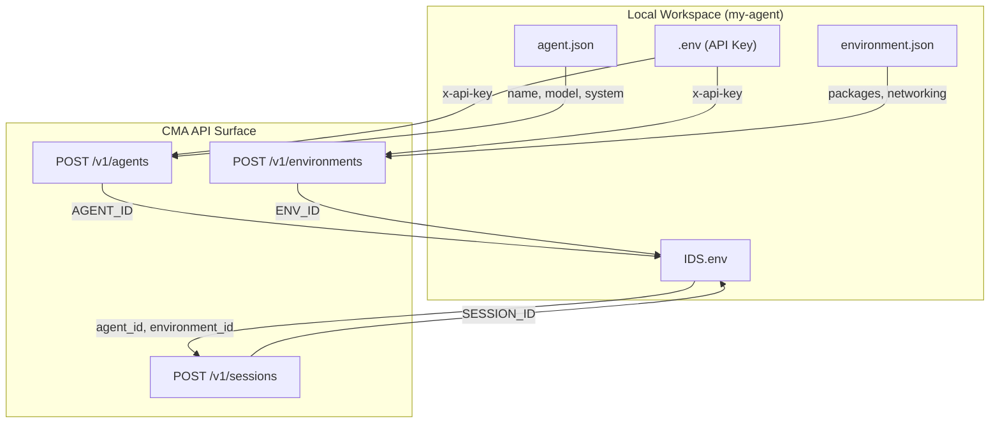
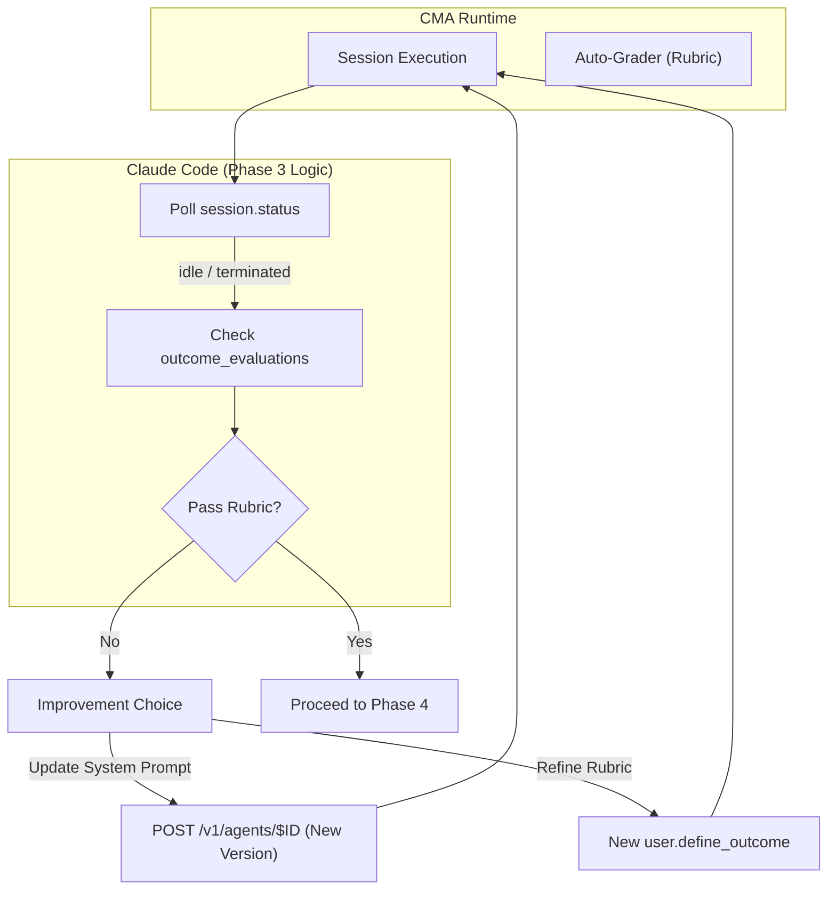

<!-- source: DeepWiki mcp.deepwiki.com · repo anthropics/launch-your-agent · page 3.3 Phase 3 — Launch & Grade · fetched 2026-10-26 -->

# Phase 3 — Launch & Grade

Relevant source files

The following files were used as context for generating this wiki page:

- [.claude/skills/launch-your-agent/SKILL.md](.claude/skills/launch-your-agent/SKILL.md)
- [.claude/skills/launch-your-agent/references/cma-api.md](.claude/skills/launch-your-agent/references/cma-api.md)
- [CLAUDE.md](CLAUDE.md)

Phase 3 is the execution stage of the `launch-your-agent` skill. It transitions from static configuration files to live API orchestration, managing the sequence of object creation, session execution, and iterative grading. The phase focuses on idempotency to handle potential failures and a tight feedback loop using the CMA Outcome primitive to verify the agent's performance against the user's rubric.

## Resumable Launch Sequence

The launch process is designed to be resumable and idempotent. It relies on `IDS.env` to track created resources, ensuring that a failed step can be re-run without creating duplicate agents or environments [ .claude/skills/launch-your-agent/references/cma-api.md:22-26]().

### Idempotency Logic
1.  **Environment Check**: Before creation, the skill checks `IDS.env` for `ENV_ID`. If missing, it creates a cloud environment with the specified networking and package configuration [ .claude/skills/launch-your-agent/references/cma-api.md:79-84]().
2.  **Agent Creation**: Checks for `AGENT_ID`. If missing, it POSTs to `/v1/agents` using `agent.json`. The response `id` and `version` (initially 1) are persisted [ .claude/skills/launch-your-agent/references/cma-api.md:35-46]().
3.  **Session Provisioning**: Creates a session tied to the `AGENT_ID` and `ENV_ID`. Sessions start in an `idle` status [ .claude/skills/launch-your-agent/references/cma-api.md:92-104]().

### Launch Flow (Code Space)
The following diagram illustrates the transition from local files to CMA API entities.

**Diagram: File-to-API Mapping**

Sources: [ .claude/skills/launch-your-agent/references/cma-api.md:13-26](), [ .claude/skills/launch-your-agent/references/cma-api.md:35-46](), [ .claude/skills/launch-your-agent/references/cma-api.md:79-84](), [ .claude/skills/launch-your-agent/references/cma-api.md:92-100]().

## The Execution Loop

Once a session is created, the skill initiates the work using an **Outcome Kickoff**. This combines the task description, the rubric, and the iteration budget into a single `user.define_outcome` event [ .claude/skills/launch-your-agent/references/cma-api.md:111-115]().

### Kickoff and Polling
-   **Kickoff**: The skill reads `kickoff.json` (or `first_prompt.txt` and `outcome.md`) and POSTs the event to the session [ .claude/skills/launch-your-agent/references/cma-api.md:113-116]().
-   **Polling**: The skill monitors session status via `GET /v1/sessions/$SESSION_ID`. It looks for status transitions from `running` to `idle` (waiting for user input/grading) or `terminated` [ .claude/skills/launch-your-agent/references/cma-api.md:104-105]().
-   **SSE Streaming**: For real-time feedback, the skill can consume the Server-Sent Events (SSE) stream at `/v1/sessions/$SESSION_ID/events`, filtering for `agent.message` and `agent.thought` [ .claude/skills/launch-your-agent/references/cma-api.md:120-125]().

### Implementation Details
| Step | Code/Action | Purpose |
| :--- | :--- | :--- |
| **Start** | `user.define_outcome` | Sets the goal and the `max_iterations` (default: 3) [ .claude/skills/launch-your-agent/SKILL.md:27](). |
| **Observe** | `GET /v1/sessions/$SESSION_ID` | Checks `.status` and `.usage` [ .claude/skills/launch-your-agent/references/cma-api.md:105](). |
| **Verify** | Python Parser | Used to extract IDs from JSON responses safely, avoiding `jq` issues with newlines in system prompts [ .claude/skills/launch-your-agent/references/cma-api.md:22-26](). |

Sources: [ .claude/skills/launch-your-agent/SKILL.md:27](), [ .claude/skills/launch-your-agent/references/cma-api.md:104-105](), [ .claude/skills/launch-your-agent/references/cma-api.md:111-125]().

## Grading and Iteration Logic

The "Grade" portion of Phase 3 uses the auto-provisioned grader within CMA. When the agent completes a run, the platform evaluates the output against the provided rubric [ .claude/skills/launch-your-agent/references/cma-api.md:111-114]().

### First-Iteration Verification
The skill must verify the first iteration's output before backgrounding long-running tasks [ .claude/skills/launch-your-agent/SKILL.md:26](). This ensures the agent understood the initial task and the environment is correctly configured (e.g., tools are accessible).

### Iteration Strategies
If the grade is insufficient, the skill guides the user through three potential fixes:
1.  **Rubric Tweaks**: Adjusting the `outcome.md` to be more specific about requirements.
2.  **Agent Version Bumps**: Updating `agent.json` (system prompt or tools) and POSTing an update to the agent. This increments the `AGENT_VERSION` in `IDS.env` [ .claude/skills/launch-your-agent/references/cma-api.md:47-53]().
3.  **Regression Testing**: Before promoting a new agent version to a production deployment, the user is encouraged to run `run-evals.sh` against a "golden set" of test cases [ CLAUDE.md:29]().

**Diagram: Grading & Improvement Loop**

Sources: [ .claude/skills/launch-your-agent/SKILL.md:27](), [ .claude/skills/launch-your-agent/references/cma-api.md:47-53](), [ .claude/skills/launch-your-agent/references/cma-api.md:105](), [ .claude/skills/launch-your-agent/references/cma-api.md:111-116](), [ CLAUDE.md:29]().

## Regression Testing with `run-evals.sh`

For agents intended for production (Scheduled Deployments), Phase 3 introduces regression testing.
-   **Golden Sets**: The founder's real past cases are stored as a golden set. If no cases exist, the first successful run's output is saved as the first test case [ CLAUDE.md:29]().
-   **Evaluation Script**: `run-evals.sh` automates the process of running a new agent version against these cases to ensure no regressions occurred before the version is promoted to the deployment [ CLAUDE.md:29]().

Sources: [ CLAUDE.md:29]().

---

