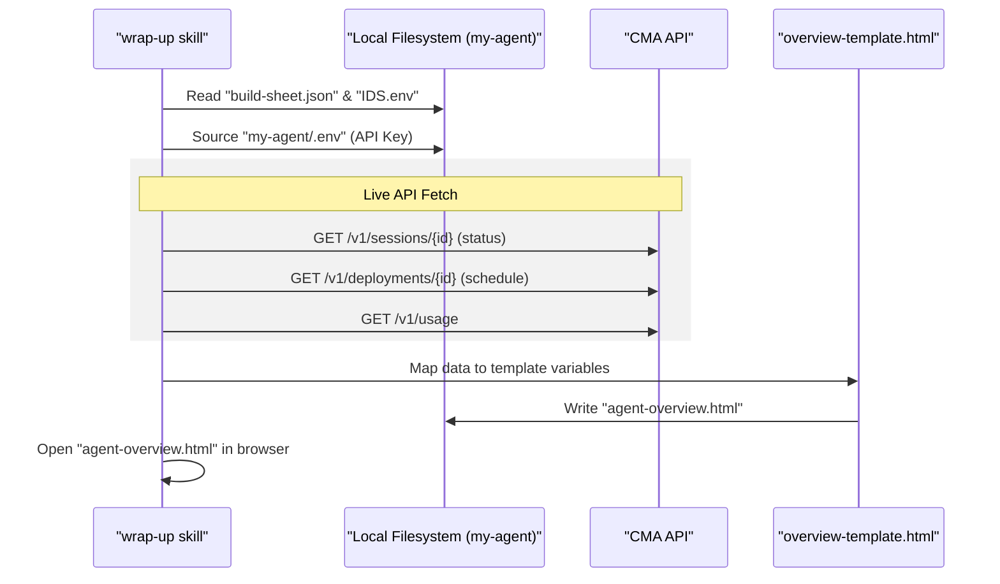
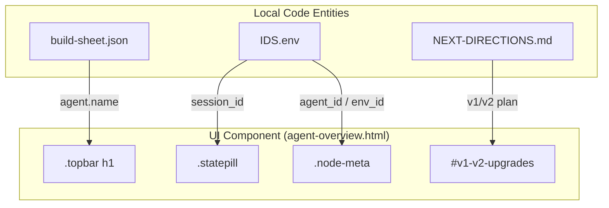

<!-- source: DeepWiki mcp.deepwiki.com · repo anthropics/launch-your-agent · page 4.1 Live State Refresh & Overview Regeneration · fetched 2026-10-26 -->

# Live State Refresh & Overview Regeneration

Relevant source files

The following files were used as context for generating this wiki page:

- [.claude/skills/launch-your-agent/references/overview-template.html](.claude/skills/launch-your-agent/references/overview-template.html)
- [.claude/skills/wrap-up/SKILL.md](.claude/skills/wrap-up/SKILL.md)
- [ui/agent-overview-example.html](ui/agent-overview-example.html)

The `wrap-up` skill performs a final state synchronization between the local project files and the live Claude Managed Agents (CMA) platform. This process reconciles the intent captured in the `build-sheet.json` with the actual deployed infrastructure, generating a visual `agent-overview.html` artifact that serves as the primary handoff for the user.

## Implementation Overview

The regeneration process is triggered by the `/wrap-up` command or automatically at the conclusion of a `/launch-your-agent` session [.claude/skills/wrap-up/SKILL.md:3-3](). It follows a strict sequence of reading local state, querying the CMA API, and populating a pre-defined HTML template.

### Data Flow: From CMA API to Overview Artifact

The skill aggregates data from multiple sources to construct the final view:

1.  **Local Configuration**: Reads `build-sheet.json` for the original design intent and `IDS.env` for the resource identifiers (Agent ID, Environment ID, etc.) [.claude/skills/wrap-up/SKILL.md:19-19]().
2.  **Live State Query**: If an `ANTHROPIC_API_KEY` is present in `my-agent/.env`, the skill performs a series of API calls to fetch real-time statuses [.claude/skills/wrap-up/SKILL.md:20-20]().
3.  **Template Injection**: The gathered data is injected into `overview-template.html` to create a customized `agent-overview.html` [.claude/skills/wrap-up/SKILL.md:28-28]().

### CMA State Reconciliation Logic
| Data Point | Source | Code Entity / API Endpoint |
| :--- | :--- | :--- |
| **Session Status** | CMA API | `session.status` [.claude/skills/wrap-up/SKILL.md:20-20]() |
| **Evaluation Results** | CMA API | `outcome_evaluations[]` [.claude/skills/wrap-up/SKILL.md:20-20]() |
| **Deployment Health** | CMA API | `deployment.status` [.claude/skills/wrap-up/SKILL.md:20-20]() |
| **Upcoming Runs** | CMA API | `schedule.upcoming_runs_at` [.claude/skills/wrap-up/SKILL.md:20-20]() |
| **Resource Usage** | CMA API | `usage` [.claude/skills/wrap-up/SKILL.md:20-20]() |

**Sources:** [.claude/skills/wrap-up/SKILL.md:17-23](), [.claude/skills/launch-your-agent/references/overview-template.html:1-50]()

---

## Technical Process Diagram: Live Refresh

The following diagram illustrates how the `wrap-up` skill bridges the local filesystem and the remote CMA environment.

### Live State Refresh Sequence

**Sources:** [.claude/skills/wrap-up/SKILL.md:17-28](), [.claude/skills/launch-your-agent/references/overview-template.html:52-70]()

---

## Overview Regeneration

The `agent-overview.html` is generated from a "warm paper" palette template designed to visualize the agent's pipeline [.claude/skills/launch-your-agent/references/overview-template.html:11-22]().

### Template Components
The template uses specific CSS classes and data attributes to represent CMA primitives:

*   **Top Bar (`.topbar`)**: Displays the agent name, a "Live" or "Planned" status pill, and usage statistics [.claude/skills/launch-your-agent/references/overview-template.html:27-47]().
*   **Pipeline Grid (`.pipeline`)**: A three-column grid (Trigger → Worker → Output) that visualizes the flow of data [.claude/skills/launch-your-agent/references/overview-template.html:53-53]().
*   **Environment Frame (`.env-frame`)**: A dashed container representing the sandboxed runtime, containing the agent and its attached tools/connections [.claude/skills/launch-your-agent/references/overview-template.html:89-90]().
*   **Run Log**: A table populated with the results of `outcome_evaluations`, showing the rubric version and the final verdict [.claude/skills/wrap-up/SKILL.md:29-29]().

### Code-to-UI Mapping
This diagram maps internal CMA primitives and file references to their visual representations in the generated HTML.

### Primitive-to-UI Association

**Sources:** [.claude/skills/wrap-up/SKILL.md:19-30](), [.claude/skills/launch-your-agent/references/overview-template.html:27-70](), [ui/agent-overview-example.html:27-70]()

---

## Key Functions & Logic

### API Interaction
The skill uses Python scripts (parsed with `strict=False`) to interact with the CMA API endpoints [.claude/skills/wrap-up/SKILL.md:20-20](). This ensures that even if the API introduces new fields, the regeneration process does not break.

### Idempotency
The `wrap-up` skill is designed to be idempotent. Running the command multiple times simply refreshes the `agent-overview.html` with the latest live data from the CMA platform and any local changes to `NEXT-DIRECTIONS.md` [.claude/skills/wrap-up/SKILL.md:36-36]().

### Artifact Delivery
The final step of the process is the browser launch. The skill is instructed to **open the overview page in the browser** as the primary closing artifact [.claude/skills/wrap-up/SKILL.md:28-28](). This provides the user with a "Live Console" view that links directly to the Anthropic Console for deep-link management.

**Sources:** [.claude/skills/wrap-up/SKILL.md:20-36](), [ui/agent-overview-example.html:1-100]()

---

