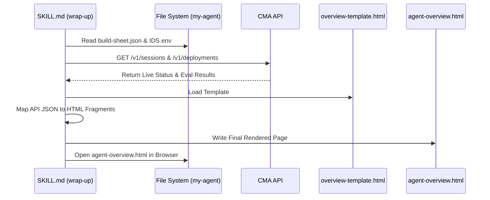

<!-- source: DeepWiki mcp.deepwiki.com · repo anthropics/launch-your-agent · page 5.4 Agent Overview Template · fetched 2026-10-26 -->

# Agent Overview Template

<details>
<summary>Relevant source files</summary>

The following files were used as context for generating this wiki page:

- [.claude/skills/launch-your-agent/references/overview-template.html](.claude/skills/launch-your-agent/references/overview-template.html)
- [.claude/skills/wrap-up/SKILL.md](.claude/skills/wrap-up/SKILL.md)
- [ui/agent-overview-example.html](ui/agent-overview-example.html)

</details>


The Agent Overview Template (`overview-template.html`) is a "warm-light" schematic layout used to visualize a Claude Managed Agent (CMA) architecture, its live execution status, and its historical performance. It serves as the primary closing artifact for the `/wrap-up` skill, providing a browser-based dashboard that bridges the gap between local configuration files and live cloud primitives.

## Visual Schematic Layout

The template utilizes a structured grid to represent the flow of data and control within a CMA instance. The layout is divided into three primary vertical lanes:

1.  **Trigger Lane**: Displays the `Deployment` schedule (cron) or manual `Session` kickoff events.
2.  **Worker Lane**: Visualizes the `Agent` (logic) nested within its `Environment` (runtime), including attached `Vaults`, `Connectors`, and `Memory Stores`.
3.  **Output & Grading Lane**: Shows the `Outcome` definition, rubric criteria, and the results of the auto-provisioned grader.

### Logical Data Flow
The following diagram illustrates how system entities map to the visual components of the template.

**Diagram: UI Component to Code Entity Mapping**
```mermaid
graph LR
    subgraph "Trigger Lane"
        ["🗓️ Deployment"] -- "schedule" --> ["Upcoming Run"]
        ["▶️ Session"] -- "initial_events" --> ["Input Node"]
    end

    subgraph "Worker Lane (Environment Frame)"
        ["📦 Environment"] -- "contains" --> ["🤖 Agent"]
        ["🤖 Agent"] -- "uses" --> ["🔌 Connectors"]
        ["🤖 Agent"] -- "reads/writes" --> ["🧠 Memory"]
        ["🤖 Agent"] -- "authenticates via" --> ["🔐 Vault"]
    end

    subgraph "Output Lane"
        ["🤖 Agent"] -- "produces" --> ["🎯 Outcome"]
        ["🎯 Outcome"] -- "evaluated by" --> ["🧪 Evals/Grader"]
    end

    style ["📦 Environment"] stroke-dasharray: 5 5
```
**Sources:**
- [.claude/skills/launch-your-agent/references/overview-template.html:51-103]()
- [ui/agent-overview-example.html:51-103]()

## Population by the wrap-up Skill

The `agent-overview.html` file is not a static asset but a generated artifact. The `wrap-up` skill performs a "Live State Refresh" to populate the template with real-time data from the CMA API.

### Population Workflow
1.  **Read Local State**: The skill reads `build-sheet.json` and `IDS.env` to identify the relevant CMA primitives [ .claude/skills/wrap-up/SKILL.md:17-19]().
2.  **Fetch Live Data**: If an `ANTHROPIC_API_KEY` is present, it calls the CMA API to retrieve:
    *   Session `status` and `outcome_evaluations` [ .claude/skills/wrap-up/SKILL.md:20-20]().
    *   Deployment `status` and `upcoming_runs_at` [ .claude/skills/wrap-up/SKILL.md:20-20]().
    *   Workspace-level `usage` metrics [ .claude/skills/wrap-up/SKILL.md:20-20]().
3.  **Template Injection**: The skill injects this data into the HTML template, updating status pills (e.g., `Live` vs `Planned`) and populating the "Run Log" lane [ .claude/skills/wrap-up/SKILL.md:28-29]().

**Diagram: wrap-up Data Orchestration**

**Sources:**
- [.claude/skills/wrap-up/SKILL.md:17-32]()

## Key UI Components

### The Version Rail and Run Log
The template includes a historical view of agent performance. This is represented as a "Run Log" table that displays:
*   **Run ID**: Deep-linked to the Anthropic Console [ .claude/skills/wrap-up/SKILL.md:28-28]().
*   **Rubric Version**: Which version of the `Outcome` rubric was used.
*   **Verdict**: The grade assigned by the auto-grader (e.g., "Pass", "Fail").
*   **Notes**: A one-line summary of the run outcome [ .claude/skills/wrap-up/SKILL.md:29-29]().

### Console Deep-Link Generation
The template generates direct links to the Claude Managed Agents Console (`platform.claude.com`). These links are constructed using the IDs stored in `IDS.env`, allowing users to jump from the local overview directly to the live execution logs or configuration page in the Anthropic dashboard [ .claude/skills/wrap-up/SKILL.md:32-32]().

### Generated-Interface Extension
A unique feature of the template is the "Generated Interface" suggestion. If the agent produces complex data (e.g., charts, large datasets), the `wrap-up` skill may suggest building a tailored UI extension [ .claude/skills/wrap-up/SKILL.md:30-30](). This extension is a separate page or small app that pulls outputs and verdicts via the CMA Files/Sessions API, effectively turning the agent into a full-stack internal tool.

## Implementation Details

### CSS Architecture
The template uses a "warm paper" palette designed for readability and a "technical schematic" feel.
*   **Root Variables**: Defines a specific palette (`--bg`, `--panel`, `--live`, `--clay`) [ .claude/skills/launch-your-agent/references/overview-template.html:10-16]().
*   **LED Pulse**: An animation (`@keyframes ledPulse`) is used for the `live` status pill to indicate an active deployment [ .claude/skills/launch-your-agent/references/overview-template.html:24-24]().
*   **Environment Frame**: Uses a dashed border (`.env-frame`) to visually encapsulate the `Agent` within its `Environment` [ .claude/skills/launch-your-agent/references/overview-template.html:89-93]().

### Component Classes
| Class | Description |
| :--- | :--- |
| `.statepill` | Displays the current lifecycle state (Planned, Live, Running) [ .claude/skills/launch-your-agent/references/overview-template.html:34-37](). |
| `.node` | The base container for a CMA primitive (Agent, Outcome, etc.) [ .claude/skills/launch-your-agent/references/overview-template.html:62-62](). |
| `.joint` | A CSS-based arrow connector between pipeline nodes [ .claude/skills/launch-your-agent/references/overview-template.html:58-60](). |
| `.attach` | A small card for auxiliary primitives like Vaults or Connectors [ .claude/skills/launch-your-agent/references/overview-template.html:95-95](). |

**Sources:**
- [.claude/skills/launch-your-agent/references/overview-template.html:9-103]()
- [ui/agent-overview-example.html:9-103]()

---

