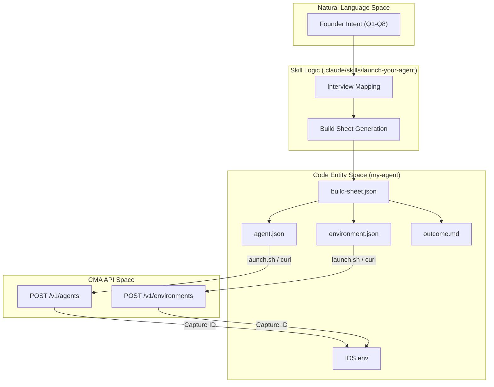
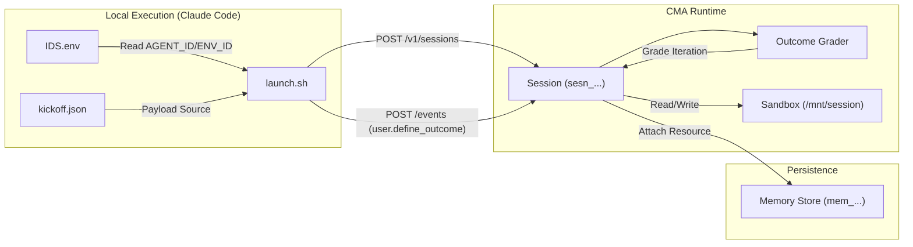

<!-- source: DeepWiki mcp.deepwiki.com · repo anthropics/launch-your-agent · page 6 Glossary · fetched 2026-10-26 -->

# Glossary

Relevant source files

The following files were used as context for generating this wiki page:

- [.claude/skills/launch-your-agent/SKILL.md](.claude/skills/launch-your-agent/SKILL.md)
- [.claude/skills/launch-your-agent/references/cma-api.md](.claude/skills/launch-your-agent/references/cma-api.md)
- [.claude/skills/launch-your-agent/references/examples-bank.md](.claude/skills/launch-your-agent/references/examples-bank.md)
- [.claude/skills/launch-your-agent/references/interview.md](.claude/skills/launch-your-agent/references/interview.md)
- [.claude/skills/launch-your-agent/references/mock-connectors.md](.claude/skills/launch-your-agent/references/mock-connectors.md)
- [.claude/skills/wrap-up/SKILL.md](.claude/skills/wrap-up/SKILL.md)
- [CLAUDE.md](CLAUDE.md)
- [cma-primitives.md](cma-primitives.md)

This glossary defines the core primitives, codebase-specific terms, and abbreviations used in the `launch-your-agent` repository. It serves as a technical reference for engineers onboarding to the Claude Managed Agents (CMA) ecosystem.

## 1. CMA Primitives (Core)

These are the foundational building blocks of the Claude Managed Agents platform.

| Term | Definition | Code Pointers |
|:---|:---|:---|
| **Agent** | A versioned configuration defining the "brain": model, system instructions, tools, and multi-agent rosters. | `agent.json`, `IDS.env` (`AGENT_ID`), `POST /v1/agents` |
| **Environment** | A reusable definition of the "hands": a sandboxed Linux container with specific packages and networking rules. | `environment.json`, `IDS.env` (`ENV_ID`), `POST /v1/environments` |
| **Session** | A single execution instance of an Agent in an Environment. It maintains state, history, and a checkpointed filesystem. | `IDS.env` (`SESSION_ID`), `POST /v1/sessions`, `GET /v1/sessions/:id` |
| **Event** | The bidirectional messaging unit of CMA. Includes `user.*` (inputs), `agent.*` (outputs/thinking), and `span.*` (telemetry). | `kickoff.json`, `POST /v1/sessions/:id/events`, `SSE` streaming |
| **Outcome** | A specialized kickoff event (`user.define_outcome`) that provides a task, a rubric, and an iteration budget for self-grading. | `outcome.md`, `user.define_outcome` in `kickoff.json` |
| **Deployment** | A managed schedule (cron) that automatically creates and runs sessions based on a template. | `deployment.json`, `POST /v1/deployments` |
| **Vault** | A secure storage for credentials (OAuth, API keys) used by MCP servers or environment variables. | `LAUNCH.md` (setup steps), `POST /v1/vaults` |

**Sources:** [cma-primitives.md:22-31](), [cma-primitives.md:35-45](), [cma-primitives.md:47-58](), [cma-primitives.md:62-74](), [cma-primitives.md:77-89](), [cma-primitives.md:104-118](), [cma-primitives.md:144-158]().

## 2. Codebase Concepts

Specific terms used within the `launch-your-agent` skill and its generated artifacts.

### Build Kit
The collection of files generated in the `my-agent/` directory during Phase 2. It represents the "source of truth" for the agent's configuration before it is pushed to the CMA API.
*   **Key Files:** `agent.json`, `environment.json`, `outcome.md`, `LAUNCH.md`, `build-sheet.json`.
*   **Sources:** [.claude/skills/launch-your-agent/SKILL.md:26-27](), [CLAUDE.md:9-16]().

### Build Sheet
The `build-sheet.json` file. It acts as the internal state for the skill, aggregating all interview answers into a single schema-validated object.
*   **Sources:** [.claude/skills/launch-your-agent/references/interview.md:11-25](), [CLAUDE.md:14-14]().

### Next Directions
The `NEXT-DIRECTIONS.md` file. A living document where the skill records features or hardening steps deferred from the current version (v0) to future versions (v1, v2).
*   **Sources:** [.claude/skills/launch-your-agent/SKILL.md:31-31](), [CLAUDE.md:27-27]().

### Mock Connector
A design pattern where an agent simulates external integration (e.g., Slack, Email) using an "outbox" filesystem queue or a custom tool stub, allowing for development without immediate credentials.
*   **Sources:** [.claude/skills/launch-your-agent/references/mock-connectors.md:4-18]().

## 3. System Architecture Diagrams

### From Natural Language to Code Entities (Phase 1 & 2)
This diagram maps the founder's intent during the interview to the specific files and API calls managed by the skill.

**Sources:** [.claude/skills/launch-your-agent/references/interview.md:11-25](), [.claude/skills/launch-your-agent/references/cma-api.md:22-26](), [.claude/skills/launch-your-agent/references/cma-api.md:35-45]().

### Execution & Lifecycle (Phase 3 & 4)
This diagram shows how code entities interact with the CMA runtime during a launch.

**Sources:** [.claude/skills/launch-your-agent/references/cma-api.md:91-102](), [.claude/skills/launch-your-agent/references/cma-api.md:111-125](), [cma-primitives.md:62-74]().

## 4. Technical Terms Reference

| Term | Implementation Detail | Source |
|:---|:---|:---|
| **Always Ask** | A `permission_policy` in `agent.json` that forces a session to `idle` with `requires_action` until a human approves a tool call. | [cma-primitives.md:131-135]() |
| **Dream** | A background process that consolidates and optimizes memories in a **Memory Store**. | [cma-primitives.md:158-158]() |
| **Golden Set** | A collection of verified successful runs stored in `evals/` used for regression testing. | [CLAUDE.md:29-29]() |
| **IDS.env** | A shell script file used to persist resource IDs (e.g., `AGENT_ID`, `SESSION_ID`) across command executions. | [.claude/skills/launch-your-agent/references/cma-api.md:22-26]() |
| **Outbox** | A directory (`/mnt/session/outputs/outbox/`) where a mocked agent writes JSON payloads instead of calling real APIs. | [.claude/skills/launch-your-agent/references/mock-connectors.md:10-13]() |
| **Skill (CMA)** | A pre-built capability (e.g., `xlsx`, `pdf`) or a custom-defined set of functions that an agent can invoke. | [cma-primitives.md:37-45]() |
| **Wrap-up** | The final phase of the workflow, triggered by `/wrap-up`, which generates the `agent-overview.html` dashboard. | [.claude/skills/wrap-up/SKILL.md:1-6]() |

**Sources:** Cited in table rows.