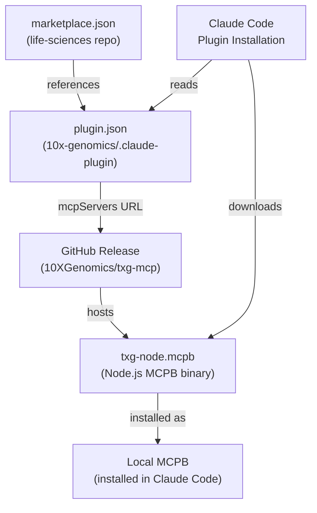
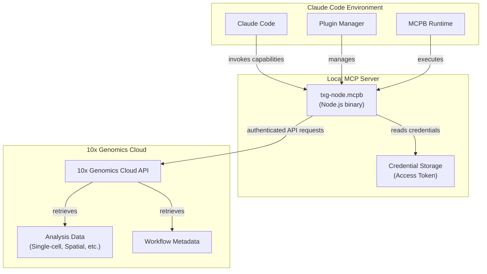
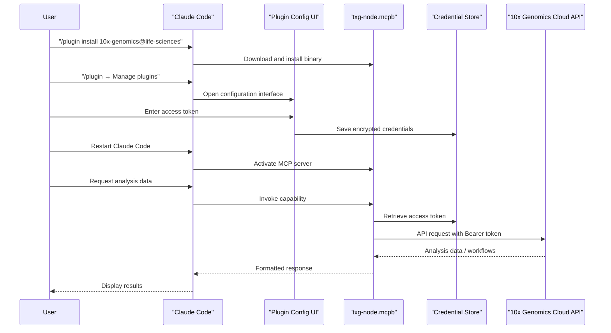
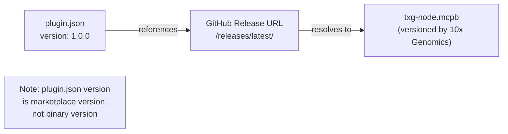

<!-- source: DeepWiki mcp.deepwiki.com · repo anthropics/life-sciences · page 3.5 10x Genomics Cloud · fetched 2026-10-26 -->

# 10x Genomics Cloud

<details>
<summary>Relevant source files</summary>

The following files were used as context for generating this wiki page:

- [.gitignore](.gitignore)
- [10x-genomics/.claude-plugin/plugin.json](10x-genomics/.claude-plugin/plugin.json)
- [10x-genomics/txg-node.mcpb](10x-genomics/txg-node.mcpb)

</details>


## Purpose and Scope

This document covers the **10x Genomics Cloud MCP server**, a Local MCP Server (MCPB) that provides access to analysis data and workflows stored in the 10x Genomics Cloud platform. This plugin enables Claude Code to retrieve and interact with single-cell analysis results, spatial transcriptomics data, and other genomics workflows generated by 10x Genomics Cloud Analysis.

For general information about MCP servers, see [Understanding MCP Servers]().

**Sources:** [10x-genomics/.claude-plugin/plugin.json:1-10]()

## Overview

The 10x Genomics Cloud MCP server is a **Local MCP Server** distributed as a compiled binary (`.mcpb` file) that communicates with the 10x Genomics Cloud API. Unlike Remote MCP servers that run as web services, this server executes locally within the Claude Code environment and requires authentication credentials to access your organization's analysis data.

**Key characteristics:**
- **Plugin ID:** `10x-genomics@life-sciences`
- **Distribution format:** Node.js-based MCPB binary (`txg-node.mcpb`) [10x-genomics/.claude-plugin/plugin.json:9]()
- **Authentication:** Access token-based
- **Prerequisites:** Requires existing analysis data in your 10x Genomics Cloud account
- **Vendor:** 10x Genomics, Inc. [10x-genomics/.claude-plugin/plugin.json:6]()

**Sources:** [10x-genomics/.claude-plugin/plugin.json:1-10]()

## Prerequisites

### Account Requirements

The 10x Genomics Cloud MCP server requires a **paid/institutional 10x Genomics Cloud account**. This plugin is only useful if you already have:

1. **Active 10x Genomics Cloud account** (https://www.10xgenomics.com/products/cloud-analysis)
2. **Existing analysis data** in your account (e.g., single-cell RNA-seq analyses, spatial transcriptomics runs)
3. **Access token** with appropriate permissions

### Data Prerequisites

Unlike other MCP servers that provide access to public databases or creation tools, the 10x Genomics Cloud MCP server is designed to retrieve **your organization's proprietary analysis data**. Without existing analyses in your account, this plugin provides no functionality.

**Sources:** [10x-genomics/.claude-plugin/plugin.json:4]()

## Plugin Configuration

### Plugin Definition Structure

The plugin is defined by a configuration file that references an externally-hosted binary:

```json
{
  "name": "10x-genomics",
  "version": "1.0.0",
  "description": "10x Genomics Cloud MCP server for accessing analysis data and workflows",
  "author": {
    "name": "10x Genomics, Inc.",
    "url": "https://www.10xgenomics.com"
  },
  "mcpServers": "https://github.com/10XGenomics/txg-mcp/releases/latest/download/txg-node.mcpb"
}
```

The `mcpServers` field points to a GitHub release URL where the MCPB binary is hosted by 10x Genomics [10x-genomics/.claude-plugin/plugin.json:9](). This allows the MCP server implementation to be updated independently of the marketplace registry.

**Sources:** [10x-genomics/.claude-plugin/plugin.json:1-10]()

### Binary Distribution Model

The following diagram illustrates how the 10x Genomics MCP server binary is distributed:



**Binary Distribution Flow**

This diagram shows the federated distribution model where the marketplace registry ([10x-genomics/.claude-plugin/plugin.json:1-10]()) contains only metadata and a URL reference, while the actual MCPB binary is hosted by 10x Genomics on their GitHub repository.

**Sources:** [10x-genomics/.claude-plugin/plugin.json:9]()

## Installation

### Step 1: Install the Plugin

```bash
/plugin install 10x-genomics@life-sciences
```

Claude Code will:
1. Read the plugin definition from [10x-genomics/.claude-plugin/plugin.json:1-10]()
2. Download `txg-node.mcpb` from the GitHub release URL [10x-genomics/.claude-plugin/plugin.json:9]()
3. Install the MCPB binary locally.

### Step 2: Configure Access Token

After installation, you must configure your 10x Genomics Cloud access token:

1. Type `/plugin` in Claude Code
2. Select "Manage plugins"
3. Find "10x-genomics" in the installed plugins list
4. Select "Configure"
5. Enter your access token
6. Restart Claude Code

**Sources:** [10x-genomics/.claude-plugin/plugin.json:1-10]()

## Architecture

### System Integration Overview



**10x Genomics MCP Server Architecture**

This diagram illustrates the runtime architecture. The `txg-node.mcpb` binary executes within the MCPB Runtime, authenticates using stored credentials, and makes API requests to the 10x Genomics Cloud to retrieve analysis data.

**Sources:** [10x-genomics/.claude-plugin/plugin.json:9](), [10x-genomics/.claude-plugin/plugin.json:4]()

### Authentication Flow



**Authentication and Data Retrieval Sequence**

This sequence diagram shows the complete lifecycle from installation through data retrieval, highlighting the authentication checkpoint where credentials are stored and later retrieved for API requests.

**Sources:** [10x-genomics/.claude-plugin/plugin.json:1-10]()

## Technical Details

### MCPB Binary Format

The `.mcpb` extension indicates a **Model Context Protocol Binary**, which is a self-contained executable that implements the MCP server protocol. For the 10x Genomics plugin:

- **Binary name:** `txg-node.mcpb` [10x-genomics/txg-node.mcpb:1]()
- **Runtime:** Node.js-based
- **Distribution URL:** https://github.com/10XGenomics/txg-mcp/releases/latest/download/txg-node.mcpb [10x-genomics/.claude-plugin/plugin.json:9]()
- **Version management:** Handled by 10x Genomics via GitHub releases (always fetches `latest`)

### Cache Management

Local MCPB binaries and their associated data are managed in specific cache directories to ensure clean operation and prevent conflicts with Python environments.

| Path | Purpose |
|------|---------|
| `.mcpb-cache/` | Storage for downloaded MCPB binaries |
| `.claude/` | Local configuration and plugin state |

**Sources:** [.gitignore:1-3](), [10x-genomics/.claude-plugin/plugin.json:9]()

### Plugin Version Strategy



**Version Decoupling Strategy**

The `version` field in [10x-genomics/.claude-plugin/plugin.json:3]() represents the **marketplace plugin definition version** (1.0.0), not the version of the `txg-node.mcpb` binary itself. The binary version is managed independently by 10x Genomics through their GitHub release process.

**Sources:** [10x-genomics/.claude-plugin/plugin.json:3](), [10x-genomics/.claude-plugin/plugin.json:9]()

---

