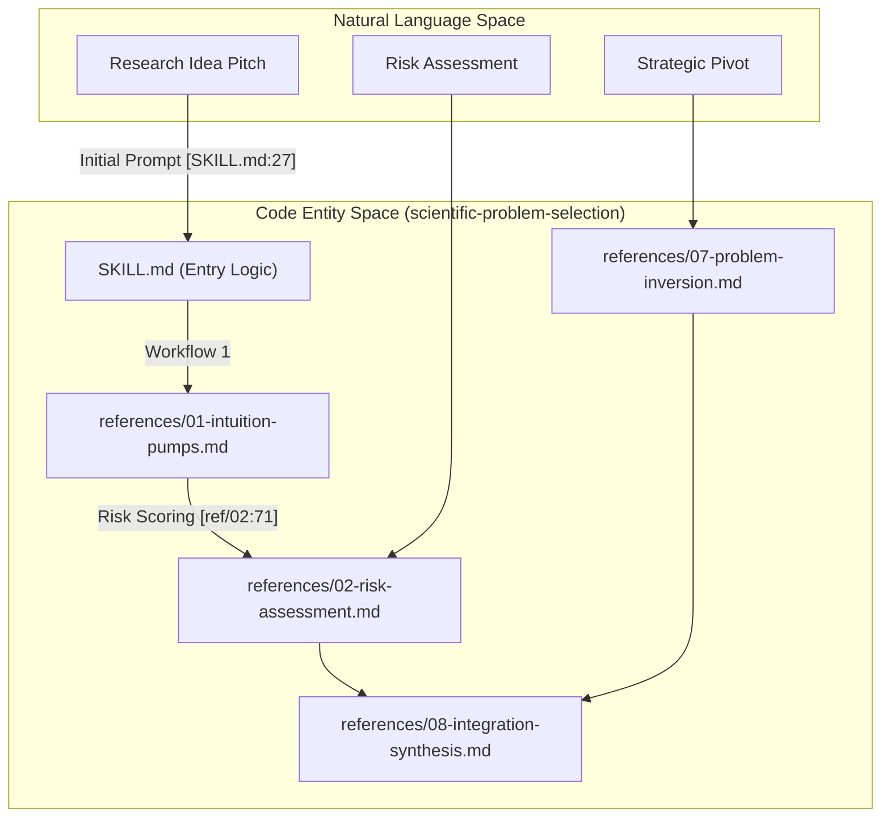
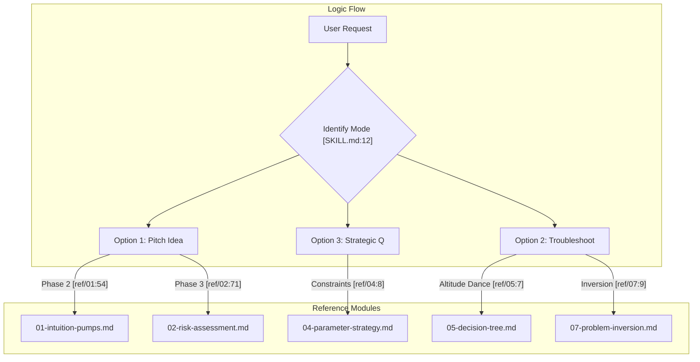

<!-- source: DeepWiki mcp.deepwiki.com · repo anthropics/life-sciences · page 4.6 Scientific Problem Selection Skill · fetched 2026-10-26 -->

# Scientific Problem Selection Skill

Relevant source files

The following files were used as context for generating this wiki page:

- [scientific-problem-selection/LICENSE.txt](scientific-problem-selection/LICENSE.txt)
- [scientific-problem-selection/SKILL.md](scientific-problem-selection/SKILL.md)
- [scientific-problem-selection/references/01-intuition-pumps.md](scientific-problem-selection/references/01-intuition-pumps.md)
- [scientific-problem-selection/references/02-risk-assessment.md](scientific-problem-selection/references/02-risk-assessment.md)
- [scientific-problem-selection/references/03-optimization-function.md](scientific-problem-selection/references/03-optimization-function.md)
- [scientific-problem-selection/references/04-parameter-strategy.md](scientific-problem-selection/references/04-parameter-strategy.md)
- [scientific-problem-selection/references/05-decision-tree.md](scientific-problem-selection/references/05-decision-tree.md)
- [scientific-problem-selection/references/06-adversity-planning.md](scientific-problem-selection/references/06-adversity-planning.md)
- [scientific-problem-selection/references/07-problem-inversion.md](scientific-problem-selection/references/07-problem-inversion.md)
- [scientific-problem-selection/references/08-integration-synthesis.md](scientific-problem-selection/references/08-integration-synthesis.md)
- [scientific-problem-selection/references/09-meta-framework.md](scientific-problem-selection/references/09-meta-framework.md)
- [scvi-tools/LICENSE.txt](scvi-tools/LICENSE.txt)
- [single-cell-rna-qc/LICENSE.txt](single-cell-rna-qc/LICENSE.txt)

The **Scientific Problem Selection Skill** is a conversational framework designed to assist scientists in high-leverage research decisions, including project ideation, risk assessment, troubleshooting, and strategic planning [scientific-problem-selection/SKILL.md:6-8](). Based on the methodology proposed by Fischbach & Walsh (2024), the skill emphasizes that **Problem Choice >> Execution Quality**; even brilliant execution of a mediocre problem yields limited impact compared to sound execution of an important problem [scientific-problem-selection/SKILL.md:104-107]().

## Overview and Entry Points

The skill is structured as a guided dialogue that meets researchers at three distinct stages of the scientific process [scientific-problem-selection/SKILL.md:12-20]().

| Entry Point | Purpose | Key Initial Prompt |
|:---|:---|:---|
| **Pitch an Idea** | Work up a new project from scratch | "Tell me the short version of your idea (1-2 sentences)." |
| **Troubleshoot a Problem** | Navigate a project that has encountered obstacles | "Tell me a short version of your problem." |
| **Ask a Strategic Question** | Navigate decision trees for current/future work | "Tell me the short version of your question." |

**Sources:** [scientific-problem-selection/SKILL.md:12-80]()

## The Nine-Step Framework

The skill implementation is divided into nine modular "Skills" (or steps) that transition from abstract ideation to concrete project synthesis [scientific-problem-selection/SKILL.md:140-153]().

### 1. Ideation and "Intuition Pumps"
This phase helps generate high-quality ideas by identifying whether a project focuses on **Perturbation**, **Measurement**, or **Theory/Computation**, and whether the advancement is in **Logic** or **Technology** [scientific-problem-selection/references/01-intuition-pumps.md:8-22]().
*   **Key Function:** Applying "Intuition Pumps" such as "Make It Systematic" (turning one-off experiments into surveys) or the "I Can't Imagine Test" (identifying inevitable future capabilities) [scientific-problem-selection/references/01-intuition-pumps.md:58-89]().
*   **Sources:** [scientific-problem-selection/references/01-intuition-pumps.md:1-128]()

### 2. Risk Assessment and Assumption Analysis
Researchers are guided to list every biological and technical assumption, scoring them by **Risk Level (1-5)** and **Time to Test** [scientific-problem-selection/references/02-risk-assessment.md:41-84]().
*   **Red Flags:** Identifying "Late High-Risk Problems" (high-risk assumptions that won't read out for >18 months) or "Multiple Miracles" (requiring >3 high-risk events) [scientific-problem-selection/references/02-risk-assessment.md:95-100]().
*   **Sources:** [scientific-problem-selection/references/02-risk-assessment.md:1-107]()

### 3. Optimization Function Selection
This step defines success metrics. Impact is evaluated on two axes (X: Likelihood of Success, Y: Impact if Successful) [scientific-problem-selection/references/03-optimization-function.md:10-12]().
*   **Frameworks:** Projects are categorized as **Basic Science** (Generality vs. Learning), **Tech Dev** (Usage vs. Criticality), or **Invention** (Good vs. Scale) [scientific-problem-selection/references/03-optimization-function.md:48-116]().
*   **Sources:** [scientific-problem-selection/references/03-optimization-function.md:1-140]()

### 4. Parameter Fixation Strategy
A strategic decision-making tool to avoid over-constraining a project. The core principle is to **fix one parameter** (e.g., the biological system) and let others (e.g., the tool or application) float [scientific-problem-selection/references/04-parameter-strategy.md:8-10]().
*   **Sources:** [scientific-problem-selection/references/04-parameter-strategy.md:1-170]()

### 5. Decision Tree Navigation ("The Altitude Dance")
This workflow establishes a rhythm for moving between **Level 1 (Ground Level execution)** and **Level 2 (Strategic Altitude evaluation)** [scientific-problem-selection/references/05-decision-tree.md:7-13]().
*   **Sources:** [scientific-problem-selection/references/05-decision-tree.md:1-80]()

### 6. Adversity Response Planning
Framing inevitable crises as "Adversity Features"—opportunities to upgrade the project while fixing the problem [scientific-problem-selection/references/06-adversity-planning.md:7-14]().
*   **Sources:** [scientific-problem-selection/references/06-adversity-planning.md:1-103]()

### 7. Problem Inversion
Techniques for navigating obstacles, including **Comparable Goal Substitution** (achieving Goal B when Goal A fails) and **Answer Seeking Question** (identifying what question the existing data actually answers) [scientific-problem-selection/references/07-problem-inversion.md:9-12]().
*   **Sources:** [scientific-problem-selection/references/07-problem-inversion.md:1-91]()

### 8. Integration & Synthesis
Synthesizing the previous steps into a **Complete Project Package**, including a narrative arc, a 3-slide presentation, and a 1-page summary [scientific-problem-selection/references/08-integration-synthesis.md:30-96]().
*   **Sources:** [scientific-problem-selection/references/08-integration-synthesis.md:1-173]()

### 9. Meta-Framework
Orchestrating the complete workflow over a 1-6 week period [scientific-problem-selection/SKILL.md:152]().

## System Architecture and Data Flow

The following diagrams illustrate the relationship between the natural language research concepts and the codebase entities that handle them.

### Research Workflow to Code Entity Mapping

**Sources:** [scientific-problem-selection/SKILL.md:1-152](), [scientific-problem-selection/references/01-intuition-pumps.md:1-50](), [scientific-problem-selection/references/02-risk-assessment.md:1-40](), [scientific-problem-selection/references/07-problem-inversion.md:1-10]()

### Strategic Decision Flow

This diagram maps the logical branching handled by the `SKILL.md` orchestration to the specific reference modules.

**Sources:** [scientific-problem-selection/SKILL.md:12-96](), [scientific-problem-selection/references/04-parameter-strategy.md:1-10](), [scientific-problem-selection/references/05-decision-tree.md:1-15]()

## Key Framework Summary

| Concept | Description | Reference File |
|:---|:---|:---|
| **Pillars of Science** | Perturbation, Measurement, Theory/Computation | [01-intuition-pumps.md:8-22]() |
| **Risk Scoring** | 1-5 Scale (Likelihood) + Time to Test | [02-risk-assessment.md:73-84]() |
| **Optimization** | Evaluation by Basic Science, Tech Dev, or Invention frameworks | [03-optimization-function.md:46-116]() |
| **Altitude Levels** | Ground Level (L1) to Career Level (L4) | [05-decision-tree.md:26-31]() |
| **Project Ensemble** | Mapping alternative paths (Path 1-4) for a core theme | [06-adversity-planning.md:72-86]() |

**Sources:** [scientific-problem-selection/references/01-intuition-pumps.md](), [scientific-problem-selection/references/02-risk-assessment.md](), [scientific-problem-selection/references/03-optimization-function.md](), [scientific-problem-selection/references/05-decision-tree.md](), [scientific-problem-selection/references/06-adversity-planning.md]()

---

