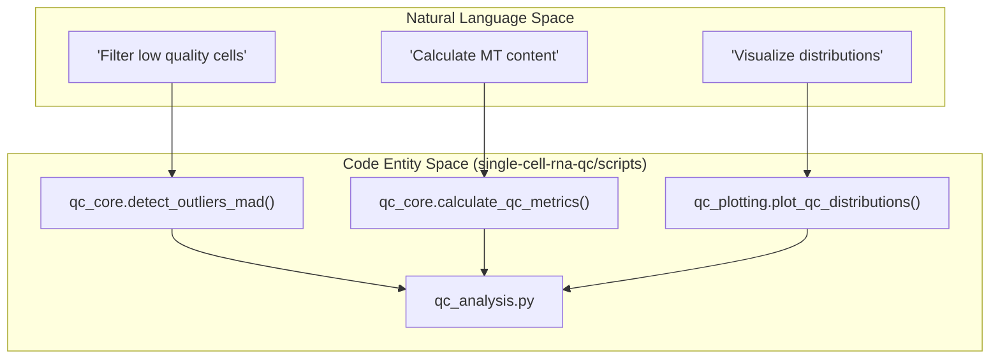
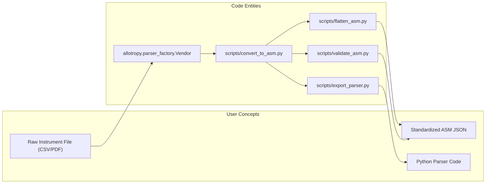

<!-- source: DeepWiki mcp.deepwiki.com · repo anthropics/life-sciences · page 6 Glossary · fetched 2026-10-26 -->

# Glossary

Relevant source files

The following files were used as context for generating this wiki page:

- [.claude-plugin/marketplace.json](.claude-plugin/marketplace.json)
- [README.md](README.md)
- [clinical-trial-protocol-skill/SKILL.md](clinical-trial-protocol-skill/SKILL.md)
- [instrument-data-to-allotrope/SKILL.md](instrument-data-to-allotrope/SKILL.md)
- [nextflow-development/SKILL.md](nextflow-development/SKILL.md)
- [nextflow-development/references/geo-sra-acquisition.md](nextflow-development/references/geo-sra-acquisition.md)
- [scientific-problem-selection/SKILL.md](scientific-problem-selection/SKILL.md)
- [scvi-tools/scripts/model_utils.py](scvi-tools/scripts/model_utils.py)
- [scvi-tools/scripts/prepare_data.py](scvi-tools/scripts/prepare_data.py)
- [single-cell-rna-qc/SKILL.md](single-cell-rna-qc/SKILL.md)
- [single-cell-rna-qc/references/scverse_qc_guidelines.md](single-cell-rna-qc/references/scverse_qc_guidelines.md)
- [single-cell-rna-qc/scripts/qc_analysis.py](single-cell-rna-qc/scripts/qc_analysis.py)
- [single-cell-rna-qc/scripts/qc_core.py](single-cell-rna-qc/scripts/qc_core.py)
- [single-cell-rna-qc/scripts/qc_plotting.py](single-cell-rna-qc/scripts/qc_plotting.py)

This glossary defines technical terms, domain concepts, and codebase-specific jargon used within the Life Sciences Marketplace. It serves as a bridge between scientific research terminology and the software entities implemented in this repository.

## Core Concepts

### Model Context Protocol (MCP)
A standard protocol for connecting AI models (like Claude) to external data sources and tools.
*   **Remote MCP Server**: HTTP-based services providing real-time access to scientific databases (e.g., PubMed, BioRender) [`README.md:40-48`]().
*   **Local MCP Server (MCPB)**: Bundled servers that run locally to handle sensitive data or complex local workflows (e.g., 10x Genomics Cloud) [`README.md:91-101`]().

### Skills
Self-contained analytical workflows that extend Claude Code's capabilities without requiring an external server connection. Skills are defined by a `SKILL.md` marker file [`single-cell-rna-qc/SKILL.md:1-4`]().

---

## Single-Cell RNA-seq QC Terms

### AnnData (`.h5ad`)
The standard data structure for single-cell analysis in Python, used extensively by `scanpy` and `scvi-tools`. It stores a central data matrix (`X`), observations/cells (`obs`), and variables/genes (`var`) [`single-cell-rna-qc/SKILL.md:19-20`]().

### MAD-Based Filtering
**Median Absolute Deviation**. A robust statistical measure of variability used to detect outliers in cell quality metrics.
*   **Formula**: `MAD = median(|X - median(X)|)` [`single-cell-rna-qc/references/scverse_qc_guidelines.md:52-53`]().
*   **Implementation**: `detect_outliers_mad` in `qc_core.py` [`single-cell-rna-qc/scripts/qc_core.py:64-101`]().

### QC Metrics
*   **Count Depth**: Total number of UMI/reads per cell [`single-cell-rna-qc/references/scverse_qc_guidelines.md:7-11`]().
*   **Mitochondrial Content (MT%)**: Percentage of counts from mitochondrial genes, indicating cell stress or lysis [`single-cell-rna-qc/references/scverse_qc_guidelines.md:19-26`]().
*   **HVG (Highly Variable Genes)**: Genes that show high cell-to-cell variation, used to focus analysis on biologically informative signals [`scvi-tools/scripts/prepare_data.py:80-102`]().

### Natural Language to Code: Single-Cell QC
The following diagram maps user-facing QC concepts to the internal Python implementation.

"Single-Cell QC Mapping"

Sources: [`single-cell-rna-qc/scripts/qc_core.py:16-101`](), [`single-cell-rna-qc/scripts/qc_plotting.py:13-25`](), [`single-cell-rna-qc/scripts/qc_analysis.py:18-30`]()

---

## Data Standardization Terms

### Allotrope Simple Model (ASM)
A standardized, JSON-based format for laboratory instrument data intended to improve reproducibility and data exchange [`instrument-data-to-allotrope/SKILL.md:6-8`]().

### ASM Document Types
*   **Measurement Document**: Contains direct instrument readings (raw data) [`instrument-data-to-allotrope/SKILL.md:63-63`]().
*   **Calculated Data Aggregate**: Contains derived values (e.g., Viability %, Concentration) with traceability to raw sources [`instrument-data-to-allotrope/SKILL.md:64-69`]().

### Natural Language to Code: Instrument Conversion
Mapping the data standardization workflow to specific code utilities.

"Instrument Data Mapping"

Sources: [`instrument-data-to-allotrope/SKILL.md:21-29`](), [`instrument-data-to-allotrope/SKILL.md:136-156`]()

---

## Clinical Research Terms

### Waypoint
A JSON or Markdown file stored in the `waypoints/` directory that persists the state of a multi-step workflow, allowing the skill to resume if interrupted [`clinical-trial-protocol-skill/SKILL.md:45-59`]().

### Protocol Sections
*   **Foundation**: Sections 1-6 covering study design and population [`clinical-trial-protocol-skill/SKILL.md:38-38`]().
*   **Intervention**: Sections 7-8 detailing the drug or device administration [`clinical-trial-protocol-skill/SKILL.md:39-39`]().
*   **Operations**: Sections 9-12 covering assessments and statistical analysis [`clinical-trial-protocol-skill/SKILL.md:40-40`]().

---

## Marketplace Infrastructure

| Term | Definition | Code Reference |
| :--- | :--- | :--- |
| **Plugin ID** | Unique identifier for installing a plugin (e.g., `pubmed@life-sciences`). | [`README.md:43`]() |
| **Marketplace Manifest** | The `marketplace.json` file defining all available plugins and their metadata. | [`.claude-plugin/marketplace.json:1-184`]() |
| **Skill Marker** | The `SKILL.md` file at the root of a skill directory that enables discovery. | [`single-cell-rna-qc/SKILL.md:1-4`]() |

Sources: [`README.md:1-28`](), [`.claude-plugin/marketplace.json:1-184`](), [`single-cell-rna-qc/SKILL.md:1-4`]()