# Page: Overview

# Overview

<details>
<summary>Relevant source files</summary>

The following files were used as context for generating this wiki page:

- [.claude-plugin/marketplace.json](.claude-plugin/marketplace.json)
- [README.md](README.md)

</details>


This document introduces the life-sciences marketplace, a plugin distribution system for Claude Code that provides access to specialized research tools and analytical workflows. It covers the marketplace architecture, plugin taxonomy, and available integrations. For installation instructions, see [Getting Started](). For detailed documentation of individual plugins, see [MCP Servers]() and [Skills]().

## Purpose

The life-sciences marketplace serves as a centralized registry of MCP (Model Context Protocol) servers and skills designed for life sciences research workflows. Users add this marketplace to Claude Code to discover and install plugins that extend Claude's capabilities with domain-specific tools, ranging from literature search to deep learning single-cell analysis.

**Sources:** [README.md:1-8]()

## Marketplace Architecture

The marketplace is defined by a Git repository containing plugin definitions and metadata. Claude Code reads the marketplace registry to display available plugins and their installation sources.

### Repository Structure

```mermaid
graph TB
    REPO["life-sciences<br/>Git Repository"]
    
    REPO --> REGISTRY[".claude-plugin/marketplace.json"]
    REPO --> PLUGIN_DIRS["Plugin Definition Directories"]
    
    PLUGIN_DIRS --> TENX["10x-genomics/"]
    PLUGIN_DIRS --> PUBMED["pubmed/"]
    PLUGIN_DIRS --> BIORENDER["biorender/"]
    PLUGIN_DIRS --> SYNAPSE["synapse/"]
    PLUGIN_DIRS --> WILEY["wiley-scholar-gateway/"]
    PLUGIN_DIRS --> BIORXIV["biorxiv/"]
    PLUGIN_DIRS --> CLINICAL["clinical-trials/"]
    PLUGIN_DIRS --> CHEMBL["chembl/"]
    PLUGIN_DIRS --> OWKIN["owkin/"]
    PLUGIN_DIRS --> OPENTARGETS["open-targets/"]
    PLUGIN_DIRS --> TOOLUNIVERSE["tooluniverse/"]
    PLUGIN_DIRS --> MEDIDATA["medidata/"]
    PLUGIN_DIRS --> CONSENSUS["consensus/"]
    PLUGIN_DIRS --> CORTELLIS["cortellis/"]
    PLUGIN_DIRS --> ADIS["adisinsight/"]
    
    PLUGIN_DIRS --> SKILL_SC["single-cell-rna-qc/"]
    PLUGIN_DIRS --> SKILL_ALLO["instrument-data-to-allotrope/"]
    PLUGIN_DIRS --> SKILL_NF["nextflow-development/"]
    PLUGIN_DIRS --> SKILL_SCVI["scvi-tools/"]
    PLUGIN_DIRS --> SKILL_PROTO["clinical-trial-protocol-skill/"]
    PLUGIN_DIRS --> SKILL_PROB["scientific-problem-selection/"]
    
    REGISTRY -.->|"references via source"| PLUGIN_DIRS
```

The `marketplace.json` file at [.claude-plugin/marketplace.json:1-184]() defines the registry structure with the following schema:

| Field | Type | Description |
|-------|------|-------------|
| `name` | string | Marketplace identifier (`"life-sciences"`) |
| `owner` | object | Contact information for marketplace maintainers |
| `metadata.version` | string | Semantic version of the marketplace |
| `plugins[]` | array | List of available plugin definitions |

Each plugin entry in the `plugins` array specifies:

| Field | Type | Description |
|-------|------|-------------|
| `name` | string | Plugin identifier (used as Plugin ID with `@life-sciences` suffix) |
| `source` | string | Relative path to plugin definition directory |
| `description` | string | Short description of plugin functionality |
| `category` | string | Classification category (e.g., `"life-sciences"`) |
| `tags` | string[] | Searchable keywords |
| `skills` | string[] | (Optional) Paths to skill definitions for skill-type plugins |

**Sources:** [.claude-plugin/marketplace.json:1-184](), [README.md:1-8]()

## Plugin Taxonomy

The marketplace contains two fundamental plugin types: **MCP Servers** and **Skills**. These differ architecturally in how they extend Claude Code's capabilities.

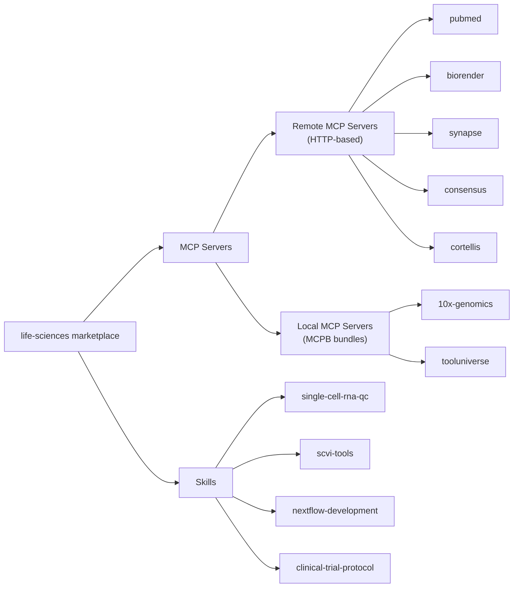

### MCP Servers

MCP Servers act as adapter layers between Claude Code and external services. They translate natural language requests into API calls and format responses.

*   **Remote MCP Servers**: Lightweight integrations that proxy requests to web APIs (e.g., PubMed, BioRender). Configuration typically requires API credentials or OAuth tokens.
*   **Local MCP Servers (MCPB)**: Binary bundles that run locally to provide complex integrations or access local data (e.g., 10x Genomics Cloud analysis data).

### Skills

Skills are self-contained analytical workflows that execute computational pipelines locally. Unlike MCP Servers, they do not integrate with external services but instead provide domain-specific data processing capabilities (e.g., single-cell QC or Nextflow pipeline management).

**Sources:** [README.md:5-8](), [.claude-plugin/marketplace.json:11-184]()

## Available Plugins

### MCP Server Catalog

| Plugin ID | Type | Service | Authentication |
|-----------|------|---------|----------------|
| `pubmed@life-sciences` | Remote | PubMed Literature | None |
| `biorender@life-sciences` | Remote | Scientific Illustrations | Free account |
| `synapse@life-sciences` | Remote | Data Management | Free account |
| `wiley-scholar-gateway@life-sciences` | Remote | Academic Publications | Free account |
| `consensus@life-sciences` | Remote | AI Evidence Synthesis | Free account |
| `cortellis@life-sciences` | Remote | Regulatory Intelligence | Paid subscription |
| `adisinsight@life-sciences` | Remote | Drug Pipeline/Trials | Paid subscription |
| `10x-genomics@life-sciences` | Local | 10x Cloud Analysis | Paid account + Token |
| `tooluniverse@life-sciences` | Local | AI Scientist Tools | Varies |

### Skill Catalog

| Plugin ID | Purpose | Key Technologies |
|-----------|---------|------------------|
| `single-cell-rna-qc@life-sciences` | scRNA-seq Quality Control | scanpy, scverse |
| `scvi-tools@life-sciences` | Deep learning for single-cell | scvi-tools, PyTorch |
| `nextflow-development@life-sciences` | Bioinformatics pipeline execution | Nextflow, Docker, nf-core |
| `instrument-data-to-allotrope@life-sciences` | Lab data standardization | Allotrope Simple Model (ASM) |
| `clinical-trial-protocol@life-sciences` | Regulatory document generation | FDA/NIH Templates |
| `scientific-problem-selection@life-sciences` | Research strategy framework | Fischbach & Walsh (2024) |

**Sources:** [README.md:38-148](), [.claude-plugin/marketplace.json:11-184]()

## Integration with Claude Code

The following diagram illustrates how plugins from this marketplace integrate into Claude Code's execution environment:

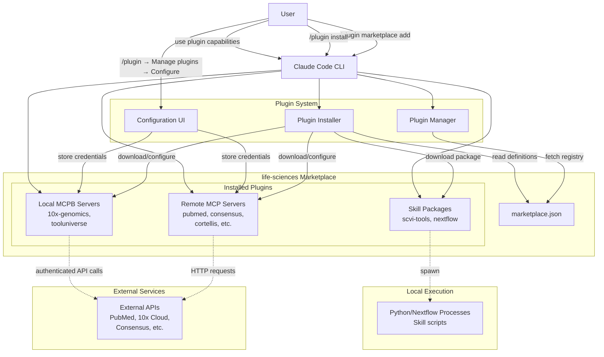

**Installation Workflow:**

1. User adds marketplace via `/plugin marketplace add anthropics/life-sciences` [README.md:12-13]()
2. Claude Code fetches [.claude-plugin/marketplace.json:1-184]()
3. User installs plugin via `/plugin install <name>@life-sciences` [README.md:15-28]()
4. For servers requiring authentication, configuration is performed via `/plugin → Manage plugins → Configure` [README.md:30-35]()
5. Claude Code restart activates the environment [README.md:36]()

**Sources:** [README.md:9-37](), [README.md:149-191](), [.claude-plugin/marketplace.json:1-184]()

## Authentication Model

The marketplace implements a tiered authentication model:

| Authentication Tier | Plugins | Setup Process |
|---------------------|---------|---------------|
| **None** | `pubmed`, `biorxiv`, `chembl` | Install and use immediately |
| **Free Account** | `biorender`, `synapse`, `consensus` | Create account, enter credentials in Claude UI |
| **Paid/Institutional** | `10x-genomics`, `cortellis`, `adisinsight` | Obtain API tokens/subscriptions, configure via UI |

**Sources:** [README.md:30-36](), [README.md:192-197]()

## Next Steps

For detailed installation procedures, see [Getting Started](). For comprehensive documentation of individual plugins:
- MCP Server details: [MCP Servers]()
- Skill documentation: [Skills]()
- Developer information: [For Developers]()

---

# Page: Getting Started

# Getting Started

<details>
<summary>Relevant source files</summary>

The following files were used as context for generating this wiki page:

- [.claude-plugin/marketplace.json](.claude-plugin/marketplace.json)
- [README.md](README.md)

</details>


## Purpose and Scope

This guide walks through the initial setup and installation process for the Life Sciences Marketplace in Claude Code. It covers marketplace registration, plugin installation, authentication configuration, and the restart process required to activate MCP servers. 

For detailed information about specific plugins, see the following sections:
- **MCP Servers**: [Understanding MCP Servers](#3.1)
- **Individual MCP server documentation**: [Literature and Research Servers](#3.2) (PubMed, BioRxiv, Wiley, Consensus), [Research Platform Servers](#3.3) (BioRender, Synapse, Open Targets), [Drug Discovery and Clinical Servers](#3.4) (ChEMBL, Owkin, Cortellis, AdisInsight, ClinicalTrials, Medidata), [10x Genomics Cloud](#3.5), and [ToolUniverse](#3.6).
- **Skills**: [Skills](#4), [Single-Cell RNA-seq Quality Control](#4.1), [scvi-tools Deep Learning Skill](#4.2), [Nextflow Development Skill](#4.3), [Instrument Data to Allotrope Skill](#4.4), [Clinical Trial Protocol Skill](#4.5), and [Scientific Problem Selection Skill](#4.6).

For developers interested in the release process or contributing, see [For Developers](#5).

Sources: [README.md:1-28](), [.claude-plugin/marketplace.json:11-183]()

---

## Prerequisites

Before beginning, ensure you have:
- **Claude Code** installed and running.
- **Command-line access** to Claude Code's CLI interface.
- **Network connectivity** for fetching marketplace definitions and plugin binaries.
- **Account credentials** (if installing MCP servers requiring authentication).
- **Docker and Nextflow** (required specifically for the `nextflow-development` skill).

Sources: [README.md:131-131]()

---

## Marketplace Registration

### Overview

The Life Sciences Marketplace is distributed as a Git repository that must be registered with Claude Code before individual plugins can be installed. This registration process is performed once per Claude Code installation.

### Command

```bash
/plugin marketplace add https://github.com/anthropics/life-sciences.git
```

### What Happens During Registration

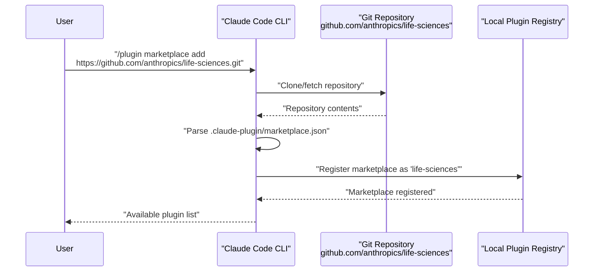

**Diagram: Marketplace Registration Flow**

When the marketplace is added, Claude Code:
1. Clones or fetches the Git repository from the specified URL [README.md:151-155]().
2. Locates the marketplace manifest at `.claude-plugin/marketplace.json` [.claude-plugin/marketplace.json:1-184]().
3. Registers the marketplace with the identifier `life-sciences` (defined as the `name` in the manifest) [.claude-plugin/marketplace.json:2-2]().
4. Makes all plugin definitions in the manifest available for installation.

Sources: [README.md:151-155](), [.claude-plugin/marketplace.json:1-184]()

---

## Plugin Identification System

### Plugin ID Format

All plugins in the marketplace are installed using the format:

```
<plugin-id>@<marketplace-name>
```

Where:
- `<plugin-id>`: The unique identifier for the specific plugin (e.g., `pubmed`, `10x-genomics`).
- `<marketplace-name>`: The marketplace identifier (in this case, `life-sciences`).

### Available Plugin IDs

```mermaid
graph TB
    subgraph "marketplace.json"
        Registry["Marketplace Registry<br/>.claude-plugin/marketplace.json"]
    end
    
    subgraph "Remote MCP Servers"
        PubMed["pubmed@life-sciences"]
        BioRender["biorender@life-sciences"]
        Synapse["synapse@life-sciences"]
        Wiley["wiley-scholar-gateway@life-sciences"]
        Consensus["consensus@life-sciences"]
        Cortellis["cortellis@life-sciences"]
        Adis["adisinsight@life-sciences"]
    end
    
    subgraph "Local MCP Servers (MCPB)"
        TenX["10x-genomics@life-sciences"]
        ToolU["tooluniverse@life-sciences"]
    end
    
    subgraph "Skills"
        SCQC["single-cell-rna-qc@life-sciences"]
        Nextflow["nextflow-development@life-sciences"]
        Allotrope["instrument-data-to-allotrope@life-sciences"]
        scvi["scvi-tools@life-sciences"]
        Protocol["clinical-trial-protocol@life-sciences"]
        Strategy["scientific-problem-selection@life-sciences"]
    end
    
    Registry --> PubMed
    Registry --> BioRender
    Registry --> Synapse
    Registry --> Wiley
    Registry --> Consensus
    Registry --> Cortellis
    Registry --> Adis
    Registry --> TenX
    Registry --> ToolU
    Registry --> SCQC
    Registry --> Nextflow
    Registry --> Allotrope
    Registry --> scvi
    Registry --> Protocol
    Registry --> Strategy
```

**Diagram: Plugin ID Namespace Structure**

Sources: [README.md:38-147](), [.claude-plugin/marketplace.json:11-183]()

### Plugin Categories and Authentication

| Plugin ID | Category | Authentication Required |
|-----------|----------|------------------------|
| `pubmed@life-sciences` | Remote MCP Server | No |
| `biorender@life-sciences` | Remote MCP Server | Yes (Free Account) |
| `synapse@life-sciences` | Remote MCP Server | Yes (Free Account) |
| `wiley-scholar-gateway@life-sciences` | Remote MCP Server | Yes (Free Account) |
| `consensus@life-sciences` | Remote MCP Server | Yes (Free Account) |
| `cortellis@life-sciences` | Remote MCP Server | Yes (Paid Subscription) |
| `adisinsight@life-sciences` | Remote MCP Server | Yes (Paid Subscription) |
| `10x-genomics@life-sciences` | Local MCP Server (MCPB) | Yes (Paid/Token) |
| `tooluniverse@life-sciences` | Local MCP Server (MCPB) | Varies |
| `single-cell-rna-qc@life-sciences` | Skill | No |
| `nextflow-development@life-sciences` | Skill | No (requires Docker/Nextflow) |
| `scvi-tools@life-sciences` | Skill | No |
| `instrument-data-to-allotrope@life-sciences` | Skill | No |
| `clinical-trial-protocol@life-sciences` | Skill | No |
| `scientific-problem-selection@life-sciences` | Skill | No |

Sources: [README.md:38-147](), [README.md:192-197]()

---

## Installing Plugins

### Installation Commands

Individual plugins are installed after marketplace registration using the `/plugin install` command [README.md:15-28]().

```bash
# Example installations
/plugin install pubmed@life-sciences
/plugin install 10x-genomics@life-sciences
/plugin install single-cell-rna-qc@life-sciences
```

### Installation Process Flow

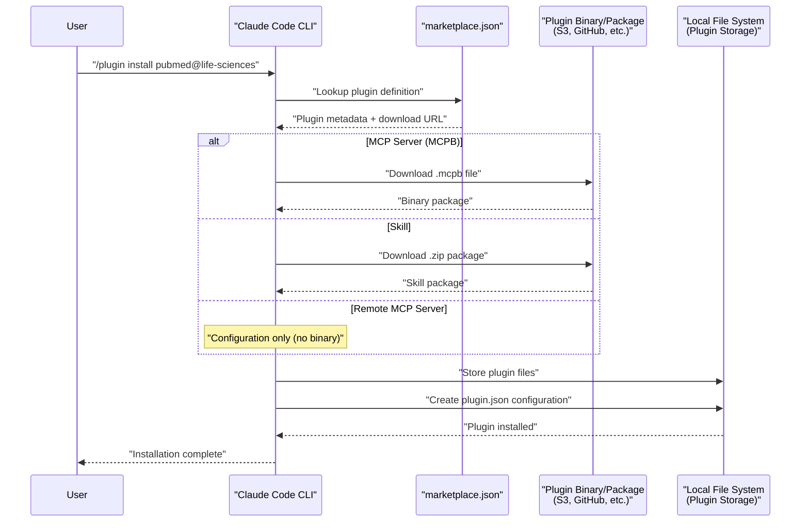

**Diagram: Plugin Installation Flow**

Sources: [README.md:157-175](), [.claude-plugin/marketplace.json:1-184]()

---

## Authentication and Configuration

### Configuration Requirements

After installing plugins, authentication must be configured for all MCP servers except PubMed. Skills do not require configuration but may have local environment requirements (e.g., Nextflow) [README.md:30-36]().

### Configuration Interface Access

1. Type `/plugin` in Claude Code.
2. Select **"Manage plugins"**.
3. Locate the installed plugin in the list.
4. Select **"Configure"**.
5. Enter required credentials (API keys, tokens, or usernames).

Sources: [README.md:177-186]()

### Credential Requirements by Plugin

#### PubMed
No configuration required. Ready to use immediately after installation [README.md:47-47]().

#### 10x Genomics Cloud
**Required Credentials:**
- **Access Token**: Generate from account security settings [README.md:100-100]().
- **Account Setup**: Generate token at https://cloud.10xgenomics.com/account/security [README.md:100-100]().

#### BioRender / Synapse / Wiley / Consensus
**Required Credentials:**
- Account credentials for the respective platform [README.md:195-195]().
- Free account registration is required on their respective websites [README.md:54-75]().

#### Cortellis / AdisInsight
**Required Credentials:**
- Paid subscription credentials/API access provided by Clarivate or Springer Nature [README.md:82-89]().

Sources: [README.md:42-101](), [README.md:192-197]()

---

## Restart Requirement

### Why Restart is Required

MCP servers operate as persistent background processes that must be initialized when Claude Code starts. Installing or configuring an MCP server does not automatically activate it in the current session [README.md:36-36]().

**No restart required for:**
- Installing Skills (they are local scripts/modules).
- Using already-configured and active MCP servers.

Sources: [README.md:36-36](), [README.md:188-190]()

---

## Verification and First Use

### Verifying MCP Server Installation

After restarting Claude Code, verify MCP servers are active by testing basic functionality:

**PubMed Example:**
`Search PubMed for recent articles about "single-cell RNA-seq quality control"`

**10x Genomics Example:**
`List my available analysis projects in 10x Genomics Cloud`

### Verifying Skill Installation

Skills are available immediately. You can test them by asking Claude to perform the specific workflow:

**Nextflow Example:**
`Check if my environment is ready to run Nextflow pipelines`

**Scientific Problem Selection Example:**
`Help me evaluate a new research idea using the Fischbach methodology`

Sources: [README.md:115-147]()

---

## Complete Installation Workflow

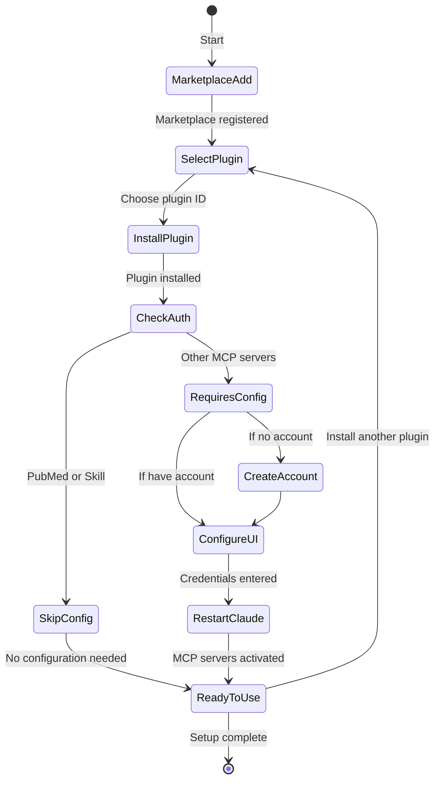

**Diagram: Complete Setup State Machine**

Sources: [README.md:9-36](), [README.md:151-190]()

---

# Page: Adding the Marketplace

# Adding the Marketplace

<details>
<summary>Relevant source files</summary>

The following files were used as context for generating this wiki page:

- [README.md](README.md)

</details>


## Purpose and Scope

This document explains how to register the life-sciences marketplace in Claude Code, making its plugins available for installation. This is a one-time setup step that must be completed before installing any MCP servers or skills from this repository [README.md:151-155]().

For information about installing individual plugins after marketplace registration, see **2.2 Installing Plugins**. For configuring credentials after plugin installation, see **2.3 Authentication and Configuration**.

---

## The Marketplace Registration Command

To register the life-sciences marketplace, execute the following command in Claude Code:

```bash
/plugin marketplace add https://github.com/anthropics/life-sciences.git
```

### Command Syntax

| Component | Description |
|-----------|-------------|
| `/plugin marketplace add` | Claude Code CLI command for registering a new marketplace |
| `https://github.com/anthropics/life-sciences.git` | Git repository URL containing the marketplace registry [README.md:154-154]() |

This command is executed **once per Claude Code installation**. The marketplace registration persists across Claude Code restarts [README.md:151-155]().

**Sources:** [README.md:11-13](), [README.md:151-155]()

---

## Registration Process

When you execute the marketplace add command, Claude Code performs the following sequence to map the repository to available tools.

### Marketplace Registration Flow

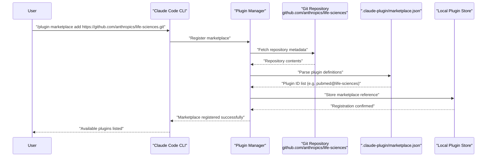

**Sources:** [README.md:11-13](), [README.md:151-155]()

---

## Marketplace Repository Structure

The marketplace is defined by a specific file structure within the Git repository. Understanding this structure helps clarify what Claude Code accesses during registration:

### Repository Layout

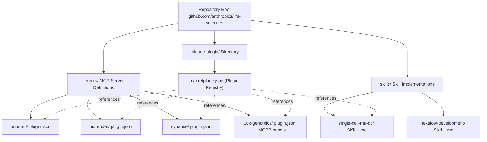

**Sources:** [README.md:38-148]()

---

## The Marketplace Registry File

The core of the marketplace is `.claude-plugin/marketplace.json`, which contains an array of plugin definitions. Each definition specifies the `pluginId`, `type`, and paths to configuration files like `plugin.json` (for MCP servers) or `SKILL.md` (for skills).

### Marketplace Registration Data Flow

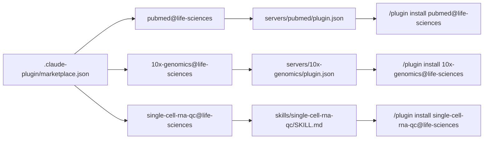

**Sources:** [README.md:11-28](), [README.md:38-148]()

---

## Verification

After executing the marketplace add command, verify successful registration using these methods:

### Method 1: List Installed Marketplaces
Execute `/plugin marketplace list` to see if `life-sciences` is present in the output.

### Method 2: Attempt Plugin Installation
Try to install a lightweight plugin:
```bash
/plugin install pubmed@life-sciences
```
If the marketplace is registered correctly, Claude Code will locate the plugin definition [README.md:42-47]().

### Method 3: Plugin Management UI
1. Type `/plugin` in Claude Code [README.md:31]().
2. Select **Manage plugins** [README.md:32]().
3. The life-sciences marketplace should appear as an available source.

**Sources:** [README.md:30-36](), [README.md:177-186]()

---

## Plugin ID Format

After marketplace registration, plugins are identified using the format `<plugin-name>@<marketplace-name>`. For this marketplace, the suffix is `@life-sciences`.

| Plugin ID | Plugin Type | Auth Requirement |
|-----------|-------------|------------------|
| `pubmed@life-sciences` | Remote MCP Server | None [README.md:47]() |
| `biorender@life-sciences` | Remote MCP Server | Free account [README.md:54]() |
| `synapse@life-sciences` | Remote MCP Server | Free account [README.md:61]() |
| `10x-genomics@life-sciences` | Local MCP Server | Paid/Institutional [README.md:98-101]() |
| `single-cell-rna-qc@life-sciences` | Skill | None [README.md:170]() |
| `nextflow-development@life-sciences` | Skill | Local Docker/Nextflow [README.md:131]() |

**Sources:** [README.md:40-148](), [README.md:192-197]()

---

## Troubleshooting

### Marketplace Add Command Fails

| Issue | Possible Cause | Solution |
|-------|---------------|----------|
| "Repository not found" | Invalid Git URL | Verify URL: `https://github.com/anthropics/life-sciences.git` [README.md:154]() |
| "Network error" | No internet connection | Check network connectivity and retry |
| "Invalid marketplace" | Missing `marketplace.json` | Ensure the `.claude-plugin/` folder exists in the repo |

### Plugins Not Appearing
If plugins don't appear in the `/plugin install` interface:
1. **Refresh cache**: Restart Claude Code [README.md:188-190]().
2. **Re-add marketplace**: 
   ```bash
   /plugin marketplace remove life-sciences
   /plugin marketplace add https://github.com/anthropics/life-sciences.git
   ```

**Sources:** [README.md:151-155](), [README.md:188-190]()

---

## Next Steps

After successfully adding the marketplace:
1. **Install plugins**: See **2.2 Installing Plugins** [README.md:157-175]().
2. **Configure authentication**: See **2.3 Authentication and Configuration** for servers like BioRender or Synapse [README.md:30-36]().
3. **Restart**: Always restart Claude Code after installing new MCP servers to activate them [README.md:190]().

**Sources:** [README.md:30-37](), [README.md:157-175](), [README.md:188-190]()

---

# Page: Installing Plugins

# Installing Plugins

<details>
<summary>Relevant source files</summary>

The following files were used as context for generating this wiki page:

- [.claude-plugin/marketplace.json](.claude-plugin/marketplace.json)
- [README.md](README.md)

</details>


## Purpose and Scope

This page documents the process of installing individual plugins from the life-sciences marketplace using the `/plugin install` command. It covers Plugin ID syntax, available plugins by type, and the installation workflow that Claude Code executes to fetch and register plugins based on the marketplace registry defined in `.claude-plugin/marketplace.json`.

**Prerequisites**: The marketplace must be registered first (see [2.1 Adding the Marketplace]()).

**Post-installation**: Authentication and configuration for plugins requiring credentials are covered in [2.3 Authentication and Configuration]().

---

## Plugin ID Format

Plugin IDs follow the format `<plugin-name>@<marketplace-name>`, where:
- `<plugin-name>`: The unique identifier for the plugin as defined in the `name` field within the `plugins` array of the marketplace registry [.claude-plugin/marketplace.json:12-182]().
- `<marketplace-name>`: The marketplace identifier, which is `life-sciences` for this repository [.claude-plugin/marketplace.json:2]().

**Examples**:
- `pubmed@life-sciences` [.claude-plugin/marketplace.json:20]()
- `10x-genomics@life-sciences` [.claude-plugin/marketplace.json:13]()
- `single-cell-rna-qc@life-sciences` [.claude-plugin/marketplace.json:83]()

The marketplace name is derived from the repository name during marketplace registration via `/plugin marketplace add` [README.md:153-155]().

**Sources**: [README.md:40-108](), [.claude-plugin/marketplace.json:1-184]()

---

## Installation Command

The basic installation syntax is:

```bash
/plugin install <plugin-id>
```

### Examples

```bash
# Install a remote MCP server
/plugin install pubmed@life-sciences

# Install a local MCP server (MCPB)
/plugin install 10x-genomics@life-sciences

# Install a skill
/plugin install single-cell-rna-qc@life-sciences
```

Multiple plugins can be installed sequentially to build a comprehensive life sciences environment [README.md:11-28]().

**Sources**: [README.md:11-28](), [README.md:157-175]()

---

## Available Plugins

### Plugin Inventory Table

| Plugin ID | Type | Description | Auth Required |
|-----------|------|-------------|---------------|
| `pubmed@life-sciences` | Remote MCP | Biomedical literature search | No [README.md:47]() |
| `biorender@life-sciences` | Remote MCP | Scientific illustration creation | Free account [README.md:54]() |
| `synapse@life-sciences` | Remote MCP | Research data management | Free account [README.md:61]() |
| `wiley-scholar-gateway@life-sciences` | Remote MCP | Academic publications access | Free account [README.md:68]() |
| `10x-genomics@life-sciences` | Local MCP (MCPB) | Genomics analysis data access | Access token [README.md:100]() |
| `single-cell-rna-qc@life-sciences` | Skill | scRNA-seq quality control pipeline | No [README.md:169-170]() |
| `nextflow-development@life-sciences` | Skill | nf-core pipeline runner | No [README.md:131]() |
| `scvi-tools@life-sciences` | Skill | Deep learning for single-cell | No [README.md:133-137]() |
| `consensus@life-sciences` | Remote MCP | AI-powered research search | Free account [README.md:75]() |
| `cortellis@life-sciences` | Remote MCP | Regulatory intelligence | Paid account [README.md:82]() |

**Sources**: [README.md:38-148](), [.claude-plugin/marketplace.json:11-183]()

### Installation by Plugin Type

#### Remote MCP Servers

Remote MCP servers connect to web-based APIs. Most require account credentials to be configured after installation [README.md:30-36]().

```bash
/plugin install pubmed@life-sciences
/plugin install consensus@life-sciences
/plugin install adisinsight@life-sciences
```

#### Local MCP Servers (MCPB)

Local MCP servers are bundled as binaries and run locally on the user's machine [README.md:91-94]().

```bash
/plugin install 10x-genomics@life-sciences
/plugin install tooluniverse@life-sciences
```

#### Skills

Skills are self-contained workflows packaged within the repository [README.md:103-106](). They do not require external service authentication but may have local system requirements (e.g., Nextflow requires Docker) [README.md:131]().

```bash
/plugin install scientific-problem-selection@life-sciences
/plugin install clinical-trial-protocol@life-sciences
```

**Sources**: [README.md:38-148](), [.claude-plugin/marketplace.json:83-147]()

---

## Plugin-to-Definition Mapping

This diagram associates the Natural Language Plugin IDs with the internal code entities and source paths defined in the marketplace registry.

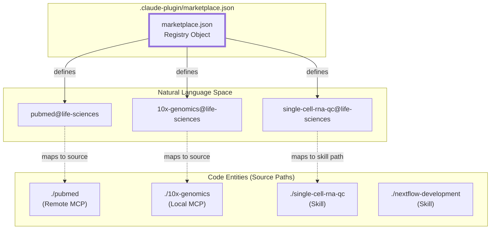

**Sources**: [.claude-plugin/marketplace.json:11-183]()

---

## Installation Workflow

The following diagram illustrates the technical flow when executing `/plugin install`, showing the relationship between the CLI and the marketplace metadata.

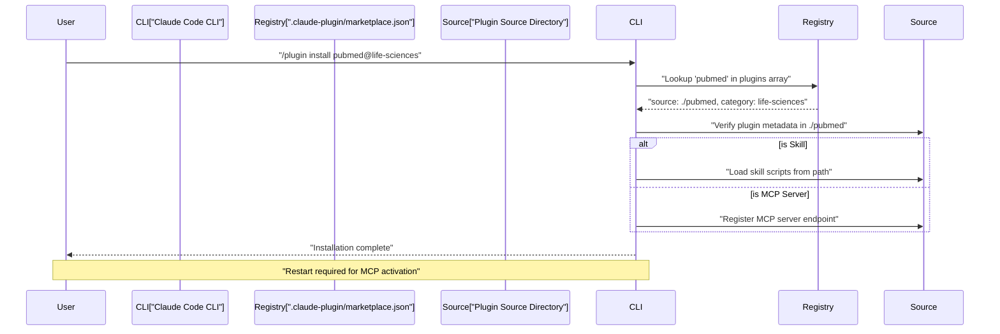

**Sources**: [README.md:157-190](), [.claude-plugin/marketplace.json:1-184]()

---

## Post-Installation Steps

### Restart Requirement

MCP servers (both remote and local) require a Claude Code restart to become active [README.md:188-190](). The restart loads the MCP server processes and establishes communication channels.

### Configuration

For servers requiring authentication (all except PubMed), credentials must be configured through the UI [README.md:30-36]():

1. Type `/plugin` in Claude Code.
2. Select **Manage plugins**.
3. Find the installed plugin.
4. Select **Configure**.
5. Enter required API keys or tokens.
6. Restart Claude Code.

**Sources**: [README.md:29-37](), [README.md:177-186]()

---

## Multiple Plugin Installation

Plugins can be installed in any order. Each installation is independent, and a single restart will activate all newly installed MCP servers [README.md:11-28]().

**Sources**: [README.md:157-175]()

---

# Page: Authentication and Configuration

# Authentication and Configuration

<details>
<summary>Relevant source files</summary>

The following files were used as context for generating this wiki page:

- [.gitignore](.gitignore)
- [10x-genomics/.claude-plugin/plugin.json](10x-genomics/.claude-plugin/plugin.json)
- [10x-genomics/txg-node.mcpb](10x-genomics/txg-node.mcpb)
- [README.md](README.md)

</details>


This page explains the authentication requirements and configuration process for plugins in the Life Sciences Marketplace. After installing a plugin (see [2.2 Installing Plugins]()), most plugins require credential setup before they can connect to external services.

For information about individual MCP server capabilities and features, see [3. MCP Servers]().

## Authentication Tiers

The marketplace organizes plugins into three authentication tiers based on their credential and account requirements.

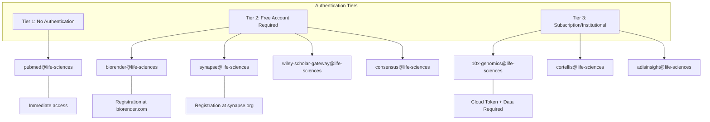
**Plugin Authentication Hierarchy**

Sources: [README.md:38-103](), [README.md:192-197]()

### Tier 1: No Authentication
**Plugins**: `pubmed@life-sciences`

These plugins are publicly accessible and require no credentials or account setup. They are immediately usable upon installation [README.md:42-47]().

### Tier 2: Free Account Required
**Plugins**: `biorender@life-sciences`, `synapse@life-sciences`, `wiley-scholar-gateway@life-sciences`, `consensus@life-sciences`

These plugins require a free account from the respective provider. Users must register on the provider's website before configuring the plugin in Claude Code [README.md:49-75]().

### Tier 3: Paid/Institutional Account
**Plugins**: `10x-genomics@life-sciences`, `cortellis@life-sciences`, `adisinsight@life-sciences`

These plugins require active subscriptions or specific institutional access.
*   **10x Genomics Cloud**: Requires an access token generated from the security settings of a 10x Genomics Cloud account [README.md:93-101]().
*   **Cortellis/AdisInsight**: Require professional subscriptions from Clarivate or Springer Nature respectively [README.md:77-90]().

## Configuration Workflow

The configuration process uses the Claude Code UI to securely store credentials. For local MCP servers like 10x Genomics, this involves the Model Context Protocol Binary (MCPB) format [10x-genomics/.claude-plugin/plugin.json:9]().

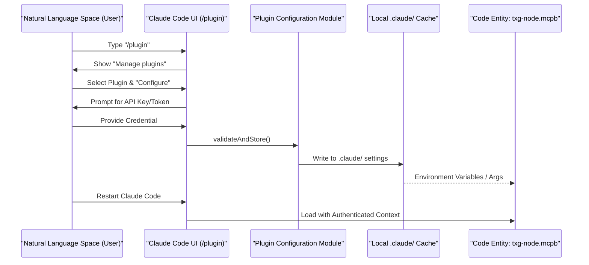
**Authentication Data Flow**

Sources: [README.md:30-36](), [README.md:179-190](), [.gitignore:1-3]()

### Step-by-Step Setup
1.  **Access Menu**: Type `/plugin` in Claude Code [README.md:31]().
2.  **Select Management**: Choose "Manage plugins" [README.md:32]().
3.  **Identify Plugin**: Find the installed server (e.g., `10x-genomics`) [README.md:33]().
4.  **Configure**: Select "Configure" and enter the required API keys or tokens [README.md:34-35]().
5.  **Restart**: Restart Claude Code to initialize the MCP server with the new credentials [README.md:36]().

## Plugin-Specific Credential Details

| Plugin ID | Credential Type | Source |
| :--- | :--- | :--- |
| `10x-genomics` | Access Token | [cloud.10xgenomics.com/account/security](https://cloud.10xgenomics.com/account/security) |
| `biorender` | Account Login | [biorender.com](https://www.biorender.com) |
| `synapse` | Account Login | [synapse.org](https://www.synapse.org) |
| `consensus` | Account Login | [consensus.app](https://consensus.app) |
| `cortellis` | Subscription Key | [clarivate.com/cortellis](https://clarivate.com/cortellis) |

Sources: [README.md:49-101]()

## Implementation Detail: Local Storage

Claude Code maintains configuration state in local cache directories. These directories are excluded from version control to prevent credential leakage.

*   **Cache Path**: `.mcpb-cache/` stores downloaded MCP binaries [10x-genomics/txg-node.mcpb:1](), [.gitignore:2]().
*   **Settings Path**: `.claude/` stores plugin-specific configurations and tokens [.gitignore:3]().

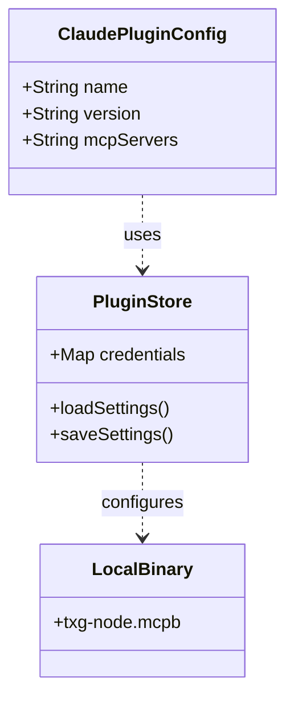
**Configuration Entities**

Sources: [10x-genomics/.claude-plugin/plugin.json:1-10](), [.gitignore:1-3]()

---

# Page: MCP Servers

# MCP Servers

<details>
<summary>Relevant source files</summary>

The following files were used as context for generating this wiki page:

- [.claude-plugin/marketplace.json](.claude-plugin/marketplace.json)
- [README.md](README.md)

</details>


## Purpose and Scope

This page introduces MCP (Model Context Protocol) servers as the primary mechanism for integrating external life sciences services into Claude Code. MCP servers act as standardized adapters that translate Claude Code requests into service-specific API calls, enabling seamless access to platforms like PubMed, 10x Genomics, ChEMBL, and others.

This page provides an architectural overview of how MCP servers function, the distinction between Remote and Local (MCPB) server types, authentication requirements, and a catalog of available servers. For detailed documentation of individual servers, see pages [Understanding MCP Servers](#3.1) through [ToolUniverse](#3.6). For self-contained analytical workflows that do not require external service integration, see [Skills](#4).

## MCP Server Architecture

MCP servers function as stateless proxy layers between Claude Code and external life sciences platforms. When a user invokes a capability, the request flows through the installed MCP server, which handles authentication, translates the request into the appropriate API format, and formats the response for Claude Code consumption.

### Request Flow Architecture

```mermaid
sequenceDiagram
    participant User
    participant CC["Claude Code"]
    participant PM["Plugin Manager"]
    participant MCP["MCP Server Instance<br/>(e.g., pubmed)"]
    participant Auth["Credential Store"]
    participant API["External Service API<br/>(e.g., PubMed API)"]
    
    User->>CC: "Invoke capability"
    CC->>PM: "Route request to server"
    PM->>MCP: "Forward request"
    MCP->>Auth: "Retrieve credentials"
    Auth-->>MCP: "API key or token"
    MCP->>API: "HTTP/REST API call"
    API-->>MCP: "JSON response"
    MCP->>MCP: "Format response"
    MCP-->>PM: "Structured data"
    PM-->>CC: "Display result"
    CC-->>User: "Show formatted output"
```

**Sources:** [README.md:1-151](), [.claude-plugin/marketplace.json:1-184]()

### Remote vs Local MCP Servers

The marketplace distinguishes between two server deployment models based on complexity and authentication requirements:

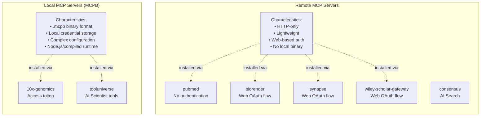

**Sources:** [README.md:40-102](), [.claude-plugin/marketplace.json:11-184]()

## Plugin Registry Structure

The marketplace registry is defined in `.claude-plugin/marketplace.json`, which serves as the central catalog of available MCP servers. Each plugin entry specifies its installation source, metadata, and categorization.

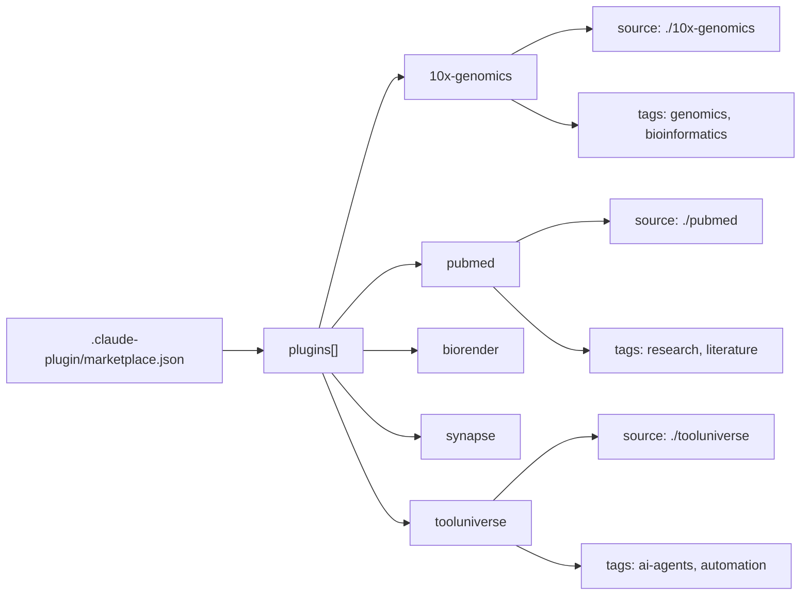

**Sources:** [.claude-plugin/marketplace.json:1-184]()

## Available MCP Servers

The marketplace provides a wide range of MCP servers categorized by domain. For details, see the linked child pages.

### Literature and Research Servers
Access scientific literature, preprints, and evidence synthesis.
*   **Servers**: PubMed, BioRxiv/MedRxiv, Wiley Scholar Gateway, Consensus.
*   **For details, see [Literature and Research Servers](#3.2)**.

### Research Platform Servers
Collaborative data management and scientific visualization.
*   **Servers**: BioRender, Synapse.org, Open Targets.
*   **For details, see [Research Platform Servers](#3.3)**.

### Drug Discovery and Clinical Servers
Intelligence for drug pipelines, bioactive molecules, and clinical trials.
*   **Servers**: ChEMBL, Owkin, Cortellis, AdisInsight, ClinicalTrials.gov, Medidata.
*   **For details, see [Drug Discovery and Clinical Servers](#3.4)**.

### Specialized Local Servers (MCPB)
Deep integration for genomics data and AI-powered scientific automation.
*   **10x Genomics Cloud**: Access analysis data and workflows. **For details, see [10x Genomics Cloud](#3.5)**.
*   **ToolUniverse**: AI agents for scientific discovery from MIMS Harvard. **For details, see [ToolUniverse](#3.6)**.

**Sources:** [README.md:40-102](), [.claude-plugin/marketplace.json:11-184]()

## Authentication Architecture

MCP servers implement a tiered authentication model. For details on how these work, see [Understanding MCP Servers](#3.1).

| Tier | Requirement | Servers |
|------|-------------|---------|
| **Tier 1** | No authentication | `pubmed` |
| **Tier 2** | Free account | `biorender`, `synapse`, `wiley-scholar-gateway`, `consensus` |
| **Tier 3** | Paid/Institutional | `10x-genomics`, `cortellis`, `adisinsight`, `medidata` |

**Sources:** [README.md:192-197]()

## Installation and Configuration Workflow

The installation lifecycle for MCP servers follows a standard pattern in Claude Code:

1.  **Add Marketplace**: `/plugin marketplace add anthropics/life-sciences` [README.md:13]()
2.  **Install Plugin**: `/plugin install <plugin-id>@life-sciences` [README.md:16-20]()
3.  **Configure**: For Tier 2/3 servers, use `/plugin` -> "Manage plugins" -> "Configure" [README.md:30-36]()
4.  **Restart**: Restart Claude Code to activate the server [README.md:188-190]()

## MCP Server vs Skill

It is important to distinguish MCP servers from skills, as they serve fundamentally different architectural purposes:

| Aspect | MCP Server | Skill |
|--------|-----------|-------|
| **Purpose** | Proxy/adapter to external service | Self-contained computational workflow |
| **Execution** | External API calls | Local in-process execution |
| **Authentication** | Required (usually) | None (operates on local data) |
| **Example** | `pubmed` queries external database | `single-cell-rna-qc` processes local files |

**Sources:** [README.md:5-7](), [.claude-plugin/marketplace.json:11-184]()

## Next Steps

- [Understanding MCP Servers](#3.1) — Deep dive into the MCP protocol and Local vs Remote servers.
- [Literature and Research Servers](#3.2) — PubMed, BioRxiv, Wiley, and Consensus.
- [Research Platform Servers](#3.3) — BioRender, Synapse, and Open Targets.
- [Drug Discovery and Clinical Servers](#3.4) — ChEMBL, Owkin, Cortellis, AdisInsight, and Medidata.
- [10x Genomics Cloud](#3.5) — 10x Genomics local MCP server.
- [ToolUniverse](#3.6) — MIMS Harvard AI scientist tools.

---

# Page: Understanding MCP Servers

# Understanding MCP Servers

<details>
<summary>Relevant source files</summary>

The following files were used as context for generating this wiki page:

- [.claude-plugin/marketplace.json](.claude-plugin/marketplace.json)
- [.gitignore](.gitignore)
- [10x-genomics/.claude-plugin/plugin.json](10x-genomics/.claude-plugin/plugin.json)
- [10x-genomics/txg-node.mcpb](10x-genomics/txg-node.mcpb)

</details>


## Purpose and Scope

This page explains the architecture and operation of MCP (Model Context Protocol) servers within the life sciences marketplace. It covers the fundamental concepts of MCP servers, how they differ from Skills, the distinction between Remote and Local (MCPB) MCP server types, and their technical implementation details.

For information about installing and configuring MCP servers, see [Authentication and Configuration](#2.3). For documentation of individual MCP servers, see sections [Literature and Research Servers](#3.2) through [3.7](#3.7). For information about Skills (self-contained analytical workflows), see [Skills](#4).

## What are MCP Servers?

MCP servers are **external service integrations** that act as proxy or adapter layers between Claude Code and life sciences platforms. Unlike Skills, which execute computational workflows locally, MCP servers translate user requests into API calls to remote services and format the responses for Claude Code.

**Key characteristics:**

| Aspect | Description |
|--------|-------------|
| **Primary Function** | Translate Claude Code requests into external API calls |
| **Data Location** | All data resides in external services (PubMed, ChEMBL, 10x Genomics Cloud, etc.) |
| **Execution Model** | Network-based request/response pattern |
| **Purpose** | Enable data access and retrieval from external platforms |
| **Local Processing** | Minimal - primarily formatting and protocol translation |

MCP servers enable Claude Code to interact with services like:
- PubMed databases for literature search [.claude-plugin/marketplace.json:20-25]()
- 10x Genomics Cloud analysis data [.claude-plugin/marketplace.json:13-18]()
- BioRender scientific illustrations [.claude-plugin/marketplace.json:27-32]()
- Synapse.org research data repositories [.claude-plugin/marketplace.json:34-39]()
- Wiley Scholar Gateway publications [.claude-plugin/marketplace.json:41-46]()
- ChEMBL bioactivity database [.claude-plugin/marketplace.json:62-67]()

**Sources:** [.claude-plugin/marketplace.json:1-182]()

## MCP Server Types: Remote vs Local (MCPB)

The marketplace distinguishes between two architectural categories of MCP servers:

### Remote MCP Servers

**Definition:** Lightweight HTTP-based integrations that communicate directly with web APIs without requiring local binary execution.

**Characteristics:**
- Simpler authentication (none to free accounts)
- Immediate availability after installation
- Web-based API endpoints
- Minimal configuration requirements

**Available Remote MCP Servers (Examples):**

| Plugin ID | Service | Authentication Requirement |
|-----------|---------|---------------------------|
| `pubmed@life-sciences` | PubMed | None [.claude-plugin/marketplace.json:20-25]() |
| `biorender@life-sciences` | BioRender | Free account [.claude-plugin/marketplace.json:27-32]() |
| `chembl@life-sciences` | ChEMBL Database | None [.claude-plugin/marketplace.json:62-67]() |
| `biorxiv@life-sciences` | bioRxiv/medRxiv | None [.claude-plugin/marketplace.json:48-53]() |

### Local MCP Servers (MCPB)

**Definition:** Local binary executables (`.mcpb` files) that run as persistent processes on the user's machine, handling more complex integration patterns and authentication schemes. These are often cached in `.mcpb-cache/` [.gitignore:2-2]().

**Characteristics:**
- Require local binary installation
- More complex authentication (API keys, access tokens)
- Stateful connections to external services
- Institutional/paid account requirements

**Available Local MCP Servers:**

| Plugin ID | Service | Binary Source |
|-----------|---------|---------------|
| `10x-genomics@life-sciences` | 10x Genomics Cloud | `txg-node.mcpb` [10x-genomics/txg-node.mcpb:1-1]() |
| `tooluniverse@life-sciences` | ToolUniverse | MIMS Harvard agents [.claude-plugin/marketplace.json:149-154]() |

**Sources:** [.claude-plugin/marketplace.json:11-182](), [10x-genomics/plugin.json:9-9](), [.gitignore:1-3]()

## MCP Server Architecture

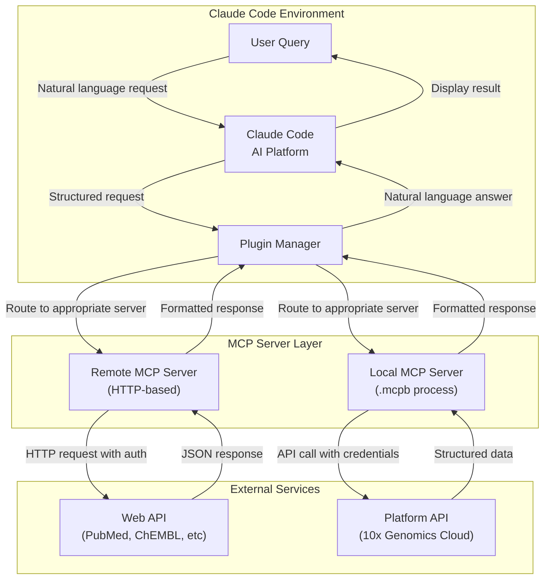

**MCP Server Request-Response Flow**

This diagram illustrates how MCP servers translate user queries into external API calls. The Plugin Manager routes requests to either Remote MCP Servers (lightweight HTTP wrappers) or Local MCP Servers (persistent `.mcpb` processes like `txg-node.mcpb` [10x-genomics/txg-node.mcpb:1-1]()), which then communicate with their respective external services.

**Sources:** [.claude-plugin/marketplace.json:1-182](), [10x-genomics/plugin.json:1-10]()

## Plugin Definition Structure

Each MCP server is defined through a hierarchical configuration structure:

### Marketplace Registry

The `marketplace.json` file serves as the central registry, listing all available plugins:

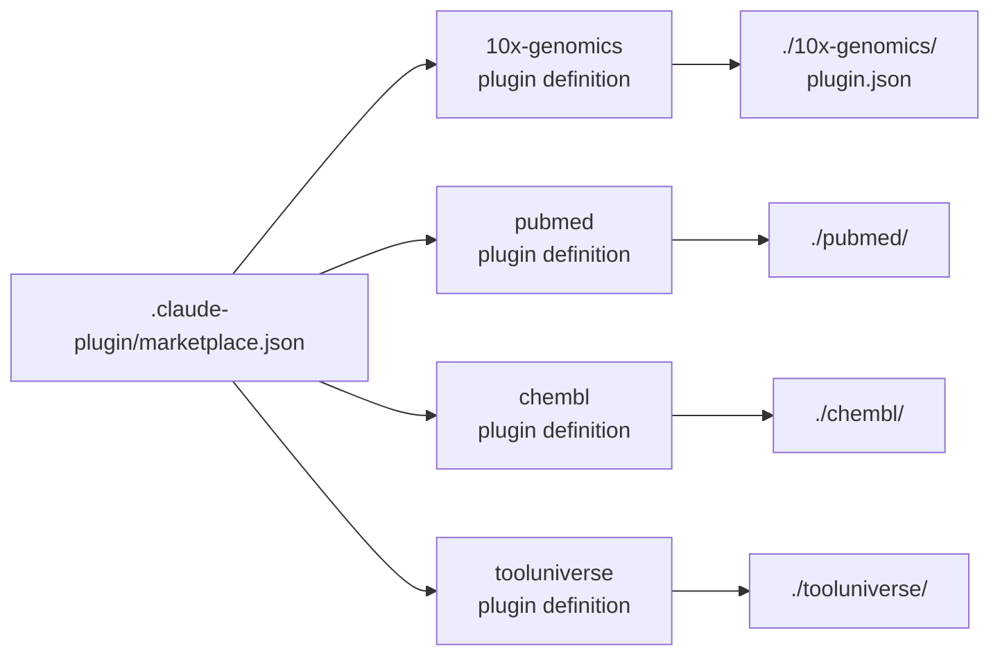

**Marketplace Plugin Registry Structure**

This diagram shows how the central `.claude-plugin/marketplace.json` registry points to individual plugin definitions. Each plugin has its own metadata and source directory [.claude-plugin/marketplace.json:11-183]().

**Key fields in marketplace.json:**

| Field | Purpose | Example |
|-------|---------|---------|
| `name` | Plugin identifier used in install commands | `"10x-genomics"` [.claude-plugin/marketplace.json:13-13]() |
| `source` | Path to plugin directory | `"./10x-genomics"` [.claude-plugin/marketplace.json:14-14]() |
| `description` | Human-readable plugin description | `"Access to the ChEMBL Database"` [.claude-plugin/marketplace.json:64-64]() |
| `tags` | Searchable metadata tags | `["drug-discovery", "chemistry"]` [.claude-plugin/marketplace.json:66-66]() |

**Sources:** [.claude-plugin/marketplace.json:1-183]()

### Individual Plugin Configuration

Each MCP server directory contains a `plugin.json` file that defines the specific server requirements. For example, the `10x-genomics` plugin defines its binary source via `mcpServers` [10x-genomics/plugin.json:9-9]().

**For Local MCP Servers (MCPB):**
- **mcpServers**: URL to the binary executable [10x-genomics/plugin.json:9-9]()
- **name/version**: Identification metadata [10x-genomics/plugin.json:2-3]()

### Directory Structure

```
life-sciences/
├── .claude-plugin/
│   └── marketplace.json          # Central plugin registry
├── 10x-genomics/
│   ├── plugin.json                # 10x Genomics MCPB configuration
│   └── txg-node.mcpb              # Local binary executable
├── pubmed/
│   └── (Remote configuration)
├── chembl/
│   └── (Remote configuration)
└── tooluniverse/
    └── (Local MCPB configuration)
```

**Sources:** [.claude-plugin/marketplace.json:1-182](), [10x-genomics/plugin.json:1-10]()

## Data Flow Comparison: MCP Servers vs Skills

```mermaid
sequenceDiagram
    participant User
    participant Claude as "Claude Code"
    participant MCP as "MCP Server (e.g. PubMed)"
    participant External as "External Service<br/>(NCBI APIs)"
    
    Note over User,External: MCP Server Data Flow
    
    User->>Claude: "Find papers about CRISPR"
    Claude->>MCP: Structured query request
    MCP->>External: HTTP API call
    Note over External: Data stored remotely
    External-->>MCP: JSON response
    MCP-->>Claude: Structured results
    Claude-->>User: Natural language answer
```

**MCP Server Data Flow Pattern**

This sequence diagram illustrates the network-based request/response pattern. All data processing occurs on external services, with the MCP server acting as a translation layer.

**Contrast with Skills:**

| Aspect | MCP Servers | Skills |
|--------|-------------|--------|
| **Data Flow** | Network requests to external APIs | Local in-process execution |
| **Data Storage** | Remote (PubMed, 10x Cloud, etc.) | Local files (e.g., `.h5ad`, `.fastq`) |
| **Execution** | External service infrastructure | User's local Python/CLI environment |
| **Definition** | Listed in `plugins` [.claude-plugin/marketplace.json:11-11]() | Listed in `skills` array [.claude-plugin/marketplace.json:89-91]() |

**Sources:** [.claude-plugin/marketplace.json:11-182]()

## Technical Implementation: The MCPB Bundle

Local MCP servers are distributed as `.mcpb` files. These are compressed bundles containing the executable logic for the server.

**Example: 10x Genomics MCPB**
The `txg-node.mcpb` file is a binary bundle [10x-genomics/txg-node.mcpb:1-34]() that Claude Code downloads from a specified release URL [10x-genomics/plugin.json:9-9](). 

- **Caching**: These binaries are stored locally in the `.mcpb-cache/` directory to avoid repeated downloads [.gitignore:2-2]().
- **Execution**: When a tool is called, Claude Code executes the binary, which then manages the connection to the 10x Genomics Cloud API.

**Sources:** [10x-genomics/plugin.json:1-10](), [10x-genomics/txg-node.mcpb:1-34](), [.gitignore:1-3]()

---

# Page: Literature and Research Servers

# Literature and Research Servers

<details>
<summary>Relevant source files</summary>

The following files were used as context for generating this wiki page:

- [adisinsight/.claude-plugin/plugin.json](adisinsight/.claude-plugin/plugin.json)
- [biorender/.claude-plugin/plugin.json](biorender/.claude-plugin/plugin.json)
- [biorxiv/.claude-plugin/plugin.json](biorxiv/.claude-plugin/plugin.json)
- [chembl/.claude-plugin/plugin.json](chembl/.claude-plugin/plugin.json)
- [clinical-trials/.claude-plugin/plugin.json](clinical-trials/.claude-plugin/plugin.json)
- [consensus/.claude-plugin/plugin.json](consensus/.claude-plugin/plugin.json)
- [cortellis/.claude-plugin/plugin.json](cortellis/.claude-plugin/plugin.json)
- [open-targets/.claude-plugin/plugin.json](open-targets/.claude-plugin/plugin.json)
- [owkin/.claude-plugin/plugin.json](owkin/.claude-plugin/plugin.json)
- [pubmed/.claude-plugin/plugin.json](pubmed/.claude-plugin/plugin.json)
- [synapse/.claude-plugin/plugin.json](synapse/.claude-plugin/plugin.json)
- [wiley-scholar-gateway/.claude-plugin/plugin.json](wiley-scholar-gateway/.claude-plugin/plugin.json)

</details>


The Literature and Research MCP (Model Context Protocol) servers provide Claude Code with direct access to vast repositories of scientific knowledge. These integrations enable researchers to perform literature reviews, track preprints, and query AI-synthesized research findings directly from their development environment.

## Overview of Research Connectors

These servers are implemented as remote HTTP MCP servers, allowing Claude to interface with external APIs through a standardized protocol.

| Server Name | Provider | Primary Use Case | Authentication |
| :--- | :--- | :--- | :--- |
| **PubMed** | U.S. National Library of Medicine | Searching peer-reviewed biomedical literature. | None (Public) |
| **bioRxiv/medRxiv** | deepsense.ai | Accessing biological and medical preprints. | None (Public) |
| **Scholar Gateway** | John Wiley & Sons, Inc. | Accessing Wiley academic publications. | Required |
| **Consensus** | Consensus | AI-powered search across peer-reviewed papers. | Required |

**Sources:**
- [pubmed/.claude-plugin/plugin.json:1-15]()
- [biorxiv/.claude-plugin/plugin.json:1-15]()
- [wiley-scholar-gateway/.claude-plugin/plugin.json:1-15]()
- [consensus/.claude-plugin/plugin.json:1-15]()

## Data Flow and Architecture

The literature servers follow a remote MCP architecture where Claude Code acts as the client, sending JSON-RPC requests to the designated service URLs defined in each plugin's configuration.

### Research Request Data Flow

The following diagram illustrates how a natural language query for literature is translated into a technical MCP request to a research provider.

**Literature Query Data Flow**
```mermaid
graph TD
    subgraph "Natural Language Space"
        User["User Query: 'Find recent papers on CRISPR-Cas9'"]
    end

    subgraph "Claude Code Entity Space"
        Claude["Claude Client"]
        PluginConfig["plugin.json Config"]
    end

    subgraph "External Research Services"
        PubMedAPI["PubMed HTTP Endpoint"]
        BioRxivAPI["bioRxiv HTTP Endpoint"]
        ConsensusAPI["Consensus HTTP Endpoint"]
    end

    User --> Claude
    Claude -- "Reads mcpServers.url" --> PluginConfig
    
    Claude -- "JSON-RPC: list_tools" --> PubMedAPI
    Claude -- "JSON-RPC: call_tool ('search')" --> PubMedAPI
    
    Claude -- "JSON-RPC: call_tool ('get_preprints')" --> BioRxivAPI
    
    Claude -- "JSON-RPC: call_tool ('ai_search')" --> ConsensusAPI

    PubMedAPI -- "JSON Results" --> Claude
    BioRxivAPI -- "JSON Results" --> Claude
    ConsensusAPI -- "JSON Results" --> Claude
```

**Sources:**
- [pubmed/.claude-plugin/plugin.json:9-14]()
- [biorxiv/.claude-plugin/plugin.json:9-14]()
- [consensus/.claude-plugin/plugin.json:9-14]()

## Implementation Details

### PubMed
The PubMed MCP server connects to the U.S. National Library of Medicine. It is a public resource that does not require individual API keys for basic search functionality through the MCP interface.

*   **Plugin ID:** `pubmed`
*   **Endpoint:** `https://pubmed.mcp.claude.com/mcp` [pubmed/.claude-plugin/plugin.json:12-12]()
*   **Capabilities:** Searching biomedical literature and retrieving article metadata/abstracts [pubmed/.claude-plugin/plugin.json:4-4]().

### bioRxiv & medRxiv
Maintained by deepsense.ai, this connector bridges Claude to the Cold Spring Harbor Laboratory preprint servers. It allows researchers to access the latest findings before they complete the peer-review cycle.

*   **Plugin ID:** `biorxiv`
*   **Endpoint:** `https://mcp.deepsense.ai/biorxiv/mcp` [biorxiv/.claude-plugin/plugin.json:12-12]()
*   **Capabilities:** Accessing research papers in biological and medical sciences posted before peer review [biorxiv/.claude-plugin/plugin.json:4-4]().

### Consensus
Consensus provides an AI-powered search layer. Unlike standard keyword search, it uses LLMs to synthesize answers based on the consensus of peer-reviewed literature.

*   **Plugin ID:** `consensus`
*   **Endpoint:** `https://mcp.consensus.app/mcp` [consensus/.claude-plugin/plugin.json:12-12]()
*   **Capabilities:** AI-powered search across peer-reviewed scientific research papers [consensus/.claude-plugin/plugin.json:4-4]().

### Wiley Scholar Gateway
This server provides a gateway to John Wiley & Sons' extensive academic catalog.

*   **Plugin ID:** `wiley-scholar-gateway`
*   **Endpoint:** `https://connector.scholargateway.ai/mcp` [wiley-scholar-gateway/.claude-plugin/plugin.json:12-12]()
*   **Capabilities:** Accessing academic research and publications hosted by Wiley [wiley-scholar-gateway/.claude-plugin/plugin.json:4-4]().

## Installation and Configuration

To install these servers, use the Claude Code CLI. While PubMed and bioRxiv are generally open, Wiley and Consensus may require authentication headers configured via the Claude environment.

### Command Reference

**Code Entity Mapping: Installation Commands**
```mermaid
graph LR
    subgraph "CLI Commands"
        InstallCmd["/plugin install"]
    end

    subgraph "Plugin Manifests (plugin.json)"
        PM["pubmed"]
        BX["biorxiv"]
        WSG["wiley-scholar-gateway"]
        CS["consensus"]
    end

    InstallCmd --> PM
    InstallCmd --> BX
    InstallCmd --> WSG
    InstallCmd --> CS
```

1.  **PubMed:**
    ```bash
    /plugin install pubmed
    ```
2.  **bioRxiv:**
    ```bash
    /plugin install biorxiv
    ```
3.  **Consensus:**
    ```bash
    /plugin install consensus
    ```
4.  **Wiley Scholar Gateway:**
    ```bash
    /plugin install wiley-scholar-gateway
    ```

**Sources:**
- [pubmed/.claude-plugin/plugin.json:2-2]()
- [biorxiv/.claude-plugin/plugin.json:2-2]()
- [wiley-scholar-gateway/.claude-plugin/plugin.json:2-2]()
- [consensus/.claude-plugin/plugin.json:2-2]()

---

# Page: Research Platform Servers

# Research Platform Servers

<details>
<summary>Relevant source files</summary>

The following files were used as context for generating this wiki page:

- [biorender/.claude-plugin/plugin.json](biorender/.claude-plugin/plugin.json)
- [biorxiv/.claude-plugin/plugin.json](biorxiv/.claude-plugin/plugin.json)
- [chembl/.claude-plugin/plugin.json](chembl/.claude-plugin/plugin.json)
- [clinical-trials/.claude-plugin/plugin.json](clinical-trials/.claude-plugin/plugin.json)
- [open-targets/.claude-plugin/plugin.json](open-targets/.claude-plugin/plugin.json)
- [owkin/.claude-plugin/plugin.json](owkin/.claude-plugin/plugin.json)
- [pubmed/.claude-plugin/plugin.json](pubmed/.claude-plugin/plugin.json)
- [synapse/.claude-plugin/plugin.json](synapse/.claude-plugin/plugin.json)
- [wiley-scholar-gateway/.claude-plugin/plugin.json](wiley-scholar-gateway/.claude-plugin/plugin.json)

</details>


This page documents the Model Context Protocol (MCP) servers for collaborative research platforms integrated into the Life Sciences marketplace. These servers enable Claude to interact with platforms for scientific illustration (BioRender), data management (Synapse.org), and drug target discovery (Open Targets).

## Overview of Research Platforms

The Research Platform servers are implemented as remote HTTP MCP servers. Unlike local skills, these servers provide a bridge between Claude and specialized web-based scientific ecosystems, allowing for the retrieval, organization, and visualization of research data.

### Platform Summary

| Platform | Provider | Purpose | Connection Type |
| :--- | :--- | :--- | :--- |
| **BioRender** | BioRender | Scientific illustrations and figures | Remote HTTP |
| **Synapse.org** | Sage Bionetworks | Collaborative data management | Remote HTTP |
| **Open Targets** | Open Targets | Drug target discovery and prioritization | Remote HTTP |

---

## BioRender

The BioRender MCP server allows Claude to interface with the BioRender platform, a tool specifically designed for creating high-quality scientific illustrations and journal figures.

### Capabilities
The server enables Claude to:
*   Search for and access scientific illustrations.
*   Assist in the creation and organization of visual research assets.

### Implementation Details
The BioRender integration is defined as a remote HTTP MCP server [biorender/.claude-plugin/plugin.json:9-13]().

**Data Flow: BioRender Integration**
```mermaid
graph TD
    subgraph "Claude Code Environment"
        A["Claude LLM"] -- "Tool Call" --> B["MCP Client"]
    end

    subgraph "BioRender Infrastructure"
        C["BioRender MCP Server"] -- "Internal API" --> D["Illustration Database"]
        C -- "Asset Management" --> E["Scientific Figures"]
    end

    B -- "HTTP/JSON-RPC" --> C
```

**Sources:**
* [biorender/.claude-plugin/plugin.json:1-15]()

---

## Synapse.org (Sage Bionetworks)

Synapse is a collaborative research platform managed by Sage Bionetworks. It is used extensively for hosting large-scale genomics, proteomics, and clinical datasets.

### Capabilities
The Synapse MCP server provides Claude with the ability to:
*   Manage collaborative research data.
*   Query datasets hosted on Synapse.org.
*   Navigate project structures and metadata.

### Implementation Details
The server is hosted by Sage Bionetworks and integrated via a standard HTTP MCP endpoint [synapse/.claude-plugin/plugin.json:9-13]().

**Entity Mapping: Synapse Research Data**
```mermaid
graph LR
    subgraph "Natural Language Space"
        NL1["'Find the gene expression data for Project X'"]
        NL2["'List files in the Sage Bionetworks folder'"]
    end

    subgraph "Code Entity Space"
        CE1["synapse/.claude-plugin/plugin.json"]
        CE2["Synapse.org MCP Server"]
        CE3["Endpoint: https://mcp.synapse.org/mcp"]
    end

    NL1 --> CE2
    NL2 --> CE2
    CE2 --- CE1
    CE2 --- CE3
```

**Sources:**
* [synapse/.claude-plugin/plugin.json:1-15]()

---

## Open Targets

The Open Targets Platform is a comprehensive tool for the systematic identification and prioritization of potential therapeutic drug targets. It integrates publicly available datasets to score target-disease associations.

### Capabilities
*   **Target-Disease Associations:** Identify targets linked to specific diseases based on genetic evidence, somatic mutations, and known drugs.
*   **Target Prioritization:** Score potential targets based on multiple evidence streams.
*   **Data Integration:** Access harmonized data from multiple biological and clinical sources.

### Implementation Details
The Open Targets MCP server connects Claude directly to the platform's drug discovery engine [open-targets/.claude-plugin/plugin.json:9-13]().

**Data Flow: Drug Target Discovery**
```mermaid
graph TD
    subgraph "Claude Code"
        A["User Query: 'Prioritize targets for Type 2 Diabetes'"] --> B["OpenTargets Tool Call"]
    end

    subgraph "Open Targets Platform"
        B -- "HTTP POST" --> C["mcp.platform.opentargets.org/mcp"]
        C --> D["Target-Disease Evidence Engine"]
        D --> E["Public Dataset Integration"]
        E --> F["Scored Associations"]
    end

    F --> A
```

**Sources:**
* [open-targets/.claude-plugin/plugin.json:1-15]()

---

## Configuration and Requirements

All three servers described on this page are remote HTTP-based MCP servers. 

### Connection Configuration
The configuration for these servers follows a standard structure within the `.claude-plugin/plugin.json` file for each directory:

| Plugin Path | Server Name | URL |
| :--- | :--- | :--- |
| `biorender/` | `BioRender` | `https://mcp.services.biorender.com/mcp` |
| `synapse/` | `Synapse.org` | `https://mcp.synapse.org/mcp` |
| `open-targets/` | `OpenTargets` | `https://mcp.platform.opentargets.org/mcp` |

### Account Requirements
*   **BioRender:** Requires a BioRender account for accessing and saving illustrations.
*   **Synapse.org:** Requires a Synapse account and appropriate permissions for specific projects/datasets.
*   **Open Targets:** Generally provides access to public data, though specific enterprise instances may require authentication.

**Sources:**
* [biorender/.claude-plugin/plugin.json:11-12]()
* [synapse/.claude-plugin/plugin.json:11-12]()
* [open-targets/.claude-plugin/plugin.json:11-12]()

---

# Page: Drug Discovery and Clinical Servers

# Drug Discovery and Clinical Servers

<details>
<summary>Relevant source files</summary>

The following files were used as context for generating this wiki page:

- [adisinsight/.claude-plugin/plugin.json](adisinsight/.claude-plugin/plugin.json)
- [biorxiv/.claude-plugin/plugin.json](biorxiv/.claude-plugin/plugin.json)
- [chembl/.claude-plugin/plugin.json](chembl/.claude-plugin/plugin.json)
- [clinical-trials/.claude-plugin/plugin.json](clinical-trials/.claude-plugin/plugin.json)
- [consensus/.claude-plugin/plugin.json](consensus/.claude-plugin/plugin.json)
- [cortellis/.claude-plugin/plugin.json](cortellis/.claude-plugin/plugin.json)
- [medidata/.claude-plugin/plugin.json](medidata/.claude-plugin/plugin.json)
- [open-targets/.claude-plugin/plugin.json](open-targets/.claude-plugin/plugin.json)
- [owkin/.claude-plugin/plugin.json](owkin/.claude-plugin/plugin.json)
- [tooluniverse/.claude-plugin/plugin.json](tooluniverse/.claude-plugin/plugin.json)
- [tooluniverse/tooluniverse.mcpb](tooluniverse/tooluniverse.mcpb)

</details>


This page documents the Model Context Protocol (MCP) servers integrated into the life-sciences marketplace that specialize in drug discovery, bioactive molecules, regulatory intelligence, and clinical trial analytics. These servers enable Claude to interface with industry-standard databases and AI agents to accelerate research from early-stage molecule discovery to late-stage clinical trial planning.

## Overview of Drug Discovery & Clinical MCPs

The marketplace provides a suite of HTTP-based and local (MCPB) servers. While some connectors provide access to public databases (like ChEMBL and ClinicalTrials.gov), others require enterprise subscriptions to Clarivate, Springer Nature, or Medidata.

### Technical Architecture: NL to Code Entity Mapping

The following diagram illustrates how natural language queries are routed through the MCP architecture to specific life-science data providers.

**Figure 1: MCP Data Flow for Drug Discovery**
```mermaid
graph TD
    subgraph "Natural Language Space"
        A["'Find binding affinity for Imatinib'"]
        B["'Predict enrollment for Phase III Oncology'"]
    end

    subgraph "Code Entity Space (MCP Servers)"
        direction LR
        C["ChEMBL MCP"]
        D["Medidata MCP"]
        E["Cortellis MCP"]
    end

    subgraph "Data Provider Endpoints"
        C1["https://mcp.deepsense.ai/chembl/mcp"]
        D1["https://mcp.imedidata.com/mcp"]
        E1["https://api.clarivate.com/lifesciences/mcp-regulatory/mcp"]
    end

    A --> C
    B --> D
    C --> C1
    D --> D1
    E --> E1

    style C stroke-width:2px
    style D stroke-width:2px
    style E stroke-width:2px
```
**Sources:**
- `chembl/.claude-plugin/plugin.json:10-13`
- `medidata/.claude-plugin/plugin.json:10-13`
- `cortellis/.claude-plugin/plugin.json:10-13`

---

## Bioactive Molecules and Target Discovery

### ChEMBL (deepsense.ai)
The ChEMBL connector provides access to a manually curated database of bioactive drug-like compounds. It is primarily used for retrieving quantitative binding and functional data against biological targets.

*   **Type:** HTTP Remote MCP
*   **Endpoint:** `https://mcp.deepsense.ai/chembl/mcp`
*   **Capabilities:** Querying quantitative SAR (Structure-Activity Relationship) data and target-molecule interactions.

**Sources:**
- `chembl/.claude-plugin/plugin.json:2-15`

### Owkin AI Agents
The Owkin server integrates AI agents designed for biology, specifically the **HistoPLUS** agent. This allows for the analysis of H&E slides from the TCGA (The Cancer Genome Atlas) database.

*   **Capabilities:**
    *   Quantifying distinct cell types in histological images.
    *   Analyzing spatial tumor microenvironments.
    *   Performing cohort-level survival analysis.
*   **Endpoint:** `https://mcp.k.owkin.com/mcp`

**Sources:**
- `owkin/.claude-plugin/plugin.json:4-13`

---

## Regulatory and Pipeline Intelligence

These servers typically require professional subscriptions to the respective providers (Clarivate, Springer Nature).

### Cortellis Regulatory Intelligence
Provides global drug regulatory data to navigate compliance and approval pathways.

*   **Provider:** Clarivate
*   **Endpoint:** `https://api.clarivate.com/lifesciences/mcp-regulatory/mcp`

**Sources:**
- `cortellis/.claude-plugin/plugin.json:2-13`

### AdisInsight
Focuses on the drug development pipeline, providing intelligence on clinical trials and pharmaceutical deals.

*   **Provider:** Springer Nature
*   **Endpoint:** `https://adisinsight-mcp.springer.com/mcp`

**Sources:**
- `adisinsight/.claude-plugin/plugin.json:4-13`

---

## Clinical Trial Analytics

### ClinicalTrials.gov (deepsense.ai)
A connector for the NIH/NLM registry of FDA-regulated clinical studies. It allows Claude to search for trial statuses, eligibility criteria, and study results across global clinical research.

*   **Type:** HTTP Remote MCP
*   **Endpoint:** `https://mcp.deepsense.ai/clinical_trials/mcp`

**Sources:**
- `clinical-trials/.claude-plugin/plugin.json:4-13`

### Medidata Predictive Site Ranking
Medidata's MCP offers advanced tools for Intelligent Trials customers, moving beyond simple data retrieval into predictive analytics.

*   **Key Functions:**
    *   **Platform Help:** Querying Medidata product documentation (Rave EDC, Clinical Data Studio).
    *   **Predictive Site Ranking:** Ranking clinical trial sites based on past performance, indication, and enrollment goals.
*   **Endpoint:** `https://mcp.imedidata.com/mcp`

**Sources:**
- `medidata/.claude-plugin/plugin.json:4-13`

---

## Implementation Details

The servers are defined in the repository using the `plugin.json` schema, which specifies the `mcpServers` configuration. For remote servers, the `type` is set to `http` and points to a hosted manifest URL.

**Figure 2: Plugin Configuration to Server Mapping**
```mermaid
classDiagram
    class PluginManifest {
        +String name
        +String description
        +Map mcpServers
    }
    class MCPServerConfig {
        +String type
        +String url
    }
    PluginManifest "1" -- "1" MCPServerConfig : contains
    
    note for PluginManifest "Defined in .claude-plugin/plugin.json"
```

### Summary of Requirements

| Server | Data Source | Auth/Subscription |
| :--- | :--- | :--- |
| **ChEMBL** | EMBL-EBI ChEMBL | Public (via deepsense.ai) |
| **ClinicalTrials** | ClinicalTrials.gov | Public (via deepsense.ai) |
| **Owkin** | TCGA / Owkin AI | Owkin Credentials |
| **Cortellis** | Clarivate Regulatory | Clarivate API Key |
| **AdisInsight** | Springer Nature Pipeline | AdisInsight Subscription |
| **Medidata** | Medidata Platform | Medidata Customer Auth |

**Sources:**
- `chembl/.claude-plugin/plugin.json:4-12`
- `clinical-trials/.claude-plugin/plugin.json:4-12`
- `cortellis/.claude-plugin/plugin.json:4-12`
- `adisinsight/.claude-plugin/plugin.json:4-12`
- `medidata/.claude-plugin/plugin.json:4-12`
- `owkin/.claude-plugin/plugin.json:4-12`

---

# Page: 10x Genomics Cloud

# 10x Genomics Cloud

<details>
<summary>Relevant source files</summary>

The following files were used as context for generating this wiki page:

- [.gitignore](.gitignore)
- [10x-genomics/.claude-plugin/plugin.json](10x-genomics/.claude-plugin/plugin.json)
- [10x-genomics/txg-node.mcpb](10x-genomics/txg-node.mcpb)

</details>


## Purpose and Scope

This document covers the **10x Genomics Cloud MCP server**, a Local MCP Server (MCPB) that provides access to analysis data and workflows stored in the 10x Genomics Cloud platform. This plugin enables Claude Code to retrieve and interact with single-cell analysis results, spatial transcriptomics data, and other genomics workflows generated by 10x Genomics Cloud Analysis.

For general information about MCP servers, see [Understanding MCP Servers]().

**Sources:** [10x-genomics/.claude-plugin/plugin.json:1-10]()

## Overview

The 10x Genomics Cloud MCP server is a **Local MCP Server** distributed as a compiled binary (`.mcpb` file) that communicates with the 10x Genomics Cloud API. Unlike Remote MCP servers that run as web services, this server executes locally within the Claude Code environment and requires authentication credentials to access your organization's analysis data.

**Key characteristics:**
- **Plugin ID:** `10x-genomics@life-sciences`
- **Distribution format:** Node.js-based MCPB binary (`txg-node.mcpb`) [10x-genomics/.claude-plugin/plugin.json:9]()
- **Authentication:** Access token-based
- **Prerequisites:** Requires existing analysis data in your 10x Genomics Cloud account
- **Vendor:** 10x Genomics, Inc. [10x-genomics/.claude-plugin/plugin.json:6]()

**Sources:** [10x-genomics/.claude-plugin/plugin.json:1-10]()

## Prerequisites

### Account Requirements

The 10x Genomics Cloud MCP server requires a **paid/institutional 10x Genomics Cloud account**. This plugin is only useful if you already have:

1. **Active 10x Genomics Cloud account** (https://www.10xgenomics.com/products/cloud-analysis)
2. **Existing analysis data** in your account (e.g., single-cell RNA-seq analyses, spatial transcriptomics runs)
3. **Access token** with appropriate permissions

### Data Prerequisites

Unlike other MCP servers that provide access to public databases or creation tools, the 10x Genomics Cloud MCP server is designed to retrieve **your organization's proprietary analysis data**. Without existing analyses in your account, this plugin provides no functionality.

**Sources:** [10x-genomics/.claude-plugin/plugin.json:4]()

## Plugin Configuration

### Plugin Definition Structure

The plugin is defined by a configuration file that references an externally-hosted binary:

```json
{
  "name": "10x-genomics",
  "version": "1.0.0",
  "description": "10x Genomics Cloud MCP server for accessing analysis data and workflows",
  "author": {
    "name": "10x Genomics, Inc.",
    "url": "https://www.10xgenomics.com"
  },
  "mcpServers": "https://github.com/10XGenomics/txg-mcp/releases/latest/download/txg-node.mcpb"
}
```

The `mcpServers` field points to a GitHub release URL where the MCPB binary is hosted by 10x Genomics [10x-genomics/.claude-plugin/plugin.json:9](). This allows the MCP server implementation to be updated independently of the marketplace registry.

**Sources:** [10x-genomics/.claude-plugin/plugin.json:1-10]()

### Binary Distribution Model

The following diagram illustrates how the 10x Genomics MCP server binary is distributed:

```mermaid
graph TB
    marketplace["marketplace.json<br/>(life-sciences repo)"]
    plugin_def["plugin.json<br/>(10x-genomics/.claude-plugin)"]
    github_release["GitHub Release<br/>(10XGenomics/txg-mcp)"]
    binary["txg-node.mcpb<br/>(Node.js MCPB binary)"]
    claude_install["Claude Code<br/>Plugin Installation"]
    local_binary["Local MCPB<br/>(installed in Claude Code)"]
    
    marketplace -->|"references"| plugin_def
    plugin_def -->|"mcpServers URL"| github_release
    github_release -->|"hosts"| binary
    claude_install -->|"reads"| plugin_def
    claude_install -->|"downloads"| binary
    binary -->|"installed as"| local_binary
```

**Binary Distribution Flow**

This diagram shows the federated distribution model where the marketplace registry ([10x-genomics/.claude-plugin/plugin.json:1-10]()) contains only metadata and a URL reference, while the actual MCPB binary is hosted by 10x Genomics on their GitHub repository.

**Sources:** [10x-genomics/.claude-plugin/plugin.json:9]()

## Installation

### Step 1: Install the Plugin

```bash
/plugin install 10x-genomics@life-sciences
```

Claude Code will:
1. Read the plugin definition from [10x-genomics/.claude-plugin/plugin.json:1-10]()
2. Download `txg-node.mcpb` from the GitHub release URL [10x-genomics/.claude-plugin/plugin.json:9]()
3. Install the MCPB binary locally.

### Step 2: Configure Access Token

After installation, you must configure your 10x Genomics Cloud access token:

1. Type `/plugin` in Claude Code
2. Select "Manage plugins"
3. Find "10x-genomics" in the installed plugins list
4. Select "Configure"
5. Enter your access token
6. Restart Claude Code

**Sources:** [10x-genomics/.claude-plugin/plugin.json:1-10]()

## Architecture

### System Integration Overview

```mermaid
graph TB
    subgraph "Claude Code Environment"
        cc["Claude Code"]
        pm["Plugin Manager"]
        mcpb_runtime["MCPB Runtime"]
    end
    
    subgraph "Local MCP Server"
        txg_node["txg-node.mcpb<br/>(Node.js binary)"]
        auth_store["Credential Storage<br/>(Access Token)"]
    end
    
    subgraph "10x Genomics Cloud"
        api["10x Genomics Cloud API"]
        analyses["Analysis Data<br/>(Single-cell, Spatial, etc.)"]
        workflows["Workflow Metadata"]
    end
    
    cc -->|"invokes capabilities"| txg_node
    pm -->|"manages"| txg_node
    mcpb_runtime -->|"executes"| txg_node
    txg_node -->|"reads credentials"| auth_store
    txg_node -->|"authenticated API requests"| api
    api -->|"retrieves"| analyses
    api -->|"retrieves"| workflows
```

**10x Genomics MCP Server Architecture**

This diagram illustrates the runtime architecture. The `txg-node.mcpb` binary executes within the MCPB Runtime, authenticates using stored credentials, and makes API requests to the 10x Genomics Cloud to retrieve analysis data.

**Sources:** [10x-genomics/.claude-plugin/plugin.json:9](), [10x-genomics/.claude-plugin/plugin.json:4]()

### Authentication Flow

```mermaid
sequenceDiagram
    participant User
    participant CC as "Claude Code"
    participant UI as "Plugin Config UI"
    participant MCPB as "txg-node.mcpb"
    participant Store as "Credential Store"
    participant API as "10x Genomics Cloud API"
    
    User->>CC: "/plugin install 10x-genomics@life-sciences"
    CC->>MCPB: Download and install binary
    
    User->>CC: "/plugin → Manage plugins"
    CC->>UI: Open configuration interface
    User->>UI: Enter access token
    UI->>Store: Save encrypted credentials
    
    User->>CC: Restart Claude Code
    CC->>MCPB: Activate MCP server
    
    User->>CC: Request analysis data
    CC->>MCPB: Invoke capability
    MCPB->>Store: Retrieve access token
    MCPB->>API: API request with Bearer token
    API-->>MCPB: Analysis data / workflows
    MCPB-->>CC: Formatted response
    CC-->>User: Display results
```

**Authentication and Data Retrieval Sequence**

This sequence diagram shows the complete lifecycle from installation through data retrieval, highlighting the authentication checkpoint where credentials are stored and later retrieved for API requests.

**Sources:** [10x-genomics/.claude-plugin/plugin.json:1-10]()

## Technical Details

### MCPB Binary Format

The `.mcpb` extension indicates a **Model Context Protocol Binary**, which is a self-contained executable that implements the MCP server protocol. For the 10x Genomics plugin:

- **Binary name:** `txg-node.mcpb` [10x-genomics/txg-node.mcpb:1]()
- **Runtime:** Node.js-based
- **Distribution URL:** https://github.com/10XGenomics/txg-mcp/releases/latest/download/txg-node.mcpb [10x-genomics/.claude-plugin/plugin.json:9]()
- **Version management:** Handled by 10x Genomics via GitHub releases (always fetches `latest`)

### Cache Management

Local MCPB binaries and their associated data are managed in specific cache directories to ensure clean operation and prevent conflicts with Python environments.

| Path | Purpose |
|------|---------|
| `.mcpb-cache/` | Storage for downloaded MCPB binaries |
| `.claude/` | Local configuration and plugin state |

**Sources:** [.gitignore:1-3](), [10x-genomics/.claude-plugin/plugin.json:9]()

### Plugin Version Strategy

```mermaid
graph LR
    plugin_json["plugin.json<br/>version: 1.0.0"]
    mcpb_url["GitHub Release URL<br/>/releases/latest/"]
    binary["txg-node.mcpb<br/>(versioned by 10x Genomics)"]
    
    plugin_json -->|"references"| mcpb_url
    mcpb_url -->|"resolves to"| binary
    
    note1["Note: plugin.json version<br/>is marketplace version,<br/>not binary version"]
```

**Version Decoupling Strategy**

The `version` field in [10x-genomics/.claude-plugin/plugin.json:3]() represents the **marketplace plugin definition version** (1.0.0), not the version of the `txg-node.mcpb` binary itself. The binary version is managed independently by 10x Genomics through their GitHub release process.

**Sources:** [10x-genomics/.claude-plugin/plugin.json:3](), [10x-genomics/.claude-plugin/plugin.json:9]()

---

# Page: ToolUniverse

# ToolUniverse

<details>
<summary>Relevant source files</summary>

The following files were used as context for generating this wiki page:

- [medidata/.claude-plugin/plugin.json](medidata/.claude-plugin/plugin.json)
- [tooluniverse/.claude-plugin/plugin.json](tooluniverse/.claude-plugin/plugin.json)
- [tooluniverse/tooluniverse.mcpb](tooluniverse/tooluniverse.mcpb)

</details>


ToolUniverse is an MCP server developed by **MIMS Harvard** designed to democratize AI-powered scientific discovery. It provides a suite of specialized tools that allow AI agents (like Claude) to perform complex scientific automation, data analysis, and research tasks within a structured framework.

## Overview

The ToolUniverse implementation in the life-sciences marketplace follows the **Local MCP Server (MCPB)** architecture. Unlike HTTP-based remote servers, ToolUniverse is distributed as a bundled package containing the necessary logic and metadata to execute scientific tools directly through the Claude Code environment.

### Key Specifications
| Attribute | Value |
| :--- | :--- |
| **Provider** | MIMS Harvard [tooluniverse/.claude-plugin/plugin.json:6-7]() |
| **Version** | 1.0.0 [tooluniverse/.claude-plugin/plugin.json:3]() |
| **Type** | Local MCP Bundle (MCPB) [tooluniverse/.claude-plugin/plugin.json:9]() |
| **Website** | [https://aiscientist.tools](https://aiscientist.tools) [tooluniverse/.claude-plugin/plugin.json:7]() |

**Sources:**
- [tooluniverse/.claude-plugin/plugin.json:1-10]()

---

## MCPB Bundle Architecture

ToolUniverse utilizes the `.mcpb` format, which is a compressed bundle containing the server's executable logic and resource definitions. This allows for offline-capable, high-performance tool execution without the latency of external API calls for the core logic.

### Data Flow: Natural Language to Scientific Execution

The following diagram illustrates how a user's natural language request is translated into a ToolUniverse action via the MCPB bundle.

**ToolUniverse Execution Flow**
```mermaid
graph TD
    subgraph "Natural Language Space"
        User["User Request (e.g., 'Analyze protein interactions')"]
        Claude["Claude Code (LLM)"]
    end

    subgraph "Code Entity Space (Local Environment)"
        PluginConfig["tooluniverse/.claude-plugin/plugin.json"]
        MCPB_Bundle["tooluniverse/tooluniverse.mcpb"]
        MCP_Runtime["MCP Runtime Engine"]
    end

    User --> Claude
    Claude -- "Reads mcpServers path" --> PluginConfig
    PluginConfig -- "Points to" --> MCPB_Bundle
    Claude -- "Loads Tools from" --> MCP_Runtime
    MCP_Runtime -- "Executes" --> MCPB_Bundle
    MCPB_Bundle -- "Returns Scientific Results" --> Claude
    Claude -- "Synthesizes Answer" --> User
```

**Sources:**
- [tooluniverse/.claude-plugin/plugin.json:1-10]()
- [tooluniverse/tooluniverse.mcpb:1-28]()

---

## Tool Capabilities

The ToolUniverse server exposes a variety of "AI Scientist" tools. While the internal logic is encapsulated within the binary bundle [tooluniverse/tooluniverse.mcpb:1-28](), the server is designed to support the following categories of scientific automation:

1.  **Hypothesis Generation**: Assisting in the formulation of testable scientific hypotheses based on existing literature.
2.  **Experimental Design**: Automating the creation of protocols and workflows for biological or chemical experiments.
3.  **Data Synthesis**: Integrating disparate datasets from multiple life-science domains to find hidden correlations.
4.  **Literature Synthesis**: Deep analysis of scientific papers to extract entities, relationships, and evidence levels.

### Comparison: ToolUniverse vs. Standard MCP

Unlike the `medidata` MCP server, which uses a standard HTTP endpoint [medidata/.claude-plugin/plugin.json:10-13](), ToolUniverse is registered as a direct file reference to a release asset [tooluniverse/.claude-plugin/plugin.json:9]().

| Feature | Medidata MCP | ToolUniverse MCP |
| :--- | :--- | :--- |
| **Communication** | HTTP/JSON-RPC [medidata/.claude-plugin/plugin.json:11]() | Local Bundle (MCPB) [tooluniverse/.claude-plugin/plugin.json:9]() |
| **Endpoint** | `https://mcp.imedidata.com/mcp` [medidata/.claude-plugin/plugin.json:12]() | `tooluniverse.mcpb` [tooluniverse/.claude-plugin/plugin.json:9]() |
| **Primary Use** | Trial Site Ranking & Help [medidata/.claude-plugin/plugin.json:4]() | AI Scientific Discovery [tooluniverse/.claude-plugin/plugin.json:4]() |

**Sources:**
- [tooluniverse/.claude-plugin/plugin.json:1-10]()
- [medidata/.claude-plugin/plugin.json:1-15]()

---

## Integration Details

To use ToolUniverse within Claude Code, the system parses the `plugin.json` file. The `mcpServers` field provides the URI to the bundle [tooluniverse/.claude-plugin/plugin.json:9]().

### System Architecture Diagram

This diagram maps the file-based configuration to the runtime entities.

**Configuration to Runtime Mapping**
```mermaid
classDiagram
    class PluginJSON {
        +String name: "tooluniverse"
        +String mcpServers: "url_to_mcpb"
    }
    class ToolUniverseBundle {
        <<binary>>
        +icon.png
        +server_logic
    }
    class ClaudeCode {
        +loadPlugin(PluginJSON)
        +mountBundle(ToolUniverseBundle)
    }

    PluginJSON ..> ToolUniverseBundle : "defines location"
    ClaudeCode --> PluginJSON : "reads"
    ClaudeCode --> ToolUniverseBundle : "executes tools from"
```

**Sources:**
- [tooluniverse/.claude-plugin/plugin.json:1-10]()
- [tooluniverse/tooluniverse.mcpb:1]() (Header showing `icon.png` in bundle)

---

## Installation and Usage

1.  **Registration**: When the `life-sciences` marketplace is added, Claude Code identifies the `tooluniverse` directory.
2.  **Loading**: The environment fetches the `tooluniverse.mcpb` bundle from the location specified in the `plugin.json` [tooluniverse/.claude-plugin/plugin.json:9]().
3.  **Discovery**: Claude discovers the tools defined within the bundle (e.g., tools for MIMS Harvard's scientific discovery framework).
4.  **Execution**: Users can invoke these tools by asking Claude to perform scientific tasks, such as "Use ToolUniverse to propose a mechanism for drug resistance in the provided dataset."

**Sources:**
- [tooluniverse/.claude-plugin/plugin.json:1-10]()
- [tooluniverse/tooluniverse.mcpb:1-28]()

---

# Page: Skills

# Skills

<details>
<summary>Relevant source files</summary>

The following files were used as context for generating this wiki page:

- [.claude-plugin/marketplace.json](.claude-plugin/marketplace.json)
- [.github/workflows/release.yml](.github/workflows/release.yml)
- [README.md](README.md)

</details>


## Purpose and Scope

This document introduces **skills** as self-contained analytical workflows that extend Claude Code's capabilities for life sciences research. Unlike MCP servers, which act as proxies to external APIs, skills provide domain-specific computational pipelines that execute locally within the Claude Code environment. They bundle implementation logic, analytical algorithms, and reference documentation into reusable packages without requiring external service integration.

For detailed documentation on specific skills, see the following child pages:
*   [Single-Cell RNA-seq Quality Control](#4.1)
*   [scvi-tools Deep Learning Skill](#4.2)
*   [Nextflow Development Skill](#4.3)
*   [Instrument Data to Allotrope Skill](#4.4)
*   [Clinical Trial Protocol Skill](#4.5)
*   [Scientific Problem Selection Skill](#4.6)

**Sources:** [README.md:5-7](), [README.md:103-148](), [.claude-plugin/marketplace.json:83-147]()

---

## Architectural Model: Natural Language to Code Execution

Skills bridge the gap between high-level scientific intent and low-level code execution. The following diagram illustrates how natural language requests are mapped to specific code entities within a skill package.

### Skill Execution Architecture

```mermaid
graph TD
    subgraph "Natural Language Space"
        UserIntent["User Intent: 'Run QC on my pbmc.h5ad'"]
        ScientificContext["Scientific Context: scverse best practices"]
    end
    
    subgraph "Claude Code Runtime"
        CC["Claude Code"]
        PluginLoader["Plugin Loader"]
    end

    subgraph "Code Entity Space (Skill Package)"
        Manifest["SKILL.md (Manifest)"]
        EntryPoint["qc_analysis.py (CLI Entry)"]
        CoreLogic["qc_core.py (Functions)"]
        VizLogic["qc_plotting.py (Visualization)"]
    end

    subgraph "Local Filesystem"
        InputData["Input: .h5ad / .h5 / .csv"]
        OutputData["Output: filtered.h5ad / plots.png"]
    end

    UserIntent --> CC
    ScientificContext -.-> CC
    CC --> PluginLoader
    PluginLoader --> Manifest
    CC --> EntryPoint
    EntryPoint --> CoreLogic
    EntryPoint --> VizLogic
    CoreLogic --> InputData
    VizLogic --> OutputData
```

**Key architectural characteristics:**
1.  **Local Execution**: The Python executor runs within the Claude Code process. No data is transmitted to external services.
2.  **File-Based I/O**: Skills consume local files and generate standardized outputs (e.g., AnnData objects or Allotrope Simple Model files).
3.  **Standardized Entry Points**: Skills typically use a primary script (e.g., `qc_analysis.py` or `convert_to_asm.py`) as the interface for Claude Code.

**Sources:** [README.md:105-148](), [.claude-plugin/marketplace.json:83-147]()

---

## Packaging and Release Workflow

Skills are distributed as versioned zip archives via GitHub. The release process is managed by automated CI/CD pipelines to ensure consistency.

### Skill Distribution Pipeline

```mermaid
graph LR
    subgraph "Repository Structure"
        SkillDir["Skill Subdirectory"]
        Marker["SKILL.md (Marker File)"]
        Src["Python Scripts"]
    end

    subgraph "CI/CD (release.yml)"
        TagEvent["Git Tag Push (v*)"]
        ZipStep["zip -r {name}-{version}.zip"]
        ReleaseStep["softprops/action-gh-release"]
    end

    subgraph "Client Installation"
        MarketplaceJSON["marketplace.json"]
        InstallCmd["/plugin install {name}@life-sciences"]
    end

    SkillDir --> Marker
    Marker --> TagEvent
    TagEvent --> ZipStep
    ZipStep --> ReleaseStep
    ReleaseStep --> MarketplaceJSON
    MarketplaceJSON --> InstallCmd
```

**Packaging logic:**
*   **Marker Convention**: The release workflow specifically looks for a `SKILL.md` file in subdirectories to identify valid skill packages [.github/workflows/release.yml:20-22]().
*   **Archive Naming**: Zip files are automatically named using the directory name and the GitHub reference name (tag) [.github/workflows/release.yml:23-26]().
*   **Marketplace Registration**: The `.claude-plugin/marketplace.json` file serves as the registry, mapping skill names to their source locations and metadata [.claude-plugin/marketplace.json:1-184]().

**Sources:** [.github/workflows/release.yml:1-42](), [.claude-plugin/marketplace.json:83-147]()

---

## Summary of Available Skills

The marketplace currently provides six primary skills, each targeting a different stage of the life sciences research lifecycle.

| Skill | Plugin ID | Primary Function |
| :--- | :--- | :--- |
| **Single-Cell QC** | `single-cell-rna-qc@life-sciences` | MAD-based filtering and visualization for scRNA-seq. |
| **scvi-tools** | `scvi-tools@life-sciences` | Deep learning for single-cell integration and embedding. |
| **Nextflow Dev** | `nextflow-development@life-sciences` | Running nf-core pipelines (RNA-seq, Sarek) locally. |
| **Allotrope Conversion** | `instrument-data-to-allotrope@life-sciences` | Standardizing lab instrument data to ASM format. |
| **Clinical Protocol** | `clinical-trial-protocol@life-sciences` | Generating FDA/NIH-compliant trial documentation. |
| **Problem Selection** | `scientific-problem-selection@life-sciences` | Strategic research planning and risk assessment. |

### Skill Details and Child Links

*   **[Single-Cell RNA-seq Quality Control](#4.1)**: Implements scverse best practices for data cleaning. For details, see [Single-Cell RNA-seq Quality Control](#4.1).
*   **[scvi-tools Deep Learning Skill](#4.2)**: Provides workflows for scVI, scANVI, and totalVI models. For details, see [scvi-tools Deep Learning Skill](#4.2).
*   **[Nextflow Development Skill](#4.3)**: Simplifies the execution of complex bioinformatics pipelines for bench scientists. For details, see [Nextflow Development Skill](#4.3).
*   **[Instrument Data to Allotrope Skill](#4.4)**: Standardizes output from plate readers, spectrophotometers, and qPCR. For details, see [Instrument Data to Allotrope Skill](#4.4).
*   **[Clinical Trial Protocol Skill](#4.5)**: Automates the generation of regulatory-grade protocols for drugs and devices. For details, see [Clinical Trial Protocol Skill](#4.5).
*   **[Scientific Problem Selection Skill](#4.6)**: Applies the Fischbach & Walsh (2024) framework for project ideation. For details, see [Scientific Problem Selection Skill](#4.6).

**Sources:** [README.md:105-148](), [.claude-plugin/marketplace.json:83-147]()

---

# Page: Single-Cell RNA-seq Quality Control

# Single-Cell RNA-seq Quality Control

<details>
<summary>Relevant source files</summary>

The following files were used as context for generating this wiki page:

- [scientific-problem-selection/LICENSE.txt](scientific-problem-selection/LICENSE.txt)
- [scvi-tools/LICENSE.txt](scvi-tools/LICENSE.txt)
- [single-cell-rna-qc/LICENSE.txt](single-cell-rna-qc/LICENSE.txt)
- [single-cell-rna-qc/SKILL.md](single-cell-rna-qc/SKILL.md)
- [single-cell-rna-qc/references/scverse_qc_guidelines.md](single-cell-rna-qc/references/scverse_qc_guidelines.md)
- [single-cell-rna-qc/scripts/qc_analysis.py](single-cell-rna-qc/scripts/qc_analysis.py)
- [single-cell-rna-qc/scripts/qc_core.py](single-cell-rna-qc/scripts/qc_core.py)
- [single-cell-rna-qc/scripts/qc_plotting.py](single-cell-rna-qc/scripts/qc_plotting.py)

</details>


## Purpose and Scope

This document provides a comprehensive overview of the single-cell RNA-seq quality control (QC) skill, a self-contained analytical workflow that implements scverse best practices for filtering low-quality cells from single-cell RNA-sequencing datasets. The skill performs MAD-based (Median Absolute Deviation) outlier detection with comprehensive visualizations and offers two distinct usage patterns: an automated end-to-end pipeline for standard workflows and modular building blocks for custom analysis.

**Related pages:**
- For installation and first-time usage, see [Quick Start Guide](#4.1.1)
- For the complete automated pipeline interface, see [Complete Pipeline (Approach 1)](#4.1.2)
- For custom workflow development, see [Modular Building Blocks (Approach 2)](#4.1.3)
- For QC methodology and filtering rationale, see [QC Best Practices and Guidelines](#4.1.4)
- For detailed function documentation, see [Core Functions Reference](#4.1.5) and [Plotting Functions Reference](#4.1.6)

## Overview

The single-cell RNA-seq QC skill addresses a critical preprocessing step in single-cell analysis: identifying and removing low-quality cells that arise from technical artifacts (cell lysis, ambient RNA contamination, low capture efficiency) rather than biological variation. Unlike external MCP servers that interface with remote services, this skill executes entirely locally using Python-based computational pipelines.

**Key capabilities:**
- Calculates standard QC metrics (total counts, detected genes, mitochondrial/ribosomal/hemoglobin content) [single-cell-rna-qc/scripts/qc_core.py:16-58]()
- Detects outlier cells using MAD-based thresholds (more robust than fixed cutoffs) [single-cell-rna-qc/scripts/qc_core.py:64-101]()
- Filters low-quality cells and genes detected in few cells [single-cell-rna-qc/scripts/qc_core.py:146-202]()
- Generates comprehensive before/after visualizations with threshold overlays [single-cell-rna-qc/scripts/qc_plotting.py:13-186]()
- Supports `.h5ad` (AnnData) and `.h5` (10X Genomics Cell Ranger) input formats [single-cell-rna-qc/scripts/qc_analysis.py:99-111]()
- Produces both filtered datasets and annotated originals for audit trails [single-cell-rna-qc/scripts/qc_analysis.py:207-212]()

**When to use this skill:**
- User requests quality control or QC on single-cell RNA-seq data
- Need to filter low-quality cells or assess data quality
- User asks to follow scverse/scanpy best practices
- Request for MAD-based filtering or outlier detection
- Need QC visualizations or metrics before downstream analysis

Sources: [single-cell-rna-qc/SKILL.md:1-23](), [single-cell-rna-qc/references/scverse_qc_guidelines.md:1-17]()

## Architecture

The skill is organized into three primary modules that provide both high-level convenience interfaces and low-level building blocks:

Title: Single-Cell QC Skill Component Structure
```mermaid
graph TB
    subgraph "Entry Points"
        ["qc_analysis.py"]
        ["Custom Scripts"]
    end
    
    subgraph "Core Modules"
        ["qc_core.py"]
        ["qc_plotting.py"]
    end
    
    subgraph "Core Functions (qc_core.py)"
        ["calculate_qc_metrics()"]
        ["detect_outliers_mad()"]
        ["apply_hard_threshold()"]
        ["filter_cells()"]
        ["filter_genes()"]
        ["print_qc_summary()"]
    end
    
    subgraph "Plotting Functions (qc_plotting.py)"
        ["plot_qc_distributions()"]
        ["plot_filtering_thresholds()"]
        ["plot_qc_after_filtering()"]
    end
    
    subgraph "Reference Documentation"
        ["scverse_qc_guidelines.md"]
    end
    
    ["qc_analysis.py"] --> ["qc_core.py"]
    ["qc_analysis.py"] --> ["qc_plotting.py"]
    ["Custom Scripts"] --> ["qc_core.py"]
    ["Custom Scripts"] --> ["qc_plotting.py"]
    
    ["qc_core.py"] --> ["calculate_qc_metrics()"]
    ["qc_core.py"] --> ["detect_outliers_mad()"]
    ["qc_core.py"] --> ["apply_hard_threshold()"]
    ["qc_core.py"] --> ["filter_cells()"]
    ["qc_core.py"] --> ["filter_genes()"]
    ["qc_core.py"] --> ["print_qc_summary()"]
    
    ["qc_plotting.py"] --> ["plot_qc_distributions()"]
    ["qc_plotting.py"] --> ["plot_filtering_thresholds()"]
    ["qc_plotting.py"] --> ["plot_qc_after_filtering()"]
    
    ["scverse_qc_guidelines.md"] -.->|"informs implementation"| ["qc_core.py"]
```

The architecture separates concerns into three layers:
1. **Entry Points**: `qc_analysis.py` provides the batteries-included CLI; custom scripts enable flexible workflows [single-cell-rna-qc/scripts/qc_analysis.py:7-9]()
2. **Core Modules**: `qc_core.py` implements statistical operations; `qc_plotting.py` handles visualization [single-cell-rna-qc/scripts/qc_core.py:3-8](), [single-cell-rna-qc/scripts/qc_plotting.py:3-6]()
3. **Reference Documentation**: `scverse_qc_guidelines.md` codifies the scientific rationale and best practices [single-cell-rna-qc/references/scverse_qc_guidelines.md:1-3]()

Sources: [single-cell-rna-qc/SKILL.md:26-111]()

## Module Responsibilities

| Module | File Path | Primary Responsibility | Key Functions |
|--------|-----------|------------------------|---------------|
| **Complete Pipeline** | `scripts/qc_analysis.py` | End-to-end automated workflow with CLI argument parsing | `main()`, file format detection, orchestration |
| **Core Operations** | `scripts/qc_core.py` | Statistical calculations, outlier detection, filtering logic | `calculate_qc_metrics()`, `detect_outliers_mad()`, `apply_hard_threshold()`, `filter_cells()`, `filter_genes()` |
| **Visualization** | `scripts/qc_plotting.py` | Generate QC plots (histograms, violin plots, scatter plots) | `plot_qc_distributions()`, `plot_filtering_thresholds()`, `plot_qc_after_filtering()` |
| **Reference Guide** | `references/scverse_qc_guidelines.md` | Scientific methodology, parameter rationale, troubleshooting | N/A (documentation) |

Sources: [single-cell-rna-qc/SKILL.md:99-112](), [single-cell-rna-qc/scripts/qc_analysis.py:18-30]()

## Two-Approach Design

The skill provides two distinct interfaces to accommodate different use cases:

### Approach 1: Complete Pipeline

**Target users**: Researchers performing standard QC workflows who want a "just works" solution.

**Interface**: Command-line script `scripts/qc_analysis.py` with adjustable parameters.

**Characteristics**:
- Automated end-to-end execution (metrics → filtering → visualization) [single-cell-rna-qc/scripts/qc_analysis.py:98-212]()
- Configurable via command-line arguments like `--mad-counts`, `--mad-genes`, and `--mt-threshold` [single-cell-rna-qc/scripts/qc_analysis.py:61-69]()
- Suitable for batch processing multiple datasets.
- Generates standardized output directory structure [single-cell-rna-qc/scripts/qc_analysis.py:82-88]()

For detailed documentation, see [Complete Pipeline (Approach 1)](#4.1.2).

### Approach 2: Modular Building Blocks

**Target users**: Developers building custom workflows or applying conditional filtering logic.

**Interface**: Direct function imports from `qc_core.py` and `qc_plotting.py`.

**Characteristics**:
- Granular control over each QC step.
- Ability to skip, reorder, or conditionally execute steps [single-cell-rna-qc/SKILL.md:91-96]()
- Support for subset-specific filtering (e.g., different thresholds for different cell types) [single-cell-rna-qc/SKILL.md:134-146]()
- Programmatic access to intermediate results.

For detailed documentation, see [Modular Building Blocks (Approach 2)](#4.1.3).

Sources: [single-cell-rna-qc/SKILL.md:25-97]()

## Data Flow and Processing Pipeline

Title: QC Processing Pipeline Data Flow
```mermaid
graph LR
    subgraph "Input Formats"
        ["input.h5ad"]
        ["raw_feature_bc_matrix.h5"]
    end
    
    subgraph "Loading & Format Detection"
        ["qc_analysis.py Loading"]
    end
    
    subgraph "Core Processing Steps"
        ["calculate_qc_metrics()"]
        ["detect_outliers_mad()"]
        ["apply_hard_threshold()"]
        ["filter_cells()"]
        ["filter_genes()"]
    end
    
    subgraph "Visualization Generation"
        ["qc_metrics_before_filtering.png"]
        ["qc_filtering_thresholds.png"]
        ["qc_metrics_after_filtering.png"]
    end
    
    subgraph "Output Datasets"
        ["filtered.h5ad"]
        ["with_qc.h5ad"]
    end
    
    ["input.h5ad"] --> ["qc_analysis.py Loading"]
    ["raw_feature_bc_matrix.h5"] --> ["qc_analysis.py Loading"]
    ["qc_analysis.py Loading"] --> ["calculate_qc_metrics()"]
    ["calculate_qc_metrics()"] --> ["detect_outliers_mad()"]
    ["detect_outliers_mad()"] --> ["apply_hard_threshold()"]
    ["apply_hard_threshold()"] --> ["filter_cells()"]
    ["filter_cells()"] --> ["filter_genes()"]
    
    ["calculate_qc_metrics()"] -.->|"plot_qc_distributions()"| ["qc_metrics_before_filtering.png"]
    ["detect_outliers_mad()"] -.->|"plot_filtering_thresholds()"| ["qc_filtering_thresholds.png"]
    ["filter_genes()"] -.->|"plot_qc_after_filtering()"| ["qc_metrics_after_filtering.png"]
    
    ["filter_genes()"] --> ["filtered.h5ad"]
    ["filter_genes()"] --> ["with_qc.h5ad"]
```

The pipeline follows a linear sequence:
1. **Format Detection**: Automatically detects `.h5ad` vs `.h5` formats and loads appropriately [single-cell-rna-qc/scripts/qc_analysis.py:99-111]()
2. **Metric Calculation**: Annotates AnnData object with QC metrics in `.obs` and `.var` attributes [single-cell-rna-qc/scripts/qc_core.py:42-58]()
3. **Outlier Detection**: Calculates MAD-based thresholds for each metric [single-cell-rna-qc/scripts/qc_core.py:84-93]()
4. **Filtering**: Applies boolean masks to remove outlier cells and low-detection genes [single-cell-rna-qc/scripts/qc_core.py:146-202]()
5. **Visualization**: Generates comprehensive plots at each stage for quality assessment [single-cell-rna-qc/scripts/qc_plotting.py:13-186]()
6. **Output**: Produces both a filtered dataset (for analysis) and annotated original (for provenance) [single-cell-rna-qc/scripts/qc_analysis.py:207-212]()

Sources: [single-cell-rna-qc/SKILL.md:68-76](), [single-cell-rna-qc/SKILL.md:56-64]()

## QC Metrics and Filtering Logic

The skill calculates and filters on the following metrics:

| Metric | Variable Name | Calculation | Filtering Logic |
|--------|---------------|-------------|-----------------|
| **Total Counts** | `total_counts` | Sum of UMI counts per cell | MAD-based lower bound (removes low-depth cells) |
| **Detected Genes** | `n_genes_by_counts` | Number of genes with >0 counts | MAD-based lower bound (removes low-complexity cells) |
| **Mitochondrial %** | `pct_counts_mt` | % of counts from MT genes | MAD-based upper bound + optional hard threshold (removes dying cells) |
| **Ribosomal %** | `pct_counts_ribo` | % of counts from ribosomal genes | Calculated but typically not filtered |
| **Hemoglobin %** | `pct_counts_hb` | % of counts from hemoglobin genes | Calculated but typically not filtered |

**MAD-Based Filtering:**
For each metric, outliers are defined as cells falling outside:
`Outlier bounds = median ± n_MADs × MAD` [single-cell-rna-qc/references/scverse_qc_guidelines.md:53]()

Where:
- `median` = median value of the metric across all cells [single-cell-rna-qc/scripts/qc_core.py:85]()
- `MAD` = median absolute deviation [single-cell-rna-qc/scripts/qc_core.py:86]()
- `n_mads` = number of MADs (default: 5 for counts/genes, 3 for MT%) [single-cell-rna-qc/scripts/qc_analysis.py:37-39]()

For detailed methodology and rationale, see [QC Best Practices and Guidelines](#4.1.4).

Sources: [single-cell-rna-qc/SKILL.md:71-72](), [single-cell-rna-qc/references/scverse_qc_guidelines.md:40-79]()

## Integration with Single-Cell Analysis Pipeline

The QC skill occupies a specific position in the broader single-cell RNA-seq analysis workflow:

Title: QC Position in Analysis Pipeline
```mermaid
graph LR
    subgraph "Upstream Steps (Pre-QC)"
        ["Sequencing"]
        ["Alignment"]
        ["Raw Count Matrix"]
    end
    
    subgraph "QC Skill (This Skill)"
        ["Quality Control"]
    end
    
    subgraph "Downstream Steps (Post-QC)"
        ["Ambient RNA Correction"]
        ["Doublet Detection"]
        ["Normalization"]
        ["Feature Selection"]
        ["Clustering"]
    end
    
    ["Sequencing"] --> ["Alignment"]
    ["Alignment"] --> ["Raw Count Matrix"]
    ["Raw Count Matrix"] --> ["Quality Control"]
    ["Quality Control"] --> ["Ambient RNA Correction"]
    ["Ambient RNA Correction"] --> ["Doublet Detection"]
    ["Doublet Detection"] --> ["Normalization"]
    ["Normalization"] --> ["Feature Selection"]
    ["Feature Selection"] --> ["Clustering"]
```

The QC skill operates immediately after raw count matrix generation and before more sophisticated preprocessing:
- **Input**: Raw count matrices from alignment tools like Cell Ranger [single-cell-rna-qc/SKILL.md:19-21]()
- **Purpose**: Remove technical artifacts (dying cells, empty droplets, low-quality captures) [single-cell-rna-qc/references/scverse_qc_guidelines.md:9-22]()
- **Rationale**: Early QC prevents low-quality cells from affecting normalization, feature selection, and dimensionality reduction [single-cell-rna-qc/references/scverse_qc_guidelines.md:80-87]()

Sources: [single-cell-rna-qc/SKILL.md:168-175](), [single-cell-rna-qc/references/scverse_qc_guidelines.md:157-180]()

## Dependencies and Requirements

The skill requires the following Python packages:

| Package | Purpose |
|---------|---------|
| `anndata` | AnnData object manipulation |
| `scanpy` | Single-cell analysis utilities |
| `scipy` | Statistical functions (MAD calculation) |
| `matplotlib` | Base plotting library |
| `seaborn` | Statistical visualization |
| `numpy` | Numerical operations |

**No external service dependencies**: Unlike MCP servers, this skill executes entirely locally without requiring API keys, authentication, or network access.

Sources: [single-cell-rna-qc/SKILL.md:43]()

## Outputs and Artifacts

The skill generates the following standardized outputs:

### Output Directory Structure

Default output location: `<input_basename>_qc_results/` (configurable via `--output-dir`) [single-cell-rna-qc/scripts/qc_analysis.py:82-88]()

```
input_qc_results/
├── qc_metrics_before_filtering.png       # Pre-QC visualizations
├── qc_filtering_thresholds.png          # Threshold overlays on data
├── qc_metrics_after_filtering.png       # Post-QC validation
├── input_filtered.h5ad                  # Clean dataset (for downstream)
└── input_with_qc.h5ad                   # Original + QC metadata (for audit)
```

**Note on artifact copying**: When copying outputs to `/mnt/user-data/outputs/` for user access in Claude Code, copy individual files (not the entire directory) so users can preview them directly as artifacts [single-cell-rna-qc/SKILL.md:65-66]().

Sources: [single-cell-rna-qc/SKILL.md:56-66](), [single-cell-rna-qc/scripts/qc_analysis.py:174-212]()

---

# Page: Quick Start Guide

# Quick Start Guide

<details>
<summary>Relevant source files</summary>

The following files were used as context for generating this wiki page:

- [single-cell-rna-qc/SKILL.md](single-cell-rna-qc/SKILL.md)
- [single-cell-rna-qc/references/scverse_qc_guidelines.md](single-cell-rna-qc/references/scverse_qc_guidelines.md)
- [single-cell-rna-qc/scripts/qc_analysis.py](single-cell-rna-qc/scripts/qc_analysis.py)
- [single-cell-rna-qc/scripts/qc_core.py](single-cell-rna-qc/scripts/qc_core.py)
- [single-cell-rna-qc/scripts/qc_plotting.py](single-cell-rna-qc/scripts/qc_plotting.py)

</details>


This guide provides the fastest path to running quality control on single-cell RNA-seq data using default parameters that follow scverse best practices. For detailed parameter customization and the complete pipeline documentation, see [Complete Pipeline (Approach 1)](4.1.2). For custom workflow implementations using modular functions, see [Modular Building Blocks (Approach 2)](4.1.3).

## Purpose and Scope

This quick start demonstrates how to:
- Run QC analysis on `.h5ad` or `.h5` files with a single command.
- Understand the automated workflow steps.
- Locate and interpret output files.

This guide uses default parameters suitable for most datasets. Advanced users requiring custom filtering logic should consult the complete documentation.

## Prerequisites

**Required Python packages:**
```
anndata
scanpy
scipy
matplotlib
seaborn
numpy
```

**Input file formats:**
- `.h5ad` files (AnnData format from scanpy/Python workflows)
- `.h5` files (10X Genomics Cell Ranger output)

**Sources:** [single-cell-rna-qc/SKILL.md:19-22](), [single-cell-rna-qc/SKILL.md:43]()

## Minimal Example

Navigate to the skill directory and run the convenience script:

```bash
python3 scripts/qc_analysis.py input.h5ad
```

Or for 10X Genomics data:

```bash
python3 scripts/qc_analysis.py raw_feature_bc_matrix.h5
```

The script automatically detects the file format and executes the complete QC pipeline with default parameters.

**Default parameters used:**
| Parameter | Default Value | Description |
|-----------|---------------|-------------|
| MAD threshold (counts) | 5 | Outlier detection for total counts [single-cell-rna-qc/scripts/qc_analysis.py:37]() |
| MAD threshold (genes) | 5 | Outlier detection for gene counts [single-cell-rna-qc/scripts/qc_analysis.py:38]() |
| MAD threshold (MT%) | 3 | Outlier detection for mitochondrial percentage [single-cell-rna-qc/scripts/qc_analysis.py:39]() |
| Hard MT% cutoff | 8% | Absolute maximum mitochondrial content [single-cell-rna-qc/scripts/qc_analysis.py:40]() |
| Minimum cells per gene | 20 | Gene filtering threshold [single-cell-rna-qc/scripts/qc_analysis.py:41]() |

**Sources:** [single-cell-rna-qc/scripts/qc_analysis.py:37-45](), [single-cell-rna-qc/SKILL.md:29-33]()

## Quick Start Workflow

```mermaid
graph TB
    INPUT["Input File<br/>(input.h5ad or input.h5)"]
    SCRIPT["qc_analysis.py"]
    
    LOAD["Step 1: Load Data<br/>ad.read_h5ad() or sc.read_10x_h5()"]
    METRICS["Step 2: Calculate Metrics<br/>calculate_qc_metrics()"]
    DETECT["Step 3: Detect Outliers<br/>detect_outliers_mad()"]
    FILTER["Step 4: Apply Filters<br/>filter_cells() + filter_genes()"]
    VIZ["Step 5: Generate Outputs<br/>plot_qc_distributions() + write()"]
    
    OUT_DIR["Output Directory<br/>(input_qc_results)"]
    
    subgraph "Output Files"
        BEFORE["qc_metrics_before_filtering.png"]
        THRESH["qc_filtering_thresholds.png"]
        AFTER["qc_metrics_after_filtering.png"]
        FILTERED["input_filtered.h5ad"]
        ANNOTATED["input_with_qc.h5ad"]
    end
    
    INPUT --> SCRIPT
    SCRIPT --> LOAD
    LOAD --> METRICS
    METRICS --> DETECT
    DETECT --> FILTER
    FILTER --> VIZ
    VIZ --> OUT_DIR
    
    OUT_DIR --> BEFORE
    OUT_DIR --> THRESH
    OUT_DIR --> AFTER
    OUT_DIR --> FILTERED
    OUT_DIR --> ANNOTATED
```

**Workflow Execution Sequence**

This diagram maps the five-step workflow executed by `qc_analysis.py` to the specific functions from the modular utility modules.

**Sources:** [single-cell-rna-qc/scripts/qc_analysis.py:98-232](), [single-cell-rna-qc/SKILL.md:67-75]()

## Detailed Workflow Steps

### Step 1: Data Loading

The script detects file format and loads appropriately using `anndata` or `scanpy`:

```python
# Executed by qc_analysis.py lines 98-111
if file_ext == '.h5ad':
    adata = ad.read_h5ad(input_file)
elif file_ext == '.h5':
    adata = sc.read_10x_h5(input_file)
    adata.var_names_make_unique()
```

**Sources:** [single-cell-rna-qc/scripts/qc_analysis.py:98-111]()

### Step 2: QC Metric Calculation

The script invokes `qc_core.calculate_qc_metrics` to compute standard scverse metrics:

```python
calculate_qc_metrics(adata, 
                     mt_pattern='mt-,MT-',
                     ribo_pattern='Rpl,Rps,RPL,RPS',
                     hb_pattern='^Hb[^(p)]|^HB[^(P)]',
                     inplace=True)
```

Annotates each cell in `adata.obs` with:
- `total_counts`: Total UMI counts per cell.
- `n_genes_by_counts`: Number of detected genes.
- `pct_counts_mt`: Mitochondrial read percentage.
- `pct_counts_ribo`: Ribosomal read percentage.
- `pct_counts_hb`: Hemoglobin read percentage.

**Sources:** [single-cell-rna-qc/scripts/qc_analysis.py:118-128](), [single-cell-rna-qc/scripts/qc_core.py:16-58](), [single-cell-rna-qc/SKILL.md:101]()

### Step 3: Outlier Detection

The script uses Median Absolute Deviation (MAD) to identify outliers permissively, avoiding the loss of rare cell populations that fixed thresholds might remove.

```python
# Invokes qc_core.detect_outliers_mad() for each metric
adata.obs['outlier_counts'] = detect_outliers_mad(adata, 'total_counts', 5)
adata.obs['outlier_genes'] = detect_outliers_mad(adata, 'n_genes_by_counts', 5)
adata.obs['outlier_mt'] = detect_outliers_mad(adata, 'pct_counts_mt', 3)

# Applies hard threshold
high_mt_mask = apply_hard_threshold(adata, 'pct_counts_mt', 8, operator='>')
```

**Sources:** [single-cell-rna-qc/scripts/qc_analysis.py:137-149](), [single-cell-rna-qc/scripts/qc_core.py:64-101]()

### Step 4: Filtering

The script combines individual masks into a final `pass_qc` flag and applies filtering to both cells and genes.

```python
# Combines all QC criteria
adata.obs['pass_qc'] = ~(
    adata.obs['outlier_counts'] |
    adata.obs['outlier_genes'] |
    adata.obs['outlier_mt']
)

# Applies cell filter
adata_filtered = filter_cells(adata, adata.obs['pass_qc'].values, inplace=False)

# Applies gene filter
filter_genes(adata_filtered, min_cells=20, inplace=True)
```

**Sources:** [single-cell-rna-qc/scripts/qc_analysis.py:152-186](), [single-cell-rna-qc/scripts/qc_core.py:146-202]()

### Step 5: Output Generation

Creates comprehensive visualizations using `qc_plotting.py` and saves the filtered datasets.

**Sources:** [single-cell-rna-qc/scripts/qc_analysis.py:204-217](), [single-cell-rna-qc/scripts/qc_plotting.py:13-164]()

## Output Files

```mermaid
graph LR
    subgraph "Input"
        IN["input.h5ad"]
    end
    
    subgraph "Output Directory: input_qc_results/"
        direction TB
        
        subgraph "Visualizations"
            V1["qc_metrics_before_filtering.png<br/>Initial QC distributions"]
            V2["qc_filtering_thresholds.png<br/>MAD threshold overlays"]
            V3["qc_metrics_after_filtering.png<br/>Post-filter metrics"]
        end
        
        subgraph "Datasets"
            D1["input_filtered.h5ad<br/>Clean data for downstream analysis"]
            D2["input_with_qc.h5ad<br/>Original data + QC annotations"]
        end
    end
    
    IN --> V1
    IN --> V2
    IN --> V3
    IN --> D1
    IN --> D2
```

**Output File Structure**

### Visualization Files

| Filename | Contents | Use Case |
|----------|----------|----------|
| `qc_metrics_before_filtering.png` | Histograms and violin plots of raw QC metrics | Assess initial data quality |
| `qc_filtering_thresholds.png` | Scatter plots with MAD threshold overlays | Verify filtering appropriateness |
| `qc_metrics_after_filtering.png` | Post-filter QC distributions | Confirm successful filtering |

### Dataset Files

| Filename | Contents | Use Case |
|----------|----------|----------|
| `<input>_filtered.h5ad` | Cells and genes passing QC | Primary input for downstream analysis (normalization, clustering, etc.) |
| `<input>_with_qc.h5ad` | Original data with QC metadata in `.obs` | Audit trail, alternative filtering criteria |

**Sources:** [single-cell-rna-qc/SKILL.md:57-64](), [single-cell-rna-qc/scripts/qc_analysis.py:209-217]()

## Function Call Graph

```mermaid
graph TD
    MAIN["qc_analysis.py<br/>main execution"]
    
    subgraph "qc_core.py"
        CALC["calculate_qc_metrics()"]
        DETECT["detect_outliers_mad()"]
        HARD["apply_hard_threshold()"]
        FCELL["filter_cells()"]
        FGENE["filter_genes()"]
        PRINT["print_qc_summary()"]
    end
    
    subgraph "qc_plotting.py"
        DIST["plot_qc_distributions()"]
        THRESH["plot_filtering_thresholds()"]
        POST["plot_qc_after_filtering()"]
    end
    
    MAIN --> CALC
    MAIN --> DETECT
    MAIN --> HARD
    MAIN --> FCELL
    MAIN --> FGENE
    MAIN --> PRINT
    MAIN --> DIST
    MAIN --> THRESH
    MAIN --> POST
    
    CALC --> DETECT
    DETECT --> FCELL
    HARD --> FCELL
    FCELL --> FGENE
```

**Module Dependencies and Function Invocation**

The convenience script `qc_analysis.py` orchestrates calls to modular functions from `qc_core.py` (statistical operations) and `qc_plotting.py` (visualizations).

**Sources:** [single-cell-rna-qc/scripts/qc_analysis.py:18-30](), [single-cell-rna-qc/SKILL.md:76-90]()

## Interpreting Console Output

During execution, the script prints progress through five phases. Key metrics are displayed to help the user verify detection patterns:

```
[1/5] Loading data...
Loaded .h5ad file: 4338 cells × 36601 genes

[2/5] Calculating QC metrics...
  Found 13 mitochondrial genes (pattern: mt-,MT-)
  Found 98 ribosomal genes (pattern: Rpl,Rps,RPL,RPS)
  Found 12 hemoglobin genes (pattern: ^Hb[^(p)]|^HB[^(P)])

[3/5] Creating QC visualizations...
  Saved: input_qc_results/qc_metrics_before_filtering.png

[4/5] Applying MAD-based filtering thresholds...
  Total cells failing QC: 187 (4.31%)
  Cells passing QC: 4151 (95.69%)

[5/5] Applying filters...
  Cells after filtering: 4151 (removed 187)
  Filtering genes detected in <20 cells...
  Genes after filtering: 19483 (removed 17118)
```

**Key metrics to verify:**
- **Mitochondrial genes detected**: Should be >0 (typically 13-37 depending on species).
- **QC failure rate**: Typically 5-15% for clean data.
- **Gene retention percentage**: Typically 50-70% after filtering.

**Sources:** [single-cell-rna-qc/scripts/qc_analysis.py:98-186](), [single-cell-rna-qc/references/scverse_qc_guidelines.md:118-121]()

## Verification Checklist

After running the script, verify:

1. **All 5 output files generated**: Check the `<input>_qc_results/` directory.
2. **Filtering rate reasonable**: Typically 5-15% cells removed for clean data.
3. **Mitochondrial genes detected**: Should be >0 (if 0, check `--mt-pattern`).
4. **Visual inspection passed**: Review `qc_filtering_thresholds.png` to confirm MAD cutoffs are appropriate.
5. **Gene count reasonable**: Filtered dataset should retain a significant fraction of the transcriptome.

**Sources:** [single-cell-rna-qc/SKILL.md:149-155](), [single-cell-rna-qc/references/scverse_qc_guidelines.md:88-115]()

## Next Steps

After successful QC, proceed with downstream analysis:

1. **Ambient RNA correction**: Use SoupX or CellBender to remove background contamination.
2. **Doublet detection**: Apply scDblFinder or Scrublet to identify multiplets.
3. **Normalization**: Log-normalize or use specialized methods like scVI.
4. **Dimensionality reduction**: Run PCA followed by UMAP or t-SNE.

**Sources:** [single-cell-rna-qc/SKILL.md:161-175](), [single-cell-rna-qc/references/scverse_qc_guidelines.md:161-178]()

---

# Page: Complete Pipeline (Approach 1)

# Complete Pipeline (Approach 1)

<details>
<summary>Relevant source files</summary>

The following files were used as context for generating this wiki page:

- [single-cell-rna-qc/SKILL.md](single-cell-rna-qc/SKILL.md)
- [single-cell-rna-qc/references/scverse_qc_guidelines.md](single-cell-rna-qc/references/scverse_qc_guidelines.md)
- [single-cell-rna-qc/scripts/qc_analysis.py](single-cell-rna-qc/scripts/qc_analysis.py)
- [single-cell-rna-qc/scripts/qc_core.py](single-cell-rna-qc/scripts/qc_core.py)
- [single-cell-rna-qc/scripts/qc_plotting.py](single-cell-rna-qc/scripts/qc_plotting.py)

</details>


## Purpose and Scope

This page documents the automated end-to-end quality control pipeline provided by `qc_analysis.py`, which implements Approach 1 of the Single-Cell RNA-seq QC skill. This approach provides a "batteries-included" command-line interface for standard QC workflows that follow scverse best practices with minimal configuration.

For custom workflows requiring different filtering logic or conditional processing, see **Modular Building Blocks (Approach 2)**. For quick-start instructions without detailed explanation, see **Quick Start Guide**. For understanding the methodology and best practices behind the pipeline, see **QC Best Practices and Guidelines**.

**Sources:** [single-cell-rna-qc/SKILL.md:25-76]()

## Overview

The `qc_analysis.py` script is a convenience wrapper that orchestrates modular functions from `qc_core.py` and `qc_plotting.py` to execute a complete QC workflow. It automatically:
- Detects input file format (`.h5ad` or `.h5`) [single-cell-rna-qc/scripts/qc_analysis.py:98-111]()
- Calculates comprehensive QC metrics [single-cell-rna-qc/scripts/qc_analysis.py:118-128]()
- Applies MAD-based filtering with configurable thresholds [single-cell-rna-qc/scripts/qc_analysis.py:137-160]()
- Generates before/after visualizations [single-cell-rna-qc/scripts/qc_analysis.py:131-135]()
- Produces filtered datasets ready for downstream analysis [single-cell-rna-qc/scripts/qc_analysis.py:178-217]()

This script is designed for users who want standard QC with adjustable parameters but do not require custom filtering logic or conditional workflows.

**Sources:** [single-cell-rna-qc/scripts/qc_analysis.py:1-9](), [single-cell-rna-qc/SKILL.md:25-43]()

## Command-Line Interface

### Basic Usage

```bash
python3 scripts/qc_analysis.py input.h5ad
```

For 10X Genomics Cell Ranger output:
```bash
python3 scripts/qc_analysis.py raw_feature_bc_matrix.h5
```

The script automatically detects file format based on extension and loads data appropriately.

**Sources:** [single-cell-rna-qc/scripts/qc_analysis.py:98-111](), [single-cell-rna-qc/SKILL.md:29-35]()

### Parameters

All filtering thresholds and gene patterns can be customized via command-line arguments:

```bash
python3 scripts/qc_analysis.py data.h5ad \
  --output-dir custom_results/ \
  --mad-counts 4 \
  --mad-genes 4 \
  --mad-mt 2.5 \
  --mt-threshold 10 \
  --min-cells 10 \
  --mt-pattern "^mt-" \
  --ribo-pattern "^Rpl,^Rps"
```

Use `--help` to display all available parameters with current default values.

**Sources:** [single-cell-rna-qc/scripts/qc_analysis.py:46-70](), [single-cell-rna-qc/SKILL.md:47-54]()

## Pipeline Architecture

The following diagram shows how `qc_analysis.py` orchestrates modular components to execute the complete workflow:

### System Orchestration Diagram
```mermaid
graph TB
    subgraph "qc_analysis.py"
        CLI["argparse<br/>Command-Line Parser"]
        LOADER["Data Loader<br/>(ad.read_h5ad or sc.read_10x_h5)"]
        ORCHESTRATOR["Pipeline Orchestrator<br/>(main workflow logic)"]
    end
    
    subgraph "qc_core.py"
        CALC["calculate_qc_metrics()"]
        DETECT["detect_outliers_mad()"]
        HARD["apply_hard_threshold()"]
        FCELLS["filter_cells()"]
        FGENES["filter_genes()"]
        SUMMARY["print_qc_summary()"]
    end
    
    subgraph "qc_plotting.py"
        PLOT_BEFORE["plot_qc_distributions()"]
        PLOT_THRESH["plot_filtering_thresholds()"]
        PLOT_AFTER["plot_qc_after_filtering()"]
    end
    
    subgraph "Inputs"
        H5AD[".h5ad file<br/>(AnnData)"]
        H5[".h5 file<br/>(10X Genomics)"]
    end
    
    subgraph "Outputs"
        FILTERED["*_filtered.h5ad<br/>(clean dataset)"]
        ANNOTATED["*_with_qc.h5ad<br/>(original + QC metadata)"]
        VIZ1["qc_metrics_before_filtering.png"]
        VIZ2["qc_filtering_thresholds.png"]
        VIZ3["qc_metrics_after_filtering.png"]
    end
    
    H5AD --> LOADER
    H5 --> LOADER
    CLI --> ORCHESTRATOR
    LOADER --> ORCHESTRATOR
    
    ORCHESTRATOR -->|"Step 1"| CALC
    ORCHESTRATOR -->|"Step 2"| PLOT_BEFORE
    ORCHESTRATOR -->|"Step 3"| DETECT
    ORCHESTRATOR -->|"Step 3"| HARD
    ORCHESTRATOR -->|"Step 3"| PLOT_THRESH
    ORCHESTRATOR -->|"Step 4"| FCELLS
    ORCHESTRATOR -->|"Step 4"| FGENES
    ORCHESTRATOR -->|"Step 5"| PLOT_AFTER
    ORCHESTRATOR -->|"uses"| SUMMARY
    
    FCELLS --> FILTERED
    ORCHESTRATOR --> ANNOTATED
    PLOT_BEFORE --> VIZ1
    PLOT_THRESH --> VIZ2
    PLOT_AFTER --> VIZ3
```

**Sources:** [single-cell-rna-qc/scripts/qc_analysis.py:18-30](), [single-cell-rna-qc/SKILL.md:67-75]()

## Workflow Steps

The pipeline executes five sequential steps, each corresponding to a section in the script output:

### Step 1: Load Data

**Code Location:** [single-cell-rna-qc/scripts/qc_analysis.py:98-111]()

The script detects file format by extension and loads data using the appropriate reader:
- `.h5ad` → `anndata.read_h5ad()` [single-cell-rna-qc/scripts/qc_analysis.py:102]()
- `.h5` → `scanpy.read_10x_h5()` [single-cell-rna-qc/scripts/qc_analysis.py:105]()

For 10X Genomics data, variable names are made unique using `adata.var_names_make_unique()` to handle duplicate gene names in Cell Ranger output [single-cell-rna-qc/scripts/qc_analysis.py:108]().

Original cell and gene counts are stored for summary statistics: `n_cells_original` and `n_genes_original` [single-cell-rna-qc/scripts/qc_analysis.py:114-115]().

### Step 2: Calculate QC Metrics

**Code Location:** [single-cell-rna-qc/scripts/qc_analysis.py:117-128]()

Invokes `calculate_qc_metrics()` from `qc_core.py` to compute:
- `total_counts` - Total UMI counts per cell
- `n_genes_by_counts` - Number of genes detected per cell
- `pct_counts_mt` - Percentage of counts from mitochondrial genes
- `pct_counts_ribo` - Percentage of counts from ribosomal genes
- `pct_counts_hb` - Percentage of counts from hemoglobin genes

Gene annotations (`adata.var['mt']`, `adata.var['ribo']`, `adata.var['hb']`) are created based on patterns specified by `--mt-pattern`, `--ribo-pattern`, and `--hb-pattern` [single-cell-rna-qc/scripts/qc_core.py:42-50]().

The script reports how many genes match each pattern and calls `print_qc_summary()` to display summary statistics [single-cell-rna-qc/scripts/qc_analysis.py:124-128]().

### Step 3: Apply MAD-Based Filtering

**Code Location:** [single-cell-rna-qc/scripts/qc_analysis.py:136-176]()

This step detects outlier cells using Median Absolute Deviation (MAD) thresholds:

### Filtering Logic Data Flow
```mermaid
graph LR
    subgraph "Outlier Detection Logic"
        COUNTS["adata.obs['outlier_counts']<br/>detect_outliers_mad(adata, 'total_counts', mad_counts)"]
        GENES["adata.obs['outlier_genes']<br/>detect_outliers_mad(adata, 'n_genes_by_counts', mad_genes)"]
        MT_MAD["detect_outliers_mad(adata, 'pct_counts_mt', mad_mt)"]
        MT_HARD["apply_hard_threshold(adata, 'pct_counts_mt', mt_threshold, '>')"]
        MT_COMBINED["adata.obs['outlier_mt']<br/>(MAD | hard threshold)"]
        PASS["adata.obs['pass_qc']<br/>~(outlier_counts | outlier_genes | outlier_mt)"]
    end
    
    MT_MAD --> MT_COMBINED
    MT_HARD --> MT_COMBINED
    COUNTS --> PASS
    GENES --> PASS
    MT_COMBINED --> PASS
```

**Key variables created:**
- `adata.obs['outlier_counts']` - Boolean mask for low/high count outliers [single-cell-rna-qc/scripts/qc_analysis.py:140]()
- `adata.obs['outlier_genes']` - Boolean mask for low/high gene detection outliers [single-cell-rna-qc/scripts/qc_analysis.py:141]()
- `adata.obs['outlier_mt']` - Boolean mask combining MAD-based + hard threshold for mitochondrial content [single-cell-rna-qc/scripts/qc_analysis.py:149]()
- `adata.obs['pass_qc']` - Boolean mask of cells passing all filters [single-cell-rna-qc/scripts/qc_analysis.py:152-156]()

The mitochondrial filter uses dual criteria [single-cell-rna-qc/scripts/qc_analysis.py:149](): statistical MAD detection combined with a hard threshold (default 8%) to catch biologically concerning high-MT cells.

Visualizations are generated via `plot_filtering_thresholds()`, which overlays threshold lines on histograms [single-cell-rna-qc/scripts/qc_plotting.py:129-148]().

### Step 4: Filter Cells and Genes

**Code Location:** [single-cell-rna-qc/scripts/qc_analysis.py:178-186]()

Two filtering operations are applied:

**Cell Filtering:**
```python
adata_filtered = filter_cells(adata, adata.obs['pass_qc'].values, inplace=False)
```
Creates a new AnnData object containing only cells where `pass_qc == True` [single-cell-rna-qc/scripts/qc_core.py:164-169](). The original `adata` is preserved with QC annotations.

**Gene Filtering:**
```python
filter_genes(adata_filtered, min_cells=args.min_cells, inplace=True)
```
Removes genes detected in fewer than `min_cells` cells (default: 20) [single-cell-rna-qc/scripts/qc_core.py:195-196]().

### Step 5: Generate Outputs

**Code Location:** [single-cell-rna-qc/scripts/qc_analysis.py:189-217]()

The pipeline produces comprehensive outputs:

**Visualization Files:**
1. `qc_metrics_before_filtering.png` - Histograms and violin plots of raw QC metrics [single-cell-rna-qc/scripts/qc_plotting.py:13-105]()
2. `qc_filtering_thresholds.png` - Threshold overlays showing which cells are flagged [single-cell-rna-qc/scripts/qc_plotting.py:108-165]()
3. `qc_metrics_after_filtering.png` - Post-filtering distributions to verify filtering effect [single-cell-rna-qc/scripts/qc_plotting.py:167-200]()

**Data Files:**
1. `<input_basename>_filtered.h5ad` - Clean dataset ready for downstream analysis [single-cell-rna-qc/scripts/qc_analysis.py:211]()
2. `<input_basename>_with_qc.h5ad` - Original unfiltered data with QC annotations in `.obs` [single-cell-rna-qc/scripts/qc_analysis.py:216]()

**Sources:** [single-cell-rna-qc/scripts/qc_analysis.py:189-217](), [single-cell-rna-qc/SKILL.md:56-65]()

## Output Directory Structure

All outputs are written to `<input_basename>_qc_results/` by default, or to a custom directory specified by `--output-dir`.

```mermaid
graph TB
    INPUT["Input: data.h5ad"]
    
    subgraph "data_qc_results/"
        VIZ["Visualizations"]
        DATA["Filtered Datasets"]
        
        VIZ --> V1["qc_metrics_before_filtering.png"]
        VIZ --> V2["qc_filtering_thresholds.png"]
        VIZ --> V3["qc_metrics_after_filtering.png"]
        
        DATA --> D1["data_filtered.h5ad<br/>(clean cells only)"]
        DATA --> D2["data_with_qc.h5ad<br/>(original + QC metadata)"]
    end
    
    INPUT --> VIZ
    INPUT --> DATA
```

**Sources:** [single-cell-rna-qc/scripts/qc_analysis.py:82-88](), [single-cell-rna-qc/SKILL.md:58-65]()

## Parameter Reference

The following table documents all command-line parameters with their default values:

| Parameter | Type | Default | Description |
|-----------|------|---------|-------------|
| `input_file` | str | *required* | Input `.h5ad` or `.h5` file path |
| `--output-dir` | str | `<input>_qc_results` | Custom output directory |
| `--mad-counts` | float | `5` | MAD threshold for total UMI counts [single-cell-rna-qc/scripts/qc_analysis.py:37]() |
| `--mad-genes` | float | `5` | MAD threshold for detected genes [single-cell-rna-qc/scripts/qc_analysis.py:38]() |
| `--mad-mt` | float | `3` | MAD threshold for mitochondrial percentage [single-cell-rna-qc/scripts/qc_analysis.py:39]() |
| `--mt-threshold` | float | `8` | Hard cutoff for mitochondrial percentage (%) [single-cell-rna-qc/scripts/qc_analysis.py:40]() |
| `--min-cells` | int | `20` | Minimum cells required for gene retention [single-cell-rna-qc/scripts/qc_analysis.py:41]() |
| `--mt-pattern` | str | `'mt-,MT-'` | Mitochondrial gene prefixes [single-cell-rna-qc/scripts/qc_analysis.py:42]() |
| `--ribo-pattern` | str | `'Rpl,Rps,RPL,RPS'` | Ribosomal gene prefixes [single-cell-rna-qc/scripts/qc_analysis.py:43]() |
| `--hb-pattern` | str | `'^Hb[^(p)]|^HB[^(P)]'` | Regex for hemoglobin genes [single-cell-rna-qc/scripts/qc_analysis.py:44]() |

### MAD Threshold Interpretation

Higher MAD values result in more permissive filtering. The default values (5 for counts/genes, 3 for MT%) are intentionally permissive to avoid losing rare cell populations [single-cell-rna-qc/references/scverse_qc_guidelines.md:58-87]().

**Sources:** [single-cell-rna-qc/scripts/qc_analysis.py:37-44](), [single-cell-rna-qc/SKILL.md:149-154]()

## Data Flow

### Complete Pipeline Execution Sequence
```mermaid
sequenceDiagram
    participant User
    participant CLI as "argparse"
    participant Main as "qc_analysis.py<br/>orchestrator"
    participant Core as "qc_core module"
    participant Plot as "qc_plotting module"
    participant Disk as "File System"
    
    User->>CLI: python3 qc_analysis.py input.h5ad --mad-counts 4
    CLI->>Main: args.input_file, args.mad_counts, etc.
    
    Main->>Disk: Load input file
    Disk-->>Main: adata (AnnData object)
    
    Main->>Core: calculate_qc_metrics(adata, mt_pattern, ribo_pattern, hb_pattern)
    Core-->>Main: adata with .obs['total_counts'], .obs['pct_counts_mt'], etc.
    
    Main->>Plot: plot_qc_distributions(adata, 'before.png', title)
    Plot-->>Disk: qc_metrics_before_filtering.png
    
    Main->>Core: detect_outliers_mad(adata, 'total_counts', mad_counts)
    Core-->>Main: outlier_counts boolean array
    
    Main->>Core: detect_outliers_mad(adata, 'n_genes_by_counts', mad_genes)
    Core-->>Main: outlier_genes boolean array
    
    Main->>Core: detect_outliers_mad(adata, 'pct_counts_mt', mad_mt)
    Core-->>Main: outlier_mt_mad boolean array
    
    Main->>Core: apply_hard_threshold(adata, 'pct_counts_mt', mt_threshold, '>')
    Core-->>Main: high_mt_mask boolean array
    
    Note over Main: adata.obs['outlier_mt'] = outlier_mt_mad | high_mt_mask
    Note over Main: adata.obs['pass_qc'] = ~(outlier_counts | outlier_genes | outlier_mt)
    
    Main->>Plot: plot_filtering_thresholds(adata, outlier_masks, thresholds, 'thresh.png')
    Plot-->>Disk: qc_filtering_thresholds.png
    
    Main->>Core: filter_cells(adata, adata.obs['pass_qc'], inplace=False)
    Core-->>Main: adata_filtered
    
    Main->>Core: filter_genes(adata_filtered, min_cells=20, inplace=True)
    Core-->>Main: adata_filtered (genes filtered in-place)
    
    Main->>Plot: plot_qc_after_filtering(adata_filtered, 'after.png')
    Plot-->>Disk: qc_metrics_after_filtering.png
    
    Main->>Disk: adata_filtered.write('*_filtered.h5ad')
    Main->>Disk: adata.write('*_with_qc.h5ad')
    
    Main->>User: Summary statistics printed to console
```

**Sources:** [single-cell-rna-qc/scripts/qc_analysis.py:98-217]()

## When to Use This Approach

Use the complete pipeline (`qc_analysis.py`) when:

✅ **Standard QC workflow** - All cells filtered using the same criteria  
✅ **Batch processing** - Processing multiple datasets with consistent parameters  
✅ **Quick exploratory analysis** - Need results quickly without custom logic  
✅ **"Just works" solution** - Default parameters are appropriate for your data  

Do **not** use this approach when:

❌ **Custom filtering logic required** - Different thresholds for cell subsets  
❌ **Conditional workflows** - Need to skip steps or change order based on data properties  
❌ **Partial execution** - Only want metrics without filtering, or only filtering without plots

**Sources:** [single-cell-rna-qc/SKILL.md:37-42](), [single-cell-rna-qc/SKILL.md:91-96]()

---

# Page: Modular Building Blocks (Approach 2)

# Modular Building Blocks (Approach 2)

<details>
<summary>Relevant source files</summary>

The following files were used as context for generating this wiki page:

- [single-cell-rna-qc/SKILL.md](single-cell-rna-qc/SKILL.md)
- [single-cell-rna-qc/references/scverse_qc_guidelines.md](single-cell-rna-qc/references/scverse_qc_guidelines.md)
- [single-cell-rna-qc/scripts/qc_analysis.py](single-cell-rna-qc/scripts/qc_analysis.py)
- [single-cell-rna-qc/scripts/qc_core.py](single-cell-rna-qc/scripts/qc_core.py)
- [single-cell-rna-qc/scripts/qc_plotting.py](single-cell-rna-qc/scripts/qc_plotting.py)

</details>


This document describes the modular approach to single-cell RNA-seq quality control, which provides programmatic access to individual QC functions for building custom analysis workflows. This approach is intended for users who need non-standard filtering logic, conditional processing, or integration with larger analytical pipelines.

For the automated end-to-end QC pipeline, see [Complete Pipeline (Approach 1) (4.1.2)](). For detailed API specifications of individual functions, see [Core Functions Reference (4.1.5)]() and [Plotting Functions Reference (4.1.6)]().

## When to Use Approach 2

Approach 2 is appropriate when:

- **Custom workflow order** - Steps need to be skipped, reordered, or executed conditionally [single-cell-rna-qc/SKILL.md:92-92]().
- **Subset-specific processing** - Different filtering thresholds must be applied to cell subpopulations (e.g., neurons vs. other cells) [single-cell-rna-qc/SKILL.md:93-93]().
- **Partial execution** - Only metrics calculation or visualization is needed without filtering [single-cell-rna-qc/SKILL.md:94-94]().
- **Pipeline integration** - QC operations must be embedded within a larger analysis workflow [single-cell-rna-qc/SKILL.md:95-95]().
- **Non-standard criteria** - Filtering logic exceeds what command-line parameters support in Approach 1 [single-cell-rna-qc/SKILL.md:96-96]().

The modular functions share the same underlying implementation as Approach 1, ensuring consistency in methodology while providing flexibility in execution.

**Sources:** [single-cell-rna-qc/SKILL.md:76-97]()

## Module Architecture

The modular approach consists of two Python modules located in [single-cell-rna-qc/scripts/](): `qc_core.py` for analytical operations and `qc_plotting.py` for visualization.

### Code Entity Space to System Architecture

```mermaid
graph TB
    subgraph "Module Structure"
        QC_CORE["qc_core.py"]
        QC_PLOT["qc_plotting.py"]
    end
    
    subgraph "Core Operations (qc_core.py)"
        CALC["calculate_qc_metrics()"]
        DETECT["detect_outliers_mad()"]
        HARD["apply_hard_threshold()"]
        FILTER_C["filter_cells()"]
        FILTER_G["filter_genes()"]
        SUMMARY["print_qc_summary()"]
    end
    
    subgraph "Visualization (qc_plotting.py)"
        PLOT_DIST["plot_qc_distributions()"]
        PLOT_THRESH["plot_filtering_thresholds()"]
        PLOT_AFTER["plot_qc_after_filtering()"]
    end
    
    QC_CORE --> CALC
    QC_CORE --> DETECT
    QC_CORE --> HARD
    QC_CORE --> FILTER_C
    QC_CORE --> FILTER_G
    QC_CORE --> SUMMARY
    
    QC_PLOT --> PLOT_DIST
    QC_PLOT --> PLOT_THRESH
    QC_PLOT --> PLOT_AFTER
    
    CALC -.->|"adds .obs columns"| ADATA["AnnData object"]
    DETECT -.->|"returns boolean mask"| MASK["Boolean masks"]
    HARD -.->|"returns boolean mask"| MASK
    FILTER_C -.->|"applies mask"| ADATA
    FILTER_G -.->|"modifies .var"| ADATA
    SUMMARY -.->|"prints statistics"| STDOUT["Console output"]
    
    PLOT_DIST -.->|"generates PNG"| PLOTS["Visualization files"]
    PLOT_THRESH -.->|"generates PNG"| PLOTS
    PLOT_AFTER -.->|"generates PNG"| PLOTS
```

**Sources:** [single-cell-rna-qc/SKILL.md:98-112](), [single-cell-rna-qc/scripts/qc_core.py:1-233](), [single-cell-rna-qc/scripts/qc_plotting.py:1-235]()

## Function Workflow Patterns

### Data Flow: Natural Language to Code Entities

This diagram maps the conceptual steps of QC analysis to the specific functions provided in the `qc_core` and `qc_plotting` modules.

```mermaid
graph LR
    subgraph "Natural Language Concepts"
        STEP1["'Calculate Metrics'"]
        STEP2["'Find Outliers'"]
        STEP3["'Visualize Bounds'"]
        STEP4["'Remove Bad Cells'"]
        STEP5["'Remove Rare Genes'"]
    end

    subgraph "Code Entities (qc_core.py / qc_plotting.py)"
        CALC["calculate_qc_metrics()"]
        DETECT["detect_outliers_mad()"]
        PLOT_T["plot_filtering_thresholds()"]
        FILTER_C["filter_cells()"]
        FILTER_G["filter_genes()"]
    end

    STEP1 --> CALC
    STEP2 --> DETECT
    STEP3 --> PLOT_T
    STEP4 --> FILTER_C
    STEP5 --> FILTER_G

    CALC -->|"Annotates .obs"| DETECT
    DETECT -->|"Generates Mask"| PLOT_T
    PLOT_T -->|"Diagnostic Check"| FILTER_C
    FILTER_C -->|"Cleans Data"| FILTER_G
```

The workflow follows this pattern:
1. **Annotation**: `calculate_qc_metrics()` adds QC columns to `adata.obs` [single-cell-rna-qc/scripts/qc_core.py:52-58]().
2. **Threshold detection**: `detect_outliers_mad()` or `apply_hard_threshold()` generate boolean masks [single-cell-rna-qc/scripts/qc_core.py:64-143]().
3. **Mask combination**: Multiple masks are combined using logical operators (e.g., `~` for inversion, `|` for union) [single-cell-rna-qc/scripts/qc_analysis.py:152-156]().
4. **Cell filtering**: `filter_cells()` applies the combined mask [single-cell-rna-qc/scripts/qc_core.py:146-170]().
5. **Gene filtering**: `filter_genes()` removes lowly-detected genes [single-cell-rna-qc/scripts/qc_core.py:172-203]().
6. **Visualization**: Optional plotting functions generate diagnostic figures [single-cell-rna-qc/scripts/qc_plotting.py:13-178]().

**Sources:** [single-cell-rna-qc/SKILL.md:80-89](), [single-cell-rna-qc/scripts/qc_core.py:10-233](), [single-cell-rna-qc/scripts/qc_analysis.py:137-160]()

## Module Import and Setup

Both modules must be imported from the `scripts/` directory. If the execution context is outside this directory, it must be added to the system path.

```python
import sys
import anndata as ad

# If not running from scripts/ directory, add it to path
sys.path.insert(0, 'path/to/single-cell-rna-qc/scripts/')

from qc_core import (
    calculate_qc_metrics,
    detect_outliers_mad,
    apply_hard_threshold,
    filter_cells,
    filter_genes,
    print_qc_summary
)

from qc_plotting import (
    plot_qc_distributions,
    plot_filtering_thresholds,
    plot_qc_after_filtering
)
```

### Module Dependencies

| Module | Dependencies |
|--------|-------------|
| `qc_core.py` | `anndata`, `scanpy`, `numpy`, `scipy.stats.median_abs_deviation` [single-cell-rna-qc/scripts/qc_core.py:10-13]() |
| `qc_plotting.py` | `numpy`, `matplotlib.pyplot`, `scipy.stats.median_abs_deviation` [single-cell-rna-qc/scripts/qc_plotting.py:8-10]() |

**Sources:** [single-cell-rna-qc/SKILL.md:80-89](), [single-cell-rna-qc/scripts/qc_core.py:1-14](), [single-cell-rna-qc/scripts/qc_plotting.py:1-10]()

## Core Function Overview

### Metrics Calculation
The `calculate_qc_metrics()` function annotates an AnnData object with QC metrics using `scanpy.pp.calculate_qc_metrics` [single-cell-rna-qc/scripts/qc_core.py:52-58]().

- **Parameters**: Supports custom patterns for mitochondrial (`mt_pattern`), ribosomal (`ribo_pattern`), and hemoglobin (`hb_pattern`) genes [single-cell-rna-qc/scripts/qc_core.py:16-17]().
- **Outputs**: Modifies `adata.var` to tag gene types and `adata.obs` to include columns like `total_counts`, `n_genes_by_counts`, and `pct_counts_mt` [single-cell-rna-qc/scripts/qc_core.py:43-58]().

**Sources:** [single-cell-rna-qc/scripts/qc_core.py:16-62]()

### Outlier Detection
Two primary methods are available for identifying low-quality cells:

1.  **MAD-based detection**: `detect_outliers_mad()` calculates bounds based on Median Absolute Deviation: `median ± n_MADs × MAD` [single-cell-rna-qc/scripts/qc_core.py:89-90](). This is robust to outliers and adapts to dataset-specific variance [single-cell-rna-qc/references/scverse_qc_guidelines.md:50-54]().
2.  **Hard threshold detection**: `apply_hard_threshold()` applies fixed cutoffs (e.g., `pct_counts_mt > 8`) [single-cell-rna-qc/scripts/qc_core.py:104-143]().

Both functions return a boolean mask where `True` indicates an outlier [single-cell-rna-qc/scripts/qc_core.py:101, 124]().

**Sources:** [single-cell-rna-qc/scripts/qc_core.py:64-144](), [single-cell-rna-qc/references/scverse_qc_guidelines.md:50-54]()

### Filtering Operations
- **`filter_cells(adata, mask, inplace=False)`**: Applies a boolean mask to the AnnData object. Note that `mask` should be `True` for cells to **keep** [single-cell-rna-qc/scripts/qc_core.py:155, 169]().
- **`filter_genes(adata, min_cells=20, ...)`**: Removes genes detected in fewer than a specified number of cells [single-cell-rna-qc/scripts/qc_core.py:172-203]().

**Sources:** [single-cell-rna-qc/scripts/qc_core.py:146-203]()

## Custom Workflow Examples

### Example 1: Metrics and Visualization Only
Useful for exploratory analysis without data modification.
```python
adata = ad.read_h5ad('input.h5ad')
calculate_qc_metrics(adata, inplace=True)
plot_qc_distributions(adata, 'qc_before.png', title='Initial QC')
print_qc_summary(adata, label='Before filtering')
```
**Sources:** [single-cell-rna-qc/SKILL.md:115-121]()

### Example 2: Subset-Specific Filtering
Different cell types may have different biological baselines (e.g., neurons often have higher mitochondrial content) [single-cell-rna-qc/references/scverse_qc_guidelines.md:153-156]().

```python
# Neurons tolerate higher MT%, other cells use stricter threshold
neurons = adata.obs['cell_type'] == 'neuron'
other_cells = ~neurons

neuron_qc = apply_hard_threshold(adata[neurons], 'pct_counts_mt', 15, operator='>')
other_qc = apply_hard_threshold(adata[other_cells], 'pct_counts_mt', 8, operator='>')
```
**Sources:** [single-cell-rna-qc/SKILL.md:134-147](), [single-cell-rna-qc/references/scverse_qc_guidelines.md:153-156]()

## Comparison: Approach 1 vs Approach 2

| Aspect | Approach 1 (qc_analysis.py) | Approach 2 (Modular Functions) |
|--------|----------------------------|-------------------------------|
| **Interface** | Command-line script | Python API |
| **Flexibility** | Fixed workflow with parameters | Fully customizable workflow |
| **Setup** | Direct execution | Requires import and scripting |
| **Subset handling** | Uniform thresholds | Per-subset thresholds possible |
| **Integration** | Standalone tool | Embeddable functions |

**Sources:** [single-cell-rna-qc/SKILL.md:25-97]()

## Mask Operations and Boolean Logic

When combining multiple QC criteria, use logical bitwise operators:
- **Union (`|`)**: Cell fails if it is an outlier in *any* metric [single-cell-rna-qc/scripts/qc_analysis.py:152-156]().
- **Inversion (`~`)**: Converts an "outlier mask" (True=Remove) to a "keep mask" (True=Keep) [single-cell-rna-qc/scripts/qc_analysis.py:152-156]().

```python
# Combine MT filters (MAD + hard threshold)
adata.obs['outlier_mt'] = adata.obs['outlier_mt'] | high_mt_mask
# Overall filtering decision
adata.obs['pass_qc'] = ~(adata.obs['outlier_counts'] | adata.obs['outlier_genes'] | adata.obs['outlier_mt'])
```
**Sources:** [single-cell-rna-qc/scripts/qc_analysis.py:149-156]()

---

# Page: QC Best Practices and Guidelines

# QC Best Practices and Guidelines

<details>
<summary>Relevant source files</summary>

The following files were used as context for generating this wiki page:

- [single-cell-rna-qc/SKILL.md](single-cell-rna-qc/SKILL.md)
- [single-cell-rna-qc/references/scverse_qc_guidelines.md](single-cell-rna-qc/references/scverse_qc_guidelines.md)
- [single-cell-rna-qc/scripts/qc_analysis.py](single-cell-rna-qc/scripts/qc_analysis.py)
- [single-cell-rna-qc/scripts/qc_core.py](single-cell-rna-qc/scripts/qc_core.py)
- [single-cell-rna-qc/scripts/qc_plotting.py](single-cell-rna-qc/scripts/qc_plotting.py)

</details>


This document provides comprehensive technical documentation of the quality control methodology implemented in the single-cell RNA-seq QC skill. It explains the scverse best practices, the rationale for MAD-based filtering, recommended thresholds, interpretation of QC visualizations, and species-specific considerations.

For information about executing the QC pipeline, see [Complete Pipeline (Approach 1)](#4.1.2). For custom workflow integration, see [Modular Building Blocks (Approach 2)](#4.1.3). For detailed API documentation of individual functions, see [Core Functions Reference](#4.1.5) and [Plotting Functions Reference](#4.1.6).

## Quality Control Metrics

The QC workflow calculates five core metrics for each cell, implemented in `calculate_qc_metrics` [single-cell-rna-qc/scripts/qc_core.py:16-62](). These metrics identify technical artifacts, low-quality cells, and biological outliers.

### Metric Definitions and Biological Significance

| Metric | What It Measures | Biological Significance | Typical Range | Red Flags |
|--------|------------------|------------------------|---------------|-----------|
| **Total Counts** | Total UMI/reads per cell | Sequencing depth, capture efficiency | 500-50,000 counts | Bimodal distributions (quality mixing) |
| **Genes Detected** | Number of genes with ≥1 count | Transcriptome complexity, capture quality | 200-5,000 genes | Very low values (<200, technical failure) |
| **Mitochondrial %** | Percentage from MT genes | Cell stress, apoptosis, membrane integrity | <5% typical, up to 10-15% for active cells | High values (>15%, lysed cells) |
| **Ribosomal %** | Percentage from ribosomal protein genes | Metabolic activity, protein synthesis | Varies by cell type | Context-dependent, not inherently bad |
| **Hemoglobin %** | Percentage from hemoglobin genes | Blood contamination | Near 0% in non-blood tissues | High values in brain/liver samples |

**Metric Calculation Diagram**

```mermaid
graph TB
    subgraph "calculate_qc_metrics()"
        INPUT["adata: AnnData<br/>mt_pattern: str<br/>ribo_pattern: str<br/>hb_pattern: str"]
        
        GENES["Gene Pattern Matching"]
        INPUT --> GENES
        
        GENES --> MT["var['mt'] = var_names.str.startswith(mt_prefixes)"]
        GENES --> RIBO["var['ribo'] = var_names.str.startswith(ribo_prefixes)"]
        GENES --> HB["var['hb'] = var_names.str.match(hb_pattern)"]
        
        CALC["scanpy.pp.calculate_qc_metrics()"]
        MT --> CALC
        RIBO --> CALC
        HB --> CALC
        
        CALC --> COUNTS["obs['total_counts']<br/>obs['n_genes_by_counts']"]
        CALC --> PCT["obs['pct_counts_mt']<br/>obs['pct_counts_ribo']<br/>obs['pct_counts_hb']"]
        
        COUNTS --> OUTPUT["Annotated AnnData"]
        PCT --> OUTPUT
    end
    
    subgraph "Pattern Examples"
        MOUSE["Mouse: mt-, Rpl, Rps, ^Hb"]
        HUMAN["Human: MT-, RPL, RPS, ^HB"]
    end
    
    GENES -.-> MOUSE
    GENES -.-> HUMAN
```

Sources: [single-cell-rna-qc/scripts/qc_core.py:16-62](), [single-cell-rna-qc/references/scverse_qc_guidelines.md:5-39]()

### Count Depth (Total Counts)

Measures the total number of UMI or reads detected per cell. Low count depth indicates empty droplets, cellular debris, or poor capture efficiency. The distribution is typically right-skewed, with high-quality cells forming a clear mode separated from low-quality outliers [single-cell-rna-qc/references/scverse_qc_guidelines.md:7-11]().

**Implementation**: Calculated by `sc.pp.calculate_qc_metrics` [single-cell-rna-qc/scripts/qc_core.py:52-58]() and stored in `adata.obs['total_counts']`.

### Gene Detection (Genes per Cell)

Counts the number of genes with at least one detected read. Strongly correlates with count depth. Values below 200 genes often indicate technical failures, while very high values may suggest doublets (not filtered by this workflow) [single-cell-rna-qc/references/scverse_qc_guidelines.md:13-17]().

**Implementation**: Stored in `adata.obs['n_genes_by_counts']` after calling `calculate_qc_metrics`.

### Mitochondrial Content

Percentage of counts originating from mitochondrial genes. High mitochondrial content indicates cell stress, apoptosis, or compromised membrane integrity, causing cytoplasmic RNA to leak out while mitochondrial RNA remains trapped [single-cell-rna-qc/references/scverse_qc_guidelines.md:19-22]().

**Context matters**: Some cell types naturally have higher mitochondrial content:
- Cardiomyocytes/Neurons: Up to 10-15% (high metabolic activity) [single-cell-rna-qc/references/scverse_qc_guidelines.md:22-26]().
- Most other tissues: <5% typical [single-cell-rna-qc/references/scverse_qc_guidelines.md:22]().

**Implementation**: Gene identification uses species-specific patterns in `calculate_qc_metrics` [single-cell-rna-qc/scripts/qc_core.py:43-44](), percentage stored in `adata.obs['pct_counts_mt']`.

### Ribosomal and Hemoglobin Content

**Ribosomal genes** (Rpl/RPL, Rps/RPS) indicate protein synthesis activity. High ribosomal content is not necessarily problematic—metabolically active cells require more ribosomes [single-cell-rna-qc/references/scverse_qc_guidelines.md:28-32]().

**Hemoglobin genes** (Hb/HB, excluding Hbp1/HBP1) indicate blood contamination. Particularly important for non-blood tissues like brain or liver [single-cell-rna-qc/references/scverse_qc_guidelines.md:34-38]().

**Implementation**: Pattern matching in `calculate_qc_metrics` [single-cell-rna-qc/scripts/qc_core.py:46-49](), percentages stored in `adata.obs['pct_counts_ribo']` and `adata.obs['pct_counts_hb']`.

## MAD-Based Filtering Rationale

This workflow uses **MAD (Median Absolute Deviation)** for outlier detection instead of fixed thresholds, following scverse best practices.

### Why MAD Instead of Fixed Thresholds?

Fixed thresholds (e.g., "remove cells with <500 genes") fail because protocols, tissues, and species yield different ranges [single-cell-rna-qc/references/scverse_qc_guidelines.md:42-49]().

**MAD adapts to your dataset**, using the distribution's properties to define outliers statistically [single-cell-rna-qc/references/scverse_qc_guidelines.md:50-54]().

### MAD Calculation and Outlier Detection

The MAD statistic measures spread around the median, robust to extreme values:
`MAD = median(|X - median(X)|)` [single-cell-rna-qc/references/scverse_qc_guidelines.md:52]().

**Implementation**: The `detect_outliers_mad` [single-cell-rna-qc/scripts/qc_core.py:64-101]() function computes MAD-based outlier masks:

```mermaid
graph TB
    subgraph "detect_outliers_mad()"
        INPUT["adata: AnnData<br/>metric: str<br/>n_mads: float"]
        
        EXTRACT["metric_values = adata.obs[metric]"]
        INPUT --> EXTRACT
        
        MEDIAN["median = np.median(metric_values)"]
        EXTRACT --> MEDIAN
        
        MAD_CALC["mad = median_abs_deviation(metric_values)"]
        MEDIAN --> MAD_CALC
        
        BOUNDS["lower = median - n_mads * mad<br/>upper = median + n_mads * mad"]
        MAD_CALC --> BOUNDS
        
        MASK["outlier_mask = (values < lower) | (values > upper)"]
        BOUNDS --> MASK
        
        MASK --> OUTPUT["Boolean array<br/>True = outlier"]
    end
```

Sources: [single-cell-rna-qc/scripts/qc_core.py:64-101](), [single-cell-rna-qc/references/scverse_qc_guidelines.md:50-54]()

## Recommended Thresholds

The default thresholds in `qc_analysis.py` [single-cell-rna-qc/scripts/qc_analysis.py:37-44]() follow scverse recommendations and are intentionally **permissive**.

### Threshold Values and Rationale

| Parameter | Default Value | Rationale |
|-----------|---------------|-----------|
| `mad-counts` | 5 MADs | Permissive to retain rare cell populations [single-cell-rna-qc/references/scverse_qc_guidelines.md:60-63](). |
| `mad-genes` | 5 MADs | Parallels count depth filtering [single-cell-rna-qc/references/scverse_qc_guidelines.md:65-69](). |
| `mad-mt` | 3 MADs | More stringent because high MT% strongly indicates dying cells [single-cell-rna-qc/references/scverse_qc_guidelines.md:70-74](). |
| `mt-threshold` | 8% | Conservative hard cutoff that works across most tissues [single-cell-rna-qc/references/scverse_qc_guidelines.md:75-79](). |
| `min-cells` | 20 | Balances noise reduction with information retention [single-cell-rna-qc/references/scverse_qc_guidelines.md:118-121](). |

Sources: [single-cell-rna-qc/scripts/qc_analysis.py:37-44](), [single-cell-rna-qc/references/scverse_qc_guidelines.md:56-87]()

### Combined Filtering Logic

The complete filtering logic in `qc_analysis.py` [single-cell-rna-qc/scripts/qc_analysis.py:137-160]() combines multiple criteria:

```mermaid
graph TB
    START["All Cells"]
    
    START --> MAD_COUNTS["detect_outliers_mad(total_counts, mad_counts)"]
    MAD_COUNTS --> MAD_GENES["detect_outliers_mad(n_genes_by_counts, mad_genes)"]
    MAD_GENES --> MAD_MT["detect_outliers_mad(pct_counts_mt, mad_mt)"]
    MAD_MT --> HARD_MT["apply_hard_threshold(pct_counts_mt, mt_threshold, '>')"]
    
    HARD_MT --> COMBINE["Combine Mask<br/>outlier_mt = outlier_mt | high_mt_mask<br/>pass_qc = ~(counts | genes | mt)"]
    
    COMBINE --> FILTER["filter_cells(adata, pass_qc)"]
    
    FILTER --> GENE_FILTER["filter_genes(adata, min_cells=20)"]
    
    GENE_FILTER --> OUTPUT["Filtered Dataset"]
```

Sources: [single-cell-rna-qc/scripts/qc_analysis.py:137-160](), [single-cell-rna-qc/scripts/qc_core.py:64-203]()

## Interpreting QC Visualizations

The workflow generates visualizations via `qc_plotting.py` [single-cell-rna-qc/scripts/qc_plotting.py:1-211]().

### Visualization Types

- **Histograms**: Identify bimodal distributions (mixing of cell types) or long tails [single-cell-rna-qc/references/scverse_qc_guidelines.md:90-93]().
- **Violin Plots**: Show distribution shape and density; median and mean should be similar for symmetric distributions [single-cell-rna-qc/references/scverse_qc_guidelines.md:95-98]().
- **Scatter Plots**: 
    - *Counts vs Genes*: Strong positive correlation (R² > 0.8) expected [single-cell-rna-qc/references/scverse_qc_guidelines.md:102-106]().
    - *Counts vs MT%*: Negative correlation expected as dying cells lose counts [single-cell-rna-qc/references/scverse_qc_guidelines.md:107-111]().

Sources: [single-cell-rna-qc/scripts/qc_plotting.py:13-106](), [single-cell-rna-qc/references/scverse_qc_guidelines.md:88-115]()

## Species-Specific Considerations

Gene name patterns differ across species, requiring pattern matching adjustments.

| Species | Mitochondrial | Ribosomal | Hemoglobin |
|---------|---------------|-----------|------------|
| **Mouse** | `mt-*` | `Rpl*`, `Rps*` | `Hb*` (not Hbp1) |
| **Human** | `MT-*` | `RPL*`, `RPS*` | `HB*` (not HBP1) |

**Implementation**: The default patterns in `qc_analysis.py` [single-cell-rna-qc/scripts/qc_analysis.py:42-44]() cover both mouse and human prefixes.

Sources: [single-cell-rna-qc/references/scverse_qc_guidelines.md:123-137](), [single-cell-rna-qc/scripts/qc_analysis.py:42-44]()

## When to Adjust Parameters

Consider adjusting thresholds when:
- **More Stringent**: High ambient RNA contamination or many low-quality cells observed [single-cell-rna-qc/references/scverse_qc_guidelines.md:142-146]().
- **More Permissive**: Studying rare cell populations or high-quality datasets [single-cell-rna-qc/references/scverse_qc_guidelines.md:147-151]().
- **Tissue-Specific**: Brain/Neurons (10-15% MT%), Blood (5-8% MT%), Tumor samples (higher variation) [single-cell-rna-qc/references/scverse_qc_guidelines.md:152-156]().

## Advanced QC Methods (Out of Scope)

The following methods are recommended for droplet-based data but not included in the basic workflow:
- **Ambient RNA correction**: SoupX, CellBender [single-cell-rna-qc/references/scverse_qc_guidelines.md:161-164]().
- **Doublet detection**: scDblFinder, scrublet [single-cell-rna-qc/references/scverse_qc_guidelines.md:166-169]().
- **Cell cycle scoring**: scanpy's `score_genes_cell_cycle` [single-cell-rna-qc/references/scverse_qc_guidelines.md:171-174]().
- **Batch correction**: Harmony, scVI [single-cell-rna-qc/references/scverse_qc_guidelines.md:176-179]().

## Reference Implementation Summary

```mermaid
graph TB
    subgraph "qc_analysis.py"
        MAIN["Main Entry Point<br/>Command-line interface"]
        MAIN --> EXEC["Execution flow:<br/>1. calculate_qc_metrics<br/>2. detect_outliers_mad<br/>3. apply_hard_threshold<br/>4. filter_cells<br/>5. filter_genes"]
    end
    
    subgraph "qc_core.py"
        CORE["Core QC Functions"]
        CORE --> METRICS["calculate_qc_metrics()<br/>Line 16-62"]
        CORE --> DETECT["detect_outliers_mad()<br/>Line 64-101"]
        CORE --> HARD["apply_hard_threshold()<br/>Line 104-143"]
        CORE --> F_CELLS["filter_cells()<br/>Line 146-170"]
        CORE --> F_GENES["filter_genes()<br/>Line 172-203"]
    end
    
    subgraph "qc_plotting.py"
        PLOT["Visualization Functions"]
        PLOT --> DIST["plot_qc_distributions()<br/>Line 13-106"]
        PLOT --> THRESH["plot_filtering_thresholds()<br/>Line 108-165"]
        PLOT --> AFTER["plot_qc_after_filtering()<br/>Line 167-211"]
    end
    
    EXEC --> METRICS
    EXEC --> DETECT
    EXEC --> HARD
    EXEC --> F_CELLS
    EXEC --> F_GENES
    EXEC --> DIST
    EXEC --> THRESH
    EXEC --> AFTER
```

Sources: [single-cell-rna-qc/scripts/qc_analysis.py:1-175](), [single-cell-rna-qc/scripts/qc_core.py:1-233](), [single-cell-rna-qc/scripts/qc_plotting.py:1-211]()

---

# Page: Core Functions Reference

# Core Functions Reference

<details>
<summary>Relevant source files</summary>

The following files were used as context for generating this wiki page:

- [single-cell-rna-qc/SKILL.md](single-cell-rna-qc/SKILL.md)
- [single-cell-rna-qc/references/scverse_qc_guidelines.md](single-cell-rna-qc/references/scverse_qc_guidelines.md)
- [single-cell-rna-qc/scripts/qc_analysis.py](single-cell-rna-qc/scripts/qc_analysis.py)
- [single-cell-rna-qc/scripts/qc_core.py](single-cell-rna-qc/scripts/qc_core.py)
- [single-cell-rna-qc/scripts/qc_plotting.py](single-cell-rna-qc/scripts/qc_plotting.py)

</details>


This page provides detailed API documentation for all functions in the `qc_core` module. These functions implement the core quality control operations for single-cell RNA-seq data following scverse best practices.

For information about using these functions in custom workflows, see [Modular Building Blocks (Approach 2)](./4.1.3). For visualization functions, see [Plotting Functions Reference](./4.1.6). For the automated pipeline that uses these functions, see [Complete Pipeline (Approach 1)](./4.1.2).

**Sources:** [single-cell-rna-qc/scripts/qc_core.py:1-233]()

## Module Overview

The `qc_core.py` module provides six primary functions organized into four functional categories:

| Category | Functions | Purpose |
|----------|-----------|---------|
| **Metric Calculation** | `calculate_qc_metrics()` | Compute QC metrics and annotate AnnData object |
| **Outlier Detection** | `detect_outliers_mad()`<br/>`apply_hard_threshold()` | Identify cells that fail quality thresholds |
| **Data Filtering** | `filter_cells()`<br/>`filter_genes()` | Apply filtering operations to remove low-quality data |
| **Reporting** | `print_qc_summary()` | Display summary statistics |

**Sources:** [single-cell-rna-qc/scripts/qc_core.py:1-233](), [single-cell-rna-qc/SKILL.md:98-107]()

### Function Workflow Diagram

This diagram maps the natural language steps of a QC pipeline to the specific code entities in `qc_core.py` and `qc_plotting.py`.

```mermaid
graph TB
    Input["AnnData Object<br/>(Raw Counts)"]
    
    subgraph "qc_core.py Entities"
        CalcMetrics["calculate_qc_metrics()"]
        Summary1["print_qc_summary()"]
        DetectMAD["detect_outliers_mad()"]
        DetectHard["apply_hard_threshold()"]
        FilterCells["filter_cells()"]
        FilterGenes["filter_genes()"]
    end

    subgraph "qc_plotting.py Entities"
        PlotDist["plot_qc_distributions()"]
        PlotThresh["plot_filtering_thresholds()"]
    end
    
    Input --> CalcMetrics
    CalcMetrics --> PlotDist
    CalcMetrics --> Summary1
    
    CalcMetrics --> DetectMAD
    CalcMetrics --> DetectHard
    
    DetectMAD --> PlotThresh
    DetectHard --> PlotThresh
    
    DetectMAD --> FilterCells
    DetectHard --> FilterCells
    
    FilterCells --> FilterGenes
    FilterGenes --> FinalSummary["print_qc_summary()"]
```

**Sources:** [single-cell-rna-qc/scripts/qc_core.py:16-233](), [single-cell-rna-qc/scripts/qc_analysis.py:118-200]()

### Data Flow and AnnData Transformations

The following diagram illustrates how the `AnnData` object structure is modified by the core functions.

```mermaid
graph LR
    subgraph "Input"
        Raw["adata<br/>X: counts matrix<br/>var: gene names<br/>obs: cell barcodes"]
    end
    
    subgraph "calculate_qc_metrics()"
        Metrics["adata<br/>var: mt, ribo, hb flags<br/>obs: total_counts,<br/>n_genes_by_counts,<br/>pct_counts_mt,<br/>pct_counts_ribo,<br/>pct_counts_hb"]
    end
    
    subgraph "detect_outliers_mad()"
        Outliers["Boolean masks:<br/>outlier_counts<br/>outlier_genes<br/>outlier_mt"]
    end
    
    subgraph "filter_cells()"
        CellFiltered["adata[keep_cells]<br/>Subset of observations<br/>(rows removed)"]
    end
    
    subgraph "filter_genes()"
        GeneFiltered["adata[:, keep_genes]<br/>Subset of variables<br/>(columns removed)"]
    end
    
    Raw --> Metrics
    Metrics --> Outliers
    Metrics --> CellFiltered
    Outliers --> CellFiltered
    CellFiltered --> GeneFiltered
```

**Sources:** [single-cell-rna-qc/scripts/qc_core.py:16-61](), [single-cell-rna-qc/scripts/qc_core.py:146-170](), [single-cell-rna-qc/scripts/qc_core.py:172-203]()

## Function Reference

### `calculate_qc_metrics()`

Calculates comprehensive quality control metrics for single-cell RNA-seq data and annotates the AnnData object with results. This function identifies mitochondrial, ribosomal, and hemoglobin genes, then uses `scanpy.pp.calculate_qc_metrics()` to compute per-cell statistics.

**Function Signature:**
```python
calculate_qc_metrics(
    adata,
    mt_pattern='mt-,MT-',
    ribo_pattern='Rpl,Rps,RPL,RPS',
    hb_pattern='^Hb[^(p)]|^HB[^(P)]',
    inplace=True
)
```

**Parameters:**

| Parameter | Type | Default | Description |
|-----------|------|---------|-------------|
| `adata` | `AnnData` | Required | Annotated data matrix with raw counts |
| `mt_pattern` | `str` | `'mt-,MT-'` | Comma-separated mitochondrial gene prefixes. Mouse uses `mt-`, human uses `MT-` [scverse_qc_guidelines.md:24-25]() |
| `ribo_pattern` | `str` | `'Rpl,Rps,RPL,RPS'` | Comma-separated ribosomal gene prefixes. Mouse uses `Rpl/Rps`, human uses `RPL/RPS` [scverse_qc_guidelines.md:31]() |
| `hb_pattern` | `str` | `'^Hb[^(p)]|^HB[^(P)]'` | Regex pattern for hemoglobin genes (excludes hemoglobin-binding proteins) [scverse_qc_guidelines.md:37]() |
| `inplace` | `bool` | `True` | If `True`, modifies `adata` in place. If `False`, returns a modified copy |

**Returns:**

| Return Type | Description |
|-------------|-------------|
| `None` or `AnnData` | Returns `None` if `inplace=True`, otherwise returns modified `AnnData` object |

**Implementation Details:**

The function performs three steps:
1. **Gene Identification** [single-cell-rna-qc/scripts/qc_core.py:42-49](): Uses string matching and regex to identify gene categories and stores them in `adata.var['mt']`, `adata.var['ribo']`, and `adata.var['hb']`.
2. **Metric Calculation** [single-cell-rna-qc/scripts/qc_core.py:52-58](): Calls `scanpy.pp.calculate_qc_metrics()` with the identified gene categories.
3. **Result Storage**: Metrics are stored in `adata.obs` (e.g., `total_counts`, `pct_counts_mt`).

**Sources:** [single-cell-rna-qc/scripts/qc_core.py:16-62]()

---

### `detect_outliers_mad()`

Identifies outlier cells using Median Absolute Deviation (MAD), a robust statistical method that is less sensitive to extreme values than standard deviation.

**Function Signature:**
```python
detect_outliers_mad(
    adata,
    metric,
    n_mads,
    verbose=True
)
```

**Parameters:**

| Parameter | Type | Default | Description |
|-----------|------|---------|-------------|
| `adata` | `AnnData` | Required | Annotated data matrix with QC metrics in `adata.obs` |
| `metric` | `str` | Required | Column name in `adata.obs` to use for outlier detection (e.g., `'total_counts'`) |
| `n_mads` | `float` | Required | Number of MADs from median to use as threshold [scverse_qc_guidelines.md:53]() |
| `verbose` | `bool` | `True` | If `True`, prints median, MAD, bounds, and outlier count |

**Returns:**

| Return Type | Description |
|-------------|-------------|
| `np.ndarray` | Boolean array where `True` indicates outlier cells. Length equals `adata.n_obs` |

**MAD Calculation Implementation:**

The function utilizes `scipy.stats.median_abs_deviation` [single-cell-rna-qc/scripts/qc_core.py:86]() to compute bounds:
- `lower = median - n_mads * mad` [single-cell-rna-qc/scripts/qc_core.py:89]()
- `upper = median + n_mads * mad` [single-cell-rna-qc/scripts/qc_core.py:90]()

**Sources:** [single-cell-rna-qc/scripts/qc_core.py:64-102](), [single-cell-rna-qc/references/scverse_qc_guidelines.md:50-54]()

---

### `apply_hard_threshold()`

Applies a fixed cutoff threshold to a QC metric, returning a boolean mask indicating cells that fail the threshold.

**Function Signature:**
```python
apply_hard_threshold(
    adata,
    metric,
    threshold,
    operator='>',
    verbose=True
)
```

**Parameters:**

| Parameter | Type | Default | Description |
|-----------|------|---------|-------------|
| `adata` | `AnnData` | Required | Annotated data matrix |
| `metric` | `str` | Required | Column name in `adata.obs` to filter on |
| `threshold` | `float` | Required | Threshold value to compare against |
| `operator` | `str` | `'>'` | Comparison operator: `'>'`, `'<'`, `'>='`, or `'<='` |

**Returns:**

| Return Type | Description |
|-------------|-------------|
| `np.ndarray` | Boolean array where `True` indicates cells that **fail** the threshold (should be filtered out) |

**Sources:** [single-cell-rna-qc/scripts/qc_core.py:104-144]()

---

### `filter_cells()`

Filters cells from an AnnData object based on a boolean mask.

**Function Signature:**
```python
filter_cells(
    adata,
    mask,
    inplace=False
)
```

**Parameters:**

| Parameter | Type | Default | Description |
|-----------|------|---------|-------------|
| `adata` | `AnnData` | Required | Annotated data matrix |
| `mask` | `np.ndarray` | Required | Boolean array where `True` indicates cells to **KEEP** |

**Important Note:**
Due to AnnData's architecture, this function returns a `.copy()` of the subsetted object [single-cell-rna-qc/scripts/qc_core.py:167-169]().

**Sources:** [single-cell-rna-qc/scripts/qc_core.py:146-170]()

---

### `filter_genes()`

Filters genes based on detection thresholds.

**Function Signature:**
```python
filter_genes(
    adata,
    min_cells=20,
    min_counts=None,
    inplace=True
)
```

**Parameters:**

| Parameter | Type | Default | Description |
|-----------|------|---------|-------------|
| `min_cells` | `int` | `20` | Minimum cells a gene must be detected in [scverse_qc_guidelines.md:118]() |
| `min_counts` | `int` | `None` | Minimum total counts across all cells |

**Implementation:**
Wraps `scanpy.pp.filter_genes()` [single-cell-rna-qc/scripts/qc_core.py:196-199]().

**Sources:** [single-cell-rna-qc/scripts/qc_core.py:172-203]()

---

### `print_qc_summary()`

Prints summary statistics for an AnnData object, including mean/median counts and genes per cell, and mitochondrial percentage.

**Sources:** [single-cell-rna-qc/scripts/qc_core.py:205-233]()

## Module Dependencies

The `qc_core` module requires the following Python packages:

| Package | Purpose |
|---------|---------|
| `anndata` | AnnData data structure management [single-cell-rna-qc/scripts/qc_core.py:10]() |
| `scanpy` | Core QC calculation and gene filtering [single-cell-rna-qc/scripts/qc_core.py:11]() |
| `numpy` | Numerical array operations and median calculation [single-cell-rna-qc/scripts/qc_core.py:12]() |
| `scipy.stats` | Robust outlier detection via MAD [single-cell-rna-qc/scripts/qc_core.py:13]() |

**Sources:** [single-cell-rna-qc/scripts/qc_core.py:10-13]()

---

# Page: Plotting Functions Reference

# Plotting Functions Reference

<details>
<summary>Relevant source files</summary>

The following files were used as context for generating this wiki page:

- [single-cell-rna-qc/SKILL.md](single-cell-rna-qc/SKILL.md)
- [single-cell-rna-qc/references/scverse_qc_guidelines.md](single-cell-rna-qc/references/scverse_qc_guidelines.md)
- [single-cell-rna-qc/scripts/qc_analysis.py](single-cell-rna-qc/scripts/qc_analysis.py)
- [single-cell-rna-qc/scripts/qc_core.py](single-cell-rna-qc/scripts/qc_core.py)
- [single-cell-rna-qc/scripts/qc_plotting.py](single-cell-rna-qc/scripts/qc_plotting.py)

</details>


This page provides detailed API documentation for all visualization functions in the `qc_plotting` module. These functions generate comprehensive quality control plots for single-cell RNA-seq data analysis following scverse best practices.

For the complementary statistical and filtering functions, see [Core Functions Reference](#4.1.5). For usage examples in complete workflows, see [Complete Pipeline (Approach 1)](#4.1.2) and [Modular Building Blocks (Approach 2)](#4.1.3).

**Sources:** [single-cell-rna-qc/scripts/qc_plotting.py:1-235](), [single-cell-rna-qc/SKILL.md:108-111]()

## Module Overview

The `qc_plotting` module provides three visualization functions that correspond to different stages of the QC workflow. All functions use `matplotlib` for rendering and save output as high-resolution PNG files.

### Plotting Function Architecture

```mermaid
graph TB
    subgraph "qc_plotting.py Module"
        PDF["plot_qc_distributions()"]
        PTH["plot_filtering_thresholds()"]
        PAF["plot_qc_after_filtering()"]
    end
    
    subgraph "Input Data"
        AD1["AnnData object<br/>with QC metrics"]
        AD2["AnnData object<br/>+ outlier_masks dict<br/>+ thresholds dict"]
        AD3["Filtered AnnData object<br/>with QC metrics"]
    end
    
    subgraph "Visual Components Generated"
        HIST["Histograms<br/>(3 metrics)"]
        VIOLIN["Violin plots<br/>(3 metrics)"]
        SCATTER["Scatter plots<br/>(3 comparisons)"]
        THRESHOLD["Threshold overlays<br/>(pass/fail colored)"]
    end
    
    subgraph "Output Files"
        PNG1["PNG file<br/>3x3 grid layout"]
        PNG2["PNG file<br/>1x3 threshold view"]
        PNG3["PNG file<br/>2x3 simplified grid"]
    end
    
    AD1 --> PDF
    AD2 --> PTH
    AD3 --> PAF
    
    PDF --> HIST
    PDF --> VIOLIN
    PDF --> SCATTER
    PDF --> PNG1
    
    PTH --> THRESHOLD
    PTH --> PNG2
    
    PAF --> HIST
    PAF --> SCATTER
    PAF --> PNG3
```

**Purpose:** Shows the three plotting functions and their distinct input requirements and outputs. `plot_qc_distributions` generates comprehensive pre-filtering visualizations, `plot_filtering_thresholds` overlays filtering criteria on distributions, and `plot_qc_after_filtering` generates simplified post-filtering visualizations.

**Sources:** [single-cell-rna-qc/scripts/qc_plotting.py:13-106](), [single-cell-rna-qc/scripts/qc_plotting.py:108-164](), [single-cell-rna-qc/scripts/qc_plotting.py:167-235]()

## Function Reference

### plot_qc_distributions

Creates comprehensive QC distribution plots showing histograms, violin plots, and scatter plots for three key metrics: total counts, genes detected, and mitochondrial percentage.

**Function Signature:**
```python
plot_qc_distributions(adata, output_path, title='Quality Control Metrics')
```

**Parameters:**

| Parameter | Type | Description |
|-----------|------|-------------|
| `adata` | `AnnData` | Annotated data matrix with QC metrics in `.obs` (must contain `total_counts`, `n_genes_by_counts`, `pct_counts_mt`) |
| `output_path` | `str` | Path where the PNG figure will be saved |
| `title` | `str` | Figure title (default: `'Quality Control Metrics'`) |

**Returns:** None (saves figure to disk)

**Output Specifications:**

- **Figure size:** 15 x 12 inches [single-cell-rna-qc/scripts/qc_plotting.py:26]()
- **Grid layout:** 3 rows × 3 columns (9 subplots) [single-cell-rna-qc/scripts/qc_plotting.py:26]()
- **Resolution:** 300 DPI [single-cell-rna-qc/scripts/qc_plotting.py:104]()
- **File format:** PNG with tight bounding box [single-cell-rna-qc/scripts/qc_plotting.py:104]()

**Visual Layout:**

```mermaid
graph TB
    subgraph "plot_qc_distributions Output Grid"
        R1["Row 1: Histograms"]
        R2["Row 2: Violin Plots"]
        R3["Row 3: Scatter Plots"]
    end
    
    subgraph "Row 1 Components"
        H1["[0,0] Total Counts<br/>histogram + median line"]
        H2["[0,1] Genes Detected<br/>histogram + median line"]
        H3["[0,2] Mitochondrial %<br/>histogram + median line"]
    end
    
    subgraph "Row 2 Components"
        V1["[1,0] Total Counts<br/>violin with mean/median"]
        V2["[1,1] Genes Detected<br/>violin with mean/median"]
        V3["[1,2] Mitochondrial %<br/>violin with mean/median"]
    end
    
    subgraph "Row 3 Components"
        S1["[2,0] Counts vs Genes<br/>colored by MT%"]
        S2["[2,1] Counts vs MT%<br/>coral scatter"]
        S3["[2,2] Genes vs MT%<br/>green scatter"]
    end
    
    R1 --> H1
    R1 --> H2
    R1 --> H3
    
    R2 --> V1
    R2 --> V2
    R2 --> V3
    
    R3 --> S1
    R3 --> S2
    R3 --> S3
```

**Purpose:** Maps the 3×3 grid structure generated by `plot_qc_distributions`. Each row provides a different visualization type (histogram, violin, scatter), and each column corresponds to a specific metric or metric comparison.

**Code Implementation Details:**

- Histograms use 100 bins with color-coded bars: `steelblue` for counts, `forestgreen` for genes, `coral` for mitochondrial percentage [single-cell-rna-qc/scripts/qc_plotting.py:30-49]()
- Violin plots show both mean and median indicators via `showmeans=True` and `showmedians=True` [single-cell-rna-qc/scripts/qc_plotting.py:52-65]()
- First scatter plot uses `viridis` colormap to encode mitochondrial percentage as a third dimension [single-cell-rna-qc/scripts/qc_plotting.py:68-79]()
- All scatter plots use `alpha=0.5` and `s=10` for semi-transparent 10-pixel markers [single-cell-rna-qc/scripts/qc_plotting.py:73-74]()

**Sources:** [single-cell-rna-qc/scripts/qc_plotting.py:13-106]()

---

### plot_filtering_thresholds

Visualizes MAD-based filtering thresholds overlaid on distribution histograms, showing which cells pass or fail QC criteria.

**Function Signature:**
```python
plot_filtering_thresholds(adata, outlier_masks, thresholds, output_path)
```

**Parameters:**

| Parameter | Type | Description |
|-----------|------|-------------|
| `adata` | `AnnData` | Annotated data matrix with QC metrics in `.obs` |
| `outlier_masks` | `dict[str, np.ndarray]` | Boolean masks for each metric indicating outliers. Keys: `'total_counts'`, `'n_genes_by_counts'`, `'pct_counts_mt'`. |
| `thresholds` | `dict[str, dict]` | Nested dictionary containing threshold parameters (e.g., `n_mads`, `hard`). |
| `output_path` | `str` | Path where the PNG figure will be saved |

**Returns:** None (saves figure to disk)

**Parameter Structure Example:**

```python
outlier_masks = {
    'total_counts': np.array([False, True, False, ...]),     # Boolean mask
    'n_genes_by_counts': np.array([False, False, True, ...]),
    'pct_counts_mt': np.array([True, False, False, ...])
}

thresholds = {
    'total_counts': {'n_mads': 5},
    'n_genes_by_counts': {'n_mads': 5},
    'pct_counts_mt': {'n_mads': 3, 'hard': 8.0}  # Optional hard threshold
}
```

**Output Specifications:**

- **Figure size:** 15 x 4 inches [single-cell-rna-qc/scripts/qc_plotting.py:125]()
- **Grid layout:** 1 row × 3 columns (3 subplots) [single-cell-rna-qc/scripts/qc_plotting.py:125]()
- **Resolution:** 300 DPI [single-cell-rna-qc/scripts/qc_plotting.py:163]()
- **File format:** PNG with tight bounding box [single-cell-rna-qc/scripts/qc_plotting.py:163]()

**Threshold Visualization Logic:**

```mermaid
graph TB
    subgraph "plot_filtering_thresholds Processing"
        INPUT["Input data + masks + thresholds"]
        CALC["Calculate MAD boundaries<br/>median ± n_mads * MAD"]
        
        HIST_PASS["Histogram: cells passing QC<br/>(steelblue, alpha=0.7)"]
        HIST_FAIL["Histogram: cells failing QC<br/>(coral, alpha=0.7)"]
        
        LINE_MAD["Vertical lines at MAD bounds<br/>(red dashed, linewidth=2)"]
        LINE_HARD["Vertical line at hard threshold<br/>(darkred dotted, linewidth=2)<br/>if applicable"]
        
        OUTPUT["3-panel figure<br/>total_counts | n_genes_by_counts | pct_counts_mt"]
    end
    
    INPUT --> CALC
    CALC --> HIST_PASS
    CALC --> HIST_FAIL
    CALC --> LINE_MAD
    CALC --> LINE_HARD
    
    HIST_PASS --> OUTPUT
    HIST_FAIL --> OUTPUT
    LINE_MAD --> OUTPUT
    LINE_HARD --> OUTPUT
```

**Purpose:** Illustrates the processing flow within `plot_filtering_thresholds`, showing how MAD-based boundaries are calculated and overlaid on pass/fail histograms. Hard thresholds are optionally added for metrics like mitochondrial percentage.

**Code Implementation Details:**

- Each subplot uses the helper function `plot_with_threshold` defined at [single-cell-rna-qc/scripts/qc_plotting.py:129-148]()
- MAD calculation uses `scipy.stats.median_abs_deviation` imported at [single-cell-rna-qc/scripts/qc_plotting.py:10]()
- Lower threshold: `median - n_mads * MAD` [single-cell-rna-qc/scripts/qc_plotting.py:133]()
- Upper threshold: `median + n_mads * MAD` [single-cell-rna-qc/scripts/qc_plotting.py:134]()
- Hard thresholds are drawn as `darkred` dotted lines when present in the `thresholds` dictionary [single-cell-rna-qc/scripts/qc_plotting.py:142-143]()

**Sources:** [single-cell-rna-qc/scripts/qc_plotting.py:108-164]()

---

### plot_qc_after_filtering

Creates simplified QC plots for filtered datasets, showing only histograms and scatter plots without threshold overlays or violin plots.

**Function Signature:**
```python
plot_qc_after_filtering(adata, output_path)
```

**Parameters:**

| Parameter | Type | Description |
|-----------|------|-------------|
| `adata` | `AnnData` | Filtered annotated data matrix with QC metrics in `.obs` |
| `output_path` | `str` | Path where the PNG figure will be saved |

**Returns:** None (saves figure to disk)

**Output Specifications:**

- **Figure size:** 15 x 8 inches [single-cell-rna-qc/scripts/qc_plotting.py:178]()
- **Grid layout:** 2 rows × 3 columns (6 subplots) [single-cell-rna-qc/scripts/qc_plotting.py:178]()
- **Resolution:** 300 DPI [single-cell-rna-qc/scripts/qc_plotting.py:234]()
- **File format:** PNG with tight bounding box [single-cell-rna-qc/scripts/qc_plotting.py:234]()
- **Title:** `'Quality Control Metrics - After Filtering'` [single-cell-rna-qc/scripts/qc_plotting.py:179]()

**Visual Layout:**

```mermaid
graph TB
    subgraph "plot_qc_after_filtering Output Grid"
        R1["Row 1: Histograms<br/>(same as plot_qc_distributions)"]
        R2["Row 2: Scatter Plots<br/>(same as plot_qc_distributions)"]
    end
    
    subgraph "Row 1: Histogram Components"
        H1["[0,0] Total Counts<br/>steelblue bars"]
        H2["[0,1] Genes Detected<br/>forestgreen bars"]
        H3["[0,2] Mitochondrial %<br/>coral bars"]
    end
    
    subgraph "Row 2: Scatter Components"
        S1["[1,0] Counts vs Genes<br/>viridis colormap by MT%"]
        S2["[1,1] Counts vs MT%<br/>coral points"]
        S3["[1,2] Genes vs MT%<br/>forestgreen points"]
    end
    
    R1 --> H1
    R1 --> H2
    R1 --> H3
    
    R2 --> S1
    R2 --> S2
    R2 --> S3
```

**Purpose:** Shows the simplified 2×3 grid layout for post-filtering visualization. This function omits violin plots since threshold interpretation is no longer needed after filtering.

**Differences from plot_qc_distributions:**

| Aspect | plot_qc_distributions | plot_qc_after_filtering |
|--------|----------------------|-------------------------|
| Grid size | 3×3 (9 subplots) | 2×3 (6 subplots) |
| Histograms | ✓ (with median lines) | ✓ (without median lines) |
| Violin plots | ✓ | ✗ |
| Scatter plots | ✓ | ✓ |
| Title | Customizable | Fixed: "After Filtering" |

**Code Implementation Details:**

- Histograms use identical styling to `plot_qc_distributions` but omit median reference lines [single-cell-rna-qc/scripts/qc_plotting.py:182-195]()
- Scatter plots are pixel-perfect replicas of those in `plot_qc_distributions` [single-cell-rna-qc/scripts/qc_plotting.py:197-231]()

**Sources:** [single-cell-rna-qc/scripts/qc_plotting.py:167-235]()

---

## Common Requirements and Dependencies

### Required Imports

```python
import numpy as np
import matplotlib.pyplot as plt
from scipy.stats import median_abs_deviation
```

**Sources:** [single-cell-rna-qc/scripts/qc_plotting.py:8-10]()

### AnnData Observation Metadata Requirements

All functions expect the following columns in `adata.obs`:

| Column Name | Type | Description |
|-------------|------|-------------|
| `total_counts` | `float` | Total UMI counts per cell |
| `n_genes_by_counts` | `int` | Number of genes detected per cell |
| `pct_counts_mt` | `float` | Percentage of counts from mitochondrial genes |

These metrics are calculated by `calculate_qc_metrics()` from the `qc_core` module.

**Sources:** [single-cell-rna-qc/scripts/qc_plotting.py:30-49](), [single-cell-rna-qc/SKILL.md:101]()

---

## Usage Patterns

### Pattern 1: Standard QC Visualization Workflow

Generate all three visualization types during a complete QC pipeline as seen in `qc_analysis.py`:

```python
from qc_plotting import (
    plot_qc_distributions,
    plot_filtering_thresholds, 
    plot_qc_after_filtering
)

# Step 1: Before filtering
plot_qc_distributions(adata, 'qc_before.png')

# Step 2: Threshold visualization
plot_filtering_thresholds(adata, outlier_masks, thresholds, 'qc_thresholds.png')

# Step 3: After filtering
plot_qc_after_filtering(adata_filtered, 'qc_after.png')
```

**Sources:** [single-cell-rna-qc/scripts/qc_analysis.py:131-180]()

### Color Scheme Consistency

The module uses consistent color coding across all functions to aid interpretation:

| Metric | Color | Rationale |
|--------|-------|-----------|
| Total counts | `steelblue` | Standard cool color for count data |
| Genes detected | `forestgreen` | Growth/information metaphor |
| Mitochondrial % | `coral` | Warm color for quality/stress indicator |
| Pass QC | `steelblue` | Matches count data color |
| Fail QC | `coral` | Matches stress/outlier color |

**Sources:** [single-cell-rna-qc/scripts/qc_plotting.py:30-49](), [single-cell-rna-qc/scripts/qc_plotting.py:136-137]()

### Memory Considerations

For large datasets (>100K cells):
- Scatter plots use `s=10` (small markers) to reduce rendering time and overplotting [single-cell-rna-qc/scripts/qc_plotting.py:74]().
- `alpha=0.5` semi-transparency helps visualize density in overlapping points [single-cell-rna-qc/scripts/qc_plotting.py:73]().
- Histograms use 100 bins regardless of cell count to maintain consistent visualization [single-cell-rna-qc/scripts/qc_plotting.py:30]().

**Sources:** [single-cell-rna-qc/scripts/qc_plotting.py:13-235]()

---

# Page: scvi-tools Deep Learning Skill

# scvi-tools Deep Learning Skill

<details>
<summary>Relevant source files</summary>

The following files were used as context for generating this wiki page:

- [scvi-tools/SKILL.md](scvi-tools/SKILL.md)
- [scvi-tools/references/atac_peakvi.md](scvi-tools/references/atac_peakvi.md)
- [scvi-tools/references/batch_correction_sysvi.md](scvi-tools/references/batch_correction_sysvi.md)
- [scvi-tools/references/environment_setup.md](scvi-tools/references/environment_setup.md)
- [scvi-tools/references/label_transfer.md](scvi-tools/references/label_transfer.md)
- [scvi-tools/references/multiome_multivi.md](scvi-tools/references/multiome_multivi.md)
- [scvi-tools/scripts/model_utils.py](scvi-tools/scripts/model_utils.py)
- [scvi-tools/scripts/prepare_data.py](scvi-tools/scripts/prepare_data.py)

</details>


The `scvi-tools` skill provides a comprehensive framework for deep learning-based single-cell omics analysis. It leverages the `scvi-tools` library to provide probabilistic models for data integration, batch correction, and multi-modal analysis across various single-cell technologies.

### Purpose and Scope
This skill is designed for technical users who need to perform complex single-cell analytical workflows using Variational Autoencoders (VAEs). It covers the transition from raw count data to integrated latent representations, supporting modalities including scRNA-seq, scATAC-seq, CITE-seq, and Spatial Transcriptomics.

The skill is organized into modular CLI scripts in the `scripts/` directory and detailed methodology guides in the `references/` directory.

### Natural Language to Code Mapping

The following diagram illustrates how natural language analysis requests map to specific code entities and model classes within the skill.

**Model Mapping Architecture**
```mermaid
graph TD
    subgraph "Natural Language Requests"
        NL1["'Integrate RNA datasets'"]
        NL2["'Transfer labels from atlas'"]
        NL3["'Analyze CITE-seq data'"]
        NL4["'Process ATAC-seq peaks'"]
        NL5["'Joint RNA+ATAC analysis'"]
    end

    subgraph "Code Entity Space (scvi-tools)"
        SCVI["scvi.model.SCVI"]
        SCANVI["scvi.model.SCANVI"]
        TOTALVI["scvi.model.TOTALVI"]
        PEAKVI["scvi.model.PEAKVI"]
        MULTIVI["scvi.model.MULTIVI"]
    end

    subgraph "Workflow Scripts"
        P_DATA["prepare_data.py"]
        T_MODEL["train_model.py"]
        L_TRANS["transfer_labels.py"]
    end

    NL1 --> SCVI
    NL2 --> SCANVI
    NL3 --> TOTALVI
    NL4 --> PEAKVI
    NL5 --> MULTIVI

    SCVI --> T_MODEL
    SCANVI --> L_TRANS
    P_DATA --> T_MODEL
```
**Sources:** [scvi-tools/SKILL.md:27-39](), [scvi-tools/SKILL.md:63-71]()

---

### 4.2.1 Model Selection and Data Preparation
Selecting the correct model is critical for capturing the underlying biology of specific omics modalities. The skill supports a wide range of models including `scVI` for unsupervised integration, `scANVI` for label transfer, and specialized models like `totalVI` (RNA+Protein) or `MultiVI` (RNA+ATAC) [scvi-tools/SKILL.md:27-39]().

Data preparation is handled by the `prepare_data.py` script, which enforces critical requirements such as:
*   **Raw Integer Counts**: Models require raw counts, typically stored in `adata.layers["counts"]` [scvi-tools/SKILL.md:108-112]().
*   **HVG Selection**: Highly Variable Gene selection, often batch-aware using `seurat_v3` flavor [scvi-tools/scripts/prepare_data.py:81-89]().
*   **QC Filtering**: Cell and gene filtering based on mitochondrial content and count depth [scvi-tools/scripts/model_utils.py:73-83]().

For details, see [Model Selection and Data Preparation](#4.2.1).

**Sources:** [scvi-tools/scripts/model_utils.py:34-112](), [scvi-tools/scripts/prepare_data.py:17-106]()

---

### 4.2.2 Training and Integration Workflows
The skill provides an end-to-end pipeline for model training and data integration. The workflow typically follows a sequence of CLI commands:
1.  `prepare_data.py`: Prepares the `AnnData` object.
2.  `train_model.py`: Executes the training loop for the selected VAE model.
3.  `cluster_embed.py`: Generates UMAP visualizations and Leiden clusters from the latent space.
4.  `differential_expression.py`: Performs library-aware DE analysis.

Integration quality can be evaluated using the `evaluate_integration` function in `model_utils.py`, which calculates metrics like Silhouette scores and batch mixing [scvi-tools/scripts/model_utils.py:200-259]().

For details, see [Training and Integration Workflows](#4.2.2).

**Sources:** [scvi-tools/SKILL.md:73-90](), [scvi-tools/scripts/model_utils.py:115-197]()

---

### 4.2.3 Specialized Analysis References
Beyond standard scRNA-seq, the skill includes specialized references for advanced omics workflows:
*   **Multi-modal**: `totalVI` for CITE-seq [scvi-tools/references/citeseq_totalvi.md]() and `MultiVI` for Multiome [scvi-tools/references/multiome_multivi.md]().
*   **Chromatin**: `PeakVI` for scATAC-seq binary accessibility modeling [scvi-tools/references/atac_peakvi.md:7-11]().
*   **Reference Mapping**: `scArches` for mapping query datasets to pre-trained atlases without full retraining [scvi-tools/references/label_transfer.md:183-203]().
*   **Dynamics**: `veloVI` for transcriptional dynamics and RNA velocity [scvi-tools/SKILL.md:37-37]().

**Workflow Execution Logic**
```mermaid
graph LR
    subgraph "Input"
        RAW["Raw h5ad/h5mu"]
    end

    subgraph "Core Utilities (model_utils.py)"
        PREP["prepare_adata()"]
        TRAIN["train_scvi()"]
        EVAL["evaluate_integration()"]
    end

    subgraph "Downstream"
        DE["differential_expression.py"]
        CLUST["cluster_embed.py"]
    end

    RAW --> PREP
    PREP --> TRAIN
    TRAIN --> EVAL
    TRAIN --> CLUST
    CLUST --> DE
```
**Sources:** [scvi-tools/scripts/model_utils.py:94-104](), [scvi-tools/SKILL.md:42-55]()

For details, see [Specialized Analysis References](#4.2.3).

---

# Page: Model Selection and Data Preparation

# Model Selection and Data Preparation

<details>
<summary>Relevant source files</summary>

The following files were used as context for generating this wiki page:

- [scvi-tools/SKILL.md](scvi-tools/SKILL.md)
- [scvi-tools/references/atac_peakvi.md](scvi-tools/references/atac_peakvi.md)
- [scvi-tools/references/batch_correction_sysvi.md](scvi-tools/references/batch_correction_sysvi.md)
- [scvi-tools/references/citeseq_totalvi.md](scvi-tools/references/citeseq_totalvi.md)
- [scvi-tools/references/data_preparation.md](scvi-tools/references/data_preparation.md)
- [scvi-tools/references/environment_setup.md](scvi-tools/references/environment_setup.md)
- [scvi-tools/references/label_transfer.md](scvi-tools/references/label_transfer.md)
- [scvi-tools/references/multiome_multivi.md](scvi-tools/references/multiome_multivi.md)
- [scvi-tools/references/troubleshooting.md](scvi-tools/references/troubleshooting.md)
- [scvi-tools/scripts/model_utils.py](scvi-tools/scripts/model_utils.py)
- [scvi-tools/scripts/prepare_data.py](scvi-tools/scripts/prepare_data.py)

</details>


This page provides technical guidance for selecting the appropriate probabilistic model from the `scvi-tools` framework and preparing `AnnData` objects for deep learning-based single-cell analysis. The `scvi-tools` skill leverages a suite of Variational Autoencoders (VAEs) to handle various omics modalities and analytical tasks [scvi-tools/SKILL.md:2-4]().

## Model Selection Guide

Selecting the correct model depends primarily on the data modality and the specific analytical goal (e.g., integration, label transfer, or deconvolution).

| Data Type | Model | Primary Use Case |
|-----------|-------|------------------|
| **scRNA-seq** | `SCVI` | Unsupervised integration, batch correction, DE, and imputation [scvi-tools/SKILL.md:31]() |
| **scRNA-seq + labels** | `SCANVI` | Semi-supervised integration and label transfer from reference to query [scvi-tools/SKILL.md:32]() |
| **CITE-seq** (RNA+Protein) | `TOTALVI` | Joint multi-modal integration and protein denoising [scvi-tools/SKILL.md:33]() |
| **scATAC-seq** | `PEAKVI` | Chromatin accessibility analysis and differential accessibility [scvi-tools/SKILL.md:34]() |
| **Multiome** (RNA+ATAC) | `MULTIVI` | Joint analysis of simultaneous RNA and ATAC measurements [scvi-tools/SKILL.md:35]() |
| **Spatial + scRNA ref** | `DESTVI` | Cell type deconvolution for spatial transcriptomics [scvi-tools/SKILL.md:36]() |
| **RNA Velocity** | `VELOVI` | Modeling transcriptional dynamics and splicing [scvi-tools/SKILL.md:37]() |
| **Cross-technology** | `SYSVI` | System-level batch correction (e.g., 10x vs Smart-seq2) [scvi-tools/SKILL.md:38]() |

### Decision Logic Flow

The following diagram illustrates the selection logic implemented in the `scvi-tools` skill.

**Model Selection Decision Tree**
```mermaid
graph TD
    start["Start: Single-Cell Analysis"] --> modality{"What Modality?"}
    
    modality -- "RNA Only" --> labels{"Have Labels?"}
    labels -- "Yes" --> scanvi["scANVI (Label Transfer)"]
    labels -- "No" --> scvi["scVI (Integration/DE)"]
    
    modality -- "RNA + Protein" --> totalvi["totalVI (CITE-seq)"]
    
    modality -- "ATAC Only" --> peakvi["PeakVI (Accessibility)"]
    
    modality -- "RNA + ATAC" --> multivi["MultiVI (Multiome)"]
    
    modality -- "Spatial" --> destvi["DestVI (Deconvolution)"]
    
    modality -- "Dynamics" --> velovi["veloVI (Velocity)"]

    subgraph "Code Entities"
    scvi_class["scvi.model.SCVI"]
    scanvi_class["scvi.model.SCANVI"]
    totalvi_class["scvi.model.TOTALVI"]
    peakvi_class["scvi.model.PEAKVI"]
    multivi_class["scvi.model.MULTIVI"]
    end

    scvi -.-> scvi_class
    scanvi -.-> scanvi_class
    totalvi -.-> totalvi_class
    peakvi -.-> peakvi_class
    multivi -.-> multivi_class
```
**Sources:** [scvi-tools/SKILL.md:29-38](), [scvi-tools/SKILL.md:127-148]()

---

## Data Preparation Requirements

All `scvi-tools` models share three critical prerequisites: raw integer counts, specific feature selection (HVGs), and batch identification [scvi-tools/SKILL.md:107-123]().

### 1. Raw Count Enforcement
Models within `scvi-tools` use probabilistic likelihoods (e.g., Negative Binomial) that require non-normalized, integer data [scvi-tools/references/data_preparation.md:8-10]().
* **Implementation**: Raw counts should be stored in a specific layer, typically `adata.layers["counts"]` [scvi-tools/scripts/model_utils.py:86]().
* **Validation**: The `prepare_adata` function checks for integer counts and preserves them before any internal normalization steps [scvi-tools/scripts/prepare_data.py:78-98]().

### 2. Highly Variable Gene (HVG) Selection
Models perform best when subset to 2,000–4,000 HVGs to focus on biological signal rather than technical noise [scvi-tools/references/data_preparation.md:83-84]().
* **Batch-Aware HVG**: For multi-batch data, the `seurat_v3` flavor is recommended as it operates on raw counts and accounts for batch variance [scvi-tools/references/data_preparation.md:107-115]().
* **Code Reference**: `sc.pp.highly_variable_genes(adata, flavor="seurat_v3", batch_key=batch_key, layer="counts")` [scvi-tools/scripts/model_utils.py:90-96]().

### 3. Batch Key Setup
To perform integration, the `batch_key` must point to a column in `adata.obs` representing technical replicates or different samples [scvi-tools/references/data_preparation.md:142-147]().

---

## Technical Implementation: `prepare_data.py`

The system provides a standardized preparation pipeline via `scripts/prepare_data.py` and the underlying `model_utils.py`.

**Data Flow: Raw to Model-Ready**
```mermaid
graph LR
    raw["raw.h5ad (adata.X)"] --> qc["QC Filtering (min_genes, max_mito)"]
    qc --> layer["Store Layer: 'counts'"]
    layer --> hvg["HVG Selection (batch-aware)"]
    hvg --> subset["Subset to HVGs"]
    subset --> setup["scvi.model.setup_anndata()"]
    setup --> final["prepared.h5ad"]

    subgraph "Key Functions"
    f_prepare["prepare_adata()"]
    f_mito["get_mito_genes()"]
    f_setup["setup_anndata()"]
    end

    qc --- f_mito
    subset --- f_prepare
    setup --- f_setup
```

### Core Preparation Function: `prepare_adata`
Defined in `scripts/model_utils.py`, this function automates the standard scverse-compliant preparation workflow:

1.  **Mitochondrial Identification**: Uses `get_mito_genes` to handle human (`MT-`) and mouse (`mt-`) prefixes [scvi-tools/scripts/model_utils.py:15-31]().
2.  **Cell Filtering**: Filters by `min_genes`, `max_genes`, and `max_mito_pct` [scvi-tools/scripts/model_utils.py:78-80]().
3.  **Gene Filtering**: Removes genes present in fewer than `min_cells` [scvi-tools/scripts/model_utils.py:83]().
4.  **Layer Assignment**: Copies `adata.X` to `adata.layers["counts"]` [scvi-tools/scripts/model_utils.py:86]().
5.  **HVG Selection**: Executes batch-aware selection if a `batch_key` is provided [scvi-tools/scripts/model_utils.py:89-96]().

**Sources:** [scvi-tools/scripts/model_utils.py:34-112](), [scvi-tools/scripts/prepare_data.py:17-106](), [scvi-tools/references/data_preparation.md:46-125]()

---

## Modality-Specific Preparation

### CITE-seq (totalVI)
* **Protein Storage**: Protein ADT counts must be raw integers and stored in `adata.obsm["protein_expression"]` [scvi-tools/references/citeseq_totalvi.md:58-66]().
* **Protein Names**: Names should be stored in `adata.uns["protein_names"]` [scvi-tools/references/citeseq_totalvi.md:65]().
* **Setup**: Requires `scvi.model.TOTALVI.setup_anndata` with `protein_expression_obsm_key` [scvi-tools/references/data_preparation.md:194-199]().

### scATAC-seq (PeakVI)
* **Binarization**: PeakVI typically models binary accessibility; counts should be binarized (`adata.X > 0`) [scvi-tools/references/atac_peakvi.md:77-84]().
* **Feature Selection**: Since HVG logic doesn't apply to ATAC, the system selects the top 50,000 most accessible peaks [scvi-tools/references/atac_peakvi.md:92-98]().

### Multiome (MultiVI)
* **Structure**: Uses `MuData` objects containing `rna` and `atac` modalities [scvi-tools/references/multiome_multivi.md:26-38]().
* **Setup**: Requires `scvi.model.MULTIVI.setup_mudata` to map the respective layers for both modalities [scvi-tools/references/multiome_multivi.md:124-134]().

**Sources:** [scvi-tools/references/citeseq_totalvi.md:1-68](), [scvi-tools/references/atac_peakvi.md:77-110](), [scvi-tools/references/multiome_multivi.md:120-134](), [scvi-tools/references/data_preparation.md:182-219]()

---

# Page: Training and Integration Workflows

# Training and Integration Workflows

<details>
<summary>Relevant source files</summary>

The following files were used as context for generating this wiki page:

- [scvi-tools/scripts/cluster_embed.py](scvi-tools/scripts/cluster_embed.py)
- [scvi-tools/scripts/differential_expression.py](scvi-tools/scripts/differential_expression.py)
- [scvi-tools/scripts/integrate_datasets.py](scvi-tools/scripts/integrate_datasets.py)
- [scvi-tools/scripts/model_utils.py](scvi-tools/scripts/model_utils.py)
- [scvi-tools/scripts/prepare_data.py](scvi-tools/scripts/prepare_data.py)
- [scvi-tools/scripts/train_model.py](scvi-tools/scripts/train_model.py)
- [scvi-tools/scripts/transfer_labels.py](scvi-tools/scripts/transfer_labels.py)

</details>


This page documents the end-to-end training and integration workflows for single-cell omics data using the `scvi-tools` skill. These workflows are implemented as a series of CLI scripts that handle data preparation, model training, latent space analysis, and cross-dataset integration.

## Workflow Overview

The standard analysis pipeline follows a linear progression from raw `AnnData` objects to biological insights. The core of this process is the transition from a generative model (scVI) to a semi-supervised model (scANVI) for label transfer and refined batch correction.

### Data Flow Architecture

The following diagram illustrates how data moves through the CLI scripts and interacts with the underlying `scvi-tools` classes.

**System Data Flow and Code Entities**
```mermaid
graph TD
    subgraph ["Data Preparation"]
        A["Raw .h5ad"] --> B["prepare_data.py"]
        B --> C["AnnData (HVGs + 'counts' layer)"]
    end

    subgraph ["Training Phase"]
        C --> D["train_model.py"]
        D -- "scvi.model.SCVI" --> E["scVI Model"]
        E -- "scvi.model.SCANVI.from_scvi_model" --> F["scANVI Model"]
    end

    subgraph ["Downstream Analysis"]
        F --> G["cluster_embed.py"]
        F --> H["differential_expression.py"]
        F --> I["transfer_labels.py"]
    end

    C -- "integrate_datasets.py" --> J["Integrated AnnData"]
    J --> G
```
**Sources:** [scvi-tools/scripts/prepare_data.py:17-52](), [scvi-tools/scripts/train_model.py:44-73](), [scvi-tools/scripts/integrate_datasets.py:17-46]()

---

## 1. Data Preparation (`prepare_data.py`)

The preparation step ensures that the input `AnnData` object meets the requirements for deep learning models, specifically regarding raw count preservation and Highly Variable Gene (HVG) selection.

### Implementation Details
- **QC Filtering**: The script identifies mitochondrial genes using `get_mito_genes` [scvi-tools/scripts/model_utils.py:15-31]() and filters cells based on `min_genes`, `max_genes`, and `max_mito_pct` [scvi-tools/scripts/prepare_data.py:60-75]().
- **Layer Setup**: Raw counts are explicitly copied to `adata.layers["counts"]` to ensure the generative model uses non-normalized data [scvi-tools/scripts/prepare_data.py:77-78]().
- **Batch-Aware HVG**: If a `batch_key` is provided, it uses the `seurat_v3` flavor to select HVGs independently across batches, preventing batch-specific noise from dominating the gene selection [scvi-tools/scripts/prepare_data.py:81-89]().

**Sources:** [scvi-tools/scripts/prepare_data.py:17-106](), [scvi-tools/scripts/model_utils.py:34-112]()

---

## 2. Model Training and scVI-to-scANVI Transition

The training workflow supports multiple modalities, but the most common path is the integration of RNA-seq data using scVI and scANVI.

### scVI to scANVI Workflow
The `train_scanvi` function implements the recommended two-step training process:
1. **Unsupervised Pre-training**: An `scvi.model.SCVI` model is trained on the entire dataset to learn a global latent representation [scvi-tools/scripts/train_model.py:49-60]().
2. **Semi-supervised Fine-tuning**: A `scvi.model.SCANVI` model is initialized from the pre-trained scVI weights using `SCANVI.from_scvi_model()` [scvi-tools/scripts/train_model.py:63-67](). This step incorporates cell type labels (with an "Unknown" category for unlabeled cells) to refine the latent space.

**Code Entity Relationship**
```mermaid
classDiagram
    class prepare_adata {
        +n_top_genes: int
        +batch_key: str
        +layers["counts"]
    }
    class train_scvi {
        +scvi.model.SCVI
        +train()
        +get_latent_representation()
    }
    class train_scanvi {
        +scvi.model.SCANVI
        +from_scvi_model()
        +labels_key: str
    }
    prepare_adata --> train_scvi : "Prepared AnnData"
    train_scvi --> train_scanvi : "Pre-trained Weights"
```
**Sources:** [scvi-tools/scripts/train_model.py:18-73](), [scvi-tools/scripts/model_utils.py:115-198]()

---

## 3. Integration and Evaluation (`integrate_datasets.py`)

Integration involves concatenating disparate datasets and using the `batch_key` to project them into a shared latent space.

### Key Integration Functions
- **`integrate_datasets`**: Handles the concatenation of multiple `AnnData` objects, finds the intersection of genes, and runs the scVI/scANVI training loop [scvi-tools/scripts/integrate_datasets.py:17-129]().
- **Evaluation Metrics**: The `evaluate_integration` function in `model_utils.py` calculates quantitative scores to assess batch mixing vs. biological separation [scvi-tools/scripts/model_utils.py:200-259]():

| Metric | Purpose | Ideal Value |
| :--- | :--- | :--- |
| `silhouette_label` | Separation of cell types in latent space | High (1.0) |
| `silhouette_batch` | Mixing of batches (lower is better mixing) | Low (0.0) |
| `batch_mixing` | Proportion of unique batches in local neighborhoods | High (1.0) |

**Sources:** [scvi-tools/scripts/integrate_datasets.py:17-129](), [scvi-tools/scripts/model_utils.py:200-259]()

---

## 4. Downstream Analysis Scripts

### Label Transfer (`transfer_labels.py`)
This script implements the **scArches** approach for reference mapping. It loads a pre-trained reference model and uses `SCANVI.prepare_query_anndata` and `SCANVI.load_query_data` to map new query data into the same latent space without retraining the entire model [scvi-tools/scripts/transfer_labels.py:17-105]().

### Differential Expression (`differential_expression.py`)
Instead of using traditional statistical tests, this script leverages the generative model's `differential_expression` method. This accounts for batch effects and technical noise by sampling from the model's posterior distribution [scvi-tools/scripts/differential_expression.py:18-97]().

### Clustering and Embedding (`cluster_embed.py`)
A wrapper for `scanpy` functions that automatically detects the `scvi-tools` latent representation (e.g., `X_scVI`, `X_scANVI`, `X_totalVI`) and performs:
- Neighbor graph construction (`sc.pp.neighbors`) [scvi-tools/scripts/cluster_embed.py:67]()
- UMAP projection (`sc.tl.umap`) [scvi-tools/scripts/cluster_embed.py:71]()
- Leiden clustering (`sc.tl.leiden`) [scvi-tools/scripts/cluster_embed.py:75]()

**Sources:** [scvi-tools/scripts/transfer_labels.py:67-74](), [scvi-tools/scripts/differential_expression.py:53-74](), [scvi-tools/scripts/cluster_embed.py:18-80]()

---

# Page: Specialized Analysis References

# Specialized Analysis References

<details>
<summary>Relevant source files</summary>

The following files were used as context for generating this wiki page:

- [scvi-tools/references/citeseq_totalvi.md](scvi-tools/references/citeseq_totalvi.md)
- [scvi-tools/references/data_preparation.md](scvi-tools/references/data_preparation.md)
- [scvi-tools/references/rna_velocity_velovi.md](scvi-tools/references/rna_velocity_velovi.md)
- [scvi-tools/references/scarches_mapping.md](scvi-tools/references/scarches_mapping.md)
- [scvi-tools/references/scrna_integration.md](scvi-tools/references/scrna_integration.md)
- [scvi-tools/references/spatial_deconvolution.md](scvi-tools/references/spatial_deconvolution.md)
- [scvi-tools/references/troubleshooting.md](scvi-tools/references/troubleshooting.md)

</details>


This section provides technical documentation for specialized single-cell analytical workflows using the `scvi-tools` framework. These references cover multi-modal integration (CITE-seq, Multiome), spatial deconvolution, RNA velocity, reference mapping, and advanced batch correction.

## Multi-modal Analysis (CITE-seq & Multiome)

### CITE-seq with totalVI
`totalVI` jointly models RNA and protein surface markers (ADT) to learn a shared latent representation. It accounts for technical noise in both modalities, specifically addressing background protein signal (ambient antibodies) [scvi-tools/references/citeseq_totalvi.md:11-15]().

**Key Requirements:**
*   **RNA**: Raw integer counts [scvi-tools/references/citeseq_totalvi.md:110-111]().
*   **Protein**: Raw ADT counts. **Warning**: Do not use CLR-normalized data from Seurat, as `totalVI` requires raw integers [scvi-tools/references/citeseq_totalvi.md:113-116]().
*   **Data Structure**: Proteins are stored in `adata.obsm["protein_expression"]` and names in `adata.uns["protein_names"]` [scvi-tools/references/citeseq_totalvi.md:58-66]().

### Multiome with MultiVI
`MultiVI` integrates paired RNA-seq and ATAC-seq data (Multiome). It can also integrate datasets where only one modality is present (e.g., integrating scRNA-seq with scATAC-seq) [scvi-tools/references/data_preparation.md:202-218]().

### Entity Mapping: Multi-modal Workflows
The following diagram maps the logical data modalities to the specific `scvi-tools` model classes and data keys.

"Multi-modal Data to Code Entity Mapping"
```mermaid
graph TD
    subgraph "Natural Language Space"
        RNA["Transcriptome (RNA)"]
        PROT["Surface Protein (ADT)"]
        ATAC["Chromatin (ATAC)"]
    end

    subgraph "Code Entity Space"
        TOTALVI["scvi.model.TOTALVI"]
        MULTIVI["scvi.model.MULTIVI"]
        ADATA["AnnData Object"]
        MDATA["MuData Object"]
    end

    RNA -- "X or layers['counts']" --> ADATA
    PROT -- "obsm['protein_expression']" --> ADATA
    ATAC -- "accessibility modality" --> MDATA

    ADATA -- "setup_anndata()" --> TOTALVI
    MDATA -- "setup_mudata()" --> MULTIVI
```
**Sources:** [scvi-tools/references/citeseq_totalvi.md:58-66](), [scvi-tools/references/data_preparation.md:184-219]()

---

## Spatial Transcriptomics

### Deconvolution with DestVI
`DestVI` performs multi-cellular spot deconvolution by leveraging a single-cell RNA-seq reference. It uses a two-step process involving `CondSCVI` (Conditional scVI) to learn cell-type-specific gene expression profiles before applying them to spatial data [scvi-tools/references/spatial_deconvolution.md:9-11]().

| Step | Class/Function | Purpose |
| :--- | :--- | :--- |
| 1 | `scvi.model.CondSCVI` | Train on scRNA-seq reference with `labels_key` [scvi-tools/references/spatial_deconvolution.md:86-97](). |
| 2 | `scvi.model.DestVI.from_rna_model` | Initialize spatial model from the trained `CondSCVI` model [scvi-tools/references/spatial_deconvolution.md:111-114](). |
| 3 | `model.get_proportions()` | Infer cell type fractions per Visium spot [scvi-tools/references/spatial_deconvolution.md:123-127](). |

### Spatial Modeling with resolVI
`resolVI` (found in `scvi.external`) is a semi-supervised method for learning spatially-aware representations and refined cell type assignments directly from spatial data [scvi-tools/references/spatial_deconvolution.md:141-143]().

**Sources:** [scvi-tools/references/spatial_deconvolution.md:9-19](), [scvi-tools/references/spatial_deconvolution.md:82-117](), [scvi-tools/references/spatial_deconvolution.md:139-186]()

---

## Dynamics and Reference Mapping

### RNA Velocity with veloVI
`veloVI` provides a probabilistic framework for RNA velocity, improving upon steady-state assumptions of traditional methods. It requires both **spliced** and **unspliced** count layers [scvi-tools/references/rna_velocity_velovi.md:20-24]().

*   **Setup**: `scvi.model.VELOVI.setup_anndata(adata, spliced_layer="spliced", unspliced_layer="unspliced")` [scvi-tools/references/rna_velocity_velovi.md:111-115]().
*   **Outputs**: `get_latent_time()` and `get_velocity()` provide uncertainty-aware estimates of cellular dynamics [scvi-tools/references/rna_velocity_velovi.md:137-147]().

### Reference Mapping with scArches
`scArches` (Single-cell Architecture Surgery) allows mapping new "query" data onto a pre-trained reference model without retraining the entire atlas.

"scArches Workflow Implementation"
```mermaid
graph LR
    subgraph "Reference Stage"
        REF_M["Reference Model (SCVI/SCANVI)"]
        REF_LOAD["load()"]
    end

    subgraph "Surgery Stage"
        QUERY_D["Query AnnData"]
        PREP["prepare_query_anndata()"]
        LOAD_Q["load_query_data()"]
    end

    subgraph "Fine-Tuning"
        TRAIN["train(max_epochs=200)"]
        LATENT["get_latent_representation()"]
    end

    REF_M --> REF_LOAD
    REF_LOAD --> LOAD_Q
    QUERY_D --> PREP
    PREP --> LOAD_Q
    LOAD_Q --> TRAIN
    TRAIN --> LATENT
```
**Sources:** [scvi-tools/references/scarches_mapping.md:7-11](), [scvi-tools/references/scarches_mapping.md:39-108]()

---

## Troubleshooting and Data Preparation

Proper data preparation is the most common source of model failure. The `scvi-tools` suite enforces strict requirements on input data types.

### Common Failure Modes
| Symptom | Root Cause | Solution |
| :--- | :--- | :--- |
| `X should contain integers` | Input data is normalized (log1p/CPM) | Use `layer="counts"` in `setup_anndata` [scvi-tools/references/troubleshooting.md:9](). |
| `CUDA out of memory` | Batch size or model too large for GPU | Reduce `batch_size` or `n_latent` [scvi-tools/references/troubleshooting.md:10](). |
| `Training loss is NaN` | All-zero cells/genes or extreme LR | Filter data using `sc.pp.filter_cells` [scvi-tools/references/troubleshooting.md:11](). |
| `Batches not mixing` | Insufficient HVG overlap | Increase `n_top_genes` in `highly_variable_genes` [scvi-tools/references/troubleshooting.md:12](). |

### Data Preparation Checklist
1.  **Raw Counts**: Verify integer status using `np.allclose(adata.X.data, adata.X.data.astype(int))` [scvi-tools/references/data_preparation.md:25]().
2.  **HVG Selection**: For multi-batch data, use `flavor="seurat_v3"` with a `batch_key` to ensure genes are variable within batches [scvi-tools/references/data_preparation.md:104-116]().
3.  **Mitochondrial Filtering**: Standard threshold is `< 20%` MT counts [scvi-tools/references/data_preparation.md:61]().
4.  **Registration**: Call the model-specific `setup_anndata` (e.g., `scvi.model.SCVI.setup_anndata`) before instantiation [scvi-tools/references/data_preparation.md:126-137]().

**Sources:** [scvi-tools/references/troubleshooting.md:5-14](), [scvi-tools/references/data_preparation.md:7-10](), [scvi-tools/references/data_preparation.md:22-67](), [scvi-tools/references/data_preparation.md:104-116]()

---

# Page: Nextflow Development Skill

# Nextflow Development Skill

<details>
<summary>Relevant source files</summary>

The following files were used as context for generating this wiki page:

- [clinical-trial-protocol-skill/LICENSE.txt](clinical-trial-protocol-skill/LICENSE.txt)
- [instrument-data-to-allotrope/LICENSE.txt](instrument-data-to-allotrope/LICENSE.txt)
- [nextflow-development/LICENSE.txt](nextflow-development/LICENSE.txt)
- [nextflow-development/SKILL.md](nextflow-development/SKILL.md)
- [nextflow-development/references/geo-sra-acquisition.md](nextflow-development/references/geo-sra-acquisition.md)

</details>


The Nextflow Development skill enables researchers to run standardized **nf-core** bioinformatics pipelines on sequencing data. It supports end-to-end analysis—from raw data acquisition to final reporting—for RNA-seq, variant calling (WGS/WES), and chromatin accessibility (ATAC-seq). This skill bridges the gap between raw sequencing files and biological insights by automating environment validation, samplesheet generation, and pipeline execution.

### System Architecture Overview

The following diagram illustrates the relationship between the natural language intent (analyzing sequencing data) and the underlying Python scripts and Nextflow components that execute the workflow.

**Nextflow Skill Entity Map**
```mermaid
graph TD
    subgraph "Natural Language Space"
        A["'Analyze RNA-seq data from GSE110004'"]
        B["'Run variant calling on my local FASTQs'"]
    end

    subgraph "Code Entity Space (Scripts & Tools)"
        S1["sra_geo_fetch.py"]
        S2["check_environment.py"]
        S3["detect_data_type.py"]
        S4["generate_samplesheet.py"]
        S5["manage_genomes.py"]
        
        subgraph "nf-core Pipelines"
            P1["nf-core/rnaseq"]
            P2["nf-core/sarek"]
            P3["nf-core/atacseq"]
        end
    end

    A --> S1
    B --> S3
    S1 --> S4
    S3 --> S2
    S2 --> S4
    S4 --> P1
    S4 --> P2
    S4 --> P3
    S5 -.-> P1
```
**Sources:** [nextflow-development/SKILL.md:1-22](), [nextflow-development/references/geo-sra-acquisition.md:22-93]()

---

## 1. Environment Setup and Data Acquisition
Before running any analysis, the system must ensure the local environment meets the strict requirements for Nextflow and Docker. Additionally, the skill provides tools to fetch public datasets directly from NCBI GEO or SRA.

*   **Environment Validation:** The `check_environment.py` script verifies the installation of Docker, Nextflow (version >= 23.04), and Java (version >= 11) [nextflow-development/SKILL.md:53-84]().
*   **Public Data Fetching:** The `sra_geo_fetch.py` script allows users to query study metadata, select specific sample subsets, and download FASTQ files from ENA/SRA [nextflow-development/references/geo-sra-acquisition.md:117-193]().

For details, see **[Environment Setup and Data Acquisition](#4.3.1)**.

**Sources:** [nextflow-development/SKILL.md:53-84](), [nextflow-development/references/geo-sra-acquisition.md:1-193]()

---

## 2. Pipeline Reference: RNA-seq, Sarek, and ATAC-seq
The skill supports three primary nf-core pipelines, each pinned to a specific version to ensure reproducibility.

| Data Type | nf-core Pipeline | Version | Primary Goal |
| :--- | :--- | :--- | :--- |
| **RNA-seq** | `rnaseq` | 3.22.2 | Gene expression quantification |
| **WGS/WES** | `sarek` | 3.7.1 | Germline/Somatic variant calling |
| **ATAC-seq** | `atacseq` | 2.1.2 | Chromatin accessibility/Peak calling |

For details, see **[Pipeline Reference: RNA-seq, Sarek, and ATAC-seq](#4.3.2)**.

**Sources:** [nextflow-development/SKILL.md:88-107]()

---

## 3. Samplesheet Generation and Genome Management
Nextflow pipelines require structured CSV samplesheets and reference genomes to function. The skill automates these configuration steps.

*   **Samplesheet Automation:** The `generate_samplesheet.py` script discovers local FASTQ/BAM files, pairs R1/R2 reads, and formats them specifically for the chosen pipeline (e.g., adding `strandedness` for RNA-seq or `status` for Sarek) [nextflow-development/SKILL.md:134-176]().
*   **Genome Management:** The `manage_genomes.py` script checks for the availability of iGenomes keys (e.g., GRCh38, GRCm39) and handles the downloading of required reference files [nextflow-development/SKILL.md:181-190]().

For details, see **[Samplesheet Generation and Genome Management](#4.3.3)**.

**Sources:** [nextflow-development/SKILL.md:134-190]()

---

## Workflow Summary

The standard execution flow follows a strict sequence to minimize failures during long-running bioinformatics jobs.

**Operational Workflow**
```mermaid
sequenceDiagram
    participant U as User
    participant S as Python Scripts
    participant N as Nextflow/Docker
    
    U->>S: Provide GEO ID or Data Path
    S->>S: detect_data_type.py
    S->>U: Confirm Pipeline & Genome
    U->>S: check_environment.py
    Note over S,N: Environment must pass
    S->>N: Run Test Profile (small data)
    N-->>U: Test Success
    S->>S: generate_samplesheet.py
    S->>N: nextflow run nf-core/<pipeline>
    N-->>U: Results (MultiQC, Counts, VCFs)
```
**Sources:** [nextflow-development/SKILL.md:12-22](), [nextflow-development/SKILL.md:110-132](), [nextflow-development/SKILL.md:226-249]()

---

# Page: Environment Setup and Data Acquisition

# Environment Setup and Data Acquisition

<details>
<summary>Relevant source files</summary>

The following files were used as context for generating this wiki page:

- [nextflow-development/SKILL.md](nextflow-development/SKILL.md)
- [nextflow-development/references/geo-sra-acquisition.md](nextflow-development/references/geo-sra-acquisition.md)
- [nextflow-development/references/installation.md](nextflow-development/references/installation.md)
- [nextflow-development/scripts/check_environment.py](nextflow-development/scripts/check_environment.py)
- [nextflow-development/scripts/sra_geo_fetch.py](nextflow-development/scripts/sra_geo_fetch.py)

</details>


This page documents the prerequisites and initial workflows required to utilize the Nextflow Development skill. It covers environment validation using `check_environment.py` and the acquisition of public sequencing data from GEO/SRA using `sra_geo_fetch.py`.

## 1. Environment Prerequisites

Before running any nf-core pipelines, the local environment must meet specific software requirements. The system relies on Docker for process isolation and Nextflow for workflow orchestration.

### Core Requirements
| Component | Requirement | Purpose |
|:---|:---|:---|
| **Java** | Version 11+ | Runtime for Nextflow [nextflow-development/scripts/check_environment.py:181-182]() |
| **Nextflow** | Version 23.04+ | Pipeline orchestration engine [nextflow-development/scripts/check_environment.py:114-115]() |
| **Docker** | Installed & Running | Containerization of bioinformatics tools [nextflow-development/scripts/check_environment.py:47-48]() |
| **Hardware** | Varies by pipeline | RAM and CPU requirements depend on the specific nf-core pipeline used [nextflow-development/SKILL.md:219-222]() |

### Validation with `check_environment.py`
The `check_environment.py` script serves as a pre-flight validation tool. It executes a series of checks to ensure the environment is ready for pipeline execution [nextflow-development/scripts/check_environment.py:2-6]().

**Key Functions:**
*   `check_docker()`: Verifies if Docker is in the `PATH`, if the daemon is reachable, and if the current user has permissions (e.g., membership in the `docker` group) [nextflow-development/scripts/check_environment.py:47-96]().
*   `check_nextflow()`: Validates the Nextflow installation and ensures the version meets the minimum requirement of 23.04 [nextflow-development/scripts/check_environment.py:113-156]().
*   `check_java()`: Confirms Java 11 or higher is available, which is necessary for Nextflow to operate [nextflow-development/scripts/check_environment.py:180-221]().

**Sources:**
* [nextflow-development/scripts/check_environment.py:1-221]()
* [nextflow-development/SKILL.md:53-85]()

---

## 2. GEO/SRA Data Acquisition

The `sra_geo_fetch.py` script facilitates the downloading of raw sequencing data from NCBI GEO (Gene Expression Omnibus) and SRA (Sequence Read Archive) and prepares it for analysis [nextflow-development/scripts/sra_geo_fetch.py:2-5]().

### Data Flow Architecture

The following diagram illustrates the transition from a GEO Accession ID to a pipeline-ready samplesheet.

**GEO/SRA Data Acquisition Workflow**
```mermaid
graph TD
    subgraph "Natural Language Space"
        User["User Request (e.g. 'Analyze GSE110004')"]
    end

    subgraph "Code Entity Space (sra_geo_fetch.py)"
        Info["cmd_info()"]
        Meta["fetch_geo_metadata()"]
        SRA["fetch_sra_run_info_detailed()"]
        Suggest["suggest_genome() & suggest_pipeline()"]
        Download["cmd_download()"]
        ENA["fetch_ena_fastq_urls()"]
        SampleSheet["cmd_samplesheet()"]
    end

    User --> Info
    Info --> Meta
    Meta --> SRA
    SRA --> Suggest
    Suggest --> |"User Confirms"| Download
    Download --> ENA
    ENA --> |"Parallel Download"| SampleSheet
    SampleSheet --> |"Output: samplesheet.csv"| NF["nf-core Pipeline"]
```
**Sources:**
* [nextflow-development/scripts/sra_geo_fetch.py:1-150]()
* [nextflow-development/references/geo-sra-acquisition.md:22-93]()

### Implementation Details

#### 1. Study Information Retrieval
The `cmd_info` function aggregates metadata to help the user decide which data to process [nextflow-development/scripts/sra_geo_fetch.py:152-154]().
*   **Organism Mapping:** Uses `suggest_genome()` to map organisms (e.g., "Homo sapiens") to standard reference genomes (e.g., "GRCh38") [nextflow-development/scripts/sra_geo_fetch.py:98-131]().
*   **Pipeline Suggestion:** Uses `suggest_pipeline()` to match library strategies (e.g., "RNA-SEQ", "WGS") to specific nf-core pipelines (e.g., `rnaseq`, `sarek`) [nextflow-development/scripts/sra_geo_fetch.py:134-149]().

#### 2. Sample Grouping and Selection
For studies with complex designs (e.g., mixed Single-end and Paired-end data), the script groups samples by type and layout [nextflow-development/scripts/sra_geo_fetch.py:179-180]().
*   Users can filter by specific subsets using the `--subset` flag (e.g., `"RNA-Seq:PAIRED"`) [nextflow-development/scripts/sra_geo_fetch.py:221-224]().

#### 3. Optimized Downloading
Data is primarily fetched from the **European Nucleotide Archive (ENA)** via FTP/HTTP using `fetch_ena_fastq_urls()`, as this is typically faster than SRA tools [nextflow-development/scripts/sra_geo_fetch.py:181-182]().
*   The script supports parallel transfers via `ThreadPoolExecutor` [nextflow-development/scripts/sra_geo_fetch.py:27]().

#### 4. Samplesheet Generation
The final step in acquisition is `cmd_samplesheet()`, which maps the downloaded FASTQ files back to their SRR/GSM accessions and generates the CSV format required by nf-core pipelines [nextflow-development/scripts/sra_geo_fetch.py:11]().

**Sources:**
* [nextflow-development/scripts/sra_geo_fetch.py:73-226]()
* [nextflow-development/references/geo-sra-acquisition.md:117-200]()

---

## 3. Workflow Integration

The relationship between environment setup and data acquisition is critical: the environment must be validated before data is downloaded to ensure the analysis can proceed immediately.

**Environment and Acquisition Logic**
```mermaid
sequenceDiagram
    participant U as User
    participant C as check_environment.py
    participant S as sra_geo_fetch.py
    participant N as Nextflow Engine

    U->>C: Run validation
    C-->>U: Report (Ready: True/False)
    
    Note over U, S: If Ready is True
    
    U->>S: info <GEO_ID>
    S-->>U: Present Summary & Est. Size
    U->>S: download <GEO_ID> -o ./fastq
    S->>S: samplesheet --fastq-dir ./fastq
    
    U->>N: nextflow run nf-core/pipeline --input samplesheet.csv
```

### Quick Start Commands

| Task | Command |
|:---|:---|
| **Validate Env** | `python scripts/check_environment.py` [nextflow-development/SKILL.md:58]() |
| **Inspect Study** | `python scripts/sra_geo_fetch.py info GSE110004` [nextflow-development/SKILL.md:36]() |
| **Download Data** | `python scripts/sra_geo_fetch.py download GSE110004 -o ./fastq -i` [nextflow-development/SKILL.md:39]() |
| **Make Samplesheet** | `python scripts/sra_geo_fetch.py samplesheet GSE110004 --fastq-dir ./fastq -o samplesheet.csv` [nextflow-development/SKILL.md:42]() |

**Sources:**
* [nextflow-development/SKILL.md:14-50]()
* [nextflow-development/references/installation.md:11-22]()

---

# Page: Pipeline Reference: RNA-seq, Sarek, and ATAC-seq

# Pipeline Reference: RNA-seq, Sarek, and ATAC-seq

<details>
<summary>Relevant source files</summary>

The following files were used as context for generating this wiki page:

- [nextflow-development/references/pipelines/atacseq.md](nextflow-development/references/pipelines/atacseq.md)
- [nextflow-development/references/pipelines/rnaseq.md](nextflow-development/references/pipelines/rnaseq.md)
- [nextflow-development/references/pipelines/sarek.md](nextflow-development/references/pipelines/sarek.md)
- [nextflow-development/scripts/config/pipelines/atacseq.yaml](nextflow-development/scripts/config/pipelines/atacseq.yaml)
- [nextflow-development/scripts/config/pipelines/rnaseq.yaml](nextflow-development/scripts/config/pipelines/rnaseq.yaml)
- [nextflow-development/scripts/config/pipelines/sarek.yaml](nextflow-development/scripts/config/pipelines/sarek.yaml)

</details>


This page provides technical documentation for the three core nf-core pipelines supported by the Nextflow Development skill. These pipelines—`rnaseq`, `sarek`, and `atacseq`—are industry standards for gene expression quantification, variant calling, and chromatin accessibility analysis, respectively.

### Pipeline Architecture and Configuration

The integration of these pipelines is managed through YAML configuration files that define metadata, samplesheet requirements, and execution templates.

**Pipeline Mapping: Configuration to Code**

The following diagram illustrates how natural language pipeline concepts map to specific configuration entities in the codebase.

```mermaid
graph TD
    subgraph "Natural Language Space"
        A["Gene Expression Analysis"]
        B["Variant Calling (WGS/WES)"]
        C["Chromatin Accessibility"]
    end

    subgraph "Code Entity Space (nextflow-development/scripts/config/pipelines)"
        A1["rnaseq.yaml"]
        B1["sarek.yaml"]
        C1["atacseq.yaml"]
    end

    subgraph "Key Configuration Keys"
        D["run_command: template"]
        E["samplesheet: columns"]
        F["decision_points"]
    end

    A --> A1
    B --> B1
    C --> C1

    A1 --> D
    A1 --> E
    B1 --> F
    C1 --> E
```
**Sources:** [nextflow-development/scripts/config/pipelines/rnaseq.yaml:1-3]() | [nextflow-development/scripts/config/pipelines/sarek.yaml:1-3]() | [nextflow-development/scripts/config/pipelines/atacseq.yaml:1-3]()

---

## 1. nf-core/rnaseq (Gene Expression)

The `rnaseq` pipeline (v3.22.2) is used for quantifying gene expression from bulk RNA-seq data. It supports multiple aligners and provides raw counts suitable for downstream differential expression analysis.

### Samplesheet Format
The pipeline requires a CSV samplesheet with specific columns for file paths and library metadata.

| Column | Required | Values | Description |
|--------|----------|--------|-------------|
| `sample` | Yes | Alphanumeric | Unique sample identifier |
| `fastq_1` | Yes | Path | Absolute path to R1 FASTQ |
| `fastq_2` | No | Path | Absolute path to R2 (empty for single-end) |
| `strandedness` | Yes | `auto`, `forward`, `reverse`, `unstranded` | Library preparation type |

**Sources:** [nextflow-development/references/pipelines/rnaseq.md:25-39]() | [nextflow-development/scripts/config/pipelines/rnaseq.yaml:34-63]()

### Execution and Parameters
The default execution uses `star_salmon` for alignment and quantification.

*   **Minimal Command:** `nextflow run nf-core/rnaseq -r 3.22.2 -profile docker --input samplesheet.csv --outdir results --genome GRCh38` [nextflow-development/references/pipelines/rnaseq.md:49-53]()
*   **Key Parameters:**
    *   `--aligner`: Defaults to `star_salmon`. Alternatives include `star_rsem` and `hisat2` [nextflow-development/scripts/config/pipelines/rnaseq.yaml:84-96]().
    *   `--genome`: Supported defaults include `GRCh38`, `GRCh37`, `mm10`, and `BDGP6` [nextflow-development/references/pipelines/rnaseq.md:57-60]().

### Outputs
Primary results are stored in the `star_salmon/` directory:
*   `salmon.merged.gene_counts.tsv`: Raw matrix for `DESeq2` [nextflow-development/references/pipelines/rnaseq.md:77-86]().
*   `salmon.merged.gene_tpm.tsv`: Normalized expression values [nextflow-development/references/pipelines/rnaseq.md:78-87]().

---

## 2. nf-core/sarek (Variant Calling)

The `sarek` pipeline (v3.7.1) handles germline and somatic variant calling for Whole Genome (WGS) and Whole Exome (WES) sequencing data.

### Data Flow and Tool Selection
The pipeline dynamically selects tools based on the detected sample status (Tumor vs. Normal).

```mermaid
graph LR
    subgraph "Input Processing"
        IN["Samplesheet"] --> DET["Status Detection"]
    end

    subgraph "Variant Calling Modes"
        DET -- "status: 0" --> GERM["Germline Mode"]
        DET -- "status: 1 & 0" --> SOM["Somatic Mode"]
    end

    subgraph "Tools (sarek.yaml)"
        GERM --> HC["haplotypecaller"]
        GERM --> DV["deepvariant"]
        SOM --> M2["mutect2"]
        SOM --> SK["strelka"]
    end

    subgraph "Outputs"
        HC --> VCF["variant_calling/*.vcf.gz"]
        M2 --> VCF
        VCF --> ANN["annotation/snpeff/"]
    end
```
**Sources:** [nextflow-development/scripts/config/pipelines/sarek.yaml:120-138]() | [nextflow-development/references/pipelines/sarek.md:115-129]()

### Samplesheet Formats
Sarek is unique in supporting multiple input types beyond FASTQ.

*   **FASTQ Input:** Requires `patient`, `sample`, `lane`, `fastq_1`, `fastq_2`, and `status` [nextflow-development/references/pipelines/sarek.md:27-33]().
*   **BAM/CRAM Input:** Requires `patient`, `sample`, `bam`, and `bai` [nextflow-development/references/pipelines/sarek.md:35-40]().
*   **Status Mapping:** `0` for normal/germline, `1` for tumor [nextflow-development/references/pipelines/sarek.md:49]().

### Key Parameters
*   `--tools`: Comma-separated list (e.g., `mutect2,strelka,snpeff`) [nextflow-development/references/pipelines/sarek.md:60-64]().
*   `--wes`: Set to `true` for exome data; requires `--intervals` [nextflow-development/scripts/config/pipelines/sarek.yaml:140-150]().

---

## 3. nf-core/atacseq (Chromatin Accessibility)

The `atacseq` pipeline (v2.1.2) identifies regions of open chromatin and performs peak calling.

### Samplesheet and Design
Unlike RNA-seq, ATAC-seq requires a `replicate` column to manage consensus peak calling across multiple runs of the same condition.

| Column | Required | Description |
|--------|----------|-------------|
| `sample` | Yes | Condition/group identifier |
| `fastq_1` | Yes | Absolute path to R1 |
| `fastq_2` | Yes | Absolute path to R2 (Paired-end required) |
| `replicate` | Yes | Integer (1, 2, etc.) |

**Sources:** [nextflow-development/references/pipelines/atacseq.md:25-40]() | [nextflow-development/scripts/config/pipelines/atacseq.yaml:35-60]()

### Key Analysis Parameters
*   `--read_length`: Used for MACS2 optimization (default: 50) [nextflow-development/scripts/config/pipelines/atacseq.yaml:77-92]().
*   `--narrow_peak`: `true` for standard ATAC-seq; `false` for broad peaks like histone marks [nextflow-development/references/pipelines/atacseq.md:65]().
*   `--deseq2_design`: Optional CSV for differential accessibility analysis [nextflow-development/references/pipelines/atacseq.md:43-49]().

### Quality Metrics and Troubleshooting
The pipeline produces specific metrics to validate library complexity and enrichment.

| Metric | Good Threshold | Source |
|--------|----------------|--------|
| **FRiP** (Reads in Peaks) | >30% | [nextflow-development/references/pipelines/atacseq.md:107]() |
| **TSS Enrichment** | >6 | [nextflow-development/references/pipelines/atacseq.md:108]() |
| **Mitochondrial Reads** | <20% | [nextflow-development/references/pipelines/atacseq.md:105]() |

**Common Fixes:**
*   **Low FRiP:** Check `plotFingerprint` for over-transposition [nextflow-development/scripts/config/pipelines/atacseq.yaml:174-175]().
*   **High Mitochondrial Reads:** The pipeline filters these by default using `--keep_mito false` [nextflow-development/scripts/config/pipelines/atacseq.yaml:180-181]().

---

## Genome Configuration Summary

All three pipelines utilize a unified genome configuration strategy via the `--genome` parameter, which leverages iGenomes for standardized resource paths.

| Genome Code | Description | Supported Pipelines |
|-------------|-------------|---------------------|
| `GRCh38` | Human (latest) | All |
| `GRCh37` | Human (legacy) | All |
| `mm10` | Mouse | All |
| `BDGP6` | Drosophila | RNA-seq |

**Sources:** [nextflow-development/scripts/config/pipelines/rnaseq.yaml:65-82]() | [nextflow-development/scripts/config/pipelines/sarek.yaml:105-118]() | [nextflow-development/scripts/config/pipelines/atacseq.yaml:61-75]()

---

# Page: Samplesheet Generation and Genome Management

# Samplesheet Generation and Genome Management

<details>
<summary>Relevant source files</summary>

The following files were used as context for generating this wiki page:

- [nextflow-development/scripts/config/genomes.yaml](nextflow-development/scripts/config/genomes.yaml)
- [nextflow-development/scripts/detect_data_type.py](nextflow-development/scripts/detect_data_type.py)
- [nextflow-development/scripts/generate_samplesheet.py](nextflow-development/scripts/generate_samplesheet.py)
- [nextflow-development/scripts/manage_genomes.py](nextflow-development/scripts/manage_genomes.py)
- [nextflow-development/scripts/utils/file_discovery.py](nextflow-development/scripts/utils/file_discovery.py)
- [nextflow-development/scripts/utils/sample_inference.py](nextflow-development/scripts/utils/sample_inference.py)
- [nextflow-development/scripts/utils/validators.py](nextflow-development/scripts/utils/validators.py)

</details>


This section documents the automation tools used to prepare metadata and reference data for Nextflow pipelines. These scripts bridge the gap between raw sequencing files and the structured inputs required by nf-core pipelines like `rnaseq`, `sarek`, and `atacseq`.

## 1. Automated Pipeline Detection

The `detect_data_type.py` script analyzes local directories to recommend the most suitable nf-core pipeline based on file content and naming conventions [nextflow-development/scripts/detect_data_type.py:2-11]().

### Implementation Details
The script performs a multi-stage analysis of the target directory:
1.  **File Scanning**: Uses `os.walk` to count FASTQ, BAM, and CRAM files and record directory structures [nextflow-development/scripts/detect_data_type.py:50-77]().
2.  **Configuration Loading**: Loads pipeline-specific YAML configurations from a local `config/pipelines` directory [nextflow-development/scripts/detect_data_type.py:23-34]().
3.  **Scoring Engine**: The `calculate_pipeline_scores` function applies weighted rules to determine the best fit [nextflow-development/scripts/detect_data_type.py:80-85]():
    *   **Filename/Directory Hints**: Matches keywords like "rna", "atac", or "tumor" against filenames (+10-15 points) [nextflow-development/scripts/detect_data_type.py:92-110]().
    *   **Compatibility**: Checks if the pipeline supports the discovered file types (e.g., BAM for `sarek`) [nextflow-development/scripts/detect_data_type.py:112-122]().
    *   **Specific Logic**: `sarek` receives boosts if both tumor and normal indicators are found in the same set [nextflow-development/scripts/detect_data_type.py:124-138]().

**Sources:** [nextflow-development/scripts/detect_data_type.py:23-172]()

---

## 2. Samplesheet Generation

The `generate_samplesheet.py` script automates the creation of the CSV samplesheets required by Nextflow. It handles complex tasks like R1/R2 read pairing and metadata inference [nextflow-development/scripts/generate_samplesheet.py:3-10]().

### Core Logic and Data Flow

The generator follows a strict pipeline: Discovery -> Inference -> Validation -> Writing.

#### Natural Language to Code Entity: Samplesheet Logic
| User Concept | Code Entity | File Reference |
| :--- | :--- | :--- |
| **File Discovery** | `discover_files` | [nextflow-development/scripts/utils/file_discovery.py:42]() |
| **Read Pairing** | `match_read_pairs` | [nextflow-development/scripts/utils/sample_inference.py:197]() |
| **Metadata Extraction** | `extract_sample_info` | [nextflow-development/scripts/utils/sample_inference.py:78]() |
| **Pipeline Rules** | `load_pipeline_config` | [nextflow-development/scripts/generate_samplesheet.py:39]() |
| **Error Checking** | `validate_samplesheet` | [nextflow-development/scripts/utils/validators.py:57]() |

### Read Pairing and Inference
The system uses a scoring-based approach to match R1 and R2 files. It defines patterns with priority scores (e.g., `_R1_001` is higher confidence than `_1`) [nextflow-development/scripts/utils/sample_inference.py:14-30]().

For the `sarek` pipeline, the script attempts to automatically classify samples as **Tumor (1)** or **Normal (0)** by searching for keywords like "metastasis", "germline", or "blood" in the filename [nextflow-development/scripts/utils/sample_inference.py:32-56]().

### Validation Workflow
Before writing the CSV, the `ValidationResult` class collects errors and warnings [nextflow-development/scripts/utils/validators.py:15-21]().
*   **Path Validation**: Checks if every file listed in the generated rows actually exists on disk [nextflow-development/scripts/utils/validators.py:113-119]().
*   **Pipeline Consistency**: Ensures `sarek` patients have matched tumor-normal pairs [nextflow-development/scripts/utils/validators.py:191-200]().

**Sources:** [nextflow-development/scripts/generate_samplesheet.py:52-160](), [nextflow-development/scripts/utils/sample_inference.py:78-247](), [nextflow-development/scripts/utils/validators.py:57-164]()

---

## 3. Reference Genome Management

Reference genomes are managed via `manage_genomes.py`, which coordinates with the nf-core `iGenomes` resource [nextflow-development/scripts/manage_genomes.py:3-6]().

### Genome Configuration
The system maintains a mapping between common organism names (e.g., "Homo sapiens") and their standard iGenomes keys (e.g., "GRCh38") [nextflow-development/scripts/config/genomes.yaml:4-9](). It also suggests pipelines based on library strategies, such as mapping "WGS" to "sarek" [nextflow-development/scripts/config/genomes.yaml:137-143]().

### Data Management Flow
The `manage_genomes.py` script provides a CLI for:
*   **Listing**: Showing available genomes defined in the `IGENOMES` dictionary [nextflow-development/scripts/manage_genomes.py:25-195]().
*   **Caching**: Storing downloaded references in a local directory defined by `NF_CORE_GENOME_CACHE` [nextflow-development/scripts/manage_genomes.py:198-203]().
*   **Parameter Generation**: Providing the specific Nextflow `--fasta` and `--gtf` paths required to run a pipeline locally [nextflow-development/scripts/manage_genomes.py:12-13]().

### Reference Data Flow
"System Entity Association"

```mermaid
graph TD
    subgraph "External Resources"
        S3["iGenomes S3 Bucket"]
    end

    subgraph "manage_genomes.py"
        IG_DICT["IGENOMES Dictionary"]
        CACHE_FUNC["get_cache_dir()"]
        DL_LOGIC["Download Logic"]
    end

    subgraph "Local Storage"
        LOCAL_FILES["Genome Fasta/GTF/Indices"]
    end

    IG_DICT -->|"Provides S3 Path"| DL_LOGIC
    S3 -->|"AWS CLI Sync"| DL_LOGIC
    DL_LOGIC -->|"Writes to NF_CORE_GENOME_CACHE"| LOCAL_FILES
    CACHE_FUNC -->|"Locates"| LOCAL_FILES
```
**Sources:** [nextflow-development/scripts/manage_genomes.py:25-203](), [nextflow-development/scripts/config/genomes.yaml:1-148]()

---

## 4. Technical Component Architecture

The following diagram illustrates how these scripts interact to transform raw data into a pipeline-ready state.

### Pipeline Preparation Architecture

```mermaid
graph TD
    DIR["Raw Data Directory"] --> D_DT["detect_data_type.py"]
    D_DT -->|"Suggests Pipeline"| GS["generate_samplesheet.py"]
    
    subgraph "Sample Processing"
        GS --> FD["utils/file_discovery.py"]
        GS --> SI["utils/sample_inference.py"]
        GS --> VAL["utils/validators.py"]
    end
    
    subgraph "Genome Management"
        MG["manage_genomes.py"]
        G_YAML["config/genomes.yaml"]
        MG --> G_YAML
    end
    
    VAL -->|"Validates"| CSV["samplesheet.csv"]
    CSV --> NF["Nextflow Pipeline"]
    MG -->|"Provides --genome"| NF
    LOCAL_DATA["Local Genome Cache"] --> NF
```

**Sources:** [nextflow-development/scripts/detect_data_type.py:175-201](), [nextflow-development/scripts/generate_samplesheet.py:52-75](), [nextflow-development/scripts/manage_genomes.py:8-13]()

---

# Page: Instrument Data to Allotrope Skill

# Instrument Data to Allotrope Skill

<details>
<summary>Relevant source files</summary>

The following files were used as context for generating this wiki page:

- [clinical-trial-protocol-skill/LICENSE.txt](clinical-trial-protocol-skill/LICENSE.txt)
- [instrument-data-to-allotrope/LICENSE.txt](instrument-data-to-allotrope/LICENSE.txt)
- [instrument-data-to-allotrope/SKILL.md](instrument-data-to-allotrope/SKILL.md)
- [nextflow-development/LICENSE.txt](nextflow-development/LICENSE.txt)

</details>


The **Instrument Data to Allotrope Skill** provides a standardized workflow for converting diverse laboratory instrument output files (e.g., CSV, Excel, TXT, PDF) into the **Allotrope Simple Model (ASM)** format. This skill is designed to support data engineering tasks such as automating schema transformations, standardizing lab data for LIMS/ELN integration, and ensuring long-term data archival through semantic modeling [instrument-data-to-allotrope/SKILL.md:1-19]().

## Workflow Overview

The conversion process follows a structured sequence to ensure data integrity and traceability:

1.  **Instrument Detection**: Identifying the source instrument and vendor from file contents [instrument-data-to-allotrope/SKILL.md:23-23]().
2.  **Parsing**: Utilizing a three-tier strategy starting with the `allotropy` library, followed by flexible fallbacks for unsupported formats [instrument-data-to-allotrope/SKILL.md:24-24]().
3.  **Standardization**: Mapping raw readings and calculated results into the ASM JSON schema [instrument-data-to-allotrope/SKILL.md:26-26]().
4.  **Validation**: Verifying the output against Allotrope specifications [instrument-data-to-allotrope/SKILL.md:95-97]().

### Data Transformation Architecture

The following diagram illustrates the relationship between the high-level conversion request and the underlying code entities responsible for processing.

**Conversion Logic Flow**
```mermaid
graph TD
    subgraph "Natural Language Space"
        UserRequest["'Convert this Vi-CELL CSV to ASM'"]
    end

    subgraph "Code Entity Space"
        Script["convert_to_asm.py"]
        Factory["allotropy.parser_factory.Vendor"]
        NativeParser["allotropy.to_allotrope.allotrope_from_file"]
        FlattenScript["flatten_asm.py"]
        Validator["validate_asm.py"]
    end

    UserRequest --> Script
    Script --> Factory
    Factory --> NativeParser
    NativeParser -->|ASM JSON| FlattenScript
    NativeParser -->|ASM JSON| Validator
    FlattenScript -->|"Flattened CSV"| Output["Standardized Data"]
    Validator -->|"Validation Report"| Output
```
Sources: [instrument-data-to-allotrope/SKILL.md:21-29](), [instrument-data-to-allotrope/SKILL.md:35-45](), [instrument-data-to-allotrope/SKILL.md:99-103]()

## Key Components

### ASM Format and Conversion Workflow
The skill prioritizes the **Allotrope Simple Model (ASM)**, a JSON-based semantic structure that uses ontology URIs for unambiguous data representation [instrument-data-to-allotrope/SKILL.md:49-51](). The workflow supports both full semantic JSON and flattened 2D CSV formats for downstream analysis in tools like Excel [instrument-data-to-allotrope/SKILL.md:53-57]().

For details on the schema structure, parsing tiers, and the conversion scripts, see **[ASM Format and Conversion Workflow](#4.4.1)**.

### Supported Instruments and Field Classification
A critical requirement of ASM is the strict separation of **raw measurements** (found in the `measurement-document`) from **calculated/derived values** (found in the `calculated-data-aggregate-document`) [instrument-data-to-allotrope/SKILL.md:61-64](). The skill supports a wide range of instruments, including cell counters, spectrophotometers, and plate readers [instrument-data-to-allotrope/SKILL.md:121-132]().

For the list of supported vendors and guidance on classifying raw vs. calculated fields, see **[Supported Instruments and Field Classification](#4.4.2)**.

## System Integration Map

This diagram maps the system's internal modules to the data entities they produce and consume.

**System Component Map**
```mermaid
graph LR
    subgraph "Input Files"
        CSV["Instrument CSV/Excel"]
        PDF["Instrument PDF"]
    end

    subgraph "Processing Modules"
        ParserTier1["allotropy Library"]
        ParserTier2["Flexible Fallback Parser"]
        ParserTier3["PDF Extraction (pdfplumber)"]
    end

    subgraph "Output Entities"
        ASM["ASM JSON (Semantic)"]
        CSV2D["Flattened CSV (Tabular)"]
        PyCode["export_parser.py (Python Code)"]
    end

    CSV --> ParserTier1
    CSV --> ParserTier2
    PDF --> ParserTier3
    ParserTier1 --> ASM
    ParserTier2 --> ASM
    ParserTier3 --> ASM
    ASM --> CSV2D
    ASM --> PyCode
```
Sources: [instrument-data-to-allotrope/SKILL.md:23-28](), [instrument-data-to-allotrope/SKILL.md:136-170]()

## Validation and Compliance
Every conversion is validated against the Allotrope ASM specification (as of December 2024) [instrument-data-to-allotrope/SKILL.md:105-108](). The `validate_asm.py` tool checks for required metadata, unique identifiers, and traceability for calculated data (`data-source-aggregate-document`) [instrument-data-to-allotrope/SKILL.md:113-120]().

| Feature | Description |
| :--- | :--- |
| **Traceability** | Calculated values must link to their source measurements via identifiers [instrument-data-to-allotrope/SKILL.md:66-81](). |
| **Soft Validation** | Unknown units or roles generate warnings rather than errors to allow for forward compatibility [instrument-data-to-allotrope/SKILL.md:110-112](). |
| **Strict Mode** | Optional flag to treat all warnings as errors for production pipelines [instrument-data-to-allotrope/SKILL.md:102-102](). |

Sources: [instrument-data-to-allotrope/SKILL.md:66-81](), [instrument-data-to-allotrope/SKILL.md:99-103](), [instrument-data-to-allotrope/SKILL.md:110-120]()

---

# Page: ASM Format and Conversion Workflow

# ASM Format and Conversion Workflow

<details>
<summary>Relevant source files</summary>

The following files were used as context for generating this wiki page:

- [instrument-data-to-allotrope/references/asm_schema_overview.md](instrument-data-to-allotrope/references/asm_schema_overview.md)
- [instrument-data-to-allotrope/references/flattening_guide.md](instrument-data-to-allotrope/references/flattening_guide.md)
- [instrument-data-to-allotrope/scripts/convert_to_asm.py](instrument-data-to-allotrope/scripts/convert_to_asm.py)
- [instrument-data-to-allotrope/scripts/flatten_asm.py](instrument-data-to-allotrope/scripts/flatten_asm.py)
- [instrument-data-to-allotrope/scripts/validate_asm.py](instrument-data-to-allotrope/scripts/validate_asm.py)

</details>


The Allotrope Simple Model (ASM) is a JSON-based standard designed to represent laboratory instrument data with semantic consistency across different vendors and techniques [instrument-data-to-allotrope/references/asm_schema_overview.md:3-5](). This page documents the schema structure, the multi-tier parsing strategy, and the utility scripts for conversion, flattening, and validation.

## 1. ASM Schema Structure

ASM uses a hierarchical document structure to separate metadata from experimental results. The root level typically contains a manifest linking to ontologies, followed by an aggregate document specific to the analytical technique [instrument-data-to-allotrope/references/asm_schema_overview.md:7-31]().

### Core Components
| Component | Description |
| :--- | :--- |
| **Manifest** | Links to Allotrope Foundation Ontologies (AFO) and JSON-LD contexts [instrument-data-to-allotrope/references/asm_schema_overview.md:16-19](). |
| **Data System Document** | Metadata about the conversion process, including the source filename, converter name, and version [instrument-data-to-allotrope/references/asm_schema_overview.md:35-43](). |
| **Device System Document** | Hardware metadata, including instrument serial numbers, manufacturers, and sub-components like probes [instrument-data-to-allotrope/references/asm_schema_overview.md:45-53](). |
| **Technique Aggregate** | The container for measurement data (e.g., `cell-counting-aggregate-document`) [instrument-data-to-allotrope/references/asm_schema_overview.md:20-29](). |

### Data Representation Patterns
*   **Value Datum:** A simple object containing a `value` and a `unit` [instrument-data-to-allotrope/references/asm_schema_overview.md:132-139]().
*   **Data Cube:** Multi-dimensional arrays for time-series or spectral data, defining `dimensions` (e.g., elapsed time) and `measures` (e.g., absorbance) [instrument-data-to-allotrope/references/asm_schema_overview.md:154-167]().

**Sources:** [instrument-data-to-allotrope/references/asm_schema_overview.md:7-53](), [instrument-data-to-allotrope/references/asm_schema_overview.md:132-167]()

---

## 2. Conversion Workflow

The `convert_to_asm.py` script manages the lifecycle of transforming raw instrument exports into validated ASM JSON. It employs a three-tier strategy to maximize compatibility.

### Tiered Parsing Strategy
1.  **Allotropy Native:** Attempts to use the `allotropy` library for high-fidelity conversion using official vendor parsers [instrument-data-to-allotrope/scripts/convert_to_asm.py:167-192]().
2.  **Flexible Fallback:** If native parsing fails, the system uses `DETECTION_PATTERNS` to identify the instrument via column headers and keywords, then applies generic tabular parsing [instrument-data-to-allotrope/scripts/convert_to_asm.py:43-98]().
3.  **PDF/OCR Extraction:** (Conceptual) Extraction of data from unstructured reports when structured exports are unavailable.

### Data Flow: Raw to ASM
```mermaid
graph TD
    Input["Raw Instrument File (.csv, .xlsx, .txt)"] --> Detect["detect_instrument_type()"]
    Detect --> Match{Match Found?}
    
    Match -- "High Confidence" --> Native["convert_with_allotropy()"]
    Match -- "Low/No Match" --> Fallback["Generic Tabular Parser"]
    
    Native --> Provenance["add_provenance_metadata()"]
    Fallback --> Provenance
    
    Provenance --> ASM["ASM JSON Output"]
    
    subgraph "Code Entities"
    Detect
    Native
    Fallback
    Provenance
    end
```
**Sources:** [instrument-data-to-allotrope/scripts/convert_to_asm.py:101-164](), [instrument-data-to-allotrope/scripts/convert_to_asm.py:167-192](), [instrument-data-to-allotrope/scripts/convert_to_asm.py:228-230]()

---

## 3. Flattening for Downstream Systems

While ASM is semantically rich, many LIMS and ELN systems require flat 2D tables. The `flatten_asm.py` script transforms hierarchical JSON into CSV format [instrument-data-to-allotrope/scripts/flatten_asm.py:2-9]().

### Flattening Logic
*   **One Row Per Measurement:** Each entry in the `measurement-document` array becomes a unique row [instrument-data-to-allotrope/references/flattening_guide.md:15-16]().
*   **Metadata Propagation:** Device and sample metadata are repeated across all rows associated with that measurement set [instrument-data-to-allotrope/scripts/flatten_asm.py:95-97]().
*   **Column Normalization:** Hyphenated ASM keys are converted to `snake_case`. Value datum units are appended as `_unit` columns [instrument-data-to-allotrope/scripts/flatten_asm.py:115-121]().

### Hierarchy Mapping
| ASM Path | Flat Column Name |
| :--- | :--- |
| `device-system-document.device-identifier` | `instrument_serial_number` |
| `measurement-document[].viable-cell-density.value` | `viable_cell_density` |
| `measurement-document[].viable-cell-density.unit` | `viable_cell_density_unit` |

**Sources:** [instrument-data-to-allotrope/references/flattening_guide.md:15-42](), [instrument-data-to-allotrope/scripts/flatten_asm.py:86-135]()

---

## 4. Validation and Quality Control

The `validate_asm.py` tool ensures that generated files adhere to the Allotrope specification and internal data integrity rules [instrument-data-to-allotrope/scripts/validate_asm.py:2-12]().

### Key Validation Rules
1.  **Technique Verification:** Checks if the aggregate document key matches one of the 65+ official Allotrope techniques (e.g., `cell-counting`, `pcr`, `spectrophotometry`) [instrument-data-to-allotrope/scripts/validate_asm.py:42-108]().
2.  **Field Nesting:** Ensures specific fields are correctly placed within nested objects. For example, `sample identifier` must reside within the `sample document` [instrument-data-to-allotrope/scripts/validate_asm.py:212-243]().
3.  **Calculated Data Traceability:** Identifies fields that should be in the `calculated-data-document` (like `viability` or `260/280` ratios) rather than the raw `measurement-document` [instrument-data-to-allotrope/scripts/validate_asm.py:189-205]().

### Validation Architecture
```mermaid
graph LR
    JSON["ASM JSON"] --> V["validate_asm.py"]
    
    subgraph "Validation Logic"
    V --> T["check_technique()"]
    V --> S["check_sample_nesting()"]
    V --> C["check_calculated_data()"]
    end
    
    T --> Results["Validation Report (Errors/Warnings)"]
    S --> Results
    C --> Results
```
**Sources:** [instrument-data-to-allotrope/scripts/validate_asm.py:42-108](), [instrument-data-to-allotrope/scripts/validate_asm.py:212-243](), [instrument-data-to-allotrope/scripts/validate_asm.py:189-205]()

---

## 5. Implementation Reference

### Key Functions
*   `detect_instrument_type(filepath)`: Scans the first 10KB of a file for vendor-specific signatures [instrument-data-to-allotrope/scripts/convert_to_asm.py:101-132]().
*   `flatten_value(value, prefix)`: A recursive function that handles nested dictionaries and "Value Datum" patterns during flattening [instrument-data-to-allotrope/scripts/flatten_asm.py:35-67]().
*   `add_provenance_metadata(asm, source_path)`: Injects SHA256 hashes and conversion timestamps into the ASM output for audit trails [instrument-data-to-allotrope/scripts/convert_to_asm.py:228-260]().

**Sources:** [instrument-data-to-allotrope/scripts/convert_to_asm.py:101-132](), [instrument-data-to-allotrope/scripts/convert_to_asm.py:228-260](), [instrument-data-to-allotrope/scripts/flatten_asm.py:35-67]()

---

# Page: Supported Instruments and Field Classification

# Supported Instruments and Field Classification

<details>
<summary>Relevant source files</summary>

The following files were used as context for generating this wiki page:

- [instrument-data-to-allotrope/references/field_classification_guide.md](instrument-data-to-allotrope/references/field_classification_guide.md)
- [instrument-data-to-allotrope/references/supported_instruments.md](instrument-data-to-allotrope/references/supported_instruments.md)
- [instrument-data-to-allotrope/requirements.txt](instrument-data-to-allotrope/requirements.txt)
- [instrument-data-to-allotrope/scripts/export_parser.py](instrument-data-to-allotrope/scripts/export_parser.py)

</details>


This page documents the analytical instruments supported by the `instrument-data-to-allotrope` skill, the classification framework for mapping instrument fields to the Allotrope Simple Model (ASM), and the utility for exporting standalone parser code.

## Supported Instruments

The skill supports a wide range of laboratory instruments through a tiered parsing strategy: native `allotropy` parsers, a flexible tabular fallback, and PDF extraction [instrument-data-to-allotrope/references/supported_instruments.md:5-9]().

### Native Allotropy Parsers
The highest fidelity conversions are achieved using optimized parsers within the `allotropy` library (version 0.1.55) [instrument-data-to-allotrope/requirements.txt:13-13](). These parsers use specific `Vendor` enum values to handle vendor-specific file formats [instrument-data-to-allotrope/references/supported_instruments.md:126-138]().

| Category | Supported Instruments | Vendor Enum |
| :--- | :--- | :--- |
| **Cell Counting** | Vi-CELL BLU, Vi-CELL XR, NucleoView NC-200, NC-View, Matrix | `BECKMAN_VI_CELL_BLU`, `BECKMAN_VI_CELL_XR`, `CHEMOMETEC_NUCLEOVIEW`, `CHEMOMETEC_NC_VIEW`, `REVVITY_MATRIX` |
| **Spectrophotometry** | NanoDrop (One, Eight, 8000), Lunatic, Genesys 30 | `THERMO_FISHER_NANODROP_ONE`, `UNCHAINED_LABS_LUNATIC`, `THERMO_FISHER_GENESYS30` |
| **Plate Readers** | SoftMax Pro, EnVision, Gen5, BMG MARS, SkanIt, Kaleido, Magellan | `MOLDEV_SOFTMAX_PRO`, `PERKIN_ELMER_ENVISION`, `AGILENT_GEN5`, `BMG_MARS`, `THERMO_SKANIT` |
| **qPCR / PCR** | QuantStudio, CFX Maestro, LightCycler | `APPBIO_QUANTSTUDIO`, `BIORAD_CFX_MAESTRO`, `ROCHE_LIGHTCYCLER` |
| **Chromatography** | Empower, Chromeleon, ChemStation | `WATERS_EMPOWER`, `THERMO_FISHER_CHROMELEON`, `AGILENT_CHEMSTATION` |
| **Flow Cytometry** | FACSDiva, FlowJo | `BD_BIOSCIENCES_FACSDIVA`, `FLOWJO` |

**Sources:** [instrument-data-to-allotrope/references/supported_instruments.md:19-99](), [instrument-data-to-allotrope/requirements.txt:1-26]()

### Auto-Detection Logic
The skill attempts to identify the instrument type automatically by scanning file contents for specific column patterns [instrument-data-to-allotrope/references/supported_instruments.md:100-102]().

*   **Vi-CELL BLU**: Looks for "Sample ID", "Viable cells (x10^6 cells/mL)", and "Viability (%)" [instrument-data-to-allotrope/references/supported_instruments.md:104-106]().
*   **NanoDrop**: Looks for "Nucleic Acid Conc.", "A260", and "A280" [instrument-data-to-allotrope/references/supported_instruments.md:112-114]().
*   **Plate Readers**: Detects block-based structures and well identifiers like the "A1-H12" pattern [instrument-data-to-allotrope/references/supported_instruments.md:116-119]().

**Sources:** [instrument-data-to-allotrope/references/supported_instruments.md:100-125]()

## Field Classification Guide

When mapping raw instrument output to the ASM structure, fields must be categorized based on their role in the experimental hierarchy [instrument-data-to-allotrope/references/field_classification_guide.md:3-5]().

### ASM Document Hierarchy
The following diagram bridges the conceptual data types found in lab exports to the specific JSON document structures defined in the ASM schema.

**Data Space to ASM Entity Mapping**
```mermaid
graph TD
    subgraph "Natural Language Space (Lab Data)"
        A["Hardware/Serial Num"]
        B["Software/File Info"]
        C["Sample Metadata"]
        D["Instrument Settings"]
        E["Raw Readings"]
        F["Computed Results"]
    end

    subgraph "Code Entity Space (ASM Documents)"
        A1["device-system-document"]
        B1["data-system-document"]
        C1["sample-document"]
        D1["device-control-aggregate-document"]
        E1["measurement-document"]
        F1["calculated-data-aggregate-document"]
    end

    A --> A1
    B --> B1
    C --> C1
    D --> D1
    E --> E1
    F --> F1
```
**Sources:** [instrument-data-to-allotrope/references/field_classification_guide.md:7-26]()

### Classification Rules
| Category | ASM Field Examples | Classification Rule |
| :--- | :--- | :--- |
| **Device Info** | `model-number`, `equipment-serial-number` | Describes physical hardware; doesn't change between runs [instrument-data-to-allotrope/references/field_classification_guide.md:30-43](). |
| **Data System** | `software-name`, `file-name`, `ASM-converter-name` | Describes software, file metadata, or data provenance [instrument-data-to-allotrope/references/field_classification_guide.md:47-59](). |
| **Sample Info** | `sample-identifier`, `location-identifier` (well) | Identifies *what* was measured, not *how* [instrument-data-to-allotrope/references/field_classification_guide.md:63-76](). |
| **Device Control** | `detector-wavelength-setting`, `flow-rate` | Configurable parameters that affect the measurement [instrument-data-to-allotrope/references/field_classification_guide.md:80-94](). |
| **Raw Measurement** | `absorbance`, `total-cell-count`, `peak-area` | Direct "ground truth" readings that were not computed from other values [instrument-data-to-allotrope/references/field_classification_guide.md:114-128](). |
| **Calculated Data** | `viability %`, `concentration (from curve)` | Values computed from raw measurements during the analysis [instrument-data-to-allotrope/references/field_classification_guide.md:132-154](). |

**Sources:** [instrument-data-to-allotrope/references/field_classification_guide.md:28-156]()

## Standalone Parser Export

The `export_parser.py` script generates self-contained Python scripts or Jupyter notebooks that encapsulate the parsing logic for a specific instrument [instrument-data-to-allotrope/scripts/export_parser.py:2-7](). This allows data engineers to integrate the conversion logic into production pipelines without needing the full skill environment.

### Implementation Details
The script uses `SCRIPT_TEMPLATE` [instrument-data-to-allotrope/scripts/export_parser.py:21-172]() and `NOTEBOOK_TEMPLATE` [instrument-data-to-allotrope/scripts/export_parser.py:176-250]() to inject vendor-specific configurations into a boilerplate parser.

**Export Workflow**
```mermaid
graph LR
    subgraph "CLI Inputs"
        V["--vendor"]
        F["--format"]
        O["--output"]
    end

    subgraph "export_parser.py"
        T["Template Engine"]
        M["allotropy.parser_factory.Vendor"]
    end

    subgraph "Output Entities"
        PY["Standalone .py Script"]
        NB["Jupyter .ipynb"]
    end

    V --> T
    F --> T
    M --> T
    T --> PY
    T --> NB
```
**Sources:** [instrument-data-to-allotrope/scripts/export_parser.py:9-12](), [instrument-data-to-allotrope/scripts/export_parser.py:20-250]()

### Key Functions in Exported Code
When a parser is exported, the resulting code includes two primary functions for handling ASM data:
1.  `convert_to_asm(filepath)`: Calls `allotrope_from_file` using the hardcoded `Vendor` enum for that instrument [instrument-data-to-allotrope/scripts/export_parser.py:63-81]().
2.  `flatten_asm(asm)`: A utility function that traverses the ASM JSON structure to produce a flat list of dictionaries, suitable for conversion to CSV via `pandas` [instrument-data-to-allotrope/scripts/export_parser.py:84-129]().

**Sources:** [instrument-data-to-allotrope/scripts/export_parser.py:63-130]()

---

# Page: Clinical Trial Protocol Skill

# Clinical Trial Protocol Skill

<details>
<summary>Relevant source files</summary>

The following files were used as context for generating this wiki page:

- [clinical-trial-protocol-skill/LICENSE.txt](clinical-trial-protocol-skill/LICENSE.txt)
- [clinical-trial-protocol-skill/README.md](clinical-trial-protocol-skill/README.md)
- [clinical-trial-protocol-skill/SKILL.md](clinical-trial-protocol-skill/SKILL.md)
- [instrument-data-to-allotrope/LICENSE.txt](instrument-data-to-allotrope/LICENSE.txt)
- [nextflow-development/LICENSE.txt](nextflow-development/LICENSE.txt)

</details>


The **Clinical Trial Protocol Skill** is a modular, waypoint-based analytical workflow designed to generate FDA/NIH-compliant clinical trial protocols for medical devices and drugs [clinical-trial-protocol-skill/README.md:1-8](). It streamlines the complex process of protocol development by integrating clinical research, regulatory guidance, and statistical power analysis into a structured sequence of steps [clinical-trial-protocol-skill/README.md:11-17]().

This skill is intended for clinical researchers, regulatory affairs professionals, and protocol writers [clinical-trial-protocol-skill/README.md:9](). It supports both medical devices via the **Investigational Device Exemption (IDE)** pathway and drugs via the **Investigational New Drug (IND)** pathway [clinical-trial-protocol-skill/README.md:13]().

### System Architecture and Data Flow

The skill utilizes a "waypoint-based" architecture, where progress and data are persisted in the `waypoints/` directory [clinical-trial-protocol-skill/SKILL.md:45-47](). This allows the system to remain token-efficient and enables users to resume interrupted workflows from any step [clinical-trial-protocol-skill/README.md:14-15]().

#### Natural Language to Code Entity Mapping

The following diagram illustrates how user-facing workflow steps map to specific markdown-based subskills and Python scripts within the codebase.

**Workflow Mapping Diagram**
```mermaid
graph TD
    subgraph "Natural Language Space (User Steps)"
        Step0["0. Initialize Intervention"]
        Step1["1. Research Similar Protocols"]
        Step2["2. Protocol Foundation"]
        Step3["3. Protocol Intervention"]
        Step4["4. Protocol Operations"]
        Step5["5. Concatenate & Generate"]
    end

    subgraph "Code Entity Space (Implementation)"
        subgraph "Subskills (references)"
            Init["00-initialize-intervention.md"]
            Res["01-research-protocols.md"]
            Found["02-protocol-foundation.md"]
            Interv["03-protocol-intervention.md"]
            Ops["04-protocol-operations.md"]
            Gen["05-generate-document.md"]
        end

        subgraph "Scripts & Data"
            Calc["scripts/sample_size_calculator.py"]
            Waypoints["waypoints/*.json & *.md"]
        end
    end

    Step0 --> Init
    Step1 --> Res
    Step2 --> Found
    Step3 --> Interv
    Step4 --> Ops
    Step5 --> Gen

    Found -.-> Calc
    Init --> Waypoints
    Res --> Waypoints
    Found --> Waypoints
```
**Sources:** [clinical-trial-protocol-skill/README.md:35-45](), [clinical-trial-protocol-skill/SKILL.md:64-84]()

### Core Capabilities

The skill offers two primary modes of operation to accommodate different stages of study design [clinical-trial-protocol-skill/SKILL.md:28-41]():

1.  **Research Only Mode (Steps 0-1):** Focuses on collecting intervention metadata and performing competitive/regulatory research using ClinicalTrials.gov and FDA databases [clinical-trial-protocol-skill/SKILL.md:30-33]().
2.  **Full Protocol Mode (Steps 0-5):** An end-to-end workflow that generates a complete protocol draft, including statistical justifications and operational procedures [clinical-trial-protocol-skill/SKILL.md:35-41]().

#### Technical Prerequisites
*   **ClinicalTrials.gov MCP Server:** Required for searching similar trials and retrieving trial details (NCT IDs) [clinical-trial-protocol-skill/SKILL.md:87-107]().
*   **Python Dependencies:** `scipy` and `numpy` are required for the `sample_size_calculator.py` script used during the Foundation step [clinical-trial-protocol-skill/SKILL.md:123-134]().
*   **WebSearch:** Used for locating specific FDA guidance documents [clinical-trial-protocol-skill/README.md:50]().

### Data Persistence (Waypoints)

As the workflow progresses, data is stored in structured files to ensure state management and context retention.

| File | Role |
| :--- | :--- |
| `intervention_metadata.json` | Stores initial device/drug info and status [clinical-trial-protocol-skill/SKILL.md:51]() |
| `01_clinical_research_summary.json` | Summary of similar trials and FDA guidance [clinical-trial-protocol-skill/SKILL.md:52]() |
| `02_sample_size_calculation.json` | Results from statistical power analysis [clinical-trial-protocol-skill/SKILL.md:58]() |
| `protocol_complete.md` | The final concatenated document [clinical-trial-protocol-skill/README.md:44]() |

**Sources:** [clinical-trial-protocol-skill/README.md:37-45](), [clinical-trial-protocol-skill/SKILL.md:49-59]()

### Child Pages

For detailed information on specific components of the Clinical Trial Protocol Skill, refer to the following child pages:

*   **[4.5.1 Protocol Generation Workflow](#)**
    Detailed breakdown of the six sequential steps, resume capability, and the interactive `sample_size_calculator.py` logic.
*   **[4.5.2 FDA Protocol Template and Regulatory Guidance](#)**
    Overview of the structural templates based on NIH/FDA guidelines and the specific regulatory pathways (510(k), PMA, IND, etc.) supported by the skill.

***

**Sources:**
- [clinical-trial-protocol-skill/README.md:1-54]()
- [clinical-trial-protocol-skill/SKILL.md:1-180]()

---

# Page: Protocol Generation Workflow

# Protocol Generation Workflow

<details>
<summary>Relevant source files</summary>

The following files were used as context for generating this wiki page:

- [clinical-trial-protocol-skill/references/00-initialize-intervention.md](clinical-trial-protocol-skill/references/00-initialize-intervention.md)
- [clinical-trial-protocol-skill/references/01-research-protocols.md](clinical-trial-protocol-skill/references/01-research-protocols.md)
- [clinical-trial-protocol-skill/references/02-protocol-foundation.md](clinical-trial-protocol-skill/references/02-protocol-foundation.md)
- [clinical-trial-protocol-skill/references/03-protocol-intervention.md](clinical-trial-protocol-skill/references/03-protocol-intervention.md)
- [clinical-trial-protocol-skill/references/04-protocol-operations.md](clinical-trial-protocol-skill/references/04-protocol-operations.md)
- [clinical-trial-protocol-skill/references/05-concatenate-protocol.md](clinical-trial-protocol-skill/references/05-concatenate-protocol.md)
- [clinical-trial-protocol-skill/scripts/sample_size_calculator.py](clinical-trial-protocol-skill/scripts/sample_size_calculator.py)

</details>


The **Clinical Trial Protocol Skill** implements a structured, waypoint-based workflow to generate FDA/NIH-compliant clinical trial protocols. The system uses a sequential pipeline that preserves context across multiple LLM interactions, allowing for the generation of massive documents (5,000+ lines) that maintain internal consistency.

## 1. Workflow Overview

The workflow is divided into two primary modes: **Research Only** and **Full Protocol**. The generation process follows six sequential waypoints, each producing specific JSON metadata or Markdown content stored in the `waypoints/` directory.

### Core Architecture
- **Waypoint-based State:** Each step reads from previous JSON waypoints and writes its own, ensuring the model doesn't "forget" earlier decisions [clinical-trial-protocol-skill/references/00-initialize-intervention.md:124-153]().
- **Resume Capability:** Because state is persisted in `waypoints/`, the workflow can be resumed at any step if interrupted.
- **Template-Driven:** The system uses standardized NIH/FDA templates found in the `assets/` folder or accepts user-provided custom templates [clinical-trial-protocol-skill/references/02-protocol-foundation.md:33-61]().

### Data Flow Diagram (NL Space to Code Space)

This diagram illustrates how Natural Language inputs are transformed into Code Entities (files and scripts) through the generation steps.

```mermaid
graph TD
    subgraph "Natural Language Space (User Input)"
        Input["Intervention Info (Drug/Device)"]
        ResearchQ["Regulatory Questions"]
        StatParams["Statistical Parameters"]
    end

    subgraph "Code Entity Space (System Implementation)"
        Init["00-initialize-intervention.md"]
        Res["01-research-protocols.md"]
        Found["02-protocol-foundation.md"]
        Interv["03-protocol-intervention.md"]
        Ops["04-protocol-operations.md"]
        Calc["sample_size_calculator.py"]
        Concat["05-concatenate-protocol.md"]
    end

    subgraph "State Persistence (Waypoints)"
        Meta["intervention_metadata.json"]
        ResSum["01_clinical_research_summary.json"]
        DraftF["02_protocol_foundation.md"]
        DraftI["03_protocol_intervention.md"]
        DraftO["04_protocol_operations.md"]
        Final["protocol_complete.md"]
    end

    Input --> Init
    Init --> Meta
    Meta --> Res
    Res --> ResSum
    ResSum --> Found
    Found --> DraftF
    DraftF --> Interv
    Interv --> DraftI
    StatParams --> Calc
    Calc --> Ops
    DraftI --> Ops
    Ops --> DraftO
    DraftF & DraftI & DraftO --> Concat
    Concat --> Final
```
**Sources:** [clinical-trial-protocol-skill/references/00-initialize-intervention.md:12-153](), [clinical-trial-protocol-skill/references/02-protocol-foundation.md:23-55](), [clinical-trial-protocol-skill/references/04-protocol-operations.md:27-200](), [clinical-trial-protocol-skill/references/05-concatenate-protocol.md:23-68]().

---

## 2. Sequential Generation Steps

### 2.1 Initialize (Step 0)
Collects high-level details about the intervention (Device vs. Drug), target population, and intended use.
- **Key Action:** Creates `waypoints/intervention_metadata.json`.
- **Custom Templates:** Users can provide a `.md` template at this stage, which is stored in the `user_provided_template` field [clinical-trial-protocol-skill/references/00-initialize-intervention.md:54-78]().

### 2.2 Research (Step 1)
Performs regulatory research using the **ClinicalTrials.gov MCP Server**.
- **Device Track:** Queries FDA Product Classification, 510(k), De Novo, and PMA databases [clinical-trial-protocol-skill/references/01-research-protocols.md:42-130]().
- **Drug Track:** Researches IND requirements and 21 CFR 312 [clinical-trial-protocol-skill/references/01-research-protocols.md:150-161]().
- **Output:** `waypoints/01_clinical_research_summary.json`.

### 2.3 Foundation (Step 2)
Generates the **Title Page** and **Sections 1-6** (Summary, Introduction, Objectives, Design, Population).
- **Template Selection:** Prioritizes user-provided templates, then `assets/` directory templates [clinical-trial-protocol-skill/references/02-protocol-foundation.md:31-61]().
- **Output:** `waypoints/02_protocol_foundation.md`.

### 2.4 Intervention (Step 3)
Generates **Sections 6-7** (Study Intervention details and Discontinuation).
- **Detail Level:** Includes technical descriptions (materials for devices, formulation for drugs) and instructions for use (IFU) [clinical-trial-protocol-skill/references/03-protocol-intervention.md:80-184]().
- **Output:** `waypoints/03_protocol_intervention.md`.

### 2.5 Operations & Statistics (Step 4)
Generates **Sections 8-11** (Assessments, Statistics, Operational Considerations).
- **Statistical Calculation:** Invokes the `sample_size_calculator.py` script [clinical-trial-protocol-skill/references/04-protocol-operations.md:160-186]().
- **Output:** `waypoints/04_protocol_operations.md`.

### 2.6 Concatenate (Step 5)
Final assembly step using system commands to merge all Markdown waypoints into a single document.
- **Command:** `cat waypoints/02_protocol_foundation.md waypoints/03_protocol_intervention.md waypoints/04_protocol_operations.md > waypoints/protocol_complete.md` [clinical-trial-protocol-skill/references/05-concatenate-protocol.md:62-65]().

---

## 3. Sample Size Calculator

The `sample_size_calculator.py` script is a standalone utility used in Step 4 to provide statistically sound enrollment targets.

### Implementation Details
- **Location:** `clinical-trial-protocol-skill/scripts/sample_size_calculator.py`
- **Supported Endpoints:**
    - **Continuous:** Uses two-sample t-test power calculation [clinical-trial-protocol-skill/scripts/sample_size_calculator.py:16-41]().
    - **Binary:** Uses two-proportion z-test power calculation [clinical-trial-protocol-skill/scripts/sample_size_calculator.py:164-189]().
- **Dependencies:** Requires `scipy` and `statsmodels` for Z-score and Normal distribution functions [clinical-trial-protocol-skill/scripts/sample_size_calculator.py:42-47]().

### Statistical Logic Flow

```mermaid
graph TD
    Start["sample_size_calculator.py"] --> Type{"Endpoint Type?"}
    
    Type -- "Continuous" --> Cont["calculate_continuous_sample_size()"]
    Type -- "Binary" --> Bin["calculate_binary_sample_size()"]
    
    Cont --> ZC["stats.norm.ppf(1 - alpha/2)"]
    Bin --> ZB["stats.norm.ppf(power)"]
    
    ZC & ZB --> Formula["n = 2 * (z_alpha + z_beta)^2 * (sigma^2 / delta^2)"]
    Formula --> Dropout["Adjust for Dropout Rate"]
    Dropout --> JSON["Return Dict to waypoints/02_sample_size_calculation.json"]
```
**Sources:** [clinical-trial-protocol-skill/scripts/sample_size_calculator.py:16-161](), [clinical-trial-protocol-skill/references/04-protocol-operations.md:171-186]().

---

## 4. Metadata and State Management

The workflow relies on two primary JSON files to maintain state:

| File | Purpose | Key Fields |
| :--- | :--- | :--- |
| `intervention_metadata.json` | Global trial state | `intervention_type`, `protocol_status`, `completed_steps`, `user_provided_template` |
| `02_protocol_metadata.json` | Protocol generation progress | `step_2_status`, `step_3_status`, `step_4_status`, `enrollment_target` |

**Sources:** [clinical-trial-protocol-skill/references/00-initialize-intervention.md:124-153](), [clinical-trial-protocol-skill/references/05-concatenate-protocol.md:102-138]().

---

# Page: FDA Protocol Template and Regulatory Guidance

# FDA Protocol Template and Regulatory Guidance

<details>
<summary>Relevant source files</summary>

The following files were used as context for generating this wiki page:

- [clinical-trial-protocol-skill/README.md](clinical-trial-protocol-skill/README.md)
- [clinical-trial-protocol-skill/assets/FDA-Clinical-Protocol-Template.md](clinical-trial-protocol-skill/assets/FDA-Clinical-Protocol-Template.md)

</details>


This page documents the structural and regulatory foundation of the Clinical Trial Protocol skill. The skill leverages official NIH/FDA templates to ensure that generated protocols meet the standards for Phase 2 and 3 clinical trials, while providing the necessary context for various regulatory pathways.

## FDA Clinical Protocol Template Structure

The skill utilizes a standardized template based on the *International Conference on Harmonisation (ICH) Guidance for Industry, E6 Good Clinical Practice: Consolidated Guidance (ICH-E6)* [clinical-trial-protocol-skill/assets/FDA-Clinical-Protocol-Template.md:7-7](). This template is specifically designed for trials conducted under an Investigational New Drug (IND) or Investigational Device Exemption (IDE) application [clinical-trial-protocol-skill/assets/FDA-Clinical-Protocol-Template.md:5-5]().

### Template Organization
The template is structured into several key areas that the skill populates across its modular waypoint-based workflow:

| Section Category | Template Sections | Workflow Step |
| :--- | :--- | :--- |
| **Foundation** | 1-6: Summary, Objectives, Design, Population | Step 2: Foundation [clinical-trial-protocol-skill/README.md:41-41]() |
| **Intervention** | 7-8: Administration, Dose Modifications | Step 3: Intervention [clinical-trial-protocol-skill/README.md:42-42]() |
| **Operations** | 9-12: Assessments, Statistics, Regulatory | Step 4: Operations [clinical-trial-protocol-skill/README.md:43-43]() |

### Implementation Mapping: Template to Code

The following diagram illustrates how the natural language requirements of the FDA Template are mapped to specific file outputs and generation logic within the skill.

**Protocol Generation Data Flow**

```mermaid
graph TD
    subgraph "Natural Language Space (FDA Requirements)"
        A["ICH-E6 GCP Standards"]
        B["21 CFR Part 312 (IND)"]
        C["21 CFR Part 812 (IDE)"]
    end

    subgraph "Code Entity Space (Skill Logic)"
        D["intervention_metadata.json"]
        E["01_clinical_research_summary.json"]
        F["02_protocol_foundation.md"]
        G["03_protocol_intervention.md"]
        H["04_protocol_operations.md"]
        I["protocol_complete.md"]
        
        J["sample_size_calculator.py"]
    end

    A --> F
    B --> D
    C --> D
    
    D --> F
    E --> F
    F --> G
    G --> H
    J --> H
    H --> I
```

Sources: [clinical-trial-protocol-skill/README.md:37-44](), [clinical-trial-protocol-skill/assets/FDA-Clinical-Protocol-Template.md:1-13]()

## Regulatory Pathways

The skill distinguishes between drug and device pathways to apply the correct regulatory terminology and guidance [clinical-trial-protocol-skill/README.md:7-7]().

### Medical Devices (IDE Pathway)
For medical devices, the skill references **21 CFR Part 812: Investigational Device Exemptions** [clinical-trial-protocol-skill/assets/FDA-Clinical-Protocol-Template.md:51-51](). This pathway is used for devices that are not yet cleared or approved for a specific indication.

### Drugs and Biologics (IND Pathway)
For drugs and biologics, the skill references **21 CFR Part 312: Investigational New Drug Application** [clinical-trial-protocol-skill/assets/FDA-Clinical-Protocol-Template.md:49-49](). This is intended for Phase 2 and 3 clinical trials [clinical-trial-protocol-skill/assets/FDA-Clinical-Protocol-Template.md:5-5]().

### Regulatory Guidance Integration
The skill is designed to incorporate guidance from:
* **ClinicalTrials.gov**: To find similar trials and benchmark study designs [clinical-trial-protocol-skill/README.md:49-49]().
* **FDA Guidance Documents**: Accessed via web search to ensure compliance with current industry standards [clinical-trial-protocol-skill/README.md:50-50]().

Sources: [clinical-trial-protocol-skill/README.md:13-17](), [clinical-trial-protocol-skill/assets/FDA-Clinical-Protocol-Template.md:49-51]()

## Disclaimers and Professional Requirements

Due to the high-stakes nature of clinical trial protocols, the skill includes mandatory disclaimers and requires professional consultation.

### Professional Consultation Requirements
The generated protocols are considered **preliminary** and do not constitute official FDA or IRB approval [clinical-trial-protocol-skill/README.md:21-21](). The following actions are required before proceeding with any clinical study:

1.  **Biostatistician Review**: Validation of sample sizes and statistical analysis plans [clinical-trial-protocol-skill/README.md:29-29]().
2.  **FDA Pre-Submission Meeting**: Q-Submission for devices or Pre-IND for drugs [clinical-trial-protocol-skill/README.md:30-30]().
3.  **IRB Review**: Institutional Review Board approval [clinical-trial-protocol-skill/README.md:31-31]().
4.  **Legal Review**: Review of the protocol and informed consent forms [clinical-trial-protocol-skill/README.md:33-33]().

### Regulatory Logic Flow

This diagram shows the relationship between the skill's output and the required professional/regulatory checkpoints.

**Regulatory Checkpoint Workflow**

```mermaid
graph TD
    subgraph "Skill Output"
        P["protocol_complete.md"]
    end

    subgraph "Professional Review"
        BS["Biostatistician Validation"]
        LE["Legal Review"]
        CE["Clinical Expert Review"]
    end

    subgraph "Regulatory Authority"
        FDA["FDA Pre-Submission"]
        IRB["IRB Approval"]
    end

    P --> BS
    P --> LE
    P --> CE
    
    BS --> FDA
    CE --> FDA
    FDA --> IRB
    LE --> IRB
```

Sources: [clinical-trial-protocol-skill/README.md:19-33]()

---

# Page: Scientific Problem Selection Skill

# Scientific Problem Selection Skill

<details>
<summary>Relevant source files</summary>

The following files were used as context for generating this wiki page:

- [scientific-problem-selection/LICENSE.txt](scientific-problem-selection/LICENSE.txt)
- [scientific-problem-selection/SKILL.md](scientific-problem-selection/SKILL.md)
- [scientific-problem-selection/references/01-intuition-pumps.md](scientific-problem-selection/references/01-intuition-pumps.md)
- [scientific-problem-selection/references/02-risk-assessment.md](scientific-problem-selection/references/02-risk-assessment.md)
- [scientific-problem-selection/references/03-optimization-function.md](scientific-problem-selection/references/03-optimization-function.md)
- [scientific-problem-selection/references/04-parameter-strategy.md](scientific-problem-selection/references/04-parameter-strategy.md)
- [scientific-problem-selection/references/05-decision-tree.md](scientific-problem-selection/references/05-decision-tree.md)
- [scientific-problem-selection/references/06-adversity-planning.md](scientific-problem-selection/references/06-adversity-planning.md)
- [scientific-problem-selection/references/07-problem-inversion.md](scientific-problem-selection/references/07-problem-inversion.md)
- [scientific-problem-selection/references/08-integration-synthesis.md](scientific-problem-selection/references/08-integration-synthesis.md)
- [scientific-problem-selection/references/09-meta-framework.md](scientific-problem-selection/references/09-meta-framework.md)
- [scvi-tools/LICENSE.txt](scvi-tools/LICENSE.txt)
- [single-cell-rna-qc/LICENSE.txt](single-cell-rna-qc/LICENSE.txt)

</details>


The **Scientific Problem Selection Skill** is a conversational framework designed to assist scientists in high-leverage research decisions, including project ideation, risk assessment, troubleshooting, and strategic planning [scientific-problem-selection/SKILL.md:6-8](). Based on the methodology proposed by Fischbach & Walsh (2024), the skill emphasizes that **Problem Choice >> Execution Quality**; even brilliant execution of a mediocre problem yields limited impact compared to sound execution of an important problem [scientific-problem-selection/SKILL.md:104-107]().

## Overview and Entry Points

The skill is structured as a guided dialogue that meets researchers at three distinct stages of the scientific process [scientific-problem-selection/SKILL.md:12-20]().

| Entry Point | Purpose | Key Initial Prompt |
|:---|:---|:---|
| **Pitch an Idea** | Work up a new project from scratch | "Tell me the short version of your idea (1-2 sentences)." |
| **Troubleshoot a Problem** | Navigate a project that has encountered obstacles | "Tell me a short version of your problem." |
| **Ask a Strategic Question** | Navigate decision trees for current/future work | "Tell me the short version of your question." |

**Sources:** [scientific-problem-selection/SKILL.md:12-80]()

## The Nine-Step Framework

The skill implementation is divided into nine modular "Skills" (or steps) that transition from abstract ideation to concrete project synthesis [scientific-problem-selection/SKILL.md:140-153]().

### 1. Ideation and "Intuition Pumps"
This phase helps generate high-quality ideas by identifying whether a project focuses on **Perturbation**, **Measurement**, or **Theory/Computation**, and whether the advancement is in **Logic** or **Technology** [scientific-problem-selection/references/01-intuition-pumps.md:8-22]().
*   **Key Function:** Applying "Intuition Pumps" such as "Make It Systematic" (turning one-off experiments into surveys) or the "I Can't Imagine Test" (identifying inevitable future capabilities) [scientific-problem-selection/references/01-intuition-pumps.md:58-89]().
*   **Sources:** [scientific-problem-selection/references/01-intuition-pumps.md:1-128]()

### 2. Risk Assessment and Assumption Analysis
Researchers are guided to list every biological and technical assumption, scoring them by **Risk Level (1-5)** and **Time to Test** [scientific-problem-selection/references/02-risk-assessment.md:41-84]().
*   **Red Flags:** Identifying "Late High-Risk Problems" (high-risk assumptions that won't read out for >18 months) or "Multiple Miracles" (requiring >3 high-risk events) [scientific-problem-selection/references/02-risk-assessment.md:95-100]().
*   **Sources:** [scientific-problem-selection/references/02-risk-assessment.md:1-107]()

### 3. Optimization Function Selection
This step defines success metrics. Impact is evaluated on two axes (X: Likelihood of Success, Y: Impact if Successful) [scientific-problem-selection/references/03-optimization-function.md:10-12]().
*   **Frameworks:** Projects are categorized as **Basic Science** (Generality vs. Learning), **Tech Dev** (Usage vs. Criticality), or **Invention** (Good vs. Scale) [scientific-problem-selection/references/03-optimization-function.md:48-116]().
*   **Sources:** [scientific-problem-selection/references/03-optimization-function.md:1-140]()

### 4. Parameter Fixation Strategy
A strategic decision-making tool to avoid over-constraining a project. The core principle is to **fix one parameter** (e.g., the biological system) and let others (e.g., the tool or application) float [scientific-problem-selection/references/04-parameter-strategy.md:8-10]().
*   **Sources:** [scientific-problem-selection/references/04-parameter-strategy.md:1-170]()

### 5. Decision Tree Navigation ("The Altitude Dance")
This workflow establishes a rhythm for moving between **Level 1 (Ground Level execution)** and **Level 2 (Strategic Altitude evaluation)** [scientific-problem-selection/references/05-decision-tree.md:7-13]().
*   **Sources:** [scientific-problem-selection/references/05-decision-tree.md:1-80]()

### 6. Adversity Response Planning
Framing inevitable crises as "Adversity Features"—opportunities to upgrade the project while fixing the problem [scientific-problem-selection/references/06-adversity-planning.md:7-14]().
*   **Sources:** [scientific-problem-selection/references/06-adversity-planning.md:1-103]()

### 7. Problem Inversion
Techniques for navigating obstacles, including **Comparable Goal Substitution** (achieving Goal B when Goal A fails) and **Answer Seeking Question** (identifying what question the existing data actually answers) [scientific-problem-selection/references/07-problem-inversion.md:9-12]().
*   **Sources:** [scientific-problem-selection/references/07-problem-inversion.md:1-91]()

### 8. Integration & Synthesis
Synthesizing the previous steps into a **Complete Project Package**, including a narrative arc, a 3-slide presentation, and a 1-page summary [scientific-problem-selection/references/08-integration-synthesis.md:30-96]().
*   **Sources:** [scientific-problem-selection/references/08-integration-synthesis.md:1-173]()

### 9. Meta-Framework
Orchestrating the complete workflow over a 1-6 week period [scientific-problem-selection/SKILL.md:152]().

## System Architecture and Data Flow

The following diagrams illustrate the relationship between the natural language research concepts and the codebase entities that handle them.

### Research Workflow to Code Entity Mapping

```mermaid
graph TD
    subgraph "Natural Language Space"
        A["Research Idea Pitch"]
        B["Risk Assessment"]
        C["Strategic Pivot"]
    end

    subgraph "Code Entity Space (scientific-problem-selection)"
        D["SKILL.md (Entry Logic)"]
        E["references/01-intuition-pumps.md"]
        F["references/02-risk-assessment.md"]
        G["references/07-problem-inversion.md"]
        H["references/08-integration-synthesis.md"]
    end

    A -->|"Initial Prompt [SKILL.md:27]"| D
    D -->|"Workflow 1"| E
    E -->|"Risk Scoring [ref/02:71]"| F
    B --> F
    C --> G
    F --> H
    G --> H
```
**Sources:** [scientific-problem-selection/SKILL.md:1-152](), [scientific-problem-selection/references/01-intuition-pumps.md:1-50](), [scientific-problem-selection/references/02-risk-assessment.md:1-40](), [scientific-problem-selection/references/07-problem-inversion.md:1-10]()

### Strategic Decision Flow

This diagram maps the logical branching handled by the `SKILL.md` orchestration to the specific reference modules.

```mermaid
graph TD
    subgraph "Logic Flow"
        START["User Request"]
        MODE{"Identify Mode [SKILL.md:12]"}
        PITCH["Option 1: Pitch Idea"]
        TROUBLE["Option 2: Troubleshoot"]
        STRAT["Option 3: Strategic Q"]
    end

    subgraph "Reference Modules"
        R01["01-intuition-pumps.md"]
        R02["02-risk-assessment.md"]
        R04["04-parameter-strategy.md"]
        R05["05-decision-tree.md"]
        R07["07-problem-inversion.md"]
    end

    START --> MODE
    MODE --> PITCH
    MODE --> TROUBLE
    MODE --> STRAT

    PITCH -->|"Phase 2 [ref/01:54]"| R01
    PITCH -->|"Phase 3 [ref/02:71]"| R02
    
    TROUBLE -->|"Altitude Dance [ref/05:7]"| R05
    TROUBLE -->|"Inversion [ref/07:9]"| R07

    STRAT -->|"Constraints [ref/04:8]"| R04
```
**Sources:** [scientific-problem-selection/SKILL.md:12-96](), [scientific-problem-selection/references/04-parameter-strategy.md:1-10](), [scientific-problem-selection/references/05-decision-tree.md:1-15]()

## Key Framework Summary

| Concept | Description | Reference File |
|:---|:---|:---|
| **Pillars of Science** | Perturbation, Measurement, Theory/Computation | [01-intuition-pumps.md:8-22]() |
| **Risk Scoring** | 1-5 Scale (Likelihood) + Time to Test | [02-risk-assessment.md:73-84]() |
| **Optimization** | Evaluation by Basic Science, Tech Dev, or Invention frameworks | [03-optimization-function.md:46-116]() |
| **Altitude Levels** | Ground Level (L1) to Career Level (L4) | [05-decision-tree.md:26-31]() |
| **Project Ensemble** | Mapping alternative paths (Path 1-4) for a core theme | [06-adversity-planning.md:72-86]() |

**Sources:** [scientific-problem-selection/references/01-intuition-pumps.md](), [scientific-problem-selection/references/02-risk-assessment.md](), [scientific-problem-selection/references/03-optimization-function.md](), [scientific-problem-selection/references/05-decision-tree.md](), [scientific-problem-selection/references/06-adversity-planning.md]()

---

# Page: For Developers

# For Developers

<details>
<summary>Relevant source files</summary>

The following files were used as context for generating this wiki page:

- [.github/workflows/claude-code-review.yml](.github/workflows/claude-code-review.yml)
- [.github/workflows/claude-skill-review.yml](.github/workflows/claude-skill-review.yml)
- [.github/workflows/claude.yml](.github/workflows/claude.yml)
- [.github/workflows/release.yml](.github/workflows/release.yml)

</details>


## Purpose and Scope

This document provides technical information for developers who want to contribute to the life-sciences marketplace, add new plugins, or understand the internal architecture of the plugin distribution system. It covers the repository structure, plugin definition formats, contribution workflows, and the distinction between different plugin types.

For details on automated workflows, see:
- [Release Process](#5.1) — Covers packaging skills via GitHub Actions and the `SKILL.md` convention.
- [CI/CD and Code Review Workflows](#5.2) — Covers automated skill and code reviews using Claude-powered actions.

---

## Repository Structure

The life-sciences marketplace is a Git repository that functions as both a plugin registry and a source code repository. The structure follows a federated architecture where different components are stored in different locations.

### Directory Layout

```mermaid
graph TB
    ROOT["life-sciences/<br/>(repository root)"]
    
    ROOT --> CLAUDE[".claude-plugin/"]
    ROOT --> PLUGINS["plugins/"]
    ROOT --> SKILLS_DIR["single-cell-rna-qc/"]
    ROOT --> WORKFLOWS[".github/workflows/"]
    ROOT --> IGNORE[".gitignore"]
    
    CLAUDE --> MARKET["marketplace.json"]
    
    PLUGINS --> PUBMED["pubmed/"]
    PLUGINS --> BIORENDER["biorender/"]
    PLUGINS --> SYNAPSE["synapse/"]
    PLUGINS --> WILEY["wiley-scholar-gateway/"]
    PLUGINS --> BENCHLING["benchling/"]
    PLUGINS --> TENX["10x-genomics/"]
    
    PUBMED --> P1["plugin.json"]
    BIORENDER --> P2["plugin.json"]
    SYNAPSE --> P3["plugin.json"]
    WILEY --> P4["plugin.json"]
    BENCHLING --> P5["plugin.json"]
    TENX --> P6["plugin.json"]
    
    SKILLS_DIR --> SCRIPTS["scripts/"]
    SKILLS_DIR --> SKILL_MD["SKILL.md"]
    SKILLS_DIR --> README_S["README.md"]
    
    SCRIPTS --> QC_CORE["qc_core.py"]
    SCRIPTS --> QC_PLOT["qc_plotting.py"]
    SCRIPTS --> QC_ANALYSIS["qc_analysis.py"]
    SCRIPTS --> QC_GUIDE["scverse_qc_guidelines.md"]
    
    WORKFLOWS --> RELEASE["release.yml"]
    WORKFLOWS --> CLAUDE_REVIEW["claude-code-review.yml"]
    WORKFLOWS --> SKILL_REVIEW["claude-skill-review.yml"]
    
    style ROOT fill:#f9f9f9
    style CLAUDE fill:#e1f5ff
    style PLUGINS fill:#fff3e0
    style SKILLS_DIR fill:#e8f5e9
    style WORKFLOWS fill:#f3e5f5
```

**Sources:** [.gitignore:1-12](), [.github/workflows/release.yml:1-31](), [.github/workflows/claude-code-review.yml:1-11](), [.github/workflows/claude-skill-review.yml:1-5]()

### Component Locations

| Component Type | Location in Repo | External Storage |
|---------------|------------------|------------------|
| Marketplace Registry | `.claude-plugin/marketplace.json` | None |
| Plugin Definitions | `plugins/{plugin-id}/plugin.json` | None |
| Remote MCP Server Binaries | None | Hosted on respective service providers |
| Local MCP Server Binaries (MCPB) | None | S3 (Benchling), GitHub Releases (10x) |
| Skills Source Code | `{skill-name}/scripts/` | None |
| Skills Packaged Releases | None | GitHub Releases |

---

## Plugin Types and Architecture

The marketplace supports three distinct plugin types, each with different architectural characteristics and contribution requirements.

```mermaid
graph TB
    subgraph "Remote MCP Servers"
        REMOTE["Remote MCP<br/>HTTP-based"]
        REMOTE --> R_DEF["plugin.json<br/>defines mcpServers"]
        R_DEF --> R_CONFIG["npx command<br/>points to npm package"]
        R_CONFIG --> R_EXTERNAL["External npm registry"]
    end
    
    subgraph "Local MCP Servers MCPB"
        LOCAL["Local MCP (MCPB)<br/>Binary distribution"]
        LOCAL --> L_DEF["plugin.json<br/>defines mcpServers"]
        L_DEF --> L_CONFIG["command path<br/>points to .mcpb file"]
        L_CONFIG --> L_BINARY["Pre-built binary<br/>S3 or GitHub Releases"]
    end
    
    subgraph "Skills"
        SKILL["Skills<br/>Self-contained workflows"]
        SKILL --> S_DEF["SKILL.md<br/>Claude-readable spec"]
        SKILL --> S_SRC["scripts/<br/>Python source code"]
        S_SRC --> S_RELEASE["release.yml<br/>packages to .zip"]
        S_RELEASE --> S_ASSET["GitHub Release asset"]
    end
    
    REMOTE -.->|"No binary packaging"| R_EXTERNAL
    LOCAL -.->|"Pre-built binary"| L_BINARY
    SKILL -.->|"Automated packaging"| S_ASSET
    
    style REMOTE fill:#e8f5e9
    style LOCAL fill:#fff3e0
    style SKILL fill:#e1f5ff
```

**Sources:** [.github/workflows/release.yml:18-26]()

---

## Automated Workflows and CI/CD

The repository utilizes several GitHub Actions workflows to maintain code quality and automate the release process.

### Automated Code and Skill Review
The marketplace employs Claude-powered review systems to ensure contributions meet technical and domain-specific standards:
- **`claude-code-review.yml`**: Triggers on pull requests to perform automated code reviews using the `claude-code-action@v1` and the `code-review@claude-code-plugins` plugin [[.github/workflows/claude-code-review.yml:1-41]()].
- **`claude-skill-review.yml`**: A specialized workflow for reviewing Skill contributions, inheriting logic from a centralized healthcare repository [[.github/workflows/claude-skill-review.yml:1-9]()].
- **`claude.yml`**: Allows developers to interact with Claude directly within issues and PRs by tagging `@claude` [[.github/workflows/claude.yml:1-19]()].

For details, see [CI/CD and Code Review Workflows](#5.2).

### Automated Release Process
When a developer pushes a tag starting with `v*`, the `release.yml` workflow is triggered [[.github/workflows/release.yml:1-6]()].
1. **Scanning**: It searches for directories containing a `SKILL.md` file [[.github/workflows/release.yml:21-22]()].
2. **Packaging**: It creates a ZIP archive for each skill, naming it `{skill_name}-{GITHUB_REF_NAME}.zip` [[.github/workflows/release.yml:23-26]()].
3. **Distribution**: The workflow creates a draft GitHub Release and attaches the ZIP files as assets [[.github/workflows/release.yml:35-42]()].

For details, see [Release Process](#5.1).

---

## Marketplace Registry Format

The marketplace registry is defined in `.claude-plugin/marketplace.json`. This file serves as the authoritative index of all available plugins.

### Registry Schema

```json
{
  "schemaVersion": "1.0",
  "marketplace": {
    "name": "Life Sciences",
    "description": "Tools and workflows for life sciences research",
    "plugins": [
      {
        "id": "plugin-identifier",
        "name": "Human-readable Name",
        "description": "Brief description",
        "publisher": "Organization/Individual",
        "version": "semantic version",
        "icon": "emoji",
        "pluginPath": "relative/path/to/plugin.json"
      }
    ]
  }
}
```

### Key Fields

| Field | Type | Required | Description |
|-------|------|----------|-------------|
| `id` | string | Yes | Unique identifier for the plugin (used in `/plugin install` command) |
| `name` | string | Yes | Display name shown in Claude Code UI |
| `description` | string | Yes | Brief summary of plugin functionality |
| `publisher` | string | Yes | Organization or individual maintaining the plugin |
| `version` | string | Yes | Semantic version (e.g., "1.0.0") |
| `icon` | string | No | Emoji icon for visual identification |
| `pluginPath` | string | Yes | Relative path to the plugin's `plugin.json` or `SKILL.md` |

---

## Testing and Validation

Before submitting a plugin, ensure it meets these validation criteria:

### CI/CD Integration Testing
Ensure your PR triggers the automated review workflows. The `claude-review` job will provide feedback directly on the PR using the `claude_code_oauth_token` secret [[.github/workflows/claude-code-review.yml:34-38]()].

### Skill Packaging Validation
Before pushing a release tag, verify that your skill directory contains the `SKILL.md` marker file, as the release script uses this to identify packageable units [[.github/workflows/release.yml:22-23]()].

**Sources:** [.github/workflows/release.yml:21-26](), [.github/workflows/claude-code-review.yml:3-5](), [.github/workflows/claude-skill-review.yml:3-5]()

---

# Page: Release Process

# Release Process

<details>
<summary>Relevant source files</summary>

The following files were used as context for generating this wiki page:

- [.github/workflows/release.yml](.github/workflows/release.yml)

</details>


## Purpose and Scope

This document describes the automated release workflow for packaging and distributing skills in the life-sciences marketplace. The release process uses GitHub Actions to dynamically discover skill directories, create versioned zip archives, and publish them as GitHub Releases. These archives are the primary distribution format for Claude Code plugins.

This page covers the technical implementation of the CI/CD pipeline for skills. For information about the overall marketplace distribution architecture, see [Overview](#1). For details on how skills are structured, see [Skills](#4).

---

## Overview

The release process is implemented as a GitHub Actions workflow that automatically packages skills when a version tag is pushed to the repository. Unlike static workflows, this implementation uses a marker convention (`SKILL.md`) to identify directories that should be packaged as independent skills.

**Key Characteristics:**
- **Trigger:** Git tags matching pattern `v*` (e.g., `v1.0.0`, `v2.1.3`) [.github/workflows/release.yml:3-6]()
- **Discovery Mechanism:** Detection of `SKILL.md` file within top-level directories [.github/workflows/release.yml:22-22]()
- **Output:** Versioned zip files (one per skill) attached to a GitHub Release [.github/workflows/release.yml:38-39]()
- **State:** Draft release requiring manual publishing [.github/workflows/release.yml:41-41]()

### Release Workflow Architecture

```mermaid
graph TB
    DEV["Developer"]
    TAG["Git Tag Creation<br/>(v*.*.*)"]
    TRIGGER["GitHub Actions Trigger<br/>on.push.tags"]
    
    subgraph "Release Workflow Jobs [.github/workflows/release.yml]"
        CHECKOUT["Checkout Code<br/>actions/checkout@v4"]
        DISCOVERY["Directory Discovery Loop<br/>for skill_dir in */"]
        MARKER_CHECK{"Check for<br/>SKILL.md"}
        ZIP["Create Skill Zip<br/>{name}-{tag}.zip"]
        RELEASE["Create GitHub Release<br/>softprops/action-gh-release@v1"]
    end
    
    ARTIFACTS["Skill Archives<br/>single-cell-rna-qc-v1.0.0.zip<br/>nextflow-dev-v1.0.0.zip"]
    GH_RELEASE["GitHub Release<br/>(Draft)"]
    
    DEV -->|"git tag v1.0.0<br/>git push origin v1.0.0"| TAG
    TAG --> TRIGGER
    TRIGGER --> CHECKOUT
    CHECKOUT --> DISCOVERY
    DISCOVERY --> MARKER_CHECK
    MARKER_CHECK -- "Exists" --> ZIP
    ZIP --> ARTIFACTS
    ARTIFACTS --> RELEASE
    RELEASE --> GH_RELEASE
```

**Sources:** [.github/workflows/release.yml:1-42]()

---

## Workflow Configuration

The release workflow is defined in `.github/workflows/release.yml` and consists of a single job running on `ubuntu-latest`.

### Trigger Configuration

The workflow activates on tag pushes matching the version pattern:

[.github/workflows/release.yml:3-6]()

```yaml
on:
  push:
    tags:
      - 'v*'
```

### Permissions

The workflow requires write access to repository contents to create the release and upload binary assets:

[.github/workflows/release.yml:8-9]()

```yaml
permissions:
  contents: write
```

**Sources:** [.github/workflows/release.yml:1-13]()

---

## Packaging Process

The workflow uses a dynamic packaging strategy to support a growing marketplace without requiring manual workflow updates for every new skill.

### Skill Discovery and ZIP Creation

The workflow iterates through all top-level directories and identifies skills by the presence of a `SKILL.md` marker file [.github/workflows/release.yml:21-22]().

```bash
for skill_dir in */; do
  if [ -d "$skill_dir" ] && [ -f "${skill_dir}SKILL.md" ]; then
    skill_name="${skill_dir%/}"
    cd "$skill_name"
    zip -r "../${skill_name}-${GITHUB_REF_NAME}.zip" .
    cd ..
  fi
done
```

**Key Implementation Details:**
1. **Marker Convention:** The `SKILL.md` file serves as the indicator that a directory is a distributable skill [.github/workflows/release.yml:22-22]().
2. **Naming Convention:** The resulting zip file follows the pattern `{directory-name}-{tag}.zip` [.github/workflows/release.yml:26-26]().
3. **Internal Structure:** The `zip -r` command is executed *inside* the skill directory to ensure the archive root contains the skill files directly, rather than a nested folder [.github/workflows/release.yml:25-27]().

### Code Entity to Packaging Mapping

```mermaid
graph LR
    subgraph "Filesystem"
        D1["single-cell-rna-qc/"]
        M1["single-cell-rna-qc/SKILL.md"]
        D2["docs/"]
        M2["(No SKILL.md)"]
        D3["nextflow-dev/"]
        M3["nextflow-dev/SKILL.md"]
    end

    subgraph "Packaging Logic [.github/workflows/release.yml]"
        LOOP["for skill_dir in */"]
        IF{"if SKILL.md"}
        ZIP["zip -r"]
    end

    subgraph "Artifacts"
        Z1["single-cell-rna-qc-v1.0.0.zip"]
        Z3["nextflow-dev-v1.0.0.zip"]
    end

    D1 --> LOOP
    D2 --> LOOP
    D3 --> LOOP
    LOOP --> IF
    IF -- "Match D1" --> ZIP --> Z1
    IF -- "Skip D2" --> LOOP
    IF -- "Match D3" --> ZIP --> Z3
```

**Sources:** [.github/workflows/release.yml:18-33]()

---

## Release Creation

The final step uses the `softprops/action-gh-release` action to publish the artifacts.

### Release Action Configuration

[.github/workflows/release.yml:35-42]()

```yaml
- name: Create Release
  uses: softprops/action-gh-release@v1
  with:
    files: |
      *-*.zip
    generate_release_notes: true
    draft: true
    prerelease: false
```

### Release Parameters

| Parameter | Value | Purpose |
|-----------|-------|---------|
| `files` | `*-*.zip` | Captures all versioned zip files generated in the packaging step [.github/workflows/release.yml:39-39](). |
| `generate_release_notes` | `true` | Automatically summarizes commits since the last tag [.github/workflows/release.yml:40-40](). |
| `draft` | `true` | Creates the release in a "Draft" state for manual verification before public availability [.github/workflows/release.yml:41-41](). |
| `prerelease` | `false` | Marks the release as a full production release [.github/workflows/release.yml:42-42](). |

**Sources:** [.github/workflows/release.yml:35-42]()

---

## Triggering a Release

### Step-by-Step Process

1. **Verify SKILL.md:** Ensure every skill directory you wish to release contains a `SKILL.md` file.
2. **Tag the Commit:**
   ```bash
   git tag -a v1.2.0 -m "Release version 1.2.0"
   git push origin v1.2.0
   ```
3. **Monitor Actions:** The "Release" workflow will start automatically [.github/workflows/release.yml:3-6]().
4. **Finalize Draft:**
   - Go to the GitHub "Releases" page.
   - Edit the new draft release.
   - Verify all expected skill ZIP files are attached (e.g., `single-cell-rna-qc-v1.2.0.zip`).
   - Click **Publish Release**.

### Versioning Conventions
The workflow uses `GITHUB_REF_NAME` to name archives [.github/workflows/release.yml:26-26](). It is recommended to follow Semantic Versioning (e.g., `v1.0.0`) to maintain compatibility with plugin management systems.

**Sources:** [.github/workflows/release.yml:1-42]()

---

# Page: CI/CD and Code Review Workflows

# CI/CD and Code Review Workflows

<details>
<summary>Relevant source files</summary>

The following files were used as context for generating this wiki page:

- [.github/workflows/claude-code-review.yml](.github/workflows/claude-code-review.yml)
- [.github/workflows/claude-skill-review.yml](.github/workflows/claude-skill-review.yml)
- [.github/workflows/claude.yml](.github/workflows/claude.yml)

</details>


The `life-sciences` repository utilizes GitHub Actions to automate quality assurance, skill validation, and interactive code assistance. These workflows integrate Claude Code directly into the development lifecycle, ensuring that new skills and code changes meet the repository's technical standards.

## Automated Code Review Workflow

The `claude-code-review.yml` workflow provides automated feedback on Pull Requests (PRs). It leverages the `code-review` plugin to analyze changes and provide insights directly within the GitHub PR interface.

### Implementation Details
The workflow triggers on PR events, including opening, synchronizing, and marking as ready for review [`.github/workflows/claude-code-review.yml`:4-5](). It utilizes the `anthropics/claude-code-action@v1` to execute the review logic [`.github/workflows/claude-code-review.yml`:36]().

Key configuration parameters include:
*   **Marketplace**: Connects to the official Claude Code plugin repository [`.github/workflows/claude-code-review.yml`:39]().
*   **Plugin**: Specifically invokes the `code-review@claude-code-plugins` [`.github/workflows/claude-code-review.yml`:40]().
*   **Command**: Executes the `/code-review:code-review` command targeting the specific PR URL [`.github/workflows/claude-code-review.yml`:41]().

### Data Flow: Code Review
The following diagram illustrates how the `claude-review` job interacts with the PR and the external action.

**Workflow: Code Review Execution**
```mermaid
graph TD
    PR_EVENT["PR Event (opened/sync)"] --> CHECKOUT["actions/checkout@v4"]
    CHECKOUT --> CLAUDE_ACTION["anthropics/claude-code-action@v1"]
    
    subgraph "Claude Code Action"
        TOKEN["CLAUDE_CODE_OAUTH_TOKEN"]
        CMD["/code-review:code-review"]
        TARGET["PR URL"]
    end
    
    CLAUDE_ACTION --> |"Uses Token"| TOKEN
    CLAUDE_ACTION --> |"Executes"| CMD
    CMD --> |"Analyzes"| TARGET
    CLAUDE_ACTION --> |"Posts Comments"| GITHUB_PR["GitHub PR Interface"]
```
**Sources:** [`.github/workflows/claude-code-review.yml`:1-45]()

---

## Skill Review Workflow

The `claude-skill-review.yml` workflow is specialized for the life-sciences marketplace. It ensures that new analytical workflows (skills) follow the required directory structures and metadata conventions (such as the presence of `SKILL.md`).

### Reusable Workflow
Unlike the general code review, this workflow calls a centralized definition hosted in the `anthropics/healthcare` repository [`.github/workflows/claude-skill-review.yml`:9](). This ensures consistency across different healthcare and life-sciences plugin repositories.

### Permissions
The job requires elevated permissions to interact with the PR environment:
*   `pull-requests: write`: To post validation results [`.github/workflows/claude-skill-review.yml`:12]().
*   `issues: write`: To log issues found during skill analysis [`.github/workflows/claude-skill-review.yml`:13]().
*   `id-token: write`: For OIDC authentication [`.github/workflows/claude-skill-review.yml`:14]().

**Sources:** [`.github/workflows/claude-skill-review.yml`:1-17]()

---

## Interactive Claude Automation

The `claude.yml` workflow enables interactive automation by allowing developers to trigger Claude Code via GitHub comments. This supports "ChatOps" style interactions where Claude can perform tasks like updating PR descriptions or reading CI results.

### Trigger Mechanisms
The workflow monitors several event types [`.github/workflows/claude.yml`:4-11]():
*   `issue_comment`: Comments on issues or PRs.
*   `pull_request_review_comment`: Comments on specific code lines.
*   `issues`: When an issue is opened or assigned.
*   `pull_request_review`: General PR reviews.

### Activation Logic
Claude only responds if specifically mentioned using the `@claude` handle in the body or title of the event [`.github/workflows/claude.yml`:16-19]().

### Integration with CI Results
A critical feature of this workflow is the `actions: read` permission [`.github/workflows/claude.yml`:26](). This allows Claude to inspect the status and logs of other CI jobs (such as unit tests or skill builds) to help developers debug failures [`.github/workflows/claude.yml`:39-41]().

**Workflow: Interactive Claude Logic**
```mermaid
graph LR
    USER["Developer Comment (@claude)"] --> TRIGGER["claude.yml Workflow"]
    TRIGGER --> ACTION["claude-code-action"]
    
    subgraph "Context Access"
        PR_DATA["PR/Issue Context"]
        CI_LOGS["GitHub Actions Logs"]
    end
    
    ACTION --> |"Reads"| PR_DATA
    ACTION --> |"Reads (actions:read)"| CI_LOGS
    ACTION --> |"Responds"| USER
```

### Configuration Summary

| Workflow | File | Primary Purpose |
| :--- | :--- | :--- |
| **Claude Code Review** | `claude-code-review.yml` | Automated static analysis and PR feedback. |
| **Claude Skill Review** | `claude-skill-review.yml` | Validation of skill-specific metadata and structure. |
| **Claude Code** | `claude.yml` | Interactive ChatOps and CI log debugging via `@claude`. |

**Sources:** [`.github/workflows/claude.yml`:1-51](), [`.github/workflows/claude-code-review.yml`:1-45](), [`.github/workflows/claude-skill-review.yml`:1-17]()

---

# Page: Glossary

# Glossary

<details>
<summary>Relevant source files</summary>

The following files were used as context for generating this wiki page:

- [.claude-plugin/marketplace.json](.claude-plugin/marketplace.json)
- [README.md](README.md)
- [clinical-trial-protocol-skill/SKILL.md](clinical-trial-protocol-skill/SKILL.md)
- [instrument-data-to-allotrope/SKILL.md](instrument-data-to-allotrope/SKILL.md)
- [nextflow-development/SKILL.md](nextflow-development/SKILL.md)
- [nextflow-development/references/geo-sra-acquisition.md](nextflow-development/references/geo-sra-acquisition.md)
- [scientific-problem-selection/SKILL.md](scientific-problem-selection/SKILL.md)
- [scvi-tools/scripts/model_utils.py](scvi-tools/scripts/model_utils.py)
- [scvi-tools/scripts/prepare_data.py](scvi-tools/scripts/prepare_data.py)
- [single-cell-rna-qc/SKILL.md](single-cell-rna-qc/SKILL.md)
- [single-cell-rna-qc/references/scverse_qc_guidelines.md](single-cell-rna-qc/references/scverse_qc_guidelines.md)
- [single-cell-rna-qc/scripts/qc_analysis.py](single-cell-rna-qc/scripts/qc_analysis.py)
- [single-cell-rna-qc/scripts/qc_core.py](single-cell-rna-qc/scripts/qc_core.py)
- [single-cell-rna-qc/scripts/qc_plotting.py](single-cell-rna-qc/scripts/qc_plotting.py)

</details>


This glossary defines technical terms, domain concepts, and codebase-specific jargon used within the Life Sciences Marketplace. It serves as a bridge between scientific research terminology and the software entities implemented in this repository.

## Core Concepts

### Model Context Protocol (MCP)
A standard protocol for connecting AI models (like Claude) to external data sources and tools.
*   **Remote MCP Server**: HTTP-based services providing real-time access to scientific databases (e.g., PubMed, BioRender) [`README.md:40-48`]().
*   **Local MCP Server (MCPB)**: Bundled servers that run locally to handle sensitive data or complex local workflows (e.g., 10x Genomics Cloud) [`README.md:91-101`]().

### Skills
Self-contained analytical workflows that extend Claude Code's capabilities without requiring an external server connection. Skills are defined by a `SKILL.md` marker file [`single-cell-rna-qc/SKILL.md:1-4`]().

---

## Single-Cell RNA-seq QC Terms

### AnnData (`.h5ad`)
The standard data structure for single-cell analysis in Python, used extensively by `scanpy` and `scvi-tools`. It stores a central data matrix (`X`), observations/cells (`obs`), and variables/genes (`var`) [`single-cell-rna-qc/SKILL.md:19-20`]().

### MAD-Based Filtering
**Median Absolute Deviation**. A robust statistical measure of variability used to detect outliers in cell quality metrics.
*   **Formula**: `MAD = median(|X - median(X)|)` [`single-cell-rna-qc/references/scverse_qc_guidelines.md:52-53`]().
*   **Implementation**: `detect_outliers_mad` in `qc_core.py` [`single-cell-rna-qc/scripts/qc_core.py:64-101`]().

### QC Metrics
*   **Count Depth**: Total number of UMI/reads per cell [`single-cell-rna-qc/references/scverse_qc_guidelines.md:7-11`]().
*   **Mitochondrial Content (MT%)**: Percentage of counts from mitochondrial genes, indicating cell stress or lysis [`single-cell-rna-qc/references/scverse_qc_guidelines.md:19-26`]().
*   **HVG (Highly Variable Genes)**: Genes that show high cell-to-cell variation, used to focus analysis on biologically informative signals [`scvi-tools/scripts/prepare_data.py:80-102`]().

### Natural Language to Code: Single-Cell QC
The following diagram maps user-facing QC concepts to the internal Python implementation.

"Single-Cell QC Mapping"
```mermaid
graph TD
    subgraph "Natural Language Space"
        A["'Filter low quality cells'"]
        B["'Calculate MT content'"]
        C["'Visualize distributions'"]
    end

    subgraph "Code Entity Space (single-cell-rna-qc/scripts)"
        A --> A_code["qc_core.detect_outliers_mad()"]
        B --> B_code["qc_core.calculate_qc_metrics()"]
        C --> C_code["qc_plotting.plot_qc_distributions()"]
        
        A_code --> Orchestrator["qc_analysis.py"]
        B_code --> Orchestrator
        C_code --> Orchestrator
    end
```
Sources: [`single-cell-rna-qc/scripts/qc_core.py:16-101`](), [`single-cell-rna-qc/scripts/qc_plotting.py:13-25`](), [`single-cell-rna-qc/scripts/qc_analysis.py:18-30`]()

---

## Data Standardization Terms

### Allotrope Simple Model (ASM)
A standardized, JSON-based format for laboratory instrument data intended to improve reproducibility and data exchange [`instrument-data-to-allotrope/SKILL.md:6-8`]().

### ASM Document Types
*   **Measurement Document**: Contains direct instrument readings (raw data) [`instrument-data-to-allotrope/SKILL.md:63-63`]().
*   **Calculated Data Aggregate**: Contains derived values (e.g., Viability %, Concentration) with traceability to raw sources [`instrument-data-to-allotrope/SKILL.md:64-69`]().

### Natural Language to Code: Instrument Conversion
Mapping the data standardization workflow to specific code utilities.

"Instrument Data Mapping"
```mermaid
graph LR
    subgraph "User Concepts"
        Input["Raw Instrument File (CSV/PDF)"]
        Standard["Standardized ASM JSON"]
        Code["Python Parser Code"]
    end

    subgraph "Code Entities"
        Input --> Factory["allotropy.parser_factory.Vendor"]
        Factory --> Main["scripts/convert_to_asm.py"]
        Main --> Output1["scripts/flatten_asm.py"]
        Main --> Output2["scripts/validate_asm.py"]
        Main --> Output3["scripts/export_parser.py"]
    end

    Output1 --> Standard
    Output2 --> Standard
    Output3 --> Code
```
Sources: [`instrument-data-to-allotrope/SKILL.md:21-29`](), [`instrument-data-to-allotrope/SKILL.md:136-156`]()

---

## Clinical Research Terms

### Waypoint
A JSON or Markdown file stored in the `waypoints/` directory that persists the state of a multi-step workflow, allowing the skill to resume if interrupted [`clinical-trial-protocol-skill/SKILL.md:45-59`]().

### Protocol Sections
*   **Foundation**: Sections 1-6 covering study design and population [`clinical-trial-protocol-skill/SKILL.md:38-38`]().
*   **Intervention**: Sections 7-8 detailing the drug or device administration [`clinical-trial-protocol-skill/SKILL.md:39-39`]().
*   **Operations**: Sections 9-12 covering assessments and statistical analysis [`clinical-trial-protocol-skill/SKILL.md:40-40`]().

---

## Marketplace Infrastructure

| Term | Definition | Code Reference |
| :--- | :--- | :--- |
| **Plugin ID** | Unique identifier for installing a plugin (e.g., `pubmed@life-sciences`). | [`README.md:43`]() |
| **Marketplace Manifest** | The `marketplace.json` file defining all available plugins and their metadata. | [`.claude-plugin/marketplace.json:1-184`]() |
| **Skill Marker** | The `SKILL.md` file at the root of a skill directory that enables discovery. | [`single-cell-rna-qc/SKILL.md:1-4`]() |

Sources: [`README.md:1-28`](), [`.claude-plugin/marketplace.json:1-184`](), [`single-cell-rna-qc/SKILL.md:1-4`]()