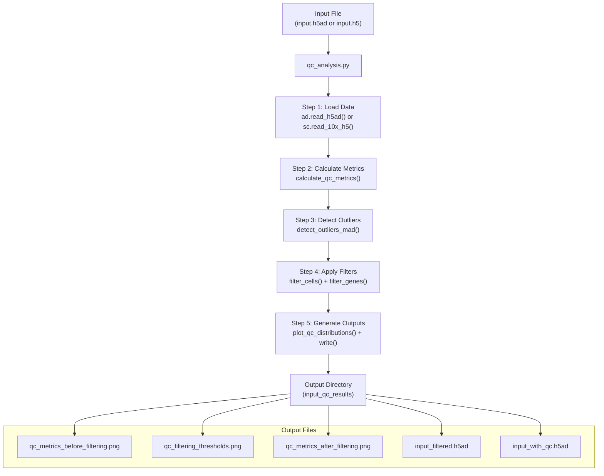
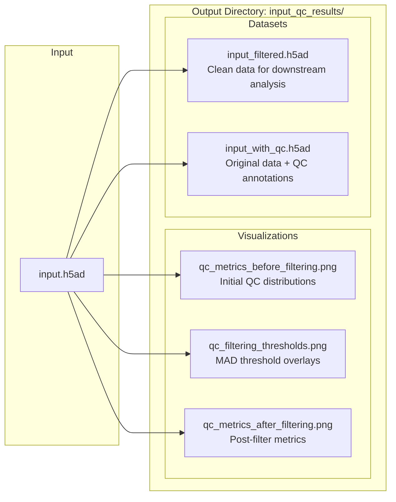
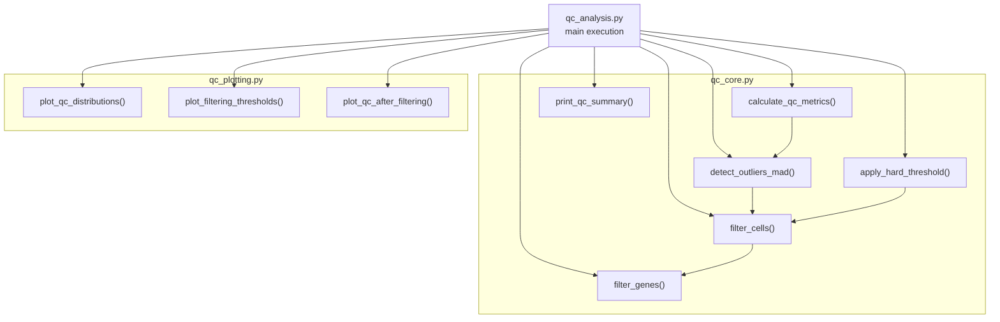

<!-- source: DeepWiki mcp.deepwiki.com · repo anthropics/life-sciences · extra page Quick Start Guide · fetched 2026-10-26 -->

# Quick Start Guide

<details>
<summary>Relevant source files</summary>

The following files were used as context for generating this wiki page:

- [single-cell-rna-qc/SKILL.md](single-cell-rna-qc/SKILL.md)
- [single-cell-rna-qc/references/scverse_qc_guidelines.md](single-cell-rna-qc/references/scverse_qc_guidelines.md)
- [single-cell-rna-qc/scripts/qc_analysis.py](single-cell-rna-qc/scripts/qc_analysis.py)
- [single-cell-rna-qc/scripts/qc_core.py](single-cell-rna-qc/scripts/qc_core.py)
- [single-cell-rna-qc/scripts/qc_plotting.py](single-cell-rna-qc/scripts/qc_plotting.py)

</details>


This guide provides the fastest path to running quality control on single-cell RNA-seq data using default parameters that follow scverse best practices. For detailed parameter customization and the complete pipeline documentation, see [Complete Pipeline (Approach 1)](4.1.2). For custom workflow implementations using modular functions, see [Modular Building Blocks (Approach 2)](4.1.3).

## Purpose and Scope

This quick start demonstrates how to:
- Run QC analysis on `.h5ad` or `.h5` files with a single command.
- Understand the automated workflow steps.
- Locate and interpret output files.

This guide uses default parameters suitable for most datasets. Advanced users requiring custom filtering logic should consult the complete documentation.

## Prerequisites

**Required Python packages:**
```
anndata
scanpy
scipy
matplotlib
seaborn
numpy
```

**Input file formats:**
- `.h5ad` files (AnnData format from scanpy/Python workflows)
- `.h5` files (10X Genomics Cell Ranger output)

**Sources:** [single-cell-rna-qc/SKILL.md:19-22](), [single-cell-rna-qc/SKILL.md:43]()

## Minimal Example

Navigate to the skill directory and run the convenience script:

```bash
python3 scripts/qc_analysis.py input.h5ad
```

Or for 10X Genomics data:

```bash
python3 scripts/qc_analysis.py raw_feature_bc_matrix.h5
```

The script automatically detects the file format and executes the complete QC pipeline with default parameters.

**Default parameters used:**
| Parameter | Default Value | Description |
|-----------|---------------|-------------|
| MAD threshold (counts) | 5 | Outlier detection for total counts [single-cell-rna-qc/scripts/qc_analysis.py:37]() |
| MAD threshold (genes) | 5 | Outlier detection for gene counts [single-cell-rna-qc/scripts/qc_analysis.py:38]() |
| MAD threshold (MT%) | 3 | Outlier detection for mitochondrial percentage [single-cell-rna-qc/scripts/qc_analysis.py:39]() |
| Hard MT% cutoff | 8% | Absolute maximum mitochondrial content [single-cell-rna-qc/scripts/qc_analysis.py:40]() |
| Minimum cells per gene | 20 | Gene filtering threshold [single-cell-rna-qc/scripts/qc_analysis.py:41]() |

**Sources:** [single-cell-rna-qc/scripts/qc_analysis.py:37-45](), [single-cell-rna-qc/SKILL.md:29-33]()

## Quick Start Workflow



**Workflow Execution Sequence**

This diagram maps the five-step workflow executed by `qc_analysis.py` to the specific functions from the modular utility modules.

**Sources:** [single-cell-rna-qc/scripts/qc_analysis.py:98-232](), [single-cell-rna-qc/SKILL.md:67-75]()

## Detailed Workflow Steps

### Step 1: Data Loading

The script detects file format and loads appropriately using `anndata` or `scanpy`:

```python
# Executed by qc_analysis.py lines 98-111
if file_ext == '.h5ad':
    adata = ad.read_h5ad(input_file)
elif file_ext == '.h5':
    adata = sc.read_10x_h5(input_file)
    adata.var_names_make_unique()
```

**Sources:** [single-cell-rna-qc/scripts/qc_analysis.py:98-111]()

### Step 2: QC Metric Calculation

The script invokes `qc_core.calculate_qc_metrics` to compute standard scverse metrics:

```python
calculate_qc_metrics(adata, 
                     mt_pattern='mt-,MT-',
                     ribo_pattern='Rpl,Rps,RPL,RPS',
                     hb_pattern='^Hb[^(p)]|^HB[^(P)]',
                     inplace=True)
```

Annotates each cell in `adata.obs` with:
- `total_counts`: Total UMI counts per cell.
- `n_genes_by_counts`: Number of detected genes.
- `pct_counts_mt`: Mitochondrial read percentage.
- `pct_counts_ribo`: Ribosomal read percentage.
- `pct_counts_hb`: Hemoglobin read percentage.

**Sources:** [single-cell-rna-qc/scripts/qc_analysis.py:118-128](), [single-cell-rna-qc/scripts/qc_core.py:16-58](), [single-cell-rna-qc/SKILL.md:101]()

### Step 3: Outlier Detection

The script uses Median Absolute Deviation (MAD) to identify outliers permissively, avoiding the loss of rare cell populations that fixed thresholds might remove.

```python
# Invokes qc_core.detect_outliers_mad() for each metric
adata.obs['outlier_counts'] = detect_outliers_mad(adata, 'total_counts', 5)
adata.obs['outlier_genes'] = detect_outliers_mad(adata, 'n_genes_by_counts', 5)
adata.obs['outlier_mt'] = detect_outliers_mad(adata, 'pct_counts_mt', 3)

# Applies hard threshold
high_mt_mask = apply_hard_threshold(adata, 'pct_counts_mt', 8, operator='>')
```

**Sources:** [single-cell-rna-qc/scripts/qc_analysis.py:137-149](), [single-cell-rna-qc/scripts/qc_core.py:64-101]()

### Step 4: Filtering

The script combines individual masks into a final `pass_qc` flag and applies filtering to both cells and genes.

```python
# Combines all QC criteria
adata.obs['pass_qc'] = ~(
    adata.obs['outlier_counts'] |
    adata.obs['outlier_genes'] |
    adata.obs['outlier_mt']
)

# Applies cell filter
adata_filtered = filter_cells(adata, adata.obs['pass_qc'].values, inplace=False)

# Applies gene filter
filter_genes(adata_filtered, min_cells=20, inplace=True)
```

**Sources:** [single-cell-rna-qc/scripts/qc_analysis.py:152-186](), [single-cell-rna-qc/scripts/qc_core.py:146-202]()

### Step 5: Output Generation

Creates comprehensive visualizations using `qc_plotting.py` and saves the filtered datasets.

**Sources:** [single-cell-rna-qc/scripts/qc_analysis.py:204-217](), [single-cell-rna-qc/scripts/qc_plotting.py:13-164]()

## Output Files



**Output File Structure**

### Visualization Files

| Filename | Contents | Use Case |
|----------|----------|----------|
| `qc_metrics_before_filtering.png` | Histograms and violin plots of raw QC metrics | Assess initial data quality |
| `qc_filtering_thresholds.png` | Scatter plots with MAD threshold overlays | Verify filtering appropriateness |
| `qc_metrics_after_filtering.png` | Post-filter QC distributions | Confirm successful filtering |

### Dataset Files

| Filename | Contents | Use Case |
|----------|----------|----------|
| `<input>_filtered.h5ad` | Cells and genes passing QC | Primary input for downstream analysis (normalization, clustering, etc.) |
| `<input>_with_qc.h5ad` | Original data with QC metadata in `.obs` | Audit trail, alternative filtering criteria |

**Sources:** [single-cell-rna-qc/SKILL.md:57-64](), [single-cell-rna-qc/scripts/qc_analysis.py:209-217]()

## Function Call Graph



**Module Dependencies and Function Invocation**

The convenience script `qc_analysis.py` orchestrates calls to modular functions from `qc_core.py` (statistical operations) and `qc_plotting.py` (visualizations).

**Sources:** [single-cell-rna-qc/scripts/qc_analysis.py:18-30](), [single-cell-rna-qc/SKILL.md:76-90]()

## Interpreting Console Output

During execution, the script prints progress through five phases. Key metrics are displayed to help the user verify detection patterns:

```
[1/5] Loading data...
Loaded .h5ad file: 4338 cells × 36601 genes

[2/5] Calculating QC metrics...
  Found 13 mitochondrial genes (pattern: mt-,MT-)
  Found 98 ribosomal genes (pattern: Rpl,Rps,RPL,RPS)
  Found 12 hemoglobin genes (pattern: ^Hb[^(p)]|^HB[^(P)])

[3/5] Creating QC visualizations...
  Saved: input_qc_results/qc_metrics_before_filtering.png

[4/5] Applying MAD-based filtering thresholds...
  Total cells failing QC: 187 (4.31%)
  Cells passing QC: 4151 (95.69%)

[5/5] Applying filters...
  Cells after filtering: 4151 (removed 187)
  Filtering genes detected in <20 cells...
  Genes after filtering: 19483 (removed 17118)
```

**Key metrics to verify:**
- **Mitochondrial genes detected**: Should be >0 (typically 13-37 depending on species).
- **QC failure rate**: Typically 5-15% for clean data.
- **Gene retention percentage**: Typically 50-70% after filtering.

**Sources:** [single-cell-rna-qc/scripts/qc_analysis.py:98-186](), [single-cell-rna-qc/references/scverse_qc_guidelines.md:118-121]()

## Verification Checklist

After running the script, verify:

1. **All 5 output files generated**: Check the `<input>_qc_results/` directory.
2. **Filtering rate reasonable**: Typically 5-15% cells removed for clean data.
3. **Mitochondrial genes detected**: Should be >0 (if 0, check `--mt-pattern`).
4. **Visual inspection passed**: Review `qc_filtering_thresholds.png` to confirm MAD cutoffs are appropriate.
5. **Gene count reasonable**: Filtered dataset should retain a significant fraction of the transcriptome.

**Sources:** [single-cell-rna-qc/SKILL.md:149-155](), [single-cell-rna-qc/references/scverse_qc_guidelines.md:88-115]()

## Next Steps

After successful QC, proceed with downstream analysis:

1. **Ambient RNA correction**: Use SoupX or CellBender to remove background contamination.
2. **Doublet detection**: Apply scDblFinder or Scrublet to identify multiplets.
3. **Normalization**: Log-normalize or use specialized methods like scVI.
4. **Dimensionality reduction**: Run PCA followed by UMAP or t-SNE.

**Sources:** [single-cell-rna-qc/SKILL.md:161-175](), [single-cell-rna-qc/references/scverse_qc_guidelines.md:161-178]()

---

