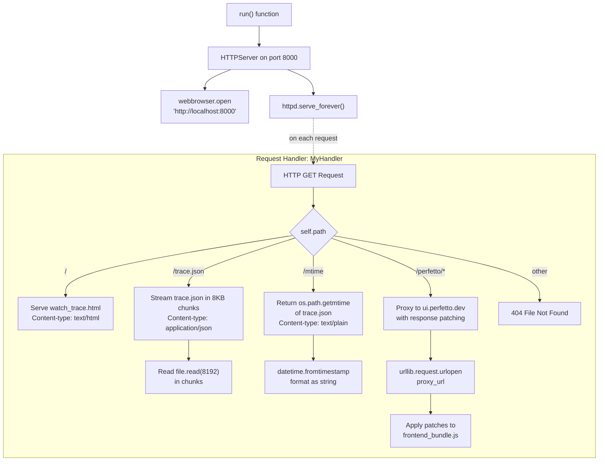
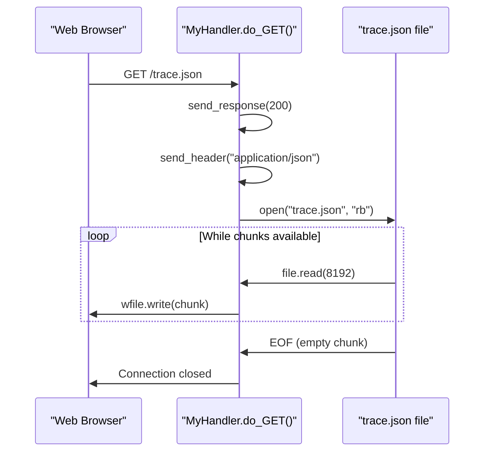
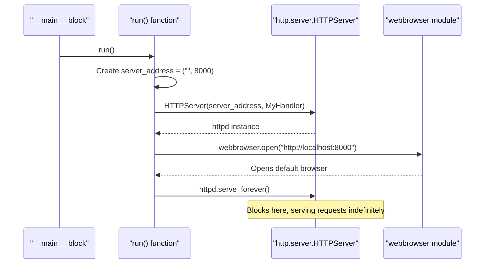
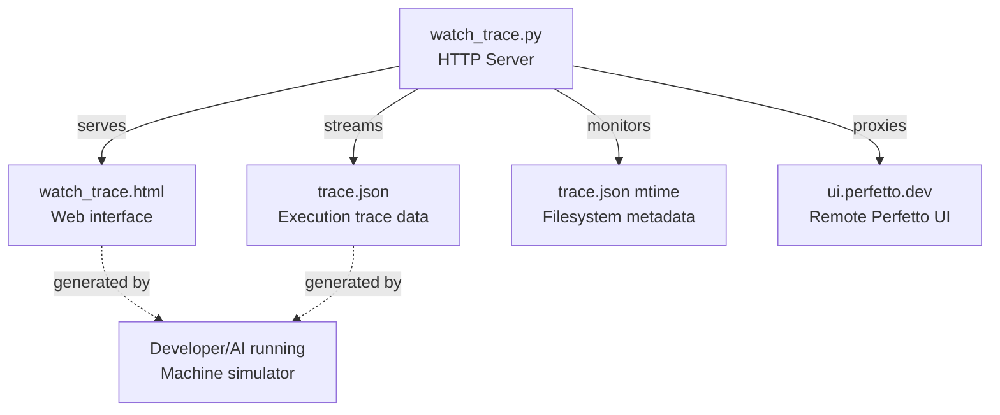

<!-- source: DeepWiki mcp.deepwiki.com · repo anthropics/original_performance_takehome · page 7.2 Trace Visualization Server · fetched 2026-10-26 -->

# Trace Visualization Server

Relevant source files

The following files were used as context for generating this wiki page:

- [watch_trace.py](watch_trace.py)

## Purpose and Scope

This document describes `watch_trace.py`, a local HTTP server that enables live visualization of execution traces generated by the Machine simulator. The server provides endpoints for serving trace files, monitoring file modifications, and proxying the Perfetto UI visualization tool. For information about generating trace files, see [7.1 Trace Generation](). For details on the web interface that consumes these endpoints, see [7.3 Web Interface Usage]().

**Sources:** [watch_trace.py:1-85]()

---

## Server Architecture

The `watch_trace.py` server is implemented using Python's built-in `http.server` module. It creates a custom request handler `MyHandler` that serves static files, streams trace data, provides modification time polling, and proxies external resources.

### Request Flow Diagram

**Sources:** [watch_trace.py:8-84]()

---

## HTTP Endpoints

The server implements five distinct endpoints through the `do_GET` method of the `MyHandler` class:

### Endpoint Reference Table

| Endpoint | Content-Type | Purpose | Implementation |
|----------|-------------|---------|----------------|
| `/` | `text/html` | Serves the web interface | Reads and returns `watch_trace.html` [watch_trace.py:13-18]() |
| `/trace.json` | `application/json` | Streams the trace file | Chunked read of `trace.json` (8192 bytes) [watch_trace.py:21-27]() |
| `/mtime` | `text/plain` | Provides trace file modification time | Returns `os.path.getmtime("trace.json")` formatted timestamp [watch_trace.py:29-38]() |
| `/perfetto/*` | various | Proxies Perfetto UI resources | Forwards to `ui.perfetto.dev` with patches [watch_trace.py:40-64]() |
| other | - | Error handling | Returns 404 response [watch_trace.py:67]() |

**Sources:** [watch_trace.py:10-70]()

### Root Endpoint ()

The root endpoint serves the web interface HTML file directly from disk. It loads the entire `watch_trace.html` file into memory and serves it [watch_trace.py:13-18](). The file is expected to be in the same directory as the server script.

**Sources:** [watch_trace.py:13-18]()

### Trace Streaming Endpoint (/trace.json)

The `/trace.json` endpoint streams the trace file using chunked transfer to handle potentially large trace files efficiently:

The chunked reading strategy (8192 bytes per read) prevents loading large trace files entirely into memory, making it suitable for traces that can grow to hundreds of megabytes during long simulations [watch_trace.py:25-27]().

**Sources:** [watch_trace.py:21-27]()

### Modification Time Endpoint (/mtime)

The `/mtime` endpoint enables the web interface to implement live reload functionality by polling for file changes. The endpoint returns a formatted timestamp string (e.g., "2024-01-15 14:30:45") using `datetime.fromtimestamp(mtime).strftime("%Y-%m-%d %H:%M:%S")` [watch_trace.py:32-34](). The web interface can compare this against previous values to detect when `trace.json` has been regenerated.

**Sources:** [watch_trace.py:29-38]()

---

## Perfetto UI Proxy

The server includes a proxy mechanism for the Perfetto UI at `/perfetto/*` paths. This proxy forwards requests to `ui.perfetto.dev` while applying runtime patches to fix bugs and customize behavior.

### Proxy Architecture

```mermaid
flowchart LR
    Client["watch_trace.html<br/>in browser"] --> LocalProxy["/perfetto/* endpoint<br/>on localhost:8000"]
    LocalProxy --> BuildURL["proxy_url =<br/>'https://ui.perfetto.dev'<br/>+ path[len('/perfetto'):]"]
    BuildURL --> FetchRemote["urllib.request.urlopen<br/>(proxy_url)"]
    FetchRemote --> CheckPath{"path ends with<br/>frontend_bundle.js?"}
    
    CheckPath -->|Yes| ApplyPatches["Apply three<br/>binary patches"]
    CheckPath -->|No| PassThrough["Pass through<br/>unmodified"]
    
    ApplyPatches --> Patch1["Fix EngineProxy disposal bug"]
    Patch1 --> Patch2["Auto-expand tracks:<br/>collapsed: true → false"]
    Patch2 --> Patch3["Auto-expand heap profiles"]
    Patch3 --> UpdateLength["Recalculate Content-Length"]
    
    PassThrough --> SendResponse["Forward response<br/>to client"]
    UpdateLength --> SendResponse
```

**Sources:** [watch_trace.py:40-64]()

### Runtime Patches

The proxy applies three specific binary patches to `frontend_bundle.js` [watch_trace.py:48-59]():

#### Patch 1: EngineProxy Disposal Bug Fix
This patch prevents Perfetto from throwing errors when the `EngineProxy` is disposed, replacing the error with a silent null return [watch_trace.py:51-54](). This fixes a known bug in Perfetto that was fixed internally but not yet deployed at the time of the server's creation [watch_trace.py:50]().

#### Patch 2: Auto-Expand Tracks
This modifies Perfetto's default behavior to show all tracks expanded by default (`collapsed: false`), making it easier to see execution details immediately upon opening a trace [watch_trace.py:56]().

#### Patch 3: Auto-Expand Heap Profiles
This ensures heap profile tracks are also expanded by default, overriding the conditional logic that would collapse them [watch_trace.py:57-59]().

**Important:** Because these patches modify the response body, the server recalculates the `Content-Length` header at [watch_trace.py:62]() to match the new response size.

**Sources:** [watch_trace.py:48-64]()

---

## Server Startup and Configuration

### Startup Sequence

The server initialization follows this sequence:

**Sources:** [watch_trace.py:74-84]()

### Configuration Constants

| Configuration | Value | Location | Description |
|---------------|-------|----------|-------------|
| Port | 8000 | [watch_trace.py:75]() | Server listening port |
| Chunk Size | 8192 | [watch_trace.py:26]() | Bytes per read for trace streaming |
| Timestamp Format | `"%Y-%m-%d %H:%M:%S"` | [watch_trace.py:32-33]() | Date format for mtime endpoint |

The server automatically opens the default web browser to `http://localhost:8000` immediately after starting [watch_trace.py:78]().

**Sources:** [watch_trace.py:75-79]()

---

## File Dependencies

The server expects the following files to exist in the current working directory:

### Required Files

**Missing File Behavior:**
- If `watch_trace.html` is missing, requests to `/` will raise an `IOError` and return a 404 response [watch_trace.py:69-70]().
- If `trace.json` is missing, requests to `/trace.json` or `/mtime` will similarly fail with 404 [watch_trace.py:69-70]().
- Network failures when proxying to `ui.perfetto.dev` will raise exceptions and result in connection errors.

**Sources:** [watch_trace.py:17, 25, 31, 41, 69-70]()

---

## Error Handling

The `do_GET` method wraps request handling in a try-except block [watch_trace.py:11, 69](). File not found errors (missing `trace.json` or `watch_trace.html`) return clean 404 responses [watch_trace.py:70](). Unknown paths that don't match any defined endpoint also return 404 [watch_trace.py:67]().

**Sources:** [watch_trace.py:11, 67, 69-70]()

---

