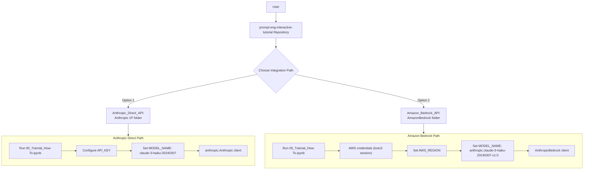
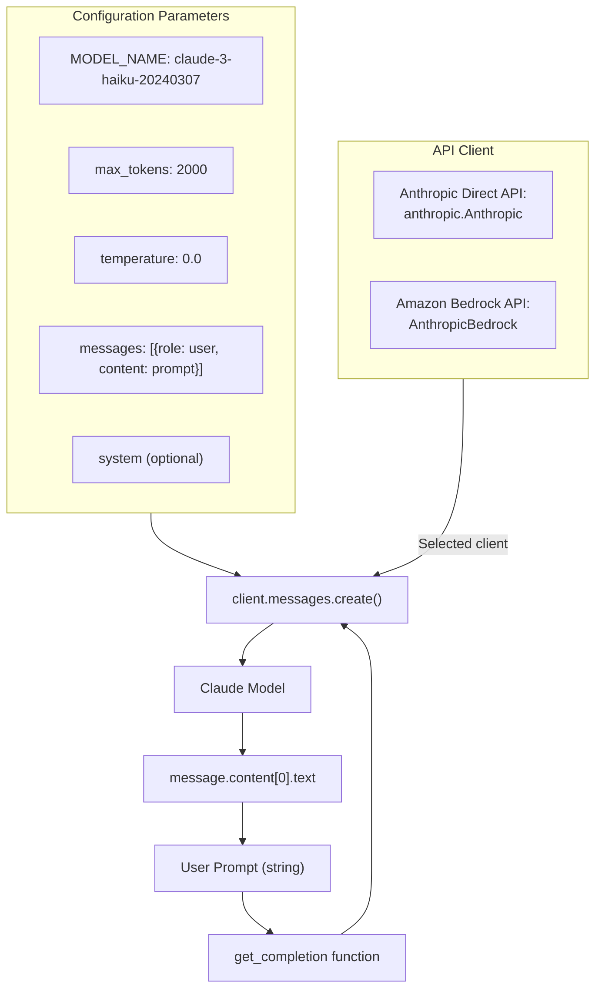

<!-- source: DeepWiki mcp.deepwiki.com · repo anthropics/prompt-eng-interactive-tutorial · page 2 Getting Started · fetched 2026-10-26 -->

# Getting Started

<details>
<summary>Relevant source files</summary>

The following files were used as context for generating this wiki page:

- [AmazonBedrock/anthropic/00_Tutorial_How-To.ipynb](AmazonBedrock/anthropic/00_Tutorial_How-To.ipynb)
- [Anthropic 1P/00_Tutorial_How-To.ipynb](Anthropic 1P/00_Tutorial_How-To.ipynb)
- [README.md](README.md)

</details>


This document provides instructions for setting up and beginning to work with the Prompt Engineering Interactive Tutorial. It covers environment setup, API configuration, and the initial steps to start running the tutorial notebooks, whether you're using the direct Anthropic API or Amazon Bedrock integration.

## Overview and Prerequisites

Before starting the tutorial, you will need:

1. A Python environment (version 3.10+ recommended)
2. Access to Jupyter notebooks
3. An API key - either:
   - An Anthropic API key (obtained via the [Anthropic Console](https://console.anthropic.com))
   - AWS credentials with Amazon Bedrock access

The tutorial uses Claude 3 Haiku for all examples and exercises, set to temperature 0 for consistent, deterministic responses.

Sources: [README.md:5-23](), [Anthropic 1P/00_Tutorial_How-To.ipynb:7-9]()

## Integration Paths

The repository provides two distinct paths for completing the tutorial:

### Integration Path Diagram



Sources: [Anthropic 1P/00_Tutorial_How-To.ipynb:16-23](), [AmazonBedrock/anthropic/00_Tutorial_How-To.ipynb:16-23]()

## Installation and Setup

### Option 1: Anthropic Direct API

1. Clone the repository to your local machine
2. Install the required Python package:

```bash
pip install anthropic
```

3. Open the tutorial setup notebook:
```bash
jupyter notebook "Anthropic 1P/00_Tutorial_How-To.ipynb"
```

4. Set up your API key by replacing `"your_api_key_here"` with your actual Anthropic API key:

```python
API_KEY = "your_api_key_here"
MODEL_NAME = "claude-3-haiku-20240307"

# Store variables for use across notebooks
%store API_KEY
%store MODEL_NAME
```

Sources: [Anthropic 1P/00_Tutorial_How-To.ipynb:16-52]()

### Option 2: Amazon Bedrock

1. Clone the repository to your local machine
2. Install the required Python packages:

```bash
pip install -qr requirements.txt
```

3. Ensure you have AWS credentials configured for boto3
4. Open the Bedrock tutorial setup notebook:
```bash
jupyter notebook "AmazonBedrock/anthropic/00_Tutorial_How-To.ipynb"
```

5. Run the notebook to configure your environment. This will automatically detect your AWS region:

```python
import boto3
session = boto3.Session()  # create a boto3 session to get region name
AWS_REGION = session.region_name
MODEL_NAME = "anthropic.claude-3-haiku-20240307-v1:0"

%store MODEL_NAME
%store AWS_REGION
```

Sources: [AmazonBedrock/anthropic/00_Tutorial_How-To.ipynb:16-102]()

## Core Component: get_completion Function

The main interface for interacting with Claude throughout the tutorial is the `get_completion` function. This function abstracts away the API details, allowing you to focus on prompt engineering.

### get_completion Function Diagram



Sources: [Anthropic 1P/00_Tutorial_How-To.ipynb:87-101](), [AmazonBedrock/anthropic/00_Tutorial_How-To.ipynb:121-132]()

### Anthropic Direct API Version

```python
def get_completion(prompt: str):
    message = client.messages.create(
        model=MODEL_NAME,
        max_tokens=2000,
        temperature=0.0,
        messages=[
          {"role": "user", "content": prompt}
        ]
    )
    return message.content[0].text
```

Sources: [Anthropic 1P/00_Tutorial_How-To.ipynb:91-100]()

### Amazon Bedrock Version

```python
def get_completion(prompt, system=''):
    message = client.messages.create(
        model=MODEL_NAME,
        max_tokens=2000,
        temperature=0.0,
        messages=[
          {"role": "user", "content": prompt}
        ],
        system=system
    )
    return message.content[0].text
```

Sources: [AmazonBedrock/anthropic/00_Tutorial_How-To.ipynb:121-132]()

## Using the Tutorial

1. After completing setup in the `00_Tutorial_How-To.ipynb` notebook, begin with Chapter 1 (Basic Prompt Structure)
2. Progress through each chapter in sequential order, as concepts build on each other
3. Use `Shift + Enter` to execute notebook cells
4. Each chapter provides:
   - Concept explanations
   - Example prompts
   - A playground area for experimentation
   - Exercises to practice the concepts

## Tutorial Structure

| Section     | Chapters                                | Key Topics                                     |
|-------------|----------------------------------------|------------------------------------------------|
| Beginner    | 1-3                                     | Basic structure, clarity, role prompting       |
| Intermediate| 4-7                                     | Data separation, output formatting, reasoning  |
| Advanced    | 8-9                                     | Hallucination avoidance, complex prompts       |
| Appendix    | Beyond Standard Prompting              | Chaining prompts, tool use, search & retrieval |

Sources: [README.md:25-58]()

## Testing Your Setup

After completing the setup, test your connection to Claude by running a simple "Hello, Claude!" prompt:

```python
# Prompt
prompt = "Hello, Claude!"

# Get Claude's response
print(get_completion(prompt))
```

This should return a friendly greeting from Claude, confirming that your setup is working correctly.

Sources: [Anthropic 1P/00_Tutorial_How-To.ipynb:117-123](), [AmazonBedrock/anthropic/00_Tutorial_How-To.ipynb:149-154]()

## Additional Information

- The tutorial has been designed to work with Claude 3 Haiku, the smallest, fastest, and most cost-effective model in the Claude 3 family
- All prompt engineering techniques taught are applicable to other Claude models as well
- For API reference documentation, see the [Anthropic Python SDK](https://docs.anthropic.com/claude/reference/client-sdks) and the [Messages API](https://docs.anthropic.com/claude/reference/messages_post)

Sources: [README.md:19-19](), [Anthropic 1P/00_Tutorial_How-To.ipynb:72-76]()

---

