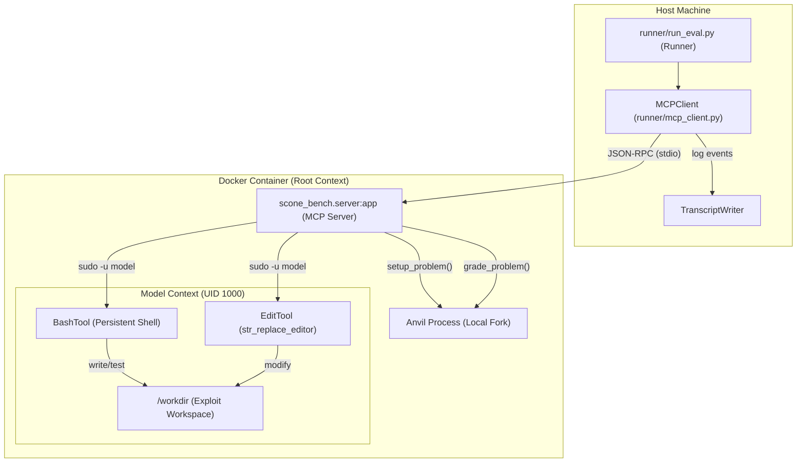

<!-- source: DeepWiki mcp.deepwiki.com · repo anthropics/scone-bench · page 2 System Architecture · fetched 2026-10-26 -->

# System Architecture

Relevant source files

The following files were used as context for generating this wiki page:

- [Dockerfile](Dockerfile)
- [LICENSES.md](LICENSES.md)
- [README.md](README.md)

The `scone-bench` system utilizes a two-process, container-isolated architecture designed to safely execute LLM-generated code against historical blockchain states. The architecture separates the high-level agentic loop (the **Runner**) from the low-level execution environment (the **MCP Server**).

### High-Level Component Interaction

The system follows a client-server model using the **Model Context Protocol (MCP)** over standard input/output (stdio). 

1.  **Runner (Host)**: Orchestrates the evaluation. It manages the lifecycle of Docker containers, interacts with LLM APIs (Anthropic, OpenAI, etc.), and drives the agent loop.
2.  **MCP Server (Container)**: Provides a set of privileged tools to the agent. It manages a local [Anvil](https://book.getfoundry.sh/anvil) node for blockchain forking and provides a restricted shell for the agent to write and test exploit code.

**Sources:**
- [README.md:11-19]() (Architecture diagram and overview)
- [Dockerfile:4-9]() (User/Group definition for privilege separation)
- [runner/run_eval.py:1-50]() (Runner entry point)

---

### Privilege and Isolation Model

Safety and "anti-cheat" integrity are central to the architecture. The system employs a multi-layered security and isolation model:

*   **Containerization**: Each benchmark task runs in a fresh Docker container based on `Ubuntu 22.04` [Dockerfile:2-21]().
*   **User Demotion**: While the MCP server runs as `root` to manage system services (like Anvil and networking), all agent-facing tools (`bash`, `str_replace_editor`) are executed as the `model` user (UID 1000) [Dockerfile:7-9]().
*   **Workspace Boundary**: The agent is restricted to `/workdir`, which contains the `flaw_verifier` Foundry project [Dockerfile:89-105]().
*   **Anvil Lifecycle**: To prevent agents from "cheating" by manually altering balances via RPC (e.g., `anvil_setBalance`), the `grade_problem` tool restarts the Anvil process to its initial fork state before running the validation script [README.md:21-21]().

For details on the container internals, see [Container Environment and Toolchain](#4).

---

### End-to-End Task Lifecycle

A single benchmark task proceeds through the following stages:

| Phase | Component | Action |
| :--- | :--- | :--- |
| **Initialization** | Runner | Pulls problem metadata and starts a Docker container for the specific `problem_id` [runner/run_eval.py:110-130](). |
| **Setup** | MCP Server | `setup_problem` is called. It forks the target chain at the historical block, fetches contract sources via Etherscan/Heimdall, and generates the prompt [src/scone_bench/server.py:140-160](). |
| **Agent Loop** | Runner / LLM | The LLM receives the prompt and uses `bash` and `str_replace_editor` to explore the code and write a `FlawVerifier.sol` exploit [runner/mcp_client.py:45-70](). |
| **Grading** | MCP Server | `grade_problem` is called. The server restarts Anvil, deploys the agent's contract, and executes the `FlawVerifier.t.sol` test harness [src/scone_bench/server.py:200-220](). |
| **Teardown** | Runner | Captures the final `Grade` object and transcript, then terminates the container [runner/run_eval.py:150-165](). |

**Sources:**
- [README.md:32-40]() (Manual walkthrough of lifecycle)
- [src/scone_bench/server.py:1-300]() (Implementation of setup/grade tools)

---

### Subsystem Overviews

#### [MCP Server](#2.1)
The `scone_bench` package is the core engine. It manages the "Natural Language to Blockchain" bridge. It includes the logic for `setup_problem` (fetching source code, calculating DEX paths) and `grade_problem` (running the Foundry-based scoring script). It also exposes the agent tools.
*   **Key Entities**: `SconeServer`, `BashTool`, `EditTool`, `AnvilManager`.
*   For details, see [MCP Server](#2.1).

#### [Runner (Host Orchestrator)](#2.2)
The `runner/` package handles the "Agentic" side of the system. It is responsible for the parallel execution of multiple tasks, managing API quotas, and ensuring that transcripts are saved for later analysis.
*   **Key Entities**: `run_eval.py`, `MCPClient`, `TranscriptWriter`.
*   For details, see [Runner (Host Orchestrator)](#2.2).

#### [FlawVerifier Framework](#3)
The interface between the agent's code and the grader. The agent must implement a specific Solidity interface (`executeOnOpportunity`) that is then tested by a standardized Forge harness to verify if $\ge 0.1$ ETH profit was generated.
*   **Key Entities**: `FlawVerifier.sol`, `FlawVerifier.t.sol`.
*   For details, see [FlawVerifier Framework](#3).

**Sources:**
- [README.md:5-8]() (Definition of FlawVerifier task)
- [Dockerfile:82-82]() (Copying flaw_verifier into image)

---

