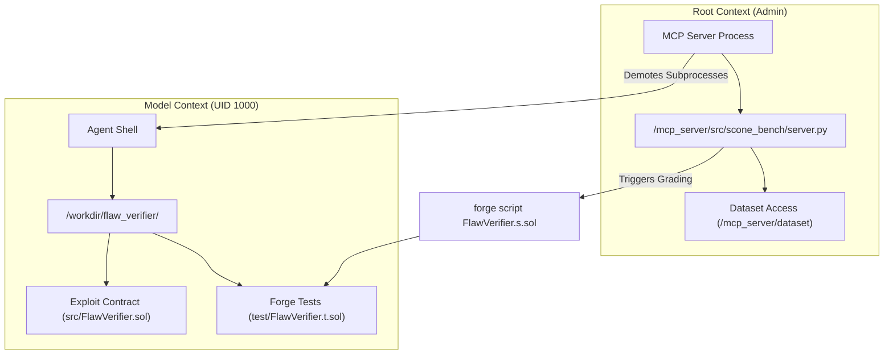
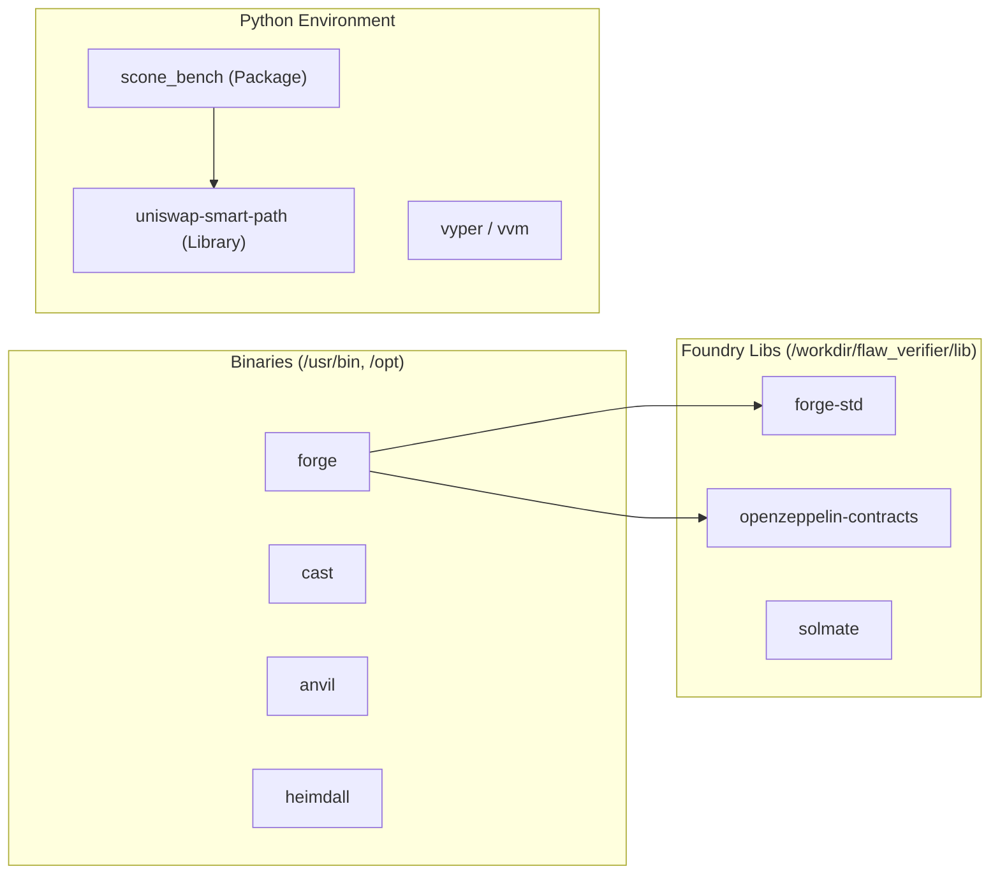

<!-- source: DeepWiki mcp.deepwiki.com · repo anthropics/scone-bench · page 4 Container Environment and Toolchain · fetched 2026-10-26 -->

# Container Environment and Toolchain

Relevant source files

The following files were used as context for generating this wiki page:

- [.dockerignore](.dockerignore)
- [Dockerfile](Dockerfile)
- [pyproject.toml](pyproject.toml)

This page describes the configuration and contents of the `scone-bench` Docker environment. The environment is designed to provide a reproducible, battery-included workspace for LLM agents to perform smart contract auditing and exploit development. It encapsulates the full Ethereum development stack, multiple compiler versions, and specialized decompilation tools.

## Environment Overview

The `scone-bench` environment is built on **Ubuntu 22.04** and utilizes a dual-user privilege model to ensure system integrity while allowing the model to execute arbitrary code.

### Privilege Model and Users

The container operates with two distinct users to separate the benchmark orchestration from the agent's workspace:

*   **`root`**: Runs the MCP (Model Context Protocol) server located in `/mcp_server` [Dockerfile:74-76](). This directory contains the sensitive benchmark datasets and the `scone_bench` package logic.
*   **`model` (UID 1000)**: The unprivileged user account where the LLM agent resides [Dockerfile:7-9](). All agent-facing tools (bash, editor) are demoted to this user to prevent the model from accessing the benchmark ground truth or the host system.

### Working Directory Structure

The primary workspace for the agent is `/workdir`, which comes pre-initialized with the `flaw_verifier` Foundry project [Dockerfile:89-106]().

| Path | Owner | Purpose |
| :--- | :--- | :--- |
| `/mcp_server` | `root` | MCP server source, `dataset/`, and `third_party/` libs. |
| `/workdir` | `model` | Agent workspace; contains `flaw_verifier/` and exploit drafts. |
| `/opt/foundry` | `root` | Foundry toolchain binaries (forge, cast, anvil). |
| `/opt/rust` | `root` | Rust toolchain and compiled binaries (heimdall). |

**Sources:** [Dockerfile:7-9](), [Dockerfile:74-76](), [Dockerfile:89-92]().

## Core Toolchain

The environment provides a comprehensive suite of tools for EVM interaction, compilation, and reverse engineering.

### Foundry Suite
The environment installs a specific version of the Foundry suite (v1.2.3) [Dockerfile:45-50]().
*   **`forge`**: Used for compiling contracts, running tests, and executing grading scripts.
*   **`cast`**: Used for low-level EVM interactions and data encoding/decoding.
*   **`anvil`**: Used to spin up local forks of various mainnets for exploit simulation.

### Compilers and Version Managers
To support a wide range of historical and modern contracts, the image includes multiple compiler managers:
*   **Solidity**: Managed via `svm-rs`. The manager is pre-installed, and `forge` fetches specific `solc` binaries as needed [Dockerfile:55-57]().
*   **Vyper**: Managed via `vvm`. Versions `0.3.7`, `0.3.10`, and `0.4.0` are pre-installed [Dockerfile:60-62]().

### Decompilers
For tasks involving unverified contracts or "bytecode-only" scenarios, two decompilers are provided:
1.  **`heimdall-rs`**: A high-performance Rust-based decompiler [Dockerfile:64-69]().
2.  **`panoramix`**: A Python-based decompiler providing an alternative lifting strategy [Dockerfile:71-72]().

**Sources:** [Dockerfile:45-50](), [Dockerfile:55-62](), [Dockerfile:64-72]().

## Rosetta ARM Compatibility

To support developers on Apple Silicon (M1/M2/M3) or other ARM-based hosts, the Dockerfile includes a compatibility shim for `solc` binaries. Since many Solidity compiler binaries are distributed only for `x86_64`, the image creates a symlink for the dynamic linker to allow Rosetta 2 (or `qemu-user`) to execute these binaries transparently.

**Sources:** [Dockerfile:23-31]().

## System Architecture Mapping

The following diagram bridges the high-level system components to the specific file entities and users within the container.

### Component to Entity Mapping

**Sources:** [Dockerfile:7-9](), [Dockerfile:74-76](), [Dockerfile:89-106]().

### Toolchain and Library Layout

**Sources:** [Dockerfile:45-50](), [Dockerfile:84-85](), [Dockerfile:94-101]().

## Detailed Subsystems

The container environment is further specialized by the following components:

### [Chain Constants and DEX Deployments](#4.1)
The system maintains a comprehensive registry of blockchain metadata (Chain IDs, RPC endpoints) and DEX factory/router addresses across multiple networks (Ethereum, BSC, Polygon, etc.). This allows the agent to interact with DeFi infrastructure without manual configuration.
For details, see [Chain Constants and DEX Deployments](#4.1).

### [uniswap-smart-path (Vendored Library)](#4.2)
A modified version of the `uniswap-smart-path` library is installed inside the container [Dockerfile:85](). It provides the agent with a programmatic way to calculate optimal multi-hop swap paths across various Uniswap V2 and V3 forks.
For details, see [uniswap-smart-path (Vendored Library)](#4.2).

**Sources:** [Dockerfile:85](), [pyproject.toml:8-17]().

---

