# Page: Overview

# Overview

<details>
<summary>Relevant source files</summary>

The following files were used as context for generating this wiki page:

- [.claude-plugin/marketplace.json](.claude-plugin/marketplace.json)
- [.gitignore](.gitignore)
- [README.md](README.md)
- [skills/academy-guide/LICENSE.txt](skills/academy-guide/LICENSE.txt)
- [skills/academy-guide/SKILL.md](skills/academy-guide/SKILL.md)
- [spec/agent-skills-spec.md](spec/agent-skills-spec.md)

</details>


The `anthropics/skills` repository is Anthropic's reference implementation of the Agent Skills standard, providing a collection of skills that extend Claude's capabilities for specialized tasks. Skills are self-contained directories containing a `SKILL.md` file with instructions, along with optional scripts and resources that Claude loads dynamically at runtime [README.md:5-18]().

This page introduces the repository's purpose, the Agent Skills standard, skill types and licensing, and deployment paths. For installation instructions, see [Quick Start](#1.1). For a view of the codebase layout, see [Repository Layout at a Glance](#1.2).

## What Are Skills?

Skills teach Claude how to complete specific tasks in a repeatable way. Each skill is a directory containing a mandatory `SKILL.md` file with YAML frontmatter and instructions [README.md:18](), [README.md:63-65](). When a user's request matches a skill's `description` field in the frontmatter, Claude loads the instructions into its execution context to perform the task [README.md:68-90]().

Sources: [README.md:5-11](), [README.md:63-90]()

## Agent Skills Standard

This repository implements the **Agent Skills** standard, a community specification for defining reusable AI capabilities [README.md:1](). The full specification is published at [agentskills.io](https://agentskills.io/specification) [spec/agent-skills-spec.md:1-3](). The standard defines the `SKILL.md` format, including required fields like `name` and `description` [README.md:86-89]().

Sources: [README.md:1](), [spec/agent-skills-spec.md:1-3]()

## Repository Purpose and Scope

The repository serves as a production reference and a community resource:

1.  **Production Reference**: Contains the `document-skills` which power Claude's production document capabilities (Word, Excel, PDF, PowerPoint) [README.md:19-21]().
2.  **Educational Examples**: Provides `example-skills` with open-source (Apache 2.0) skills for creative, technical, and enterprise workflows [README.md:16-20]().
3.  **Template**: Provides a `template` directory for creating new skills [README.md:29]().

**Licensing Model:**

| Category | License | Usage |
| :--- | :--- | :--- |
| **Document Skills** | Source-available | Production-grade reference for complex AI applications [README.md:19-21]() |
| **Example Skills** | Apache 2.0 | Open-source examples for developers [README.md:19-20]() |

Sources: [README.md:14-25](), [README.md:26-30]()

## Repository Structure

The repository is organized around the `skills/` directory and the Agent Skills specification.

**Organization of Skill Entities**

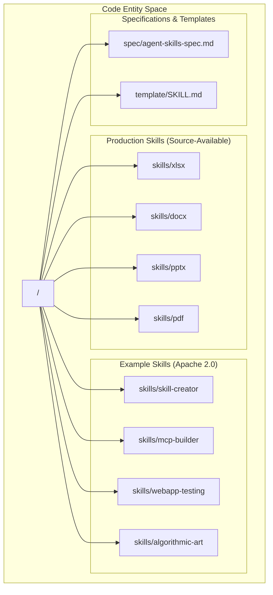

Sources: [README.md:26-30](), [README.md:19-21]()

## Skill Execution Model

Skills bridge the gap between natural language requests and specific code execution or behavioral constraints.

**Natural Language to Code Entity Mapping**

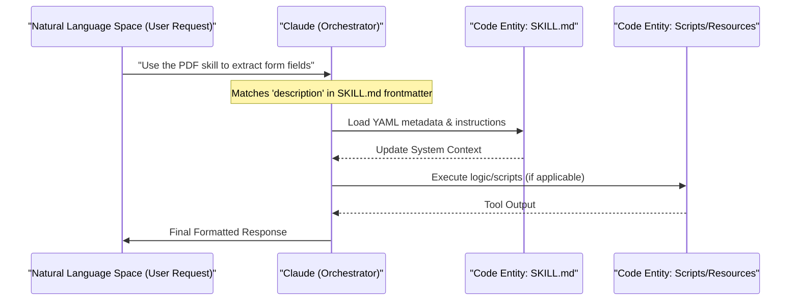

Sources: [README.md:5-12](), [README.md:50-52](), [README.md:68-90]()

## Skill Catalog Overview

The repository includes several specialized skill sets:

*   **Document Skills**: Production-grade tools for `docx`, `pdf`, `pptx`, and `xlsx` [README.md:19-21]().
*   **Creative & Design**: Skills for algorithmic art, canvas design, and music [README.md:16-18](), [README.md:27]().
*   **Development & Technical**: Tools for MCP server generation and webapp testing [README.md:16-18](), [README.md:27]().
*   **Enterprise & Communication**: Skills for brand guidelines and internal communications [README.md:16-18](), [README.md:27]().

Sources: [README.md:14-21](), [README.md:26-30]()

## Deployment Paths

Skills can be used across multiple Anthropic platforms:

*   **Claude Code**: Installed via `/plugin install` commands or by adding the marketplace [README.md:33-52]().
*   **Claude.ai**: Pre-integrated for paid plans or available via custom skill uploads [README.md:53-57]().
*   **Claude API**: Created and managed programmatically via the Skills API [README.md:59-61]().

For detailed setup instructions, see [Quick Start](#1.1).

Sources: [README.md:31-61]()

---

# Page: Quick Start

# Quick Start

<details>
<summary>Relevant source files</summary>

The following files were used as context for generating this wiki page:

- [.gitignore](.gitignore)
- [README.md](README.md)
- [spec/agent-skills-spec.md](spec/agent-skills-spec.md)

</details>


This page provides installation and basic usage instructions for getting started with skills across Claude's three deployment platforms: Claude Code, Claude.ai, and the Claude API [README.md:31-61]().

## Prerequisites

Before installing skills, ensure you have access to one of the following platforms:

| Platform | Requirements | Skill Access |
|----------|-------------|--------------|
| **Claude Code** | Desktop application installed | Plugin marketplace system with manual installation [README.md:33-49]() |
| **Claude.ai** | Paid plan (Pro, Team, or Enterprise) | Example skills pre-integrated; custom upload supported [README.md:53-57]() |
| **Claude API** | API key and SDK setup | Programmatic skill management via API endpoints [README.md:59-61]() |

Sources: [README.md:33-61]()

## Installation Paths Overview

The following diagram bridges user commands in Natural Language Space to code entities and configuration files in Code Entity Space.

Title: Deployment Paths for Skills Installation

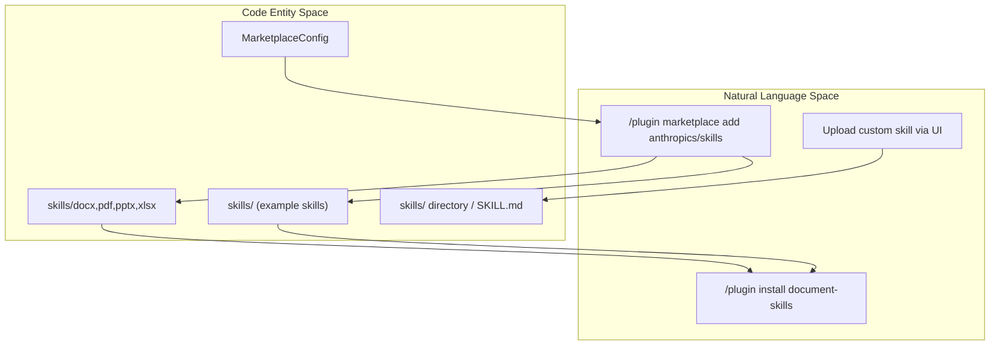

Sources: [README.md:20-61]()

## Claude Code Installation

### Register the Plugin Marketplace

Register the `anthropics/skills` repository as a plugin marketplace by running the command within Claude Code [README.md:33-37]():

```bash
/plugin marketplace add anthropics/skills
```

### Install a Plugin

**Interactive Installation:**
1. Select `Browse and install plugins` [README.md:39-43]()
2. Select `anthropic-agent-skills` [README.md:42-42]()
3. Choose plugin (`document-skills` or `example-skills`) [README.md:43-43]()
4. Select `Install now` [README.md:43-43]()

**Direct Installation:** [README.md:45-49]()
```bash
/plugin install document-skills@anthropic-agent-skills
/plugin install example-skills@anthropic-agent-skills
```

Title: Plugin Installation and Loading Flow

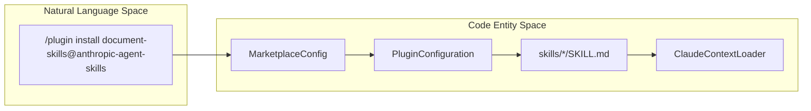

Sources: [README.md:33-51]()

### Invoke a Skill

After installation, skills are invoked through natural language references [README.md:51-51]():

```
Use the PDF skill to extract the form fields from path/to/some-file.pdf
```

Claude dynamically loads the corresponding `SKILL.md` file located in the skill directory and executes the instructions [README.md:18-51]().

Sources: [README.md:18-51]()

## Claude.ai Installation

### Pre-integrated Skills

Example skills are pre-integrated into Claude.ai for users on paid plans (Pro, Team, Enterprise) [README.md:53-55](). 

### Upload Custom Skills

To upload custom skills or creations, follow the instructions in the official Claude documentation referenced in [README.md:57-57]().

Sources: [README.md:53-57]()

## Claude API Installation

### Prerequisites

Install the Anthropic SDK as outlined in the official API guides [README.md:59-61]().

Title: API Skill Integration Flow

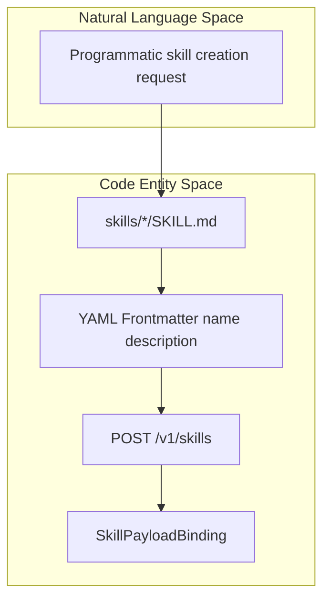

Sources: [README.md:59-61](), [README.md:68-89]()

## Skill Invocation Pattern

Once installed, skills follow a uniform loading and execution pattern across platforms:

Title: Skill Loading and Execution

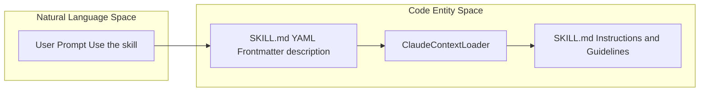

The `description` field in the YAML frontmatter [README.md:88-88]() determines when Claude activates a skill, while the markdown content provides execution instructions [README.md:90-90]().

Sources: [README.md:63-90]()

## Next Steps

- **Understand skill structure:** See the template definition [README.md:65-84]()
- **Review the Agent Skills standard:** See [spec/agent-skills-spec.md:1-3]() and [agentskills.io](http://agentskills.io) [README.md:1-1]()

Sources: [README.md:1-96](), [spec/agent-skills-spec.md:1-3]()

---

# Page: Repository Layout at a Glance

# Repository Layout at a Glance

<details>
<summary>Relevant source files</summary>

The following files were used as context for generating this wiki page:

- [.claude-plugin/marketplace.json](.claude-plugin/marketplace.json)
- [.gitignore](.gitignore)
- [README.md](README.md)
- [skills/academy-guide/LICENSE.txt](skills/academy-guide/LICENSE.txt)
- [skills/academy-guide/SKILL.md](skills/academy-guide/SKILL.md)
- [spec/agent-skills-spec.md](spec/agent-skills-spec.md)

</details>


## Purpose and Scope
This page provides a technical map of the top-level directory structure in the `anthropics/skills` repository [README.md:1-30](). It details how the codebase organizes skill implementations, formal specifications, templates, and plugin integration metadata. Understanding this layout is essential for navigating the repository, authoring custom skills, and integrating them with Claude Code, Claude.ai, or the Claude API [README.md:31-62]().

Sources: `README.md:1-30`, `README.md:31-62`

---

## Top-Level Directory Mapping

The repository is organized into distinct top-level directories, mapping natural language concepts and user workflows to concrete code entities and configuration files within the codebase.

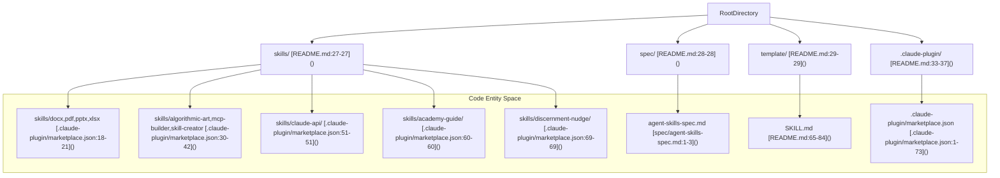

### Directory Breakdown

*   **`skills/`**: Contains the core collection of skills. This directory houses open-source example skills, reference documentation skills (`claude-api`), guidance skills (`academy-guide`, `discernment-nudge`), and source-available production document processing skills (`docx`, `pdf`, `pptx`, `xlsx`) [README.md:16-21](), [.claude-plugin/marketplace.json:11-72]().
*   **`spec/`**: Houses specification reference documents, pointing readers to the external Agent Skills standard hosted at [agentskills.io](https://agentskills.io) [README.md:1-1, spec/agent-skills-spec.md:1-4]().
*   **`template/`**: Provides the structural baseline for developing new skills, featuring standard YAML frontmatter and Markdown layout conventions [README.md:29-29, README.md:63-84]().
*   **`.claude-plugin/`**: Contains marketplace configurations (`marketplace.json`) and plugin registry manifests required for distributing skill packs through Claude Code [README.md:33-49](), [.claude-plugin/marketplace.json:1-73]().

Sources: `README.md:16-30`, `README.md:63-84`, `spec/agent-skills-spec.md:1-4`, `.claude-plugin/marketplace.json:1-73`

---

## Plugin Integration and Distribution Flow

The repository is structured to integrate natively with the Claude Code plugin marketplace system [README.md:33-49](). Users can register the repository and install packaged skill sets directly via CLI commands mapped directly to manifest definitions in `.claude-plugin/marketplace.json` [.claude-plugin/marketplace.json:1-73]().

```mermaid
graph LR
    User["DeveloperOrUser"] -->|" "/plugin marketplace add anthropics/skills" [README.md:34-36]()"| ClaudeCode["ClaudeCodeEngine"]
    ClaudeCode -->|"ResolvesManifest"| PluginRegistry[".claude-plugin/marketplace.json [.claude-plugin/marketplace.json:1-73]()"]
    PluginRegistry -->|"RegistersPlugin"| DocumentSkillsPlugin["document-skills [.claude-plugin/marketplace.json:13-23]()"]
    PluginRegistry -->|"RegistersPlugin"| ExampleSkillsPlugin["example-skills [.claude-plugin/marketplace.json:25-43]()"]
    PluginRegistry -->|"RegistersPlugin"| ApiPlugin["claude-api [.claude-plugin/marketplace.json:46-53]()"]
    PluginRegistry -->|"RegistersPlugin"| AcademyPlugin["academy-guide [.claude-plugin/marketplace.json:55-62]()"]
    PluginRegistry -->|"RegistersPlugin"| NudgePlugin["discernment-nudge [.claude-plugin/marketplace.json:64-71]()"]
    DocumentSkillsPlugin -->|"LoadsInstructions"| DynamicLoading["SKILL.md Execution [README.md:6-6]()"]
    ExampleSkillsPlugin -->|"LoadsInstructions"| DynamicLoading
    ApiPlugin -->|"LoadsInstructions"| DynamicLoading
    AcademyPlugin -->|"LoadsInstructions"| DynamicLoading
    NudgePlugin -->|"LoadsInstructions"| DynamicLoading
```

### Key Distribution Endpoints
*   **Marketplace Registration**: Executing `/plugin marketplace add anthropics/skills` registers the repository as a valid plugin source [README.md:33-37]().
*   **Plugin Install Targets**: Users can selectively install pre-bundled collections such as `document-skills@anthropic-agent-skills`, `example-skills@anthropic-agent-skills`, or specialized plugins like `claude-api`, `academy-guide`, and `discernment-nudge` [README.md:45-49](), [.claude-plugin/marketplace.json:11-72]().

Sources: `README.md:33-49`, `.claude-plugin/marketplace.json:1-73`

---

# Page: Core Concepts

# Core Concepts

<details>
<summary>Relevant source files</summary>

The following files were used as context for generating this wiki page:

- [.gitignore](.gitignore)
- [README.md](README.md)
- [spec/agent-skills-spec.md](spec/agent-skills-spec.md)

</details>


This page introduces the fundamental concepts of the Claude skills system, explaining what skills are, how they are structured, and the core principles that govern their execution. 

Skills are folders of instructions, scripts, and resources that Claude loads dynamically to improve performance on specialized tasks [README.md:5-6](). They operate on a progressive disclosure model to maintain context efficiency.

As a parent page, this document provides a high-level overview. For deep technical details, please refer to the child pages:
- For runtime execution and loading architecture, see [Skills System Architecture](#2.1).
- For file structure and syntax rules, see [SKILL.md Format Specification](#2.2).
- For packaging and distribution, see [Marketplace and Plugin System](#2.3).
- For platform-specific invocation, see [Platform Integration](#2.4).

---

## 2.1. Skills System Architecture

The skills system uses a **progressive disclosure model** to manage context window efficiency. Claude does not pre-load all available skills into its context; instead, it exposes only lightweight metadata initially and loads full instructions and resources on demand.

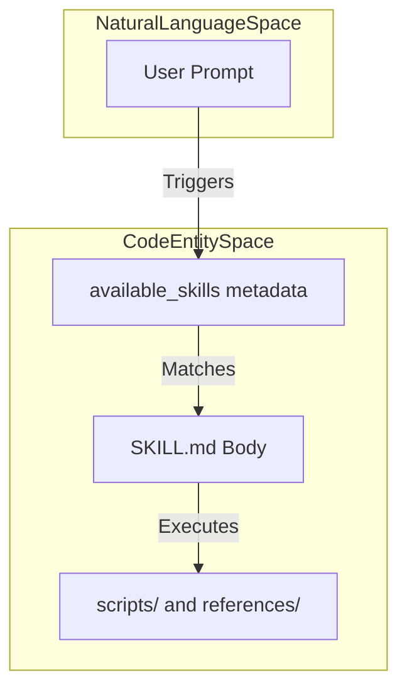

For detailed information on how skills are loaded, executed, and integrated with Claude's execution context, see [Skills System Architecture](#2.1).

Sources: [README.md:5-12](), [README.md:63-88]()

---

## 2.2. SKILL.md Format Specification

Every skill is encapsulated in a self-contained folder containing a required `SKILL.md` file [README.md:18](). The file combines YAML frontmatter for metadata with Markdown for instructional guidance.

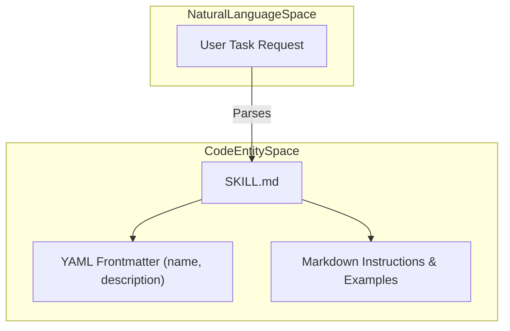

For comprehensive syntax requirements, frontmatter schemas, and Markdown guidelines, see [SKILL.md Format Specification](#2.2).

Sources: [README.md:63-91]()

---

## 2.3. Marketplace and Plugin System

Skills can be bundled into plugins and distributed via a marketplace structure defined by `marketplace.json` [README.md:34-36](). This allows teams and the broader community to share sets of specialized capabilities—such as document processing or example workflows—in a unified registry.

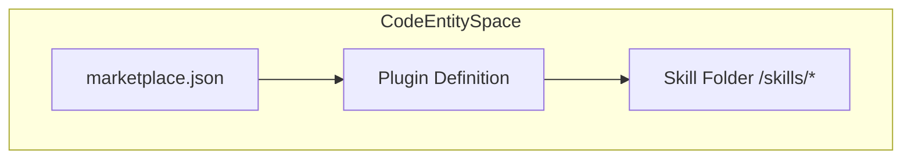

For details on plugin organization, registry configuration, and distribution mechanics, see [Marketplace and Plugin System](#2.3).

Sources: [README.md:34-49](), [README.md:5-6]()

---

## 2.4. Platform Integration

Skills integrate seamlessly across multiple Claude deployment surfaces, including Claude Code, Claude.ai, and the Claude API [README.md:31-62](). Installation and invocation methods vary slightly by platform, ranging from CLI plugin commands (`/plugin install`) to API tool definitions.

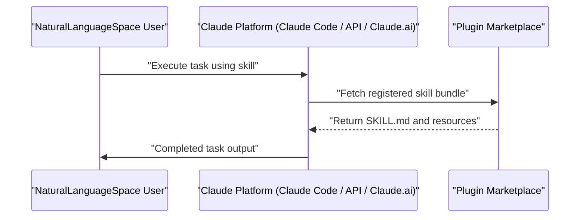

For platform-specific installation guides, invocation syntax, and execution environments, see [Platform Integration](#2.4).

Sources: [README.md:31-62]()

---

# Page: Skills System Architecture

# Skills System Architecture

<details>
<summary>Relevant source files</summary>

The following files were used as context for generating this wiki page:

- [.gitignore](.gitignore)
- [README.md](README.md)
- [skills/skill-creator/SKILL.md](skills/skill-creator/SKILL.md)
- [skills/skill-creator/scripts/improve_description.py](skills/skill-creator/scripts/improve_description.py)
- [skills/skill-creator/scripts/run_loop.py](skills/skill-creator/scripts/run_loop.py)
- [spec/agent-skills-spec.md](spec/agent-skills-spec.md)

</details>


## Purpose and Scope
This page explains the high-level technical architecture of the Anthropic skills system. It covers how skills are structured, how Claude dynamically discovers and loads them via progressive disclosure, how they map to plugins and the filesystem, and how programmatic execution and optimization loops (such as `run_loop.py` and `improve_description.py`) bridge natural language user requests to concrete code entities.

---

## 1. Core Anatomy of a Skill

A skill is a self-contained directory containing a `SKILL.md` file [README.md:18-18](). The `SKILL.md` file serves as the primary entry point for Claude and consists of two core components:

1. **YAML Frontmatter**: Machine-readable metadata containing the skill's identity and activation criteria [README.md:68-71]().
   - `name`: A unique lowercase identifier utilizing hyphens for spaces [README.md:87-87]().
   - `description`: A complete specification of what the skill does and when Claude should invoke it, functioning as the primary triggering mechanism [README.md:88-88]().
2. **Markdown Body**: The instructional set, examples, and guidelines that Claude executes when the skill is active [README.md:73-84]().

Skills may also package optional supporting resources [skills/skill-creator/SKILL.md:75-84]():
- `scripts/`: Executable code for deterministic or repetitive tasks [skills/skill-creator/SKILL.md:81-81]().
- `references/`: Documentation or large context files loaded only as needed [skills/skill-creator/SKILL.md:82-82]().
- `assets/`: Files used during output generation, such as templates, icons, or fonts [skills/skill-creator/SKILL.md:83-83]().

Sources: [README.md:18-18](), [README.md:68-90](), [skills/skill-creator/SKILL.md:75-84]()

---

## 2. Directory Layout and Organization

The repository organizes skills under a flat directory structure within the `skills/` folder [README.md:27-27](). Each subfolder represents a standalone skill containing its own configuration and execution assets.

**Diagram: Repository Structure and Code Entities**

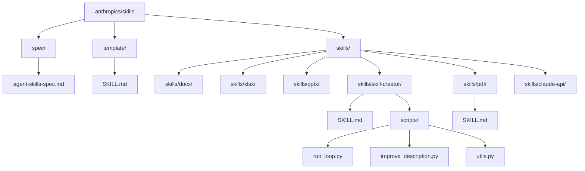

Sources: [README.md:26-30](), [spec/agent-skills-spec.md:1-3](), [skills/skill-creator/scripts/run_loop.py:1-20]()

---

## 3. The Plugin System and Marketplace Integration

While individual skill directories represent the atomic unit of execution, they are organized into logical **Plugins** for packaging and distribution, particularly within Claude Code [README.md:33-49]().

- **Marketplace**: Users register the repository as a plugin marketplace via `/plugin marketplace add anthropics/skills` [README.md:36-36]().
- **Plugins**: Skills are grouped into logical bundles like `document-skills` (containing document processing binaries) or `example-skills` [README.md:41-48]().

**Diagram: Plugin to Code Entity Mapping**

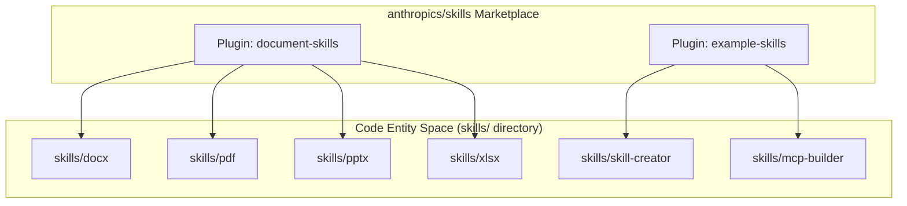

Sources: [README.md:20-20](), [README.md:33-49]()

---

## 4. Progressive Disclosure and Runtime Lifecycle

Skills are loaded dynamically based on contextual relevance [README.md:6-6](). Claude utilizes a three-tier system of **Progressive Disclosure** to manage context efficiency [skills/skill-creator/SKILL.md:88-92]().

1. **Metadata** (`name` + `description`): Always maintained in active context (~100 words) for trigger evaluation [skills/skill-creator/SKILL.md:89-89]().
2. **`SKILL.md` Body**: Injected into context whenever the skill triggers (<500 lines ideal) [skills/skill-creator/SKILL.md:90-90]().
3. **Bundled Resources**: Loaded or executed selectively as needed (e.g., executing scripts without loading entire reference documents into context) [skills/skill-creator/SKILL.md:91-91]().

Sources: [README.md:6-6](), [skills/skill-creator/SKILL.md:88-92]()

---

## 5. Execution Flow and Optimization Engine

Meta-skills like `skills/skill-creator/SKILL.md` provide automated workflows that bridge natural language prompts to concrete Python execution pipelines (`run_loop.py`, `improve_description.py`, `run_eval.py`). 

**Diagram: Natural Language Space to Code Entity Space Execution Flow**

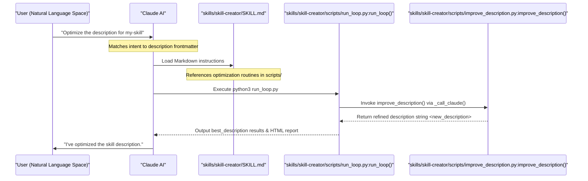

Sources: [README.md:6-6](), [README.md:51-51](), [skills/skill-creator/SKILL.md:88-109](), [skills/skill-creator/scripts/run_loop.py:47-61](), [skills/skill-creator/scripts/improve_description.py:20-60]()

---

## 6. Architectural Principles

1. **Self-Containment**: Each skill folder encapsulates instructions (`SKILL.md`) and supporting logic (`scripts/`) or assets [README.md:18-18]().
2. **Progressive Disclosure**: Detailed instructions remain deferred until triggered, preventing context window saturation [skills/skill-creator/SKILL.md:88-92]().
3. **Standardization**: All implementations comply with the open **Agent Skills Spec** [README.md:1-1](), [spec/agent-skills-spec.md:3-3]().
4. **Optimization Loop**: Meta-skills such as `skill-creator` incorporate evaluation scripts (`run_loop.py`) [skills/skill-creator/scripts/run_loop.py:1-7]() and description tuning functions (`improve_description.py`) [skills/skill-creator/scripts/improve_description.py:1-7]() to systematically measure and improve triggering accuracy.

Sources: [README.md:1-1](), [README.md:18-20](), [skills/skill-creator/SKILL.md:88-92](), [skills/skill-creator/scripts/run_loop.py:1-7](), [skills/skill-creator/scripts/improve_description.py:1-7]()

---

# Page: SKILL.md Format Specification

# SKILL.md Format Specification

<details>
<summary>Relevant source files</summary>

The following files were used as context for generating this wiki page:

- [.gitignore](.gitignore)
- [README.md](README.md)
- [skills/docx/SKILL.md](skills/docx/SKILL.md)
- [skills/docx/scripts/merge_runs.py](skills/docx/scripts/merge_runs.py)
- [spec/agent-skills-spec.md](spec/agent-skills-spec.md)

</details>


## Purpose and Scope
This document defines the technical structure, format requirements, and validation logic for `SKILL.md` files, which serve as the primary entry point and configuration for all skills in the `anthropics/skills` repository. It covers YAML frontmatter property constraints, Markdown body conventions, and the programmatic validation rules enforced by tools such as `quick_validate.py`. 

Sources: [README.md:63-90]()

## File Structure Overview
Every skill is encapsulated within its own directory under the `skills/` folder, containing a mandatory `SKILL.md` entry point. The file combines structured metadata headers (YAML frontmatter) with freeform instruction bodies (Markdown) that dictate how Claude should execute the skill.

### Natural Language to Code Entity Mapping: File Structure
This diagram illustrates how high-level natural language concepts map onto concrete file artifacts and parser functions in the codebase.

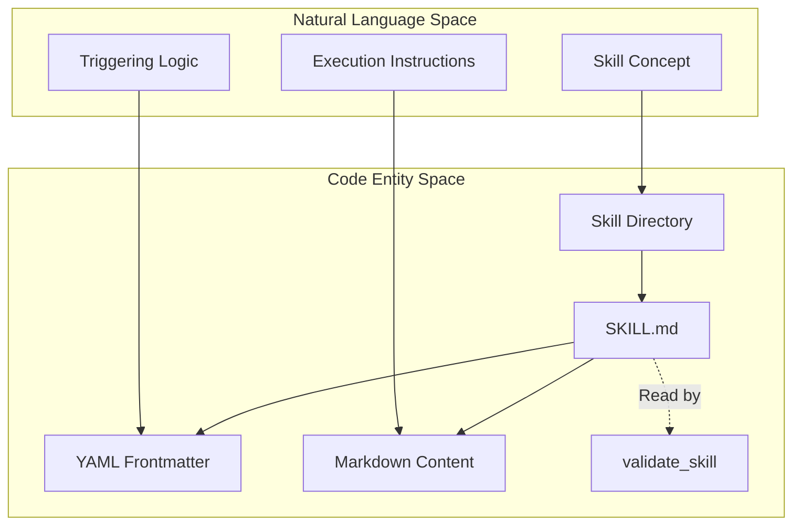

Sources: [README.md:14-20]()

## YAML Frontmatter Specification
The YAML frontmatter must appear at the exact beginning of the `SKILL.md` file, bounded by `---` markers. It is parsed to drive skill discovery, routing, and tool access permissions.

### Allowed and Required Properties
The validation engine strictly enforces an allowlist of properties:

| Field | Type | Constraints | Purpose |
|-------|------|-------------|---------|
| `name` | string | Kebab-case (`[a-z0-9-]+`), max 64 chars | Unique identifier for the skill [README.md:87]() |
| `description` | string | Max 1024 chars, no angle brackets (`<`, `>`) | Drives skill triggering and routing [README.md:88]() |
| `license` | string | Optional | Clarifies usage rights (e.g. `Apache-2.0`) [README.md:20]() |
| `allowed-tools` | list/string | Optional | Restricts tool execution permissions |
| `metadata` | map | Optional | Nested metadata dictionary |
| `compatibility` | string | Max 500 chars, optional | Environment or platform requirements |

### Parsing and Validation Rules
The validation function performs the following validation steps:
1. Verifies the existence of `SKILL.md` within the target directory.
2. Ensures the file starts with `---` and extracts the frontmatter text block using regular expression matching.
3. Safely parses the extracted text using YAML parsing into a dictionary structure.
4. Compares frontmatter keys against allowed properties (`name`, `description`, `license`, `allowed-tools`, `metadata`, `compatibility`).
5. Validates name formatting: checks that `name` consists entirely of lowercase alphanumeric characters and hyphens, avoids consecutive or leading/trailing hyphens, and adheres to a maximum length of 64 characters.
6. Validates description string: prohibits angle brackets (`<` or `>`) to prevent injection/parsing errors and enforces a 1024-character maximum length.

Sources: [README.md:86-90]()

## Markdown Body Specification
Following the closing `---` frontmatter delimiter, the Markdown body contains the procedural instructions, context, examples, and guidelines loaded into Claude's context window upon activation.

### Progressive Disclosure System
* **Metadata Layer (Frontmatter)**: Always active or indexable for routing decisions.
* **Instruction Body**: Dynamically loaded into context only when the skill is invoked [README.md:6-11]().
* **Bundled Resources**: Reference scripts, templates, and assets embedded in the skill folder that Claude can access via tool calls as needed [README.md:6]().

### Content Conventions
* **Headings**: Use structured H1 and H2 headers (`#`, `##`) to logically divide instructions, workflows, and reference sections [README.md:73-84]().
* **Examples**: Provide clear sample usage blocks under an `## Examples` header to guide Claude's generation pattern [README.md:77-79]().
* **Guidelines**: Itemize boundary conditions, formatting rules, or constraints under an `## Guidelines` header [README.md:81-83]().

Sources: [README.md:6-11](), [README.md:65-84]()

## Validation and Execution Logic
Python scripts in the repository parse and validate `SKILL.md` to ensure structural integrity before test evaluations or packaging.

### Natural Language to Code Entity Mapping: Validation Flow
This diagram maps frontmatter and body evaluation rules to their underlying code components.

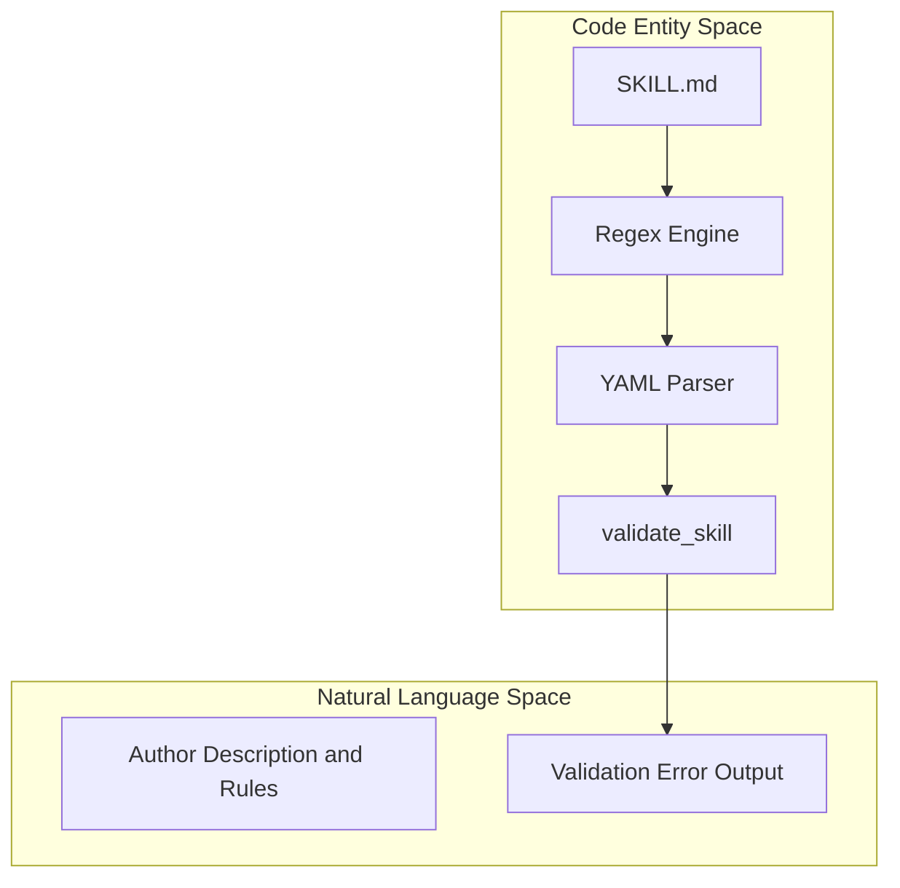

Sources: [README.md:63-90]()

## Complete Format Example
A standard `SKILL.md` compliant with parser rules follows this template:

```markdown
---
name: my-skill-name
description: A clear description of what this skill does and when to use it
---

# My Skill Name

[Add your instructions here that Claude will follow when this skill is active]

## Examples
- Example usage 1
- Example usage 2

## Guidelines
- Guideline 1
- Guideline 2
```

Sources: [README.md:65-84]()

---

# Page: Marketplace and Plugin System

# Marketplace and Plugin System

<details>
<summary>Relevant source files</summary>

The following files were used as context for generating this wiki page:

- [.claude-plugin/marketplace.json](.claude-plugin/marketplace.json)
- [skills/academy-guide/LICENSE.txt](skills/academy-guide/LICENSE.txt)
- [skills/academy-guide/SKILL.md](skills/academy-guide/SKILL.md)

</details>


## Purpose and Scope

This document explains the marketplace and plugin system that enables skill discovery and loading in Claude. It covers the structure of `.claude-plugin/marketplace.json`, how plugins organize skills into bundles, the `strict` resolution mode, how skill paths resolve relative to the repo root, and the licensing boundaries between different skill groups. For information about the `SKILL.md` format that defines individual skills, see page 2.2. For the overall architecture of how skills are loaded and executed, see page 2.1.

Sources: [.claude-plugin/marketplace.json:1-73]()

## Marketplace.json Structure

The `.claude-plugin/marketplace.json` file serves as the central registry for all skills available in the repository. It defines plugins, which are logical groupings of related skills, and provides metadata about the marketplace itself.

### Top-Level Fields

The marketplace file contains four primary sections:

| Field | Type | Purpose | Example |
|-------|------|---------|---------|
| `name` | string | Unique identifier for the marketplace | `"anthropic-agent-skills"` |
| `owner` | object | Contact information for marketplace maintainer | `{"name": "Keith Lazuka", "email": "..."}` |
| `metadata` | object | Descriptive information and versioning | `{"description": "...", "version": "1.0.0"}` |
| `plugins` | array | List of plugin definitions | See Plugin Structure below |

Sources: [.claude-plugin/marketplace.json:1-11]()

### Plugin Structure

Each plugin in the `plugins` array defines a collection of related skills:

| Field | Type | Required | Purpose |
|-------|------|----------|---------|
| `name` | string | Yes | Unique identifier for the plugin |
| `description` | string | Yes | Human-readable description of plugin capabilities |
| `source` | string | Yes | Base path for skill resolution (typically `"./"`) |
| `strict` | boolean | Yes | Whether to enforce strict loading rules |
| `skills` | array | Yes | List of relative paths to skill directories |

**Example Plugin Definition:**

```json
{
  "name": "example-skills",
  "description": "Collection of example skills demonstrating various capabilities including skill creation, MCP building, visual design, algorithmic art, internal communications, web testing, artifact building, Slack GIFs, and theme styling",
  "source": "./",
  "strict": false,
  "skills": [
    "./skills/algorithmic-art",
    "./skills/brand-guidelines",
    "./skills/canvas-design",
    "./skills/doc-coauthoring",
    "./skills/frontend-design",
    "./skills/internal-comms",
    "./skills/mcp-builder",
    "./skills/skill-creator",
    "./skills/slack-gif-creator",
    "./skills/theme-factory",
    "./skills/web-artifacts-builder",
    "./skills/webapp-testing"
  ]
}
```

Sources: [.claude-plugin/marketplace.json:24-43]()

## Plugin Organization Hierarchy

The following diagram illustrates how `.claude-plugin/marketplace.json` organizes plugins and skills across all five registered plugin suites, linking JSON structural definitions directly to filesystem paths.

### Diagram: Marketplace Registry to Filesystem Layout

```mermaid
graph TB
    subgraph marketplace[".claude-plugin/marketplace.json"]
        mname["name: \"anthropic-agent-skills\""]
        owner["owner: {name, email}"]
        metadata["metadata: {description, version: \"1.0.0\"}"]
        plugins["plugins: [ ... ]"]
    end

    subgraph plugin1["plugins[0]: document-skills"]
        p1_source["source: \"./\""]
        p1_strict["strict: false"]
        p1_skills["skills: [...]"]
    end

    subgraph plugin2["plugins[1]: example-skills"]
        p2_source["source: \"./\""]
        p2_strict["strict: false"]
        p2_skills["skills: [...]"]
    end

    subgraph plugin3["plugins[2]: claude-api"]
        p3_source["source: \"./\""]
        p3_strict["strict: false"]
        p3_skills["skills: [\"./skills/claude-api\"]"]
    end

    subgraph plugin4["plugins[3]: academy-guide"]
        p4_source["source: \"./\""]
        p4_strict["strict: false"]
        p4_skills["skills: [\"./skills/academy-guide\"]"]
    end

    subgraph plugin5["plugins[4]: discernment-nudge"]
        p5_source["source: \"./\""]
        p5_strict["strict: false"]
        p5_skills["skills: [\"./skills/discernment-nudge\"]"]
    end

    plugins --> plugin1
    plugins --> plugin2
    plugins --> plugin3
    plugins --> plugin4
    plugins --> plugin5

    p1_skills --> xlsx["\"./skills/xlsx\""]
    p1_skills --> docx["\"./skills/docx\""]
    p1_skills --> pptx["\"./skills/pptx\""]
    p1_skills --> pdf["\"./skills/pdf\""]

    p2_skills --> skill_creator["\"./skills/skill-creator\""]
    p2_skills --> mcp["\"./skills/mcp-builder\""]
    p2_skills --> canvas["\"./skills/canvas-design\""]
    p2_skills --> algo["\"./skills/algorithmic-art\""]
    p2_skills --> brand["\"./skills/brand-guidelines\""]
    p2_skills --> doc["\"./skills/doc-coauthoring\""]
    p2_skills --> frontend["\"./skills/frontend-design\""]
    p2_skills --> comms["\"./skills/internal-comms\""]
    p2_skills --> slack["\"./skills/slack-gif-creator\""]
    p2_skills --> theme["\"./skills/theme-factory\""]
    p2_skills --> artifacts["\"./skills/web-artifacts-builder\""]
    p2_skills --> webapp["\"./skills/webapp-testing\""]

    p3_skills --> claudeapi["\"./skills/claude-api\""]
    p4_skills --> academy["\"./skills/academy-guide\""]
    p5_skills --> discernment["\"./skills/discernment-nudge\""]
```

Sources: [.claude-plugin/marketplace.json:11-72]()

## Skill Path Resolution

Skills are referenced by relative paths in the `skills` array. The path resolution combines the plugin's `source` field with the skill path to locate the `SKILL.md` file.

### Diagram: Skill Path Resolution Architecture

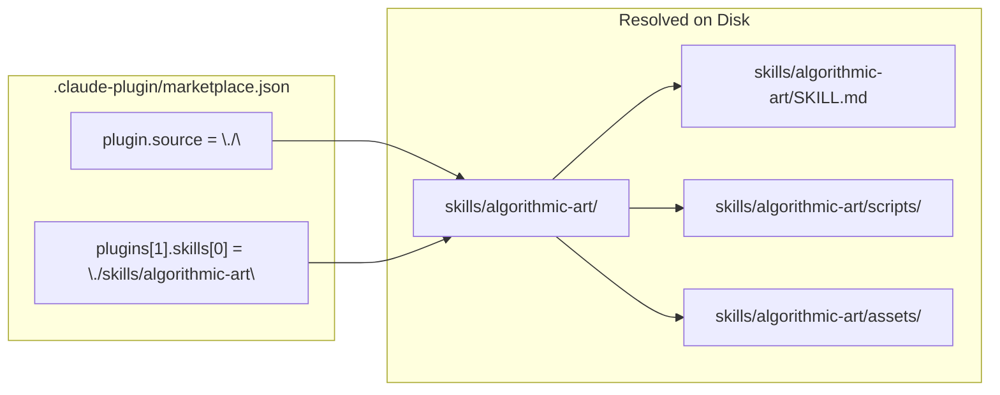

The resolution process:
1. Parse `.claude-plugin/marketplace.json` to extract plugin definitions.
2. For each entry in `plugin.skills`, treat the path as relative to the repository root (the `source` field `"./"` anchors it there).
3. Locate `SKILL.md` inside the resolved directory — this is the skill definition file.
4. Additional resources (scripts, assets) are loaded from the same directory as needed during execution.

All skill paths in this repository follow the pattern `./skills/<skill-name>`, meaning every skill lives directly under the top-level `skills/` directory.

Sources: [.claude-plugin/marketplace.json:11-73]()

## Plugin Groups and Licensing

The marketplace is divided into five distinct plugins, each with different purposes and licensing constraints.

### 1. `document-skills` Plugin
*   **Name**: `document-skills`
*   **Skills**: `xlsx`, `docx`, `pptx`, `pdf`
*   **Purpose**: Production-grade document processing suite [.claude-plugin/marketplace.json:13-22]().
*   **License**: Source-available (not open source). These are published for reference but not licensed for redistribution.

### 2. `example-skills` Plugin
*   **Name**: `example-skills`
*   **Skills**: 12 skills including `skill-creator`, `mcp-builder`, `algorithmic-art`, etc. [.claude-plugin/marketplace.json:25-42]()
*   **Purpose**: Demonstrating various Agent Skills capabilities.
*   **License**: Apache 2.0. Fully open source and redistributable.

### 3. `claude-api` Plugin
*   **Name**: `claude-api`
*   **Skills**: `claude-api` [.claude-plugin/marketplace.json:46-52]()
*   **Purpose**: Documentation and SDK examples for building with Claude.
*   **License**: Apache 2.0.

### 4. `academy-guide` Plugin
*   **Name**: `academy-guide`
*   **Skills**: `academy-guide` [.claude-plugin/marketplace.json:55-61]()
*   **Purpose**: Recommends relevant Claude Academy courses, tutorials, and use cases when users ask how to use Claude.
*   **License**: Apache 2.0.

### 5. `discernment-nudge` Plugin
*   **Name**: `discernment-nudge`
*   **Skills**: `discernment-nudge` [.claude-plugin/marketplace.json:64-70]()
*   **Purpose**: Appends short follow-up questions after substantive answers to help users check key facts, probe reasoning, and notice missing context.
*   **License**: Apache 2.0.

Sources: [.claude-plugin/marketplace.json:11-72]()

### Strict vs. Permissive Resolution Mode

The `strict` field on each plugin controls how the plugin loader handles missing or malformed skill metadata:

| `strict` value | Behavior |
|----------------|---------|
| `true` | All skills in the plugin must pass validation; a single failure prevents the entire plugin from loading. |
| `false` | The loader attempts to load each skill independently; a malformed or missing `SKILL.md` in one skill does not block others. |

All plugins in `.claude-plugin/marketplace.json` currently set `"strict": false`.

Sources: [.claude-plugin/marketplace.json:16,28,49,58,67]()

## Skill Discovery Workflow

When a user mentions a skill by name or intent, Claude performs a discovery process that bridges natural language input to code entity resolution via `.claude-plugin/marketplace.json` and `SKILL.md` files.

### Diagram: Natural Language to Code Entity Mapping

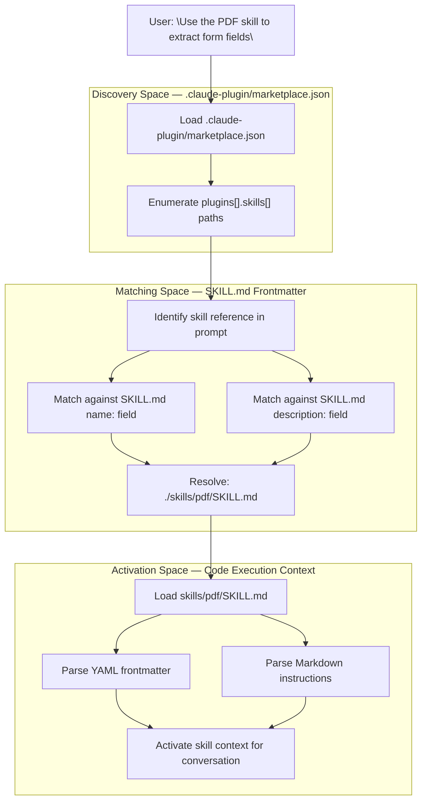

Sources: [.claude-plugin/marketplace.json:1-73]()

---

# Page: Platform Integration

# Platform Integration

<details>
<summary>Relevant source files</summary>

The following files were used as context for generating this wiki page:

- [.gitignore](.gitignore)
- [README.md](README.md)
- [skills/claude-api/SKILL.md](skills/claude-api/SKILL.md)
- [spec/agent-skills-spec.md](spec/agent-skills-spec.md)

</details>


This page describes how skills from the `anthropics/skills` repository integrate across three distinct Claude surfaces: Claude Code (via the plugin marketplace), Claude.ai (pre-integrated for paid plans), and the Claude API (via the Skills API). While each surface employs a different installation and invocation mechanism, all three rely on the standard `SKILL.md` format loaded at runtime.

For details on the `SKILL.md` format, see page 2.2. For how skills are packaged into plugins, see page 2.3.

## Platform Comparison

| Platform | Access Method | Pre-installed | Custom Skills | Activation |
|----------|---------------|---------------|---------------|------------|
| Claude Code | `/plugin` commands + marketplace | No (manual install required) | Yes (local repo files) | Natural language mention |
| Claude.ai | Web interface | Yes (paid plans) | Yes (upload via UI) | Auto-available after upload |
| Claude API | Skills API endpoints | Yes (Anthropic pre-built) | Yes (upload via API) | API parameter / natural language |

Sources: [README.md:31-61]()

## Claude Code Integration

Claude Code accesses skills through a plugin marketplace system that requires explicit registration and installation steps.

### Marketplace Registration

Register the repository as a plugin marketplace source:

```
/plugin marketplace add anthropics/skills
```

This registers the repository as an available plugin source.

Sources: [README.md:33-37]()

### Plugin Installation Methods

After marketplace registration, install a plugin bundle using either method:

**Interactive:**
1. Select `Browse and install plugins`
2. Select `anthropic-agent-skills`
3. Choose `document-skills` or `example-skills`
4. Select `Install now`

**Direct command:**
```
/plugin install document-skills@anthropic-agent-skills
/plugin install example-skills@anthropic-agent-skills
```

The syntax is `/plugin install <plugin-name>@<marketplace-name>`.

Sources: [README.md:39-49]()

### Skill Activation

Once installed, invoke a skill by mentioning it in natural language:

```
Use the PDF skill to extract the form fields from path/to/some-file.pdf
```

Claude Code matches the mention against loaded `SKILL.md` `description` fields and injects the matching skill's instructions into context.

Sources: [README.md:51-52](), [README.md:68-71]()

**Diagram: Natural Language Space to Code Entity Space — Claude Code Installation and Execution Flow**

```mermaid
flowchart TD
    NL["Natural Language Space: 'Use the PDF skill to extract form fields'"]
    Command["Code Entity: /plugin install document-skills@anthropic-agent-skills"]
    Marketplace["Code Entity: marketplace.json / anthropics/skills"]
    PluginDoc["Code Entity: skills/docx/SKILL.md & skills/pdf/SKILL.md"]
    Context["Code Entity: Claude Context Injection"]

    NL --> Command
    Command --> Marketplace
    Marketplace --> PluginDoc
    PluginDoc --> Context
```

Sources: [README.md:31-52](), [README.md:68-71]()

## Claude.ai Integration

### Pre-integrated Skills

The example skills from this repository are already available to paid plan users on Claude.ai without any manual installation step.

Sources: [README.md:53-56]()

### Custom Skill Upload

Paid users can upload additional skills (including custom-authored ones) through the Claude.ai web interface. The upload accepts a `SKILL.md` file and supporting assets.

Sources: [README.md:57-58]()

Sources: [README.md:53-58]()

## Claude API Integration

### Pre-built Skills

The Skills API exposes Anthropic's pre-built skills directly. No repository setup is required.

### Custom Skill Upload

Developers can upload custom `SKILL.md`-based skills to the API for use in production applications. The `claude-api` skill specifically provides documentation for integrating these features using the Anthropic SDKs (`anthropic`, `@anthropic-ai/sdk`, etc.) as defined in [skills/claude-api/SKILL.md:1-25]().

| Language | Feature Support | Tool Runner | Managed Agents |
|----------|-----------------|-------------|----------------|
| Python | Full | Yes (beta) | Yes (beta) |
| TypeScript | Full | Yes (beta) | Yes (beta) |
| Java | Full | Yes (beta) | Yes (beta) |
| Go | Full | Yes (beta) | Yes (beta) |
| Ruby | Full | Yes (beta) | Yes (beta) |
| PHP | Full | Yes (beta) | Yes (beta) |
| C# | Official SDK | No | No |

Sources: [README.md:59-61](), [skills/claude-api/SKILL.md:1-25]()

## Cross-Platform Execution Model

All three platforms share a common execution model despite different integration methods:

### Unified Skill Loading

```mermaid
sequenceDiagram
    participant Platform as "Platform (Code/Web/API)"
    participant Loader as "Skill Loader"
    participant FileSystem as "SKILL.md File"
    participant Parser as "YAML + Markdown Parser"
    participant Executor as "Claude Context"
    
    Platform->>Loader: "Skill activation request"
    Loader->>FileSystem: "Read SKILL.md"
    FileSystem-->>Loader: "File contents"
    Loader->>Parser: "Parse YAML frontmatter"
    Parser-->>Loader: "name, description"
    Loader->>Parser: "Parse markdown content"
    Parser-->>Loader: "Instructions, examples, guidelines"
    Loader->>Executor: "Inject skill context"
    Executor-->>Platform: "Ready for execution"
```

Sources: [README.md:63-90](), [skills/claude-api/SKILL.md:1-5]()

### Platform-Specific Features

| Feature | Claude Code | Claude.ai | Claude API |
|---------|-------------|-----------|------------|
| Installation method | `/plugin` commands | Pre-integrated + upload | API endpoint |
| Skill discovery | Marketplace browse UI | Web interface | Programmatic query |
| Custom skills | Local repository files | Upload interface | API upload |
| Activation | Natural language mention | Automatic | API parameter |
| Skill updates | Re-install plugin | Re-upload | Re-upload via API |

Sources: [README.md:31-61]()

### Language and SDK Integration (Claude API)

For API-based integration, the `claude-api` skill manages language detection and provides specific implementation details for calling Claude.

**Diagram: Natural Language Space to Code Entity Space — Claude API Language Detection and SDK Invocation**

```mermaid
flowchart TD
    NLReq["Natural Language Space: User Request / Project Files"]
    LangDetect["Code Entity: Language Detection Logic"]
    PythonModule["Code Entity: skills/claude-api/python/"]
    TSModule["Code Entity: skills/claude-api/typescript/"]
    GoModule["Code Entity: skills/claude-api/go/"]
    JavaModule["Code Entity: skills/claude-api/java/"]
    RubyModule["Code Entity: skills/claude-api/ruby/"]
    PHPModule["Code Entity: skills/claude-api/php/"]
    C_Module["Code Entity: skills/claude-api/csharp/"]
    CurlModule["Code Entity: skills/claude-api/curl/"]
    SDKCall["Code Entity: Official Anthropic SDK / HTTP REST"]

    NLReq --> LangDetect
    LangDetect --> PythonModule & TSModule & GoModule & JavaModule & RubyModule & PHPModule & C_Module & CurlModule
    PythonModule & TSModule & GoModule & JavaModule & RubyModule & PHPModule & C_Module & CurlModule --> SDKCall
```

Sources: [skills/claude-api/SKILL.md:15-22](), [skills/claude-api/SKILL.md:41-50]()

## Platform Integration Summary

The three platforms provide different developer experiences while maintaining compatibility with the same skill format:

- **Claude Code** requires explicit marketplace registration and plugin installation, offering fine-grained control over which skills are available.
- **Claude.ai** provides immediate access to example skills for paid users and supports custom uploads through a web interface.
- **Claude API** enables programmatic skill management and execution, suitable for production applications, with SDK support for automated tool loops and Managed Agents.

All platforms load `SKILL.md` files dynamically at skill activation time, ensuring that skill updates are immediately available to the model.

Sources: [README.md:31-61](), [skills/claude-api/SKILL.md:1-50]()

---

# Page: Skills Catalog

# Skills Catalog

<details>
<summary>Relevant source files</summary>

The following files were used as context for generating this wiki page:

- [.claude-plugin/marketplace.json](.claude-plugin/marketplace.json)
- [skills/academy-guide/LICENSE.txt](skills/academy-guide/LICENSE.txt)
- [skills/academy-guide/SKILL.md](skills/academy-guide/SKILL.md)

</details>


This page provides a high-level catalog of all skills available in the `anthropics/skills` repository. These skills are organized into functional plugins that extend Claude's capabilities across document processing, software development, creative design, API integration, and behavioral guidance `[.claude-plugin/marketplace.json:1-73]()`.

For detailed technical specifications of individual skills, refer to the child pages:
- [Document Skills](#3.1) — Production-grade document processing (PDF, DOCX, XLSX, PPTX).
- [Example Skills](#3.2) — Open-source tools for design, development, and communication.
- [Claude API Documentation Skill](#3.3) — Language-specific SDK guides and API examples.
- [Guidance and Behavior Skills](#3.4) — Academy recommendations and response discernment nudges.

## Marketplace Structure

The repository organizes skills into five primary plugins defined in the marketplace configuration. These plugins group related `SKILL.md` files into installable units for Claude Code, Claude.ai, and the Claude API `[.claude-plugin/marketplace.json:11-72]`.

**Skills Hierarchy and Code Mapping**

```mermaid
graph TD
    Marketplace["marketplace.json"]
    
    subgraph Plugin1["document-skills"]
        P1["Plugin: document-skills"]
        S1["./skills/xlsx"]
        S2["./skills/docx"]
        S3["./skills/pptx"]
        S4["./skills/pdf"]
    end
    
    subgraph Plugin2["example-skills"]
        P2["Plugin: example-skills"]
        S5["./skills/algorithmic-art"]
        S6["./skills/canvas-design"]
        S7["./skills/mcp-builder"]
        S8["./skills/skill-creator"]
        S9["./skills/webapp-testing"]
        S10["...and others"]
    end

    subgraph Plugin3["claude-api"]
        P3["Plugin: claude-api"]
        S11["./skills/claude-api"]
    end

    subgraph Plugin4["academy-guide"]
        P4["Plugin: academy-guide"]
        S12["./skills/academy-guide"]
    end

    subgraph Plugin5["discernment-nudge"]
        P5["Plugin: discernment-nudge"]
        S13["./skills/discernment-nudge"]
    end
    
    Marketplace --> P1
    Marketplace --> P2
    Marketplace --> P3
    Marketplace --> P4
    Marketplace --> P5
    
    P1 --> S1 & S2 & S3 & S4
    P2 --> S5 & S6 & S7 & S8 & S9 & S10
    P3 --> S11
    P4 --> S12
    P5 --> S13
```

Sources: `[.claude-plugin/marketplace.json:1-73]()`

## Document Skills

The `document-skills` plugin contains production-grade, source-available skills that power Claude's core document capabilities `[.claude-plugin/marketplace.json:11-23]()`. These skills utilize system-level integrations to perform complex manipulations on binary formats including spreadsheets, documents, presentations, and portable documents.

- **XLSX**: Advanced spreadsheet manipulation including formula recalculation.
- **DOCX**: Word document processing with support for tracked changes and comments.
- **PPTX**: Presentation generation, slide manipulation, and thumbnail rendering.
- **PDF**: Structural extraction from non-fillable PDFs and document assembly.

For details, see [Document Skills](#3.1).

Sources: `[.claude-plugin/marketplace.json:11-23]()`

## Example Skills

The `example-skills` plugin showcases the versatility of the Agent Skills standard through a variety of open-source tools `[.claude-plugin/marketplace.json:24-43]()`. These serve as reference implementations for developers building custom skills for software development, creative design, and communication workflows.

| Category | Skills |
| :--- | :--- |
| **Creative** | `algorithmic-art`, `canvas-design`, `slack-gif-creator` |
| **Development** | `mcp-builder`, `webapp-testing`, `web-artifacts-builder`, `frontend-design` |
| **Enterprise** | `brand-guidelines`, `internal-comms`, `theme-factory` |
| **Meta-Skills** | `skill-creator`, `doc-coauthoring` |

For details, see [Example Skills](#3.2).

Sources: `[.claude-plugin/marketplace.json:24-43]()`

## Claude API Documentation Skill

The `claude-api` skill is a specialized documentation tool designed to assist developers in building LLM-powered applications using Anthropic's platform `[.claude-plugin/marketplace.json:45-53]()`. It provides language-specific guides, core SDK reference materials, and support for advanced features like prompt caching and tool use.

For details, see [Claude API Documentation Skill](#3.3).

Sources: `[.claude-plugin/marketplace.json:45-53]()`

## Guidance and Behavior Skills

The guidance and behavior skills include `academy-guide` and `discernment-nudge` `[.claude-plugin/marketplace.json:54-71]()`. The `academy-guide` skill recommends relevant Claude Academy learning resources from a remote catalog with freshness checks `[skills/academy-guide/SKILL.md:1-135]()`, while the `discernment-nudge` skill appends short follow-up questions to substantive answers to prompt critical thinking.

For details, see [Guidance and Behavior Skills](#3.4).

Sources: `[.claude-plugin/marketplace.json:54-71]()`, `[skills/academy-guide/SKILL.md:1-135]()`

## Skill Discovery and Execution

The skills system bridges natural language requests to specific filesystem entities. When a user interacts with Claude, the system resolves intent based on the frontmatter definition in each skill's configuration `[.claude-plugin/marketplace.json:1-73]()`, `[skills/academy-guide/SKILL.md:1-19]()`.

**Natural Language to Code Entity Mapping**

```mermaid
sequenceDiagram
    participant User as "User Intent (Natural Language)"
    participant Trigger as "Frontmatter Trigger (YAML)"
    participant SkillFile as "SKILL.md (Code Entity)"
    participant Runner as "Claude / SDK Runner"

    User->>Trigger: "How do I get started with Claude?"
    Note over Trigger: Matches 'academy-guide' description & triggers
    Trigger->>SkillFile: Resolve to skills/academy-guide/SKILL.md
    SkillFile->>Runner: Load instructions and dynamic catalog logic
    Note over Runner: Claude executes catalog checks and appends recommendation [Line 21-128]
    Runner->>User: "Here is the answer... You might also find this helpful: [Course](URL)"
```

Sources: `[.claude-plugin/marketplace.json:1-73]()`, `[skills/academy-guide/SKILL.md:1-128]()`

---

# Page: Document Skills

# Document Skills

<details>
<summary>Relevant source files</summary>

The following files were used as context for generating this wiki page:

- [skills/docx/SKILL.md](skills/docx/SKILL.md)
- [skills/docx/scripts/accept_changes.py](skills/docx/scripts/accept_changes.py)
- [skills/docx/scripts/merge_runs.py](skills/docx/scripts/merge_runs.py)
- [skills/pdf/scripts/extract_form_structure.py](skills/pdf/scripts/extract_form_structure.py)

</details>


This page covers the **document-skills** plugin bundle: a suite of four production-grade, source-available skills for processing Word (`.docx`), Excel (`.xlsx`), PowerPoint (`.pptx`), and PDF (`.pdf`) files. It documents what is common across the suite — bundle registration, the shared Open XML processing workflow, and LibreOffice headless integration. For per-skill technical detail, see [DOCX Skill](#3.1.1), [PDF Skill](#3.1.2), [PPTX Skill](#3.1.3), and [XLSX Skill](#3.1.4).

---

## Bundle Registration and Code Mapping

The four skills are registered under the document processing ecosystem. The bundle uses loose resolution (`"strict": false`), allowing Claude to match user intents with appropriate script execution engines.

**Diagram: Natural Language to Code Entity Mapping for Document Skills**

```mermaid
graph TD
    subgraph NaturalLanguage["Natural Language Space"]
        NL_DOCX["\"Word doc / .docx / memo\""]
        NL_XLSX["\"Spreadsheet / .xlsx / formulas\""]
        NL_PPTX["\"Slides / presentation / .pptx\""]
        NL_PDF["\"PDF form structure / extraction\""]
    end

    subgraph CodeSpace["Code Entity Space"]
        SKILL_DOCX["skills/docx/SKILL.md"] --> SCRIPT_MERGE["skills/docx/scripts/merge_runs.py"]
        SKILL_DOCX --> SCRIPT_ACCEPT["skills/docx/scripts/accept_changes.py"]
        SKILL_PDF["skills/pdf/SKILL.md"] --> SCRIPT_EXTRACT["skills/pdf/scripts/extract_form_structure.py"]
    end

    NL_DOCX --> SKILL_DOCX
    NL_XLSX --> SKILL_XLSX
    NL_PPTX --> SKILL_PPTX
    NL_PDF --> SKILL_PDF
```

Sources: [skills/docx/SKILL.md:1-5](), [skills/docx/scripts/merge_runs.py:20-24](), [skills/docx/scripts/accept_changes.py:36-88](), [skills/pdf/scripts/extract_form_structure.py:20-88]()

---

## Skills at a Glance

| Skill | File Format | Primary Engine | Key Capabilities | Unique Scripts / Modules |
|---|---|---|---|---|
| `docx` | `.docx` | `docx-js` / LibreOffice | Tracked changes, comment insertion, XML editing | `skills/docx/scripts/merge_runs.py` [skills/docx/scripts/merge_runs.py:1-24](), `accept_changes.py` [skills/docx/scripts/accept_changes.py:36-39]() |
| `xlsx` | `.xlsx` | LibreOffice / `openpyxl` | Formula recalculation, error reporting | `skills/xlsx/SKILL.md:37-38`() |
| `pptx` | `.pptx` | LibreOffice / `pptxgenjs` | Slide manipulation, thumbnail generation | `skills/pptx/SKILL.md:24-24`() |
| `pdf` | `.pdf` | `pdfplumber` | Form structure & coordinate extraction | `skills/pdf/scripts/extract_form_structure.py:20-27`() |

Sources: [skills/docx/SKILL.md:13-16](), [skills/docx/scripts/merge_runs.py:1-24](), [skills/docx/scripts/accept_changes.py:36-39](), [skills/pdf/scripts/extract_form_structure.py:20-27]()

---

## Shared Architecture

### Open XML: Unpack → Edit → Repack

The `.docx`, `.xlsx`, and `.pptx` formats are ZIP archives containing XML. Each skill that edits these files follows a common workflow implemented across respective helper tools:

1. **Unpack**: The archive is extracted into a directory tree (`unzip -q doc.docx -d unpacked/`) [skills/docx/SKILL.md:52-52]().
2. **Edit**: XML files are modified directly or via script utilities (e.g., `merge_runs.py` [skills/docx/scripts/merge_runs.py:1-24](), `accept_changes.py` [skills/docx/scripts/accept_changes.py:36-39](), `extract_form_structure.py` [skills/pdf/scripts/extract_form_structure.py:20-27]()).
3. **Repack**: The directory is compressed back into a valid archive structure [skills/docx/SKILL.md:56-56]().

**Diagram: Workflow Bridge from Task Space to Code Execution**

```mermaid
graph LR
    subgraph NaturalLanguage["Natural Language Space"]
        TASK["\"Edit Word document or extract form structure\""]
    end

    subgraph CodeSpace["Code Entity Space"]
        MERGE["skills/docx/scripts/merge_runs.py\n(merge_runs)"]
        ACCEPT["skills/docx/scripts/accept_changes.py\n(accept_changes)"]
        EXTRACT["skills/pdf/scripts/extract_form_structure.py\n(extract_form_structure)"]
    end

    TASK --> MERGE
    TASK --> ACCEPT
    TASK --> EXTRACT
```

Sources: [skills/docx/SKILL.md:51-59](), [skills/docx/scripts/merge_runs.py:40-61](), [skills/docx/scripts/accept_changes.py:36-39](), [skills/pdf/scripts/extract_form_structure.py:20-27]()

---

### LibreOffice Headless Integration

Multiple document skills invoke LibreOffice (`soffice`) in `--headless` mode to perform rendering, PDF conversion, macro execution, and formula evaluation [skills/docx/scripts/accept_changes.py:58-65](). 

* **DOCX**: Used for rendering previews via PDF conversion and running tracked change acceptance macros via StarBasic [skills/docx/SKILL.md:40-43](), [skills/docx/scripts/accept_changes.py:19-33]().
* **XLSX**: Used by spreadsheet calculation helpers to evaluate formulas and cache values.
* **PPTX**: Used for headless conversion to image/PDF pipelines.

Sources: [skills/docx/SKILL.md:40-43](), [skills/docx/scripts/accept_changes.py:19-65]()

---

## Child Pages

For deep technical details on specific document types, refer to the following child pages:

* **[DOCX Skill](#3.1.1)** — Document the DOCX skill's capabilities, including accepting tracked changes and adding comments via LibreOffice integration.
* **[PDF Skill](#3.1.2)** — Document the PDF skill's capabilities, including form structure extraction for non-fillable PDFs.
* **[PPTX Skill](#3.1.3)** — Document the PPTX skill's capabilities, including slide manipulation and thumbnail generation.
* **[XLSX Skill](#3.1.4)** — Document the XLSX skill's capabilities, including formula recalculation via LibreOffice.

Sources: [skills/docx/SKILL.md:1-5](), [skills/docx/scripts/accept_changes.py:1-4]()

---

## Licensing

The document skills are released under a **proprietary, source-available license**. Each skill configuration specifies:

```yaml
license: Proprietary. LICENSE.txt has complete terms
```

Sources: [skills/docx/SKILL.md:4]()

---

# Page: DOCX Skill

# DOCX Skill

<details>
<summary>Relevant source files</summary>

The following files were used as context for generating this wiki page:

- [skills/docx/SKILL.md](skills/docx/SKILL.md)
- [skills/docx/scripts/comment.py](skills/docx/scripts/comment.py)
- [skills/docx/scripts/merge_runs.py](skills/docx/scripts/merge_runs.py)
- [skills/docx/scripts/office/helpers/pptx_slide.py](skills/docx/scripts/office/helpers/pptx_slide.py)
- [skills/docx/scripts/office/helpers/pptx_theme.py](skills/docx/scripts/office/helpers/pptx_theme.py)
- [skills/docx/scripts/office/soffice.py](skills/docx/scripts/office/soffice.py)

</details>


## Purpose and Scope

The DOCX skill provides production-grade Microsoft Word document processing capabilities for Claude. It enables advanced operations including accepting tracked changes, adding comments, merging fragmented text runs, validating redlines, and document manipulation through a combination of JavaScript-based generation (`docx-js`) and Python-based XML/LibreOffice automation. This skill is part of the document processing skills plugin that powers Claude's production document capabilities.

This page documents the DOCX skill's technical implementation, capabilities, helpers, and dependencies.

Sources: [skills/docx/SKILL.md:1-91](), [skills/docx/scripts/comment.py:1-175]()

## Skill Architecture

The DOCX skill combines declarative instructions in `SKILL.md` with Python automation scripts and JavaScript generation logic.

### Component Overview

The following diagram maps natural language requests to the underlying codebase entities.

```mermaid
graph TB
    subgraph "Natural Language Space"
        TrackedChanges["'Accept tracked changes'"]
        AddComments["'Add a comment'"]
        CreateDoc["'Create a Word doc'"]
        MergeRuns["'Merge fragmented runs'"]
    end

    subgraph "Code Entity Space (skills/docx)"
        SKILLMD["SKILL.md<br/>[skills/docx/SKILL.md:1-5]"]
        
        subgraph "scripts/"
            CommentScript["comment.py<br/>[skills/docx/scripts/comment.py:1-35]"]
            MergeScript["merge_runs.py<br/>[skills/docx/scripts/merge_runs.py:40-64]"]
            SofficeWrapper["office/soffice.py<br/>[skills/docx/scripts/office/soffice.py:27-47]"]
        end

        subgraph "Generation Logic"
            DocxJS["docx (npm)<br/>[skills/docx/SKILL.md:13-33]"]
        end
    end
    
    AddComments --> CommentScript
    CreateDoc --> DocxJS
    MergeRuns --> MergeScript
    SKILLMD -.->|"Defines triggers"| TrackedChanges
```

Sources: [skills/docx/SKILL.md:1-33](), [skills/docx/scripts/comment.py:1-35](), [skills/docx/scripts/merge_runs.py:40-64](), [skills/docx/scripts/office/soffice.py:27-47]()

## Capabilities

### 1. Accept Tracked Changes and Editing Existing Documents

Word splits text across many `<w:r>` runs (revision ids, spell-check markers), so phrases often don't exist as contiguous strings. The skill uses `merge_runs.py` to coalesce adjacent identically-formatted runs [skills/docx/scripts/merge_runs.py:1-24](). Tracked changes can be accepted via LibreOffice automation or scripts [skills/docx/SKILL.md:65-72]().

Sources: [skills/docx/SKILL.md:47-72](), [skills/docx/scripts/merge_runs.py:1-24]()

### 2. Add Comments and Replies

The skill adds comments and nested replies through direct XML manipulation of the unpacked DOCX structure or via direct file execution using `comment.py` [skills/docx/scripts/comment.py:1-23]().

```mermaid
graph TB
    subgraph "Natural Language Space"
        UserComment["'Add a comment to the DOCX'"]
    end

    subgraph "Code Entity Space (skills/docx/scripts)"
        CommentPy["comment.py<br/>[skills/docx/scripts/comment.py:1-23]"]
        AppendXml["_append_xml()<br/>[skills/docx/scripts/comment.py:100-110]"]
        NextCommentId["_next_comment_id()<br/>[skills/docx/scripts/comment.py:122-133]"]
    end

    UserComment --> CommentPy
    CommentPy --> NextCommentId
    CommentPy --> AppendXml
```

**Comment System Metadata:**
The script coordinates entries across multiple XML parts to ensure full compatibility with Word:
* `comments.xml`: Primary comment content (`w:id`, `w:author`, `w14:paraId`) [skills/docx/scripts/comment.py:49-65]().
* `commentsExtended.xml`: Reply threading structure (`w15:paraIdParent`) [skills/docx/scripts/comment.py:166]().
* `commentsIds.xml`: Durable IDs (`w16cid:durableId`) [skills/docx/scripts/comment.py:167]().
* `commentsExtensible.xml`: UTC timestamps (`w16cex:dateUtc`) [skills/docx/scripts/comment.py:168]().

Sources: [skills/docx/scripts/comment.py:1-175]()

## Technical Implementation Details

### LibreOffice Headless Execution and Socket Shim

The `office/soffice.py` helper manages running LibreOffice (`soffice`) in sandboxed environments where Unix domain sockets (`AF_UNIX`) may be restricted [skills/docx/scripts/office/soffice.py:1-16](). It detects restrictions at runtime via `_needs_shim()` and applies an `LD_PRELOAD` socket shim if necessary [skills/docx/scripts/office/soffice.py:27-35]().

Sources: [skills/docx/scripts/office/soffice.py:1-47]()

### XML Security and Parsing

The skill utilizes `defusedxml` to parse XML documents securely, preventing XML External Entity (XXE) vulnerabilities [skills/docx/scripts/comment.py:34]().

**Utility Functions:**
* `_append_xml()`: Imports nodes from a wrapper DOM into the target document DOM [skills/docx/scripts/comment.py:100-110]().
* `_encode_smart_quotes()`: Escapes smart quote characters into standard XML entities [skills/docx/scripts/comment.py:94-97]().
* `_next_comment_id()`: Determines the next available comment ID [skills/docx/scripts/comment.py:122-133]().

Sources: [skills/docx/scripts/comment.py:34-133]()

## Dependencies

| Dependency | Purpose | Location |
|------------|---------|----------|
| `docx` (npm) | Generating new `.docx` files | [skills/docx/SKILL.md:13]() |
| `pandoc` | Reading and extracting content (`-t markdown`) | [skills/docx/SKILL.md:15]() |
| LibreOffice (`soffice`) | Headless conversion and tracking acceptance | [skills/docx/SKILL.md:91]() |
| `defusedxml` | Secure XML parsing | [skills/docx/scripts/comment.py:34]() |
| `pdftoppm` (Poppler) | Rendering PDF pages to images for visual verification | [skills/docx/SKILL.md:41]() |

Sources: [skills/docx/SKILL.md:13-91](), [skills/docx/scripts/comment.py:34]()

---

# Page: PDF Skill

# PDF Skill

<details>
<summary>Relevant source files</summary>

The following files were used as context for generating this wiki page:

- [skills/docx/scripts/accept_changes.py](skills/docx/scripts/accept_changes.py)
- [skills/pdf/scripts/extract_form_structure.py](skills/pdf/scripts/extract_form_structure.py)

</details>


## Purpose and Scope

This document describes the PDF skill, a source-available document processing capability that enables Claude to extract form structure from non-fillable PDF documents. The skill analyzes PDF files to identify text labels, horizontal lines, checkboxes, and row boundaries, producing structured JSON output that facilitates form understanding and data extraction [skills/pdf/scripts/extract_form_structure.py:1-13]().

For information about other document processing skills, see Document Skills [3.1]. For details on the DOCX skill, see DOCX Skill [3.1.1]. For details on PPTX and XLSX skills, see PPTX Skill [3.1.3] and XLSX Skill [3.1.4].

Sources: [skills/pdf/scripts/extract_form_structure.py:1-13]()

## Overview

The PDF skill is a production-grade capability that powers Claude's PDF document processing features. Unlike fillable PDF forms with embedded form fields, many PDF documents are non-fillable—containing static text, lines, and shapes that visually represent a form but lack machine-readable field definitions. The PDF skill addresses this challenge by analyzing the visual layout of such documents [skills/pdf/scripts/extract_form_structure.py:1-13]().

| Capability | Description |
|------------|-------------|
| **Form Structure Extraction** | Identifies text labels, lines, checkboxes, and spatial relationships in non-fillable PDFs |
| **Coordinate Precision** | Captures exact x/y coordinates for all detected elements |
| **Row Boundary Detection** | Analyzes horizontal lines to determine row structure |
| **Checkbox Recognition** | Identifies small rectangles that function as checkbox elements |

The skill is source-available, serving as a reference implementation for complex PDF processing workflows.

Sources: [skills/pdf/scripts/extract_form_structure.py:1-13]()

## Skill Architecture

The PDF skill follows the standard skills directory structure with a `SKILL.md` definition file and supporting Python scripts in the `scripts/` subdirectory.

### Component Architecture

```mermaid
graph TB
    subgraph "skills/pdf/"
        SKILL["SKILL.md"]
        
        subgraph "scripts/"
            EXTRACT["extract_form_structure.py"]
        end
    end
    
    subgraph "Runtime_Environment"
        MODEL["Claude_AI_Model"]
        PYTHON["Python_Runtime"]
    end
    
    subgraph "External_Dependencies"
        PLUMBER["pdfplumber"]
    end
    
    SKILL --> MODEL
    MODEL --> EXTRACT
    EXTRACT --> PYTHON
    PYTHON --> PLUMBER
    
    subgraph "Input/Output"
        INPUT["input.pdf"]
        OUTPUT["output.json"]
    end
    
    INPUT --> EXTRACT
    EXTRACT --> OUTPUT
```

**Diagram: PDF Skill Component Architecture**

Sources: [skills/pdf/scripts/extract_form_structure.py:1-17](), [skills/pdf/scripts/extract_form_structure.py:29-30]()

The `SKILL.md` file contains instructions for Claude on when and how to invoke the PDF skill. When Claude determines that form structure extraction is needed, it executes the `extract_form_structure.py` script, which uses the `pdfplumber` library to parse PDF content and extract structural elements [skills/pdf/scripts/extract_form_structure.py:15-17](), [skills/pdf/scripts/extract_form_structure.py:29-30]().

Sources: [skills/pdf/scripts/extract_form_structure.py:1-17](), [skills/pdf/scripts/extract_form_structure.py:29-30]()

## Form Structure Extraction Pipeline

The core functionality is implemented in the `extract_form_structure()` function, which processes PDF files through a multi-stage extraction pipeline [skills/pdf/scripts/extract_form_structure.py:20-27]().

### Extraction Data Flow (Natural Language to Code Entities)

```mermaid
graph TD
    subgraph "Code_Entity_Space"
        START["start_extraction"] --> INIT["extract_form_structure(pdf_path)"]
        INIT --> OPEN["pdfplumber.open(pdf_path)"]
        
        OPEN --> LOOP["page_loop"]
        
        LOOP --> DIM["page.width / page.height"]
        LOOP --> WORDS["page.extract_words()"]
        LOOP --> LINES["page.lines"]
        LOOP --> RECTS["page.rects"]
        
        DIM --> PSTRUCT["structure['pages']"]
        WORDS --> LABELS["structure['labels']"]
        LINES --> HINES["structure['lines']"]
        RECTS --> CHECK["structure['checkboxes']"]
        
        LABELS --> NEXT["next_page"]
        HINES --> NEXT
        CHECK --> NEXT
        PSTRUCT --> NEXT
        
        NEXT --> LOOP
        NEXT --> GRP["lines_by_page"]
        GRP --> SORT["sorted(y_coords)"]
        SORT --> BOUND["structure['row_boundaries']"]
        BOUND --> RET["return_structure"]
    end
```

**Diagram: Form Structure Extraction Data Flow**

Sources: [skills/pdf/scripts/extract_form_structure.py:20-88]()

### Extraction Stages

The pipeline executes the following stages for each PDF page:

1. **Page Metadata Extraction**: Captures page dimensions (`width`, `height`) and page number [skills/pdf/scripts/extract_form_structure.py:30-35]().
2. **Text Label Extraction**: Uses `page.extract_words()` to obtain text elements with precise `x0`, `top`, `x1`, and `bottom` coordinates [skills/pdf/scripts/extract_form_structure.py:37-46]().
3. **Horizontal Line Detection**: Filters lines where the width exceeds 50% of the page width to identify row separators [skills/pdf/scripts/extract_form_structure.py:48-55]().
4. **Checkbox Identification**: Detects small square rectangles (width/height between 5-15 units, side difference < 2 units) [skills/pdf/scripts/extract_form_structure.py:57-69]().
5. **Row Boundary Calculation**: Groups lines by page, sorts them vertically, and computes vertical spans between consecutive lines [skills/pdf/scripts/extract_form_structure.py:71-86]().

Sources: [skills/pdf/scripts/extract_form_structure.py:20-88]()

## JSON Output Structure

The `extract_form_structure()` function returns a structured dictionary containing five primary top-level keys for layout reconstruction [skills/pdf/scripts/extract_form_structure.py:21-27]().

### Output Schema

| Field | Type | Description |
|-------|------|-------------|
| `pages` | Array | Page metadata including dimensions [skills/pdf/scripts/extract_form_structure.py:31-35]() |
| `labels` | Array | Text elements with bounding box coordinates [skills/pdf/scripts/extract_form_structure.py:39-46]() |
| `lines` | Array | Horizontal lines with y-coordinate and span [skills/pdf/scripts/extract_form_structure.py:50-55]() |
| `checkboxes` | Array | Small square rectangles with center points [skills/pdf/scripts/extract_form_structure.py:61-69]() |
| `row_boundaries` | Array | Vertical spacing between horizontal lines [skills/pdf/scripts/extract_form_structure.py:81-86]() |

### Page Metadata

```json
{
  "page_number": 1,
  "width": 612.0,
  "height": 792.0
}
```
Each page entry captures the page number and dimensions in PDF points (1/72 inch) [skills/pdf/scripts/extract_form_structure.py:31-35]().

### Text Labels

```json
{
  "page": 1,
  "text": "First Name:",
  "x0": 50.0,
  "top": 100.5,
  "x1": 120.3,
  "bottom": 112.0
}
```
Text labels include the extracted string and bounding box defined by `x0`, `top`, `x1`, and `bottom` [skills/pdf/scripts/extract_form_structure.py:37-46]().

### Horizontal Lines

```json
{
  "page": 1,
  "y": 115.2,
  "x0": 45.0,
  "x1": 567.0
}
```
Lines are filtered to include only those spanning at least 50% of the page width [skills/pdf/scripts/extract_form_structure.py:48-55]().

### Checkboxes

```json
{
  "page": 1,
  "x0": 200.0,
  "top": 150.0,
  "x1": 210.0,
  "bottom": 160.0,
  "center_x": 205.0,
  "center_y": 155.0
}
```
Checkbox detection uses geometric filtering: rectangles between 5-15 units that are nearly square. Center coordinates (`center_x`, `center_y`) are computed for spatial targeting [skills/pdf/scripts/extract_form_structure.py:57-69]().

### Row Boundaries

```json
{
  "page": 1,
  "row_top": 115.2,
  "row_bottom": 145.8,
  "row_height": 30.6
}
```
Derived from sorting horizontal lines and calculating vertical gaps [skills/pdf/scripts/extract_form_structure.py:71-86]().

Sources: [skills/pdf/scripts/extract_form_structure.py:21-88]()

## Command-Line Interface

The script can be invoked directly from the command line for standalone form structure extraction [skills/pdf/scripts/extract_form_structure.py:12-13]().

### Script Execution Flow (Code Entity Space)

```mermaid
graph LR
    subgraph "CLI_Execution_main()"
        ARG["sys.argv"] --> VAL["validate_arg_count"]
        VAL -->|len == 3| EXT["extract_form_structure(pdf_path)"]
        VAL -->|len != 3| ERR["print_usage_and_exit"]
        EXT --> JSON["json.dump(output_path)"]
        JSON --> PRT["print_summary"]
    end
```

**Diagram: Command-Line Execution Flow**

Sources: [skills/pdf/scripts/extract_form_structure.py:91-115]()

The `main()` function validates that exactly two arguments (`input.pdf` and `output.json`) are supplied via `sys.argv` before invoking `extract_form_structure()` and serializing the output [skills/pdf/scripts/extract_form_structure.py:91-115]().

Sources: [skills/pdf/scripts/extract_form_structure.py:91-115]()

## Dependencies

The PDF skill relies on the `pdfplumber` library for low-level PDF parsing [skills/pdf/scripts/extract_form_structure.py:17]().

| Library | Purpose |
|---------|---------|
| **pdfplumber** | Extraction of words, lines, and rectangles with precise coordinates [skills/pdf/scripts/extract_form_structure.py:29-69]() |

Sources: [skills/pdf/scripts/extract_form_structure.py:17](), [skills/pdf/scripts/extract_form_structure.py:29-69]()

## Integration with Claude

When Claude loads the PDF skill, the `SKILL.md` file instructs Claude on when form structure extraction is appropriate. The resulting JSON structure enables Claude to:

- Identify field labels by proximity to text elements.
- Locate input areas between horizontal lines.
- Map checkboxes to their associated labels.
- Understand multi-row table structures.
- Generate accurate field coordinates for form filling workflows [skills/pdf/scripts/extract_form_structure.py:1-13]().

Sources: [skills/pdf/scripts/extract_form_structure.py:1-13]()

---

# Page: PPTX Skill

# PPTX Skill

<details>
<summary>Relevant source files</summary>

The following files were used as context for generating this wiki page:

- [skills/pptx/scripts/add_slide.py](skills/pptx/scripts/add_slide.py)
- [skills/pptx/scripts/thumbnail.py](skills/pptx/scripts/thumbnail.py)

</details>


This page is the technical reference for the PPTX skill located at `skills/pptx/`. It documents the Python scripts that support slide insertion, thumbnail generation, package cleaning, and schema validation, covering their internal logic, Open XML structures, and integration with LibreOffice and `pptxgenjs`. For the shared architectural pattern common to all document skills, see [Document Skills](#3.1).

---

## Open XML Package Structure

A `.pptx` file is a ZIP archive. Before package manipulation scripts run, Claude unpacks it. The archive structure contains core OPC parts:

| Path | Role |
|---|---|
| `[Content_Types].xml` | Declares MIME types for every part in the package |
| `ppt/presentation.xml` | Ordered list of slides (`<p:sldIdLst>`), presentation metadata |
| `ppt/_rels/presentation.xml.rels` | Maps relationship identifiers (`rId`) to slide files |
| `ppt/slides/slide{n}.xml` | Per-slide XML content |
| `ppt/slides/_rels/slide{n}.xml.rels` | Per-slide relationships (layout references, notes, media) |
| `ppt/slideLayouts/slideLayout{n}.xml` | Layout templates used by slides |

Sources: [skills/pptx/scripts/add_slide.py:1-36]()

---

## Slide Insertion (`add_slide.py`)

### Purpose and Execution Flow

`add_slide.py` inserts a new slide into an unpacked PPTX directory or directly into a `.pptx` file. It executes package bookkeeping (creating slide XML, updating `[Content_Types].xml`, updating `presentation.xml.rels`) and computes the next slide ID, printing the `<p:sldId>` element required for manual insertion into `presentation.xml`.

**Diagram: Natural Language to Code Entity Space - Slide Insertion**
```mermaid
flowchart TD
    NL1[""Duplicate Existing Slide""] --> CE1["duplicate_slide"]
    NL2[""Create Slide from Layout""] --> CE2["create_slide_from_layout"]
    CE1 --> CE3["_precheck_registration"]
    CE2 --> CE3
    CE3 --> CE4["_register_slide"]
    CE4 --> CE5["get_next_slide_number"]
```
Sources: [skills/pptx/scripts/add_slide.py:76-152]()

### Insertion Modes

1. **Create from Layout (`create_slide_from_layout`)**: Instantiates `MINIMAL_SLIDE_XML` containing required drawingml namespaces and root elements (`<p:sld>`, `<p:cSld>`, `<p:spTree>`, `<p:clrMapOvr>`). Generates a `.rels` file referencing `../slideLayouts/{layout_file}`.
2. **Duplicate Slide (`duplicate_slide`)**: Copies an existing slide XML and its `.rels` file via `shutil.copy2`. Strips `notesSlide` relationship entries using `NOTES_SLIDE_TYPE_RE` regex to avoid sharing speaker notes.

Sources: [skills/pptx/scripts/add_slide.py:38-151]()

---

## Thumbnail Generation (`thumbnail.py`)

### Purpose and Pipeline

`thumbnail.py` converts presentation slides into a labeled JPEG grid image or series of grids using LibreOffice (`soffice`) and `pdftoppm`. Hidden slides are rendered using a diagonal-line placeholder pattern.

**Diagram: Natural Language to Code Entity Space - Thumbnail Pipeline**
```mermaid
flowchart TD
    NL3[""Extract Slide Metadata & Order""] --> CE6["get_slide_info"]
    NL4[""Convert Presentation to Images""] --> CE7["convert_to_images"]
    NL5[""Build Slide List & Placeholders""] --> CE8["build_slide_list"]
    NL6[""Create Grid Canvas""] --> CE9["create_grids"]
    CE6 --> CE10["_is_hidden"]
    CE7 --> CE11["run_soffice"]
    CE8 --> CE12["create_hidden_placeholder"]
```
Sources: [skills/pptx/scripts/thumbnail.py:108-185]()

### Pipeline Steps

1. `get_slide_info()` reads `ppt/_rels/presentation.xml.rels` and `ppt/presentation.xml` to build an ordered list of slides, evaluating the `show="0"` attribute via `_is_hidden()` to detect hidden slides.
2. `convert_to_images()` invokes `soffice` in headless mode to convert `.pptx` to PDF, then uses `pdftoppm -jpeg -r 100` to generate individual page JPEGs.
3. `build_slide_list()` pairs visible slide images with their filenames and generates gray placeholder images (`#F0F0F0` background with `#CCCCCC` diagonal lines) for hidden slides.
4. `create_grids()` assembles images into multi-column Pillow grids with filename labels and borders.

Sources: [skills/pptx/scripts/thumbnail.py:99-202]()

---

## Package Cleanup and Validation

### Package Cleaning

Package cleanup scripts remove orphaned resources from an unpacked PPTX directory, deleting unreferenced slides, orphaned `.rels` files, and unreferenced media or drawings.

Sources: [skills/pptx/scripts/add_slide.py:1-36]()

### Schema Validation

Validation scripts perform OPC schema, relationship, content-type, chart, and slide checks to ensure PowerPoint does not reject modified files as corrupt.

Sources: [skills/pptx/scripts/add_slide.py:37-60]()

---

# Page: XLSX Skill

# XLSX Skill

<details>
<summary>Relevant source files</summary>

The following files were used as context for generating this wiki page:

- [skills/xlsx/scripts/recalc.py](skills/xlsx/scripts/recalc.py)

</details>


## Purpose and Scope

The XLSX Skill is a source-available, production-grade document processing skill that enables Claude to manipulate Excel spreadsheet files (`.xlsx`, `.xlsm`, `.xltx`, `.csv`, `.tsv`). This skill powers Claude's spreadsheet capabilities and serves as a reference implementation for complex spreadsheet operations, formatting, charting, cleaning messy data, and formula recalculation.

The primary capability provided by this skill is **formula recalculation** and error detection using LibreOffice headless integration, alongside robust handling of `openpyxl` quirks and formula compatibility rules.

For information about other document processing skills, see:
- DOCX Skill ([3.1.1]())
- PDF Skill ([3.1.2]())
- PPTX Skill ([3.1.3]())

Sources: [skills/xlsx/SKILL.md:1-5](), [skills/xlsx/scripts/recalc.py:1-4]()

## Skill Structure

The XLSX skill follows the standard skill directory structure:

```
skills/xlsx/
├── SKILL.md           # Skill definition, prompt guidelines, and gotchas
└── scripts/
    └── recalc.py      # Formula recalculation and external link safety engine
```

Sources: [skills/xlsx/SKILL.md:1-19](), [skills/xlsx/scripts/recalc.py:1-193]()

## Core Capabilities

### Formula Recalculation & Execution

The skill's primary automated function is to recalculate all formulas in an Excel file using LibreOffice's native calculation engine. Because `openpyxl` writes formulas as strings with no cached values, raw files read back as `None` for data readers until recalculated [skills/xlsx/SKILL.md:32-34]().

The recalculation engine is implemented in `recalc()` and supporting functions within [skills/xlsx/scripts/recalc.py:124-193]().

**Key Features:**
- Executes LibreOffice in headless mode via a StarBasic macro to trigger `calculateAll()` [skills/xlsx/scripts/recalc.py:33-37](), [skills/xlsx/scripts/recalc.py:174-181]().
- Rewrites the workbook in-place with freshly evaluated formula values [skills/xlsx/SKILL.md:40]().
- Scans calculated outputs for standard Excel formula errors (`#VALUE!`, `#DIV/0!`, `#REF!`, `#NAME?`, `#NULL!`, `#NUM!`, `#N/A`).
- Protects against destructive external reference stripping (`external_links_at_risk()`) [skills/xlsx/scripts/recalc.py:81-121]().

Sources: [skills/xlsx/SKILL.md:30-47](), [skills/xlsx/scripts/recalc.py:30-121]()

## Architecture Overview

The following diagram bridges natural language spreadsheet workflows to specific Python code entities in `recalc.py`.

**Diagram: Natural Language to Code Entity Mapping**

```mermaid
graph TB
    subgraph "NaturalLanguageSpace"
        UserRequest[""Spreadsheet Recalculation Request""]
        SafetyValidation[""External Link Safety Validation""]
    end
    
    subgraph "CodeEntitySpace"
        RecalcEntry[""recalc(filename, timeout, force)""]
        LinkCheck[""external_links_at_risk(filename)""]
        ProfileSetup[""setup_libreoffice_macro(profile_dir)""]
        ProfileRecalc[""_recalc_with_profile(filename, abs_path, timeout, profile_dir)""]
    end

    UserRequest --> RecalcEntry
    RecalcEntry --> LinkCheck
    LinkCheck -.-> SafetyValidation
    RecalcEntry --> ProfileRecalc
    ProfileRecalc --> ProfileSetup
```

Sources: [skills/xlsx/SKILL.md:1-79](), [skills/xlsx/scripts/recalc.py:81-193]()

## LibreOffice Integration & Macro Execution

### Macro-Based Recalculation

To force LibreOffice to recalculate and save workbooks programmatically without user prompts, `recalc.py` injects a StarBasic macro into a temporary user profile directory [skills/xlsx/scripts/recalc.py:30-78]().

**Macro Definition (`RECALCULATE_MACRO`):**
Defined at [skills/xlsx/scripts/recalc.py:30-38]():

```xml
<?xml version="1.0" encoding="UTF-8"?>
<!DOCTYPE script:module PUBLIC "-//OpenOffice.org//DTD OfficeDocument 1.0//EN" "module.dtd">
<script:module xmlns:script="http://openoffice.org/2000/script" script:name="Module1" script:language="StarBasic">
    Sub RecalculateAndSave()
      ThisComponent.calculateAll()
      ThisComponent.store()
      ThisComponent.close(True)
    End Sub
</script:module>
```

### Macro Setup and Invocation Architecture

The diagram below maps macro initialization constants and temporary directories to the execution functions.

**Diagram: Macro Setup and Invocation Flow**

```mermaid
graph LR
    subgraph "MacroAndProfileSpace"
        MacroConst[""RECALCULATE_MACRO (Module1.xba)""]
        ProfileDir[""tempfile.TemporaryDirectory(prefix='recalc-lo-profile-')""]
    end
    
    subgraph "ExecutionSpace"
        SetupMacro[""setup_libreoffice_macro()""]
        SubprocessRun[""subprocess.run(cmd)""]
        SofficeBin[""soffice / gtimeout / timeout""]
    end

    MacroConst --> SetupMacro
    ProfileDir --> SetupMacro
    SetupMacro --> SubprocessRun
    SubprocessRun --> SofficeBin
```

The function `setup_libreoffice_macro()` prepares a temporary profile directory and writes `Module1.xba` [skills/xlsx/scripts/recalc.py:56-78](). The script then executes LibreOffice via `subprocess.run()` using the script URL [skills/xlsx/scripts/recalc.py:174-192]().

Sources: [skills/xlsx/scripts/recalc.py:30-78](), [skills/xlsx/scripts/recalc.py:158-192]()

## External Link Safety Checks

Workbooks linking to external files present a risk during recalculation. Because `openpyxl` strips cached values of external references upon saving, recalculating without the source workbook causes LibreOffice to evaluate them to `#NAME?` and permanently destroy the external links [skills/xlsx/SKILL.md:52-59]().

The function `external_links_at_risk(filename)` inspects `xl/externalLinks/` via `zipfile` and scans defined names and formulas for external references [skills/xlsx/scripts/recalc.py:81-121](). If at-risk cells are detected and `force=False`, `recalc()` refuses to run unless `--force` is passed [skills/xlsx/scripts/recalc.py:143-156]().

Sources: [skills/xlsx/SKILL.md:52-59](), [skills/xlsx/scripts/recalc.py:81-121]()

## Platform-Specific Handling & Timeouts

To prevent headless LibreOffice instances from hanging indefinitely, `recalc.py` wraps execution with timeout commands based on the host operating system [skills/xlsx/scripts/recalc.py:41-48](), [skills/xlsx/scripts/recalc.py:183-187]().

| Platform | Timeout Wrapper Utility | Detection Function |
|----------|-------------------------|--------------------|
| Linux | `timeout` | `shutil.which("timeout")` [skills/xlsx/scripts/recalc.py:183-184]() |
| macOS | `gtimeout` | `has_gtimeout()` [skills/xlsx/scripts/recalc.py:41-48](), [skills/xlsx/scripts/recalc.py:185-186]() |
| Fallback | None (relies on subprocess timeout) | N/A |

Sources: [skills/xlsx/scripts/recalc.py:41-48](), [skills/xlsx/scripts/recalc.py:183-187]()

## SKILL.md Guidelines & openpyxl Gotchas

When writing scripts or building spreadsheets via `SKILL.md` instructions, Claude must adhere to core tabular standards and account for `openpyxl` limitations:

1. **Two-Load Requirement:** Reading a model requires two passes—`data_only=True` for cached values (formulas gone) and default loading for formula strings [skills/xlsx/SKILL.md:73]().
2. **Destructive Saves:** Saving after `data_only=True` permanently replaces formulas with literal values [skills/xlsx/SKILL.md:74]().
3. **Formula Compatibility:** 
   - Prefer Excel-2007 era functions (`SUMIFS`, `INDEX`, `MATCH`, `IFERROR`, `SUMPRODUCT`) [skills/xlsx/SKILL.md:66]().
   - Post-2007 functions require an `_xlfn.` prefix (`_xlfn.TEXTJOIN`, `_xlfn.IFS`, `_xlfn.MAXIFS`, etc.) [skills/xlsx/SKILL.md:67]().
   - Never use `XLOOKUP`, `XMATCH`, `SORT`, `FILTER`, `UNIQUE`, or `SEQUENCE` because LibreOffice cannot evaluate them or encounters spill errors [skills/xlsx/SKILL.md:68]().
4. **Merged Cells:** Write only to the top-left anchor cell; other cells in the range are read-only `MergedCell` instances [skills/xlsx/SKILL.md:76]().
5. **Macro Preservation:** Pass `keep_vba=True` when loading `.xlsm` files to avoid stripping macros [skills/xlsx/SKILL.md:77]().
6. **Sheet Name Quoting:** Sheet names containing spaces must be quoted in cross-sheet references (e.g., `='Assumptions Inputs'!$B$5`) [skills/xlsx/SKILL.md:78]().

Sources: [skills/xlsx/SKILL.md:20-79]()

---

# Page: Example Skills

# Example Skills

<details>
<summary>Relevant source files</summary>

The following files were used as context for generating this wiki page:

- [skills/doc-coauthoring/SKILL.md](skills/doc-coauthoring/SKILL.md)
- [skills/frontend-design/SKILL.md](skills/frontend-design/SKILL.md)
- [skills/mcp-builder/LICENSE.txt](skills/mcp-builder/LICENSE.txt)
- [skills/theme-factory/LICENSE.txt](skills/theme-factory/LICENSE.txt)
- [skills/webapp-testing/LICENSE.txt](skills/webapp-testing/LICENSE.txt)

</details>


This page documents the **`example-skills`** plugin bundle: its constituent skills, their categories, intended use cases, and technical implementation details. These skills are open-source reference implementations licensed under Apache 2.0.

For the parallel bundle of document-processing skills (`docx`, `xlsx`, `pptx`, `pdf`), see [Document Skills](3.1). For a deep dive into the `skill-creator` skill specifically, see [Skill Creator](4).

---

## License and Distribution

All skills in the `example-skills` bundle are licensed under the **Apache License 2.0**. This distinguishes them from the `document-skills` bundle, which is source-available but not open-source. Each skill directory contains a `LICENSE.txt` file confirming these terms.

**Bundle Registration and Skill Paths**

| Skill Name | Directory Path | License |
| :--- | :--- | :--- |
| `algorithmic-art` | `skills/algorithmic-art` | [skills/algorithmic-art/LICENSE.txt:1-132]() |
| `brand-guidelines` | `skills/brand-guidelines` | [skills/brand-guidelines/LICENSE.txt:1-132]() |
| `canvas-design` | `skills/canvas-design` | [skills/canvas-design/LICENSE.txt:1-132]() |
| `doc-coauthoring` | `skills/doc-coauthoring` | (Included in bundle) |
| `frontend-design` | `skills/frontend-design` | [skills/frontend-design/SKILL.md:4-4]() |
| `internal-comms` | `skills/internal-comms` | [skills/internal-comms/LICENSE.txt:1-132]() |
| `mcp-builder` | `skills/mcp-builder` | [skills/mcp-builder/LICENSE.txt:1-132]() |
| `slack-gif-creator` | `skills/slack-gif-creator` | [skills/slack-gif-creator/LICENSE.txt:1-132]() |
| `theme-factory` | `skills/theme-factory` | [skills/theme-factory/LICENSE.txt:1-132]() |
| `web-artifacts-builder` | `skills/web-artifacts-builder` | [skills/web-artifacts-builder/LICENSE.txt:1-132]() |
| `webapp-testing` | `skills/webapp-testing` | [skills/webapp-testing/LICENSE.txt:1-132]() |

Sources: [skills/algorithmic-art/LICENSE.txt:1-132](), [skills/brand-guidelines/LICENSE.txt:1-132](), [skills/canvas-design/LICENSE.txt:1-132](), [skills/internal-comms/LICENSE.txt:1-132](), [skills/mcp-builder/LICENSE.txt:1-132](), [skills/slack-gif-creator/LICENSE.txt:1-132](), [skills/theme-factory/LICENSE.txt:1-132](), [skills/web-artifacts-builder/LICENSE.txt:1-132](), [skills/webapp-testing/LICENSE.txt:1-132]()

---

## Technical Implementation & Data Flow

Example skills utilize the `SKILL.md` format to define triggers, instructions, and workflows. Some skills, like `doc-coauthoring` and `frontend-design`, implement complex state-based logic through Markdown-defined stages.

### Skill Invocation Flow

The following diagram illustrates how a user request flows from natural language into the specific code entities defined in the example skills.

**Natural Language to Code Entity Mapping**

```mermaid
graph TD
    User["User Request: \"Help me draft a PRD\""] -- "Matches Trigger" --> SM["skills/doc-coauthoring/SKILL.md"]
    
    subgraph "Code Entity Space: doc-coauthoring"
        SM -- "Stage 1: Context" --> CG["Context Gathering [SKILL.md:28-103]"]
        SM -- "Stage 2: Structure" --> RS["Refinement & Structure [SKILL.md:104-148]"]
        RS -- "Tool Call" --> CF["create_file (Artifact) [SKILL.md:135]"]
    end

    User2["User Request: \"Design a dashboard\""] -- "Matches Trigger" --> FD["skills/frontend-design/SKILL.md"]
    
    subgraph "Code Entity Space: frontend-design"
        FD -- "Instruction" --> DT["Design Thinking [SKILL.md:11-20]"]
        FD -- "Guideline" --> AG["Aesthetics Guidelines [SKILL.md:27-43]"]
    end
```

Sources: [skills/doc-coauthoring/SKILL.md:1-148](), [skills/frontend-design/SKILL.md:1-43]()

---

## Design & Visual

These skills focus on visual output, creative generation, and design system enforcement.

### `frontend-design`
Located at `skills/frontend-design/`. This skill directs Claude to avoid "AI slop" aesthetics such as generic font families (Inter, Roboto) or purple gradients [skills/frontend-design/SKILL.md:36](). It emphasizes bold aesthetic directions like editorial, broadsheet, or opinionated token systems [skills/frontend-design/SKILL.md:15]().

**Key Logic:**
- **Typography**: Mandates avoiding generic fonts in favor of distinctive pairings [skills/frontend-design/SKILL.md:19-21]().
- **Motion**: Prioritizes restrained, purposeful transitions rather than scattered generic entrance animations [skills/frontend-design/SKILL.md:32]().
- **Spatial Composition**: Encourages deliberate palette token systems and layout structuring [skills/frontend-design/SKILL.md:47-52]().

### `brand-guidelines`
Located at `skills/brand-guidelines/`. Encodes organizational rules into the model's prompt context to ensure consistency across all generated artifacts and brand communications.

### `algorithmic-art`
Located at `skills/algorithmic-art/`. Uses code-based generation (SVG, Canvas, or CSS) to create generative art based on mathematical patterns and randomized procedural rules.

### `canvas-design`
Located at `skills/canvas-design/`. Guides the generation of HTML5 Canvas graphics, diagrams, and visual layouts with precise positioning and aesthetic formatting.

### `theme-factory`
Located at `skills/theme-factory/`. Provides systematic color palettes, typography scales, and CSS token configurations to generate coherent visual themes across web applications.

Sources: [skills/frontend-design/SKILL.md:1-58](), [skills/brand-guidelines/LICENSE.txt:1-102](), [skills/algorithmic-art/LICENSE.txt:1-102](), [skills/canvas-design/LICENSE.txt:1-102](), [skills/theme-factory/LICENSE.txt:1-102]()

---

## Communication & Co-authoring

### `doc-coauthoring`
Located at `skills/doc-coauthoring/`. Implements a structured three-stage workflow: Context Gathering, Refinement & Structure, and Reader Testing [skills/doc-coauthoring/SKILL.md:18-22]().

**Workflow Implementation:**
1. **Context Gathering**: Claude asks 5-10 numbered questions to close the knowledge gap between the user and the agent [skills/doc-coauthoring/SKILL.md:90-92]().
2. **Refinement**: Uses `create_file` to build a scaffold artifact if available [skills/doc-coauthoring/SKILL.md:135]().
3. **Integration Check**: Detects if Slack, Teams, or Google Drive MCP servers are available to pull context [skills/doc-coauthoring/SKILL.md:70-74]().

### `internal-comms`
Located at `skills/internal-comms/`. Standardizes internal announcements, memos, and team updates to maintain a professional organizational voice.

### `slack-gif-creator`
Located at `skills/slack-gif-creator/`. Assists in generating or formatting concise, animated assets optimized for Slack custom emojis and chat sharing.

Sources: [skills/doc-coauthoring/SKILL.md:1-148](), [skills/internal-comms/LICENSE.txt:1-102](), [skills/slack-gif-creator/LICENSE.txt:1-102]()

---

## Developer Tooling & Web/Testing

### `mcp-builder`
Located at `skills/mcp-builder/`. Provides instructions for generating Model Context Protocol (MCP) server code, allowing Claude to extend its own toolset via standardized interfaces.

### `web-artifacts-builder`
Located at `skills/web-artifacts-builder/`. Focuses on generating complete, self-contained HTML/JS/CSS bundles that function as standalone applications within Claude's artifact view.

### `webapp-testing`
Located at `skills/webapp-testing/`. Guides the model in writing and executing automated UI tests, bridging high-level requirements with executable verification scripts.

Sources: [skills/mcp-builder/LICENSE.txt:1-102](), [skills/web-artifacts-builder/LICENSE.txt:1-102](), [skills/webapp-testing/LICENSE.txt:1-102]()

---

## Reference Implementation Patterns

The `example-skills` serve as a blueprint for developers. Key patterns demonstrated include:

1. **Progressive Disclosure**: Using stages (like in `doc-coauthoring`) to avoid overwhelming the user with questions [skills/doc-coauthoring/SKILL.md:104-116]().
2. **Aesthetic Constraints**: Using negative constraints (like in `frontend-design`) to steer the model away from common LLM pitfalls [skills/frontend-design/SKILL.md:38-45]().
3. **Contextual Awareness**: Checking for available integrations (MCP servers) before attempting to pull external data [skills/doc-coauthoring/SKILL.md:70-80]().

**Skill Execution Architecture**

```mermaid
sequenceDiagram
    participant U as User
    participant C as Claude (Skill Runner)
    participant S as SKILL.md
    participant T as Tools (MCP/Artifacts)

    U->>C: "I need to write a technical spec"
    C->>S: Match trigger [doc-coauthoring]
    S-->>C: Load Stage 1 (Context Gathering)
    C->>U: Ask meta-context questions [SKILL.md:34-40]
    U->>C: Provide project background
    C->>T: create_file (Scaffold Artifact) [SKILL.md:135]
    T-->>U: Display Artifact Scaffold
```

Sources: [skills/doc-coauthoring/SKILL.md:18-148](), [skills/frontend-design/SKILL.md:36-45]()

---

# Page: Claude API Documentation Skill

# Claude API Documentation Skill

<details>
<summary>Relevant source files</summary>

The following files were used as context for generating this wiki page:

- [skills/claude-api/LICENSE.txt](skills/claude-api/LICENSE.txt)
- [skills/claude-api/SKILL.md](skills/claude-api/SKILL.md)
- [skills/claude-api/shared/live-sources.md](skills/claude-api/shared/live-sources.md)

</details>


## Purpose and Scope

The Claude API Documentation Skill (`claude-api`) is a specialized technical documentation skill designed to guide developers in building, debugging, and optimizing applications with the Claude API and Anthropic SDKs [skills/claude-api/SKILL.md:1-5](). This skill provides automated language detection, architectural decision support, and language-specific code examples across all official Anthropic SDKs (Python, TypeScript, Go, Java, Ruby, PHP, C#, cURL), along with shared reference documents and the Managed Agents documentation suite [skills/claude-api/SKILL.md:1-13]().

Sources: [skills/claude-api/SKILL.md:1-13]()

---

## Skill Definition and Trigger Logic

The skill is defined in `skills/claude-api/SKILL.md`. It uses YAML frontmatter to define activation triggers based on code imports, SDK usage, and user intent [skills/claude-api/SKILL.md:1-8]().

**Trigger Conditions:**
- **Code Analysis**: Presence of imports or project files referencing `anthropic` (Python), `@anthropic-ai/sdk` (TypeScript), or `com.anthropic.*` (Java) [skills/claude-api/SKILL.md:5]().
- **Direct Inquiry**: The prompt explicitly names Claude, Anthropic, or specific model IDs (`claude-*`, `us.anthropic.*`, `[1m]`) [skills/claude-api/SKILL.md:5]().
- **LLM-Shaped Tasks**: Tasks involving agents, MCP, tool definitions, multi-agent frameworks, RAG, LLM-judges, computer use, or debugging streaming/refusals/tokens where the provider is unstated [skills/claude-api/SKILL.md:5]().

**Non-Trigger Conditions (SKIP Rules):**
- Explicit work on another provider (`openai`, `langchain_openai`, `google.generativeai`, `mistralai`, `cohere`, `ollama`) [skills/claude-api/SKILL.md:6]().
- Files containing non-Anthropic provider markers unless explicitly overridden [skills/claude-api/SKILL.md:14-16]().

Sources: [skills/claude-api/SKILL.md:1-8](), [skills/claude-api/SKILL.md:14-16]()

---

## Skill Architecture and Routing

The skill organizes documentation by programming language and shared technical reference files [skills/claude-api/SKILL.md:1-13]().

```mermaid
graph TB
    subgraph "NaturalLanguageSpace"
        UserPrompt["UserPromptAskingClaudeAPI"]
    end
    subgraph "CodeEntitySpace"
        SKILL["skills/claude-api/SKILL.md"]
        PythonDir["python/claude-api/README.md"]
        TSDir["typescript/claude-api/README.md"]
        JavaDir["java/claude-api/README.md"]
        GoDir["go/claude-api/README.md"]
        PHPDir["php/claude-api/README.md"]
        SharedSources["shared/live-sources.md"]
    end
    UserPrompt -->|"TriggerMatch"| SKILL
    SKILL -->|"DetectPython"| PythonDir
    SKILL -->|"DetectTypeScript"| TSDir
    SKILL -->|"DetectJava"| JavaDir
    SKILL -->|"DetectGo"| GoDir
    SKILL -->|"DetectPHP"| PHPDir
    PythonDir -->|"FetchLiveDocs"| SharedSources
```
Sources: [skills/claude-api/SKILL.md:1-13](), [skills/claude-api/shared/live-sources.md:1-12]()

---

## Language-Specific SDK Implementation

The skill enforces strict adherence to official language SDK namespaces and methods, avoiding cross-language inference [skills/claude-api/SKILL.md:27-28]().

### Client Initialization Across Languages

| Language | Initialization Snippet / Pattern | Source Citation |
| :--- | :--- | :--- |
| **Python** | `client = anthropic.Anthropic()` | [skills/claude-api/python/claude-api/README.md:17-20]() |
| **TypeScript** | `const client = new Anthropic();` | [skills/claude-api/typescript/claude-api/README.md:18-23]() |
| **Java** | `AnthropicClient client = AnthropicOkHttpClient.fromEnv();` | [skills/claude-api/java/claude-api/README.md:63-67]() |
| **Go** | `client := anthropic.NewClient()` | [skills/claude-api/go/claude-api/README.md:14-20]() |
| **PHP** | `$client = new Client(apiKey: getenv("ANTHROPIC_API_KEY"));` | [skills/claude-api/php/claude-api/README.md:13-17]() |

Sources: [skills/claude-api/python/claude-api/README.md:17-20](), [skills/claude-api/typescript/claude-api/README.md:18-23](), [skills/claude-api/java/claude-api/README.md:63-67](), [skills/claude-api/go/claude-api/README.md:14-20](), [skills/claude-api/php/claude-api/README.md:13-17]()

---

## Core Features: Defaults, Adaptive Thinking, and Eager Input Streaming

### Defaults and Model Versions
Unless otherwise specified, requests default to model string `claude-opus-5-5` (Claude Opus 5.5) [skills/claude-api/SKILL.md:35](). 

### Adaptive Thinking and Eager Streaming
For complex reasoning tasks, the skill mandates adaptive thinking (`thinking: {type: "adaptive"}`) [skills/claude-api/SKILL.md:35](). Deprecated parameters like `budget_tokens` are rejected with a `400` error on modern models [skills/claude-api/SKILL.md:43](). Additionally, for streaming requests involving user-defined tools, `eager_input_streaming: true` should be set on each tool so inputs stream as they are generated [skills/claude-api/SKILL.md:35]().

```mermaid
graph TD
    subgraph "NaturalLanguageSpace"
        ComplexReq["ComplexReasoningTask"]
    end
    subgraph "CodeEntitySpace"
        ThinkingAdaptive["thinking: {type: \"adaptive\"}"]
        ModelOpus55["model: \"claude-opus-5-5\""]
        MsgCreate["client.messages.create()"]
        ToolRunnerMethod["client.beta.messages.toolRunner()"]
    end
    ComplexReq -->|"ApplyDefaults"| ModelOpus55
    ModelOpus55 --> ThinkingAdaptive
    ThinkingAdaptive --> MsgCreate
    ComplexReq -->|"ToolAutomation"| ToolRunnerMethod
```
Sources: [skills/claude-api/SKILL.md:35-43](), [skills/claude-api/python/claude-api/README.md:92-104]()

---

## Tool Use, Tool Runner, and API Drift Guidelines

The skill documents both manual tool execution loops and automated SDK tool runners across supported languages [skills/claude-api/java/claude-api/tool-use.md:7-14]().

- **API Drift Mitigations**: Stale training priors (e.g., `budget_tokens` on newer models, or old tool version suffixes like `web_search_20250305` vs current `web_search_20260209`) are corrected via authoritative skill rules [skills/claude-api/SKILL.md:39-47]().
- **Files API & Skills**: Out of beta, namespaces have stabilized from `client.beta.files.*` to `client.files.*` and `client.skills.*` [skills/claude-api/SKILL.md:47]().

Sources: [skills/claude-api/SKILL.md:39-47](), [skills/claude-api/java/claude-api/tool-use.md:7-58]()

---

## Message Batches and API Operations

Asynchronous batch processing (`client.messages.batches.create`) enables high-throughput request handling with significant cost efficiency [skills/claude-api/csharp/claude-api/batches.md:5-10](), [skills/claude-api/php/claude-api/batches.md:6-10]().

- **Polling Pattern**: Poll the batch retrieve endpoint until `processingStatus` / `processing_status` reaches `"ended"`, then retrieve results [skills/claude-api/csharp/claude-api/batches.md:11-13](), [skills/claude-api/php/claude-api/batches.md:10-12]().

Sources: [skills/claude-api/csharp/claude-api/batches.md:5-13](), [skills/claude-api/php/claude-api/batches.md:6-12]()

---

# Page: Guidance and Behavior Skills

# Guidance and Behavior Skills

<details>
<summary>Relevant source files</summary>

The following files were used as context for generating this wiki page:

- [.claude-plugin/marketplace.json](.claude-plugin/marketplace.json)
- [skills/academy-guide/LICENSE.txt](skills/academy-guide/LICENSE.txt)
- [skills/academy-guide/SKILL.md](skills/academy-guide/SKILL.md)
- [skills/discernment-nudge/LICENSE.txt](skills/discernment-nudge/LICENSE.txt)
- [skills/discernment-nudge/SKILL.md](skills/discernment-nudge/SKILL.md)

</details>


## Purpose and Scope

This page documents section 3.4 of the `anthropics/skills` repository, covering the **Guidance and Behavior Skills** category. Unlike document processing tools or code generators, guidance and behavior skills operate as meta-prompting and policy overlays that dictate how Claude structures its interactions, recommends learning resources, and prompts critical thinking. Specifically, this document details two production skills:
1. `academy-guide`: Recommends verified Claude Academy courses, tutorials, and use cases by dynamically querying a remote catalog with freshness validation [skills/academy-guide/SKILL.md:1-147]().
2. `discernment-nudge`: Appends structured, context-specific follow-up questions to substantive answers to encourage user fact-checking and reasoning validation [skills/discernment-nudge/SKILL.md:1-209]().

Sources: [skills/academy-guide/SKILL.md:1-147](), [skills/discernment-nudge/SKILL.md:1-209](), [.claude-plugin/marketplace.json:55-71]()

---

## 1. The Academy Guide Skill (`academy-guide`)

The `academy-guide` skill directs Claude to recommend relevant learning materials from Claude Academy (`academy.claude.com`) when a user inquires about how to use Claude, specific product features, or broader AI workflows [skills/academy-guide/SKILL.md:1-47](). 

### Key Behavioral Rules

The instruction set defined in `skills/academy-guide/SKILL.md` enforces strict protocols to maintain user trust and avoid hallucination:
* **Answer First**: The primary question must always be answered directly before any learning recommendation is appended [skills/academy-guide/SKILL.md:48-52]().
* **Strong Match Criteria**: Recommendations occur only when the user expresses clear intent to *learn* a feature or workflow (e.g., "how do projects work?"), rather than when they are mid-task and seeking immediate task execution ("help me organize this document") [skills/academy-guide/SKILL.md:53-70]().
* **No Hallucination**: Claude is prohibited from generating Academy links or titles from parametric memory. All recommendations must be pulled from the fetched JSON catalog or designated static product hubs (`/claude`, `/code`, `/cowork`, `/fluency`, `/platform`) [skills/academy-guide/SKILL.md:73-79]().
* **Conciseness**: At most two items (ideally one) are recommended per response using a standardized short format [skills/academy-guide/SKILL.md:80-94]().

### Remote Catalog and Freshness Validation

To prevent stale documentation, the skill references a dynamic JSON catalog rather than embedding hardcoded URLs [skills/academy-guide/SKILL.md:121-125](). Claude fetches `https://academy.claude.com/assets/data/catalog.json` once per conversation [skills/academy-guide/SKILL.md:126-127](). 

Validation checks enforce:
1. **`staleAfter` Timestamp**: If the catalog contains a `staleAfter` ISO timestamp, it is compared against the current execution date [skills/academy-guide/SKILL.md:129-130]().
2. **Fallback Window**: If `staleAfter` is missing, the catalog is considered valid only if `generatedAt` is within a 30-day window [skills/academy-guide/SKILL.md:130-132]().
3. **Graceful Degradation**: If the fetch fails or the catalog is stale, Claude falls back to general product hub links or `academy.claude.com/resources` without guessing individual item slugs [skills/academy-guide/SKILL.md:108-117]().

Diagram: Academy Catalog Retrieval and Recommendation Flow (Natural Language to Code Entity Space)

```mermaid
graph TD
    UserQuery["User Natural Language Query: 'how do i use projects'"] --> SkillActivation["Activation of skills/academy-guide/SKILL.md"]
    SkillActivation --> FrontmatterRule["Read YAML Frontmatter Trigger Rules skills/academy-guide/SKILL.md:1-19"]
    FrontmatterRule --> CheckMatch["Evaluate Intent Against Rules skills/academy-guide/SKILL.md:48-70"]
    CheckMatch --> FetchTarget["Fetch Catalog URL: academy.claude.com/assets/data/catalog.json skills/academy-guide/SKILL.md:121-125"]
    FetchTarget --> ValidateStep["Check staleAfter / generatedAt skills/academy-guide/SKILL.md:129-132"]
    ValidateStep -- "Valid Catalog" --> MatchItems["Match Intent Against Catalog Items"]
    ValidateStep -- "Stale or Fetch Failed" --> FallbackHub["Recommend Product Hub or /resources"]
    MatchItems -- "Strong Match Found" --> OutputRecommendation["Append Curated Link & Description"]
    MatchItems -- "Weak/No Match" --> Silence["Remain Silent (No Recommendation)"]
```

Sources: [skills/academy-guide/SKILL.md:1-147](), [.claude-plugin/marketplace.json:55-62]()

---

## 2. The Discernment Nudge Skill (`discernment-nudge`)

The `discernment-nudge` skill prompts Claude to append two or three short follow-up questions after providing a substantive answer [skills/discernment-nudge/SKILL.md:1-11](). These questions model core AI Fluency habits: checking facts, questioning reasoning, and noticing missing context [skills/discernment-nudge/SKILL.md:34-43]().

### Inclusion and Exclusion Boundaries

The skill establishes strict guardrails to ensure nudges add value rather than functioning as repetitive noise:
* **Frequency Cap**: Offered *at most once per conversation* [skills/discernment-nudge/SKILL.md:80-86]().
* **Qualified Content Types**: Applied to estimates/projections, consequential advice (business, financial, health), factual claims intended for external decision-making, multi-step reasoning, and drafted artifacts (plans, pitches, proposals) [skills/discernment-nudge/SKILL.md:46-70]().
* **Exclusions**: Skipped during creative writing, casual conversation, executable code generation, simple lookups, purely educational/definitional explanations, and cases where the user explicitly requested verification, a quick version, or asked Claude to review their own pre-supplied material [skills/discernment-nudge/SKILL.md:88-135]().

Diagram: Discernment Nudge Evaluation Pipeline (Natural Language to Code Entity Space)

```mermaid
graph TD
    SubstantiveResponse["Claude Substantive Answer / Artifact Output"] --> NudgeScript["Invoke skills/discernment-nudge/SKILL.md Execution Policy"]
    NudgeScript --> CheckFreq["Enforce Once-Per-Conversation Rule skills/discernment-nudge/SKILL.md:80-86"]
    CheckFreq --> CheckExclusionsBlock["Evaluate Exclusion Boundaries skills/discernment-nudge/SKILL.md:88-135"]
    CheckExclusionsBlock -- "Passes" --> CheckQualifying["Match Actable Criteria (Estimates, Advice, Multi-step) skills/discernment-nudge/SKILL.md:46-70"]
    CheckExclusionsBlock -- "Fails Exclusion" --> SuppressNudge["Finalize Reply Without Nudge"]
    CheckQualifying -- "No" --> SuppressNudge
    CheckQualifying -- "Yes" --> AppendNudge["Append 2-3 Contextual Follow-Up Questions skills/discernment-nudge/SKILL.md:1-209"]
```

Sources: [skills/discernment-nudge/SKILL.md:1-209](), [.claude-plugin/marketplace.json:63-71]()

---

## 3. Marketplace and Plugin Registration

Both guidance and behavior skills are packaged as individual plugins within the top-level marketplace catalog file [.claude-plugin/marketplace.json:55-71](). They operate as modular extensions that can be loaded independently or alongside document and developer skills.

Table: Guidance and Behavior Skill Registrations

| Skill Name | Plugin Name | Source Directory | Primary Purpose |
| :--- | :--- | :--- | :--- |
| `academy-guide` | `academy-guide` | `./skills/academy-guide` | Recommends relevant Claude Academy courses and tutorials [skills/academy-guide/SKILL.md:1-17]() |
| `discernment-nudge` | `discernment-nudge` | `./skills/discernment-nudge` | Appends follow-up questions for fact-checking and reasoning verification [skills/discernment-nudge/SKILL.md:1-19]() |

Sources: [.claude-plugin/marketplace.json:55-71](), [skills/academy-guide/SKILL.md:1-19](), [skills/discernment-nudge/SKILL.md:1-19]()

---

# Page: Skill Creator

# Skill Creator

<details>
<summary>Relevant source files</summary>

The following files were used as context for generating this wiki page:

- [skills/skill-creator/SKILL.md](skills/skill-creator/SKILL.md)
- [skills/skill-creator/scripts/improve_description.py](skills/skill-creator/scripts/improve_description.py)
- [skills/skill-creator/scripts/run_loop.py](skills/skill-creator/scripts/run_loop.py)

</details>


This page introduces the `skill-creator` meta-skill: what it is, why it exists, and how its internal subsystems fit together. It is the entry point for the section; detailed documentation for each subsystem is in the child pages:
- For the end-to-end process, see [Skill Creator Workflow](#4.1)
- For test case design and execution, see [Test Case Creation and Evaluation](#4.2)
- For reporting, metrics, and review, see [Review and Benchmarking](#4.3)
- For triggering tuning, see [Description Optimization](#4.4)

For background on what a skill is and how `SKILL.md` works, see [SKILL.md Format Specification](#2.2).

---

## What It Is

`skill-creator` is a meta-skill that creates and iteratively improves other skills. It lives at `skills/skill-creator/SKILL.md` and is triggered by prompts expressing intent to build, test, benchmark, or optimize skills [skills/skill-creator/SKILL.md:1-3]().

Its core capability is orchestrating a feedback loop for skill development: Claude drafts a `SKILL.md`, spawns subagents to execute test cases in parallel, grades outputs against assertions, aggregates quantitative metrics, launches a browser-based viewer for human review, and iterates based on feedback until quality criteria are met [skills/skill-creator/SKILL.md:10-21]().

`skill-creator` is the most operationally complex skill in the repository, coordinating multiple subsystems (parallel subagent execution, grading agents, benchmark aggregation scripts, HTML viewer generation, and Claude API-powered description optimization via `skills/skill-creator/scripts/run_loop.py`) that implement a CI/CD-style pipeline for skill development [skills/skill-creator/scripts/run_loop.py:1-7]().

Sources: [skills/skill-creator/SKILL.md:1-31](), [skills/skill-creator/scripts/run_loop.py:1-45]()

---

## Subsystems and Lifecycle Overview

The `skill-creator` architecture bridges natural language instructions with concrete code entities. The workflow spans requirements capture, parallel subagent execution, automated grading, human-in-the-loop review, and description tuning.

**Diagram: Skill Creation Workflow and Code Mapping**

```mermaid
flowchart TD
    A["CaptureIntent\n(SKILL.md:47-58)"] --> B["WriteSkillMd\n(SKILL.md:62-69)"]
    B --> C["WriteTestCases\nevals/evals.json"]
    C --> D["SpawnSubagents\n(SKILL.md:163-198)"]

    subgraph PARALLEL["Parallel Execution"]
        WS["WithSkillAgent\nworkspace/iteration-N/eval-ID/with_skill/"]
        BS["BaselineAgent\nworkspace/iteration-N/eval-ID/baseline/"]
    end

    D --> PARALLEL

    PARALLEL --> E["CaptureTiming\ntiming.json"]
    E --> F["GradeOutputs\ngraders/grader.md"]
    F --> G["AggregateBenchmark\naggregate_benchmark.py"]
    G --> H["AnalyzeResults\nanalyzer.md"]
    H --> I["LaunchViewer\ngenerate_review.py"]
    I --> J["CollectFeedback\nfeedback.json"]
    J --> K{"Satisfied?"}
    K -->|"No"| L["ImproveSkillMd\nnew iteration/"]
    L --> D
    K -->|"Yes"| M["OptimizeDescription\nrun_loop.py"]
    M --> N["PackageSkill\npackage_skill.py"]
```

Sources: [skills/skill-creator/SKILL.md:163-416](), [skills/skill-creator/scripts/run_loop.py:1-10](), [skills/skill-creator/scripts/improve_description.py:1-10]()

---

## Internal File Layout

The workspace and source organization separates human-authored configuration from generated evaluation runs and snapshots.

**Diagram: skill-creator Directory Structure and Artifacts**

```mermaid
graph TD
    ROOT["skills/skill-creator/"]

    ROOT --> SKILLMD["SKILL.md"]
    ROOT --> AGENTS["agents/"]
    ROOT --> SCRIPTS["scripts/"]
    ROOT --> EVALVIEWER["eval-viewer/"]
    ROOT --> EVALS["evals/"]

    AGENTS --> GRADER["grader.md"]
    AGENTS --> ANALYZER["analyzer.md"]

    SCRIPTS --> AGG["aggregate_benchmark.py"]
    SCRIPTS --> RUNLOOP["run_loop.py"]
    SCRIPTS --> IMPROVE["improve_description.py"]
    SCRIPTS --> RUNEVAL["run_eval.py"]
    SCRIPTS --> PACKAGE["package_skill.py"]

    EVALVIEWER --> GENREVIEW["generate_review.py"]
    EVALVIEWER --> GENREPORT["generate_report.py"]

    EVALS --> EVALSJSON["evals.json"]
```

Sources: [skills/skill-creator/SKILL.md:459-469](), [skills/skill-creator/scripts/run_loop.py:1-22](), [skills/skill-creator/scripts/improve_description.py:1-20]()

---

## Workflow and Subsystem Summary

For comprehensive procedures and technical specifics, consult the child pages:

1. **[Skill Creator Workflow](#4.1)**: Covers capturing intent, interactive prompt refinement, drafting `SKILL.md` with progressive disclosure rules, and final packaging via `package_skill.py`.
2. **[Test Case Creation and Evaluation](#4.2)**: Explains structured test definitions in `evals/evals.json`, setting up assertions, and executing runs through parallel subagents with `run_eval.py`.
3. **[Review and Benchmarking](#4.3)**: Documents metric collection (`grading.json`, `timing.json`), benchmark aggregation (`aggregate_benchmark.py`), and launching the browser-based review UI via `eval-viewer/generate_review.py`.
4. **[Description Optimization](#4.4)**: Details the automated description tuning pipeline implemented in `run_loop.py` and `improve_description.py`, including train/test holdouts to prevent overfitting.

Sources: [skills/skill-creator/SKILL.md:1-416](), [skills/skill-creator/scripts/run_loop.py:1-137](), [skills/skill-creator/scripts/improve_description.py:1-146]()

---

# Page: Skill Creator Workflow

# Skill Creator Workflow

<details>
<summary>Relevant source files</summary>

The following files were used as context for generating this wiki page:

- [skills/skill-creator/SKILL.md](skills/skill-creator/SKILL.md)
- [skills/skill-creator/scripts/improve_description.py](skills/skill-creator/scripts/improve_description.py)
- [skills/skill-creator/scripts/run_loop.py](skills/skill-creator/scripts/run_loop.py)

</details>


This page provides a detailed technical reference for the full skill creation lifecycle as managed by the `skill-creator` meta-skill system. It covers the end-to-end journey from initial requirements capture through parallel evaluation, iterative refinement, automated description optimization via `run_loop.py` and `improve_description.py`, and final packaging.

Sources: [skills/skill-creator/SKILL.md:1-30](), [skills/skill-creator/scripts/run_loop.py:1-7](), [skills/skill-creator/scripts/improve_description.py:1-8]()

---

## Workflow Overview

The `skill-creator` workflow operates as an iterative loop combining requirements gathering, automated evaluation, benchmarking, description optimization, and packaging [skills/skill-creator/SKILL.md:10-28](). 

### End-to-End Workflow & Code Mapping

```mermaid
flowchart TD
    A["Natural Language Intent\n(Capture Intent)"] -->|SKILL.md draft| B["Evaluation Suite\n(evals/evals.json)"]
    B -->|Batch Execution| C["Parallel Subagents\nrun_eval.py"]
    C -->|Metrics Collection| D["Benchmark Aggregation\naggregate_benchmark.py"]
    D -->|Review UI| E["Eval Viewer\ngenerate_review.py"]
    E -->|User Feedback| F["Description Optimization\nscripts/run_loop.py"]
    F -->|Iterative Rewrite| G["Description Improvement\nimprove_description.py"]
    G -->|Validation & Archiving| H["Skill Packaging\npackage_skill.py"]

    style A fill:none,stroke:#000,stroke-width:1px
    style B fill:none,stroke:#000,stroke-width:1px
    style C fill:none,stroke:#000,stroke-width:1px
    style D fill:none,stroke:#000,stroke-width:1px
    style E fill:none,stroke:#000,stroke-width:1px
    style F fill:none,stroke:#000,stroke-width:1px
    style G fill:none,stroke:#000,stroke-width:1px
    style H fill:none,stroke:#000,stroke-width:1px
```

Sources: [skills/skill-creator/SKILL.md:10-28](), [skills/skill-creator/scripts/run_loop.py:47-61]()

---

## Phase 1: Capture Intent

Before authoring code or documentation, the `skill-creator` extracts requirements across four core dimensions [skills/skill-creator/SKILL.md:47-55]():

| Question | Purpose |
|---|---|
| What should the skill enable Claude to do? | Defines the structural scope of the `SKILL.md` body |
| When should the skill trigger? | Drives the frontmatter `description` field |
| What is the expected output format? | Shapes example data and assertion criteria |
| Should test cases be set up? | Determines if quantitative evals are warranted |

Skills with objectively verifiable outputs (such as file transformations, data extraction, or fixed code generation workflows) benefit significantly from test cases. Skills focused on subjective traits (such as writing style or visual design) typically omit them [skills/skill-creator/SKILL.md:54-55]().

Sources: [skills/skill-creator/SKILL.md:47-58]()

---

## Phase 2: Interview and Research

This phase addresses edge cases, input/output formats, example files, success criteria, and dependencies. Test prompts are withheld until these constraints are clarified [skills/skill-creator/SKILL.md:56-58]().

Model Context Protocol (MCP) servers and documentation search tools are queried in parallel via subagents to gather best practices and reference implementations, reducing manual user burden [skills/skill-creator/SKILL.md:60-61]().

Sources: [skills/skill-creator/SKILL.md:56-61]()

---

## Phase 3: Write SKILL.md

The drafted `SKILL.md` file integrates specific frontmatter and Markdown instruction blocks [skills/skill-creator/SKILL.md:62-69]().

| Component | Specifications |
|---|---|
| `name` (Frontmatter) | Kebab-case identifier, maximum 64 characters |
| `description` (Frontmatter) | Primary triggering mechanism; must contain both functional capabilities and triggering contexts. Phrased assertively to counter undertriggering |
| `compatibility` (Frontmatter) | Optional list of required tools or external system dependencies |
| Body Instructions | Markdown format; kept under 500 lines with explicit pointers to bundled resources |

To combat model undertriggering, descriptions use assertive imperative phrasing (e.g., "Make sure to use this skill whenever the user mentions...") [skills/skill-creator/SKILL.md:67-67]().

**Skill Directory Layout:**
```
skill-name/
├── SKILL.md          (required)
├── scripts/          (executable code for deterministic tasks)
├── references/       (docs loaded into context as needed)
└── assets/           (templates, icons, fonts used in output)
```

Progressive disclosure ensures only metadata (`name` and `description`) remains permanently in context (~100 words), while the body loads on trigger, and bundled resources load strictly on demand [skills/skill-creator/SKILL.md:86-92]().

Sources: [skills/skill-creator/SKILL.md:62-138]()

---

## Phase 4: Write Test Cases

After the skill draft is established, 2 to 3 representative prompt scenarios are authored into `evals/evals.json` [skills/skill-creator/SKILL.md:143-161](). At this stage, assertions are left unpopulated to be drafted dynamically during evaluation execution [skills/skill-creator/SKILL.md:152-161]().

Sources: [skills/skill-creator/SKILL.md:143-161]()

---

## Phase 5: Run Parallel Evaluations

Subagents are spawned concurrently for each test case—one operating with the skill loaded (`with_skill`), and one acting as a control (`without_skill`) [skills/skill-creator/SKILL.md:168-175]().

Sources: [skills/skill-creator/SKILL.md:168-197]()

---

## Phase 6: Draft Assertions

While subagent background runs execute, verification assertions are finalized for each test case. Assertions target objectively verifiable properties of the generated outputs [skills/skill-creator/SKILL.md:199-206]().

Sources: [skills/skill-creator/SKILL.md:199-206]()

---

## Phase 7: Capture Timing Data

Execution telemetry—including `total_tokens` and `duration_ms`—is captured upon task completion and written directly to `timing.json` within each run directory [skills/skill-creator/SKILL.md:207-219]().

Sources: [skills/skill-creator/SKILL.md:207-219]()

---

## Phase 8: Grade, Aggregate, and Launch the Viewer

The evaluation pipeline chains grading, aggregation, and review UI generation [skills/skill-creator/SKILL.md:221-266]().

### Evaluation Pipeline & Code Entity Mapping

```mermaid
flowchart LR
    subgraph DataArtifacts ["Data Artifact Space"]
        EM["eval_metadata.json"]
        OUT["outputs/"]
        MET["metrics.json"]
        TIM["timing.json"]
    end

    subgraph ProcessingScripts ["Code Entity Space"]
        GRADER["agents/grader.md"]
        AGG["aggregate_benchmark.py"]
        VIEWER["generate_review.py"]
    end

    EM --> GRADER
    OUT --> GRADER
    GRADER --> GJ["grading.json"]
    GJ --> AGG
    TIM --> AGG
    MET --> AGG
    AGG --> BJ["benchmark.json"]
    BJ --> VIEWER
    OUT --> VIEWER
    VIEWER --> HTML["Browser HTML Review"]

    style DataArtifacts fill:none,stroke:#000,stroke-width:1px
    style ProcessingScripts fill:none,stroke:#000,stroke-width:1px
    style EM fill:none,stroke:#000,stroke-width:1px
    style OUT fill:none,stroke:#000,stroke-width:1px
    style MET fill:none,stroke:#000,stroke-width:1px
    style TIM fill:none,stroke:#000,stroke-width:1px
    style GRADER fill:none,stroke:#000,stroke-width:1px
    style AGG fill:none,stroke:#000,stroke-width:1px
    style VIEWER fill:none,stroke:#000,stroke-width:1px
    style GJ fill:none,stroke:#000,stroke-width:1px
    style BJ fill:none,stroke:#000,stroke-width:1px
    style HTML fill:none,stroke:#000,stroke-width:1px
```

- **Grading**: A grader subagent executes `agents/grader.md` instructions, populating `grading.json` [skills/skill-creator/SKILL.md:223-231]().
- **Aggregation**: `aggregate_benchmark.py` compiles metrics into `benchmark.json` and `benchmark.md` [skills/skill-creator/SKILL.md:233-242]().
- **Viewer**: `generate_review.py` initializes the interactive review server [skills/skill-creator/SKILL.md:254-266]().

Sources: [skills/skill-creator/SKILL.md:221-266]()

---

## Phase 9: Read Feedback and Improve

Review outcomes are logged to `feedback.json`. Refinements generalize from specific failures to broad user intent categories, avoiding overfitting [skills/skill-creator/SKILL.md:268-322]().

Sources: [skills/skill-creator/SKILL.md:268-322]()

---

## Phase 10: Description Optimization

Once the skill body is stable, the `description` frontmatter field is optimized using `scripts/run_loop.py` [skills/skill-creator/SKILL.md:334-340](), [skills/skill-creator/scripts/run_loop.py:47-61]().

- **Stratification**: `split_eval_set` splits evaluation queries into training and holdout test sets based on `should_trigger` parameters [skills/skill-creator/scripts/run_loop.py:24-44]().
- **Optimization Loop**: `run_loop` coordinates evaluation runs and description generation across iterations [skills/skill-creator/scripts/run_loop.py:47-137]().
- **Subprocess Invocation**: `improve_description.py` defines `_call_claude` to invoke `claude -p` subprocesses (stripping `CLAUDECODE` environment variables safely) and `improve_description` to prompt Claude for revised descriptions [skills/skill-creator/scripts/improve_description.py:20-60]().
- **Constraints**: Descriptions must remain under the hard 1024-character ceiling [skills/skill-creator/scripts/improve_description.py:132-132]().

Sources: [skills/skill-creator/SKILL.md:334-404](), [skills/skill-creator/scripts/run_loop.py:24-174](), [skills/skill-creator/scripts/improve_description.py:20-142]()

---

## Phase 11: Package

Final packaging is handled by `scripts/package_skill.py`. The script executes:
1. **Validation**: Calls `validate_skill` from `quick_validate.py` to confirm structure and frontmatter validity [skills/skill-creator/scripts/package_skill.py:71-77]().
2. **Exclusion Filtering**: Skips build caches (`__pycache__`, `node_modules`) and intermediate `evals/` directories [skills/skill-creator/scripts/package_skill.py:20-39]().
3. **Compression**: Archives the valid directory into a deployable `.skill` bundle [skills/skill-creator/scripts/package_skill.py:91-101]().

Sources: [skills/skill-creator/SKILL.md:408-416](), [skills/skill-creator/scripts/package_skill.py:1-136]()

---

# Page: Test Case Creation and Evaluation

# Test Case Creation and Evaluation

<details>
<summary>Relevant source files</summary>

The following files were used as context for generating this wiki page:

- [skills/skill-creator/SKILL.md](skills/skill-creator/SKILL.md)
- [skills/skill-creator/agents/analyzer.md](skills/skill-creator/agents/analyzer.md)
- [skills/skill-creator/agents/comparator.md](skills/skill-creator/agents/comparator.md)
- [skills/skill-creator/agents/grader.md](skills/skill-creator/agents/grader.md)
- [skills/skill-creator/assets/eval_review.html](skills/skill-creator/assets/eval_review.html)
- [skills/skill-creator/eval-viewer/generate_review.py](skills/skill-creator/eval-viewer/generate_review.py)
- [skills/skill-creator/eval-viewer/viewer.html](skills/skill-creator/eval-viewer/viewer.html)
- [skills/skill-creator/references/schemas.md](skills/skill-creator/references/schemas.md)
- [skills/skill-creator/scripts/improve_description.py](skills/skill-creator/scripts/improve_description.py)
- [skills/skill-creator/scripts/run_loop.py](skills/skill-creator/scripts/run_loop.py)

</details>


This page explains how to create test cases for skills and execute them using subagents. Test cases are stored in `evals/evals.json` and form the foundation of the skill development and evaluation loop, providing concrete examples to validate that a skill behaves correctly and triggers under the appropriate conditions [skills/skill-creator/references/schemas.md:7-36]().

---

## Test Case Structure in `evals.json`

Test cases are defined in `evals/evals.json` at the root of each skill directory. Each test case represents a realistic user task that the skill should handle.

The JSON schema defines the skill name and an array of individual evaluation test cases [skills/skill-creator/references/schemas.md:7-36]().

```json
{
  "skill_name": "example-skill",
  "evals": [
    {
      "id": 1,
      "prompt": "User's example prompt",
      "expected_output": "Description of expected result",
      "files": ["evals/files/sample1.pdf"],
      "expectations": [
        "The output includes X",
        "The skill used script Y"
      ]
    }
  ]
}
```

| Field | Type | Description |
|-------|------|-------------|
| `skill_name` | String | Name matching the skill's frontmatter [skills/skill-creator/references/schemas.md:30-30]() |
| `evals` | Array | Array of test case objects [skills/skill-creator/references/schemas.md:14-25]() |
| `evals[].id` | Integer | Unique integer identifier for the test case [skills/skill-creator/references/schemas.md:31-31]() |
| `evals[].prompt` | String | The task prompt to execute during evaluation [skills/skill-creator/references/schemas.md:32-32]() |
| `evals[].expected_output` | String | Human-readable description of success [skills/skill-creator/references/schemas.md:33-33]() |
| `evals[].files` | Array[String] | Optional list of input file paths relative to the skill root [skills/skill-creator/references/schemas.md:34-34]() |
| `evals[].expectations` | Array[String] | List of verifiable assertions used by the grader [skills/skill-creator/references/schemas.md:35-35]() |

Sources: [skills/skill-creator/references/schemas.md:7-36]()

---

## Executing Test Cases with Subagents

The evaluation framework automates testing by invoking execution agents against the defined prompts in `evals.json`.

### Diagram: Evaluation Execution and Data Flow

```mermaid
flowchart TD
    subgraph "Execution Coordination"
        RUN_LOOP["scripts/run_loop.py"] --> SPLIT["split_eval_set"]
        SPLIT --> TRAIN_SET["Train Set"]
        SPLIT --> TEST_SET["Test Set (Holdout)"]
    end

    subgraph "Subagent Execution"
        TRAIN_SET --> RUN_EVAL["scripts/run_eval.py"]
        TEST_SET --> RUN_EVAL
        RUN_EVAL --> EXECUTOR["Executor Subagent"]
        EXECUTOR --> OUTPUTS["outputs/"]
        EXECUTOR --> METRICS["outputs/metrics.json"]
    end

    subgraph "Grading and Analysis"
        OUTPUTS --> GRADER["agents/grader.md"]
        METRICS --> GRADER
        GRADER --> GRADING_JSON["grading.json"]
    end

    GRADING_JSON --> REPORT["generate_report.py"]
    GRADING_JSON --> IMPROVE["scripts/improve_description.py"]
```

Sources: [skills/skill-creator/references/schemas.md:1-247](), [skills/skill-creator/agents/grader.md:1-184]()

---

## Grading and Analysis Agents

Once an execution run completes, results are evaluated using dedicated subagent roles and grading schemas.

### Grader Agent (`agents/grader.md`)

The **Grader Agent** reviews execution transcripts and generated output files to determine whether each expectation passes or fails [skills/skill-creator/agents/grader.md:1-7]().

- **Inputs**: `expectations`, `transcript_path`, and `outputs_dir` [skills/skill-creator/agents/grader.md:11-17]().
- **Process**:
  1. Reads the markdown execution transcript [skills/skill-creator/agents/grader.md:21-25]().
  2. Examines generated files in `outputs_dir` using inspection tools [skills/skill-creator/agents/grader.md:27-32]().
  3. Evaluates each expectation, providing explicit evidence strings for `PASS` or `FAIL` verdicts [skills/skill-creator/agents/grader.md:33-42]().
  4. Extracts and verifies implicit factual, process, and quality claims [skills/skill-creator/agents/grader.md:43-60]().
- **Output**: Writes structured results to `grading.json` [skills/skill-creator/agents/grader.md:81-83](), containing expectational verdicts, execution metrics, timing, and claims [skills/skill-creator/references/schemas.md:86-160]().

### Blind Comparison and Post-hoc Analysis

When comparing competing skill versions (such as a baseline against an optimized version), the framework utilizes two specialized agents:
1. **Blind Comparator** (`agents/comparator.md`): Evaluates two outputs labeled A and B without knowing which skill produced them, scoring them against a dynamically generated Content and Structure rubric [skills/skill-creator/agents/comparator.md:1-85]().
2. **Post-hoc Analyzer** (`agents/analyzer.md`): Unblinds the comparison results, inspects both `SKILL.md` instructions and execution transcripts, and generates actionable improvement suggestions categorized by instructions, tools, and error handling [skills/skill-creator/agents/analyzer.md:1-89]().

Sources: [skills/skill-creator/agents/grader.md:1-184](), [skills/skill-creator/agents/comparator.md:1-85](), [skills/skill-creator/agents/analyzer.md:1-89](), [skills/skill-creator/references/schemas.md:86-160]()

---

## Execution Metrics and Timing

Execution metadata and performance characteristics are captured across specialized JSON files.

- `metrics.json`: Records counts per tool type (`Read`, `Write`, `Bash`, `Edit`, `Glob`, `Grep`), total steps, created files, and character metrics [skills/skill-creator/references/schemas.md:163-194]().
- `timing.json`: Captures wall-clock duration and token counts across executor and grader subagents [skills/skill-creator/references/schemas.md:197-215]().

Sources: [skills/skill-creator/references/schemas.md:163-215]()

---

## Natural Language Space to Code Entity Mapping

The following mapping associates the conceptual components of the evaluation system with their concrete code implementations.

### Diagram: Natural Language to Code Entity Space

```mermaid
graph LR
    subgraph "NaturalLanguageSpace"
        NLP_EVAL["Test Case Definition"]
        NLP_TRIGGER["Trigger Verification"]
        NLP_LOOP["Evaluation Loop"]
        NLP_OPTIMIZER["Description Optimizer"]
        NLP_GRADER["Grading Logic"]
    end

    subgraph "CodeEntitySpace"
        CE_EVAL["evals/evals.json"]
        CE_TRIGGER["scripts/run_eval.py"]
        CE_LOOP["scripts/run_loop.py"]
        CE_OPTIMIZER["scripts/improve_description.py"]
        CE_GRADER["agents/grader.md"]
        CE_SCHEMA["grading.json"]
    end

    NLP_EVAL --> CE_EVAL
    NLP_TRIGGER --> CE_TRIGGER
    NLP_LOOP --> CE_LOOP
    NLP_OPTIMIZER --> CE_OPTIMIZER
    NLP_GRADER --> CE_GRADER
    NLP_GRADER --> CE_SCHEMA
```

| Natural Language Concept | Code Entity / File Path |
|--------------------------|-------------------------|
| Test Case Definitions    | `evals/evals.json` [skills/skill-creator/references/schemas.md:7-9]() |
| Trigger Test Execution   | `scripts/run_eval.py` [skills/skill-creator/scripts/run_eval.py:1-6]() |
| Evaluation Coordination  | `scripts/run_loop.py` [skills/skill-creator/scripts/run_loop.py:1-7]() |
| Description Optimization | `scripts/improve_description.py` [skills/skill-creator/scripts/improve_description.py:1-7]() |
| Grader Agent Definition  | `agents/grader.md` [skills/skill-creator/agents/grader.md:1-3]() |
| Grading Output Schema    | `grading.json` [skills/skill-creator/references/schemas.md:86-88]() |

Sources: [skills/skill-creator/references/schemas.md:1-220](), [skills/skill-creator/agents/grader.md:1-184]()

---

# Page: Review and Benchmarking

# Review and Benchmarking

<details>
<summary>Relevant source files</summary>

The following files were used as context for generating this wiki page:

- [skills/skill-creator/agents/analyzer.md](skills/skill-creator/agents/analyzer.md)
- [skills/skill-creator/agents/comparator.md](skills/skill-creator/agents/comparator.md)
- [skills/skill-creator/agents/grader.md](skills/skill-creator/agents/grader.md)
- [skills/skill-creator/assets/eval_review.html](skills/skill-creator/assets/eval_review.html)
- [skills/skill-creator/eval-viewer/generate_review.py](skills/skill-creator/eval-viewer/generate_review.py)
- [skills/skill-creator/eval-viewer/viewer.html](skills/skill-creator/eval-viewer/viewer.html)
- [skills/skill-creator/references/schemas.md](skills/skill-creator/references/schemas.md)

</details>


This page documents the evaluation review and benchmarking tools within the `skill-creator` system. These tools facilitate qualitative inspection of model outputs, collection of human feedback, automated grading, post-hoc analysis, and quantitative performance aggregation across skill iterations.

---

## 1. Component Overview and Architecture

The review system bridges raw execution outputs in the workspace (`outputs/`, `grading.json`, `metrics.json`) with a structured browser interface (`viewer.html`), standalone Python review servers (`generate_review.py`), and downstream benchmarking aggregators.

### Component-to-Code Map

```mermaid
graph TD
    subgraph "Server Space [skills/skill-creator/eval-viewer/generate_review.py]"
        gen_review["generate_review.py:main()"]
        find_runs["find_runs()"]
        build_run["build_run()"]
        embed_file["embed_file()"]
        ReviewHandler["ReviewHandler"]
    end

    subgraph "Browser UI Space [skills/skill-creator/eval-viewer/viewer.html]"
        EMBEDDED_DATA["EMBEDDED_DATA"]
        showRun["showRun()"]
        renderOutputs["renderOutputs()"]
        saveFeedback["saveCurrentFeedback()"]
    end

    subgraph "Aggregation Space [skills/skill-creator/scripts/]"
        agg_bench["aggregate_benchmark.py"]
        gen_report["generate_report.py"]
    end

    subgraph "Data Storage"
        workspace["workspace/\n(outputs/, grading.json)"]
        feedback_json["feedback.json"]
        benchmark_json["benchmark.json"]
    end

    gen_review --> find_runs
    find_runs --> build_run
    build_run --> embed_file
    ReviewHandler -->|"GET /"| workspace
    ReviewHandler -->|"POST /api/feedback"| feedback_json
    EMBEDDED_DATA --> showRun
    showRun --> renderOutputs
    agg_bench -->|"reads runs"| workspace
    agg_bench -->|"writes"| benchmark_json
    gen_report -->|"visualizes"| benchmark_json
```

Sources: [skills/skill-creator/eval-viewer/generate_review.py:1-29](), [skills/skill-creator/eval-viewer/viewer.html:1-12](), [skills/skill-creator/scripts/aggregate_benchmark.py:1-35]()

---

## 2. Evaluation Review Server (`generate_review.py`)

`generate_review.py` is a standalone Python script that scans a workspace for evaluation runs and serves a self-contained HTML page for human review. It requires no external dependencies beyond the Python standard library [skills/skill-creator/eval-viewer/generate_review.py:8-13]().

### Workspace Discovery and Run Building
The server utilizes `find_runs()` to recursively search a workspace directory for folders containing an `outputs/` subdirectory [skills/skill-creator/eval-viewer/generate_review.py:60-66](). It filters out unrelated directories such as `node_modules`, `.git`, `__pycache__`, and `inputs` [skills/skill-creator/eval-viewer/generate_review.py:79-83]().

For each discovered run directory, `build_run()` extracts metadata and artifacts:
*   **Prompt extraction**: Reads `eval_metadata.json` or parses `transcript.md` via regular expressions looking for `## Eval Prompt` headers [skills/skill-creator/eval-viewer/generate_review.py:85-118]().
*   **Output collection**: Gathers files inside `outputs/` while excluding system metadata files (`transcript.md`, `user_notes.md`, `metrics.json`) [skills/skill-creator/eval-viewer/generate_review.py:31-31](), [skills/skill-creator/eval-viewer/generate_review.py:121-128]().
*   **Grading integration**: Loads `grading.json` if generated by the evaluation subagent [skills/skill-creator/eval-viewer/generate_review.py:129-139]().

### File Embedding
To make the review page fully portable without external static file hosting, `embed_file()` transforms output files into embedded representations based on their extensions [skills/skill-creator/eval-viewer/generate_review.py:149-153]():
*   **Text files**: Extensions matching `TEXT_EXTENSIONS` (e.g., `.py`, `.json`, `.md`, `.txt`) are read as plain strings [skills/skill-creator/eval-viewer/generate_review.py:34-38](), [skills/skill-creator/eval-viewer/generate_review.py:154-163]().
*   **Image files**: Extensions matching `IMAGE_EXTENSIONS` (e.g., `.png`, `.jpg`, `.svg`) are converted to base64 data URIs [skills/skill-creator/eval-viewer/generate_review.py:40-42](), [skills/skill-creator/eval-viewer/generate_review.py:164-175]().
*   **Specialized documents**: `.pdf` and `.xlsx` files are encoded in base64 streams for specialized browser viewers (such as SheetJS for spreadsheets) [skills/skill-creator/eval-viewer/generate_review.py:176-197]().

Sources: [skills/skill-creator/eval-viewer/generate_review.py:1-58](), [skills/skill-creator/eval-viewer/generate_review.py:60-146](), [skills/skill-creator/eval-viewer/generate_review.py:149-203]()

---

## 3. Viewer Interface (`viewer.html`)

The viewer front-end is a single-page application embedded with run data injected via `generate_review.py`.

### Run Visualization and Grading Display
*   `showRun(index)` manages navigation between different test cases [skills/skill-creator/eval-viewer/viewer.html:689-761]().
*   **Configuration Badges**: Distinguishes between configuration types (e.g., `config-primary` vs `config-baseline`) [skills/skill-creator/eval-viewer/viewer.html:98-119]().
*   **Output Rendering**: `renderOutputs()` handles inline text, image tags, iframes for PDFs, and SheetJS-rendered tables for `.xlsx` spreadsheets [skills/skill-creator/eval-viewer/viewer.html:763-855]().
*   **Automated Grades**: `renderGrades()` reads structured pass/fail verdicts and evidence from the automated grader [skills/skill-creator/eval-viewer/viewer.html:857-912]().

### Feedback Collection Process
The interface provides textareas for capturing developer and reviewer notes:
*   As users type into the `feedback-textarea`, `saveCurrentFeedback()` initiates a debounced `POST` request to `/api/feedback` [skills/skill-creator/eval-viewer/viewer.html:993-1025]().
*   Feedback is persisted locally to `feedback.json` within the workspace directory, ensuring reviewer insights are captured alongside run artifacts.

Sources: [skills/skill-creator/eval-viewer/viewer.html:1-12](), [skills/skill-creator/eval-viewer/viewer.html:239-255](), [skills/skill-creator/eval-viewer/viewer.html:993-1067]()

---

## 4. Specialized Evaluation Agents

Beyond simple scripts, the evaluation suite deploys subagents to grade, compare, and analyze runs qualitatively.

### Grader Agent (`grader.md`)
The Grader agent evaluates execution transcripts and output files against defined expectations [skills/skill-creator/agents/grader.md:1-7]().
*   **Evidence Checking**: Searches transcripts and outputs for strict proof, marking assertions as `PASS` or `FAIL` with explicit citations [skills/skill-creator/agents/grader.md:33-42]().
*   **Claim Extraction**: Extracts implicit factual and quality claims from outputs to verify correctness beyond rigid assertions [skills/skill-creator/agents/grader.md:43-59]().
*   **Eval Critique**: Critiques the quality of the evals themselves, flagging assertions that are too weak or fail to discriminate success [skills/skill-creator/agents/grader.md:68-80]().
*   **Output Schema**: Writes its findings to `grading.json` (sibling to `outputs/`) [skills/skill-creator/agents/grader.md:81-108]().

### Blind Comparator Agent (`comparator.md`)
The Blind Comparator compares two outputs (A and B) without knowing which skill version produced them, mitigating bias [skills/skill-creator/agents/comparator.md:1-9]().
*   **Rubric Generation**: Constructs a two-dimensional rubric covering *Content* (correctness, completeness, accuracy) and *Structure* (organization, formatting, usability) [skills/skill-creator/agents/comparator.md:37-59]().
*   **Scoring & Decision**: Assigns 1–5 scores per criterion, scales overall scores to 1–10, and determines a decisive winner (`A`, `B`, or `TIE`) [skills/skill-creator/agents/comparator.md:60-85]().

### Post-hoc Analyzer Agent (`analyzer.md`)
After a winner is declared, the Post-hoc Analyzer "unblinds" the results to extract actionable improvement insights [skills/skill-creator/agents/analyzer.md:1-8]().
*   **Instruction Following Analysis**: Evaluates how closely each execution transcript followed the `SKILL.md` instructions [skills/skill-creator/agents/analyzer.md:49-58]().
*   **Suggestion Generation**: Produces prioritized suggestions categorized under `instructions`, `tools`, `examples`, `error_handling`, `structure`, or `references` [skills/skill-creator/agents/analyzer.md:77-85](), [skills/skill-creator/agents/analyzer.md:166-178]().

Sources: [skills/skill-creator/agents/comparator.md:1-11](), [skills/skill-creator/agents/grader.md:1-10](), [skills/skill-creator/agents/analyzer.md:1-18]()

---

## 5. Benchmark Aggregation and Schemas

Quantitative analysis across multiple runs and configurations is handled by aggregation scripts and structured JSON schemas.

### Benchmark Aggregation (`aggregate_benchmark.py`)
`aggregate_benchmark.py` parses `grading.json` files across run directories to compute aggregate statistics (mean pass rates, token counts, execution durations) and generate comparative summaries between skill-enabled configurations and baseline runs [skills/skill-creator/scripts/aggregate_benchmark.py:45-64]().

### Structured Data Schemas

The following JSON schemas define the core data artifacts generated during review and benchmarking:

| Artifact | Location | Description |
| :--- | :--- | :--- |
| `evals.json` | `evals/evals.json` | Defines skill test cases, prompts, input files, and expectation assertions [skills/skill-creator/references/schemas.md:7-27]() |
| `grading.json` | `<run-dir>/grading.json` | Output from the grader agent containing assertion pass/fail results, evidence, and execution metrics [skills/skill-creator/references/schemas.md:86-150]() |
| `metrics.json` | `<run-dir>/outputs/metrics.json` | Executor agent telemetry including tool call counts, steps, and character output volume [skills/skill-creator/references/schemas.md:163-184]() |
| `benchmark.json` | `benchmarks/<timestamp>/benchmark.json` | Aggregated multi-run benchmark results comparing configurations [skills/skill-creator/references/schemas.md:219-247]() |

Sources: [skills/skill-creator/references/schemas.md:1-27](), [skills/skill-creator/references/schemas.md:86-160](), [skills/skill-creator/references/schemas.md:163-194](), [skills/skill-creator/references/schemas.md:219-247]()

---

## 6. Eval Set Review Tool (`eval_review.html`)

The `eval_review.html` asset provides a developer UI for managing and refining test queries in `evals.json` [skills/skill-creator/assets/eval_review.html:1-60]().

| Function Name | Description |
| :--- | :--- |
| `addRow()` | Appends a new query entry to the local eval set state and focuses the input [skills/skill-creator/assets/eval_review.html:115-120]() |
| `updateTrigger()` | Toggles whether a query should trigger the skill (`should_trigger: true/false`) and re-renders [skills/skill-creator/assets/eval_review.html:112-112]() |
| `exportEvalSet()` | Serializes the validated query list into a downloadable `eval_set.json` file [skills/skill-creator/assets/eval_review.html:129-141]() |

The interface automatically sorts evaluation queries by their `should_trigger` classification to help developers maintain a balanced mix of positive and negative trigger test cases [skills/skill-creator/assets/eval_review.html:71-85]().

Sources: [skills/skill-creator/assets/eval_review.html:1-60](), [skills/skill-creator/assets/eval_review.html:71-141]()

---

# Page: Description Optimization

# Description Optimization

<details>
<summary>Relevant source files</summary>

The following files were used as context for generating this wiki page:

- [skills/skill-creator/SKILL.md](skills/skill-creator/SKILL.md)
- [skills/skill-creator/scripts/improve_description.py](skills/skill-creator/scripts/improve_description.py)
- [skills/skill-creator/scripts/run_loop.py](skills/skill-creator/scripts/run_loop.py)

</details>


This page documents the automated description optimization subsystem located within the `skill-creator` meta-skill [skills/skill-creator/SKILL.md:28-28](). Its purpose is to iteratively refine a `SKILL.md` description field so that Claude triggers the skill accurately on relevant user queries and correctly ignores it on irrelevant ones [skills/skill-creator/scripts/improve_description.py:2-7](), [skills/skill-creator/scripts/run_loop.py:2-6]().

Sources: [skills/skill-creator/SKILL.md:28-28](), [skills/skill-creator/scripts/improve_description.py:2-7](), [skills/skill-creator/scripts/run_loop.py:2-6]()

---

## Why Description Optimization Exists

A skill's `description` field (bounded by a hard limit of 1024 characters) is the primary signal Claude evaluates in its `available_skills` list to decide whether to invoke a skill for a given user query [skills/skill-creator/scripts/improve_description.py:81-82](), [skills/skill-creator/scripts/improve_description.py:132-132](). Sub-optimal wording results in two primary failure modes:

| Failure Mode | Meaning | Code Representation |
|---|---|---|
| **Failed trigger** | The skill should have activated for a query, but the description did not match (False Negative) | `[r for r in eval_results["results"] if r["should_trigger"] and not r["pass"]]` [skills/skill-creator/scripts/improve_description.py:62-65]() |
| **False trigger** | The skill activated when it should have stayed dormant (False Positive) | `[r for r in eval_results["results"] if not r["should_trigger"] and not r["pass"]]` [skills/skill-creator/scripts/improve_description.py:66-69]() |

The optimization subsystem treats description tuning as an iterative search problem over a labeled set of test queries [skills/skill-creator/scripts/run_loop.py:2-7]().

Sources: [skills/skill-creator/scripts/improve_description.py:62-69](), [skills/skill-creator/scripts/improve_description.py:81-82](), [skills/skill-creator/scripts/improve_description.py:132-132](), [skills/skill-creator/scripts/run_loop.py:2-7]()

---

## Key Files and Roles

| File Path | Role and Description |
|---|---|
| `skills/skill-creator/scripts/run_loop.py` | Orchestrates the evaluation and improvement loop, handles train/test splitting, and records iteration history [skills/skill-creator/scripts/run_loop.py:1-7]() |
| `skills/skill-creator/scripts/improve_description.py` | Core optimization logic; formats failure feedback into prompts and calls Claude via subprocess [skills/skill-creator/scripts/improve_description.py:1-7]() |
| `skills/skill-creator/scripts/run_eval.py` | Executes skill descriptions against query sets to measure triggering accuracy [skills/skill-creator/scripts/run_loop.py:20-20]() |
| `skills/skill-creator/scripts/generate_report.py` | Renders iteration history into an interactive HTML summary report [skills/skill-creator/scripts/run_loop.py:18-18]() |
| `skills/skill-creator/scripts/utils.py` | Provides `parse_skill_md` for parsing YAML frontmatter fields from `SKILL.md` [skills/skill-creator/scripts/utils.py:7-47]() |

Sources: [skills/skill-creator/scripts/run_loop.py:1-20](), [skills/skill-creator/scripts/improve_description.py:1-7](), [skills/skill-creator/scripts/utils.py:7-47]()

---

## The Optimization Loop Architecture

The optimization process follows a continuous loop: evaluating descriptions against query sets, analyzing failure categories, invoking Claude to generate improved text, and repeating until convergence or iteration limits are reached [skills/skill-creator/scripts/run_loop.py:2-7]().

Title: Description Optimization Data Flow
```mermaid
flowchart TD
    EVALSET["eval_set"]
    RUNLOOP["run_loop.py:run_loop()"]
    SPLIT["run_loop.py:split_eval_set()"]
    RUNEVAL["run_eval.py:run_eval()"]
    EVALRESULTS["eval_results"]
    IMPROVE["improve_description.py:improve_description()"]
    CLAUDE["Subprocess claude -p"]
    NEWDESC["new_description"]
    HISTORY["history list"]
    REPORT["generate_report.py:generate_html()"]

    EVALSET --> RUNLOOP
    RUNLOOP --> SPLIT
    SPLIT --> RUNEVAL
    RUNEVAL --> EVALRESULTS
    EVALRESULTS --> IMPROVE
    IMPROVE --> CLAUDE
    CLAUDE --> NEWDESC
    NEWDESC --> HISTORY
    HISTORY --> RUNLOOP
    HISTORY --> REPORT
```
Sources: [skills/skill-creator/scripts/run_loop.py:24-151](), [skills/skill-creator/scripts/improve_description.py:50-60](), [skills/skill-creator/scripts/improve_description.py:146-147]()

---

## Implementation Details

### Train vs. Test Split
To prevent descriptions from overfitting to specific evaluation queries, `run_loop.py` splits the query list into training and testing partitions using `split_eval_set` [skills/skill-creator/scripts/run_loop.py:24-44]().
- **Train Set**: Utilized by `improve_description.py` to analyze failed triggers and false positives [skills/skill-creator/scripts/improve_description.py:62-69]().
- **Test Set**: Acts as an independent holdout evaluation layer to verify generalization [skills/skill-creator/scripts/run_loop.py:112-120]().

Splitting is stratified by the `should_trigger` boolean flag to maintain proportional representation across positive and negative cases [skills/skill-creator/scripts/run_loop.py:25-30]().

Sources: [skills/skill-creator/scripts/run_loop.py:24-44](), [skills/skill-creator/scripts/run_loop.py:112-120](), [skills/skill-creator/scripts/improve_description.py:62-69]()

### `improve_description.py` Subsystem
The core function `improve_description` formats an extensive prompt incorporating current metrics, failure items, previous attempts, and SKILL.md body context [skills/skill-creator/scripts/improve_description.py:50-125](). It expects responses enclosed within `<new_description>` XML tags [skills/skill-creator/scripts/improve_description.py:142-146]().

Key prompt engineering constraints enforced on Claude include:
- **Imperative Phrasing**: Descriptions must start with imperative framing like "Use this skill for..." rather than declarative phrasing [skills/skill-creator/scripts/improve_description.py:135-135]().
- **Intent Focus**: Focus on user objectives and goals rather than low-level implementation logic [skills/skill-creator/scripts/improve_description.py:136-136]().
- **Character Budget**: Keep word counts between 100–200 words, strictly bounded below the 1024-character truncation threshold [skills/skill-creator/scripts/improve_description.py:132-132]().
- **Generalization**: Avoid appending exhaustive lists of literal query strings to prevent prompt bloat and overfitting [skills/skill-creator/scripts/improve_description.py:127-130]().

Sources: [skills/skill-creator/scripts/improve_description.py:50-146]()

---

## Technical Flow and Code Entities

This diagram bridges natural language optimization concepts to their concrete code entities and functions within the repository.

Title: Natural Language to Code Entity Mapping
```mermaid
flowchart LR
    subgraph NaturalLanguageSpace ["Natural Language Space"]
        NL_TRAIN["Training Intent Queries"]
        NL_FAIL["Failure Analysis and Feedback"]
        NL_CANDIDATE["Description Candidate"]
    end

    subgraph CodeEntitySpace ["Code Entity Space"]
        RL["run_loop.py:run_loop()"]
        SPLIT["run_loop.py:split_eval_set()"]
        ID["improve_description.py:improve_description()"]
        CC["improve_description.py:_call_claude()"]
        RE["run_eval.py:run_eval()"]
    end

    NL_TRAIN --> SPLIT
    SPLIT --> RE
    NL_FAIL --> ID
    ID --> CC
    CC --> NL_CANDIDATE
    NL_CANDIDATE --> RL
```
Sources: [skills/skill-creator/scripts/run_loop.py:24-99](), [skills/skill-creator/scripts/improve_description.py:20-61]()

---

## Execution and Reporting

### The `run_loop` Orchestration Function
The loop runner in `run_loop.py` iterates up to `max_iterations`, executing evaluations and invoking description improvements [skills/skill-creator/scripts/run_loop.py:47-177]().
1. Executes `run_eval` across all training and testing queries in batch [skills/skill-creator/scripts/run_loop.py:89-99]().
2. Computes summary metrics (precision, recall, accuracy) and records history entries [skills/skill-creator/scripts/run_loop.py:121-137](), [skills/skill-creator/scripts/run_loop.py:164-166]().
3. Writes live HTML diagnostic reports via `generate_html` [skills/skill-creator/scripts/run_loop.py:140-151]().
4. Feeds performance data into `improve_description` to generate subsequent candidates [skills/skill-creator/scripts/improve_description.py:50-60]().

### Subprocess Execution Model
To invoke Claude without requiring separate API keys, `improve_description.py` executes the local Claude Code CLI via `_call_claude` using `subprocess.run` [skills/skill-creator/scripts/improve_description.py:20-47](). It purges the `CLAUDECODE` environment variable to safely allow nested execution when run inside an active interactive session [skills/skill-creator/scripts/improve_description.py:30-33]().

Sources: [skills/skill-creator/scripts/run_loop.py:47-177](), [skills/skill-creator/scripts/improve_description.py:20-60]()

---

# Page: Developer Guide

# Developer Guide

<details>
<summary>Relevant source files</summary>

The following files were used as context for generating this wiki page:

- [.gitignore](.gitignore)
- [README.md](README.md)
- [skills/skill-creator/SKILL.md](skills/skill-creator/SKILL.md)
- [skills/skill-creator/scripts/improve_description.py](skills/skill-creator/scripts/improve_description.py)
- [skills/skill-creator/scripts/run_loop.py](skills/skill-creator/scripts/run_loop.py)
- [spec/agent-skills-spec.md](spec/agent-skills-spec.md)

</details>


This guide provides a high-level overview of the developer workflow for creating, validating, and packaging new skills for Claude. Skills are modular folders containing instructions, scripts, and resources that Claude loads dynamically `[README.md:6-6]()`. Developers can author custom skills using a simple Markdown format with YAML frontmatter `[README.md:63-71]()`.

This is a parent page. For detailed step-by-step instructions, see [Creating a New Skill](#5.1). For automated validation requirements, see [Skill Validation](#5.2). For bundling and marketplace distribution, see [Skill Packaging and Distribution](#5.3).

---

## Developer Workflow Overview

The skill development lifecycle flows from authoring a new skill directory to validating its structure and finally packaging it for distribution.

### Diagram: Skill Development Lifecycle
```mermaid
graph TB
    Start["\"Developer Intent\""] --> Create["\"Creating a New Skill\"<br/>(`SKILL.md`)"]
    Create --> Validate["\"Skill Validation\"<br/>(`quick_validate.py`)"]
    Validate -->|Passes| Package["\"Skill Packaging & Distribution\"<br/>(`package_skill.py`)"]
    Validate -->|Fails| Create
    Package --> Marketplace["\"Marketplace Registration\"<br/>(`marketplace.json`)"]

    subgraph "Code Entity Space"
        Create
        Validate
        Package
    end
```
**Sources:** `[README.md:6-18]`, `[README.md:63-91]`

---

## Skill Creator and Optimization Pipeline

Developers leveraging the `skill-creator` meta-skill can programmatically evaluate, test, and optimize skill descriptions using automated Python scripts.

### Diagram: Optimization Pipeline Architecture
```mermaid
graph LR
    NL["\"Natural Language Intent\""] --> Prompt["\"User Prompt Collection\""]
    Prompt --> Script["`run_loop.py`"]
    Script --> Eval["`run_eval.py`"]
    Eval --> Imp["`improve_description.py`"]
    Imp --> Opt["\"Optimized Description\""]

    subgraph "Code Entity Space"
        Script
        Eval
        Imp
    end
```
**Sources:** `[skills/skill-creator/scripts/run_loop.py:47-61]`, `[skills/skill-creator/scripts/improve_description.py:50-60]`

---

## 5.1 Creating a New Skill

Creating a skill starts with setting up a dedicated directory under the `skills/` or `template/` path containing a required `SKILL.md` file `[README.md:18-29]()`. The frontmatter requires unique identification and descriptive metadata, while the body defines operational instructions and guidelines `[README.md:68-84]()`.

Developers can also organize optional supporting directories such as `scripts/` for executable code, `references/` for contextual documentation, and `assets/` for template files `[README.md:18-20]()`.

For step-by-step authoring instructions, directory structure conventions, and resource organization, see [Creating a New Skill](#5.1).

**Sources:** `[README.md:6-30]`, `[README.md:63-91]`

---

## 5.2 Skill Validation

Before distributing or registering a skill, developers must ensure that metadata fields, YAML frontmatter syntax, and file structures adhere to the Agent Skills standard and repository requirements. Automated validation checks prevent runtime loading errors and ensure correct parsing of skill triggers.

For detailed documentation on executing validation scripts like `quick_validate.py` and checking SKILL.md requirements, see [Skill Validation](#5.2).

**Sources:** `[README.md:1-6]`, `[README.md:63-91]`

---

## 5.3 Skill Packaging and Distribution

Once a skill is authored and validated, it can be bundled into a distributable plugin package or integrated directly into plugin marketplaces such as Claude Code `[README.md:33-49]()`. Packaging ensures all required assets, scripts, and instructions are correctly bundled for target environments.

For information on packaging scripts, distribution formats, and marketplace integration steps, see [Skill Packaging and Distribution](#5.3).

**Sources:** `[README.md:33-52]`, `[README.md:63-91]`

---

# Page: Creating a New Skill

# Creating a New Skill

<details>
<summary>Relevant source files</summary>

The following files were used as context for generating this wiki page:

- [skills/skill-creator/SKILL.md](skills/skill-creator/SKILL.md)
- [skills/skill-creator/scripts/improve_description.py](skills/skill-creator/scripts/improve_description.py)
- [skills/skill-creator/scripts/run_loop.py](skills/skill-creator/scripts/run_loop.py)

</details>


This page provides a step-by-step technical guide for creating a new skill in the `anthropics/skills` repository. It covers the directory structure, `SKILL.md` authoring, YAML frontmatter requirements, and the validation process using the repository's internal tooling (`skills/skill-creator/scripts/run_loop.py` and `skills/skill-creator/scripts/improve_description.py`).

## Prerequisites

Before creating a new skill, ensure you have:
- A clear understanding of the task your skill should accomplish `[skills/skill-creator/SKILL.md:10-12]()`.
- Familiarity with YAML syntax for frontmatter `[skills/skill-creator/SKILL.md:78-79]()`.
- Knowledge of Markdown formatting for instructions `[skills/skill-creator/SKILL.md:79-79]()`.
- Reference to the Agent Skills specification `[spec/agent-skills-spec.md:1-3]()`.

Sources: `[skills/skill-creator/SKILL.md:10-12]`, `[skills/skill-creator/SKILL.md:78-79]`, `[spec/agent-skills-spec.md:1-3]()`

## Skill Creation Workflow

The following diagram maps the creation workflow to the actual file system artifacts and tooling involved in the repository, bridging natural language authoring concepts to code execution functions like `parse_skill_md()` and `run_eval()`.

**Skill Creation File System and Tooling Map**

```mermaid
flowchart TD
    Start["DeveloperStartsIntentCapture"] --> TemplateSrc["template/SKILL.md"]
    TemplateSrc --> NewFolder["skills/my-skill-name/"]
    NewFolder --> SkillFile["skills/my-skill-name/SKILL.md"]
    
    SkillFile --> FMBlock["YAMLFrontmatter"]
    SkillFile --> MDBlock["MarkdownInstructions"]
    
    FMBlock --> ParseSkillMd["utils.parse_skill_md()"]
    MDBlock --> ParseSkillMd
    
    ParseSkillMd --> Validate["quick_validate.py"]
    Validate --> ValidResult{"IsValid"}
    
    ValidResult -->|"No"| SkillFile
    ValidResult -->|"Yes"| Test["run_eval.py / run_loop.py"]
```

Sources: `[skills/skill-creator/SKILL.md:47-69]`, `[skills/skill-creator/scripts/run_loop.py:20-21]()`

## Step 1: Create the Skill Folder

Create a new directory under `skills/`. The folder name should be a unique identifier using lowercase letters and hyphens (kebab-case) `[README.md:85-86]()`.

```text
skills/
└── my-skill-name/
    ├── SKILL.md
    └── [optional resource folders]
```

Sources: `[skills/skill-creator/SKILL.md:76-84]()`

## Step 2: Author the SKILL.md File

Every skill must contain a `SKILL.md` file `[skills/skill-creator/SKILL.md:77-77]()`. This file is the primary interface between the skill and the Claude model. It consists of a YAML frontmatter block for metadata and a Markdown body for instructions.

### SKILL.md Internal Structure

The following diagram illustrates how the `SKILL.md` file sections map to the internal logic of the skills system and code functions.

**SKILL.md: Sections and Their Code-Level Roles**

```mermaid
graph TD
    SkillMD["skills/my-skill-name/SKILL.md"]

    Frontmatter["YAMLFrontmatter"]
    NameField["name field\nParsed by parse_skill_md()"]
    DescField["description field\nOptimized by improve_description.py"]
    OptFields["compatibility field"]

    Content["MarkdownBody"]
    Title["# Skill Title"]
    Instructions["Instructions\nLoaded into Claude context"]
    Examples["## Examples"]
    Guidelines["## Guidelines"]

    SkillMD --> Frontmatter
    SkillMD --> Content

    Frontmatter --> NameField
    Frontmatter --> DescField
    Frontmatter --> OptFields

    Content --> Title
    Content --> Instructions
    Content --> Examples
    Content --> Guidelines
```

Sources: `[skills/skill-creator/SKILL.md:77-84]`, `[skills/skill-creator/scripts/run_loop.py:64-64]`, `[skills/skill-creator/scripts/improve_description.py:79-86]()`

## Step 3: Define YAML Frontmatter

The frontmatter is delimited by `---` markers. The `skill-creator` system enforces specific rules on these fields `[skills/skill-creator/SKILL.md:63-69]()`.

| Field | Required | Constraints | Role |
| :--- | :--- | :--- | :--- |
| `name` | Yes | Unique, kebab-case identifier `[skills/skill-creator/SKILL.md:66-66]()` | Used for installation and internal routing. |
| `description` | Yes | Max 1024 chars `[skills/skill-creator/scripts/improve_description.py:132-132]()` | Primary triggering mechanism. Claude decides to use the skill based on this `[skills/skill-creator/scripts/improve_description.py:79-81]()`. |
| `compatibility` | No | Optional notes `[skills/skill-creator/SKILL.md:68-68]()` | Documents required tools or dependencies. |

### Progressive Disclosure
Skills utilize a three-level loading system to manage context window efficiency `[skills/skill-creator/SKILL.md:86-92]()`:
1. **Metadata**: `name` and `description` are always in context (~100 words) `[skills/skill-creator/SKILL.md:89-89]()`.
2. **SKILL.md body**: Loaded only when the skill is triggered (< 500 lines ideal) `[skills/skill-creator/SKILL.md:90-90]()`.
3. **Resources**: Loaded as-needed by the model `[skills/skill-creator/SKILL.md:91-91]()`.

Sources: `[skills/skill-creator/SKILL.md:63-92]`, `[skills/skill-creator/scripts/improve_description.py:132-132]()`

## Step 4: Author Instructions and Examples

The Markdown body provides the logic for the skill.
- **Intent**: Use "pushy" descriptions to ensure Claude triggers the skill when relevant `[skills/skill-creator/SKILL.md:67-67]()`.
- **Structure**: Include an H1 title, clear instructions, and a `## Examples` section `[skills/skill-creator/SKILL.md:79-79]()`.
- **Generalization**: Avoid overfitting descriptions to specific queries; focus on user intent `[skills/skill-creator/scripts/improve_description.py:127-130]()`.

Sources: `[skills/skill-creator/SKILL.md:67-79]`, `[skills/skill-creator/scripts/improve_description.py:127-130]()`

## Step 5: Organize Optional Resources

Complex skills should use subdirectories to keep the main `SKILL.md` concise `[skills/skill-creator/SKILL.md:96-109]()`:

- **`scripts/`**: Executable code for deterministic tasks `[skills/skill-creator/SKILL.md:81-81]()`.
- **`references/`**: Documentation or large datasets loaded on-demand. Use a table of contents if files exceed 300 lines `[skills/skill-creator/SKILL.md:82-98]()`.
- **`assets/`**: Static files like templates, icons, or fonts `[skills/skill-creator/SKILL.md:83-83]()`.

Sources: `[skills/skill-creator/SKILL.md:81-109]()`

## Step 6: Testing and Validation

Once the skill is authored, it should be validated and tested using the `skill-creator` tools:

1. **Test Cases**: Create an `evals/evals.json` file to define expected behavior `[skills/skill-creator/SKILL.md:14-16]()`.
2. **Evaluation**: Run `run_eval.py` to check the skill against defined prompts `[skills/skill-creator/scripts/run_loop.py:89-99]()`.
3. **Optimization**: Use `run_loop.py` and `improve_description.py` to iteratively improve the skill's `description` field based on pass/fail rates `[skills/skill-creator/scripts/run_loop.py:47-62]`, `[skills/skill-creator/scripts/improve_description.py:50-60]()`.

**Validation Mapping: File Sections to Code Entities**

```mermaid
graph LR
    subgraph FileSystem["FileSystemSpace"]
        SkillDir["skills/my-skill-name/"]
        SkillMD["SKILL.md"]
        EvalsJS["evals/evals.json"]
        SkillDir --> SkillMD
        SkillDir --> EvalsJS
    end

    subgraph CodeEntity["CodeEntitySpace"]
        Parse["utils.parse_skill_md()"]
        Eval["run_eval.run_eval()"]
        Improve["improve_description.improve_description()"]
    end

    SkillMD --> Parse
    EvalsJS --> Eval
    Parse --> Improve
    Eval --> Improve
```

Sources: `[skills/skill-creator/scripts/run_loop.py:20-64]`, `[skills/skill-creator/scripts/improve_description.py:50-60]()`

---

# Page: Skill Validation

# Skill Validation

<details>
<summary>Relevant source files</summary>

The following files were used as context for generating this wiki page:

- [skills/skill-creator/scripts/quick_validate.py](skills/skill-creator/scripts/quick_validate.py)

</details>


This page documents the `quick_validate.py` script located in `skills/skill-creator/scripts/quick_validate.py`, which provides a command-line tool for statically validating a skill directory against the `SKILL.md` specification. The script checks structural and content constraints and exits with a non-zero code on failure, making it suitable for CI integration.

For the full `SKILL.md` format specification (field definitions, allowed values, and semantic meaning), see [SKILL.md Format Specification](). For guidance on creating a new skill from scratch, see [Creating a New Skill]().

---

## Running the Validator

The script accepts a single positional argument: the path to the skill directory to validate [skills/skill-creator/scripts/quick_validate.py:96-103]().

```bash
python quick_validate.py <skill_directory>
```

**Exit codes:**

| Exit Code | Meaning |
|-----------|---------|
| `0` | Skill passed all validation gates |
| `1` | At least one validation gate failed |

**Example output (passing):**

```text
Skill is valid!
```

**Example output (failing):**

```text
Name 'My Skill' should be kebab-case (lowercase letters, digits, and hyphens only)
```

The script always prints exactly one message to stdout describing the outcome. On failure, the message identifies the specific gate that was violated.

Sources: [skills/skill-creator/scripts/quick_validate.py:96-103]()

---

## Validation Gates

The validator applies checks sequentially. The first failed check terminates validation and returns its error message. All gates must pass for the skill to be considered valid [skills/skill-creator/scripts/quick_validate.py:12-94]().

Title: "Logic Flow of validate_skill Function"
```mermaid
flowchart TD
    START["validate_skill(skill_path)\nLine 12"]
    
    CHECK_EXIST["skill_md.exists()\nLine 18"]
    CHECK_STARTS["content.startswith('---')\nLine 23"]
    REGEX_MATCH["re.match(r'^---\\n(.*?)\\n---', content, re.DOTALL)\nLine 27"]
    YAML_PARSE["yaml.safe_load(frontmatter_text)\nLine 35"]
    TYPE_CHECK["isinstance(frontmatter, dict)\nLine 36"]
    KEY_CHECK["set(frontmatter.keys()) - ALLOWED_PROPERTIES\nLine 45"]
    NAME_CHECK["'name' in frontmatter\nLine 53"]
    DESC_CHECK["'description' in frontmatter\nLine 55"]
    
    NAME_VAL["Name validation:\nre.match(r'^[a-z0-9-]+$', name)\nLines 59-71"]
    DESC_VAL["Description validation:\nAngle bracket check, length check\nLines 74-84"]
    COMPAT_VAL["Compatibility validation (optional):\nType and length check\nLines 87-92"]
    
    PASS["return (True, 'Skill is valid!')\nLine 94"]
    FAIL["return (False, error_message)\nLines 19, 24, 29, 39, 48, 54, 56, 66-71, 81-84, 92"]

    START --> CHECK_EXIST
    CHECK_EXIST -->|"False"| FAIL
    CHECK_EXIST -->|"True"| CHECK_STARTS
    CHECK_STARTS -->|"False"| FAIL
    CHECK_STARTS -->|"True"| REGEX_MATCH
    REGEX_MATCH -->|"None"| FAIL
    REGEX_MATCH -->|"match"| YAML_PARSE
    YAML_PARSE -->|"YAMLError"| FAIL
    YAML_PARSE -->|"success"| TYPE_CHECK
    TYPE_CHECK -->|"False"| FAIL
    TYPE_CHECK -->|"True"| KEY_CHECK
    KEY_CHECK -->|"unexpected_keys"| FAIL
    KEY_CHECK -->|"clean"| NAME_CHECK
    NAME_CHECK -->|"False"| FAIL
    NAME_CHECK -->|"True"| DESC_CHECK
    DESC_CHECK -->|"False"| FAIL
    DESC_CHECK -->|"True"| NAME_VAL
    NAME_VAL -->|"invalid"| FAIL
    NAME_VAL -->|"valid"| DESC_VAL
    DESC_VAL -->|"invalid"| FAIL
    DESC_VAL -->|"valid"| COMPAT_VAL
    COMPAT_VAL -->|"invalid"| FAIL
    COMPAT_VAL -->|"valid/absent"| PASS
```

Sources: [skills/skill-creator/scripts/quick_validate.py:12-94]()

---

## Gate-by-Gate Reference

### Gate 1 — SKILL.md Existence

Checks that a file named `SKILL.md` exists directly inside the provided skill directory path [skills/skill-creator/scripts/quick_validate.py:17-19]().

- **Checked by:** [skills/skill-creator/scripts/quick_validate.py:17-19]()
- **Error:** `SKILL.md not found`

### Gate 2 — Frontmatter Presence

The full file content is read and checked to ensure it begins with the string `---`, indicating the start of YAML frontmatter [skills/skill-creator/scripts/quick_validate.py:23-24]().

- **Checked by:** [skills/skill-creator/scripts/quick_validate.py:23-24]()
- **Error:** `No YAML frontmatter found`

### Gate 3 — Frontmatter Format

A regex match extracts the frontmatter block. The pattern `^---\n(.*?)\n---` is applied with `re.DOTALL`. If no match is found, the frontmatter is considered malformed [skills/skill-creator/scripts/quick_validate.py:27-29]().

- **Checked by:** [skills/skill-creator/scripts/quick_validate.py:27-29]()
- **Error:** `Invalid frontmatter format`

### Gate 4 — YAML Parse

The extracted frontmatter text is parsed using `yaml.safe_load`. Two failure conditions exist:

1. The YAML itself is syntactically invalid (`yaml.YAMLError` is raised).
2. The parsed result is not a Python `dict` (e.g., a bare scalar or list) [skills/skill-creator/scripts/quick_validate.py:34-39]().

| Condition | Error Message |
|-----------|---------------|
| YAML syntax error | `Invalid YAML in frontmatter: <exception>` |
| Not a dict | `Frontmatter must be a YAML dictionary` |

- **Checked by:** [skills/skill-creator/scripts/quick_validate.py:34-39]()

### Gate 5 — Allowed Property Set

The set of keys present in the parsed frontmatter is compared against the hardcoded `ALLOWED_PROPERTIES` constant [skills/skill-creator/scripts/quick_validate.py:42-50]():

```python
ALLOWED_PROPERTIES = {'name', 'description', 'license', 'allowed-tools', 'metadata', 'compatibility'}
```

The check is performed using set difference:
```python
unexpected_keys = set(frontmatter.keys()) - ALLOWED_PROPERTIES
```

Any key not in this set causes a failure. The error message lists all unexpected keys and the full set of allowed properties [skills/skill-creator/scripts/quick_validate.py:42-50]().

- **Checked by:** [skills/skill-creator/scripts/quick_validate.py:42-50]()
- **Error:** `Unexpected key(s) in SKILL.md frontmatter: <keys>. Allowed properties are: <allowed>`

### Gate 6 — Required Field: `name`

Checks that a `name` key exists in the parsed frontmatter dictionary [skills/skill-creator/scripts/quick_validate.py:53-54]().

- **Checked by:** [skills/skill-creator/scripts/quick_validate.py:53-54]()
- **Error:** `Missing 'name' in frontmatter`

### Gate 7 — Required Field: `description`

Checks that a `description` key exists in the parsed frontmatter dictionary [skills/skill-creator/scripts/quick_validate.py:55-56]().

- **Checked by:** [skills/skill-creator/scripts/quick_validate.py:55-56]()
- **Error:** `Missing 'description' in frontmatter`

### Gate 8 — Name Validation

The `name` field is extracted using `frontmatter.get('name', '')` and validated after stripping whitespace [skills/skill-creator/scripts/quick_validate.py:59-71](). Four sub-checks are applied in order:

| Sub-check | Rule | Implementation | Error |
|-----------|------|----------------|-------|
| Type | Must be a `str` | `isinstance(name, str)` check [skills/skill-creator/scripts/quick_validate.py:60-60]() | `Name must be a string, got <type>` |
| Character set | Must match kebab-case | `re.match(r'^[a-z0-9-]+$', name)` [skills/skill-creator/scripts/quick_validate.py:65-65]() | `Name '<name>' should be kebab-case (lowercase letters, digits, and hyphens only)` |
| Hyphen position | No leading/trailing/double hyphens | `name.startswith('-') or name.endswith('-') or '--' in name` [skills/skill-creator/scripts/quick_validate.py:67-67]() | `Name '<name>' cannot start/end with hyphen or contain consecutive hyphens` |
| Length | Maximum 64 characters | `len(name) > 64` [skills/skill-creator/scripts/quick_validate.py:70-70]() | `Name is too long (<n> characters). Maximum is 64 characters.` |

- **Checked by:** [skills/skill-creator/scripts/quick_validate.py:59-71]()

### Gate 9 — Description Validation

The `description` field is extracted using `frontmatter.get('description', '')` and validated after stripping whitespace [skills/skill-creator/scripts/quick_validate.py:74-84](). Three sub-checks apply:

| Sub-check | Rule | Implementation | Error |
|-----------|------|----------------|-------|
| Type | Must be a `str` | `isinstance(description, str)` check [skills/skill-creator/scripts/quick_validate.py:75-75]() | `Description must be a string, got <type>` |
| Angle brackets | Must not contain `<` or `>` | `'<' in description or '>' in description` [skills/skill-creator/scripts/quick_validate.py:80-80]() | `Description cannot contain angle brackets (< or >)` |
| Length | Maximum 1024 characters | `len(description) > 1024` [skills/skill-creator/scripts/quick_validate.py:83-83]() | `Description is too long (<n> characters). Maximum is 1024 characters.` |

- **Checked by:** [skills/skill-creator/scripts/quick_validate.py:74-84]()

### Gate 10 — Compatibility Validation (Optional Field)

The `compatibility` field is optional and extracted using `frontmatter.get('compatibility', '')`. If present and non-empty, two sub-checks apply [skills/skill-creator/scripts/quick_validate.py:87-92]():

| Sub-check | Rule | Implementation | Error |
|-----------|------|----------------|-------|
| Type | Must be a `str` | `isinstance(compatibility, str)` check [skills/skill-creator/scripts/quick_validate.py:89-89]() | `Compatibility must be a string, got <type>` |
| Length | Maximum 500 characters | `len(compatibility) > 500` [skills/skill-creator/scripts/quick_validate.py:91-91]() | `Compatibility is too long (<n> characters). Maximum is 500 characters.` |

- **Checked by:** [skills/skill-creator/scripts/quick_validate.py:87-92]()

Sources: [skills/skill-creator/scripts/quick_validate.py:12-94]()

---

## Field Constraints Summary

The following table summarizes all field-level constraints enforced by `quick_validate.py` [skills/skill-creator/scripts/quick_validate.py:42-92]():

| Field | Required | Type | Max Length | Additional Constraints |
|-------|----------|------|-----------|------------------------|
| `name` | Yes | `str` | 64 chars | kebab-case only (`[a-z0-9-]+`); no leading/trailing/double hyphens |
| `description` | Yes | `str` | 1024 chars | No angle brackets (`<`, `>`) |
| `license` | No | (unchecked) | — | Presence allowed; value not validated |
| `allowed-tools` | No | (unchecked) | — | Presence allowed; value not validated |
| `metadata` | No | (unchecked) | — | Top-level key allowed; nested keys not inspected |
| `compatibility` | No | `str` | 500 chars | — |

Sources: [skills/skill-creator/scripts/quick_validate.py:42-92]()

---

## Code Structure

The script exposes a single public function `validate_skill()` and a `__main__` entry point for command-line execution [skills/skill-creator/scripts/quick_validate.py:12-103]().

Title: "Implementation Details of quick_validate.py"
```mermaid
graph TD
    IMPORTS["Standard library imports:\nsys, os, re, pathlib.Path\nLine 6-10"]
    YAML_IMPORT["yaml.safe_load\nLine 9"]
    
    MAIN_BLOCK["__main__ block\nLines 96-103"]
    VALIDATE_FN["validate_skill(skill_path)\nLines 12-94\nReturns: tuple[bool, str]"]
    
    CONST_ALLOWED["ALLOWED_PROPERTIES constant:\n{'name', 'description', 'license',\n'allowed-tools', 'metadata', 'compatibility'}\nLine 42"]
    
    PATH_OBJ["skill_path = Path(skill_path)\nLine 14"]
    SKILL_MD["skill_md = skill_path / 'SKILL.md'\nLine 17"]
    CONTENT["content = skill_md.read_text()\nLine 22"]
    
    REGEX_PATTERN["re.match(r'^---\\n(.*?)\\n---', content, re.DOTALL)\nLine 27"]
    FRONTMATTER_TEXT["frontmatter_text = match.group(1)\nLine 31"]
    FRONTMATTER_DICT["frontmatter = yaml.safe_load(frontmatter_text)\nLine 35"]
    
    VALIDATIONS["Sequential validations:\n- File existence\n- Frontmatter format\n- Required fields\n- Field constraints\nLines 16-92"]
    
    RETURN_VAL["Return (valid, message)\nLines 19, 24, 29, 39, 48, 54, 56, 66-71, 81-84, 92, 94"]
    
    MAIN_BLOCK -->|"sys.argv[1]"| VALIDATE_FN
    VALIDATE_FN --> PATH_OBJ
    PATH_OBJ --> SKILL_MD
    SKILL_MD --> CONTENT
    CONTENT --> REGEX_PATTERN
    REGEX_PATTERN --> FRONTMATTER_TEXT
    FRONTMATTER_TEXT --> FRONTMATTER_DICT
    FRONTMATTER_DICT --> CONST_ALLOWED
    CONST_ALLOWED --> VALIDATIONS
    VALIDATIONS --> RETURN_VAL
    RETURN_VAL -->|"print(message)\nsys.exit(0 if valid else 1)"| MAIN_BLOCK
    
    YAML_IMPORT -.imported by.-> FRONTMATTER_DICT
    IMPORTS -.imported by.-> VALIDATE_FN
```

Sources: [skills/skill-creator/scripts/quick_validate.py:1-103]()

---

## Usage in Context

The `quick_validate.py` script is part of the `skill-creator` skill's utility scripts [skills/skill-creator/scripts/quick_validate.py:1-11](). It is a standalone tool with dependencies restricted to the Python standard library and `PyYAML` [skills/skill-creator/scripts/quick_validate.py:6-10]().

Sources: [skills/skill-creator/scripts/quick_validate.py:1-11]()

---

# Page: Skill Packaging and Distribution

# Skill Packaging and Distribution

<details>
<summary>Relevant source files</summary>

The following files were used as context for generating this wiki page:

- [.claude-plugin/marketplace.json](.claude-plugin/marketplace.json)
- [skills/academy-guide/LICENSE.txt](skills/academy-guide/LICENSE.txt)
- [skills/academy-guide/SKILL.md](skills/academy-guide/SKILL.md)
- [skills/skill-creator/SKILL.md](skills/skill-creator/SKILL.md)
- [skills/skill-creator/scripts/improve_description.py](skills/skill-creator/scripts/improve_description.py)
- [skills/skill-creator/scripts/run_loop.py](skills/skill-creator/scripts/run_loop.py)

</details>


This document explains how to package individual skills for distribution and how to organize skills into plugins within the marketplace system [.claude-plugin/marketplace.json:1-73](). For information about creating the initial skill structure, see [Creating A New Skill](). For validation requirements before packaging, see [Skill Validation]().

## Overview

Skills can be distributed in two primary forms:

1.  **Packaged `.skill` files** - Self-contained archives for individual skill distribution and installation.
2.  **Marketplace plugins** - Collections of related skills organized through `.claude-plugin/marketplace.json` for bulk installation [.claude-plugin/marketplace.json:1-73]().

The packaging process transforms a skill directory containing `SKILL.md` and optional resources into a distributable format using `package_skill.py`. The marketplace system groups related skills into named plugins that users can install as collections [.claude-plugin/marketplace.json:11-72]().

Sources: [.claude-plugin/marketplace.json:1-73]()

## Skill Packaging

### Package Format

A packaged skill is a single `.skill` file created from a skill directory. The `package_skill.py` script bundles the entire skill directory structure (`SKILL.md`, `scripts/`, `references/`, `assets/`, etc.) into this portable format.

Title: Skill Packaging Data Flow
```mermaid
graph LR
    SkillDir["Skill Directory<br/>skill-name/"]
    SKILLMD["SKILL.md<br/>(required)"]
    Scripts["scripts/<br/>(optional)"]
    Refs["references/<br/>(optional)"]
    Assets["assets/<br/>(optional)"]
    
    PackageScript["skills/skill-creator/scripts/package_skill.py"]
    SkillFile["skill-name.skill<br/>(packaged output)"]
    
    SkillDir --> SKILLMD
    SkillDir --> Scripts
    SkillDir --> Refs
    SkillDir --> Assets
    
    SkillDir --> PackageScript
    PackageScript --> SkillFile
    
    SkillFile -.contains.-> SKILLMD
    SkillFile -.contains.-> Scripts
    SkillFile -.contains.-> Refs
    SkillFile -.contains.-> Assets
```
Sources: [skills/skill-creator/scripts/package_skill.py:1-17]()

### Packaging Command

The `package_skill.py` script is used to create a distributable `.skill` file from a skill folder [skills/skill-creator/scripts/package_skill.py:2-3]().

**Usage:**
```bash
python skills/skill-creator/scripts/package_skill.py <path/to/skill-folder> [output-directory]
```
Sources: [skills/skill-creator/scripts/package_skill.py:5-11]()

**Requirements:**
- The path must be a directory containing a `SKILL.md` file [skills/skill-creator/scripts/package_skill.py:53-68]().
- The skill must pass validation via `validate_skill` from `scripts.quick_validate` before packaging [skills/skill-creator/scripts/package_skill.py:71-77]().

### Excluded Files and Directories

The packager automatically excludes specific patterns to keep the `.skill` file clean:
- **Global Exclusions:** `__pycache__`, `node_modules`, `*.pyc`, and `.DS_Store` [skills/skill-creator/scripts/package_skill.py:20-22]().
- **Root-only Exclusions:** The `evals` directory is excluded only if it exists at the root of the skill folder [skills/skill-creator/scripts/package_skill.py:24-35]().

### Packaging Workflow

Title: Skill Packaging and Validation Workflow
```mermaid
graph TD
    Start["Skill Directory"]
    Validate["validate_skill<br/>(quick_validate.py)"]
    Bundle["package_skill<br/>(package_skill.py)"]
    SkillFile[".skill File (Zip)"]
    
    ValidationError["Validation Error"]
    Fix["Fix Issues"]
    
    Start --> Validate
    Validate -->|valid| Bundle
    Validate -->|invalid| ValidationError
    ValidationError --> Fix
    Fix --> Validate
    
    Bundle --> SkillFile
    
    subgraph DistributionOptions ["Distribution Options"]
        DirectInstall["Direct Installation"]
        MarketPlace["Marketplace Integration"]
    end
    
    SkillFile --> DirectInstall
    SkillFile --> MarketPlace
```
Sources: [skills/skill-creator/scripts/package_skill.py:71-108]()

## Marketplace Structure

### marketplace.json Schema

The marketplace is defined by `.claude-plugin/marketplace.json`, which organizes skills into named plugins. This file contains metadata about the owner and a list of plugin definitions [.claude-plugin/marketplace.json:1-11]().

Title: Marketplace Plugin Organization
```mermaid
graph TB
    Marketplace[".claude-plugin/marketplace.json"]
    
    subgraph PluginDocumentSkills ["Plugin: document-skills"]
        DocPlugin["name: 'document-skills'<br/>source: './'"]
        DocSkills["skills: [<br/>'./skills/xlsx',<br/>'./skills/docx',<br/>'./skills/pptx',<br/>'./skills/pdf'<br/>]"]
    end
    
    subgraph PluginExampleSkills ["Plugin: example-skills"]
        ExPlugin["name: 'example-skills'"]
        ExSkills["skills: [<br/>'./skills/algorithmic-art',<br/>'./skills/skill-creator',<br/>...<br/>]"]
    end
    
    subgraph PluginClaudeAPI ["Plugin: claude-api"]
        APIPlugin["name: 'claude-api'"]
        APISkills["skills: [<br/>'./skills/claude-api'<br/>]"]
    end
    
    Marketplace --> DocPlugin
    Marketplace --> ExPlugin
    Marketplace --> APIPlugin
    
    DocPlugin --> DocSkills
    ExPlugin --> ExSkills
    APIPlugin --> APISkills
```
Sources: [.claude-plugin/marketplace.json:11-72]()

### Marketplace Fields

| Field | Type | Description |
|-------|------|-------------|
| `name` | string | Marketplace identifier [.claude-plugin/marketplace.json:2]() |
| `owner` | object | Contains `name` and `email` of the maintainer [.claude-plugin/marketplace.json:3-6]() |
| `metadata` | object | Contains `description` and `version` [.claude-plugin/marketplace.json:7-10]() |
| `plugins` | array | List of plugin objects [.claude-plugin/marketplace.json:11]() |

### Plugin Fields

| Field | Type | Description |
|-------|------|-------------|
| `name` | string | Unique name for the plugin (e.g., `document-skills`) [.claude-plugin/marketplace.json:13]() |
| `description` | string | Summary of what the plugin provides [.claude-plugin/marketplace.json:14]() |
| `source` | string | The base directory for skill paths [.claude-plugin/marketplace.json:15]() |
| `strict` | boolean | Whether to enforce strict skill loading [.claude-plugin/marketplace.json:16]() |
| `skills` | array | List of relative paths to skill directories [.claude-plugin/marketplace.json:17-22]() |

Sources: [.claude-plugin/marketplace.json:1-73]()

## Distribution Paths

### Path 1: Marketplace Plugin Installation

Users install skills through the plugin marketplace system in Claude Code. The system resolves paths in `marketplace.json` relative to the repository root.

**Current Marketplace Plugins:**

| Plugin Name | Description | Skill Count |
|-------------|-------------|-------------|
| `document-skills` | Document processing (Excel, Word, PPT, PDF) [.claude-plugin/marketplace.json:13-23]() | 4 |
| `example-skills` | Demonstrations of various capabilities [.claude-plugin/marketplace.json:25-43]() | 12 |
| `claude-api` | Claude API and SDK documentation [.claude-plugin/marketplace.json:46-53]() | 1 |
| `academy-guide` | Recommends relevant Claude Academy learning courses and tutorials [.claude-plugin/marketplace.json:55-62]() | 1 |
| `discernment-nudge` | Appends follow-up questions after answers [.claude-plugin/marketplace.json:64-71]() | 1 |

Sources: [.claude-plugin/marketplace.json:11-73]()

### Path 2: Direct .skill File Installation

The `package_skill.py` script creates a ZIP-compressed archive with the `.skill` extension [skills/skill-creator/scripts/package_skill.py:87-91](). This file can be shared directly and contains all necessary logic and assets defined in the skill directory.

Sources: [skills/skill-creator/scripts/package_skill.py:80-108]()

## Integrating Skills into the Marketplace

### Adding a New Skill to an Existing Plugin

To add a new skill to an existing plugin:
1. Ensure the skill directory is correctly structured with a `SKILL.md`.
2. Locate the target plugin in `.claude-plugin/marketplace.json`.
3. Add the relative path to the skill directory to the `skills` array [.claude-plugin/marketplace.json:17-22]().

### Skill Path Resolution

The `source` field in the plugin definition determines how the `skills` paths are resolved. In the current configuration, `source` is set to `./`, meaning skill paths are relative to the root of the repository [.claude-plugin/marketplace.json:15]().

Title: Marketplace Path Resolution
```mermaid
graph TB
    MarketplaceJSON[".claude-plugin/marketplace.json"]
    PluginDef["Plugin Definition"]
    SourceField["source: './'"]
    SkillPath["'./skills/xlsx'"]
    
    ActualDir["skills/xlsx/"]
    
    MarketplaceJSON --> PluginDef
    PluginDef --> SourceField
    PluginDef --> SkillPath
    
    SourceField -.base.-> SkillPath
    SkillPath -.resolves to.-> ActualDir
```
Sources: [.claude-plugin/marketplace.json:12-23]()

## Licensing and Third-Party Notices

When distributing skills, ensure appropriate licenses are included. Skills may depend on third-party components that require attribution.

### Third-Party Dependencies
The repository maintains license information across individual skills, such as Apache 2.0 notices found in package directories (e.g., [skills/academy-guide/LICENSE.txt:1-126]() and [skills/claude-api/LICENSE.txt:1-126]()). When packaging skills that utilize external libraries or code, developers must ensure the corresponding `LICENSE.txt` remains accurate and is distributed alongside the skill.

Sources: [skills/academy-guide/LICENSE.txt:1-126](), [skills/claude-api/LICENSE.txt:1-126]()

---

# Page: Technical Reference

# Technical Reference

<details>
<summary>Relevant source files</summary>

The following files were used as context for generating this wiki page:

- [.gitignore](.gitignore)
- [README.md](README.md)
- [skills/claude-api/SKILL.md](skills/claude-api/SKILL.md)
- [spec/agent-skills-spec.md](spec/agent-skills-spec.md)

</details>


This section provides technical reference materials and specifications for the skills system, linking to comprehensive child pages covering the Agent Skills standard, Claude API reference, Managed Agents API, third-party dependencies, and repository structure [README.md:1-28](). 

For detailed information, see the following child pages:
- **Agent Skills Specification** ([Agent Skills Specification](#6.1)) — Document the external Agent Skills standard at `agentskills.io` that this repository implements [spec/agent-skills-spec.md:1-3]().
- **Managed Agents API Reference** ([Managed Agents API Reference](#6.2)) — Comprehensive reference for the Managed Agents platform documented in `skills/claude-api/shared`: agents, sessions, environments, and deployments [skills/claude-api/SKILL.md:46-46]().
- **Claude API Core Reference** ([Claude API Core Reference](#6.3)) — Reference for core Claude API usage documented by the `claude-api` skill: messages, streaming, tool use, batches, prompt caching, and cloud backends [skills/claude-api/SKILL.md:1-5]().
- **Third-Party Dependencies** ([Third-Party Dependencies](#6.4)) — Catalog third-party dependencies used across skills, including licensing information [README.md:7-20]().
- **Repository Structure** ([Repository Structure](#6.5)) — Document the repository's directory structure and organization conventions [README.md:26-30]().

---

## Agent Skills Specification

The skills system is founded upon the Agent Skills standard, which defines how portable instructions, scripts, and resources are structured and loaded dynamically by Claude [README.md:6-6](). The standard mandates the use of a self-contained folder structure centered around a `SKILL.md` manifest file containing YAML frontmatter and Markdown instructions [README.md:18-88]().

For deep technical details, specifications, and compliance guidelines, see [Agent Skills Specification](#6.1).

**Specification Architecture**

```mermaid
graph TB
    subgraph "NaturalLanguageSpace"
        AgentSpec["AgentSkillsStandard"]
        SkillFolder["SkillDirectory"]
    end

    subgraph "CodeEntitySpace"
        SkillMD["SKILL.md"]
        YamlFrontmatter["YamlFrontmatterParser"]
        MarkdownContent["MarkdownInstructionEngine"]
    end

    AgentSpec --> SkillFolder
    SkillFolder --> SkillMD
    SkillMD --> YamlFrontmatter
    SkillMD --> MarkdownContent
```

**Sources:** [README.md:6-18](), [spec/agent-skills-spec.md:1-3]()

---

## Managed Agents API Reference

The Managed Agents API provides primitives for stateful, long-running multi-agent execution. It manages agent lifecycles, execution sessions, security vaults, memory stores, and scheduled deployments [skills/claude-api/SKILL.md:46-46]().

For complete API signatures, payload schemas, and orchestration workflows, see [Managed Agents API Reference](#6.2).

**Managed Agents Orchestration Entities**

```mermaid
graph TD
    subgraph "NaturalLanguageSpace"
        UserRequest["MultiAgentOrchestrationRequest"]
    end

    subgraph "CodeEntitySpace"
        AgentsAPI["agents.create"]
        SessionsAPI["sessions.create"]
        VaultsAPI["vaults.create"]
        MemoryAPI["memory_stores.create"]
    end

    UserRequest --> AgentsAPI
    AgentsAPI --> SessionsAPI
    SessionsAPI --> VaultsAPI
    SessionsAPI --> MemoryAPI
```

**Sources:** [README.md:16-16](), [skills/claude-api/SKILL.md:46-46]()

---

## Claude API Core Reference

The `claude-api` skill documents core Claude API capabilities, including message generation, streaming responses, tool use declarations, message batches, the Files API, token counting, error handling, prompt caching, and cloud platform integrations [skills/claude-api/SKILL.md:1-5]().

For complete code examples across Python, TypeScript, Go, Ruby, and other languages, see [Claude API Core Reference](#6.3).

**API Core Workflow**

```mermaid
graph LR
    subgraph "NaturalLanguageSpace"
        PromptInput["PromptSubmission"]
    end

    subgraph "CodeEntitySpace"
        MessagesCreate["messages.create"]
        StreamHandler["messages.stream"]
        ToolExecutor["tool_use_execution"]
    end

    PromptInput --> MessagesCreate
    MessagesCreate --> StreamHandler
    StreamHandler --> ToolExecutor
```

**Sources:** [skills/claude-api/SKILL.md:1-5]()

---

## Third-Party Dependencies

Skills within the repository rely on various third-party libraries, binaries, and runtime environments (such as LibreOffice for document rendering in DOCX and XLSX skills) [README.md:20-20](). 

For a complete catalog of external dependencies, version requirements, and licensing details, see [Third-Party Dependencies](#6.4).

**Dependency Integration Structure**

```mermaid
graph TD
    subgraph "NaturalLanguageSpace"
        SkillExecution["DocumentSkillExecution"]
    end

    subgraph "CodeEntitySpace"
        LibreOfficeBinary["libreoffice_binary"]
        PythonPackages["third_party_python_packages"]
        NodeModules["third_party_node_modules"]
    end

    SkillExecution --> LibreOfficeBinary
    SkillExecution --> PythonPackages
    SkillExecution --> NodeModules
```

**Sources:** [README.md:20-20]()

---

## Repository Structure

The repository is organized into distinct subdirectories separating production document skills, open-source example skills, skill creation templates, and specifications [README.md:26-30]().

For a complete breakdown of directory hierarchies and organization conventions, see [Repository Structure](#6.5).

**Top-Level Repository Layout**

```mermaid
graph TB
    subgraph "NaturalLanguageSpace"
        RootRepo["AnthropicSkillsRepository"]
    end

    subgraph "CodeEntitySpace"
        SkillsDir["skills/"]
        SpecDir["spec/"]
        TemplateDir["template/"]
        GitIgnore[".gitignore"]
    end

    RootRepo --> SkillsDir
    RootRepo --> SpecDir
    RootRepo --> TemplateDir
    RootRepo --> GitIgnore
```

**Sources:** [README.md:26-30](), [.gitignore:1-5]()

---

# Page: Agent Skills Specification

# Agent Skills Specification

<details>
<summary>Relevant source files</summary>

The following files were used as context for generating this wiki page:

- [.gitignore](.gitignore)
- [README.md](README.md)
- [spec/agent-skills-spec.md](spec/agent-skills-spec.md)

</details>


This section documents the external Agent Skills standard defined at `agentskills.io` that serves as the foundation for Claude's skills system [README.md:1-1](). The specification defines a portable, platform-agnostic format for encoding specialized capabilities that AI agents can dynamically load and execute.

For implementation details specific to this repository's `SKILL.md` format, see [SKILL.md Format Specification]() (or [README.md:63-90]()). For practical guidance on creating skills, see [Creating a New Skill]().

Sources: [README.md:1-1](), [spec/agent-skills-spec.md:1-3]()

## Overview

The Agent Skills Specification is an open standard for packaging instructions, scripts, and resources that enable AI agents to perform specialized tasks. The specification is maintained externally at `agentskills.io` and implemented by various platforms, including Anthropic's Claude AI system [README.md:1-1]().

This repository (`anthropics/skills`) contains Anthropic's reference implementation of skills conforming to this standard, along with production-grade examples demonstrating advanced patterns [README.md:14-20]().

Sources: [README.md:1-1](), [spec/agent-skills-spec.md:1-3]()

## Specification Location and Governance

The authoritative specification is hosted externally at `https://agentskills.io/specification` [spec/agent-skills-spec.md:3-3](). This repository contains a pointer file at `spec/agent-skills-spec.md` that redirects to the canonical specification, ensuring developers always reference the current standard [spec/agent-skills-spec.md:1-3]().

### Specification Relationship Diagram

```mermaid
graph TB
    Agentskills["agentskills.io"] -- "Defines" --> AgentSpec["AgentSkillsSpecification"]
    AgentSpec -- "Governs" --> Repo["anthropics/skills"]
    
    subgraph AnthropicImplementation["Anthropic Implementation"]
        Repo -- "References" --> SpecPointer["spec/agent-skills-spec.md"]
        SpecPointer -- "RedirectsTo" --> Agentskills
        Repo -- "Implements" --> SkillFormat["SKILL.md Format"]
    end
    
    subgraph OtherImplementations["Other Implementations"]
        OtherPlatforms["OtherAIPlatforms"] -- "Implements" --> AgentSpec
    end
```

**Diagram 1: Specification Governance and Implementation Relationship**

Sources: [README.md:1-1](), [spec/agent-skills-spec.md:1-3]()

## Core Specification Concepts

The Agent Skills Specification defines several foundational concepts for skill packaging and execution:

### Skill Definition
A skill is a self-contained directory containing:
- Declarative instructions for AI agent behavior [README.md:5-6]().
- Optional executable scripts or resources [README.md:5-6]().
- Metadata for identification and invocation [README.md:85-88]().

### Skill File (`SKILL.md`)
The specification requires a `SKILL.md` file as the primary skill definition. This file combines machine-readable YAML frontmatter and human-readable Markdown content [README.md:18-18](), [README.md:63-65]().

### Skill Structure Mapping

```mermaid
graph TD
    subgraph CodeEntitySpace["Code Entity Space"]
        SkillFolder["SkillFolder"] -- "Contains" --> SkillMd["SKILL.md"]
        SkillFolder -- "Optional" --> ScriptsDir["scripts/"]
        SkillFolder -- "Optional" --> AssetsDir["assets/"]
    end

    subgraph NaturalLanguageSpace["Natural Language Space"]
        SkillMd -- "Has" --> Frontmatter["YAML Frontmatter"]
        SkillMd -- "Has" --> MarkdownInstructions["Markdown Instructions"]
        
        Frontmatter -- "Defines" --> NameField["name"]
        Frontmatter -- "Defines" --> DescField["description"]
        
        MarkdownInstructions -- "Provides" --> BehaviorContext["Behavioral Context"]
        MarkdownInstructions -- "Provides" --> ExamplesBlock["Examples"]
    end
```

**Diagram 2: Mapping Code Entities to Specification Concepts**

Sources: [README.md:5-18](), [README.md:63-88]()

## YAML Frontmatter Requirements

The specification mandates two required fields in the YAML frontmatter of the `SKILL.md` file [README.md:86-89]().

| Field | Type | Required | Purpose |
|-------|------|----------|---------|
| `name` | string | Yes | Unique skill identifier (lowercase, hyphen-separated). |
| `description` | string | Yes | Complete description of skill purpose and invocation triggers. |

### Field Specifications
- **`name`**: A unique identifier for the skill. It should use lowercase letters and hyphens for spaces (e.g., `my-skill-name`) [README.md:69-69](), [README.md:87-87]().
- **`description`**: A clear and complete description of what the skill does and when the agent should use it. This is used for dynamic loading and triggering [README.md:70-70](), [README.md:88-88]().

Sources: [README.md:63-90]()

## Markdown Content Structure

While the specification allows for flexible Markdown content, this repository follows a standard pattern for instructions that Claude uses to execute the skill [README.md:63-90]().

### Standard Sections
1. **Title**: The name of the skill as a Level 1 header [README.md:73-73]().
2. **Instructions**: Detailed guidance that Claude will follow when the skill is active [README.md:75-75]().
3. **Examples**: Concrete usage examples to help the agent understand triggering and execution [README.md:77-80]().
4. **Guidelines**: Constraints and best practices for the agent to observe [README.md:81-84]().

### Execution Flow Diagram

```mermaid
graph LR
    subgraph NaturalLanguageSpace["Natural Language Space"]
        UserPrompt["UserPrompt"] -- "Triggers" --> SkillSelector["SkillSelector"]
        SkillSelector -- "Matches" --> YamlDesc["description in YAML"]
    end

    subgraph CodeEntitySpace["Code Entity Space"]
        YamlDesc -- "Loads" --> SkillMdFile["SKILL.md"]
        SkillMdFile -- "Injects" --> MdInstructions["Markdown Instructions"]
        MdInstructions -- "Guides" --> AgentExecution["AgentExecution"]
    end
```

**Diagram 3: Natural Language Triggering to Code-Defined Execution**

Sources: [README.md:5-11](), [README.md:63-90]()

## Skill Template Implementation

The repository provides a reference implementation at `template/` that demonstrates compliance with the Agent Skills Specification [README.md:29-29]().

- **`template/`**: Contains the basic structure for a new skill [README.md:29-29]().
- **`SKILL.md` (within template)**: Shows the required YAML frontmatter structure (`name`, `description`) and the recommended Markdown headers (`# Name`, `## Examples`, `## Guidelines`) [README.md:63-84]().

Sources: [README.md:29-29](), [README.md:63-84]()

## Relationship to This Repository

This repository serves as a practical implementation of the Agent Skills standard for the Claude ecosystem [README.md:1-6]().

- **Spec Pointer**: The `spec/agent-skills-spec.md` file explicitly points to the external standard at `agentskills.io` [spec/agent-skills-spec.md:1-3]().
- **Production Examples**: Skills like `skills/docx`, `skills/pdf`, `skills/pptx`, and `skills/xlsx` demonstrate how complex, source-available tools are packaged using this standard [README.md:20-20]().
- **Community Skills**: The `skills/` directory contains various open-source (Apache 2.0) skills that follow the specification for creative and technical tasks [README.md:14-18](), [README.md:27-27]().

Sources: [README.md:12-23](), [spec/agent-skills-spec.md:1-3]()

---

# Page: Managed Agents API Reference

# Managed Agents API Reference

<details>
<summary>Relevant source files</summary>

The following files were used as context for generating this wiki page:

- [skills/claude-api/shared/managed-agents-api-reference.md](skills/claude-api/shared/managed-agents-api-reference.md)
- [skills/claude-api/shared/managed-agents-core.md](skills/claude-api/shared/managed-agents-core.md)
- [skills/claude-api/shared/managed-agents-overview.md](skills/claude-api/shared/managed-agents-overview.md)
- [skills/claude-api/shared/managed-agents-scheduled-deployments.md](skills/claude-api/shared/managed-agents-scheduled-deployments.md)

</details>


Managed Agents is a hosted infrastructure for Claude AI that provides sandboxed execution environments for tool use [skills/claude-api/shared/managed-agents-overview.md:3-4](). The system is built on an orchestration layer that runs the agent loop while offloading tool execution—such as bash commands, file operations, and code—to isolated containers [skills/claude-api/shared/managed-agents-overview.md:3-4](). 

This page serves as a high-level overview of the Managed Agents platform documented across `skills/claude-api/shared`. For detailed technical specifications, resource models, and runtime patterns, consult the child pages:
- [Agents, Sessions, Environments, and Resources](#6.2.1) — Detailed core Managed Agents resource model: versioned agents, session lifecycle, environments (cloud and self-hosted sandboxes), file resources, credential vaults, memory stores, and scheduled deployments.
- [Events, Tools, and Client Patterns](#6.2.2) — Session event streaming (SSE), event types, tool confirmation gates, managed agent tools, webhooks, outcomes, multi-agent orchestration, and per-language SDK patterns (Python, TypeScript, Go, Java, Ruby, PHP, cURL).
- [Onboarding and Quickstart Templates](#6.2.3) — Onboarding flows (from quickstart, from URL) and the quickstart template library (support agent, data analyst, deep researcher, incident commander, bug hunter, and others).

---

## 1. Core Resource Model and Architecture

Managed Agents centers around persistent, versioned objects and execution sandboxes [skills/claude-api/shared/managed-agents-core.md:5-12](). 

*   **Agent (`/v1/agents`)**: A persisted, versioned object defining the agent's capabilities, model selection, system prompt, tools, MCP servers, and skills [skills/claude-api/shared/managed-agents-core.md:9-9](). Agent creation is a mandatory prerequisite; sessions reference a pre-created agent ID and version rather than embedding inline configurations [skills/claude-api/shared/managed-agents-overview.md:7-16]().
*   **Session (`/v1/sessions`)**: A stateful interaction referencing an agent and environment, producing an event stream [skills/claude-api/shared/managed-agents-core.md:10-10]().
*   **Environment (`/v1/environments`)**: A template defining container provisioning and networking policies [skills/claude-api/shared/managed-agents-core.md:11-11]().
*   **Vaults & Memory Stores**: Secure credential containers (`/v1/vaults`) and persistent cross-session memory stores (`/v1/memory_stores`) [skills/claude-api/shared/managed-agents-api-reference.md:33-35]().

For comprehensive details on versioning semantics, state machines, container sandboxes, vaults, and cron-based deployments, see [Agents, Sessions, Environments, and Resources](#6.2.1).

### Diagram: Natural Language to Code Entity Space - Core Resources

Title: Natural Language to Code Entity Space: Core Managed Agents Resources

```mermaid
graph TD
    subgraph "Natural Language Space"
        N1["Saved Agent Configuration"]
        N2["Running Interaction Session"]
        N3["Container Sandbox Template"]
        N4["Credential Vault Storage"]
    end

    subgraph "Code Entity Space"
        C1["/v1/agents"]
        C2["/v1/sessions"]
        C3["/v1/environments"]
        C4["/v1/vaults"]
        
        N1 --- C1
        N2 --- C2
        N3 --- C3
        N4 --- C4
    end

    subgraph "SDK Methods"
        S1["client.beta.agents.create"]
        S2["client.beta.sessions.create"]
        S3["client.beta.environments.create"]
        S4["client.beta.vaults.create"]
        
        C1 --- S1
        C2 --- S2
        C3 --- S3
        C4 --- S4
    end
```
Sources: [skills/claude-api/shared/managed-agents-core.md:7-12](), [skills/claude-api/shared/managed-agents-api-reference.md:21-35]()

---

## 2. Runtime, Events, Tools, and Client Patterns

The Managed Agents platform communicates asynchronously via Server-Sent Events (SSE) and maintains state transitions between `idle`, `running`, `rescheduling`, and `terminated` [skills/claude-api/shared/managed-agents-core.md:36-44](), [skills/claude-api/shared/managed-agents-api-reference.md:27-28](). Tool execution is driven by prebuilt toolsets (such as `agent_toolset_20260401`) supporting configurable permission policies like `always_allow` and `always_ask` [skills/claude-api/shared/managed-agents-tools.md:19-76](). Multi-agent coordination enables coordinator agents to spawn sub-agents across isolated threads [skills/claude-api/shared/managed-agents-multiagent.md:3-11]().

For deep dives into stream reconstruction, webhook event notifications, rubric-graded outcomes, tool confirmation gates, and multi-language SDK implementations, see [Events, Tools, and Client Patterns](#6.2.2).

### Diagram: Natural Language to Code Entity Space - Runtime and Events

Title: Natural Language to Code Entity Space: Runtime Operations and Event Streaming

```mermaid
graph TD
    subgraph "Natural Language Space"
        NL1["Stream Session Events"]
        NL2["Send User Message"]
        NL3["List Session Files"]
    end

    subgraph "Code Entity Space"
        CE1["/v1/sessions/{session_id}/events"]
        CE2["/v1/sessions/{session_id}/events/send"]
        CE3["/v1/files?scope_id={session_id}"]
        
        NL1 --- CE1
        NL2 --- CE2
        NL3 --- CE3
    end

    subgraph "SDK Methods"
        SD1["client.beta.sessions.events.stream"]
        SD2["client.beta.sessions.events.send"]
        SD3["client.beta.files.list"]
        
        CE1 --- SD1
        CE2 --- SD2
        CE3 --- SD3
    end
```
Sources: [skills/claude-api/shared/managed-agents-api-reference.md:28-30](), [skills/claude-api/shared/managed-agents-overview.md:31-32]()

Sources: [skills/claude-api/shared/managed-agents-api-reference.md:27-30](), [skills/claude-api/shared/managed-agents-overview.md:31-32](), [skills/claude-api/shared/managed-agents-tools.md:19-76]()

---

## 3. Onboarding and Quickstart Templates

Deploying managed agents is supported by guided onboarding workflows and version-controlled project layouts synced via `ant apply` [skills/claude-api/shared/managed-agents-api-reference.md:5](), [skills/claude-api/shared/managed-agents-overview.md:38-40](). Developers can leverage pre-built templates for support agents, data analysts, deep researchers, incident commanders, and bug hunters.

For step-by-step onboarding flows and template configurations, see [Onboarding and Quickstart Templates](#6.2.3).

Sources: [skills/claude-api/shared/managed-agents-overview.md:38-40](), [skills/claude-api/shared/managed-agents-api-reference.md:5]()

---

# Page: Agents, Sessions, Environments, and Resources

# Agents, Sessions, Environments, and Resources

<details>
<summary>Relevant source files</summary>

The following files were used as context for generating this wiki page:

- [skills/claude-api/shared/managed-agents-core.md](skills/claude-api/shared/managed-agents-core.md)
- [skills/claude-api/shared/managed-agents-environments.md](skills/claude-api/shared/managed-agents-environments.md)
- [skills/claude-api/shared/managed-agents-memory.md](skills/claude-api/shared/managed-agents-memory.md)
- [skills/claude-api/shared/managed-agents-scheduled-deployments.md](skills/claude-api/shared/managed-agents-scheduled-deployments.md)
- [skills/claude-api/shared/managed-agents-self-hosted-sandboxes.md](skills/claude-api/shared/managed-agents-self-hosted-sandboxes.md)

</details>


This page details the core Managed Agents resource model documented within the Managed Agents API reference suite [skills/claude-api/shared/managed-agents-core.md:1](). It covers the primary system abstractions: persisted and versioned agents, session lifecycles, execution environments (cloud and self-hosted sandboxes), data resources, memory stores, and recurring scheduled deployments.

---

## 1. Versioned Agents and Prerequisites

Every agent interaction begins with a persisted, versioned agent object managed via `/v1/agents` [skills/claude-api/shared/managed-agents-core.md:5](). The agent definition encapsulates the model selection, system prompt, tool configurations, MCP servers, and skills [skills/claude-api/shared/managed-agents-core.md:9](). 

Agent creation is a strict prerequisite; sessions reference a pre-created agent by its unique identifier (`agent_id`) [skills/claude-api/shared/managed-agents-core.md:29](). Configuration parameters such as `model`, `system`, and `tools` reside exclusively on the agent object rather than on session initiation payloads [skills/claude-api/shared/managed-agents-core.md:29]().

```mermaid
graph TD
    A["POST /v1/agents"] --> B["AgentObject"]
    B --> C["client.beta.sessions.create"]
    C --> D["SessionObject"]
    
    classDef default stroke:#333,fill:#fff;
```
*Figure 1: Agent creation prerequisite data flow mapping API routes to SDK methods.*

Sources: [skills/claude-api/shared/managed-agents-core.md:5-30]()

---

## 2. Session Lifecycle and State Machine

A session (`/v1/sessions`) represents a stateful interaction instance executing against an agent inside a specific environment [skills/claude-api/shared/managed-agents-core.md:9](). Sessions emit an asynchronous event stream consumed via Server-Sent Events or SDK pollers [skills/claude-api/shared/managed-agents-core.md:10]().

### Lifecycle States

Sessions transition through distinct runtime states managed by Anthropic's orchestration layer:
* `idle`: The agent has completed a task turn and awaits input (e.g., `user.message`, `user.custom_tool_result`, `user.tool_confirmation`) or has hit a budget limit [skills/claude-api/shared/managed-agents-core.md:41]().
* `running`: The agent is actively processing work turns [skills/claude-api/shared/managed-agents-core.md:43]().
* `rescheduling`: The session is recovering or rescheduling following a transient execution error [skills/claude-api/shared/managed-agents-core.md:43]().
* `terminated`: Terminal state reached upon completion or unrecoverable error [skills/claude-api/shared/managed-agents-core.md:44]().

```mermaid
graph LR
    idle["idle"] -->|UserEvent| running["running"]
    running -->|TaskComplete| idle
    running -->|RetryableError| rescheduling["rescheduling"]
    rescheduling --> running
    running -->|TerminalState| terminated["terminated"]
    idle --> terminated

    classDef default stroke:#333,fill:#fff;
```
*Figure 2: Session lifecycle state machine.*

Sources: [skills/claude-api/shared/managed-agents-core.md:33-49]()

---

## 3. Environments: Cloud and Self-Hosted Sandboxes

Environments (`/v1/environments`) act as reusable container configuration templates [skills/claude-api/shared/managed-agents-environments.md:5](). Environment names must be globally unique within the workspace, returning a `409 Conflict` upon duplication [skills/claude-api/shared/managed-agents-environments.md:7]().

### Environment Configuration Types
1. **Cloud Sandboxes (`config: { type: "cloud" }`)**: Managed containers provisioned inside Anthropic's infrastructure [skills/claude-api/shared/managed-agents-environments.md:5](). Networking policies can be set to `unrestricted` or `limited` (supporting opt-ins via `allowed_hosts`, `allow_package_managers`, and `allow_mcp_servers`) [skills/claude-api/shared/managed-agents-environments.md:11]().
2. **Self-Hosted Sandboxes (`config: { type: "self_hosted" }`)**: Execution occurs within client-controlled infrastructure [skills/claude-api/shared/managed-agents-self-hosted-sandboxes.md:3](). The agent loop remains on Anthropic's orchestration plane while tool invocations (`bash`, file operations) are polled and executed locally via `EnvironmentWorker` or `ant beta:worker poll` [skills/claude-api/shared/managed-agents-self-hosted-sandboxes.md:3]().

| Operation | Method | Route | Notes |
| --- | --- | --- | --- |
| Create | `POST` | `/v1/environments` | [skills/claude-api/shared/managed-agents-environments.md:57]() |
| List | `GET` | `/v1/environments` | Paginated via `limit`, `after_id`, `before_id` [skills/claude-api/shared/managed-agents-environments.md:58]() |
| Get | `GET` | `/v1/environments/{id}` | [skills/claude-api/shared/managed-agents-environments.md:59]() |
| Update | `POST` | `/v1/environments/{id}` | Applies to new containers only [skills/claude-api/shared/managed-agents-environments.md:60]() |
| Archive | `POST` | `/v1/environments/{id}/archive` | Sets environment to read-only terminal state [skills/claude-api/shared/managed-agents-environments.md:62]() |

Sources: [skills/claude-api/shared/managed-agents-environments.md:3-63](), [skills/claude-api/shared/managed-agents-self-hosted-sandboxes.md:1-109]()

---

## 4. Resources and Files

Sessions accept up to 999 file resources attached during creation [skills/claude-api/shared/managed-agents-environments.md:68](). Files are uploaded via the Files API (`client.beta.files.upload`) and referenced by `file_id` [skills/claude-api/shared/managed-agents-environments.md:72]().

* **Input Mounts (`mount_path`)**: Optional absolute paths rooted under `/mnt/session/uploads/`. Files are mounted read-only [skills/claude-api/shared/managed-agents-environments.md:90]().
* **Session Outputs**: Agents write output files to `/mnt/session/outputs/` [skills/claude-api/shared/managed-agents-environments.md:94](). These are captured automatically by the Files API and retrieved post-execution via `client.beta.files.list({ scope_id: session.id })` [skills/claude-api/shared/managed-agents-environments.md:98]().

Sources: [skills/claude-api/shared/managed-agents-environments.md:66-110]()

---

## 5. Vaults and Memory Stores

### Memory Stores (`memstore_...`)
Memory stores provide persistent workspace-scoped cross-session memory [skills/claude-api/shared/managed-agents-memory.md:5](). Attached via session `resources[]` (up to 8 per session), stores are mounted into the container at `/mnt/memory/<store-name>/` [skills/claude-api/shared/managed-agents-memory.md:5]().

* **Object Hierarchy**:
  * Store: `memstore_...` [skills/claude-api/shared/managed-agents-memory.md:15]()
  * Memory: `mem_...` (individual <= 100KB text files accessed via path) [skills/claude-api/shared/managed-agents-memory.md:16]()
  * Memory Version: `memver_...` (immutable point-in-time audit snapshot) [skills/claude-api/shared/managed-agents-memory.md:17]()

> **Security Warning**: Credentials or API keys must never be stored in memory stores; use vault environment variables instead [skills/claude-api/shared/managed-agents-memory.md:9]().

Sources: [skills/claude-api/shared/managed-agents-memory.md:1-96]()

---

## 6. Scheduled Deployments and Deployment Runs

Scheduled deployments (`/v1/deployments`) execute agents on recurring POSIX cron schedules [skills/claude-api/shared/managed-agents-scheduled-deployments.md:3](). Each trigger generates a deployment run (`drun_...`) record and spawns an autonomous session [skills/claude-api/shared/managed-agents-scheduled-deployments.md:3]().

```mermaid
graph TD
    cron["CronTrigger"] --> dep["DeploymentObject"]
    dep -->|FireTime| run["DeploymentRun (drun_...)"]
    run --> sess["SessionInstance"]
    sess --> stream["EventStream"]

    classDef default stroke:#333,fill:#fff;
```
*Figure 3: Scheduled deployment execution pipeline.*

* **Budgets**: Deployments accept spend limits via `budget` parameters which copy down to generated sessions [skills/claude-api/shared/managed-agents-scheduled-deployments.md:86]().
* **Audit & Inspection**: List runs via `client.beta.deployment_runs.list()` to inspect failures or execution metadata [skills/claude-api/shared/managed-agents-scheduled-deployments.md:100]().

Sources: [skills/claude-api/shared/managed-agents-scheduled-deployments.md:1-127]()

---

# Page: Events, Tools, and Client Patterns

# Events, Tools, and Client Patterns

<details>
<summary>Relevant source files</summary>

The following files were used as context for generating this wiki page:

- [skills/claude-api/curl/managed-agents.md](skills/claude-api/curl/managed-agents.md)
- [skills/claude-api/go/managed-agents/README.md](skills/claude-api/go/managed-agents/README.md)
- [skills/claude-api/java/managed-agents/README.md](skills/claude-api/java/managed-agents/README.md)
- [skills/claude-api/php/managed-agents/README.md](skills/claude-api/php/managed-agents/README.md)
- [skills/claude-api/python/managed-agents/README.md](skills/claude-api/python/managed-agents/README.md)
- [skills/claude-api/ruby/managed-agents/README.md](skills/claude-api/ruby/managed-agents/README.md)
- [skills/claude-api/shared/managed-agents-client-patterns.md](skills/claude-api/shared/managed-agents-client-patterns.md)
- [skills/claude-api/shared/managed-agents-events.md](skills/claude-api/shared/managed-agents-events.md)
- [skills/claude-api/shared/managed-agents-multiagent.md](skills/claude-api/shared/managed-agents-multiagent.md)
- [skills/claude-api/shared/managed-agents-outcomes.md](skills/claude-api/shared/managed-agents-outcomes.md)
- [skills/claude-api/shared/managed-agents-tools.md](skills/claude-api/shared/managed-agents-tools.md)
- [skills/claude-api/shared/managed-agents-webhooks.md](skills/claude-api/shared/managed-agents-webhooks.md)
- [skills/claude-api/typescript/managed-agents/README.md](skills/claude-api/typescript/managed-agents/README.md)

</details>


## Purpose and Scope

This page documents the operational mechanics of Anthropic's Managed Agents platform, covering real-time session event streaming via Server-Sent Events (SSE), event types, tool permission policies, tool confirmation gates, automated outcome grading, multi-agent orchestration, and per-language client integration patterns across Python, TypeScript, Go, Java, Ruby, PHP, and raw HTTP (`cURL`) [skills/claude-api/shared/managed-agents-events.md:1-72](), [skills/claude-api/shared/managed-agents-tools.md:1-98](), [skills/claude-api/shared/managed-agents-client-patterns.md:1-128]().

---

## 1. Tools and Permission Gates

Managed Agents distinguish between server-executed tools, Model Context Protocol (MCP) tools, and client-executed custom tools [skills/claude-api/shared/managed-agents-tools.md:5-12]().

### Tool Execution Types

- **Prebuilt Claude Agent Tools (`agent_toolset_20260401`)**: Run on the session's container (for `cloud` environments) or worker application (`self_hosted`). Includes `bash`, `read`, `write`, `edit`, `glob`, `grep`, `web_fetch`, and `web_search` [skills/claude-api/shared/managed-agents-tools.md:9-31]().
- **MCP Tools (`mcp_toolset`)**: Managed by Anthropic's orchestration layer, connecting capabilities from external MCP servers [skills/claude-api/shared/managed-agents-tools.md:10]().
- **Custom Tools**: Handled entirely by the client application. The agent emits an `agent.custom_tool_use` event, transitioning the session state to idle (`requires_action`), requiring the client to respond with a `user.custom_tool_result` event [skills/claude-api/shared/managed-agents-tools.md:11]().

### Permission Policies

Tool calls are governed by three permission policies [skills/claude-api/shared/managed-agents-tools.md:63-70]():
1. `always_allow`: Executes automatically (default for `agent_toolset_20260401`) [skills/claude-api/shared/managed-agents-tools.md:67]().
2. `always_ask`: Pauses execution, emitting `session.status_idle` with `stop_reason.type: requires_action`, awaiting a `user.tool_confirmation` event [skills/claude-api/shared/managed-agents-tools.md:68]().
3. `auto`: The server evaluates each call contextually, deciding whether to run, deny, or pause for user confirmation [skills/claude-api/shared/managed-agents-tools.md:69]().

```mermaid
graph TD
    A["Agent Tool Call"] --> B{"Permission Policy"}
    B -->|always_allow| C["Execute Automatically"]
    B -->|always_ask| D["Session Status Idle: requires_action"]
    B -->|auto| E["Server Evaluation Engine"]
    
    E -->|Allow| C
    E -->|Deny| F["Return Error to Agent"]
    E -->|Uncertain| D
    
    D --> G["client.beta.sessions.events.send()"]
    G --> H["user.tool_confirmation event"]
    H --> C
```
*Sources: [skills/claude-api/shared/managed-agents-tools.md:63-94](), [skills/claude-api/shared/managed-agents-events.md:9-14]() *

---

## 2. Session Events and Streaming (SSE)

Sessions emit and ingest events via REST endpoints and real-time streaming [skills/claude-api/shared/managed-agents-events.md:5-49]().

### Sending Events

Events are sent via `POST /v1/sessions/{id}/events` [skills/claude-api/shared/managed-agents-events.md:5-7](). Supported payload types include `user.message`, `user.interrupt`, `user.tool_confirmation`, `user.custom_tool_result`, `user.define_outcome`, and `system.message` [skills/claude-api/shared/managed-agents-events.md:9-17]().

Mid-session system prompts can be injected using `system.message`:
```python
client.beta.sessions.events.send(
    session.id,
    events=[
        {
            "type": "system.message",
            "content": [
                {"type": "text", "text": "The user's current timezone is America/New_York."},
            ],
        },
    ],
)
```
*Sources: [skills/claude-api/shared/managed-agents-events.md:18-34]()*

### Receiving Events

Clients consume event streams using three patterns [skills/claude-api/shared/managed-agents-events.md:42-48]():
1. **Streaming (SSE)**: `GET /v1/sessions/{id}/events/stream` for real-time delivery with server heartbeats [skills/claude-api/shared/managed-agents-events.md:46]().
2. **Polling**: `GET /v1/sessions/{id}/events` for paginated historical fetches (`limit` default 1000) [skills/claude-api/shared/managed-agents-events.md:47]().
3. **Webhooks**: HTTPS endpoint callbacks for asynchronous state transitions [skills/claude-api/shared/managed-agents-events.md:48]().

---

## 3. Outcomes and Automated Grading

Outcomes elevate standard conversations to goal-directed execution [skills/claude-api/shared/managed-agents-outcomes.md:1-4](). A dedicated grader evaluates artifacts against a provided markdown rubric across iterative refinement cycles [skills/claude-api/shared/managed-agents-outcomes.md:3-7]().

### The `user.define_outcome` Event

An outcome is initialized by sending `user.define_outcome` after creating a session (or seeding it in `initial_events`) [skills/claude-api/shared/managed-agents-outcomes.md:11-15]().

```python
client.beta.sessions.events.send(
    session_id=session.id,
    events=[
        {
            "type": "user.define_outcome",
            "description": "Build a DCF model for Costco in .xlsx",
            "rubric": {"type": "text", "content": RUBRIC_MD},
            "max_iterations": 5,
        }
    ],
)
```
*Sources: [skills/claude-api/shared/managed-agents-outcomes.md:24-36]()*

### Outcome Evaluation Span Events

During evaluation, the event stream emits specific span markers:
- `span.outcome_evaluation_start`: Signals the beginning of grader assessment for an iteration [skills/claude-api/shared/managed-agents-outcomes.md:57]().
- `span.outcome_evaluation_ongoing`: Periodic heartbeat during evaluation [skills/claude-api/shared/managed-agents-outcomes.md:58]().
- `span.outcome_evaluation_end`: Returns evaluation results (`satisfied`, `needs_revision`, `max_iterations_reached`, `failed`, `interrupted`) along with structured explanations and token usage metrics [skills/claude-api/shared/managed-agents-outcomes.md:59-69]().

---

## 4. Multi-Agent Orchestration

Multi-agent sessions allow a coordinator agent to delegate isolated sub-tasks to specialized sub-agents [skills/claude-api/shared/managed-agents-multiagent.md:1-4](). All agents share the execution container and filesystem while running in separate event-stream contexts (threads) [skills/claude-api/shared/managed-agents-multiagent.md:3]().

```mermaid
graph TD
    A["Coordinator Agent (claude-opus-5-5)"] -->|Delegation Tool| B["Thread 1: Web Researcher (claude-haiku-5-5)"]
    A -->|Delegation Tool| C["Thread 2: Concurrency Reviewer (claude-sonnet-5-5)"]
    A -->|Delegation Tool| D["Thread 3: Self-Copy (claude-opus-5-5)"]
    
    B -->|Shared Container / Filesystem| E["/workspace/repo"]
    C -->|Shared Container / Filesystem| E
    D -->|Shared Container / Filesystem| E
```
*Sources: [skills/claude-api/shared/managed-agents-multiagent.md:1-65]() *

---

## 5. Cross-Language Client Patterns

Robust client implementations must handle stream reconnections, queuing delays, and correct idle states [skills/claude-api/shared/managed-agents-client-patterns.md:1-125]().

### Stream Reconnection and Deduplication
Because Server-Sent Events do not support native replay, clients must fetch historical events via `events.list()` upon reconnecting and deduplicate by event ID before consuming live SSE chunks [skills/claude-api/shared/managed-agents-client-patterns.md:9-36]().

### SDK Integration Summary across Languages

| Language / Interface | Initialization SDK / Command | Stream Method | Tool Confirmation Pattern |
|---|---|---|---|
| **Python** | `anthropic.Anthropic()` [skills/claude-api/python/managed-agents/README.md:21]() | `client.beta.sessions.events.stream()` | Check `event.evaluated_permission == 'ask'` and send `user.tool_confirmation` |
| **TypeScript** | `new Anthropic()` [skills/claude-api/typescript/managed-agents/README.md:21]() | `client.beta.sessions.events.stream(id)` | Check `event.evaluated_permission === 'ask'` |
| **Go** | `anthropic.NewClient()` [skills/claude-api/go/managed-agents/README.md:24]() | `client.Beta.Sessions.Events.New(...)` | Handle union event types and send confirmation |
| **Java** | `AnthropicOkHttpClient.fromEnv()` [skills/claude-api/java/managed-agents/README.md:22]() | `client.beta().sessions().events().stream(...)` | Inspect `evaluatedPermission()` builder states |
| **Ruby** | `Anthropic::Client.new` [skills/claude-api/ruby/managed-agents/README.md:19]() | `client.beta.sessions.events.stream_events(id)` | Pattern match `in :"agent.tool_use"` and check `evaluated_permission == :ask` |
| **PHP** | `new Client()` [skills/claude-api/php/managed-agents/README.md:19]() | `client->beta->sessions->events->streamStream(...)` | Match `$event->type` and check `$event->evaluatedPermission === 'ask'` |
| **cURL** | Raw HTTP Headers with `x-api-key` [skills/claude-api/curl/managed-agents.md:10-16]() | `GET /v1/sessions/{id}/events/stream` [skills/claude-api/curl/managed-agents.md:200]() | POST `user.tool_confirmation` to `/events` |

Sources: [skills/claude-api/shared/managed-agents-events.md:1-72](), [skills/claude-api/shared/managed-agents-tools.md:1-98](), [skills/claude-api/shared/managed-agents-client-patterns.md:1-128](), [skills/claude-api/typescript/managed-agents/README.md:1-165](), [skills/claude-api/python/managed-agents/README.md:1-157](), [skills/claude-api/go/managed-agents/README.md:1-168](), [skills/claude-api/php/managed-agents/README.md:1-163](), [skills/claude-api/ruby/managed-agents/README.md:1-184](), [skills/claude-api/java/managed-agents/README.md:1-146](), [skills/claude-api/curl/managed-agents.md:1-218]()

---

# Page: Onboarding and Quickstart Templates

# Onboarding and Quickstart Templates

<details>
<summary>Relevant source files</summary>

The following files were used as context for generating this wiki page:

- [skills/claude-api/shared/managed-agents-onboarding-from-quickstart.md](skills/claude-api/shared/managed-agents-onboarding-from-quickstart.md)
- [skills/claude-api/shared/managed-agents-onboarding-from-url.md](skills/claude-api/shared/managed-agents-onboarding-from-url.md)
- [skills/claude-api/shared/managed-agents-onboarding.md](skills/claude-api/shared/managed-agents-onboarding.md)
- [skills/claude-api/shared/managed-agents-quickstarts/bug-hunter.md](skills/claude-api/shared/managed-agents-quickstarts/bug-hunter.md)
- [skills/claude-api/shared/managed-agents-quickstarts/contract-tracker.md](skills/claude-api/shared/managed-agents-quickstarts/contract-tracker.md)
- [skills/claude-api/shared/managed-agents-quickstarts/data-analyst.md](skills/claude-api/shared/managed-agents-quickstarts/data-analyst.md)
- [skills/claude-api/shared/managed-agents-quickstarts/deep-researcher.md](skills/claude-api/shared/managed-agents-quickstarts/deep-researcher.md)
- [skills/claude-api/shared/managed-agents-quickstarts/incident-commander.md](skills/claude-api/shared/managed-agents-quickstarts/incident-commander.md)
- [skills/claude-api/shared/managed-agents-quickstarts/support-agent.md](skills/claude-api/shared/managed-agents-quickstarts/support-agent.md)

</details>


This page documents the technical implementation and operational flows of the Managed Agents onboarding system and its bundled quickstart template library within the `anthropics/skills` repository. It covers the interactive onboarding interview, URL-based setup, pre-configured quickstart loading via the `ant` CLI, and the specific architecture of pre-built agent templates such as the Deep Researcher, Support Agent, Data Analyst, Incident Commander, Contract Tracker, and Bug Hunter.

---

## 1. Managed Agents Onboarding Flows

The managed-agents onboarding system is invoked via the `/claude-api managed-agents-onboard` skill subcommand [skills/claude-api/shared/managed-agents-onboarding.md:1-3](). Depending on how the subcommand is invoked (bare, with a URL, or with a quickstart name), the execution branches into three distinct flows: the interactive interview, the URL-ingestion flow, or the bundled quickstart template flow.

### 1.1 The Standard Interview Flow

When invoked without arguments (`/claude-api managed-agents-onboard`), the skill executes an interactive interview flow structured around a four-beat arc: **describe -> agent -> environment -> session** [skills/claude-api/shared/managed-agents-onboarding.md:5-7](). 
1. **Describe**: Collects high-level task parameters from the user via a single open-ended prompt [skills/claude-api/shared/managed-agents-onboarding.md:11-17]().
2. **Agent Configuration**: Automatically drafts an agent configuration proposal, determining necessary tools (`agent_toolset_20260401`), Model ID (`claude-opus-5-5` or `claude-fable-5-1`), MCP servers, and skill inclusions [skills/claude-api/shared/managed-agents-onboarding.md:19-32]().
3. **Environment Selection**: Configures sandboxed execution networking (`limited` vs `unrestricted`), package manager access (`allow_package_managers`), and MCP host allowlists [skills/claude-api/shared/managed-agents-onboarding.md:34-39]().
4. **Session & Credentials**: Binds user credentials at session setup (`sessions.create()`) and performs a live smoke-test [skills/claude-api/shared/managed-agents-onboarding.md:7]().

### 1.2 URL-Based Ingestion Flow

When invoked with a target URL (`/claude-api managed-agents-onboard https://...`), the system bypasses the interactive interview and delegates to the URL ingestion pipeline [skills/claude-api/shared/managed-agents-onboarding-from-url.md:1-5](). 
* **Pre-flight CLI Verification**: Before fetching any remote content, the workflow executes read-only validation commands to ensure proper client environment configuration:
  - Validates that `ant --version` is `1.34.0` or later [skills/claude-api/shared/managed-agents-onboarding-from-url.md:7-9]().
  - Checks `ant auth status` to confirm an active credential source and correct organization/workspace binding [skills/claude-api/shared/managed-agents-onboarding-from-url.md:10]().
* **Tier Enforcement**: Content parsing is governed by trust tiers (`First-party` vs. `Third-party`) [skills/claude-api/shared/managed-agents-onboarding-from-url.md:16-29](). First-party sources (Anthropic documentation domains and specified GitHub `main` branch references) permit direct copying of prompts, kickoff states, and tool structures, whereas third-party sources require design-only extraction where every word is authored locally [skills/claude-api/shared/managed-agents-onboarding-from-url.md:20-23]().

### 1.3 Quickstart-Based Ingestion Flow

When invoked with a quickstart template name (`/claude-api managed-agents-onboard <quickstart-name>`), the system loads the matching file stem from `skills/claude-api/shared/managed-agents-quickstarts/` [skills/claude-api/shared/managed-agents-onboarding-from-quickstart.md:1-3](). This flow extracts bundled configuration sections (`agent.md`, `environment.yaml`, `outcome.yaml`, `session.yaml`) and writes them directly into local project directories under `agents/<name>/` for deployment via `ant apply` [skills/claude-api/shared/managed-agents-onboarding-from-quickstart.md:5-41]().

```mermaid
title "Managed Agents Onboarding Invocation Architecture"
graph TD
    UserCommand["/claude-api managed-agents-onboard"] --> ArgCheck{"Argument Type?"}
    
    ArgCheck -->|None| StandardInterview["Interactive Interview Flow\nskills/claude-api/shared/managed-agents-onboarding.md"]
    ArgCheck -->|URL Provided| URLIngestion["URL Ingestion Flow\nskills/claude-api/shared/managed-agents-onboarding-from-url.md"]
    ArgCheck -->|Quickstart Name| QuickstartLoad["Quickstart Loading Flow\nskills/claude-api/shared/managed-agents-quickstarts/"]

    URLIngestion --> CLIPreflight["CLI Version & Auth Check\nant --version && ant auth status"]
    CLIPreflight --> TierEval{"Source Tier?"}
    TierEval -->|First-Party| DirectCopy["Copy Prompts & Configs"]
    TierEval -->|Third-Party| DesignOnly["Extract Architecture Only"]

    QuickstartLoad --> ExtractFiles["Parse Template Parts\nagent.md, environment.yaml, outcome.yaml"]
    
    StandardInterview --> AntApply["Deployment Execution\nant apply"]
    DirectCopy --> AntApply
    DesignOnly --> AntApply
    ExtractFiles --> AntApply
```
Sources: [skills/claude-api/shared/managed-agents-onboarding.md:1-8](), [skills/claude-api/shared/managed-agents-onboarding-from-url.md:1-12](), [skills/claude-api/shared/managed-agents-onboarding-from-quickstart.md:1-41]()

---

## 2. Quickstart Template Library

The repository includes a curated library of production-grade quickstart templates stored in `skills/claude-api/shared/managed-agents-quickstarts/`. Each quickstart file defines an agent's frontmatter configuration, system prompts, integration tools, and optional validation rubrics.

### 2.1 Deep Researcher

The deep researcher template configures an agent to execute multi-step web searches, decompose queries into authoritative sub-questions, and synthesize cited reports [skills/claude-api/shared/managed-agents-quickstarts/deep-researcher.md:1-36]().
* **Model Configuration**: Uses `claude-opus-5-5` with low effort tuning [skills/claude-api/shared/managed-agents-quickstarts/deep-researcher.md:18-20]().
* **Tooling**: Utilizes `agent_toolset_20260401` [skills/claude-api/shared/managed-agents-quickstarts/deep-researcher.md:21-22]().
* **Outcome Validation**: Bundles an `outcome.yaml` defining structured evaluation rubrics for source verification and confidence-gaps analysis [skills/claude-api/shared/managed-agents-quickstarts/deep-researcher.md:38-50]().

### 2.2 Support Agent

The support agent template connects Claude to customer support environments by integrating Notion knowledge bases and Slack communication channels [skills/claude-api/shared/managed-agents-quickstarts/support-agent.md:1-36]().
* **MCP Servers**: Configures URL-based MCP endpoints for Notion (`https://mcp.notion.com/mcp`) and Slack (`https://mcp.slack.com/mcp`) [skills/claude-api/shared/managed-agents-quickstarts/support-agent.md:21-27]().
* **Behavioral Rules**: Enforces strict policy quotation (no memory-based paraphrasing) and confidence thresholds ($\ge 80\%$) before direct customer replies [skills/claude-api/shared/managed-agents-quickstarts/support-agent.md:38-44]().

### 2.3 Data Analyst

The data analyst template provisions an environment for tabular data loading, cleansing, and visualization [skills/claude-api/shared/managed-agents-quickstarts/data-analyst.md:1-32]().
* **Tooling**: Combines standard file and execution tools with the Amplitude product analytics MCP server (`https://mcp.amplitude.com/mcp`) [skills/claude-api/shared/managed-agents-quickstarts/data-analyst.md:21-28]().
* **Execution Flow**: Mandates shape inspection, missing value handling, and output artifact generation under `/mnt/session/outputs/` [skills/claude-api/shared/managed-agents-quickstarts/data-analyst.md:33-41]().

### 2.4 Incident Commander

Designed for Sentry alert triage, the incident commander template orchestrates cross-service investigations [skills/claude-api/shared/managed-agents-quickstarts/incident-commander.md:1-44]().
* **MCP Integration**: Integrates Sentry (`https://mcp.sentry.dev/mcp`), Linear (`https://mcp.linear.app/mcp`), Slack (`https://mcp.slack.com/mcp`), and GitHub Copilot (`https://api.githubcopilot.com/mcp/`) [skills/claude-api/shared/managed-agents-quickstarts/incident-commander.md:19-41]().
* **Operational Cadence**: Pulls stack traces, opens tracking tickets, posts threaded status updates, and polls metrics every 15 minutes [skills/claude-api/shared/managed-agents-quickstarts/incident-commander.md:46-54]().

### 2.5 Contract Tracker

The contract tracker template automates contract lifecycle management by parsing Box documents and synchronizing obligations with Asana [skills/claude-api/shared/managed-agents-quickstarts/contract-tracker.md:1-34]().
* **MCP Servers**: Box (`https://mcp.box.com`) and Asana (`https://mcp.asana.com/sse`) [skills/claude-api/shared/managed-agents-quickstarts/contract-tracker.md:19-25]().
* **Task Automation**: Extracts parties, valuation, expiration dates, and critical milestones into categorized project tasks with verbatim clause references [skills/claude-api/shared/managed-agents-quickstarts/contract-tracker.md:36-43]().

### 2.6 Bug Hunter

The bug hunter template implements a specialized multi-agent workflow for parallel codebase inspection and proof-backed bug reporting [skills/claude-api/shared/managed-agents-quickstarts/bug-hunter.md:1-46]().
* **Multi-Agent Configuration**: Activates dynamic workflows via `multiagent: { type: multiagent_20261001, workflows: { type: enabled }, subagents: { type: disabled } }` [skills/claude-api/shared/managed-agents-quickstarts/bug-hunter.md:21-26]().
* **Execution Phases**: Distributes codebases across 4 to 20 parallel slices, executing a four-phase pipeline: reader analysis, second-round reviewer pass, candidate prioritization, and automated test-driven proof verification [skills/claude-api/shared/managed-agents-quickstarts/bug-hunter.md:52-64]().

```mermaid
title "Quickstart Template File Parsing and Application Data Flow"
graph TD
    TemplateFile["Quickstart File Stem\nskills/claude-api/shared/managed-agents-quickstarts/*.md"] --> FrontmatterParse["Parse Frontmatter\ntitle, description, console_key"]
    
    FrontmatterParse --> WriteAgentMD["Write agent.md\n(Config, Frontmatter, System Prompt)"]
    FrontmatterParse --> WriteEnvYaml["Write environment.yaml\n(Networking & Limits)"]
    FrontmatterParse --> WriteOutcomeYaml["Write outcome.yaml\n(Rubrics & Evaluation Criteria)"]
    FrontmatterParse --> WriteSessionYaml["Write session.yaml\n(Initial Message & Budget)"]

    WriteAgentMD --> TargetDir["Local Directory\nagents/<template-name>/"]
    WriteEnvYaml --> TargetDir
    WriteOutcomeYaml --> TargetDir
    WriteSessionYaml --> TargetDir

    TargetDir --> AntApplyExec["CLI Application Engine\nant apply"]
    AntApplyExec --> ManagedPlatform["Anthropic Managed Agents Platform"]
```
Sources: [skills/claude-api/shared/managed-agents-quickstarts/contract-tracker.md:1-34](), [skills/claude-api/shared/managed-agents-quickstarts/data-analyst.md:1-32](), [skills/claude-api/shared/managed-agents-quickstarts/deep-researcher.md:1-36](), [skills/claude-api/shared/managed-agents-quickstarts/incident-commander.md:1-44](), [skills/claude-api/shared/managed-agents-quickstarts/support-agent.md:1-36](), [skills/claude-api/shared/managed-agents-quickstarts/bug-hunter.md:1-46]()

---

## 3. Template Configuration Schema Reference

Each template file encapsulates standard configuration blocks recognized by the Managed Agents API and the `ant` CLI toolset. The structural components are mapped below:

| Template Part | Target Filename | API Equivalent / Resource Type | Technical Purpose |
|---|---|---|---|
| Frontmatter metadata | `agent.md` (YAML Header) | `AgentConfig` | Defines model versioning, effort levels, toolsets, and MCP endpoints [skills/claude-api/shared/managed-agents-quickstarts/contract-tracker.md:15-34]() |
| System Prompt | `agent.md` (Markdown Body) | `SystemPrompt` | Instructs agent behavior, operational rules, and step-by-step logic [skills/claude-api/shared/managed-agents-quickstarts/contract-tracker.md:36-43]() |
| Environment setup | `environment.yaml` | `EnvironmentConfig` | Provisions sandboxed containers, networking rules, and package manager allowances [skills/claude-api/shared/managed-agents-onboarding-from-quickstart.md:36]() |
| Evaluation Rubric | `outcome.yaml` | `user.define_outcome` | Establishes automated grading criteria and iterative success conditions [skills/claude-api/shared/managed-agents-onboarding-from-quickstart.md:39]() |
| Session Parameters | `session.yaml` | `SessionConfig` | Specifies initial user prompt text and token/compute budget limits [skills/claude-api/shared/managed-agents-onboarding-from-quickstart.md:38]() |

Sources: [skills/claude-api/shared/managed-agents-onboarding-from-quickstart.md:32-40](), [skills/claude-api/shared/managed-agents-quickstarts/contract-tracker.md:1-34]()

---

# Page: Claude API Core Reference

# Claude API Core Reference

<details>
<summary>Relevant source files</summary>

The following files were used as context for generating this wiki page:

- [skills/claude-api/SKILL.md](skills/claude-api/SKILL.md)
- [skills/claude-api/shared/live-sources.md](skills/claude-api/shared/live-sources.md)
- [skills/claude-api/shared/models.md](skills/claude-api/shared/models.md)

</details>


## Purpose and Scope

This document serves as the high-level parent reference for core Claude API usage as documented by the `claude-api` skill. It provides an overview of foundational API mechanics, model catalogs, and the broader architectural surfaces of the Anthropic SDK. Because this is a parent page, deep technical specifics are delegated to specialized child pages covering messaging, tool use, caching, multi-language SDK guides, and operational migration or cost-optimization workflows.

Sources: `[skills/claude-api/SKILL.md:1-13]()`, `[skills/claude-api/shared/models.md:1-10]()`

---

## 1. Core Architecture and API Navigation

Interacting with Claude requires selecting the appropriate SDK or transport surface, adhering to model discovery protocols, and observing modern API constraints such as adaptive thinking defaults and strict model ID usage (`[skills/claude-api/SKILL.md:20-36]()`). Developers should consult the child pages for granular protocol breakdowns.

For comprehensive details on specific operational domains, refer to the following child sections:
- **Messages, Tool Use, and Caching**: See [Messages, Tool Use, and Caching](#6.3.1) for streaming mechanics, server-defined tools, prompt caching, batch processing, token counting, and the files API.
- **SDK Language Guides**: See [SDK Language Guides](#6.3.2) for implementation details across Python, TypeScript, Go, Java, Ruby, PHP, C#, and cURL.
- **Migration and Optimization**: See [Migration, Audits, Evals, and Cost Optimization](#6.3.3) for model migration strategies, preserved-thinking rules, prompt auditing, and cloud backend integrations.

### Diagram: API Request Lifecycle & Natural Language Bridge
The following diagram bridges high-level developer goals (Natural Language Space) to concrete SDK entrypoints and client methods (Code Entity Space).

```mermaid
graph TD
    subgraph NaturalLanguageSpace["Natural Language Space"]
        A["Define Agentic Task & Select Claude Model"] --> B["Configure Prompt Structure & Streaming"]
    end

    subgraph CodeEntitySpace["Code Entity Space"]
        B --> C["client.models.retrieve()"]
        C --> D["client.messages.create()"]
        D --> E["client.messages.stream()"]
        E --> F["client.beta.messages.toolRunner()"]
    end

    style NaturalLanguageSpace fill:none,stroke:#000,stroke-width:2px
    style CodeEntitySpace fill:none,stroke:#000,stroke-width:2px
```

Sources: `[skills/claude-api/SKILL.md:20-36]`, `[skills/claude-api/shared/models.md:10-31]`

---

## 2. Models, Messages, and Protocol Mechanics

The Claude API relies on precise model identifiers and dynamic capability discovery. Applications query the Models API at runtime to inspect context windows, input capabilities, and supported features like adaptive thinking and structured outputs (`[skills/claude-api/shared/models.md:5-30]`). 

Default runtime configurations prioritize `claude-opus-5-5` with adaptive thinking (`thinking: {type: "adaptive"}`) and streaming enabled for robust long-context handling (`[skills/claude-api/SKILL.md:35-36]()`).

### Diagram: Model Capability Discovery Bridge
This diagram connects conceptual feature checks (Natural Language Space) to programmatically invoked model attributes and client queries (Code Entity Space).

```mermaid
graph TD
    subgraph NaturalLanguageSpace["Natural Language Space"]
        NL["Query Model Context Windows & Thinking Support"] --> PDD["Dynamic Feature Discovery"]
    end

    subgraph CodeEntitySpace["Code Entity Space"]
        PDD --> REQ["client.models.retrieve('claude-opus-4-8')"]
        REQ --> CAPS["m.capabilities['thinking']['types']['adaptive']['supported']"]
        CAPS --> LIST["client.models.list()"]
    end

    style NaturalLanguageSpace fill:none,stroke:#000,stroke-width:2px
    style CodeEntitySpace fill:none,stroke:#000,stroke-width:2px
```

Sources: `[skills/claude-api/SKILL.md:35-36]`, `[skills/claude-api/shared/models.md:5-31]`

---

## 3. Overview of Child Sub-Topics

To implement specific features or manage production deployments, navigate directly to the respective child pages:

- **[Messages, Tool Use, and Caching](#6.3.1)**: Covers the Messages API, SSE streaming event loops, user-defined tools, eager input streaming, server tools, prompt caching ephemeral breakpoints, message batches, the files API, and organization admin endpoints.
- **[SDK Language Guides](#6.3.2)**: Summarizes language-specific documentation bundles, import paths, idiomatic wrappers, and tool-use patterns for Python, TypeScript, Go, Java, Ruby, PHP, C#, and cURL.
- **[Migration, Audits, Evals, and Cost Optimization](#6.3.3)**: Documents legacy model deprecations, preserved-thinking constraints, prompt auditing utilities, evaluation building, cost levers, and cloud platform integrations across AWS Bedrock, Vertex AI, Foundry, and AWS Platform.

Sources: `[skills/claude-api/SKILL.md:40-48]`, `[skills/claude-api/shared/live-sources.md:12-76]`

---

# Page: Messages, Tool Use, and Caching

# Messages, Tool Use, and Caching

<details>
<summary>Relevant source files</summary>

The following files were used as context for generating this wiki page:

- [skills/claude-api/python/claude-api/batches.md](skills/claude-api/python/claude-api/batches.md)
- [skills/claude-api/python/claude-api/files-api.md](skills/claude-api/python/claude-api/files-api.md)
- [skills/claude-api/python/claude-api/streaming.md](skills/claude-api/python/claude-api/streaming.md)
- [skills/claude-api/shared/admin-api.md](skills/claude-api/shared/admin-api.md)
- [skills/claude-api/shared/error-codes.md](skills/claude-api/shared/error-codes.md)
- [skills/claude-api/shared/prompt-caching.md](skills/claude-api/shared/prompt-caching.md)
- [skills/claude-api/shared/token-counting.md](skills/claude-api/shared/token-counting.md)
- [skills/claude-api/shared/tool-use-concepts.md](skills/claude-api/shared/tool-use-concepts.md)
- [skills/claude-api/typescript/claude-api/streaming.md](skills/claude-api/typescript/claude-api/streaming.md)

</details>


This technical reference page details the Messages API surface provided by the Claude API. It covers streaming mechanisms, tool use concepts and server tools, prompt caching design and invariants, asynchronous message batches, the files API, token counting rules, HTTP error codes, and the organization admin API.

---

## 1. Streaming Mechanics

The Messages API supports streaming responses via Server-Sent Events (SSE). High-level SDK helpers (`client.messages.stream()` in Python and `client.messages.stream()` in TypeScript) accumulate state and expose text streams or final messages, while lower-level flags (`stream=True`) provide raw event iterators [skills/claude-api/python/claude-api/streaming.md:27-41]().

### Streaming Content Types and Thinking Blocks
Streaming responses handle text blocks, thinking blocks, and tool use blocks [skills/claude-api/python/claude-api/streaming.md:45-47](). Models using adaptive thinking (`thinking: {type: "adaptive"}`) emit `content_block_start` events for thinking or text blocks, followed by `content_block_delta` events (`thinking_delta` or `text_delta`) [skills/claude-api/python/claude-api/streaming.md:52-70]().

```mermaid
graph TD
    A["NaturalLanguagePrompt"] --> B["client.messages.stream()"]
    B --> C["content_block_start"]
    C --> D{"BlockType"}
    D -->|"thinking"| E["thinking_delta"]
    D -->|"text"| F["text_delta"]
    D -->|"tool_use"| G["input_json_delta"]
```
Sources: [skills/claude-api/python/claude-api/streaming.md:45-70](), [skills/claude-api/typescript/claude-api/streaming.md:24-60]()

---

## 2. Tool Use Concepts and Server Tools

Tool use allows Claude to interact with external functions and server-provided tools. 

### Tool Definition and Eager Input Streaming
User-defined tools require a `name`, `description`, and a JSON Schema for `input_schema` [skills/claude-api/shared/tool-use-concepts.md:11-33](). By default, the API buffers and validates each tool input parameter before emitting `input_json_delta` events [skills/claude-api/shared/tool-use-concepts.md:45-47](). Setting `eager_input_streaming: true` on a tool bypasses this buffering, streaming fragments as they are generated [skills/claude-api/shared/tool-use-concepts.md:45-47]().

```mermaid
graph TD
    A["UserDefinedTool"] --> B["betaZolTool / @beta_tool"]
    B --> C["eager_input_streaming: true"]
    C --> D["input_json_delta"]
    D --> E["TolerantPartialJSONParser"]
    E --> F["ToolRunnerValidation"]
```
Sources: [skills/claude-api/shared/tool-use-concepts.md:1-88](), [skills/claude-api/python/claude-api/streaming.md:74-140](), [skills/claude-api/typescript/claude-api/streaming.md:64-155]()

---

## 3. Prompt Caching

Prompt caching relies on a strict invariant: **Prompt caching is a prefix match; any change anywhere in the prefix invalidates everything after it** [skills/claude-api/shared/prompt-caching.md:5-7]().

### Render Order and Breakpoints
The render order for prompts is `tools` -> `system` -> `messages` [skills/claude-api/shared/prompt-caching.md:9-11](). Caching breakpoints are specified using `cache_control: {"type": "ephemeral"}` [skills/claude-api/shared/prompt-caching.md:41-52](). Mid-conversation system messages can be inserted via `role: "system"` inside `messages[]` to inject operator instructions without invalidating the cached prefix [skills/claude-api/shared/prompt-caching.md:65-83]().

```mermaid
graph TD
    A["tools"] --> B["system"]
    B --> C["messages"]
    C --> D["cache_control: ephemeral"]
    D --> E["PrefixMatchCacheKey"]
```
Sources: [skills/claude-api/shared/prompt-caching.md:1-94]()

---

## 4. Message Batches API

The Batches API (`POST /v1/messages/batches`) processes asynchronous groups of Messages API requests at a 50% price reduction [skills/claude-api/python/claude-api/batches.md:1-10]().

### Batch Lifecycle and Execution
Batches accept up to 100,000 requests or 256 MB per batch, completing within 1 to 24 hours [skills/claude-api/python/claude-api/batches.md:5-10](). Results are retained for 29 days [skills/claude-api/python/claude-api/batches.md:5-10]().

```mermaid
graph TD
    A["client.messages.batches.create()"] --> B["ProcessingState"]
    B --> C["client.messages.batches.retrieve()"]
    C --> D{"processing_status"}
    D -->|"ended"| E["client.messages.batches.results()"]
    D -->|"processing"| B
```
Sources: [skills/claude-api/python/claude-api/batches.md:1-200]()

---

## 5. Files API

The Files API allows files to be uploaded once and referenced via `file_id` across multiple Messages API calls [skills/claude-api/python/claude-api/files-api.md:1-4]().

### File Management and Limits
- Maximum file size: 500 MB [skills/claude-api/python/claude-api/files-api.md:7-9]()
- Storage limit: 100 GB per organization [skills/claude-api/python/claude-api/files-api.md:7-10]()
- Supported file types include PDFs, text documents, and images referenced in message content blocks [skills/claude-api/python/claude-api/files-api.md:37-86]().

```mermaid
graph TD
    A["client.beta.files.upload()"] --> B["FileUploadResponse"]
    B --> C["file_id"]
    C --> D["messages.create() ContentBlock"]
    D --> E["client.beta.files.delete()"]
```
Sources: [skills/claude-api/python/claude-api/files-api.md:1-170]()

---

## 6. Token Counting

Token counts must be retrieved using the `count_tokens` endpoint (`POST /v1/messages/count_tokens`) as tokenization is model-specific [skills/claude-api/shared/token-counting.md:1-5](). Third-party tokenizers like `tiktoken` undercount Claude tokens significantly and should not be used [skills/claude-api/shared/token-counting.md:7-10]().

```mermaid
graph TD
    A["ClientInputText"] --> B["client.messages.count_tokens()"]
    B --> C["input_tokens"]
```
Sources: [skills/claude-api/shared/token-counting.md:1-56]()

---

## 7. HTTP Error Codes

The Claude API returns standard HTTP status codes indicating request outcomes, validation errors, and operational states [skills/claude-api/shared/error-codes.md:1-18]().

| Code | Error Type | Retryable | Common Cause |
| --- | --- | --- | --- |
| 400 | `invalid_request_error` | No | Malformed JSON or invalid parameter |
| 401 | `authentication_error` | No | Missing or invalid API key |
| 403 | `permission_error` | No | Credential lacks access |
| 404 | `not_found_error` | No | Model ID typo or unavailable model |
| 413 | `request_too_large` | No | Request body exceeds size limits |
| 429 | `rate_limit_error` | Yes | Too many requests |
| 500 | `api_error` | Yes | Anthropic service issue |
| 529 | `overloaded_error` | Yes | API temporarily overloaded |

Sources: [skills/claude-api/shared/error-codes.md:1-18]()

---

## 8. Admin API

The Admin API manages organization-level resources under `https://api.anthropic.com/v1/organizations/*` [skills/claude-api/shared/admin-api.md:1-5]().

### Authentication and Coverage
Management operations require an Admin API key (`sk-ant-admin...`) or an `org:admin` OAuth token [skills/claude-api/shared/admin-api.md:8-16](). It governs members, invites, workspaces, API keys, rate limits, service accounts, and workload identity federation (WIF) [skills/claude-api/shared/admin-api.md:3-60]().

```mermaid
graph TD
    A["AdminAPIRequest"] --> B{"CredentialType"}
    B -->|"AdminAPIKey"| C["x-api-key"]
    B -->|"OAuthToken"| D["authorization: Bearer"]
    C --> E["client.beta.organization"]
    D --> E
    E --> F["WorkspacesAndMembers"]
```
Sources: [skills/claude-api/shared/admin-api.md:1-82]()

---

# Page: SDK Language Guides

# SDK Language Guides

<details>
<summary>Relevant source files</summary>

The following files were used as context for generating this wiki page:

- [skills/claude-api/csharp/claude-api/README.md](skills/claude-api/csharp/claude-api/README.md)
- [skills/claude-api/csharp/claude-api/batches.md](skills/claude-api/csharp/claude-api/batches.md)
- [skills/claude-api/curl/examples.md](skills/claude-api/curl/examples.md)
- [skills/claude-api/go/claude-api/README.md](skills/claude-api/go/claude-api/README.md)
- [skills/claude-api/java/claude-api/README.md](skills/claude-api/java/claude-api/README.md)
- [skills/claude-api/java/claude-api/tool-use.md](skills/claude-api/java/claude-api/tool-use.md)
- [skills/claude-api/php/claude-api/README.md](skills/claude-api/php/claude-api/README.md)
- [skills/claude-api/php/claude-api/batches.md](skills/claude-api/php/claude-api/batches.md)
- [skills/claude-api/php/claude-api/tool-use.md](skills/claude-api/php/claude-api/tool-use.md)
- [skills/claude-api/python/claude-api/README.md](skills/claude-api/python/claude-api/README.md)
- [skills/claude-api/python/claude-api/sdk-upgrade.md](skills/claude-api/python/claude-api/sdk-upgrade.md)
- [skills/claude-api/python/claude-api/tool-use.md](skills/claude-api/python/claude-api/tool-use.md)
- [skills/claude-api/ruby/claude-api/README.md](skills/claude-api/ruby/claude-api/README.md)
- [skills/claude-api/ruby/claude-api/tool-use.md](skills/claude-api/ruby/claude-api/tool-use.md)
- [skills/claude-api/typescript/claude-api/README.md](skills/claude-api/typescript/claude-api/README.md)
- [skills/claude-api/typescript/claude-api/tool-use.md](skills/claude-api/typescript/claude-api/tool-use.md)

</details>


This page provides full technical documentation and architectural summaries for the per-language SDK documentation bundles included in the `claude-api` skill catalog (`skills/claude-api/`). It covers the official Anthropic client libraries for Python, TypeScript, Go, Java, Ruby, PHP, C#, as well as raw HTTP usage via cURL. Each language bundle follows a consistent modular structure (`README.md`, `tool-use.md`, streaming, batches, files API, and upgrade guides where applicable) to provide idiomatic, production-grade patterns for interacting with the Claude Messages API and beta features like the Tool Runner.

---

## 1. Shared Bundle Structure and Layout

The `claude-api` skill organizes language-specific reference materials into dedicated directories under `skills/claude-api/`. Across all languages, the documentation adheres to a uniform structure designed to accelerate onboarding, provide copy-pasteable client skeletons, and address advanced features such as prompt caching, structured outputs, extended thinking, and agentic tool loops.

```
skills/claude-api/
├── python/claude-api/      # Python SDK (anthropic >= 1.x)
├── typescript/claude-api/  # TypeScript SDK (@anthropic-ai/sdk)
├── go/claude-api/          # Go SDK (anthropic-sdk-go)
├── java/claude-api/        # Java SDK (com.anthropic.*)
├── csharp/claude-api/      # C# SDK (.NET / AnthropicClient)
├── php/claude-api/         # PHP SDK (Anthropic\Client)
├── ruby/claude-api/        # Ruby SDK (Anthropic::Client)
└── curl/                   # Raw HTTP / cURL examples & jq parsing
```

Each language bundle generally includes:
- **`README.md`**: Core installation, client initialization, environment variable resolution (`ANTHROPIC_API_KEY`), basic message requests, system prompts, vision inputs, and prompt caching.
- **`tool-use.md`**: Automated tool execution via SDK tool runners (e.g., `client.beta.messages.tool_runner()`), manual agentic loops, server-side tools (`web_search_20260209`, `web_fetch_20260209`), and Model Context Protocol (MCP) helpers.
- **Additional Topic Files**: Dedicated guides for streaming (SSE), message batches, files API, and major version upgrades (`sdk-upgrade.md`).

Sources: [skills/claude-api/python/claude-api/README.md:1-58](), [skills/claude-api/typescript/claude-api/README.md:1-27](), [skills/claude-api/go/claude-api/README.md:1-26](), [skills/claude-api/csharp/claude-api/README.md:1-22]()

---

## 2. Python SDK Guide (`anthropic` 1.x)

The Python SDK (`anthropic` 1.x, built on `httpx2`) provides both synchronous (`anthropic.Anthropic`) and asynchronous (`anthropic.AsyncAnthropic`) clients.

### Client Initialization & Overrides
Credentials are resolved automatically from environment variables (`ANTHROPIC_API_KEY`, `ANTHROPIC_AUTH_TOKEN`) or local CLI profiles (`ant auth login`). Per-request overrides are handled cleanly via `with_options()` without mutating the shared client instance:

```python
import anthropic

client = anthropic.Anthropic()

# Single-call override with timeout and retry configuration
response = client.with_options(timeout=5.0, max_retries=5).messages.create(
    model="claude-opus-5-5",
    max_tokens=1024,
    messages=[{"role": "user", "content": "Hello"}],
)
```

### Tool Runner & Decorators
The Python SDK features `@beta_tool` (and `@beta_async_tool`) decorators that automatically generate JSON schemas from type annotations and docstrings, feeding them directly into `client.beta.messages.tool_runner()`:

```python
import anthropic
from anthropic import beta_tool

client = anthropic.Anthropic()

@beta_tool
def get_weather(location: str, unit: str = "celsius") -> str:
    """Get current weather for a location."""
    return f"72°F and sunny in {location}"

runner = client.beta.messages.tool_runner(
    model="claude-opus-5-5",
    max_tokens=16000,
    tools=[get_weather],
    messages=[{"role": "user", "content": "What's the weather in Paris?"}],
)

for message in runner:
    print(message)
```

```mermaid
graph TD
    A["UserPrompt"] --> B["Client_beta_messages_tool_runner"]
    B --> C["BetaMessage_Yield"]
    C --> D{"ToolCallDetected?"}
    D -- Yes --> E["beta_tool_Execution"]
    E --> F["ToolResult_Append"]
    F --> B
    D -- No --> G["FinalMessageOutput"]

    subgraph "Python SDK Entity Space"
        B
        E
        G
    end
```

Sources: [skills/claude-api/python/claude-api/README.md:9-40](), [skills/claude-api/python/claude-api/tool-use.md:25-54](), [skills/claude-api/python/claude-api/sdk-upgrade.md:1-22]()

---

## 3. TypeScript SDK Guide (`@anthropic-ai/sdk`)

The TypeScript SDK provides robust discriminated unions for content blocks and helper utilities for Zod-backed tool definitions.

### ESM Imports & Client Setup
In ES modules, directory references like `__dirname` are undefined. The TypeScript documentation emphasizes using `import.meta.url` or bare relative paths for file operations:

```typescript
import Anthropic from "@anthropic-ai/sdk";

const client = new Anthropic();

const response = await client.messages.create({
  model: "claude-opus-5-5",
  max_tokens: 16000,
  messages: [{ role: "user", content: "What is the capital of France?" }],
});

for (const block of response.content) {
  if (block.type === "text") {
    console.log(block.text);
  }
}
```

### Zod Tool Runner
Using `betaZodTool` from `@anthropic-ai/sdk/helpers/beta/zod`, developers define type-safe tools with runtime validation:

```typescript
import Anthropic from "@anthropic-ai/sdk";
import { betaZodTool } from "@anthropic-ai/sdk/helpers/beta/zod";
import { z } from "zod";

const client = new Anthropic();

const getWeather = betaZodTool({
  name: "get_weather",
  description: "Get current weather for a location",
  inputSchema: z.object({
    location: z.string().describe("City and state"),
  }),
  run: async (input) => {
    return `72°F and sunny in ${input.location}`;
  },
});

const finalMessage = await client.beta.messages.toolRunner({
  model: "claude-opus-5-5",
  max_tokens: 16000,
  tools: [getWeather],
  messages: [{ role: "user", content: "What's the weather in Paris?" }],
});
```

```mermaid
graph TD
    A["Client_Instantiation: new Anthropic()"] --> B["client.beta.messages.toolRunner"]
    B --> C["betaZodTool_Validation"]
    C --> D["Zod_Input_Parsing"]
    D --> E["Async_Run_Function"]
    E --> F["Final_Message_Resolution"]

    subgraph "TypeScript SDK Entity Space"
        A
        B
        C
        E
    end
```

Sources: [skills/claude-api/typescript/claude-api/README.md:7-46](), [skills/claude-api/typescript/claude-api/tool-use.md:19-54]()

---

## 4. Go SDK Guide (`anthropic-sdk-go`)

The Go SDK (`github.com/anthropics/anthropic-sdk-go`) leverages idiomatic Go structures, functional option patterns (`option.WithAPIKey`), and union types for thinking configurations and message parameters.

### Initialization & Message Creation
```go
import (
    "context"
    "fmt"
    "log"
    "github.com/anthropics/anthropic-sdk-go"
    "github.com/anthropics/anthropic-sdk-go/option"
)

client := anthropic.NewClient(
    option.WithAPIKey("your-api-key"),
)

response, err := client.Messages.New(context.Background(), anthropic.MessageNewParams{
    Model:     "claude-opus-5-5",
    MaxTokens: 16000,
    Messages: []anthropic.MessageParam{
        anthropic.NewUserMessage(anthropic.NewTextBlock("What is the capital of France?")),
    },
})
if err != nil {
    log.Fatal(err)
}

for _, block := range response.Content {
    switch variant := block.AsAny().(type) {
    case anthropic.TextBlock:
        fmt.Println(variant.Text)
    }
}
```

Sources: [skills/claude-api/go/claude-api/README.md:5-57]()

---

## 5. Java & C# SDK Guides

### Java SDK
Java integration utilizes builders and annotated classes implementing `Supplier<String>` for automatic execution via `BetaToolRunner`:

```java
import com.anthropic.models.beta.messages.MessageCreateParams;
import com.anthropic.models.beta.messages.BetaMessage;
import com.anthropic.helpers.BetaToolRunner;
import com.fasterxml.jackson.annotation.JsonClassDescription;
import com.fasterxml.jackson.annotation.JsonPropertyDescription;
import java.util.function.Supplier;

@JsonClassDescription("Get the weather in a given location")
static class GetWeather implements Supplier<String> {
    @JsonPropertyDescription("The city and state")
    public String location;

    @Override
    public String get() {
        return "The weather in " + location + " is sunny and 72°F";
    }
}
```

### C# SDK
The official .NET SDK (`AnthropicClient`) organizes types into strict namespaces (`Anthropic.Models.Messages`, `Anthropic.Models.Beta.Messages`, `Anthropic.Helpers.Beta`). Top-level statements and PascalCase properties map directly to wire-format fields:

```csharp
using System;
using Anthropic;
using Anthropic.Models.Messages;

AnthropicClient client = new();

var message = await client.Messages.Create(new MessageCreateParams
{
    Model = "claude-opus-5-5",
    MaxTokens = 1024,
    Messages = [ new() { Role = Role.User, Content = "Hello, Claude" } ],
});

Console.WriteLine(message.Content);
```

Sources: [skills/claude-api/csharp/claude-api/README.md:1-67](), [skills/claude-api/java/claude-api/tool-use.md:23-56]()

---

## 6. Ruby, PHP, and cURL / Raw HTTP Guides

### Ruby
Ruby supports raw schema definitions and the beta tool runner using `Anthropic::BaseModel` and `Anthropic::BaseTool`:

```ruby
class GetWeatherInput < Anthropic::BaseModel
  required :location, String, doc: "City and state"
end

class GetWeather < Anthropic::BaseTool
  doc "Get the current weather for a location"
  input_schema GetWeatherInput

  def call(input)
    "The weather in #{input.location} is sunny and 72°F."
  end
end
```

### PHP
The PHP SDK (`Anthropic\Client`) uses camelCase configuration keys that map to snake_case wire formats automatically, alongside structured output models:

```php
use Anthropic\Lib\Tools\BetaRunnableTool;

$weatherTool = new BetaRunnableTool(
    definition: [
        'name' => 'get_weather',
        'description' => 'Get the current weather for a location.',
        'inputSchema' => [
            'type' => 'object',
            'properties' => ['location' => ['type' => 'string']],
            'required' => ['location'],
        ],
    ],
    run: function (array $input): string {
        return "The weather in {$input['location']} is sunny and 72°F.";
    },
);
```

### cURL / Raw HTTP
For environments without an official SDK, raw requests use `curl` combined with `jq` for reliable JSON parsing:

```bash
response=$(curl -s https://api.anthropic.com/v1/messages \
  -H "Content-Type: application/json" \
  -H "x-api-key: $ANTHROPIC_API_KEY" \
  -H "anthropic-version: 2023-06-01" \
  -d '{"model":"claude-opus-5-5","max_tokens":16000,"messages":[{"role":"user","content":"Hello"}]}')

echo "$response" | jq -r '.content[0].text'
```

Sources: [skills/claude-api/curl/examples.md:1-45](), [skills/claude-api/ruby/claude-api/tool-use.md:23-48](), [skills/claude-api/php/claude-api/tool-use.md:23-43]()

---

# Page: Migration, Audits, Evals, and Cost Optimization

# Migration, Audits, Evals, and Cost Optimization

<details>
<summary>Relevant source files</summary>

The following files were used as context for generating this wiki page:

- [skills/claude-api/shared/agent-design.md](skills/claude-api/shared/agent-design.md)
- [skills/claude-api/shared/anthropic-cli.md](skills/claude-api/shared/anthropic-cli.md)
- [skills/claude-api/shared/claude-platform-on-aws.md](skills/claude-api/shared/claude-platform-on-aws.md)
- [skills/claude-api/shared/cost-optimization.md](skills/claude-api/shared/cost-optimization.md)
- [skills/claude-api/shared/evals/build-eval.md](skills/claude-api/shared/evals/build-eval.md)
- [skills/claude-api/shared/evals/eval-hillclimb.md](skills/claude-api/shared/evals/eval-hillclimb.md)
- [skills/claude-api/shared/model-migration.md](skills/claude-api/shared/model-migration.md)
- [skills/claude-api/shared/platform-availability.md](skills/claude-api/shared/platform-availability.md)
- [skills/claude-api/shared/preserved-thinking-migration.md](skills/claude-api/shared/preserved-thinking-migration.md)
- [skills/claude-api/shared/preserved-thinking-migration/causes.md](skills/claude-api/shared/preserved-thinking-migration/causes.md)
- [skills/claude-api/shared/prompt-audit.md](skills/claude-api/shared/prompt-audit.md)

</details>


This document covers operational workflows and maintenance guides for Claude-powered applications and agent systems. It details model upgrade paths, conversation signature preservation, prompt audits, evaluation frameworks, hill-climbing optimization, cost reduction strategies, the `ant` command-line interface, and cross-platform cloud integrations.

---

## 1. Model Migration Workflows

Migrating between Claude model generations requires systematic scoping, classification of codebase files, and adherence to breaking change profiles.

### Scope Confirmation and File Classification
Before executing edits, model migrations enforce strict scope verification (`skills/claude-api/shared/model-migration.md:43-54`). Edits must never proceed under ambiguous project-wide selectors without explicitly confirming scope (entire directory, subdirectory, or explicit file list). 

Migration files are classified to determine whether to swap model identifiers, insert parallel implementations, or skip deprecations. Key syntax changes include transitioning from legacy parameters like `budget_tokens` to `thinking: {type: "adaptive"}`, and removing transitional beta headers (`effort-2025-11-24`, `interleaved-thinking-2025-05-14`) as features reach General Availability (`skills/claude-api/shared/model-migration.md:39-40`).

```mermaid
graph TD
    subgraph NaturalLanguageSpace ["User Migration Request"]
        A[""Ambiguous Request""] --> B[""Step 0: Confirm Scope""]
    end
    subgraph CodeEntitySpace ["Migration Execution"]
        B --> C[""Step 1: Classify Files""]
        C --> D[""Swap Model Strings & Remove Beta Headers""]
        D --> E[""Validate via model-migration.md Checklist""]
    end
    
    classDef default stroke:#000,fill:#fff,color:#000;
```
*Diagram: Model Migration Scoping and Execution Flow*  
Sources: `skills/claude-api/shared/model-migration.md:1-54`

---

## 2. Preserved-Thinking Migration & Conversation Continuity

Advanced models utilize preserved thinking, where each `thinking` block's `signature` binds to the upstream conversation prefix (`system` prompt, `tools`, and preceding messages) and the model instance that generated it (`skills/claude-api/shared/preserved-thinking-migration.md:7-8`).

### The Conversation Integrity Check
When a conversation transcript is replayed, the API recomputes the signature record. If intermediate turns are rewritten, truncated, or re-rendered, the prefix check fails, resulting in either a `400` error (in `error` mode) or a `thinking_dropped` event (in `drop_block` mode) (`skills/claude-api/shared/preserved-thinking-migration.md:7-8`, `skills/claude-api/shared/preserved-thinking-migration/causes.md:14-18`).

- **Tier 0 (Fine):** Cache control markers, tool array reordering, server-side compaction, and standard retries do not break prefixes.
- **Tier 1-2 (Accidental/Fixable):** Re-rendered dynamic system prompts or mid-conversation tool schema mutations; resolved via append-only edits (`skills/claude-api/shared/preserved-thinking-migration.md:24-26`).
- **Tier 3-4 (Recurring/Stop):** Rolling truncation or prefix surgery; requires abandoning destructive pruning in favor of append-only patterns (`skills/claude-api/shared/preserved-thinking-migration.md:27-28`).

```mermaid
graph TD
    subgraph NaturalLanguageSpace ["Conversation State Analysis"]
        A[""Inspect Conversation History""] --> B[""Run drop_block_probe.py""]
    end
    subgraph CodeEntitySpace ["Analysis Tools & Verification"]
        B --> C[""skills/claude-api/shared/preserved-thinking-migration/drop_block_probe.py""]
        C --> D[""skills/claude-api/shared/preserved-thinking-migration/prefix_diff.py""]
        D --> E[""Classify Failure Tiers 0-4""]
    end
    
    classDef default stroke:#000,fill:#fff,color:#000;
```
*Diagram: Preserved Thinking Diagnostic Pipeline*  
Sources: `skills/claude-api/shared/preserved-thinking-migration.md:11-28`, `skills/claude-api/shared/preserved-thinking-migration/causes.md:9-18`

---

## 3. Prompt Audits and Outdated Pattern Removal

Prompts and skill configurations accumulate legacy workarounds tuned for older models (e.g., excessive emphasis, rigid output scaffolds, or manual step-by-step scripts) (`skills/claude-api/shared/prompt-audit.md:5`). Because modern models adhere closely to instructions, outdated text increases token overhead and degrades performance.

### Audit Deliverables
Prompt auditing inventories four core surfaces: system prompt assembler code, tool definitions (`description` fields), agent instruction files (`CLAUDE.md`, `SKILL.md`), and request-building code (`skills/claude-api/shared/prompt-audit.md:33-35`). The audit outputs two required artifacts:
1. **Audit Report:** Documenting every finding with `file:line`, matched pattern, obsolescence reason, and confidence level (`skills/claude-api/shared/prompt-audit.md:10-12`).
2. **Proposed Diff:** Concrete edits for validated cruft, avoiding speculative deletions (`skills/claude-api/shared/prompt-audit.md:12-14`).

Sources: `skills/claude-api/shared/prompt-audit.md:1-42`

---

## 4. Eval Building and Hill-Climbing

Measuring whether a Claude application functions correctly across model upgrades or prompt rewrites requires systematic evaluation harnesses (`skills/claude-api/shared/evals/build-eval.md:5-7`).

### The Eval & Hill-Climbing Loop
An eval consists of an input example set, a test harness, and automated grading functions (`skills/claude-api/shared/evals/build-eval.md:7`). The iterative hill-climbing process executes as follows:
1. **Baseline Generation:** Establish costs, token usage, and transcript fidelity via `evals.json` or custom test runners (`skills/claude-api/shared/evals/eval-hillclimb.md:23`).
2. **Execution:** Run background batch evaluations (`run_in_background: true`) to record transcripts, model tags, usage metrics, and grading dictionaries (`skills/claude-api/shared/evals/eval-hillclimb.md:13-23`).
3. **Analysis & Iteration:** Analyze model transcripts for failure modes, apply targeted code or prompt updates, and measure scoring deltas against the test set (`skills/claude-api/shared/evals/eval-hillclimb.md:5-7`).

Sources: `skills/claude-api/shared/evals/build-eval.md:1-44`, `skills/claude-api/shared/evals/eval-hillclimb.md:1-26`

---

## 5. Cost Optimization and Spend per Completed Task

API optimization is measured by **cost per completed task, not cost per token**, balancing sticker prices against task completion efficiency and retry elimination (`skills/claude-api/shared/cost-optimization.md:5`).

### Optimization Levers
- **Free Wins:** Implement prompt caching, input-token hygiene (via prompt auditing), loop optimization, and batch processing before altering core architectures (`skills/claude-api/shared/cost-optimization.md:9`).
- **Tradeoffs:** Adjust effort parameters (`output_config: {effort: ...}`), token budgets, and model selections after establishing an eval-backed baseline (`skills/claude-api/shared/cost-optimization.md:10`, `skills/claude-api/shared/agent-design.md:11-12`).
- **Parameter Controls:** Adaptive thinking (`thinking: {type: "adaptive"}`) delegates reasoning depth control to Claude, while `effort` tiers govern thoroughness vs. efficiency (`skills/claude-api/shared/agent-design.md:9-12`).

Sources: `skills/claude-api/shared/cost-optimization.md:1-37`, `skills/claude-api/shared/agent-design.md:7-14`

---

## 6. The Anthropic CLI (`ant`)

The `ant` CLI provides shell subcommands for every Anthropic API resource, separating control-plane configuration from data-plane SDK workflows (`skills/claude-api/shared/anthropic-cli.md:1-7`).

### Control Plane vs. Data Plane
- **Control Plane (`ant`):** Manages static resources such as agents, environments, skills, vaults, and files stored as repo configurations (`skills/claude-api/shared/anthropic-cli.md:7-14`).
- **Data Plane (SDK):** Drives dynamic application sessions, event streams, and tool callback handling (`skills/claude-api/shared/anthropic-cli.md:7-14`).

```sh
# Example: Profile authentication and model invocation via ant CLI
ant auth login --profile production
ant --profile production models list
```

Sources: `skills/claude-api/shared/anthropic-cli.md:1-70`

---

## 7. Cloud Platform Backends and Availability

Claude models run across multiple cloud architectures and first-party endpoints. Feature availability differs across platforms, tracked via platform availability matrices (`skills/claude-api/shared/platform-availability.md:3-5`).

### Platform Overview Matrix

| Feature | First-Party (1P) | Claude Platform on AWS (P-AWS) | Amazon Bedrock | Google Cloud Vertex AI | Microsoft Foundry |
|---|---|---|---|---|---|
| Core Messages & Streaming | Yes | Yes | Yes | Yes | Yes |
| Adaptive Thinking / Effort | Yes | Yes | Yes | Yes | Yes |
| Prompt Caching (5m, 1h) | Yes | Yes | Yes | Yes | Yes |
| Server-Side Web Search | Yes | Yes | No | Yes (Basic) | Yes (Basic) |
| Managed Agents API | Beta | Beta | No | No | No |

### Claude Platform on AWS (`AnthropicAWS`)
Claude Platform on AWS offers Anthropic-operated access via AWS IAM, SigV4 authentication, and AWS Marketplace billing while maintaining same-day API parity with first-party endpoints (`skills/claude-api/shared/claude-platform-on-aws.md:1-3`). Model identifiers use bare first-party strings (`claude-opus-5-5`) without provider prefixes (`skills/claude-api/shared/claude-platform-on-aws.md:3`).

Sources: `skills/claude-api/shared/claude-platform-on-aws.md:1-60`, `skills/claude-api/shared/platform-availability.md:1-54`

---

# Page: Third-Party Dependencies

# Third-Party Dependencies

<details>
<summary>Relevant source files</summary>

The following files were used as context for generating this wiki page:

- [THIRD_PARTY_NOTICES.md](THIRD_PARTY_NOTICES.md)
- [skills/algorithmic-art/LICENSE.txt](skills/algorithmic-art/LICENSE.txt)
- [skills/canvas-design/LICENSE.txt](skills/canvas-design/LICENSE.txt)

</details>


This page documents all third-party software components—libraries, binaries, and font assets—that are bundled with or required by skills in this repository, along with the license terms that govern their use. The authoritative attribution text is maintained in `[THIRD_PARTY_NOTICES.md:1-403]()`.

This page covers runtime and asset dependencies only. For information about the repository's own licensing structure (source-available vs. Apache 2.0 skill bundles), see `[skills/claude-api/LICENSE.txt:1-176]()` and `[skills/algorithmic-art/LICENSE.txt:1-126]()`. For an overview of which Python libraries are invoked by each document skill's scripts, see the Technical Reference section.

---

## Summary

The repository bundles four categories of third-party components:

| Component | Version | License | Type |
|---|---|---|---|
| `imageio` | 2.37.0 | BSD 2-Clause | Python library |
| `imageio-ffmpeg` | 0.6.0 | BSD 2-Clause | Python library |
| FFmpeg | 7.0.2 | GNU GPL v3.0 | Binary executable |
| Pillow | 11.3.0 | MIT-CMU (HPND) | Python library |
| 27 font families | — | SIL OFL v1.1 | Font assets |

Sources: `[THIRD_PARTY_NOTICES.md:11-13]()`, `[THIRD_PARTY_NOTICES.md:31-33]()`, `[THIRD_PARTY_NOTICES.md:287-300]()`

---

## Python Libraries

### `imageio` and `imageio-ffmpeg`

Both packages are licensed under the **BSD 2-Clause License**.

| Field | Value |
|---|---|
| Package | `imageio` |
| Version | 2.37.0 |
| Copyright | 2014–2022, imageio developers |
| License | BSD 2-Clause |

| Field | Value |
|---|---|
| Package | `imageio-ffmpeg` |
| Version | 0.6.0 |
| Copyright | 2019–2025, imageio |
| License | BSD 2-Clause |

`imageio-ffmpeg` provides Python bindings to an FFmpeg binary. The two packages are used together wherever the repository needs to read or write video/animation formats (e.g., GIF output in the `slack-gif-creator` skill).

The BSD 2-Clause license permits redistribution in source and binary form provided that the copyright notice and disclaimer are retained `[THIRD_PARTY_NOTICES.md:17-21]()`. No advertising clause is imposed.

Sources: `[THIRD_PARTY_NOTICES.md:7-23]()`

---

### FFmpeg

FFmpeg is licensed under the **GNU General Public License v3.0**. Its inclusion in the repository is mediated through `imageio-ffmpeg`, which downloads or bundles an FFmpeg binary at install time.

| Field | Value |
|---|---|
| Component | FFmpeg |
| Version | 7.0.2 |
| Copyright | 2000–2024, the FFmpeg developers |
| License | GNU GPL v3.0 |
| Source tarball | `https://ffmpeg.org/releases/ffmpeg-7.0.2.tar.xz` |

The GPL v3.0 requires that any distribution of a covered work (or work incorporating it) must: carry a copy of the license, provide access to the corresponding source code, and pass the same license terms to downstream recipients `[THIRD_PARTY_NOTICES.md:79-84]()`. Because FFmpeg is accessed as a subprocess binary (not statically linked into Python code), the GPL boundary is at the process level.

Sources: `[THIRD_PARTY_NOTICES.md:27-34]()`

---

### Pillow

Pillow is licensed under the **MIT-CMU License (Historical Permission Notice and Disclaimer, HPND)**.

| Field | Value |
|---|---|
| Package | `Pillow` |
| Version | 11.3.0 |
| Copyright | 1997–2011, Secret Labs AB; 1995–2011, Fredrik Lundh and contributors; 2010, Jeffrey A. Clark and contributors |
| License | MIT-CMU (HPND) |

Pillow (`PIL`) is used by the PPTX skill's `thumbnail.py` script to composite slide images into a grid view after rendering. The HPND license permits use, copying, modification, and distribution for any purpose without fee, provided the copyright notice appears in all copies and the name "Secret Labs AB" is not used in advertising without permission `[THIRD_PARTY_NOTICES.md:290-300]()`.

Sources: `[THIRD_PARTY_NOTICES.md:287-300]()`

---

## Dependency–Skill Mapping

The diagram below maps each third-party library and binary to the skill and script file that depends on it, bridging natural language descriptions to code entities.

Diagram: Third-Party Libraries to Skill Scripts
```mermaid
graph TD
    subgraph "BSD-2-Clause"
        imageio["imageio-2.37.0"]
        imageio_ffmpeg["imageio-ffmpeg-0.6.0"]
    end

    subgraph "GPL-v3.0"
        FFmpeg["FFmpeg-7.0.2"]
    end

    subgraph "MIT-CMU-HPND"
        Pillow["Pillow-11.3.0"]
    end

    imageio --> slack_gif["skills/slack-gif-creator"]
    imageio_ffmpeg --> slack_gif
    imageio_ffmpeg -->|"wraps"| FFmpeg
    FFmpeg --> slack_gif

    Pillow --> thumbnail_py["skills/pptx/scripts/thumbnail.py"]

    slack_gif_skill["skills/slack-gif-creator"]
    pptx_skill["skills/pptx"]

    slack_gif_skill -.-> slack_gif
    pptx_skill -.-> thumbnail_py
```
Sources: `[THIRD_PARTY_NOTICES.md:7-34]()`, `[THIRD_PARTY_NOTICES.md:287-300]()`

---

## Font Assets

Twenty-seven font families are bundled as static assets under the **SIL Open Font License v1.1**. These are used by the design and visual skills (e.g., `canvas-design`, `theme-factory`, `brand-guidelines`, `frontend-design`) to embed typography in generated documents and visual output.

### Font Inventory

| Font Family | Copyright Holder | Source |
|---|---|---|
| Arsenal SC | The Arsenal Project Authors | andrij.design@gmail.com |
| Big Shoulders | The Big Shoulders Project Authors | github.com/xotypeco/big_shoulders |
| Boldonse | The Boldonse Project Authors | github.com/googlefonts/boldonse |
| Bricolage Grotesque | The Bricolage Grotesque Project Authors | github.com/ateliertriay/bricolage |
| Crimson Pro | The Crimson Pro Project Authors | github.com/Fonthausen/CrimsonPro |
| DM Mono | The DM Mono Project Authors | github.com/googlefonts/dm-mono |
| Erica One | LatinoType Limitada | luciano@latinotype.com |
| Geist Mono | The Geist Project Authors | github.com/vercel/geist-font |
| Gloock | The Gloock Project Authors | github.com/duartp/gloock |
| IBM Plex Mono | IBM Corp. | — |
| Instrument Sans | The Instrument Sans Project Authors | github.com/Instrument/instrument-sans |
| Italiana | Santiago Orozco | hi@typemade.mx |
| JetBrains Mono | The JetBrains Mono Project Authors | github.com/JetBrains/JetBrainsMono |
| Jura | The Jura Project Authors | github.com/ossobuffo/jura |
| Libre Baskerville | The Libre Baskerville Project Authors | github.com/impallari/Libre-Baskerville |
| Lora | The Lora Project Authors | github.com/cyrealtype/Lora-Cyrillic |
| National Park | The National Park Project Authors | github.com/benhoepner/National-Park |
| Nothing You Could Do | Kimberly Geswein | kimberlygeswein.com |
| Outfit | The Outfit Project Authors | github.com/Outfitio/Outfit-Fonts |
| Pixelify Sans | The Pixelify Sans Project Authors | github.com/eifetx/Pixelify-Sans |
| Poiret One | Denis Masharov | denis.masharov@gmail.com |
| Red Hat Mono | The Red Hat Project Authors | github.com/RedHatOfficial/RedHatFont |
| Silkscreen | The Silkscreen Project Authors | github.com/googlefonts/silkscreen |
| Smooch Sans | The Smooch Sans Project Authors | github.com/googlefonts/smooch-sans |
| Tektur | The Tektur Project Authors | github.com/hyvyys/Tektur |
| Work Sans | The Work Sans Project Authors | github.com/weiweihuanghuang/Work-Sans |
| Young Serif | The Young Serif Project Authors | github.com/noirblancrouge/YoungSerif |

Sources: `[THIRD_PARTY_NOTICES.md:303-360]()`

### SIL OFL v1.1 Key Terms

The SIL Open Font License v1.1 permits fonts to be used, studied, modified, and redistributed freely, subject to these conditions:

| Condition | Detail |
|---|---|
| No standalone sale | Font files cannot be sold by themselves; they may be bundled with software. |
| License must travel | Every copy of the font must include the copyright notice and the OFL license. |
| Reserved Font Names | Modified versions may not use the Reserved Font Name of the original. |
| No re-licensing | Font files (modified or not) must remain under the OFL; documents created with the font are not affected. |

Sources: `[THIRD_PARTY_NOTICES.md:365-403]()`

---

## Dependency Licensing Overview

Diagram: License Types Across Bundled Components
```mermaid
graph LR
    OFL["SIL-OFL-v1.1"]
    BSD2["BSD-2-Clause"]
    GPL3["GNU-GPL-v3.0"]
    HPND["MIT-CMU-HPND"]
    Apache2["Apache-2.0"]

    OFL -->|"fonts asset bundles"| DesignSkills["canvas-design"]
    BSD2 -->|"imageio libraries"| MediaSkills["skills/slack-gif-creator"]
    GPL3 -->|"ffmpeg binary"| MediaSkills
    HPND -->|"thumbnail compositing"| PPTXSkill["skills/pptx/scripts/thumbnail.py"]
    Apache2 -->|"api skill bundle"| ClaudeAPISkill["skills/claude-api"]
```
Sources: `[THIRD_PARTY_NOTICES.md:1-403]()`, `[skills/claude-api/LICENSE.txt:1-176]()`

---

## Full License Texts

The complete, verbatim license texts for the primary licenses are reproduced in the repository:

| License | Location in file |
|---|---|
| BSD 2-Clause | `[THIRD_PARTY_NOTICES.md:7-23]()` |
| GNU GPL v3.0 | `[THIRD_PARTY_NOTICES.md:27-283]()` |
| MIT-CMU (HPND) | `[THIRD_PARTY_NOTICES.md:287-300]()` |
| SIL OFL v1.1 | `[THIRD_PARTY_NOTICES.md:365-403]()` |
| Apache 2.0 | `[skills/claude-api/LICENSE.txt:1-176]()` |

Sources: `[THIRD_PARTY_NOTICES.md:1-403]()`, `[skills/claude-api/LICENSE.txt:1-176]()`

---

# Page: Repository Structure

# Repository Structure

<details>
<summary>Relevant source files</summary>

The following files were used as context for generating this wiki page:

- [.claude-plugin/marketplace.json](.claude-plugin/marketplace.json)
- [.gitignore](.gitignore)
- [README.md](README.md)
- [skills/academy-guide/LICENSE.txt](skills/academy-guide/LICENSE.txt)
- [skills/academy-guide/SKILL.md](skills/academy-guide/SKILL.md)
- [spec/agent-skills-spec.md](spec/agent-skills-spec.md)

</details>


This page is a reference map of the full directory layout of the `anthropics/skills` repository. It covers what each top-level directory and file contains, how the flat `skills/` directory maps to plugin bundles, and the role of the `spec/` and `template/` directories.

---

## Top-Level Layout

The repository root contains four primary directories and a small set of configuration files.

**Diagram: Top-level repository layout bridging system components to filesystem entities**

```mermaid
graph TD
    ROOT["\"anthropics/skills\" (repo root)"]

    ROOT --> SKILLS["\"skills/\"\n(all skill implementations)"]
    ROOT --> SPEC["\"spec/\"\n(Agent Skills specification)"]
    ROOT --> TEMPLATE["\"template/\"\n(starter template)"]
    ROOT --> PLUGIN["\".claude-plugin/\"\n(plugin registry)"]
    ROOT --> README["\"README.md\"\n(user docs)"]
    ROOT --> GITIGNORE["\".gitignore\""]

    SKILLS --> DOC["\"Document Skills\"\n(source-available)"]
    SKILLS --> EXAMPLE["\"Example Skills\"\n(Apache 2.0)"]
    SKILLS --> API_SKILL["\"Claude API Skill\"\n(Apache 2.0)"]
    SKILLS --> ACADEMY["\"Academy Guide Skill\""]
    SKILLS --> DISC["\"Discernment Nudge Skill\""]

    DOC --> DOCX["skills/docx/"]
    DOC --> XLSX["skills/xlsx/"]
    DOC --> PPTX["skills/pptx/"]
    DOC --> PDF["skills/pdf/"]

    EXAMPLE --> ART["skills/algorithmic-art/"]
    EXAMPLE --> BRAND["skills/brand-guidelines/"]
    EXAMPLE --> CANVAS["skills/canvas-design/"]
    EXAMPLE --> COAUTH["skills/doc-coauthoring/"]
    EXAMPLE --> FE["skills/frontend-design/"]
    EXAMPLE --> COMMS["skills/internal-comms/"]
    EXAMPLE --> MCP["skills/mcp-builder/"]
    EXAMPLE --> CREATOR["skills/skill-creator/"]
    EXAMPLE --> SLACK["skills/slack-gif-creator/"]
    EXAMPLE --> THEME["skills/theme-factory/"]
    EXAMPLE --> WEB["skills/web-artifacts-builder/"]
    EXAMPLE --> TEST["skills/webapp-testing/"]
    
    API_SKILL --> CAPI["skills/claude-api/"]
    ACADEMY --> ACAD_SKILL["skills/academy-guide/"]
    DISCERN --> DISC_SKILL["skills/discernment-nudge/"]

    PLUGIN --> MARKET["marketplace.json"]
```

Sources: [README.md:26-30](), [.claude-plugin/marketplace.json:11-72]()

---

## Directory Reference

| Path | Purpose |
|---|---|
| `skills/` | All skill implementations; each subdirectory is one skill [README.md:27]() |
| `spec/` | Redirects to the canonical Agent Skills specification at agentskills.io [spec/agent-skills-spec.md:3]() |
| `template/` | Starter template used when creating a new skill from scratch [README.md:29]() |
| `.claude-plugin/` | Plugin registry consumed by Claude Code's plugin system [.claude-plugin/marketplace.json:1-73]() |
| `README.md` | Primary user-facing documentation: installation, usage, skill authoring [README.md:1-96]() |
| `.gitignore` | Ignores `.DS_Store`, `__pycache__/`, `.idea/`, `.vscode/` [.gitignore:1-4]() |

Sources: [README.md:26-30](), [.gitignore:1-4](), [spec/agent-skills-spec.md:1-3]()

---

## `skills/` Directory

All skill folders live directly under `skills/` with no further nesting. The directory is flat by design — each subfolder is an independent, self-contained skill [README.md:18]().

**Diagram: Mapping flat skill folders in `skills/` to plugin definitions in `marketplace.json`**

```mermaid
graph LR
    subgraph MARKET["marketplace.json plugin bundles"]
        DOC_BUNDLE["\"document-skills\" plugin"]
        EX_BUNDLE["\"example-skills\" plugin"]
        API_BUNDLE["\"claude-api\" plugin"]
        ACAD_BUNDLE["\"academy-guide\" plugin"]
        DISC_BUNDLE["\"discernment-nudge\" plugin"]
    end

    subgraph SKILLS["skills/ (flat directory)"]
        S_DOCX["skills/docx/"]
        S_XLSX["skills/xlsx/"]
        S_PPTX["skills/pptx/"]
        S_PDF["skills/pdf/"]

        S_ART["skills/algorithmic-art/"]
        S_BRAND["skills/brand-guidelines/"]
        S_CANVAS["skills/canvas-design/"]
        S_COAUTH["skills/doc-coauthoring/"]
        S_FE["skills/frontend-design/"]
        S_COMMS["skills/internal-comms/"]
        S_MCP["skills/mcp-builder/"]
        S_CREATOR["skills/skill-creator/"]
        S_SLACK["skills/slack-gif-creator/"]
        S_THEME["skills/theme-factory/"]
        S_WEB["skills/web-artifacts-builder/"]
        S_TEST["skills/webapp-testing/"]
        
        S_CAPI["skills/claude-api/"]
        S_ACAD["skills/academy-guide/"]
        S_DISC["skills/discernment-nudge/"]
    end

    DOC_BUNDLE --> S_DOCX
    DOC_BUNDLE --> S_XLSX
    DOC_BUNDLE --> S_PPTX
    DOC_BUNDLE --> S_PDF

    EX_BUNDLE --> S_ART
    EX_BUNDLE --> S_BRAND
    EX_BUNDLE --> S_CANVAS
    EX_BUNDLE --> S_COAUTH
    EX_BUNDLE --> S_FE
    EX_BUNDLE --> S_COMMS
    EX_BUNDLE --> S_MCP
    EX_BUNDLE --> S_CREATOR
    EX_BUNDLE --> S_SLACK
    EX_BUNDLE --> S_THEME
    EX_BUNDLE --> S_WEB
    EX_BUNDLE --> S_TEST

    API_BUNDLE --> S_CAPI
    ACAD_BUNDLE --> S_ACAD
    DISC_BUNDLE --> S_DISC
```

Sources: [.claude-plugin/marketplace.json:11-72]()

### Skill Folder Contents

Each skill folder follows the same internal convention [README.md:18, 65-90]():

| Item | Required | Description |
|---|---|---|
| `SKILL.md` | Yes | YAML frontmatter (`name`, `description`) + markdown body [README.md:65-90]() |
| `scripts/` | No | Python utility scripts or automation tools used by the skill |
| `assets/` | No | Static files (fonts, images, templates) bundled with the skill |
| `evals.json` | No | Test cases and evaluation criteria for the skill |

Sources: [README.md:18](), [README.md:65-90]()

### Skills by Bundle

**`document-skills` bundle** — source-available license [README.md:20](), four skills:

| Skill Folder | Purpose |
|---|---|
| `skills/docx/` | Word document creation and editing [.claude-plugin/marketplace.json:19]() |
| `skills/xlsx/` | Excel spreadsheet creation, formula recalculation [.claude-plugin/marketplace.json:18]() |
| `skills/pptx/` | PowerPoint slide creation and thumbnail generation [.claude-plugin/marketplace.json:20]() |
| `skills/pdf/` | PDF form field extraction [.claude-plugin/marketplace.json:21]() |

**`example-skills` bundle** — Apache 2.0 [README.md:20](), twelve skills:

| Skill Folder | Category | Purpose |
|---|---|---|
| `skills/algorithmic-art/` | Creative & Design | Generates algorithmic visual art [.claude-plugin/marketplace.json:30]() |
| `skills/brand-guidelines/` | Creative & Design | Enforces brand style rules [.claude-plugin/marketplace.json:31]() |
| `skills/canvas-design/` | Creative & Design | Canvas-based design generation [.claude-plugin/marketplace.json:32]() |
| `skills/frontend-design/` | Creative & Design | Frontend UI design patterns [.claude-plugin/marketplace.json:34]() |
| `skills/theme-factory/` | Creative & Design | CSS/UI theme generation [.claude-plugin/marketplace.json:39]() |
| `skills/internal-comms/` | Communication | Internal communication drafting [.claude-plugin/marketplace.json:35]() |
| `skills/slack-gif-creator/` | Communication | Animated GIF creation for Slack [.claude-plugin/marketplace.json:38]() |
| `skills/doc-coauthoring/` | Communication | Collaborative document authoring [.claude-plugin/marketplace.json:33]() |
| `skills/skill-creator/` | Developer Tooling | Meta-skill: builds and evaluates other skills [.claude-plugin/marketplace.json:37]() |
| `skills/mcp-builder/` | Developer Tooling | Generates MCP server scaffolding [.claude-plugin/marketplace.json:36]() |
| `skills/web-artifacts-builder/` | Developer Tooling | Web artifact generation [.claude-plugin/marketplace.json:40]() |
| `skills/webapp-testing/` | Developer Tooling | Web application test automation [.claude-plugin/marketplace.json:41]() |

**`claude-api` bundle** — Apache 2.0, one skill:

| Skill Folder | Purpose |
|---|---|
| `skills/claude-api/` | Claude API and SDK documentation skill [.claude-plugin/marketplace.json:51]() |

**`academy-guide` bundle** — Apache 2.0, one skill:

| Skill Folder | Purpose |
|---|---|
| `skills/academy-guide/` | Recommends relevant Claude Academy courses and tutorials [.claude-plugin/marketplace.json:60]() |

**`discernment-nudge` bundle** — Apache 2.0, one skill:

| Skill Folder | Purpose |
|---|---|
| `skills/discernment-nudge/` | Appends follow-up questions after substantive answers [.claude-plugin/marketplace.json:69]() |

Sources: [.claude-plugin/marketplace.json:11-72](), [README.md:14-20]()

---

## `.claude-plugin/` Directory

Contains a single file: `marketplace.json`.

**Diagram: `marketplace.json` schema mapping to registry fields**

```mermaid
graph TD
    MKTJSON[".claude-plugin/marketplace.json"]

    MKTJSON --> NAME["name: \"anthropic-agent-skills\"\n(marketplace identifier)"]
    MKTJSON --> OWNER["owner: { name, email }"]
    MKTJSON --> META["metadata: { description, version }"]
    MKTJSON --> PLUGINS["plugins: [ ... ]"]

    PLUGINS --> P1["plugin[0]\nname: \"document-skills\"\nsource: \"./\"\nstrict: false\nskills: [ \"./skills/xlsx\", \"./skills/docx\",\n          \"./skills/pptx\", \"./skills/pdf\" ]"]
    PLUGINS --> P2["plugin[1]\nname: \"example-skills\"\nsource: \"./\"\nstrict: false\nskills: [ \"./skills/algorithmic-art\",\n          ... 11 more paths ... ]"]
    PLUGINS --> P3["plugin[2]\nname: \"claude-api\"\nsource: \"./\"\nstrict: false\nskills: [ \"./skills/claude-api\" ]"]
    PLUGINS --> P4["plugin[3]\nname: \"academy-guide\"\nsource: \"./\"\nstrict: false\nskills: [ \"./skills/academy-guide\" ]"]
    PLUGINS --> P5["plugin[4]\nname: \"discernment-nudge\"\nsource: \"./\"\nstrict: false\nskills: [ \"./skills/discernment-nudge\" ]"]
```

The `strict: false` field on all plugins enables permissive resolution mode [.claude-plugin/marketplace.json:16, 28, 49, 58, 67](). The `source: "./"` field anchors path resolution to the repository root [.claude-plugin/marketplace.json:15, 27, 48, 57, 66](). Skill paths are relative to `source`.

Sources: [.claude-plugin/marketplace.json:1-73]()

---

## `spec/` Directory

Contains a single file: `spec/agent-skills-spec.md`. This file does not contain the specification itself. It is a redirect notice pointing to the canonical location:

> The spec is now located at https://agentskills.io/specification

Sources: [spec/agent-skills-spec.md:1-3]()

---

## `template/` Directory

Contains a starter skill folder intended for use when creating a new skill from scratch [README.md:29, 65](). Its structure mirrors the standard skill folder layout (a `SKILL.md` with minimal frontmatter and placeholder body).

Sources: [README.md:29](), [README.md:65-84]()

---

## `README.md`

The primary user-facing document at the repository root. It defines the entry point for users across three platforms:
- **Claude Code**: Registering the marketplace and installing plugins via `/plugin marketplace add anthropics/skills` [README.md:33-52]().
- **Claude.ai**: Instructions for using pre-built skills on paid plans [README.md:53-57]().
- **Claude API**: Reference to the Skills API Quickstart [README.md:59-61]().

Sources: [README.md:1-96]()

---

# Page: Glossary

# Glossary

<details>
<summary>Relevant source files</summary>

The following files were used as context for generating this wiki page:

- [.gitignore](.gitignore)
- [README.md](README.md)
- [skills/claude-api/SKILL.md](skills/claude-api/SKILL.md)
- [skills/claude-api/shared/managed-agents-api-reference.md](skills/claude-api/shared/managed-agents-api-reference.md)
- [skills/skill-creator/SKILL.md](skills/skill-creator/SKILL.md)
- [skills/skill-creator/scripts/improve_description.py](skills/skill-creator/scripts/improve_description.py)
- [skills/skill-creator/scripts/run_loop.py](skills/skill-creator/scripts/run_loop.py)
- [spec/agent-skills-spec.md](spec/agent-skills-spec.md)

</details>


This glossary provides definitions for codebase-specific terms, technical jargon, abbreviations, and domain concepts used throughout the `anthropics/skills` repository. It is intended to help onboarding engineers navigate the intersection of natural language instructions and programmatic execution.

## Purpose and Scope

The scope of this page covers technical terminology, system architectures, API endpoints, optimization loops, and domain-specific metadata conventions present in the codebase. Every definition connects natural language space entities to their corresponding programmatic implementations and code pointers.

---

## Core Concepts

| Term | Definition | Code Pointer |
| :--- | :--- | :--- |
| **Skill** | A self-contained folder containing instructions (`SKILL.md`), scripts, and resources that Claude loads to perform specialized tasks. | [README.md:4-4]() |
| **SKILL.md** | The mandatory entry point for a skill, containing YAML frontmatter for discovery and Markdown for instructions. | [skills/skill-creator/SKILL.md:76-79]() |
| **Frontmatter** | The YAML block at the top of a `SKILL.md` file. It must include `name` and `description`. | [README.md:84-87]() |
| **Plugin** | A logical grouping of skills defined in `marketplace.json`, allowing for bulk installation in environments like Claude Code. | [README.md:34-49]() |
| **Marketplace** | A JSON configuration file (`marketplace.json`) that catalogs available plugins and their constituent skills. | [.claude-plugin/marketplace.json:1-1]() |
| **Agent Skills Standard** | The interoperable specification for skill structure and discovery, documented at agentskills.io. | [README.md:1-1]() |
| **MCP** | Model Context Protocol. A standard for connecting AI models to external data sources and tools. | [skills/skill-creator/SKILL.md:60-61]() |
| **Academy Catalog** | A remotely fetched JSON catalog (`catalog.json`) containing Claude Academy courses, tutorials, and use cases used by the academy-guide skill. | [skills/academy-guide/SKILL.md:120-125]() |

### Skill Discovery and Execution Flow

The following diagram illustrates how a natural language query is mapped to a specific skill through the `available_skills` list and the progressive disclosure mechanism.

**Natural Language to Code Entity Mapping**
```mermaid
graph TD
    UserQuery["UserQuery"] --> ClaudeDecision["ClaudeDecisionEngine"]
    
    subgraph "Discovery Space"
        ClaudeDecision -- "Scans Descriptions" --> SkillList["available_skills List"]
        SkillList --> SkillMetadata["SKILL.md Frontmatter (name/description)"]
    end

    subgraph "Execution Space"
        SkillMetadata -- "Triggered" --> SkillBody["SKILL.md Body (Instructions)"]
        SkillBody -- "Optional" --> BundledResources["Bundled Resources (/scripts, /assets)"]
    end

    SkillMetadata -.-> [README.md:84-87]
    SkillBody -.-> [skills/skill-creator/SKILL.md:88-91]
    BundledResources -.-> [skills/skill-creator/SKILL.md:80-84]
```
Sources: [README.md:84-87](), [skills/skill-creator/SKILL.md:76-91]()

---

## Technical Features & Optimization

### Progressive Disclosure
A three-level loading system designed to minimize context window bloat:
1. **Metadata**: Name and description (~100 words) are always in context for triggering.
2. **Body**: The `SKILL.md` content is loaded only when the skill triggers.
3. **Resources**: Scripts and reference files are accessed only when explicitly needed by the model.
Sources: [skills/skill-creator/SKILL.md:86-91]()

### Triggering & "Should-Trigger"
*   **Triggering**: The process where Claude decides to invoke a skill based on its description.
*   **Should-trigger**: A boolean field in an `evals.json` test case indicating whether the skill *ought* to be activated for a given query.
*   **Adaptive Thinking**: A Claude feature (`thinking: {type: "adaptive"}`) that allows the model to perform internal reasoning before providing a response or calling a tool.
*   **Effort Ladder**: A specification of reasoning effort levels (`low`, `medium`, `high`, `xhigh`, `max`) configured on agent models.
*   **Prompt Caching**: The optimization of API requests by reusing identical prefix tokens to reduce latency and cost.
*   **Compaction**: The process of summarizing conversation history to maintain a stable, cacheable prefix.
Sources: [skills/skill-creator/SKILL.md:67-67](), [skills/claude-api/SKILL.md:30-35](), [skills/skill-creator/scripts/run_loop.py:25-29](), [skills/claude-api/shared/managed-agents-api-reference.md:47-47]()

---

## Managed Agents API

The Managed Agents system introduces several specific entities for persistent, containerized agent execution.

| Term | Definition | Code Pointer |
| :--- | :--- | :--- |
| **Agent** | A persisted, versioned configuration (model, system prompt, tools, MCP servers, skills). | [skills/claude-api/shared/managed-agents-api-reference.md:58-60]() |
| **Session** | An active instance of an agent, provisioning a container as the agent's workspace. | [skills/claude-api/shared/managed-agents-api-reference.md:69-70]() |
| **Environment** | The infrastructure layer where tool execution occurs. Can be Anthropic-hosted or self-hosted. | [skills/claude-api/shared/managed-agents-api-reference.md:25-26]() |
| **Vault** | A secure store for credentials, particularly for MCP servers and OAuth tokens. | [skills/claude-api/shared/managed-agents-api-reference.md:33-34]() |
| **Memory Store** | A persistent storage system allowing agents to retain information across different sessions. | [skills/claude-api/shared/managed-agents-api-reference.md:35-36]() |
| **Coordinator** | A primary agent in a multi-agent session that can delegate tasks to other agents. | [skills/claude-api/shared/managed-agents-api-reference.md:23-23]() |
| **Roster** | The list of agents that a coordinator is authorized to delegate to via multiagent configurations. | [skills/claude-api/shared/managed-agents-api-reference.md:45-45]() |
| **Session Thread** | A context-isolated event stream for a subagent within a multi-agent session (`sessions.threads.*`). | [skills/claude-api/shared/managed-agents-api-reference.md:29-29]() |
| **Outcome** | A rubric-graded objective for a session, used for iterative execution loops. | [skills/claude-api/shared/managed-agents-api-reference.md:40-40]() |
| **Rubric** | Evaluation criteria used to score session outcomes. | [skills/claude-api/shared/managed-agents-api-reference.md:40-40]() |
| **Deployment Run** | An execution instance of a managed deployment (`deployment_runs.*`). | [skills/claude-api/shared/managed-agents-api-reference.md:32-32]() |
| **Self-Hosted Sandbox** | An infrastructure setup where customer-hosted workers poll for execution work (`environments.work.poller`). | [skills/claude-api/shared/managed-agents-api-reference.md:26-26]() |
| **agent_toolset_20260401** | The internal toolset identifier used by agents to perform base operations like file manipulation. | [skills/claude-api/shared/managed-agents-api-reference.md:10-10]() |
| **WIF** | Workload Identity Federation, used for secure cloud credential exchange in managed environments. | [skills/claude-api/shared/managed-agents-api-reference.md:33-34]() |

### Multi-Agent Interaction Model

**Managed Agents Entity Relationships**
```mermaid
graph TD
    subgraph "OrchestrationLayer"
        Coordinator["AgentsCreate (Coordinator)"]
        Roster["RosterConfig"]
        Session["SessionsCreate"]
    end

    subgraph "ExecutionLayer"
        Thread1["SessionsThreadsPrimary"]
        Thread2["SessionsThreadsSubagentA"]
        Thread3["SessionsThreadsSubagentB"]
        FS["SharedFilesystem"]
    end

    Coordinator --> Roster
    Session --> Thread1
    Thread1 -- "Delegates" --> Thread2
    Thread1 -- "Delegates" --> Thread3
    Thread1 --> FS
    Thread2 --> FS
    Thread3 --> FS

    Session -.-> [skills/claude-api/shared/managed-agents-api-reference.md:27-29]
    Roster -.-> [skills/claude-api/shared/managed-agents-api-reference.md:45-45]
```
Sources: [skills/claude-api/shared/managed-agents-api-reference.md:23-45]()

---

## Skill Creator & Evaluation Jargon

The `skill-creator` meta-skill uses specific terms for iterative improvement and evaluation:

*   **Tool Runner**: An SDK feature (e.g., `BetaToolRunner`) that automatically manages the agentic loop (calling tools, feeding results back to Claude).
*   **Eval Set**: A collection of test queries and expected outcomes (`evals.json`) used to benchmark skill performance.
*   **Grader Subagent**: A secondary LLM instance used to evaluate the quality of a primary agent's response against a rubric.
*   **Description Optimizer**: Automated scripts (`run_loop.py`, `improve_description.py`) that iteratively rewrite a skill's description to improve triggering accuracy based on eval results.
*   **Assertions**: Programmatic checks applied to eval outputs to determine pass/fail status.
*   **Blind Comparison**: Evaluating model outputs side-by-side without revealing which output came from the baseline vs. the skill-augmented run.
Sources: [skills/skill-creator/SKILL.md:14-18](), [skills/skill-creator/scripts/run_loop.py:24-44](), [skills/skill-creator/scripts/improve_description.py:50-60]()

### Description Optimization Loop

The following diagram maps the optimization scripts to the conceptual improvement loop.

**Optimization Loop Architecture**
```mermaid
graph LR
    subgraph "PythonScriptSpace"
        RL["RunLoopModule (run_loop.py)"]
        RE["RunEvalModule (run_eval.py)"]
        ID["ImproveDescriptionModule (improve_description.py)"]
    end

    RL -- "1. Executes" --> RE
    RE -- "2. Reports Failures" --> RL
    RL -- "3. Requests Revision" --> ID
    ID -- "4. Returns <new_description>" --> RL
    RL -- "5. Re-evaluates" --> RE

    RL -.-> [skills/skill-creator/scripts/run_loop.py:47-61]
    ID -.-> [skills/skill-creator/scripts/improve_description.py:50-60]
```
Sources: [skills/skill-creator/scripts/run_loop.py:47-61](), [skills/skill-creator/scripts/improve_description.py:50-60]()

---

## Domain-Specific Terms

### Document Skills
Production-grade skills for handling complex file formats under `skills/docx`, `skills/pdf`, `skills/pptx`, and `skills/xlsx`.
*   **DOCX Skill**: LibreOffice-backed Word document processing supporting tracked changes and comments.
*   **PDF Skill**: PDF structure extraction and form field parsing.
*   **PPTX Skill**: Slide manipulation and thumbnail generation.
*   **XLSX Skill**: Spreadsheet formula recalculation via LibreOffice integration.
Sources: [README.md:20-20]()