# Page: Overview: Inference Optimization Kits

# Overview: Inference Optimization Kits

<details>
<summary>Relevant source files</summary>

The following files were used as context for generating this wiki page:

- [af2ig/opt/forward/af2ig_kit/upstream/LICENSE.dl_binder_design.MIT.txt](af2ig/opt/forward/af2ig_kit/upstream/LICENSE.dl_binder_design.MIT.txt)
- [af2ig/third_party_licenses/dl_binder_design.MIT.txt](af2ig/third_party_licenses/dl_binder_design.MIT.txt)
- [af2ig/third_party_licenses/silent_tools.MIT.txt](af2ig/third_party_licenses/silent_tools.MIT.txt)
- [af3_jax/CHANGES.md](af3_jax/CHANGES.md)
- [af3_jax/opt/forward/fast_inference/HOWTO.md](af3_jax/opt/forward/fast_inference/HOWTO.md)
- [af3_jax/opt/forward/flashpairformer/README.md](af3_jax/opt/forward/flashpairformer/README.md)
- [af3_jax/opt/forward/flashpairformer/af3_flashpairformer/__init__.py](af3_jax/opt/forward/flashpairformer/af3_flashpairformer/__init__.py)
- [af3_jax/opt/forward/flashpairformer/af3_flashpairformer/patch.py](af3_jax/opt/forward/flashpairformer/af3_flashpairformer/patch.py)
- [atlasfold/opt/atlasfold_opt/__init__.py](atlasfold/opt/atlasfold_opt/__init__.py)
- [atlasfold/opt/atlasfold_opt/stack.py](atlasfold/opt/atlasfold_opt/stack.py)
- [atlasfold/stock/src/LICENSE](atlasfold/stock/src/LICENSE)
- [atlasfold/third_party_licenses/AtlasFold.MIT.txt](atlasfold/third_party_licenses/AtlasFold.MIT.txt)
- [boltz2/CHANGES.md](boltz2/CHANGES.md)
- [boltz2/README.md](boltz2/README.md)
- [boltz2/STOCK.md](boltz2/STOCK.md)
- [boltz2/environment/Dockerfile](boltz2/environment/Dockerfile)
- [boltz2/environment/apptainer.def](boltz2/environment/apptainer.def)
- [boltz2/opt/forward/dit_hoist/LICENSE](boltz2/opt/forward/dit_hoist/LICENSE)
- [boltz2/stock/src/LICENSE](boltz2/stock/src/LICENSE)
- [boltz2/third_party_licenses/Boltz.MIT.txt](boltz2/third_party_licenses/Boltz.MIT.txt)
- [boltz2/third_party_licenses/alphafold3-pytorch.MIT.txt](boltz2/third_party_licenses/alphafold3-pytorch.MIT.txt)
- [boltzgen/CHANGES.md](boltzgen/CHANGES.md)
- [boltzgen/README.md](boltzgen/README.md)
- [boltzgen/STOCK.md](boltzgen/STOCK.md)
- [boltzgen/environment/Dockerfile](boltzgen/environment/Dockerfile)
- [boltzgen/environment/apptainer.def](boltzgen/environment/apptainer.def)
- [borzoi/environment/apptainer.def](borzoi/environment/apptainer.def)
- [chai1/third_party_licenses/ColabFold.MIT.txt](chai1/third_party_licenses/ColabFold.MIT.txt)
- [chai1/third_party_licenses/ESM-fair-esm.MIT.txt](chai1/third_party_licenses/ESM-fair-esm.MIT.txt)
- [chrombpnet/third_party_licenses/bpnet-lite.MIT.txt](chrombpnet/third_party_licenses/bpnet-lite.MIT.txt)
- [chrombpnet/third_party_licenses/pyBigWig.MIT.txt](chrombpnet/third_party_licenses/pyBigWig.MIT.txt)
- [chrombpnet/third_party_licenses/tangermeme.MIT.txt](chrombpnet/third_party_licenses/tangermeme.MIT.txt)
- [colabdesign/opt/colabdesign_opt/__init__.py](colabdesign/opt/colabdesign_opt/__init__.py)
- [colabdesign/opt/pyproject.toml](colabdesign/opt/pyproject.toml)
- [colabdesign/stock/src/bindcraft/LICENSE](colabdesign/stock/src/bindcraft/LICENSE)
- [colabdesign/third_party_licenses/BindCraft.MIT.txt](colabdesign/third_party_licenses/BindCraft.MIT.txt)
- [colabdesign/third_party_licenses/ESM.MIT.txt](colabdesign/third_party_licenses/ESM.MIT.txt)
- [colabfold/opt/colabfold_opt/__init__.py](colabfold/opt/colabfold_opt/__init__.py)
- [colabfold/opt/colabfold_opt/cli.py](colabfold/opt/colabfold_opt/cli.py)
- [colabfold/opt/pyproject.toml](colabfold/opt/pyproject.toml)
- [colabfold/stock/src/colabfold/LICENSE](colabfold/stock/src/colabfold/LICENSE)
- [colabfold/third_party_licenses/ColabFold.MIT.txt](colabfold/third_party_licenses/ColabFold.MIT.txt)
- [common/README.md](common/README.md)
- [common/opt_core/CHANGES.md](common/opt_core/CHANGES.md)
- [common/opt_core/README.md](common/opt_core/README.md)
- [common/opt_core/opt_core/__init__.py](common/opt_core/opt_core/__init__.py)
- [common/opt_core/opt_core/capture/__init__.py](common/opt_core/opt_core/capture/__init__.py)
- [common/opt_core/opt_core/of3_sampler/__init__.py](common/opt_core/opt_core/of3_sampler/__init__.py)
- [common/opt_core/opt_core/of3_trunk/__init__.py](common/opt_core/opt_core/of3_trunk/__init__.py)
- [common/opt_core/opt_core/seq/__init__.py](common/opt_core/opt_core/seq/__init__.py)
- [common/opt_core/pyproject.toml](common/opt_core/pyproject.toml)
- [ef2inv/stock/src/LICENSE.md](ef2inv/stock/src/LICENSE.md)
- [enformer/stock/src/LICENSE](enformer/stock/src/LICENSE)
- [enformer/third_party_licenses/enformer-pytorch.MIT.txt](enformer/third_party_licenses/enformer-pytorch.MIT.txt)
- [esm_if1/stock/src/LICENSE](esm_if1/stock/src/LICENSE)
- [esm_if1/third_party_licenses/fair-esm.MIT.txt](esm_if1/third_party_licenses/fair-esm.MIT.txt)
- [genie3/README.md](genie3/README.md)
- [genie3/STOCK.md](genie3/STOCK.md)
- [genie3/configs/h100.env](genie3/configs/h100.env)
- [genie3/environment/Dockerfile](genie3/environment/Dockerfile)
- [genie3/environment/apptainer.def](genie3/environment/apptainer.def)
- [genie3/stock/PINS.json](genie3/stock/PINS.json)
- [gpnstar/STOCK.md](gpnstar/STOCK.md)
- [mosaic/opt/mosaic_opt/licenses/LICENSE.boltz-escalante-fork-1acc397b.MIT.txt](mosaic/opt/mosaic_opt/licenses/LICENSE.boltz-escalante-fork-1acc397b.MIT.txt)
- [mosaic/opt/mosaic_opt/licenses/LICENSE.joltz-ed0f0425.MIT.txt](mosaic/opt/mosaic_opt/licenses/LICENSE.joltz-ed0f0425.MIT.txt)
- [mosaic/opt/mosaic_opt/licenses/LICENSE.mosaic-70fec525.MIT.txt](mosaic/opt/mosaic_opt/licenses/LICENSE.mosaic-70fec525.MIT.txt)
- [mosaic/stock/src/boltz/LICENSE](mosaic/stock/src/boltz/LICENSE)
- [mosaic/stock/src/joltz/LICENSE](mosaic/stock/src/joltz/LICENSE)
- [mosaic/stock/src/joltz/NOTICE](mosaic/stock/src/joltz/NOTICE)
- [mosaic/stock/src/mosaic/LICENSE](mosaic/stock/src/mosaic/LICENSE)
- [mosaic/third_party_licenses/ColabFold.MIT.txt](mosaic/third_party_licenses/ColabFold.MIT.txt)
- [mosaic/third_party_licenses/alphafold3-pytorch.MIT.txt](mosaic/third_party_licenses/alphafold3-pytorch.MIT.txt)
- [mosaic/third_party_licenses/boltz.MIT.txt](mosaic/third_party_licenses/boltz.MIT.txt)
- [mosaic/third_party_licenses/joltz.MIT.txt](mosaic/third_party_licenses/joltz.MIT.txt)
- [mosaic/third_party_licenses/joltz.NOTICE.txt](mosaic/third_party_licenses/joltz.NOTICE.txt)
- [mosaic/third_party_licenses/mosaic.MIT.txt](mosaic/third_party_licenses/mosaic.MIT.txt)
- [openfold3/opt/openfold3_opt/cells/__init__.py](openfold3/opt/openfold3_opt/cells/__init__.py)
- [openfold3/opt/pyproject.toml](openfold3/opt/pyproject.toml)
- [openfold3/stock/src/pyproject.toml](openfold3/stock/src/pyproject.toml)
- [openfold3_ob0/opt/openfold3_ob0_opt/cells/__init__.py](openfold3_ob0/opt/openfold3_ob0_opt/cells/__init__.py)
- [openfold3_ob0/opt/pyproject.toml](openfold3_ob0/opt/pyproject.toml)
- [openfold3_ob0/stock/src/pyproject.toml](openfold3_ob0/stock/src/pyproject.toml)
- [progen2/environment/Dockerfile](progen2/environment/Dockerfile)
- [progen2/environment/requirements.lock](progen2/environment/requirements.lock)
- [rfdiffusion3/third_party_licenses/neurips19-graph-protein-design.MIT.txt](rfdiffusion3/third_party_licenses/neurips19-graph-protein-design.MIT.txt)
- [rosettafold3/opt/pyproject.toml](rosettafold3/opt/pyproject.toml)
- [rosettafold3/opt/rosettafold3_opt/__init__.py](rosettafold3/opt/rosettafold3_opt/__init__.py)
- [rosettafold3/third_party_licenses/neurips19-graph-protein-design.MIT.txt](rosettafold3/third_party_licenses/neurips19-graph-protein-design.MIT.txt)

</details>


The `anthropics/uplifting-biomolecular-modeling` repository provides 36 drop-in inference optimization kits designed to accelerate and reduce GPU memory consumption for prominent protein structure prediction, molecular design, protein/genomic language model, and genomics regression tools [boltz2/README.md:1-10](). Each kit maintains a strict structural separation between the unmodified upstream software release (`stock/`) and the optimization logic (`opt/`), coordinated via a shared runtime library (`common/opt_core`) [common/opt_core/README.md:1-10]().

Kits expose a standardized command-line vocabulary (`off`, `exact`, `fast`, `big`) through a unified execution harness (`run.sh`) without altering upstream application interfaces [boltz2/README.md:3-9](). 

For comprehensive details on how kits are structured, installed, configured, and categorized across domains, refer to the parent-managed child pages:
- For directory organization and asset inventories, see [Repository Layout and Kit Anatomy](#1.1).
- For setup instructions, environment routes (`run.sh`), and card configurations, see [Getting Started: Install, Check, Run](#1.2).
- For an exhaustive tour of the 36 optimization kits grouped by biological and computational domain, see [Kit Catalog by Domain](#1.3).

---

## Architectural Bridge: Natural Language to Code Entities

To understand how user-facing concepts map directly to the codebase, the diagrams below bridge natural language operational concepts to their exact underlying code structures and module hierarchies.

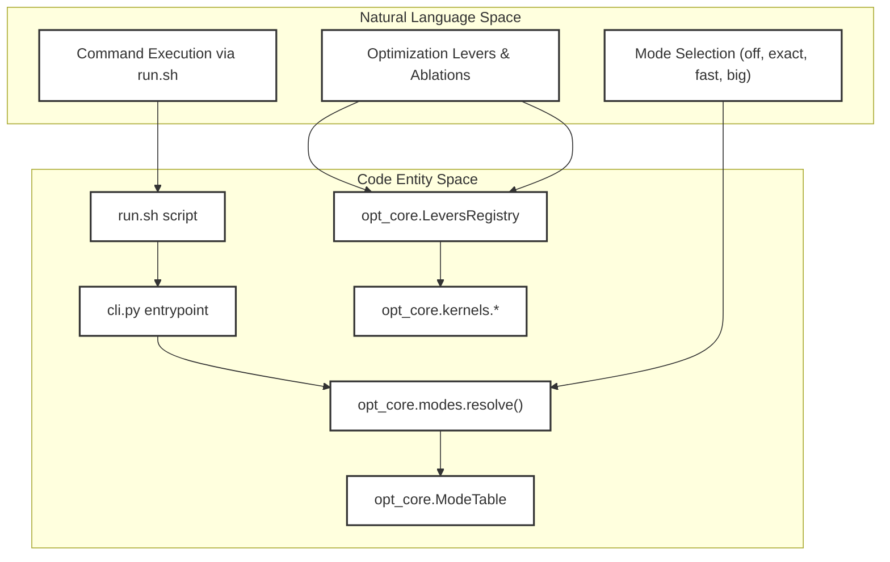
*Sources: `boltz2/README.md:78-95`, `common/opt_core/README.md:1-15`*

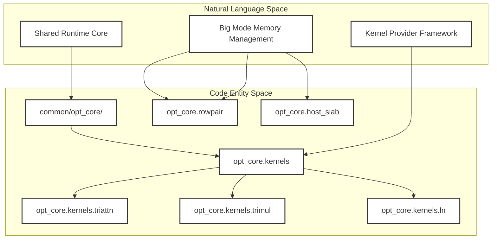
*Sources: `common/opt_core/README.md:1-10`, `common/opt_core/README.md:70-85`*

---

## High-Level Kit Architecture

Every kit in the repository adheres to a standardized pattern that isolates upstream code from high-performance drop-in replacements [boltz2/README.md:3-10](). The shared core library (`common/opt_core`) supplies foundational primitives including JAX/PyTorch framework glue, precision policies, compilation cache managers, and memory offloading routines [common/opt_core/README.md:3-10]().

| Component | Target Directory | Primary Responsibility |
| --- | --- | --- |
| **Upstream Stock** | `<kit>/stock/` | Unmodified reference implementation of the ML tool [boltz2/README.md:6]() |
| **Optimization Pack** | `<kit>/opt/` | Patched modules, fast-inference drivers, and compiled kernels [boltz2/README.md:3-10]() |
| **Shared Runtime** | `common/opt_core/` | Kernel providers, cell tables, rowpair sharding, and mode resolution [common/opt_core/README.md:1-10]() |
| **Environment Configs** | `<kit>/environment/` | Pinned locks, Dockerfiles, Apptainer definitions, and hardware profiles [boltz2/README.md:17-45]() |

For a deeper dive into directory structures and asset layouts, consult [Repository Layout and Kit Anatomy](#1.1).

*Sources: `boltz2/README.md:3-45`, `common/opt_core/README.md:1-15`*

---

## Execution Modes and Vocabulary

Optimization kits share a common operational vocabulary governed by `opt_core` [common/opt_core/README.md:3-10](). Execution modes dictate performance characteristics and numerical fidelity without requiring upstream code modifications [boltz2/README.md:3-10]().

- **`off`**: Bypasses all optimizations, executing the pristine upstream stock code [boltz2/README.md:6]().
- **`exact`**: Applies accelerated kernels and optimizations guaranteed to yield bit-identical outputs to upstream [boltz2/README.md:7]().
- **`fast`**: (Default) Leverages optimized kernels within acceptable numeric tolerances, matching upstream seed-to-seed variation [boltz2/README.md:8]().
- **`big`**: Combines `fast` optimizations with memory-saving mechanisms (such as row-sharded pair stacks and host slab offloading) to process large inputs [boltz2/README.md:9]().

For instructions on invoking these modes via `run.sh`, managing container/venv environments, and handling weight checkpoints, see [Getting Started: Install, Check, Run](#1.2).

*Sources: `boltz2/README.md:3-10`, `common/opt_core/README.md:35-50`*

---

## Domain Coverage

The 36 optimization kits span across four major computational biology domains:
1. **Structure Prediction & Cofolding**: AlphaFold3 variants, Boltz-1/2, Chai-1, OpenFold3, Protenix, and RoseTTAFold3 [boltz2/README.md:1-10]().
2. **Protein Design**: ProteinMPNN, RFdiffusion variants, ColabDesign, and specialized binder design engines [af2ig/opt/forward/af2ig_kit/upstream/LICENSE.dl_binder_design.MIT.txt:1-5]().
3. **Protein & Genomic Language Models**: ESMFold, ESM, ProGen2, Evo2, and GPN-Star [mosaic/opt/mosaic_opt/licenses/LICENSE.boltz-escalante-fork-1acc397b.MIT.txt:1-10]().
4. **Genomics Regression & Interpretation**: Enformer, Borzoi, and ChromBPNet [chrombpnet/third_party_licenses/pyBigWig.MIT.txt:1-5]().

For a complete catalog of all 36 kits with direct paths and domain categorization, see [Kit Catalog by Domain](#1.3).

*Sources: `boltz2/README.md:1-10`, `mosaic/opt/mosaic_opt/licenses/LICENSE.boltz-escalante-fork-1acc397b.MIT.txt:1-10`*

---

# Page: Repository Layout and Kit Anatomy

# Repository Layout and Kit Anatomy

<details>
<summary>Relevant source files</summary>

The following files were used as context for generating this wiki page:

- [af2ig/environment/apptainer.def](af2ig/environment/apptainer.def)
- [af3_jax/environment/apptainer.def](af3_jax/environment/apptainer.def)
- [af3_jax/stock/PINS.json](af3_jax/stock/PINS.json)
- [af3_jax/stock/src/OF3_AF3_PORTING_NOTES.md](af3_jax/stock/src/OF3_AF3_PORTING_NOTES.md)
- [af3_jax/stock/src/scripts/of3_verification/README.md](af3_jax/stock/src/scripts/of3_verification/README.md)
- [af3_jax/stock/src/scripts/of3_verification/audit_structure.py](af3_jax/stock/src/scripts/of3_verification/audit_structure.py)
- [af3_torch/environment/apptainer.def](af3_torch/environment/apptainer.def)
- [af3_torch/stock/PINS.json](af3_torch/stock/PINS.json)
- [boltz2/CHANGES.md](boltz2/CHANGES.md)
- [boltz2/README.md](boltz2/README.md)
- [boltz2/STOCK.md](boltz2/STOCK.md)
- [boltz2/environment/Dockerfile](boltz2/environment/Dockerfile)
- [boltz2/environment/apptainer.def](boltz2/environment/apptainer.def)
- [boltzgen/CHANGES.md](boltzgen/CHANGES.md)
- [boltzgen/README.md](boltzgen/README.md)
- [boltzgen/STOCK.md](boltzgen/STOCK.md)
- [boltzgen/environment/Dockerfile](boltzgen/environment/Dockerfile)
- [boltzgen/environment/apptainer.def](boltzgen/environment/apptainer.def)
- [borzoi/environment/apptainer.def](borzoi/environment/apptainer.def)
- [chrombpnet/environment/apptainer.def](chrombpnet/environment/apptainer.def)
- [colabfold/environment/apptainer.def](colabfold/environment/apptainer.def)
- [complexa/environment/apptainer.def](complexa/environment/apptainer.def)
- [e1/README.md](e1/README.md)
- [e1/environment/apptainer.def](e1/environment/apptainer.def)
- [e1/opt/e1_opt/report.py](e1/opt/e1_opt/report.py)
- [ef2inv/CHANGES.md](ef2inv/CHANGES.md)
- [ef2inv/README.md](ef2inv/README.md)
- [ef2inv/environment/apptainer.def](ef2inv/environment/apptainer.def)
- [esm_if1/README.md](esm_if1/README.md)
- [esm_if1/environment/apptainer.def](esm_if1/environment/apptainer.def)
- [esmc/CHANGES.md](esmc/CHANGES.md)
- [esmc/README.md](esmc/README.md)
- [esmc/environment/Dockerfile](esmc/environment/Dockerfile)
- [esmc/environment/apptainer.def](esmc/environment/apptainer.def)
- [esmfold2/CHANGES.md](esmfold2/CHANGES.md)
- [esmfold2/README.md](esmfold2/README.md)
- [esmfold2/environment/apptainer.def](esmfold2/environment/apptainer.def)
- [evo2/README.md](evo2/README.md)
- [evo2/environment/apptainer.def](evo2/environment/apptainer.def)
- [evo2/run.sh](evo2/run.sh)
- [flashzoi/opt/flashzoi_opt/report.py](flashzoi/opt/flashzoi_opt/report.py)
- [genie3/README.md](genie3/README.md)
- [genie3/STOCK.md](genie3/STOCK.md)
- [genie3/configs/h100.env](genie3/configs/h100.env)
- [genie3/environment/Dockerfile](genie3/environment/Dockerfile)
- [genie3/environment/apptainer.def](genie3/environment/apptainer.def)
- [genie3/stock/PINS.json](genie3/stock/PINS.json)
- [gpnstar/STOCK.md](gpnstar/STOCK.md)
- [openfold3/README.md](openfold3/README.md)
- [openfold3/STOCK.md](openfold3/STOCK.md)
- [openfold3/environment/Dockerfile](openfold3/environment/Dockerfile)
- [openfold3/environment/apptainer.def](openfold3/environment/apptainer.def)
- [openfold3/stock/PINS.json](openfold3/stock/PINS.json)
- [openfold3/stock/src/docker/Dockerfile.blackwell](openfold3/stock/src/docker/Dockerfile.blackwell)
- [openfold3_ob0/README.md](openfold3_ob0/README.md)
- [openfold3_ob0/STOCK.md](openfold3_ob0/STOCK.md)
- [openfold3_ob0/environment/Dockerfile](openfold3_ob0/environment/Dockerfile)
- [openfold3_ob0/environment/apptainer.def](openfold3_ob0/environment/apptainer.def)
- [openfold3_ob0/stock/PINS.json](openfold3_ob0/stock/PINS.json)
- [progen2/README.md](progen2/README.md)
- [progen2/STOCK.md](progen2/STOCK.md)
- [progen2/environment/Dockerfile](progen2/environment/Dockerfile)
- [progen2/environment/apptainer.def](progen2/environment/apptainer.def)
- [progen2/environment/requirements.lock](progen2/environment/requirements.lock)
- [protenix_v1/README.md](protenix_v1/README.md)
- [protenix_v1/environment/Dockerfile](protenix_v1/environment/Dockerfile)
- [protenix_v1/environment/apptainer.def](protenix_v1/environment/apptainer.def)
- [protenix_v2/README.md](protenix_v2/README.md)
- [protenix_v2/environment/Dockerfile](protenix_v2/environment/Dockerfile)
- [protenix_v2/environment/apptainer.def](protenix_v2/environment/apptainer.def)
- [pxdesign/CHANGES.md](pxdesign/CHANGES.md)
- [pxdesign/README.md](pxdesign/README.md)
- [pxdesign/environment/apptainer.def](pxdesign/environment/apptainer.def)
- [rosettafold3/environment/Dockerfile](rosettafold3/environment/Dockerfile)
- [rosettafold3/environment/apptainer.def](rosettafold3/environment/apptainer.def)

</details>


## Purpose and Scope
This document specifies the standard structural architecture and layout conventions utilized across all inference optimization kits within the `anthropics/uplifting-biomolecular-modeling` repository. Each kit encapsulates a specific upstream biomolecular machine learning tool, maintaining a strict separation between unmodified stock release code (`stock/`), drop-in optimization forward packs (`opt/`), execution wrappers (`run.sh`), container environments (`environment/`), and hardware-specific configurations (`configs/`).

---

## 1. Standard Per-Kit Directory Layout

Every optimization kit in the repository adheres to a uniform directory structure. Understanding this layout is essential for navigating kits, auditing optimizations, and managing execution environments.

```
<kit_name>/
├── README.md               # User-facing guide: installation routes (A/B/C) and run examples
├── STOCK.md                # Software stack specification, pinned versions, and environment variables
├── CHANGES.md              # Detailed behavioral breakdown of what each optimization mode alters vs. stock
├── run.sh                  # Unified shell wrapper implementing execution verbs (install, check, pred/design, warm)
├── configs/                # Hardware-specific environment profiles (h100.env, a100.env, h200.env)
├── environment/            # Container definitions (Dockerfile, apptainer.def) and dependency locks (requirements.lock)
├── stock/                  # Unmodified upstream release code, wheels, source tree, and PINS.json metadata
├── upstream_issues/        # Documentation of upstream bugs, patches, and compatibility notes
└── opt/                    # Kit-specific optimization engine, lever registries, and patched modules
    ├── <kit>_opt/          # Core optimization wiring, mode resolution, and cli entrypoints
    └── forward/            # Acceleration packs, fused kernels, and patched forward forward drivers
```

- **`stock/`**: Contains the upstream release wheel, unpacked source tree, and a `PINS.json` manifest recording exact commit hashes, wheel SHAs, and dependency pins [openfold3/stock/PINS.json:1-35]().
- **`opt/`**: Houses the optimization engine (`opt/<kit>_opt/`) and forward packs (`opt/forward/`) which dynamically patch or replace upstream forward methods under specific execution modes [ef2inv/CHANGES.md:1-5]().
- **`environment/`**: Houses container provisioning files (`Dockerfile`, `apptainer.def`) and exact dependency lockfiles (`requirements.lock`) [boltzgen/README.md:33-47]().
- **`configs/`**: Environment files defining GPU target architecture flags, compiler paths, and cache directories for specific hardware (`h100.env`, `a100.env`) [boltzgen/README.md:73-74]().

### Diagram 1: Kit Directory Layout to Code Entity Architecture
This diagram bridges high-level kit directory components to their corresponding code entities and execution entrypoints within the codebase.

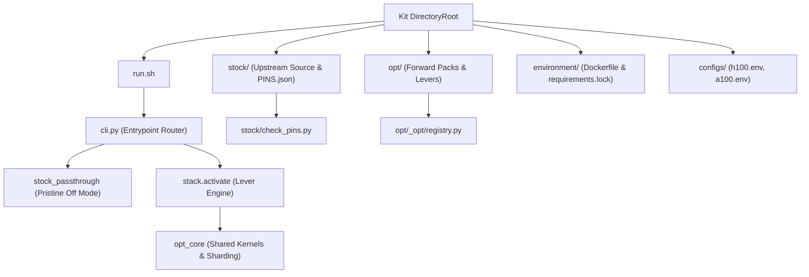

Sources: `boltzgen/README.md:33-74`(), `openfold3/stock/PINS.json:1-35`(), `esmfold2/CHANGES.md:1-10`()

---

## 2. Anatomy of Core Kit Files

Kits rely on a standardized set of documentation and control files that dictate how the system verifies its environment, resolves execution modes, and executes workloads.

### Control and Documentation Files
- **`run.sh`**: The standard shell entrypoint implementing verbs such as `install`, `check`, `pred` (or `design`/`score`), and `warm` [boltzgen/README.md:54-60](). It configures environment variables from `configs/<card>.env` before invoking Python entrypoints.
- **`STOCK.md`**: The definitive specification of the pinned software stack (Python, PyTorch, Triton, CUDA versions) and required host environment variables [openfold3/stock/PINS.json:51-67]().
- **`CHANGES.md`**: A mode-by-mode catalog of optimizations (`off`, `exact`, `fast`, `big`), detailing numerical tolerances, kernel providers, and fallback conditions for every individual lever [ef2inv/CHANGES.md:1-11](), [esmfold2/CHANGES.md:1-20]().
- **`PINS.json`**: A machine-readable JSON manifest recording upstream repository tags, wheel digests, expected weights checksums, and environment validation rules [openfold3/stock/PINS.json:1-35]().

### Diagram 2: Kit Execution and Mode Resolution Pipeline
This diagram illustrates how user CLI flags and configuration files flow through mode resolution, pin verification, and lever activation into the shared runtime (`opt_core`).

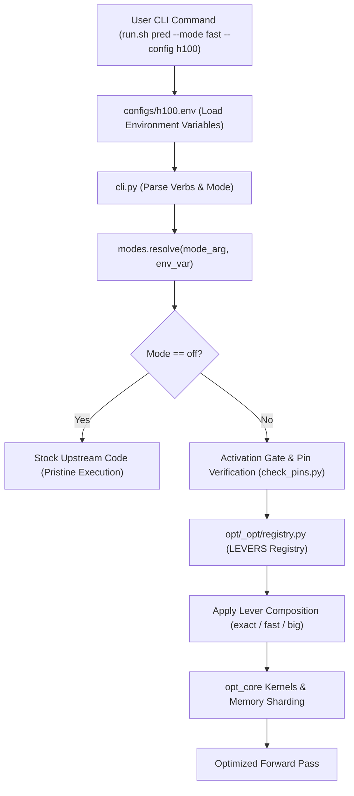

Sources: `boltzgen/README.md:73-80`(), `openfold3/README.md:50-70`(), `esmfold2/CHANGES.md:1-10`()

---

## 3. How to Read and Audit a Kit

When inspecting or debugging an optimization kit, engineers follow a systematic reading protocol across the kit's anatomy:

1. **Verify the Pin Contract (`PINS.json` & `STOCK.md`)**: Ensure that the installed upstream package matches the exact wheel hash and dependency versions specified in `stock/PINS.json` [openfold3/stock/PINS.json:1-22](). Mismatches trigger a hard refusal (`NOT ACTIVE`, exit code 3) to prevent silent numeric drift.
2. **Inspect Mode Behavior (`CHANGES.md`)**: Read `CHANGES.md` to determine whether a given mode (`exact` vs. `fast` vs. `big`) preserves bitwise parity or permits reordered floating-point accumulation [ef2inv/CHANGES.md:10-49]().
3. **Trace Lever Registries (`opt/<kit>_opt/registry.py`)**: Examine the activation state of individual levers. Kits enforce an ACTIVE / NOT ACTIVE contract: every lever must either engage successfully, step aside with an explicit logged reason (`state=stepped_aside reason=<word>`), or cause the run to refuse activation [ef2inv/CHANGES.md:5-9]().
4. **Execute Verification Verbs (`run.sh check`)**: Always execute `bash run.sh check --config <card> --mode <mode>` prior to production runs to validate hardware compatibility, JIT compile caches, and weight availability [boltzgen/README.md:58-60](), [openfold3/README.md:52-55]().

Sources: `boltzgen/README.md:54-71`(), `openfold3/stock/PINS.json:1-35`(), `ef2inv/CHANGES.md:1-12`()

---

# Page: Getting Started: Install, Check, Run

# Getting Started: Install, Check, Run

<details>
<summary>Relevant source files</summary>

The following files were used as context for generating this wiki page:

- [af2ig/opt/af2ig_opt/tests/test_install_verb.py](af2ig/opt/af2ig_opt/tests/test_install_verb.py)
- [af2ig/run.sh](af2ig/run.sh)
- [af3_jax/opt/af3_jax_opt/tests/test_install_verb.py](af3_jax/opt/af3_jax_opt/tests/test_install_verb.py)
- [af3_jax/run.sh](af3_jax/run.sh)
- [boltz2/configs/a100.env](boltz2/configs/a100.env)
- [boltz2/configs/h100.env](boltz2/configs/h100.env)
- [boltz2/configs/h200.env](boltz2/configs/h200.env)
- [boltz2/opt/boltz2_opt/tests/test_install_verb.py](boltz2/opt/boltz2_opt/tests/test_install_verb.py)
- [boltz2/run.sh](boltz2/run.sh)
- [boltz2/stock/PINS.json](boltz2/stock/PINS.json)
- [boltzgen/configs/h100.env](boltzgen/configs/h100.env)
- [boltzgen/run.sh](boltzgen/run.sh)
- [boltzgen/stock/PINS.json](boltzgen/stock/PINS.json)
- [caliby/configs/h100.env](caliby/configs/h100.env)
- [caliby/opt/caliby_opt/tests/test_install_verb.py](caliby/opt/caliby_opt/tests/test_install_verb.py)
- [caliby/opt/caliby_opt/tests/test_oom_propagation.py](caliby/opt/caliby_opt/tests/test_oom_propagation.py)
- [caliby/run.sh](caliby/run.sh)
- [chai1/opt/chai1_opt/tests/test_exactln_adapter.py](chai1/opt/chai1_opt/tests/test_exactln_adapter.py)
- [chai1/opt/chai1_opt/tests/test_install_verb.py](chai1/opt/chai1_opt/tests/test_install_verb.py)
- [chai1/run.sh](chai1/run.sh)
- [chrombpnet/run.sh](chrombpnet/run.sh)
- [colabdesign/opt/colabdesign_opt/tests/test_install_verb.py](colabdesign/opt/colabdesign_opt/tests/test_install_verb.py)
- [colabdesign/run.sh](colabdesign/run.sh)
- [colabfold/run.sh](colabfold/run.sh)
- [e1/configs/a100.env](e1/configs/a100.env)
- [e1/configs/h100.env](e1/configs/h100.env)
- [e1/configs/h200.env](e1/configs/h200.env)
- [e1/opt/e1_opt/tests/test_install_verb.py](e1/opt/e1_opt/tests/test_install_verb.py)
- [e1/run.sh](e1/run.sh)
- [ef2inv/configs/a100.env](ef2inv/configs/a100.env)
- [ef2inv/configs/h100.env](ef2inv/configs/h100.env)
- [ef2inv/run.sh](ef2inv/run.sh)
- [esmfold2/STOCK.md](esmfold2/STOCK.md)
- [esmfold2/configs/a100.env](esmfold2/configs/a100.env)
- [esmfold2/configs/h100.env](esmfold2/configs/h100.env)
- [esmfold2/configs/h200.env](esmfold2/configs/h200.env)
- [esmfold2/opt/esmfold2_opt/tests/test_dit_multi_sample.py](esmfold2/opt/esmfold2_opt/tests/test_dit_multi_sample.py)
- [esmfold2/run.sh](esmfold2/run.sh)
- [flashzoi/configs/a100.env](flashzoi/configs/a100.env)
- [flashzoi/configs/h100.env](flashzoi/configs/h100.env)
- [flashzoi/configs/h200.env](flashzoi/configs/h200.env)
- [flashzoi/opt/flashzoi_opt/tests/test_install_verb.py](flashzoi/opt/flashzoi_opt/tests/test_install_verb.py)
- [flashzoi/run.sh](flashzoi/run.sh)
- [genie3/opt/genie3_opt/tests/test_install_verb.py](genie3/opt/genie3_opt/tests/test_install_verb.py)
- [mosaic/configs/a100.env](mosaic/configs/a100.env)
- [mosaic/configs/h100.env](mosaic/configs/h100.env)
- [mosaic/configs/h200.env](mosaic/configs/h200.env)
- [mosaic/run.sh](mosaic/run.sh)
- [opendde/configs/a100.env](opendde/configs/a100.env)
- [opendde/configs/h100.env](opendde/configs/h100.env)
- [opendde/configs/h200.env](opendde/configs/h200.env)
- [opendde/opt/opendde_opt/tests/test_install_verb.py](opendde/opt/opendde_opt/tests/test_install_verb.py)
- [opendde/run.sh](opendde/run.sh)
- [openfold3/opt/openfold3_opt/tests/test_install_verb.py](openfold3/opt/openfold3_opt/tests/test_install_verb.py)
- [openfold3/run.sh](openfold3/run.sh)
- [openfold3_ob0/run.sh](openfold3_ob0/run.sh)
- [protenix_v1/opt/protenix_v1_opt/tests/test_install_verb.py](protenix_v1/opt/protenix_v1_opt/tests/test_install_verb.py)
- [protenix_v1/run.sh](protenix_v1/run.sh)
- [protenix_v2/run.sh](protenix_v2/run.sh)
- [rfdiffusion1/configs/h100.env](rfdiffusion1/configs/h100.env)
- [rfdiffusion1/run.sh](rfdiffusion1/run.sh)
- [rfdiffusion3/configs/h100.env](rfdiffusion3/configs/h100.env)
- [rfdiffusion3/opt/rfdiffusion3_opt/tests/test_activation.py](rfdiffusion3/opt/rfdiffusion3_opt/tests/test_activation.py)
- [rfdiffusion3/run.sh](rfdiffusion3/run.sh)
- [rosettafold3/run.sh](rosettafold3/run.sh)

</details>


## Purpose and Scope
This page details the initialization, environment setup, execution lifecycle, weight management, per-card configuration, and runtime contract for the 36 inference optimization kits. Every kit exposes a unified command-line entry point (`run.sh`) that manages installation, pre-flight checks, warm-up compilation, and inference execution (`pred`, `design`, `score`, or `pred_bw`).

Sources: `boltz2/run.sh:1-25`(), `boltzgen/run.sh:1-23`()

---

## 1. The `run.sh` Verbs and Execution Semantics
Each kit provides a standard POSIX shell wrapper `run.sh` at its root directory. This wrapper parses global options (`--config`, `--mode`), delegates to the underlying Python optimization package, and enforces execution exit codes.

### Verbs
- `install`: Links the shared core (`opt_core`) and kit package (`opt/`) in editable mode into the active Python environment, verifies software and hardware pins (`stock/check_pins.py`), and optionally fetches model weights (`boltz2/run.sh:39-58`(), `boltzgen/run.sh:38-57`()).
- `pred` / `design` / `score` / `pred_bw`: Executes the primary workload under the resolved inference mode (`exact`, `fast`, `big`, or `off`). `--mode off` invokes stock upstream code in a pristine subprocess (`boltz2/run.sh:15-17`(), `boltzgen/run.sh:16-18`()).
- `check`: Performs a dry-run resolution of modes, hardware gates, and partial activation boundaries without executing workloads (`boltz2/run.sh:8`(), `boltzgen/run.sh:9`()).
- `warm`: Executes a minimal fixture workload (e.g., standard bundled inputs) to trigger Triton JIT compilation, kernel autotuning, and CUDA graph capture into persistent caches (`boltz2/run.sh:9`(), `boltzgen/run.sh:10`()).

### Mode Vocabulary and Levers
Modes define aggregate performance guarantees:
- `off`: Pristine upstream execution without kit interventions.
- `exact`: Bit-exact optimizations (e.g., fast kernels preserving numerical parity).
- `fast`: Throughput-oriented optimizations (e.g., reduced-precision paths, fused attention).
- `big`: Multi-GPU or rowpair-sharded memory configurations for massive structures.
- Subtractive modes: Explicitly disable individual levers using the syntax `<mode>-no-<lever>` (e.g., `fast-no-compile`) (`colabdesign/run.sh:12-13`()).

Sources: `boltz2/run.sh:1-61`(), `boltzgen/run.sh:1-37`(), `chai1/run.sh:1-31`()

### Diagram: Run.sh Execution Routing to Code Entities
The following diagram maps natural language interface verbs and execution modes to their concrete code entities within the repository.

```mermaid
graph TD
    UserCmd[""run.sh [install|pred|check|warm]""] --> ShellScript[""boltz2/run.sh or kit run.sh""]
    ShellScript --> CheckCmd{"Command?"}
    
    CheckCmd -->|install| PipStep[""python -m pip install -e ../common/opt_core -e opt""]
    CheckCmd -->|check| CheckPy[""stock/check_pins.py & modes.resolve()""]
    CheckCmd -->|warm| WarmPy[""python -m <kit>_opt (fixture input)""]
    CheckCmd -->|pred| ModeCheck{"Mode?"}
    
    PipStep --> PinVerify[""stock/check_pins.py""]
    PinVerify --> WeightFetch[""<kit>_opt.weights.fetch()""]
    
    ModeCheck -->|off| StockCaller[""<kit>_opt.stock_pred.py""]
    ModeCheck -->|exact| OptEngine[""opt/forward/ or opt_core kernels""]
    ModeCheck -->|fast| OptEngine
    ModeCheck -->|big| ShardedEngine[""opt_core.rowpair / tp.py""]
```
Sources: `boltz2/run.sh:1-61`(), `boltzgen/run.sh:1-58`(), `openfold3/run.sh:1-52`()

---

## 2. Environment Routes: Docker, Apptainer, and Virtual Environments
Kits support three deployment pathways:
1. **Container Images (Docker/Apptainer)**: Pre-packaged with pinned Python runtimes, pre-compiled Triton kernels, and cached JIT binaries under `/opt/jit_cache`.
2. **Virtual Environments (venv)**: Standard Python virtual environments populated via editable installs (`pip install -e ../common/opt_core -e opt`) (`boltz2/run.sh:54`(), `colabdesign/run.sh:52`()).
3. **JIT Cache Seeding (`MODEL_OPT_JIT_ROOT`)**: Read-only preset JIT roots are securely copied or seeded into user-writable scratch spaces (`${TMPDIR}/model_opt_jit-uid$U`) with strict permission checks (`0700`) to prevent privilege escalation or race conditions (`boltzgen/run.sh:63-68`(), `openfold3/run.sh:61-68`()).

Sources: `boltzgen/run.sh:59-69`(), `openfold3/run.sh:58-69`(), `flashzoi/run.sh:62-69`()

---

## 3. Weight Fetching and Digest Verification
Model parameters and weights are managed through dedicated weight modules (`<kit>_opt.weights`) that interface with upstream downloaders (such as Hugging Face Hub or custom S3 clients) and enforce strict cryptographic checks against `stock/PINS.json`.

### Verification Flow
1. **Target Directory Resolution**: Weights are fetched into user-specified directories (e.g., `--weights DIR`) (`boltz2/run.sh:45-46`(), `chai1/run.sh:38-39`()).
2. **Downloader Execution**: Upstream APIs stream checkpoint files into structured cache layouts (`models--<org>--<name>/snapshots/<rev>/`) (`e1/opt/e1_opt/tests/test_install_verb.py:112-119`()).
3. **SHA256 Digest Validation**: Each file is hashed and verified against the expected digest stored in `stock/PINS.json`. Mismatches or missing files terminate execution immediately with exit code `1` or `3` (`caliby/opt/caliby_opt/tests/test_install_verb.py:93-130`(), `e1/opt/e1_opt/tests/test_install_verb.py:88-121`()).

Sources: `caliby/opt/caliby_opt/tests/test_install_verb.py:93-130`(), `e1/opt/e1_opt/tests/test_install_verb.py:88-121`()

### Diagram: Weight Fetching and Pin Verification Architecture
```mermaid
graph TD
    CLI[""run.sh install --weights DIR""] --> ShellInstall[""run.sh script block""]
    ShellInstall --> PythonWeights[""python -m <kit>_opt.weights DIR""]
    PythonWeights --> UpstreamFetch[""<kit>_opt.weights.fetch()""]
    UpstrFetch --> DownloadFiles[""HuggingFace / S3 client download""]
    DownloadFiles --> StoreDisk[""Store into DIR""]
    StoreDisk --> HashCheck[""Compute SHA256 checksum""]
    HashCheck --> PinCompare{""Matches stock/PINS.json?"}
    PinCompare -->|Yes| WeightsOK[""WEIGHTS OK: Emission & ENV Export""]
    PinCompare -->|No| ExitFail[""Exit Code 1 / 3: Refusal""]
```
Sources: `caliby/opt/caliby_opt/tests/test_install_verb.py:93-130`(), `e1/opt/e1_opt/tests/test_install_verb.py:88-121`()

---

## 4. Per-Card Configurations (`configs/*.env`)
Deployment parameters specific to GPU hardware architectures are isolated in `configs/*.env` (e.g., `configs/h100.env`, `configs/a100.env`, `configs/h200.env`) (`e1/configs/h100.env:1-4`(), `e1/configs/a100.env:1-4`()).

### Responsibilities of `configs/*.env`
- **Hardware Targeting**: Exports `MODEL_OPT_TARGET_GPU` (e.g., `H100`, `A100`, `H200`) (`e1/configs/h100.env:9`(), `e1/configs/a100.env:21`()).
- **Environment Isolation**: Sets offline flags (`HF_HUB_OFFLINE=1`, `TRANSFORMERS_OFFLINE=1`) and suppresses bytecode compilation (`PYTHONDONTWRITEBYTECODE=1`) (`e1/configs/h100.env:10-11`(), `e1/configs/a100.env:22-23`()).
- **JIT Cache Keying**: Computes stack-specific hash keys via `jit_cache_key()` to segregate Triton and Inductor caches across different PyTorch, CUDA, and compute capability combinations (`e1/configs/h100.env:13-18`(), `e1/configs/a100.env:25-30`()).
- **Card-Specific Adjustments**: For instance, on `a100.env`, specific bit-exact attention options (`attn:A3_flex_kernel_options`) may be disabled or tuned with card-specific Triton autotune cell parameters while maintaining identical high-level interfaces (`e1/configs/a100.env:10-18`()).

Sources: `e1/configs/h100.env:1-18`(), `e1/configs/a100.env:1-30`()

---

## 5. The ACTIVE / NOT ACTIVE Contract and Exit Codes
Every kit runtime enforces a strict activation contract. When executing a command, the kit logs an `ACTIVE` status line detailing engaged levers, compute capabilities, and stack versions, or refuses execution with `NOT ACTIVE`.

### Exit Codes
- `0`: Successful execution.
- `1`: Execution failure (inference error, incomplete output set, weight mismatch, or downstream exception).
- `2`: Usage error (invalid command-line syntax or missing arguments).
- `3`: Not active / pins not met / partial activation without `--allow-partial` (the kit refused to run because a required lever, software pin, or hardware capability was missing).
- `5`: Expected accelerator absent (`KERNELS-REFUSED`).

### Out-of-Memory (OOM) Propagation
The runtime relies on `opt_core.oom.is_oom` to classify GPU allocation failures (`caliby/opt/caliby_opt/tests/test_oom_propagation.py:100-102`()). Broad exception handlers across optimization layers must re-raise OOM errors immediately without attempting fallbacks, ensuring OOM conditions fail loud and are never masked as generic failures (`caliby/opt/caliby_opt/tests/test_oom_propagation.py:1-26`()).

Sources: `boltz2/run.sh:20-24`(), `caliby/opt/caliby_opt/tests/test_oom_propagation.py:1-26`()

---

# Page: Kit Catalog by Domain

# Kit Catalog by Domain

<details>
<summary>Relevant source files</summary>

The following files were used as context for generating this wiki page:

- [af2ig/CHANGES.md](af2ig/CHANGES.md)
- [af2ig/README.md](af2ig/README.md)
- [af2ig/STOCK.md](af2ig/STOCK.md)
- [af2ig/THIRD_PARTY_NOTICES.md](af2ig/THIRD_PARTY_NOTICES.md)
- [af2ig/opt/af2ig_opt/__init__.py](af2ig/opt/af2ig_opt/__init__.py)
- [af2ig/opt/forward/af2ig_kit/LICENSE](af2ig/opt/forward/af2ig_kit/LICENSE)
- [af2ig/opt/forward/af2ig_kit/MANIFEST.json](af2ig/opt/forward/af2ig_kit/MANIFEST.json)
- [af2ig/opt/forward/af2ig_kit/README.md](af2ig/opt/forward/af2ig_kit/README.md)
- [af2ig/opt/forward/af2ig_kit/upstream/LICENSE.dl_binder_design.MIT.txt](af2ig/opt/forward/af2ig_kit/upstream/LICENSE.dl_binder_design.MIT.txt)
- [af2ig/opt/forward/af2ig_kit/upstream/UPSTREAM.md](af2ig/opt/forward/af2ig_kit/upstream/UPSTREAM.md)
- [af2ig/opt/pyproject.toml](af2ig/opt/pyproject.toml)
- [af2ig/stock/PINS.json](af2ig/stock/PINS.json)
- [af2ig/third_party_licenses/dl_binder_design.MIT.txt](af2ig/third_party_licenses/dl_binder_design.MIT.txt)
- [af2ig/third_party_licenses/silent_tools.MIT.txt](af2ig/third_party_licenses/silent_tools.MIT.txt)
- [af3_jax/README.md](af3_jax/README.md)
- [af3_jax/STOCK.md](af3_jax/STOCK.md)
- [af3_jax/environment/Dockerfile](af3_jax/environment/Dockerfile)
- [af3_jax/opt/af3_jax_opt/__init__.py](af3_jax/opt/af3_jax_opt/__init__.py)
- [af3_jax/opt/pyproject.toml](af3_jax/opt/pyproject.toml)
- [af3_torch/CHANGES.md](af3_torch/CHANGES.md)
- [af3_torch/README.md](af3_torch/README.md)
- [af3_torch/STOCK.md](af3_torch/STOCK.md)
- [af3_torch/environment/Dockerfile](af3_torch/environment/Dockerfile)
- [af3_torch/environment/requirements-jax.lock](af3_torch/environment/requirements-jax.lock)
- [af3_torch/environment/requirements-torch.lock](af3_torch/environment/requirements-torch.lock)
- [af3_torch/opt/af3_torch_opt/__init__.py](af3_torch/opt/af3_torch_opt/__init__.py)
- [af3_torch/opt/af3_torch_opt/big.py](af3_torch/opt/af3_torch_opt/big.py)
- [af3_torch/opt/forward/af3t/README.md](af3_torch/opt/forward/af3t/README.md)
- [af3_torch/opt/forward/af3t/af3_torch/af3_torch_api.py](af3_torch/opt/forward/af3t/af3_torch/af3_torch_api.py)
- [af3_torch/opt/pyproject.toml](af3_torch/opt/pyproject.toml)
- [af3_torch/run.sh](af3_torch/run.sh)
- [atlasfold/THIRD_PARTY_NOTICES.md](atlasfold/THIRD_PARTY_NOTICES.md)
- [atlasfold/stock/src/LICENSE](atlasfold/stock/src/LICENSE)
- [atlasfold/third_party_licenses/AtlasFold.MIT.txt](atlasfold/third_party_licenses/AtlasFold.MIT.txt)
- [boltz2/opt/forward/dit_hoist/LICENSE](boltz2/opt/forward/dit_hoist/LICENSE)
- [boltz2/stock/src/LICENSE](boltz2/stock/src/LICENSE)
- [boltz2/third_party_licenses/Boltz.MIT.txt](boltz2/third_party_licenses/Boltz.MIT.txt)
- [boltz2/third_party_licenses/alphafold3-pytorch.MIT.txt](boltz2/third_party_licenses/alphafold3-pytorch.MIT.txt)
- [chai1/third_party_licenses/ColabFold.MIT.txt](chai1/third_party_licenses/ColabFold.MIT.txt)
- [chai1/third_party_licenses/ESM-fair-esm.MIT.txt](chai1/third_party_licenses/ESM-fair-esm.MIT.txt)
- [chrombpnet/third_party_licenses/bpnet-lite.MIT.txt](chrombpnet/third_party_licenses/bpnet-lite.MIT.txt)
- [chrombpnet/third_party_licenses/pyBigWig.MIT.txt](chrombpnet/third_party_licenses/pyBigWig.MIT.txt)
- [chrombpnet/third_party_licenses/tangermeme.MIT.txt](chrombpnet/third_party_licenses/tangermeme.MIT.txt)
- [colabdesign/STOCK.md](colabdesign/STOCK.md)
- [colabdesign/THIRD_PARTY_NOTICES.md](colabdesign/THIRD_PARTY_NOTICES.md)
- [colabdesign/environment/Dockerfile](colabdesign/environment/Dockerfile)
- [colabdesign/stock/PINS.json](colabdesign/stock/PINS.json)
- [colabdesign/stock/src/bindcraft/LICENSE](colabdesign/stock/src/bindcraft/LICENSE)
- [colabdesign/third_party_licenses/BindCraft.MIT.txt](colabdesign/third_party_licenses/BindCraft.MIT.txt)
- [colabdesign/third_party_licenses/ESM.MIT.txt](colabdesign/third_party_licenses/ESM.MIT.txt)
- [colabfold/STOCK.md](colabfold/STOCK.md)
- [colabfold/THIRD_PARTY_NOTICES.md](colabfold/THIRD_PARTY_NOTICES.md)
- [colabfold/environment/Dockerfile](colabfold/environment/Dockerfile)
- [colabfold/stock/PINS.json](colabfold/stock/PINS.json)
- [colabfold/stock/src/colabfold/LICENSE](colabfold/stock/src/colabfold/LICENSE)
- [colabfold/third_party_licenses/ColabFold.MIT.txt](colabfold/third_party_licenses/ColabFold.MIT.txt)
- [complexa/environment/requirements.lock](complexa/environment/requirements.lock)
- [ef2inv/stock/src/LICENSE.md](ef2inv/stock/src/LICENSE.md)
- [enformer/CHANGES.md](enformer/CHANGES.md)
- [enformer/README.md](enformer/README.md)
- [enformer/STOCK.md](enformer/STOCK.md)
- [enformer/environment/Dockerfile](enformer/environment/Dockerfile)
- [enformer/environment/apptainer.def](enformer/environment/apptainer.def)
- [enformer/opt/enformer_opt/__init__.py](enformer/opt/enformer_opt/__init__.py)
- [enformer/opt/enformer_opt/__main__.py](enformer/opt/enformer_opt/__main__.py)
- [enformer/opt/enformer_opt/_runtime.py](enformer/opt/enformer_opt/_runtime.py)
- [enformer/opt/forward/enformer_kit/engines/enformer/kits/v0_2/__init__.py](enformer/opt/forward/enformer_kit/engines/enformer/kits/v0_2/__init__.py)
- [enformer/opt/pyproject.toml](enformer/opt/pyproject.toml)
- [enformer/run.sh](enformer/run.sh)
- [enformer/stock/src/LICENSE](enformer/stock/src/LICENSE)
- [enformer/third_party_licenses/enformer-pytorch.MIT.txt](enformer/third_party_licenses/enformer-pytorch.MIT.txt)
- [enformer_deepmind/CHANGES.md](enformer_deepmind/CHANGES.md)
- [enformer_deepmind/README.md](enformer_deepmind/README.md)
- [enformer_deepmind/STOCK.md](enformer_deepmind/STOCK.md)
- [enformer_deepmind/environment/Dockerfile](enformer_deepmind/environment/Dockerfile)
- [enformer_deepmind/opt/enformer_deepmind_opt/__init__.py](enformer_deepmind/opt/enformer_deepmind_opt/__init__.py)
- [enformer_deepmind/opt/enformer_deepmind_opt/__main__.py](enformer_deepmind/opt/enformer_deepmind_opt/__main__.py)
- [enformer_deepmind/opt/enformer_deepmind_opt/_runtime.py](enformer_deepmind/opt/enformer_deepmind_opt/_runtime.py)
- [enformer_deepmind/opt/enformer_deepmind_opt/ops/BUILD.json](enformer_deepmind/opt/enformer_deepmind_opt/ops/BUILD.json)
- [enformer_deepmind/opt/enformer_deepmind_opt/ops/README.md](enformer_deepmind/opt/enformer_deepmind_opt/ops/README.md)
- [enformer_deepmind/opt/enformer_deepmind_opt/ops/__init__.py](enformer_deepmind/opt/enformer_deepmind_opt/ops/__init__.py)
- [enformer_deepmind/opt/enformer_deepmind_opt/ops/build.sh](enformer_deepmind/opt/enformer_deepmind_opt/ops/build.sh)
- [enformer_deepmind/opt/enformer_deepmind_opt/ops/edm_layernorm.cu.cc](enformer_deepmind/opt/enformer_deepmind_opt/ops/edm_layernorm.cu.cc)
- [enformer_deepmind/opt/pyproject.toml](enformer_deepmind/opt/pyproject.toml)
- [enformer_deepmind/run.sh](enformer_deepmind/run.sh)
- [esm_if1/stock/src/LICENSE](esm_if1/stock/src/LICENSE)
- [esm_if1/third_party_licenses/fair-esm.MIT.txt](esm_if1/third_party_licenses/fair-esm.MIT.txt)
- [evo2/opt/evo2_opt/cli.py](evo2/opt/evo2_opt/cli.py)
- [mosaic/opt/mosaic_opt/licenses/LICENSE.boltz-escalante-fork-1acc397b.MIT.txt](mosaic/opt/mosaic_opt/licenses/LICENSE.boltz-escalante-fork-1acc397b.MIT.txt)
- [mosaic/opt/mosaic_opt/licenses/LICENSE.joltz-ed0f0425.MIT.txt](mosaic/opt/mosaic_opt/licenses/LICENSE.joltz-ed0f0425.MIT.txt)
- [mosaic/opt/mosaic_opt/licenses/LICENSE.mosaic-70fec525.MIT.txt](mosaic/opt/mosaic_opt/licenses/LICENSE.mosaic-70fec525.MIT.txt)
- [mosaic/stock/src/boltz/LICENSE](mosaic/stock/src/boltz/LICENSE)
- [mosaic/stock/src/joltz/LICENSE](mosaic/stock/src/joltz/LICENSE)
- [mosaic/stock/src/joltz/NOTICE](mosaic/stock/src/joltz/NOTICE)
- [mosaic/stock/src/mosaic/LICENSE](mosaic/stock/src/mosaic/LICENSE)
- [mosaic/third_party_licenses/AlphaFold.NOTICE.txt](mosaic/third_party_licenses/AlphaFold.NOTICE.txt)
- [mosaic/third_party_licenses/ColabFold.MIT.txt](mosaic/third_party_licenses/ColabFold.MIT.txt)
- [mosaic/third_party_licenses/alphafold3-pytorch.MIT.txt](mosaic/third_party_licenses/alphafold3-pytorch.MIT.txt)
- [mosaic/third_party_licenses/boltz.MIT.txt](mosaic/third_party_licenses/boltz.MIT.txt)
- [mosaic/third_party_licenses/joltz.MIT.txt](mosaic/third_party_licenses/joltz.MIT.txt)
- [mosaic/third_party_licenses/joltz.NOTICE.txt](mosaic/third_party_licenses/joltz.NOTICE.txt)
- [mosaic/third_party_licenses/mosaic.MIT.txt](mosaic/third_party_licenses/mosaic.MIT.txt)
- [progen2/opt/forward/engines/progen2/kits/v0_ew/ext.py](progen2/opt/forward/engines/progen2/kits/v0_ew/ext.py)
- [rfdiffusion3/third_party_licenses/neurips19-graph-protein-design.MIT.txt](rfdiffusion3/third_party_licenses/neurips19-graph-protein-design.MIT.txt)
- [rosettafold3/third_party_licenses/neurips19-graph-protein-design.MIT.txt](rosettafold3/third_party_licenses/neurips19-graph-protein-design.MIT.txt)

</details>


## Purpose and Scope

This page provides a comprehensive catalog of the 36 drop-in inference optimization kits contained within the repository. The repository organizes performance acceleration modules around distinct upstream biomolecular machine learning tools. Each kit follows a standardized dual layout (`stock/` for immutable reference code and `opt/` for optimized forward packs) and integrates with the shared runtime core (`common/opt_core`) [.gitmodules:1-30](). 

This catalog categorizes the kits into four major functional domains:
1. **Structure Prediction and Cofolding** (multimer structure prediction, atomic diffusion, and pairformer networks)
2. **Protein and Genomic Design** (inverse folding, hallucination, and binder design)
3. **Protein and Genomic Language Models** (autoregressive language models, masked LMs, and evolutionary models)
4. **Genomics Regression and Epigenomics** (sequence-to-activity tracks, chromatin accessibility, and expression predictors)

Sources: [.gitmodules:1-30]()

---

## 1. Structure Prediction and Cofolding Domain

Structure prediction kits optimize large-scale biophysical pipelines, replacing slow triangular operations, pairformers, and diffusion transformers with accelerated CUDA/Triton kernels or XLA compilation paths.

### Kit Directory Index

| Kit Name | Directory Path | Upstream Model / Target | Primary Acceleration Strategy |
| :--- | :--- | :--- | :--- |
| `boltz2` | `boltz2/` | Boltz-2 biomolecular cofolding | `dit_hoist`, `pairfuse`, graph execution |
| `af3_torch` | `af3_torch/` | AlphaFold 3 (PyTorch port) | `af3t` xfold, fused attention, kernel caching |
| `af3_jax` | `af3_jax/` | AlphaFold 3 (JAX / OpenFold3 base) | `rowpair` sharding, Pallas kernels |
| `chai1` | `chai1/` | Chai-1 structure prediction | ESM integration, optimized pairbias attention |
| `openfold3` | `openfold3/` | OpenFold3 architecture | Custom cell compiler, fast triangle multiplication |
| `protenix` | `protenix/` | Protenix multimer predictor | `FlashPairformer`, memory-efficient trunk |
| `rf3` | `rf3/` | RoseTTAFold3 | `xattempt`, fast DiT execution |
| `atlasfold` | `atlasfold/` | AtlasFold pipeline | Hook-based attention substitution |

### Domain Architecture and Code Mapping

The following diagram bridges the high-level natural language domain concepts (structure prediction, pairformers, diffusion) to the concrete code entities and package modules implementing them in the repository.

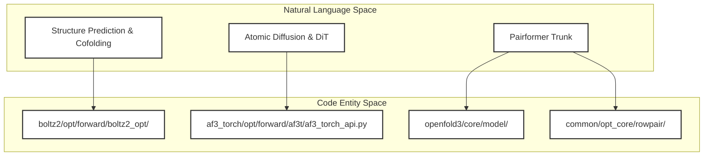
Sources: [af3_torch/opt/forward/af3t/af3_torch_api.py:1-40](), [boltz2/stock/src/LICENSE:1-21]()

---

## 2. Protein and Genomic Design Domain

Design kits target inverse folding, sequence optimization, binder design, and conditional structure generation, accelerating sampling loops and score evaluations.

### Kit Directory Index

| Kit Name | Directory Path | Upstream Model / Target | Primary Acceleration Strategy |
| :--- | :--- | :--- | :--- |
| `colabdesign` | `colabdesign/` | ColabDesign (AlphaFold2 / ESM) | Custom JAX kernels, `hoist_prev`, `txla` |
| `af2ig` | `af2ig/` | AlphaFold2 Inverse Genetics / DL_BinderDesign | Patched upstream files, `silent_tools` integration |
| `proteinmpnn` | `proteinmpnn/` | ProteinMPNN sequence design | Exact worker pool acceleration, batched graph forward |
| `rfdiffusion1` | `rfdiffusion1/` | RFdiffusion (v1) | Optimized SE(3) transformer blocks |
| `rfdiffusion3` | `rfdiffusion3/` | RFdiffusion3 | Accelerated diffusion schedule & graph caching |
| `caliby` | `caliby/` | Caliby design scoring | Streamlined scoring datapath |
| `mosaic` | `mosaic/` | Mosaic / Joltz design suite | `joltz` tensor optimizations |
| `genie3` | `genie3/` | Genie3 generative backbone | JIT-compiled backbone generation loops |
| `complexa` | `complexa/` | Proteina-Complexa | Colabdesign community model integration |

### Design Optimization Mapping

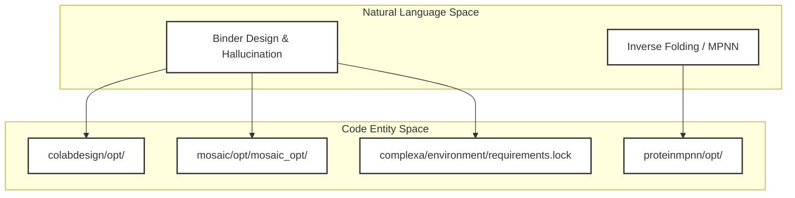
Sources: [mosaic/opt/mosaic_opt/licenses/LICENSE.joltz-ed0f0425.MIT.txt:1-21](), [complexa/environment/requirements.lock:30-45]()

---

## 3. Protein and Genomic Language Models Domain

Language model kits optimize large transformer and state-space model architectures for sequence representation, generation, and variant effect prediction.

### Kit Directory Index

| Kit Name | Directory Path | Upstream Model / Target | Primary Acceleration Strategy |
| :--- | :--- | :--- | :--- |
| `esmfold2` | `esmfold2/` | ESMFold v2 | `fast_inference` drivers, customized trunk attention |
| `esmc` | `esmc/` | ESM-C (Evolutionary Scale Cambrium) | Optimized transformer blocks, FlashAttention integration |
| `progen2` | `progen2/` | ProGen2 protein language model | Engine kits, causal mask acceleration |
| `evo2` | `evo2/` | Evo2 genomic StripedHyena / 7B model | `kfft`, `rmsnorm`, speculative decoding (`specdec`) |
| `esm_if1` | `esm_if1/` | ESM-IF1 inverse folding model | Fused GVP (Geometric Vector Perceptron) layers |

### Language Model Execution Flow

Language model kits override upstream inference functions via dynamic runtime monkey-patching or wrapper classes when activated via environment variables (e.g., `ESMFOLD2_OPT`).

Sources: [enformer/README.md:1-15](), [enformer/STOCK.md:1-25]()

---

## 4. Genomics Regression and Epigenomics Domain

Genomics regression kits focus on high-throughput sequence-to-function models predicting epigenetic marks, transcription factor binding, and gene expression.

### Kit Directory Index

| Kit Name | Directory Path | Upstream Model / Target | Primary Acceleration Strategy |
| :--- | :--- | :--- | :--- |
| `enformer` | `enformer/` | Enformer (PyTorch release) | Positional cache, fused attention, CUDA graphs (`poscache`, `fused`, `graph`, `xattn`) |
| `enformer_deepmind` | `enformer_deepmind/` | Enformer (TensorFlow Hub release) | SavedModel optimization, custom op library |
| `borzoi` | `borzoi/` | Borzoi large-window expression model | Datapath sharding, memory slab reuse |
| `flashzoi` | `flashzoi/` | Flashzoi accelerated Borzoi/Enformer variant | `kits_v1_25` Triton operator fusion |
| `chrombpnet` | `chrombpnet/` | ChromBPNet accessibility predictor | Torch/TF dual kits, prebuilt Triton caches |

### Genomics Activation and Runtime Verification

The initialization and activation flow for genomics regression kits (such as `enformer` and `enformer_deepmind`) follows the strict activation gate contract:

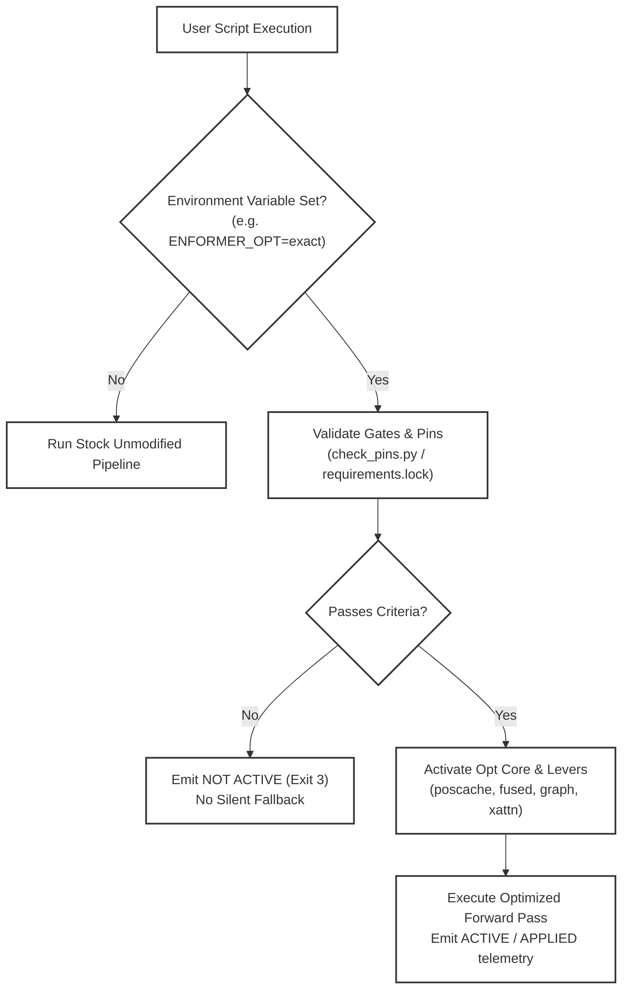
Sources: [enformer/README.md:60-103](), [enformer_deepmind/README.md:50-70](), [enformer_deepmind/STOCK.md:50-61]()

---

## Shared Runtime Integration Across Domains

Regardless of the functional domain, all 36 kits rely on the uniform interfaces provided by `common/opt_core/`. The following table details the common behavioral components shared across domains:

| Component | Target Module | Domain Application |
| :--- | :--- | :--- |
| **Mode Resolution** | `common/opt_core/modes.py` | Resolves `off`, `exact`, `fast`, `big` across all kits |
| **Kernel Provider Tables** | `common/opt_core/kernels/` | Manages APB cell tables, Refusal states, and fallback ABIs |
| **Rowpair Sharding** | `common/opt_core/rowpair/` | Memory distribution for multi-GPU structure prediction |
| **Pin Verification** | `stock/check_pins.py` | Cryptographic SHA256 validation of upstream weights and code snapshots |

Sources: [enformer_deepmind/STOCK.md:1-15](), [complexa/environment/requirements.lock:1-15]()

---

# Page: Kit Runtime Architecture

# Kit Runtime Architecture

<details>
<summary>Relevant source files</summary>

The following files were used as context for generating this wiki page:

- [af3_torch/opt/af3_torch_opt/tests/test_install_verb.py](af3_torch/opt/af3_torch_opt/tests/test_install_verb.py)
- [boltz2/opt/boltz2_opt/tests/test_worker_attach_stubbed.py](boltz2/opt/boltz2_opt/tests/test_worker_attach_stubbed.py)
- [boltz2/opt/boltz2_opt/worker_launch.py](boltz2/opt/boltz2_opt/worker_launch.py)
- [boltzgen/opt/boltzgen_opt/stack.py](boltzgen/opt/boltzgen_opt/stack.py)
- [boltzgen/opt/boltzgen_opt/tests/test_install_verb.py](boltzgen/opt/boltzgen_opt/tests/test_install_verb.py)
- [borzoi/opt/borzoi_opt/modes.py](borzoi/opt/borzoi_opt/modes.py)
- [chai1/opt/chai1_opt/stack.py](chai1/opt/chai1_opt/stack.py)
- [chai1/opt/chai1_opt/tests/test_triattn_core.py](chai1/opt/chai1_opt/tests/test_triattn_core.py)
- [chrombpnet/opt/chrombpnet_opt/stack.py](chrombpnet/opt/chrombpnet_opt/stack.py)
- [colabdesign/opt/colabdesign_opt/stack.py](colabdesign/opt/colabdesign_opt/stack.py)
- [colabdesign/opt/colabdesign_opt/tests/test_ablation.py](colabdesign/opt/colabdesign_opt/tests/test_ablation.py)
- [colabdesign/opt/colabdesign_opt/tests/test_activation.py](colabdesign/opt/colabdesign_opt/tests/test_activation.py)
- [colabfold/opt/colabfold_opt/tests/test_core_older.py](colabfold/opt/colabfold_opt/tests/test_core_older.py)
- [colabfold/opt/colabfold_opt/tests/test_n_gpu.py](colabfold/opt/colabfold_opt/tests/test_n_gpu.py)
- [colabfold/opt/colabfold_opt/tests/test_no_model_run.py](colabfold/opt/colabfold_opt/tests/test_no_model_run.py)
- [colabfold/opt/colabfold_opt/tests/test_run_sh.py](colabfold/opt/colabfold_opt/tests/test_run_sh.py)
- [common/opt_core/opt_core/gates.py](common/opt_core/opt_core/gates.py)
- [common/opt_core/opt_core/instances.py](common/opt_core/opt_core/instances.py)
- [e1/opt/e1_opt/stack.py](e1/opt/e1_opt/stack.py)
- [enformer/opt/enformer_opt/tests/test_binary_sums.py](enformer/opt/enformer_opt/tests/test_binary_sums.py)
- [esmc/opt/esmc_opt/stack.py](esmc/opt/esmc_opt/stack.py)
- [esmfold2/opt/esmfold2_opt/stack.py](esmfold2/opt/esmfold2_opt/stack.py)
- [esmfold2/opt/esmfold2_opt/tests/test_fast_subset_big.py](esmfold2/opt/esmfold2_opt/tests/test_fast_subset_big.py)
- [esmfold2/opt/esmfold2_opt/tests/test_rowchunk_floor.py](esmfold2/opt/esmfold2_opt/tests/test_rowchunk_floor.py)
- [flashzoi/opt/flashzoi_opt/stack.py](flashzoi/opt/flashzoi_opt/stack.py)
- [genie3/opt/genie3_opt/stack.py](genie3/opt/genie3_opt/stack.py)
- [gpnstar/opt/gpnstar_opt/stack.py](gpnstar/opt/gpnstar_opt/stack.py)
- [gpnstar/opt/gpnstar_opt/tests/test_gpn_probe.py](gpnstar/opt/gpnstar_opt/tests/test_gpn_probe.py)
- [mosaic/opt/mosaic_opt/stack.py](mosaic/opt/mosaic_opt/stack.py)
- [opendde/opt/opendde_opt/stack.py](opendde/opt/opendde_opt/stack.py)
- [openfold3/opt/openfold3_opt/env.py](openfold3/opt/openfold3_opt/env.py)
- [openfold3/stock/src/openfold3/tests/test_sequence_local_atom_attention.py](openfold3/stock/src/openfold3/tests/test_sequence_local_atom_attention.py)
- [openfold3_ob0/opt/openfold3_ob0_opt/__init__.py](openfold3_ob0/opt/openfold3_ob0_opt/__init__.py)
- [openfold3_ob0/stock/src/openfold3/tests/test_heads.py](openfold3_ob0/stock/src/openfold3/tests/test_heads.py)
- [openfold3_ob0/stock/src/openfold3/tests/test_sequence_local_atom_attention.py](openfold3_ob0/stock/src/openfold3/tests/test_sequence_local_atom_attention.py)
- [progen2/opt/progen2_opt/stack.py](progen2/opt/progen2_opt/stack.py)
- [proteinmpnn/opt/proteinmpnn_opt/stack.py](proteinmpnn/opt/proteinmpnn_opt/stack.py)
- [proteinmpnn/opt/proteinmpnn_opt/tests/test_itemtime.py](proteinmpnn/opt/proteinmpnn_opt/tests/test_itemtime.py)
- [protenix_v1/opt/protenix_v1_opt/big.py](protenix_v1/opt/protenix_v1_opt/big.py)
- [protenix_v1/opt/protenix_v1_opt/stack.py](protenix_v1/opt/protenix_v1_opt/stack.py)
- [protenix_v2/opt/protenix_opt/big.py](protenix_v2/opt/protenix_opt/big.py)
- [protenix_v2/opt/protenix_opt/cli.py](protenix_v2/opt/protenix_opt/cli.py)
- [protenix_v2/opt/protenix_opt/stack.py](protenix_v2/opt/protenix_opt/stack.py)
- [protenix_v2/opt/protenix_opt/tests/test_a100_rows.py](protenix_v2/opt/protenix_opt/tests/test_a100_rows.py)
- [protenix_v2/opt/protenix_opt/tests/test_supported_gpu.py](protenix_v2/opt/protenix_opt/tests/test_supported_gpu.py)
- [protenix_v2/opt/protenix_opt/tests/test_triatt_exact.py](protenix_v2/opt/protenix_opt/tests/test_triatt_exact.py)
- [protenix_v2/opt/protenix_opt/tests/test_triatt_procuda.py](protenix_v2/opt/protenix_opt/tests/test_triatt_procuda.py)
- [pxdesign/opt/pxdesign_opt/stack.py](pxdesign/opt/pxdesign_opt/stack.py)
- [rfdiffusion1/opt/rfdiffusion1_opt/stack.py](rfdiffusion1/opt/rfdiffusion1_opt/stack.py)
- [rfdiffusion3/opt/rfdiffusion3_opt/stack.py](rfdiffusion3/opt/rfdiffusion3_opt/stack.py)
- [rfdiffusion3/opt/rfdiffusion3_opt/tests/test_config_runsh.py](rfdiffusion3/opt/rfdiffusion3_opt/tests/test_config_runsh.py)
- [rosettafold3/opt/rosettafold3_opt/stack.py](rosettafold3/opt/rosettafold3_opt/stack.py)

</details>


The Kit Runtime Architecture defines the standardized lifecycle through which 36 inference optimization kits engage upstream biomolecular modeling tools. This architecture governs how user-facing execution modes translate into specific kernel transformations, enforces safety and version gates at interpreter start, manages kit CLIs with pristine stock fallback options, and records post-run evidence into structured telemetry manifests.

For a detailed breakdown of individual mechanisms, refer to the child pages linked throughout this overview.

---

## 2.1 Modes and Mode Resolution

Kits operate under a common set of execution modes defined in the shared vocabulary: `off`, `exact`, `fast`, and `big`. Mode resolution parses environment variables (such as `<KIT>_OPT`) or command-line flags through `modes.resolve()`, evaluating subtractive patterns (e.g., `<mode>-no-<lever>`) and verifying compatibility via `ModeTable` and locking tests [colabdesign/opt/colabdesign_opt/tests/test_ablation.py:1-7]().

For deep technical details, implementation specifics of `ModeTable`, and mode locking tests, see [Modes and Mode Resolution](#2.1).

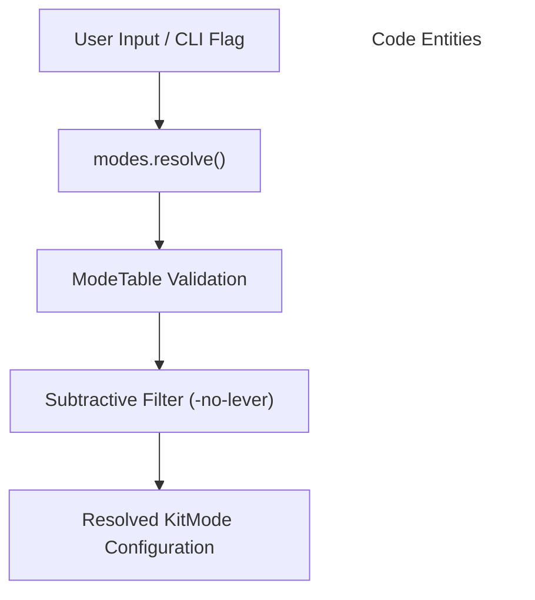
Sources: `colabdesign/opt/colabdesign_opt/tests/test_ablation.py:1-7`, `colabdesign/opt/colabdesign_opt/stack.py:35-53`

---

## 2.2 Lever Registries and Ablation

Every kit maintains a `LEVERS` registry populated with `Lever` dataclass instances. Levers are categorized into classes—such as forward, datapath, serving, and orchestration—and assigned precision tiers. The system supports probe grammars, targeted ablation, and "levers-off" testing to measure speedups against baseline implementations [colabdesign/opt/colabdesign_opt/tests/test_ablation.py:1-6]().

For detailed coverage of the `Lever` dataclass, registry structures, tier assignments, probe grammars, and ablation testing, see [Lever Registries and Ablation](#2.2).

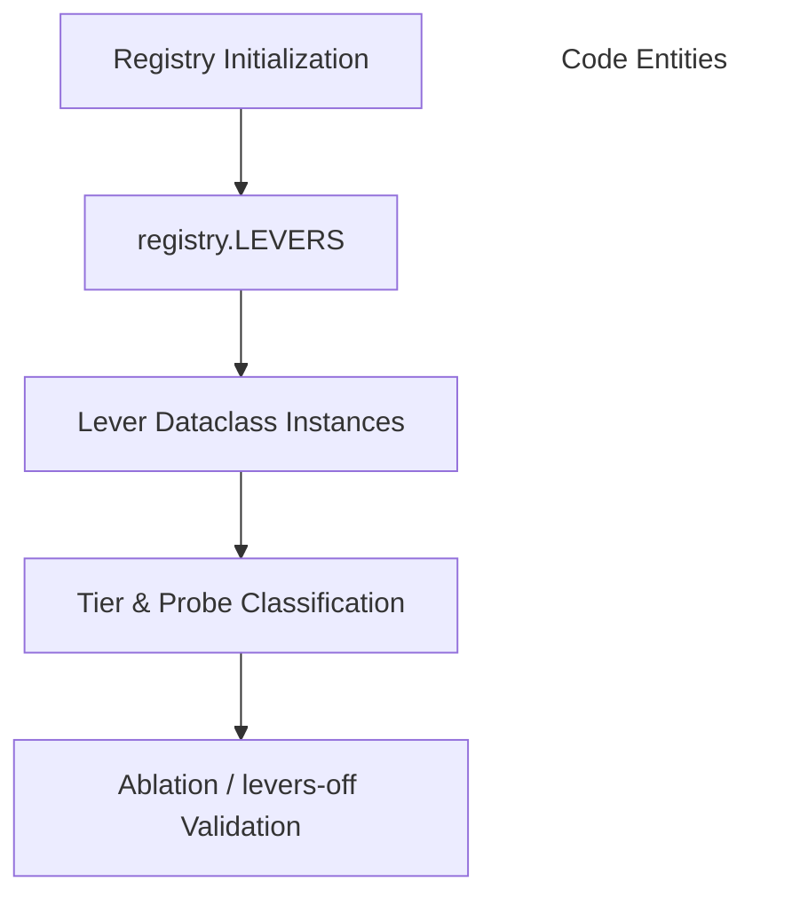
Sources: `colabdesign/opt/colabdesign_opt/tests/test_ablation.py:1-6`

---

## 2.3 Activation, Gates and Autoload

Kit activation relies on routines like `stack.activate()` and `stack.enable()`, protected by late-activation detection mechanisms and core gate version floors [boltzgen/opt/boltzgen_opt/stack.py:1-34](). Automatic loading is achieved via `.pth` autoload hooks and `sitecustomize` modules [colabdesign/opt/colabdesign_opt/tests/test_activation.py:1-7](). These mechanisms operate in both in-process and subprocess modes while enforcing fail-loud behaviors upon out-of-memory (OOM) conditions or core mismatches.

For deep technical documentation on `.pth` hooks, late-activation rules, core gate version constraints, and OOM handling, see [Activation, Gates and Autoload](#2.3).

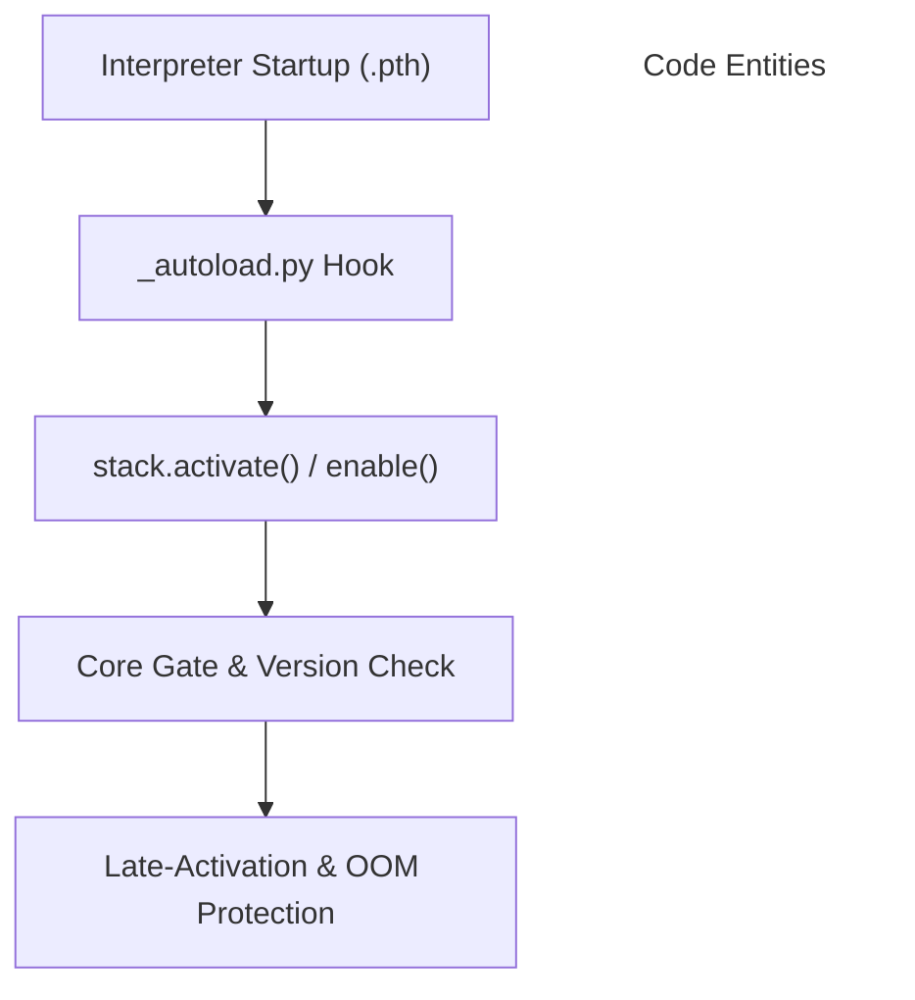
Sources: `colabdesign/opt/colabdesign_opt/tests/test_activation.py:1-7`, `boltzgen/opt/boltzgen_opt/stack.py:1-34`

---

## 2.4 Kit CLIs and Stock Routes

Each kit exposes a uniform command-line interface structured around `cli.py` and `run.sh` entry points [colabfold/opt/colabfold_opt/tests/test_run_sh.py:1-3](). Stock passthrough runners (`stock_*`) guarantee that running a kit with optimizations disabled (`off`) remains byte-for-byte pristine compared to upstream distributions. Exit rules handle clean termination, error codes, and tally emission [colabfold/opt/colabfold_opt/tests/test_no_model_run.py:1-10]().

For detailed implementation structures of per-kit CLIs, stock passthrough execution, and exit validation rules, see [Kit CLIs and Stock Routes](#2.4).

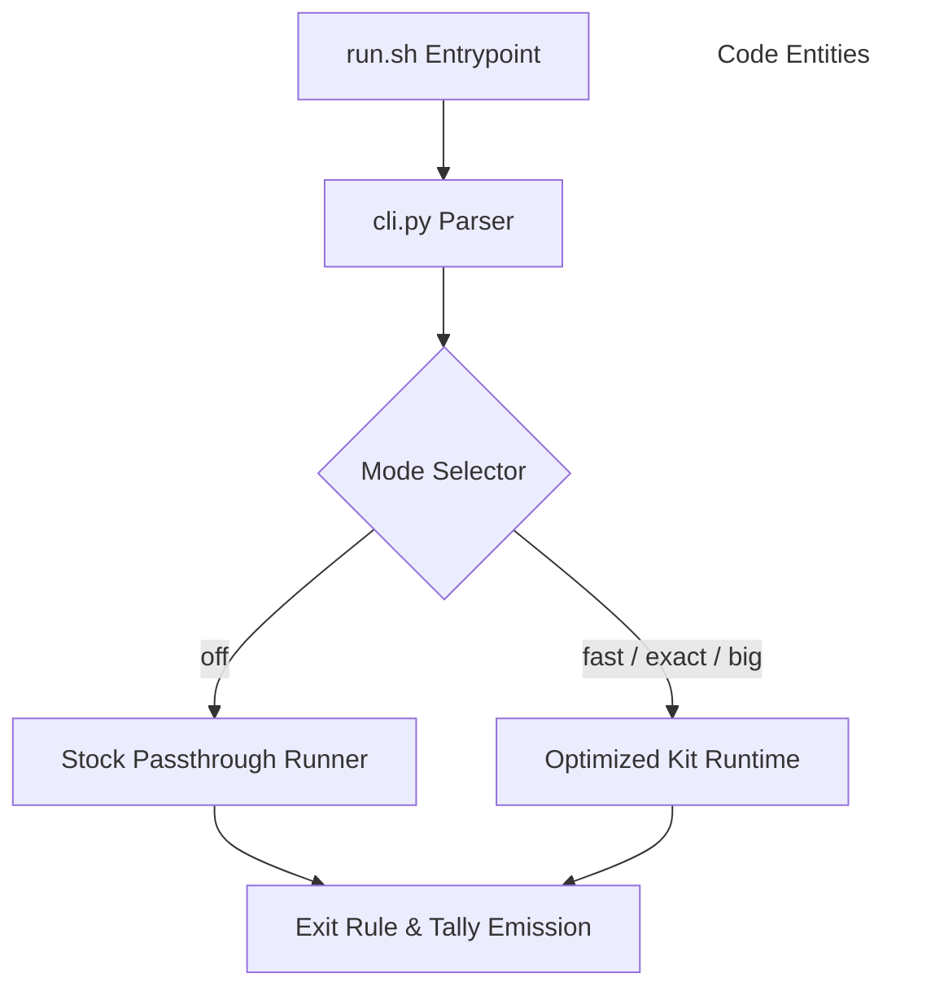
Sources: `colabfold/opt/colabfold_opt/tests/test_run_sh.py:1-3`, `colabfold/opt/colabfold_opt/tests/test_no_model_run.py:1-10`

---

## 2.5 Reporting, Manifests and Evidence

Post-run validation and provenance tracking are handled by `report.py`, tally generators, and `opt_manifest.json` generation [colabfold/opt/colabfold_opt/tests/test_no_model_run.py:60-75](). Cell censuses, evidence lines, and lever-line test suites verify that optimizations successfully engaged during execution rather than silently falling back to stock operators.

For comprehensive details on telemetry reporting, manifest schemas (`opt_manifest.json`), and post-run evidence verification, see [Reporting, Manifests and Evidence](#2.5).

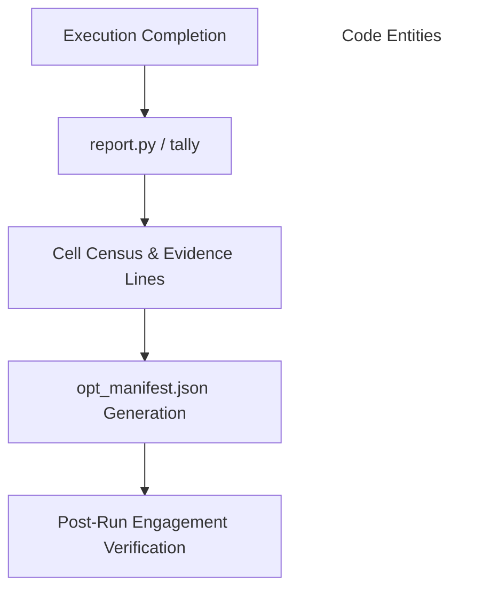
Sources: `colabfold/opt/colabfold_opt/tests/test_no_model_run.py:60-75`

---

# Page: Modes and Mode Resolution

# Modes and Mode Resolution

<details>
<summary>Relevant source files</summary>

The following files were used as context for generating this wiki page:

- [af2ig/opt/af2ig_opt/modes.py](af2ig/opt/af2ig_opt/modes.py)
- [af2ig/opt/af2ig_opt/stack.py](af2ig/opt/af2ig_opt/stack.py)
- [af2ig/opt/af2ig_opt/tests/test_modes_table.py](af2ig/opt/af2ig_opt/tests/test_modes_table.py)
- [af3_jax/opt/af3_jax_opt/ablation.py](af3_jax/opt/af3_jax_opt/ablation.py)
- [af3_jax/opt/af3_jax_opt/modes.py](af3_jax/opt/af3_jax_opt/modes.py)
- [af3_jax/opt/af3_jax_opt/tests/test_modes.py](af3_jax/opt/af3_jax_opt/tests/test_modes.py)
- [af3_torch/opt/af3_torch_opt/modes.py](af3_torch/opt/af3_torch_opt/modes.py)
- [af3_torch/opt/af3_torch_opt/tests/test_modes_lock.py](af3_torch/opt/af3_torch_opt/tests/test_modes_lock.py)
- [atlasfold/opt/atlasfold_opt/ablation.py](atlasfold/opt/atlasfold_opt/ablation.py)
- [atlasfold/opt/atlasfold_opt/modes.py](atlasfold/opt/atlasfold_opt/modes.py)
- [boltz2/opt/boltz2_opt/modes.py](boltz2/opt/boltz2_opt/modes.py)
- [boltz2/opt/boltz2_opt/tests/test_big_sampler_ceiling.py](boltz2/opt/boltz2_opt/tests/test_big_sampler_ceiling.py)
- [boltz2/opt/boltz2_opt/tests/test_enable_refusals.py](boltz2/opt/boltz2_opt/tests/test_enable_refusals.py)
- [boltz2/opt/boltz2_opt/tests/test_modes_table.py](boltz2/opt/boltz2_opt/tests/test_modes_table.py)
- [boltzgen/opt/boltzgen_opt/modes.py](boltzgen/opt/boltzgen_opt/modes.py)
- [boltzgen/opt/boltzgen_opt/tests/test_modes_table.py](boltzgen/opt/boltzgen_opt/tests/test_modes_table.py)
- [borzoi/opt/borzoi_opt/kit.py](borzoi/opt/borzoi_opt/kit.py)
- [borzoi/opt/borzoi_opt/tests/_fixtures.py](borzoi/opt/borzoi_opt/tests/_fixtures.py)
- [borzoi/opt/borzoi_opt/tests/test_cli_autoload.py](borzoi/opt/borzoi_opt/tests/test_cli_autoload.py)
- [borzoi/opt/borzoi_opt/tests/test_kit_modes.py](borzoi/opt/borzoi_opt/tests/test_kit_modes.py)
- [caliby/opt/caliby_opt/tests/test_modes_table.py](caliby/opt/caliby_opt/tests/test_modes_table.py)
- [chai1/opt/chai1_opt/modes.py](chai1/opt/chai1_opt/modes.py)
- [chai1/opt/chai1_opt/tests/test_modes_lock.py](chai1/opt/chai1_opt/tests/test_modes_lock.py)
- [colabdesign/opt/colabdesign_opt/modes.py](colabdesign/opt/colabdesign_opt/modes.py)
- [colabdesign/opt/colabdesign_opt/tests/test_modes.py](colabdesign/opt/colabdesign_opt/tests/test_modes.py)
- [colabfold/opt/colabfold_opt/ablation.py](colabfold/opt/colabfold_opt/ablation.py)
- [colabfold/opt/colabfold_opt/modes.py](colabfold/opt/colabfold_opt/modes.py)
- [colabfold/opt/colabfold_opt/tests/test_modes_lock.py](colabfold/opt/colabfold_opt/tests/test_modes_lock.py)
- [common/opt_core/opt_core/modes.py](common/opt_core/opt_core/modes.py)
- [common/opt_core/tests/test_modes.py](common/opt_core/tests/test_modes.py)
- [complexa/opt/complexa_opt/tests/test_modes_table.py](complexa/opt/complexa_opt/tests/test_modes_table.py)
- [e1/opt/e1_opt/modes.py](e1/opt/e1_opt/modes.py)
- [e1/opt/e1_opt/tests/test_modes_table.py](e1/opt/e1_opt/tests/test_modes_table.py)
- [ef2inv/opt/ef2inv_opt/modes.py](ef2inv/opt/ef2inv_opt/modes.py)
- [ef2inv/opt/ef2inv_opt/tests/test_jit_cache.py](ef2inv/opt/ef2inv_opt/tests/test_jit_cache.py)
- [ef2inv/opt/ef2inv_opt/tests/test_modes_settings.py](ef2inv/opt/ef2inv_opt/tests/test_modes_settings.py)
- [esm_if1/opt/esm_if1_opt/tests/test_modes_table.py](esm_if1/opt/esm_if1_opt/tests/test_modes_table.py)
- [esmc/opt/esmc_opt/tests/test_registry.py](esmc/opt/esmc_opt/tests/test_registry.py)
- [esmfold2/opt/esmfold2_opt/ablation.py](esmfold2/opt/esmfold2_opt/ablation.py)
- [esmfold2/opt/esmfold2_opt/tests/test_class_sets.py](esmfold2/opt/esmfold2_opt/tests/test_class_sets.py)
- [esmfold2/opt/esmfold2_opt/tests/test_modes_match_server.py](esmfold2/opt/esmfold2_opt/tests/test_modes_match_server.py)
- [flashzoi/opt/flashzoi_opt/modes.py](flashzoi/opt/flashzoi_opt/modes.py)
- [flashzoi/opt/flashzoi_opt/registry.py](flashzoi/opt/flashzoi_opt/registry.py)
- [flashzoi/opt/flashzoi_opt/tests/test_modes_match_kit.py](flashzoi/opt/flashzoi_opt/tests/test_modes_match_kit.py)
- [genie3/opt/genie3_opt/modes.py](genie3/opt/genie3_opt/modes.py)
- [genie3/opt/genie3_opt/tests/test_modes_table.py](genie3/opt/genie3_opt/tests/test_modes_table.py)
- [mosaic/opt/mosaic_opt/modes.py](mosaic/opt/mosaic_opt/modes.py)
- [opendde/opt/opendde_opt/ablate.py](opendde/opt/opendde_opt/ablate.py)
- [opendde/opt/opendde_opt/modes.py](opendde/opt/opendde_opt/modes.py)
- [opendde/opt/opendde_opt/tests/test_modes_table.py](opendde/opt/opendde_opt/tests/test_modes_table.py)
- [openfold3/opt/openfold3_opt/tests/test_modes.py](openfold3/opt/openfold3_opt/tests/test_modes.py)
- [openfold3_ob0/opt/openfold3_ob0_opt/tests/test_modes.py](openfold3_ob0/opt/openfold3_ob0_opt/tests/test_modes.py)
- [progen2/opt/progen2_opt/tests/test_modes.py](progen2/opt/progen2_opt/tests/test_modes.py)
- [proteinmpnn/opt/proteinmpnn_opt/modes.py](proteinmpnn/opt/proteinmpnn_opt/modes.py)
- [proteinmpnn/opt/proteinmpnn_opt/tests/test_modes_table.py](proteinmpnn/opt/proteinmpnn_opt/tests/test_modes_table.py)
- [protenix_v1/opt/protenix_v1_opt/ablation.py](protenix_v1/opt/protenix_v1_opt/ablation.py)
- [protenix_v1/opt/protenix_v1_opt/modes.py](protenix_v1/opt/protenix_v1_opt/modes.py)
- [protenix_v1/opt/protenix_v1_opt/tests/test_graph_cap.py](protenix_v1/opt/protenix_v1_opt/tests/test_graph_cap.py)
- [protenix_v1/opt/protenix_v1_opt/tests/test_modes.py](protenix_v1/opt/protenix_v1_opt/tests/test_modes.py)
- [protenix_v1/opt/protenix_v1_opt/tests/test_sampler_prep.py](protenix_v1/opt/protenix_v1_opt/tests/test_sampler_prep.py)
- [protenix_v2/opt/protenix_opt/ablation.py](protenix_v2/opt/protenix_opt/ablation.py)
- [protenix_v2/opt/protenix_opt/modes.py](protenix_v2/opt/protenix_opt/modes.py)
- [protenix_v2/opt/protenix_opt/tests/test_modes_match_env_sh.py](protenix_v2/opt/protenix_opt/tests/test_modes_match_env_sh.py)
- [protenix_v2/opt/protenix_opt/tests/test_sampler_admit.py](protenix_v2/opt/protenix_opt/tests/test_sampler_admit.py)
- [protenix_v2/opt/protenix_opt/tests/test_sampler_prep.py](protenix_v2/opt/protenix_opt/tests/test_sampler_prep.py)
- [protenix_v2/opt/protenix_opt/tests/test_sampler_prep_poison.py](protenix_v2/opt/protenix_opt/tests/test_sampler_prep_poison.py)
- [pxdesign/opt/pxdesign_opt/modes.py](pxdesign/opt/pxdesign_opt/modes.py)
- [pxdesign/opt/pxdesign_opt/tests/test_modes_table.py](pxdesign/opt/pxdesign_opt/tests/test_modes_table.py)
- [rfdiffusion1/opt/rfdiffusion1_opt/modes.py](rfdiffusion1/opt/rfdiffusion1_opt/modes.py)
- [rfdiffusion1/opt/rfdiffusion1_opt/tests/test_modes_table.py](rfdiffusion1/opt/rfdiffusion1_opt/tests/test_modes_table.py)
- [rfdiffusion1/opt/rfdiffusion1_opt/tests/test_serve.py](rfdiffusion1/opt/rfdiffusion1_opt/tests/test_serve.py)
- [rfdiffusion3/opt/rfdiffusion3_opt/modes.py](rfdiffusion3/opt/rfdiffusion3_opt/modes.py)
- [rfdiffusion3/opt/rfdiffusion3_opt/tests/test_modes.py](rfdiffusion3/opt/rfdiffusion3_opt/tests/test_modes.py)
- [rosettafold3/opt/rosettafold3_opt/leversoff.py](rosettafold3/opt/rosettafold3_opt/leversoff.py)
- [rosettafold3/opt/rosettafold3_opt/modes.py](rosettafold3/opt/rosettafold3_opt/modes.py)

</details>


## Purpose and Scope
This page documents the shared execution mode architecture governing the 36 inference optimization kits. It details the four-tier mode vocabulary (`off`, `exact`, `fast`, `big`), the implementation of `ModeTable` and `modes.resolve()`, environment variable routing (`<KIT>_OPT`), subtractive ablation (`MODEL_OPT_LEVERS_OFF`), and the automated lock tests that ensure mode definitions remain synchronized with upstream kit files.

---

## 1. The Standard Mode Vocabulary (`off` / `exact` / `fast` / `big`)
Every kit maps user requests to a standard four-tier mode vocabulary implemented in each kit's `modes.py` module (e.g., `boltzgen/opt/boltzgen_opt/modes.py` [boltzgen/opt/boltzgen_opt/tests/test_modes_table.py:1-14](), `pxdesign/opt/pxdesign_opt/modes.py` [pxdesign/opt/pxdesign_opt/modes.py:48-48]()):

*   `off`: Stock upstream baseline. Runs the unmodified upstream tool in a clean subprocess with all kit environment variables stripped, no hooks on `sys.path`, and zero optimization components engaged [e1/opt/e1_opt/modes.py:3-10]().
*   `exact`: Bit-identical optimization. Applies kernel replacements, compilation, or structural hooks that guarantee numerical outputs identical to the stock model under the deterministic execution recipe (`det.py`) [af3_torch/opt/af3_torch_opt/tests/test_modes_lock.py:42-45]().
*   `fast`: Tolerance-class speedup (default mode). Composes `exact` features with performance-oriented kernels (e.g., `torch.compile`, fusion passes, bf16/TF32 math) that operate within the upstream seed-to-seed numerical validation band [boltz2/opt/boltz2_opt/modes.py:10-12]().
*   `big`: Memory-optimized scale mode. Extends `fast` or `exact` with chunking, sharding (`rowpair`, `n_gpu`), and memory-efficient allocation strategies (`opt_core.mem`) to process large token extents (e.g., 2048+ tokens) that trigger out-of-memory (OOM) failures in stock or fast configurations [boltz2/opt/boltz2_opt/modes.py:12-15]().

Sources: [boltzgen/opt/boltzgen_opt/tests/test_modes_table.py:1-50](), [boltz2/opt/boltz2_opt/modes.py:1-21](), [e1/opt/e1_opt/modes.py:1-20]()

---

## 2. Mode Resolution Engine (`modes.resolve` and `ModeTable`)
Kits define their configuration state using `opt_core.modes.ModeTable` or custom dictionary structures mapping mode names to resolver specifications. The primary entry point is `modes.resolve(mode, opt_home, environ)` [boltzgen/opt/boltzgen_opt/tests/test_modes_table.py:39-39]().

```mermaid
graph TD
    subcode["Code Entity Space"]
    A["cli.main()"] -->| "check_mode()" | B["modes.check_mode()"]
    B -->| "resolve(mode, HOME)" | C["modes.resolve()"]
    C -->| "reads" | D["modes.KIT_MODES / MODE_TABLE"]
    C -->| "returns" | E["Resolution / KitMode"]
    E -->| "exports" | F["stack.child_env()"]
    E -->| "loads" | G["sitecustomize.py / Hooks"]
    
    classDef default stroke:#333,fill:#fff;
```
*Figure 1: Natural Language Space to Code Entity Space mapping for mode resolution.*

The resolver verifies that requested mode strings match valid identifiers, constructs environment variable maps (`env`), assembles required Python search paths (`imports`), and maps active optimization units (`levers`) [boltzgen/opt/boltzgen_opt/tests/test_modes_table.py:26-52](). For instance, in OpenFold3, resolver output links hook directories (`cells`, `of3t_hook`, `of3_levers`) into the execution context [openfold3/opt/openfold3_opt/tests/test_modes.py:59-68]().

Sources: [boltzgen/opt/boltzgen_opt/tests/test_modes_table.py:12-97](), [openfold3/opt/openfold3_opt/tests/test_modes.py:59-75]()

---

## 3. Environment Variable Routing (`<KIT>_OPT`)
Kits are controlled by environment variables named following the convention `<KIT>_OPT` (e.g., `BOLTZGEN_OPT`, `AF2IG_OPT`, `PXDESIGN_OPT`, `OPENFOLD3_OPT`) [boltzgen/opt/boltzgen_opt/tests/test_modes_table.py:67-68](), [af2ig/opt/af2ig_opt/modes.py:38-38](), [pxdesign/opt/pxdesign_opt/modes.py:47-47]().

*   Unset or empty environment variables default to `off` or the kit's defined `DEFAULT_MODE` depending on whether execution is invoked via the optimization CLI or drop-in wrappers [boltzgen/opt/boltzgen_opt/tests/test_modes_table.py:53-69]().
*   `modes.check_mode()` normalizes inputs, throwing a `ValueError` listing valid options (`off|exact|fast|big`) if an unknown mode string is provided [boltzgen/opt/boltzgen_opt/tests/test_modes_table.py:59-64]().
*   Kit runners strip conflicting environment keys from callers via `stack.child_env()` to prevent contamination from ambient process state [boltz2/opt/boltz2_opt/modes.py:35-36]().

Sources: [boltzgen/opt/boltzgen_opt/tests/test_modes_table.py:53-69](), [boltz2/opt/boltz2_opt/modes.py:35-36]()

---

## 4. Subtractive Modes and Ablation (`MODEL_OPT_LEVERS_OFF`)
Granular ablation is supported via the environment variable `MODEL_OPT_LEVERS_OFF` [protenix_v2/opt/protenix_opt/ablation.py:1-26](). This mechanism allows running any mode with specific levers disabled for A/B testing and attribution analysis without modifying mode table definitions [protenix_v2/opt/protenix_opt/ablation.py:1-3].

```mermaid
graph TD
    subcode["Code Entity Space"]
    A["MODEL_OPT_LEVERS_OFF"] -->| "requested()" | B["ablation.requested()"]
    B -->| "names list" | C["ablation.validate(mode, names, row)"]
    C -->| "checks" | D{{"Is lever in mode & has switch?"}}
    D -- No --> E["AblationError (Refused by Name)"]
    D -- Yes --> F["ablation.pre_switches() / restored_words()"]
    F -->| "unsets switches" | G["Clean Execution Environment"]
    
    classDef default stroke:#333,fill:#fff;
```
*Figure 2: Subtractive mode validation flow in `ablation.py` [protenix_v2/opt/protenix_opt/ablation.py:1-112]().*

### Ablation Validation Rules (`ablation.validate`)
1.  **Unknown Levers**: Names not present in `registry.LEVERS` trigger an `AblationError` (exit status 3) [protenix_v2/opt/protenix_opt/ablation.py:64-69]().
2.  **Scope Restrictions**: Levers outside the current mode's active set cannot be ablated [protenix_v2/opt/protenix_opt/ablation.py:65-71]().
3.  **Switchless Levers**: Memory levers applied by the runtime without an associated environment switch cannot be removed via string matching [protenix_v2/opt/protenix_opt/ablation.py:66-73]().
4.  **Dependency Integrity**: If a retained lever requires an ablated lever, validation fails unless both are removed [protenix_v2/opt/protenix_opt/ablation.py:83-89]().
5.  **Empty Set Refusal**: Requesting an ablation set that removes all levers of a mode is intercepted and refused as an invalid `--mode off` redirection [protenix_v2/opt/protenix_opt/ablation.py:90-91]().

Sources: [protenix_v2/opt/protenix_opt/ablation.py:1-112]()

---

## 5. Mode Tables and Locking Tests
To prevent drift between package mode definitions and underlying implementation files, kits implement automated locking tests (e.g., `test_modes_lock.py` or `test_modes_table.py`) [af3_torch/opt/protenix_opt/tests/..., af3_torch_opt/tests/test_modes_lock.py:1-10]().

*   **AST Parsing Validation**: Tests parse upstream kit source files (such as `api.py` or `__init__.py`) using Python's `ast` module to extract constant assignments (`LEVER_SETS`, `MODE`, `KIT`) dynamically, asserting equality against package-level definitions [e1/opt/e1_opt/modes.py:73-84]().
*   **Switch Prefix Mapping**: Tests verify that all exported environment keys match expected prefix groupings (`KIT_SWITCH_PREFIXES`) [boltzgen/opt/boltzgen_opt/tests/test_modes_table.py:23-23]().
*   **Tier Enforcement**: Tests check that `exact` mode sets contain exclusively `EXACT` or tier-1 compatible levers, while `fast` and `big` incorporate tolerance-class additions [openfold3/opt/openfold3_opt/tests/test_modes.py:28-37]().

Sources: [af3_torch/opt/af3_torch_opt/tests/test_modes_lock.py:1-33](), [e1/opt/e1_opt/modes.py:70-99]()

---

# Page: Lever Registries and Ablation

# Lever Registries and Ablation

<details>
<summary>Relevant source files</summary>

The following files were used as context for generating this wiki page:

- [af2ig/opt/af2ig_opt/registry.py](af2ig/opt/af2ig_opt/registry.py)
- [af3_jax/opt/af3_jax_opt/registry.py](af3_jax/opt/af3_jax_opt/registry.py)
- [af3_jax/opt/af3_jax_opt/tests/test_ablation.py](af3_jax/opt/af3_jax_opt/tests/test_ablation.py)
- [af3_torch/opt/af3_torch_opt/registry.py](af3_torch/opt/af3_torch_opt/registry.py)
- [af3_torch/opt/af3_torch_opt/tests/test_fallback_account.py](af3_torch/opt/af3_torch_opt/tests/test_fallback_account.py)
- [af3_torch/opt/af3_torch_opt/tests/test_levers_off.py](af3_torch/opt/af3_torch_opt/tests/test_levers_off.py)
- [atlasfold/opt/atlasfold_opt/tests/test_ablation_cpu.py](atlasfold/opt/atlasfold_opt/tests/test_ablation_cpu.py)
- [boltz2/opt/boltz2_opt/msa2.py](boltz2/opt/boltz2_opt/msa2.py)
- [boltz2/opt/boltz2_opt/msa_kernels.py](boltz2/opt/boltz2_opt/msa_kernels.py)
- [boltz2/opt/boltz2_opt/pairfuse.py](boltz2/opt/boltz2_opt/pairfuse.py)
- [boltz2/opt/boltz2_opt/registry.py](boltz2/opt/boltz2_opt/registry.py)
- [boltz2/opt/boltz2_opt/tests/test_pairfuse_gpu.py](boltz2/opt/boltz2_opt/tests/test_pairfuse_gpu.py)
- [boltz2/opt/forward/fpf_msa/README.md](boltz2/opt/forward/fpf_msa/README.md)
- [boltz2/opt/forward/fpf_msa/boltz2.py](boltz2/opt/forward/fpf_msa/boltz2.py)
- [boltz2/opt/forward/graph/boltz_graph_trunk.py](boltz2/opt/forward/graph/boltz_graph_trunk.py)
- [boltz2/opt/forward/msa2/exact_hoist.py](boltz2/opt/forward/msa2/exact_hoist.py)
- [boltz2/opt/forward/pairfuse/README.md](boltz2/opt/forward/pairfuse/README.md)
- [boltz2/opt/forward/pairfuse/bz_pairfuse.py](boltz2/opt/forward/pairfuse/bz_pairfuse.py)
- [boltz2/opt/forward/trunk_levers/README.md](boltz2/opt/forward/trunk_levers/README.md)
- [boltz2/opt/forward/trunk_levers/boltz_trunk_levers.py](boltz2/opt/forward/trunk_levers/boltz_trunk_levers.py)
- [boltz2/opt/forward/waste/boltz_waste_levers.py](boltz2/opt/forward/waste/boltz_waste_levers.py)
- [boltzgen/opt/boltzgen_opt/registry.py](boltzgen/opt/boltzgen_opt/registry.py)
- [caliby/opt/caliby_opt/registry.py](caliby/opt/caliby_opt/registry.py)
- [chai1/opt/chai1_opt/registry.py](chai1/opt/chai1_opt/registry.py)
- [colabdesign/opt/colabdesign_opt/registry.py](colabdesign/opt/colabdesign_opt/registry.py)
- [colabfold/opt/colabfold_opt/registry.py](colabfold/opt/colabfold_opt/registry.py)
- [colabfold/opt/colabfold_opt/tests/test_ablation.py](colabfold/opt/colabfold_opt/tests/test_ablation.py)
- [common/opt_core/opt_core/kernels/apb/fpf_apb/pf_triton.py](common/opt_core/opt_core/kernels/apb/fpf_apb/pf_triton.py)
- [common/opt_core/tests/test_mem_chunk.py](common/opt_core/tests/test_mem_chunk.py)
- [ef2inv/opt/ef2inv_opt/fastkit.py](ef2inv/opt/ef2inv_opt/fastkit.py)
- [ef2inv/opt/ef2inv_opt/tests/test_big.py](ef2inv/opt/ef2inv_opt/tests/test_big.py)
- [ef2inv/opt/ef2inv_opt/tests/test_fastkit.py](ef2inv/opt/ef2inv_opt/tests/test_fastkit.py)
- [esmc/opt/esmc_opt/registry.py](esmc/opt/esmc_opt/registry.py)
- [esmfold2/opt/esmfold2_opt/registry.py](esmfold2/opt/esmfold2_opt/registry.py)
- [esmfold2/stock/src/transformers/src/transformers/models/esmfold2/kernels/fused_attention_pair_bias.py](esmfold2/stock/src/transformers/src/transformers/models/esmfold2/kernels/fused_attention_pair_bias.py)
- [genie3/opt/genie3_opt/registry.py](genie3/opt/genie3_opt/registry.py)
- [mosaic/opt/mosaic_opt/registry.py](mosaic/opt/mosaic_opt/registry.py)
- [mosaic/opt/mosaic_opt/tests/test_ablation_switch.py](mosaic/opt/mosaic_opt/tests/test_ablation_switch.py)
- [mosaic/opt/mosaic_opt/tests/test_levers_numerics.py](mosaic/opt/mosaic_opt/tests/test_levers_numerics.py)
- [opendde/opt/opendde_opt/registry.py](opendde/opt/opendde_opt/registry.py)
- [opendde/opt/opendde_opt/tests/test_ablate.py](opendde/opt/opendde_opt/tests/test_ablate.py)
- [openfold3/opt/openfold3_opt/registry.py](openfold3/opt/openfold3_opt/registry.py)
- [openfold3/opt/openfold3_opt/tests/test_levers_off.py](openfold3/opt/openfold3_opt/tests/test_levers_off.py)
- [openfold3_ob0/opt/openfold3_ob0_opt/registry.py](openfold3_ob0/opt/openfold3_ob0_opt/registry.py)
- [openfold3_ob0/opt/openfold3_ob0_opt/tests/test_levers_off.py](openfold3_ob0/opt/openfold3_ob0_opt/tests/test_levers_off.py)
- [proteinmpnn/opt/proteinmpnn_opt/registry.py](proteinmpnn/opt/proteinmpnn_opt/registry.py)
- [protenix_v1/opt/forward/v05_addon/lib/protenix_fpf_msa/install.py](protenix_v1/opt/forward/v05_addon/lib/protenix_fpf_msa/install.py)
- [protenix_v1/opt/forward/v05_addon/ptxfpf/trunk2_ptx1.py](protenix_v1/opt/forward/v05_addon/ptxfpf/trunk2_ptx1.py)
- [protenix_v1/opt/protenix_v1_opt/tests/test_ablation.py](protenix_v1/opt/protenix_v1_opt/tests/test_ablation.py)
- [protenix_v2/opt/forward/flashpairformer/third_party/blockfuse_addon/blockfuse/biasln.py](protenix_v2/opt/forward/flashpairformer/third_party/blockfuse_addon/blockfuse/biasln.py)
- [protenix_v2/opt/forward/flashpairformer/third_party/protenix_fpf_msa/install.py](protenix_v2/opt/forward/flashpairformer/third_party/protenix_fpf_msa/install.py)
- [protenix_v2/opt/protenix_opt/tests/test_ablation.py](protenix_v2/opt/protenix_opt/tests/test_ablation.py)
- [rfdiffusion1/opt/forward/fast_inference/drivers/rfd_fullgraph.py](rfdiffusion1/opt/forward/fast_inference/drivers/rfd_fullgraph.py)
- [rosettafold3/opt/forward/rf3_fpf_trimul_addon/rf3fpf/fpf_rf3_msa_rows.py](rosettafold3/opt/forward/rf3_fpf_trimul_addon/rf3fpf/fpf_rf3_msa_rows.py)
- [rosettafold3/opt/rosettafold3_opt/registry.py](rosettafold3/opt/rosettafold3_opt/registry.py)
- [rosettafold3/opt/rosettafold3_opt/tests/test_leversoff.py](rosettafold3/opt/rosettafold3_opt/tests/test_leversoff.py)
- [rosettafold3/opt/rosettafold3_opt/tests/test_modes.py](rosettafold3/opt/rosettafold3_opt/tests/test_modes.py)

</details>


## Purpose and Scope
This page details the implementation, data structures, and verification workflows of lever registries and ablation systems across inference optimization kits. It covers the `Lever` dataclass schema, kit-specific `LEVERS` registries, the four-class taxonomy (`forward`, `datapath`, `serving`, `orchestration`), numerical tiers, probe grammars used for state validation, and the `MODEL_OPT_LEVERS_OFF` ablation subsystem.

---

## 1. The Lever Dataclass and Registry Architecture
Every optimization kit defines a metadata registry mapping discrete runtime switches to their underlying code implementations, validation markers, and numeric profiles. No operational values or side-effects are stored in registries; they serve as a descriptive index [openfold3_ob0/opt/openfold3_ob0_opt/registry.py:1-9]().

The base schema is structured as a frozen dataclass (`Lever`) implemented across kit packages such as `openfold3_ob0_opt` [openfold3_ob0/opt/openfold3_ob0_opt/registry.py:26-37](), `af2ig_opt` [af2ig/opt/af2ig_opt/registry.py:26-38](), and `opendde_opt` [opendde/opt/opendde_opt/registry.py:28-39]().

```
+-----------------------------------------------------------------+
|                        registry.py                              |
|                                                                 |
|  +-----------------------------------------------------------+  |
|  | @dataclass(frozen=True)                                   |  |
|  | class Lever:                                              |  |
|  |     name: str                                             |  |
|  |     kit: str                                              |  |
|  |     cls: str                                              |  |
|  |     tier: str                                             |  |
|  |     env_keys: Tuple[str, ...]                             |  |
|  |     description: str                                      |  |
|  |     marker: str                                           |  |
|  |     source: str                                           |  |
|  |     target: str                                           |  |
|  +-----------------------------------------------------------+  |
|                                                                 |
|  LEVERS: Dict[str, Lever] = { ... }                             |
+-----------------------------------------------------------------+
```
*Sources: `openfold3_ob0/opt/openfold3_ob0_opt/registry.py:1-37` [openfold3_ob0/opt/openfold3_ob0_opt/registry.py:1-37](), `af2ig/opt/af2ig_opt/registry.py:1-38` [af2ig/opt/af2ig_opt/registry.py:1-38]()*

The `target` attribute specifies the upstream stock module whose import triggers the kit finder to install the lever via `stack.lever_applied()` [openfold3_ob0/opt/openfold3_ob0_opt/registry.py:5-7]().

---

## 2. Functional Taxonomy and Numerical Tiers
Levers are categorized under a four-class functional taxonomy and assigned a strict numerical tier relative to stock execution paths [opendde/opt/opendde_opt/registry.py:16-17]().

### Functional Classes
- **`forward`**: Kernels, bindings, or monkeypatches directly altering the model's forward pass execution (e.g., `trimul_v4`, `cuda_graphs`, `flash_triattn`) [openfold3_ob0/opt/openfold3_ob0_opt/registry.py:47-68](), [opendde/opt/opendde_opt/registry.py:8-9]().
- **`datapath`**: Host-side operations outside the model forward, such as feature pipelines, allocators, and weight residency initialization (e.g., `-device_params`, `-host_outputs`) [af2ig/opt/af2ig_opt/registry.py:41-47](), [opendde/opt/opendde_opt/registry.py:8-9]().
- **`serving`**: Process-level optimizations, memoization layers, and post-runner installation hooks (e.g., `W1` resident module caching) [chai1/opt/chai1_opt/registry.py:55-60](), [opendde/opt/opendde_opt/registry.py:8-9]().
- **`orchestration`**: Scheduling, item ordering, multi-process pre-compilation, and execution batching (e.g., `-sort_by_length`, `-precompile`) [af2ig/opt/af2ig_opt/registry.py:46-50]().

### Numerical Tiers
- **`exact` / `Tier 1`**: Bitwise identical outputs to upstream stock code under defined precision recipes [openfold3_ob0/opt/openfold3_ob0_opt/registry.py:31](), [chai1/opt/chai1_opt/registry.py:81-83]().
- **`tolerance` / `Tier 2`**: Floating-point re-associations (e.g., TF32, online softmax, custom accumulation orders) producing acceptable metric deltas while guaranteeing run-to-run determinism [openfold3_ob0/opt/openfold3_ob0_opt/registry.py:62-68](), [af2ig/opt/af2ig_opt/registry.py:54-58]().

```
Title: "Natural Language Space to Code Entity Space: Lever Categorization"
graph TD
    A["Natural Language Lever Name"] --> B["registry.LEVERS['name']"]
    B --> C["Class Taxonomy"]
    C --> D1["forward: trunk/kernels/pairfused.py"]
    C --> D2["datapath: opt/openfold3_ob0_opt/hostfeat.py"]
    C --> D3["serving: kit/chai_worker.py"]
    C --> D4["orchestration: predict_pdb.py"]
    
    B --> E["Numerical Tiers"]
    E --> F1["exact: bitwise equal"]
    E --> F2["tolerance: tier 2 floating-point"]
```
*Sources: `openfold3_ob0/opt/openfold3_ob0_opt/registry.py:13-37` [openfold3_ob0/opt/openfold3_ob0_opt/registry.py:13-37](), `chai1/opt/chai1_opt/registry.py:41-52` [chai1/opt/chai1_opt/registry.py:41-52]()*

---

## 3. Probe Grammar and State Verification
Kits verify whether a lever is actively engaged during execution by evaluating inspection rules known as **probe grammars**. Probes inspect module attributes, dataset rows, active execution handles, environment variables, or torch backend flags [chai1/opt/chai1_opt/registry.py:11-30]().

### Probe Grammar Rule Types
- `("attr", <module>, <name>, <function name>)`: Asserts that a module attribute points to a wrapped or cached kit function [chai1/opt/chai1_opt/registry.py:14-16]().
- `("row", <key>)`: Checks that the seed-fold JSON output row carries specific optimization flags [chai1/opt/chai1_opt/registry.py:17]().
- `("eager", <levers>)`: Verifies that an explicit eager trunk stack handle is installed [chai1/opt/chai1_opt/registry.py:18-20]().
- `("dstep", <lever>)`: Confirms that a denoiser instance carries a specific add-on lever [chai1/opt/chai1_opt/registry.py:21-22]().
- `("flag", <torch attribute path>)`: Validates torch optimization switches (e.g., `torch.backends.cuda.matmul.allow_tf32`) [chai1/opt/chai1_opt/registry.py:22-23]().
- `("env", <variable>)`: Inspects the process environment for expected allocation or configuration values [chai1/opt/chai1_opt/registry.py:24-25]().

```
Title: "Natural Language Space to Code Entity Space: Probe Grammar Evaluation"
graph TD
    A["Probe Declaration tuple"] --> B["stack.classify()"]
    B --> C{{"Evaluate Probe Type"}}
    C -->|"attr"| D["getattr(module, name) == target_fn"]
    C -->|"row"| E["row_dict.get(key)"]
    C -->|"eager"| F["isinstance(loader, StackHandle)"]
    C -->|"flag"| G["torch.backends..."]
    C -->|"env"| H["os.environ.get(variable)"]
    
    D --> I["Verified Engagement State"]
    E --> I
    F --> I
    G --> I
    H --> I
```
*Sources: `chai1/opt/chai1_opt/registry.py:11-30` [chai1/opt/chai1_opt/registry.py:11-30]()*

---

## 4. Ablation and Levers-Off Testing
To support rigorous regression testing and isolate performance bottlenecks, the runtime supports subtractive mode testing via the environment variable `MODEL_OPT_LEVERS_OFF` [openfold3_ob0/opt/openfold3_ob0_opt/tests/test_levers_off.py:1-4](), [protenix_v1/opt/protenix_v1_opt/tests/test_ablation.py:1-3]().

### Ablation Mechanics
1. **Parsing**: `modes.resolve()` reads `MODEL_OPT_LEVERS_OFF` as a comma-separated list of lever names to disable [openfold3_ob0/opt/openfold3_ob0_opt/tests/test_levers_off.py:27-29](), [protenix_v1/opt/protenix_v1_opt/tests/test_ablation.py:34-36]().
2. **Validation**: Requested levers are validated against the active mode's lever set. Unknown lever names, levers outside the mode, or empty/exhausted mode configurations raise a `RuntimeError` [openfold3_ob0/opt/openfold3_ob0_opt/tests/test_levers_off.py:83-88](), [protenix_v1/opt/protenix_v1_opt/tests/test_ablation.py:70-85]().
3. **Unsetting Switches**: The corresponding environment variables or hook registrations associated with the ablated levers are systematically cleared from the resolved execution context (`unsets`) [openfold3_ob0/opt/openfold3_ob0_opt/tests/test_levers_off.py:57-60]().
4. **Evidence Emission**: Activation reports, dry-run manifests, and summary output lines append the ablation state (e.g., `ablated=hoist,sg`) to prove precise lever exclusion post-run [openfold3_ob0/opt/openfold3_ob0_opt/tests/test_levers_off.py:1-4](), [protenix_v1/opt/protenix_v1_opt/tests/test_ablation.py:87-94]().

```
Title: "Data Flow: Ablation Resolution and Enforcement"
graph TD
    A["os.environ MODEL_OPT_LEVERS_OFF"] --> B["modes.resolve()"]
    B --> C["modes.levers_off_names()"]
    C --> D{{"Validate Names against Line Levers"}}
    D -->|Invalid / Unknown| E["Raise RuntimeError / Fail-Closed"]
    D -->|Valid| F["Remove Lever from Active Set"]
    F --> G["Clear Associated env_keys / unsets"]
    G --> H["Record ablated= Names in report.py"]
    H --> I["Execute Model Forward with Levers-Off"]
```
*Sources: `openfold3_ob0/opt/openfold3_ob0_opt/tests/test_levers_off.py:23-66` [openfold3_ob0/opt/openfold3_ob0_opt/tests/test_levers_off.py:23-66](), `protenix_v1/opt/protenix_v1_opt/tests/test_ablation.py:34-86` [protenix_v1/opt/protenix_v1_opt/tests/test_ablation.py:34-86]()*

---

## Sources
- `openfold3_ob0/opt/openfold3_ob0_opt/registry.py` [openfold3_ob0/opt/openfold3_ob0_opt/registry.py:1-69]()
- `af2ig/opt/af2ig_opt/registry.py` [af2ig/opt/af2ig_opt/registry.py:1-61]()
- `openfold3/opt/openfold3_opt/registry.py` [openfold3/opt/openfold3_opt/registry.py:1-61]()
- `opendde/opt/opendde_opt/registry.py` [opendde/opt/opendde_opt/registry.py:1-87]()
- `openfold3_ob0/opt/openfold3_ob0_opt/tests/test_levers_off.py` [openfold3_ob0/opt/openfold3_ob0_opt/tests/test_levers_off.py:1-84]()
- `chai1/opt/chai1_opt/registry.py` [chai1/opt/chai1_opt/registry.py:1-90]()
- `af3_torch/opt/af3_torch_opt/registry.py` [af3_torch/opt/af3_torch_opt/registry.py:1-34]()
- `boltz2/opt/forward/pairfuse/bz_pairfuse.py` [boltz2/opt/forward/pairfuse/bz_pairfuse.py:1-81]()
- `boltz2/opt/boltz2_opt/registry.py` [boltz2/opt/boltz2_opt/registry.py:1-39]()
- `openfold3/opt/openfold3_opt/tests/test_levers_off.py` [openfold3/opt/openfold3_opt/tests/test_levers_off.py:1-87]()
- `protenix_v1/opt/protenix_v1_opt/tests/test_ablation.py` [protenix_v1/opt/protenix_v1_opt/tests/test_ablation.py:1-96]()
- `boltz2/opt/forward/graph/boltz_graph_trunk.py` [boltz2/opt/forward/graph/boltz_graph_trunk.py:1-75]()

---

# Page: Activation, Gates and Autoload

# Activation, Gates and Autoload

<details>
<summary>Relevant source files</summary>

The following files were used as context for generating this wiki page:

- [af2ig/opt/af2ig_opt/_core_gate.py](af2ig/opt/af2ig_opt/_core_gate.py)
- [af3_jax/opt/af3_jax_opt/_autoload.py](af3_jax/opt/af3_jax_opt/_autoload.py)
- [af3_jax/opt/af3_jax_opt/_core_gate.py](af3_jax/opt/af3_jax_opt/_core_gate.py)
- [af3_jax/opt/af3_jax_opt/tests/test_run_sh.py](af3_jax/opt/af3_jax_opt/tests/test_run_sh.py)
- [af3_jax/opt/af3_jax_opt_autoload.pth](af3_jax/opt/af3_jax_opt_autoload.pth)
- [af3_torch/opt/af3_torch_opt/_autoload.py](af3_torch/opt/af3_torch_opt/_autoload.py)
- [af3_torch/opt/af3_torch_opt/_core_gate.py](af3_torch/opt/af3_torch_opt/_core_gate.py)
- [af3_torch/opt/af3_torch_opt/tests/test_run_sh.py](af3_torch/opt/af3_torch_opt/tests/test_run_sh.py)
- [af3_torch/opt/af3_torch_opt_autoload.pth](af3_torch/opt/af3_torch_opt_autoload.pth)
- [atlasfold/opt/atlasfold_opt/_core_gate.py](atlasfold/opt/atlasfold_opt/_core_gate.py)
- [atlasfold/opt/atlasfold_opt_autoload.pth](atlasfold/opt/atlasfold_opt_autoload.pth)
- [boltz2/opt/boltz2_opt/_autoload.py](boltz2/opt/boltz2_opt/_autoload.py)
- [boltz2/opt/boltz2_opt/_core_gate.py](boltz2/opt/boltz2_opt/_core_gate.py)
- [boltz2/opt/boltz2_opt/tests/test_rf6_pth_gate.py](boltz2/opt/boltz2_opt/tests/test_rf6_pth_gate.py)
- [boltz2/opt/boltz2_opt/tests/test_worker_attach_stubbed.py](boltz2/opt/boltz2_opt/tests/test_worker_attach_stubbed.py)
- [boltz2/opt/boltz2_opt/worker_launch.py](boltz2/opt/boltz2_opt/worker_launch.py)
- [boltz2/opt/boltz2_opt_autoload.pth](boltz2/opt/boltz2_opt_autoload.pth)
- [boltzgen/opt/boltzgen_opt/_autoload.py](boltzgen/opt/boltzgen_opt/_autoload.py)
- [boltzgen/opt/boltzgen_opt/_core_gate.py](boltzgen/opt/boltzgen_opt/_core_gate.py)
- [boltzgen/opt/boltzgen_opt/stack.py](boltzgen/opt/boltzgen_opt/stack.py)
- [boltzgen/opt/boltzgen_opt_autoload.pth](boltzgen/opt/boltzgen_opt_autoload.pth)
- [borzoi/opt/borzoi_opt/modes.py](borzoi/opt/borzoi_opt/modes.py)
- [borzoi/opt/borzoi_opt_autoload.pth](borzoi/opt/borzoi_opt_autoload.pth)
- [caliby/opt/caliby_opt/_core_gate.py](caliby/opt/caliby_opt/_core_gate.py)
- [caliby/opt/caliby_opt_autoload.pth](caliby/opt/caliby_opt_autoload.pth)
- [chai1/opt/chai1_opt/__init__.py](chai1/opt/chai1_opt/__init__.py)
- [chai1/opt/chai1_opt/_autoload.py](chai1/opt/chai1_opt/_autoload.py)
- [chai1/opt/chai1_opt/_core_gate.py](chai1/opt/chai1_opt/_core_gate.py)
- [chai1/opt/chai1_opt/stack.py](chai1/opt/chai1_opt/stack.py)
- [chai1/opt/chai1_opt_autoload.pth](chai1/opt/chai1_opt_autoload.pth)
- [chrombpnet/opt/chrombpnet_opt/__init__.py](chrombpnet/opt/chrombpnet_opt/__init__.py)
- [chrombpnet/opt/chrombpnet_opt/_autoload.py](chrombpnet/opt/chrombpnet_opt/_autoload.py)
- [chrombpnet/opt/chrombpnet_opt/cli.py](chrombpnet/opt/chrombpnet_opt/cli.py)
- [chrombpnet/opt/chrombpnet_opt/report.py](chrombpnet/opt/chrombpnet_opt/report.py)
- [chrombpnet/opt/chrombpnet_opt/stack.py](chrombpnet/opt/chrombpnet_opt/stack.py)
- [chrombpnet/opt/chrombpnet_opt_autoload.pth](chrombpnet/opt/chrombpnet_opt_autoload.pth)
- [chrombpnet/opt/kit/torch/chrombpnet_k1/_oom.py](chrombpnet/opt/kit/torch/chrombpnet_k1/_oom.py)
- [chrombpnet/opt/kit_ho/tf/chrombpnet_fastkit/_oom.py](chrombpnet/opt/kit_ho/tf/chrombpnet_fastkit/_oom.py)
- [colabdesign/opt/colabdesign_opt/_core_gate.py](colabdesign/opt/colabdesign_opt/_core_gate.py)
- [colabdesign/opt/colabdesign_opt/stack.py](colabdesign/opt/colabdesign_opt/stack.py)
- [colabfold/opt/colabfold_opt/_core_gate.py](colabfold/opt/colabfold_opt/_core_gate.py)
- [colabfold/opt/colabfold_opt/tests/test_env_route_pth.py](colabfold/opt/colabfold_opt/tests/test_env_route_pth.py)
- [common/opt_core/kit_template/_core_gate.py](common/opt_core/kit_template/_core_gate.py)
- [common/opt_core/opt_core/gates.py](common/opt_core/opt_core/gates.py)
- [common/opt_core/opt_core/instances.py](common/opt_core/opt_core/instances.py)
- [common/opt_core/opt_core/oom.py](common/opt_core/opt_core/oom.py)
- [common/opt_core/tests/test_oom.py](common/opt_core/tests/test_oom.py)
- [complexa/opt/complexa_opt/_core_gate.py](complexa/opt/complexa_opt/_core_gate.py)
- [complexa/opt/complexa_opt_autoload.pth](complexa/opt/complexa_opt_autoload.pth)
- [e1/opt/e1_opt/stack.py](e1/opt/e1_opt/stack.py)
- [e1/opt/e1_opt_autoload.pth](e1/opt/e1_opt_autoload.pth)
- [ef2inv/opt/ef2inv_opt/_core_gate.py](ef2inv/opt/ef2inv_opt/_core_gate.py)
- [enformer/opt/enformer_opt_autoload.pth](enformer/opt/enformer_opt_autoload.pth)
- [enformer_deepmind/opt/enformer_deepmind_opt_autoload.pth](enformer_deepmind/opt/enformer_deepmind_opt_autoload.pth)
- [esm_if1/opt/esm_if1_opt/_core_gate.py](esm_if1/opt/esm_if1_opt/_core_gate.py)
- [esmc/opt/esmc_opt/_oom.py](esmc/opt/esmc_opt/_oom.py)
- [esmc/opt/esmc_opt/stack.py](esmc/opt/esmc_opt/stack.py)
- [esmc/opt/esmc_opt/tests/test_oom.py](esmc/opt/esmc_opt/tests/test_oom.py)
- [esmc/opt/esmc_opt_autoload.pth](esmc/opt/esmc_opt_autoload.pth)
- [esmfold2/opt/esmfold2_opt/_core_gate.py](esmfold2/opt/esmfold2_opt/_core_gate.py)
- [esmfold2/opt/esmfold2_opt/stack.py](esmfold2/opt/esmfold2_opt/stack.py)
- [esmfold2/opt/esmfold2_opt/tests/test_oom_fail_loud.py](esmfold2/opt/esmfold2_opt/tests/test_oom_fail_loud.py)
- [esmfold2/opt/esmfold2_opt_autoload.pth](esmfold2/opt/esmfold2_opt_autoload.pth)
- [evo2/opt/evo2_opt/_oom.py](evo2/opt/evo2_opt/_oom.py)
- [evo2/opt/evo2_opt_autoload.pth](evo2/opt/evo2_opt_autoload.pth)
- [flashzoi/opt/flashzoi_opt/stack.py](flashzoi/opt/flashzoi_opt/stack.py)
- [flashzoi/opt/flashzoi_opt/tests/test_oom_fail_loud.py](flashzoi/opt/flashzoi_opt/tests/test_oom_fail_loud.py)
- [flashzoi/opt/flashzoi_opt_autoload.pth](flashzoi/opt/flashzoi_opt_autoload.pth)
- [flashzoi/opt/forward/kits_v1_25/engines/flashzoi/kits/v1_25/_oom.py](flashzoi/opt/forward/kits_v1_25/engines/flashzoi/kits/v1_25/_oom.py)
- [genie3/opt/genie3_opt/_autoload.py](genie3/opt/genie3_opt/_autoload.py)
- [genie3/opt/genie3_opt/_core_gate.py](genie3/opt/genie3_opt/_core_gate.py)
- [genie3/opt/genie3_opt/stack.py](genie3/opt/genie3_opt/stack.py)
- [genie3/opt/genie3_opt/tests/test_resource_guards.py](genie3/opt/genie3_opt/tests/test_resource_guards.py)
- [genie3/opt/genie3_opt_autoload.pth](genie3/opt/genie3_opt_autoload.pth)
- [gpnstar/opt/gpnstar_opt/_core_gate.py](gpnstar/opt/gpnstar_opt/_core_gate.py)
- [gpnstar/opt/gpnstar_opt/stack.py](gpnstar/opt/gpnstar_opt/stack.py)
- [gpnstar/opt/gpnstar_opt/tests/test_gpn_probe.py](gpnstar/opt/gpnstar_opt/tests/test_gpn_probe.py)
- [mosaic/opt/mosaic_opt/_core_gate.py](mosaic/opt/mosaic_opt/_core_gate.py)
- [mosaic/opt/mosaic_opt/stack.py](mosaic/opt/mosaic_opt/stack.py)
- [mosaic/opt/mosaic_opt_autoload.pth](mosaic/opt/mosaic_opt_autoload.pth)
- [opendde/opt/forward/fast_inference/levers/ACCEL/odde_served_levers.py](opendde/opt/forward/fast_inference/levers/ACCEL/odde_served_levers.py)
- [opendde/opt/forward/fast_inference/levers/ACCEL/sitecustomize.py](opendde/opt/forward/fast_inference/levers/ACCEL/sitecustomize.py)
- [opendde/opt/forward/fast_inference/levers/ARMT/sitecustomize.py](opendde/opt/forward/fast_inference/levers/ARMT/sitecustomize.py)
- [opendde/opt/forward/fast_inference/levers/OFFLOAD/sitecustomize.py](opendde/opt/forward/fast_inference/levers/OFFLOAD/sitecustomize.py)
- [opendde/opt/forward/fast_inference/levers/XL/sitecustomize.py](opendde/opt/forward/fast_inference/levers/XL/sitecustomize.py)
- [opendde/opt/opendde_opt/_core_gate.py](opendde/opt/opendde_opt/_core_gate.py)
- [opendde/opt/opendde_opt/stack.py](opendde/opt/opendde_opt/stack.py)
- [opendde/opt/opendde_opt/tests/test_activation.py](opendde/opt/opendde_opt/tests/test_activation.py)
- [opendde/opt/opendde_opt/tests/test_env_routes.py](opendde/opt/opendde_opt/tests/test_env_routes.py)
- [opendde/opt/opendde_opt/tests/test_hook_chain.py](opendde/opt/opendde_opt/tests/test_hook_chain.py)
- [opendde/opt/opendde_opt_autoload.pth](opendde/opt/opendde_opt_autoload.pth)
- [openfold3/opt/openfold3_opt/_core_gate.py](openfold3/opt/openfold3_opt/_core_gate.py)
- [openfold3/opt/openfold3_opt/env.py](openfold3/opt/openfold3_opt/env.py)
- [openfold3/opt/openfold3_opt/tests/test_env_probe_a13.py](openfold3/opt/openfold3_opt/tests/test_env_probe_a13.py)
- [openfold3/opt/openfold3_opt/tests/test_rf6_pth_gate.py](openfold3/opt/openfold3_opt/tests/test_rf6_pth_gate.py)
- [openfold3/opt/openfold3_opt_autoload.pth](openfold3/opt/openfold3_opt_autoload.pth)
- [openfold3_ob0/opt/openfold3_ob0_opt/__init__.py](openfold3_ob0/opt/openfold3_ob0_opt/__init__.py)
- [openfold3_ob0/opt/openfold3_ob0_opt/_core_gate.py](openfold3_ob0/opt/openfold3_ob0_opt/_core_gate.py)
- [openfold3_ob0/opt/openfold3_ob0_opt/tests/test_env_probe_a13.py](openfold3_ob0/opt/openfold3_ob0_opt/tests/test_env_probe_a13.py)
- [openfold3_ob0/opt/openfold3_ob0_opt/tests/test_rf6_pth_gate.py](openfold3_ob0/opt/openfold3_ob0_opt/tests/test_rf6_pth_gate.py)
- [openfold3_ob0/opt/openfold3_ob0_opt_autoload.pth](openfold3_ob0/opt/openfold3_ob0_opt_autoload.pth)
- [progen2/opt/progen2_opt/stack.py](progen2/opt/progen2_opt/stack.py)
- [progen2/opt/progen2_opt/tests/test_oom_fail_loud.py](progen2/opt/progen2_opt/tests/test_oom_fail_loud.py)
- [progen2/opt/serving/pipeline_v0_4/_oom.py](progen2/opt/serving/pipeline_v0_4/_oom.py)
- [proteinmpnn/opt/proteinmpnn_opt/_core_gate.py](proteinmpnn/opt/proteinmpnn_opt/_core_gate.py)
- [proteinmpnn/opt/proteinmpnn_opt/stack.py](proteinmpnn/opt/proteinmpnn_opt/stack.py)
- [protenix_v1/opt/protenix_v1_opt/_core_gate.py](protenix_v1/opt/protenix_v1_opt/_core_gate.py)
- [protenix_v1/opt/protenix_v1_opt/big.py](protenix_v1/opt/protenix_v1_opt/big.py)
- [protenix_v1/opt/protenix_v1_opt/stack.py](protenix_v1/opt/protenix_v1_opt/stack.py)
- [protenix_v1/opt/protenix_v1_opt/tests/test_autoload.py](protenix_v1/opt/protenix_v1_opt/tests/test_autoload.py)
- [protenix_v1/opt/protenix_v1_opt/tests/test_autoload_hook.py](protenix_v1/opt/protenix_v1_opt/tests/test_autoload_hook.py)
- [protenix_v1/opt/protenix_v1_opt_autoload.pth](protenix_v1/opt/protenix_v1_opt_autoload.pth)
- [protenix_v2/opt/protenix_opt/_core_gate.py](protenix_v2/opt/protenix_opt/_core_gate.py)
- [protenix_v2/opt/protenix_opt/big.py](protenix_v2/opt/protenix_opt/big.py)
- [protenix_v2/opt/protenix_opt/cli.py](protenix_v2/opt/protenix_opt/cli.py)
- [protenix_v2/opt/protenix_opt/stack.py](protenix_v2/opt/protenix_opt/stack.py)
- [protenix_v2/opt/protenix_opt_autoload.pth](protenix_v2/opt/protenix_opt_autoload.pth)
- [protenix_v2/tests/test_rf6_pth_gate.py](protenix_v2/tests/test_rf6_pth_gate.py)
- [pxdesign/opt/pxdesign_opt/_core_gate.py](pxdesign/opt/pxdesign_opt/_core_gate.py)
- [pxdesign/opt/pxdesign_opt/stack.py](pxdesign/opt/pxdesign_opt/stack.py)
- [pxdesign/opt/pxdesign_opt/tests/test_activation_rules.py](pxdesign/opt/pxdesign_opt/tests/test_activation_rules.py)
- [pxdesign/opt/pxdesign_opt/tests/test_oom_propagation.py](pxdesign/opt/pxdesign_opt/tests/test_oom_propagation.py)
- [pxdesign/opt/pxdesign_opt_autoload.pth](pxdesign/opt/pxdesign_opt_autoload.pth)
- [rfdiffusion1/opt/rfdiffusion1_opt/_core_gate.py](rfdiffusion1/opt/rfdiffusion1_opt/_core_gate.py)
- [rfdiffusion1/opt/rfdiffusion1_opt/stack.py](rfdiffusion1/opt/rfdiffusion1_opt/stack.py)
- [rfdiffusion3/opt/rfdiffusion3_opt/stack.py](rfdiffusion3/opt/rfdiffusion3_opt/stack.py)
- [rosettafold3/opt/rosettafold3_opt/_core_gate.py](rosettafold3/opt/rosettafold3_opt/_core_gate.py)
- [rosettafold3/opt/rosettafold3_opt/stack.py](rosettafold3/opt/rosettafold3_opt/stack.py)
- [rosettafold3/opt/rosettafold3_opt/tests/test_run_sh_probe.py](rosettafold3/opt/rosettafold3_opt/tests/test_run_sh_probe.py)
- [rosettafold3/opt/rosettafold3_opt_autoload.pth](rosettafold3/opt/rosettafold3_opt_autoload.pth)

</details>


## Purpose and Scope
This document details the runtime activation mechanics, pre-import core gating, `.pth` autoload hooks, site customization, process vs. in-process execution pathways, late-activation safeguards, and out-of-memory (OOM) fail-loud error handling used across optimization kits. 

Sources: `boltzgen/opt/boltzgen_opt/stack.py:1-34()`, `genie3/opt/genie3_opt/_core_gate.py:1-15()`

---

## 1. Core Gates and Version Floors

Before any toolkit imports `opt_core` or downstream model frameworks, an entry gate validates the runtime environment. This is implemented via lightweight, zero-dependency `_core_gate.py` modules embedded within each kit package.

The core gate performs the following validation steps:
1. Locates the nearest `pyproject.toml` file containing a `[tool.opt_core]` configuration table [genie3/opt/genie3_opt/_core_gate.py:66-77]().
2. Parses the minimum required `version` and target `path` specifications [genie3/opt/genie3_opt/_core_gate.py:121-125]().
3. Uses `importlib.util.find_spec("opt_core")` to locate the installed core package **without importing it**, preventing premature module-loading side effects [genie3/opt/genie3_opt/_core_gate.py:88-93]().
4. Inspects the `__version__` string inside the located `opt_core/__init__.py` file [genie3/opt/genie3_opt/_core_gate.py:95-102]().
5. Compares version tuples via `version_tuple()`; if the installed version is older than the floor, or if `opt_core` is missing, it writes a structured `NOT ACTIVE` diagnostic to `sys.stderr` and terminates via `SystemExit(3)` (`CoreGateRefused`) [genie3/opt/genie3_opt/_core_gate.py:36-39(), 105-131]().

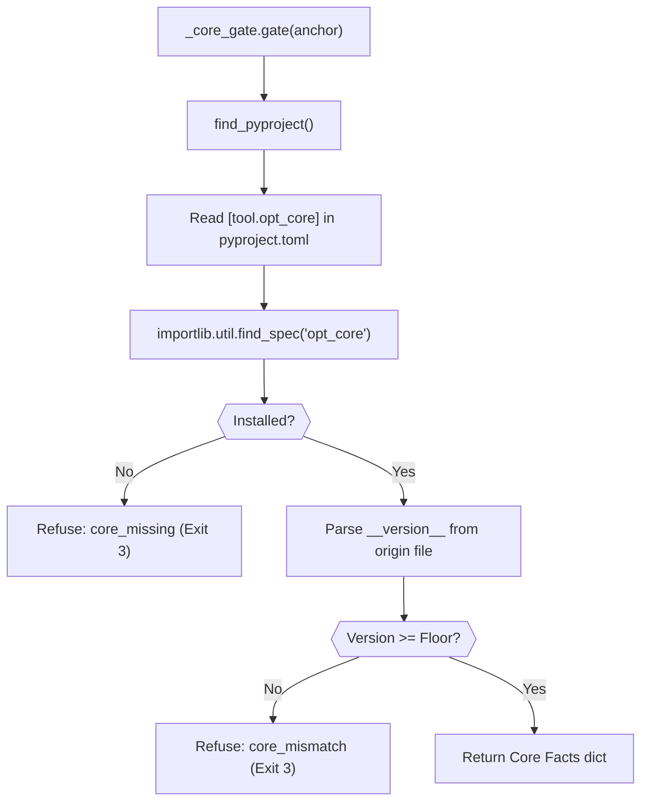
Sources: `genie3/opt/genie3_opt/_core_gate.py:1-136()`, `openfold3_ob0/opt/openfold3_ob0_opt/__init__.py:40-58()`

---

## 2. Autoload Hooks and `.pth` Integration

Kits support zero-code integration through Python `.pth` path configuration files placed in site-packages (e.g., `e1_opt_autoload.pth`, `openfold3_ob0_opt_autoload.pth`). These hooks intercept python interpreter initialization before user scripts execute.

### Data Flow of `.pth` Execution
* When Python starts, it executes inline statements inside `.pth` files.
* The hook checks whether the kit's environment variable (e.g., `E1_OPT`, `OPENFOLD3_OB0_OPT`) is set and not equal to `off` [e1/opt/e1_opt_autoload.pth:1-2()]().
* If active, it imports the kit's `_autoload` submodule. If an exception occurs or configuration fails, it catches `SystemExit` or `BaseException`, prints a formatted `NOT ACTIVE` message to `sys.stderr`, and forces a hard termination via `os._exit(3)` [e1/opt/e1_opt_autoload.pth:1-2()]().

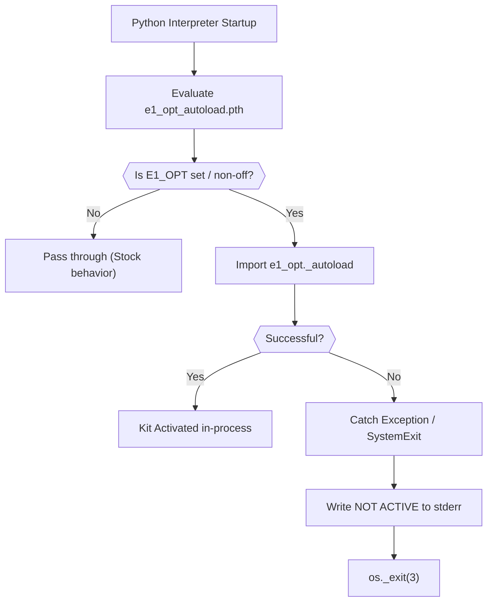
Sources: `e1/opt/e1_opt_autoload.pth:1-3()`, `openfold3_ob0/opt/openfold3_ob0_opt_autoload.pth:1-1()`

---

## 3. Process vs. In-Process Activation Forms

Kits define two primary modes of execution for running optimized workflows, balancing process isolation with programmatic integration:

1. **Process Form (Runner / Child Process)**:
   * Executed via kit CLIs (e.g., `boltzgen-opt design`) [boltzgen/opt/boltzgen_opt/stack.py:5-8]()
   * Spawns a child process runner script (`python forward/.../src/xa_run.py`) with an environment built via `mode_env()` [boltzgen/opt/boltzgen_opt/stack.py:5-8]().
   * Exports `BOLTZGEN_OPT=<mode>` and a one-shot handover flag `BOLTZGEN_OPT_HANDOVER=1`, ensuring that child processes activate the package precisely once upon interpreter start [boltzgen/opt/boltzgen_opt/stack.py:8-12]().
   * Lever modules patch target classes during import within the child, and their execution lines are monitored via stdout/stderr pattern matching (`RUNNER_LINES`) [boltzgen/opt/boltzgen_opt/stack.py:12-14(), 74-81]().

2. **In-Process Form (`enable(mode)`)**:
   * Invoked directly within a user Python session calling upstream APIs (e.g., `chai_lab` or `openfold3`) [chai1/opt/chai1_opt/stack.py:11-15(), openfold3_ob0/opt/openfold3_ob0_opt/__init__.py:60-70]().
   * `activate()` resolves the mode, configures `sys.path` ordering to put optimization layers at the front, executes required bootstrap hooks (`sitecustomize`, `bg_hook`), and applies monkey-patches at import time [boltzgen/opt/boltzgen_opt/stack.py:13-18()]().

Sources: `boltzgen/opt/boltzgen_opt/stack.py:1-34()`, `openfold3_ob0/opt/openfold3_ob0_opt/__init__.py:60-78()`

---

## 4. Late-Activation Protection

To prevent undefined behavior, inconsistent monkey-patching, or silent partial state corruption, kits enforce strict **late-activation rules**. 

* Once upstream model instances are instantiated (tracked via constructor wrappers or garbage-collection scans of model classes like `Boltz`, `ESMC`, or `ESMFold2Model`), subsequent activation attempts are blocked [boltzgen/opt/boltzgen_opt/stack.py:25-33(), esmc/opt/esmc_opt/stack.py:11-14(), esmfold2/opt/esmfold2_opt/stack.py:60-65()]().
* If any target optimization module has already been imported or patched by another route, activation fails with an `ActivationError` [boltzgen/opt/boltzgen_opt/stack.py:20-23(), openfold3_ob0/opt/openfold3_ob0_opt/__init__.py:25-28()]().
* Calling `activate(..., dry_run=True)` (or `check`) validates gates and resolutions without importing model weights or mutating `sys.modules` [boltzgen/opt/boltzgen_opt/stack.py:33]().

Sources: `boltzgen/opt/boltzgen_opt/stack.py:25-34()`, `esmc/opt/esmc_opt/stack.py:11-15()`, `esmfold2/opt/esmfold2_opt/stack.py:60-65()`

---

## 5. Out-of-Memory (OOM) Fail-Loud Discipline

Kits operate under a strict **fail-loud** policy regarding resource exhaustion. 

* **No Silent Fallbacks**: Served handlers never catch an `OutOfMemoryError` to transparently fall back to a slower or smaller unoptimized configuration. Because fallback pathways require distinct memory profiles, letting OOMs propagate allows callers and benchmark harnesses to record true failure boundaries [genie3/opt/genie3_opt/tests/test_resource_guards.py:10-15()]().
* **Classifier Integration**: Memory errors are identified exclusively via the shared core classifier `opt_core.oom.is_oom` [boltzgen/opt/boltzgen_opt/stack.py:51(), esmc/opt/esmc_opt/_oom.py:1](). Core forward drivers and patch modules intentionally omit local exception handlers around tensor operations to ensure exceptions surface immediately.
* **Pre-Run Capacity Guards**: Prior to execution, batch capacity and resident memory requirements are projected against device limits (e.g., via `g3batch.capacity_verdict()`). If a batch cannot fit safely within card bounds, it aborts pre-execution with an explicit exit status rather than failing mid-inference [genie3/opt/genie3_opt/tests/test_resource_guards.py:6-12()]().

Sources: `genie3/opt/genie3_opt/tests/test_resource_guards.py:1-19()`, `boltzgen/opt/boltzgen_opt/stack.py:50-51()`

---

# Page: Kit CLIs and Stock Routes

# Kit CLIs and Stock Routes

<details>
<summary>Relevant source files</summary>

The following files were used as context for generating this wiki page:

- [af2ig/opt/af2ig_opt/cli.py](af2ig/opt/af2ig_opt/cli.py)
- [af3_jax/opt/af3_jax_opt/cli.py](af3_jax/opt/af3_jax_opt/cli.py)
- [af3_jax/opt/af3_jax_opt/convert.py](af3_jax/opt/af3_jax_opt/convert.py)
- [af3_torch/opt/af3_torch_opt/featurise.py](af3_torch/opt/af3_torch_opt/featurise.py)
- [af3_torch/opt/af3_torch_opt/pipeline_stream.py](af3_torch/opt/af3_torch_opt/pipeline_stream.py)
- [af3_torch/opt/af3_torch_opt/tests/test_cli_manifest.py](af3_torch/opt/af3_torch_opt/tests/test_cli_manifest.py)
- [af3_torch/opt/af3_torch_opt/tests/test_pipeline_stream.py](af3_torch/opt/af3_torch_opt/tests/test_pipeline_stream.py)
- [atlasfold/opt/atlasfold_opt/cli.py](atlasfold/opt/atlasfold_opt/cli.py)
- [boltz2/opt/boltz2_opt/cli.py](boltz2/opt/boltz2_opt/cli.py)
- [boltz2/opt/boltz2_opt/settings.py](boltz2/opt/boltz2_opt/settings.py)
- [boltzgen/opt/boltzgen_opt/cli.py](boltzgen/opt/boltzgen_opt/cli.py)
- [boltzgen/opt/boltzgen_opt/design.py](boltzgen/opt/boltzgen_opt/design.py)
- [boltzgen/opt/boltzgen_opt/tests/test_levers.py](boltzgen/opt/boltzgen_opt/tests/test_levers.py)
- [boltzgen/opt/boltzgen_opt/tests/test_stock_route.py](boltzgen/opt/boltzgen_opt/tests/test_stock_route.py)
- [borzoi/README.md](borzoi/README.md)
- [borzoi/opt/borzoi_opt/cli.py](borzoi/opt/borzoi_opt/cli.py)
- [borzoi/run.sh](borzoi/run.sh)
- [caliby/opt/caliby_opt/cli.py](caliby/opt/caliby_opt/cli.py)
- [caliby/opt/caliby_opt/design_run.py](caliby/opt/caliby_opt/design_run.py)
- [chai1/opt/chai1_opt/cli.py](chai1/opt/chai1_opt/cli.py)
- [chai1/opt/chai1_opt/stock_fold.py](chai1/opt/chai1_opt/stock_fold.py)
- [chai1/opt/chai1_opt/tests/test_big.py](chai1/opt/chai1_opt/tests/test_big.py)
- [chai1/opt/chai1_opt/tests/test_optin.py](chai1/opt/chai1_opt/tests/test_optin.py)
- [colabdesign/opt/colabdesign_opt/envproof.py](colabdesign/opt/colabdesign_opt/envproof.py)
- [colabdesign/opt/colabdesign_opt/levers.py](colabdesign/opt/colabdesign_opt/levers.py)
- [common/mps_packing/README.md](common/mps_packing/README.md)
- [common/mps_packing/mps_workers.sh](common/mps_packing/mps_workers.sh)
- [common/opt_core/opt_core/attn/__init__.py](common/opt_core/opt_core/attn/__init__.py)
- [common/opt_core/opt_core/kernels/trimul/native/pkg/v5/python/trimul_native/build.py](common/opt_core/opt_core/kernels/trimul/native/pkg/v5/python/trimul_native/build.py)
- [common/opt_core/opt_core/kernels/trimul/native/pkg/v5/python/trimul_native/vectors.py](common/opt_core/opt_core/kernels/trimul/native/pkg/v5/python/trimul_native/vectors.py)
- [common/opt_core/opt_core/stock_proof.py](common/opt_core/opt_core/stock_proof.py)
- [common/opt_core/tests/test_attn.py](common/opt_core/tests/test_attn.py)
- [common/opt_core/tests/test_stock_cli_process.py](common/opt_core/tests/test_stock_cli_process.py)
- [complexa/README.md](complexa/README.md)
- [complexa/STOCK.md](complexa/STOCK.md)
- [complexa/environment/Dockerfile](complexa/environment/Dockerfile)
- [complexa/opt/complexa_opt/levers.py](complexa/opt/complexa_opt/levers.py)
- [complexa/opt/complexa_opt/outputs.py](complexa/opt/complexa_opt/outputs.py)
- [complexa/opt/complexa_opt/stock_design.py](complexa/opt/complexa_opt/stock_design.py)
- [complexa/opt/complexa_opt/tests/test_lever_gates.py](complexa/opt/complexa_opt/tests/test_lever_gates.py)
- [complexa/opt/complexa_opt/tests/test_stock_env.py](complexa/opt/complexa_opt/tests/test_stock_env.py)
- [e1/opt/e1_opt/cli.py](e1/opt/e1_opt/cli.py)
- [e1/opt/e1_opt/kit_score.py](e1/opt/e1_opt/kit_score.py)
- [e1/opt/e1_opt/tests/test_off_env_proof.py](e1/opt/e1_opt/tests/test_off_env_proof.py)
- [ef2inv/opt/ef2inv_opt/cli.py](ef2inv/opt/ef2inv_opt/cli.py)
- [ef2inv/opt/ef2inv_opt/envproof.py](ef2inv/opt/ef2inv_opt/envproof.py)
- [ef2inv/opt/ef2inv_opt/tests/test_fallbacks.py](ef2inv/opt/ef2inv_opt/tests/test_fallbacks.py)
- [esm_if1/opt/esm_if1_opt/stock_design.py](esm_if1/opt/esm_if1_opt/stock_design.py)
- [esmfold2/opt/esmfold2_opt/cli.py](esmfold2/opt/esmfold2_opt/cli.py)
- [esmfold2/opt/esmfold2_opt/tests/test_off_env_proof.py](esmfold2/opt/esmfold2_opt/tests/test_off_env_proof.py)
- [genie3/opt/genie3_opt/cli.py](genie3/opt/genie3_opt/cli.py)
- [genie3/opt/genie3_opt/design.py](genie3/opt/genie3_opt/design.py)
- [genie3/opt/genie3_opt/stock_cli.py](genie3/opt/genie3_opt/stock_cli.py)
- [genie3/opt/genie3_opt/tests/test_cli_outputs_stock.py](genie3/opt/genie3_opt/tests/test_cli_outputs_stock.py)
- [mosaic/opt/mosaic_opt/stock_design.py](mosaic/opt/mosaic_opt/stock_design.py)
- [mosaic/opt/mosaic_opt/weights.py](mosaic/opt/mosaic_opt/weights.py)
- [opendde/opt/forward/fast_inference/levers/OFFLOAD/odde_offload.py](opendde/opt/forward/fast_inference/levers/OFFLOAD/odde_offload.py)
- [opendde/opt/opendde_opt/ran.py](opendde/opt/opendde_opt/ran.py)
- [opendde/opt/opendde_opt/tests/test_lever_mechanics.py](opendde/opt/opendde_opt/tests/test_lever_mechanics.py)
- [opendde/opt/opendde_opt/tests/test_lncore.py](opendde/opt/opendde_opt/tests/test_lncore.py)
- [opendde/opt/opendde_opt/tests/test_lnstream.py](opendde/opt/opendde_opt/tests/test_lnstream.py)
- [opendde/opt/opendde_opt/tests/test_ran.py](opendde/opt/opendde_opt/tests/test_ran.py)
- [opendde/opt/opendde_opt/tests/test_tp_struct_cpu.py](opendde/opt/opendde_opt/tests/test_tp_struct_cpu.py)
- [opendde/opt/opendde_opt/tp_struct.py](opendde/opt/opendde_opt/tp_struct.py)
- [opendde/stock/src/opendde/model/modules/structural_tokens.py](opendde/stock/src/opendde/model/modules/structural_tokens.py)
- [openfold3/opt/openfold3_opt/hooks.py](openfold3/opt/openfold3_opt/hooks.py)
- [openfold3/opt/openfold3_opt/tests/test_off_env_proof.py](openfold3/opt/openfold3_opt/tests/test_off_env_proof.py)
- [openfold3_ob0/opt/openfold3_ob0_opt/env.py](openfold3_ob0/opt/openfold3_ob0_opt/env.py)
- [openfold3_ob0/opt/openfold3_ob0_opt/hooks.py](openfold3_ob0/opt/openfold3_ob0_opt/hooks.py)
- [openfold3_ob0/opt/openfold3_ob0_opt/tests/test_kit_hook_detection.py](openfold3_ob0/opt/openfold3_ob0_opt/tests/test_kit_hook_detection.py)
- [openfold3_ob0/opt/openfold3_ob0_opt/tests/test_off_env_proof.py](openfold3_ob0/opt/openfold3_ob0_opt/tests/test_off_env_proof.py)
- [progen2/opt/forward/engines/progen2/kits/v0_ew/build.py](progen2/opt/forward/engines/progen2/kits/v0_ew/build.py)
- [progen2/opt/progen2_opt/cli.py](progen2/opt/progen2_opt/cli.py)
- [progen2/opt/progen2_opt/stock_cli.py](progen2/opt/progen2_opt/stock_cli.py)
- [progen2/opt/progen2_opt/tests/conftest.py](progen2/opt/progen2_opt/tests/conftest.py)
- [progen2/opt/progen2_opt/tests/test_cli_usage.py](progen2/opt/progen2_opt/tests/test_cli_usage.py)
- [progen2/opt/progen2_opt/tests/test_stock_cli.py](progen2/opt/progen2_opt/tests/test_stock_cli.py)
- [progen2/opt/progen2_opt/tests/test_stock_route_cpu.py](progen2/opt/progen2_opt/tests/test_stock_route_cpu.py)
- [proteinmpnn/opt/proteinmpnn_opt/cli.py](proteinmpnn/opt/proteinmpnn_opt/cli.py)
- [proteinmpnn/opt/proteinmpnn_opt/stock_run.py](proteinmpnn/opt/proteinmpnn_opt/stock_run.py)
- [proteinmpnn/opt/proteinmpnn_opt/tests/test_cli_manifest.py](proteinmpnn/opt/proteinmpnn_opt/tests/test_cli_manifest.py)
- [protenix_v1/opt/protenix_v1_opt/cli.py](protenix_v1/opt/protenix_v1_opt/cli.py)
- [protenix_v1/opt/protenix_v1_opt/tests/test_stock_route.py](protenix_v1/opt/protenix_v1_opt/tests/test_stock_route.py)
- [protenix_v2/opt/forward/PTX_TP/PTX_TP_ADDON/ptx_tp/launch.py](protenix_v2/opt/forward/PTX_TP/PTX_TP_ADDON/ptx_tp/launch.py)
- [protenix_v2/opt/forward/PTX_TP/PTX_TP_ADDON/ptx_tp/launch_core.py](protenix_v2/opt/forward/PTX_TP/PTX_TP_ADDON/ptx_tp/launch_core.py)
- [protenix_v2/opt/forward/PTX_TP/PTX_TP_ADDON/ptx_tp/rowlocal.py](protenix_v2/opt/forward/PTX_TP/PTX_TP_ADDON/ptx_tp/rowlocal.py)
- [protenix_v2/opt/protenix_opt/tests/test_cli_passthrough.py](protenix_v2/opt/protenix_opt/tests/test_cli_passthrough.py)
- [protenix_v2/opt/protenix_opt/tests/test_stock_route.py](protenix_v2/opt/protenix_opt/tests/test_stock_route.py)
- [pxdesign/STOCK.md](pxdesign/STOCK.md)
- [pxdesign/opt/pxdesign_opt/options.py](pxdesign/opt/pxdesign_opt/options.py)
- [pxdesign/opt/pxdesign_opt/stamps.py](pxdesign/opt/pxdesign_opt/stamps.py)
- [pxdesign/opt/pxdesign_opt/tests/test_cli_manifest.py](pxdesign/opt/pxdesign_opt/tests/test_cli_manifest.py)
- [pxdesign/opt/pxdesign_opt/tests/test_stamps.py](pxdesign/opt/pxdesign_opt/tests/test_stamps.py)
- [pxdesign/opt/pxdesign_opt/tests/test_stock_surface.py](pxdesign/opt/pxdesign_opt/tests/test_stock_surface.py)
- [pxdesign/run.sh](pxdesign/run.sh)
- [pxdesign/stock/PINS.json](pxdesign/stock/PINS.json)
- [rfdiffusion1/opt/rfdiffusion1_opt/cli.py](rfdiffusion1/opt/rfdiffusion1_opt/cli.py)
- [rfdiffusion1/opt/rfdiffusion1_opt/design.py](rfdiffusion1/opt/rfdiffusion1_opt/design.py)
- [rfdiffusion1/opt/rfdiffusion1_opt/serve.py](rfdiffusion1/opt/rfdiffusion1_opt/serve.py)
- [rfdiffusion1/opt/rfdiffusion1_opt/stock_cli.py](rfdiffusion1/opt/rfdiffusion1_opt/stock_cli.py)
- [rfdiffusion3/opt/rfdiffusion3_opt/cli.py](rfdiffusion3/opt/rfdiffusion3_opt/cli.py)
- [rfdiffusion3/opt/rfdiffusion3_opt/stock_design.py](rfdiffusion3/opt/rfdiffusion3_opt/stock_design.py)
- [rosettafold3/opt/rosettafold3_opt/cli.py](rosettafold3/opt/rosettafold3_opt/cli.py)
- [rosettafold3/opt/rosettafold3_opt/hostlean.py](rosettafold3/opt/rosettafold3_opt/hostlean.py)
- [rosettafold3/opt/rosettafold3_opt/tests/test_hostlean.py](rosettafold3/opt/rosettafold3_opt/tests/test_hostlean.py)
- [rosettafold3/opt/rosettafold3_opt/tests/test_size_routes.py](rosettafold3/opt/rosettafold3_opt/tests/test_size_routes.py)
- [rosettafold3/opt/rosettafold3_opt/tests/test_upstream_census.py](rosettafold3/opt/rosettafold3_opt/tests/test_upstream_census.py)
- [rosettafold3/opt/rosettafold3_opt/upstream.py](rosettafold3/opt/rosettafold3_opt/upstream.py)

</details>


## Purpose and Scope
This page details the implementation of per-kit command-line interfaces (`cli.py`), upstream command passthrough runners (`stock_*`), the cryptographic and environmental proof framework (`opt_core.stock_proof`) guaranteeing that `--mode off` executions are strictly pristine, and the exit rule system coupled with manifest emission. Every optimization kit provides a unified CLI facade that proxies or wraps upstream entry points while offering rigorous isolation for exact comparison.

Sources: [rfdiffusion3/opt/rfdiffusion3_opt/cli.py:1-39](), [protenix_v2/opt/protenix_opt/tests/test_stock_route.py:1-10]()

---

## 1. Per-Kit `cli.py` Architecture and Command Routing

Every kit implements a standard command router in `cli.py` (e.g., `rfdiffusion3_opt.cli`, `genie3_opt.cli`, `protenix_v1_opt.cli`) built on top of `argparse` or click. The router captures optimization-specific arguments (such as `--mode`, `--det`, `--n_gpu`, and `--allow-partial`) and passes downstream tokens verbatim to upstream entry points.

The core command lifecycle parsed by `cli.py` includes:
* **`design` / `pred` / `sad`**: The primary execution verb. It resolves the requested mode, validates environment constraints, constructs the activation delta, and either invokes the optimized engine in-process or delegates to a stock runner (`stock_design.py`, `stock_pred.py`, `stock_cli.py`, `stock_fold.py`) when `--mode off` is specified.
* **`check`**: A dry-run inspection verb that verifies kernel availability, pin integrity, GPU capabilities, and package versions without executing inference or importing heavy deep learning frameworks.
* **`warm`**: Loads model weights and captures compilation graphs under the specified mode without running a full job, verifying early-stage memory allocation and hardware target compatibility.

Mode resolution is handled centrally via `opt_core.modes` or kit-specific mode tables (`modes.resolve_mode_arg`), where command-line flags (`--mode`) strictly override environment variables (e.g., `RFDIFFUSION3_OPT`, `PROTENIX_OPT`), which in turn fall back to package defaults.

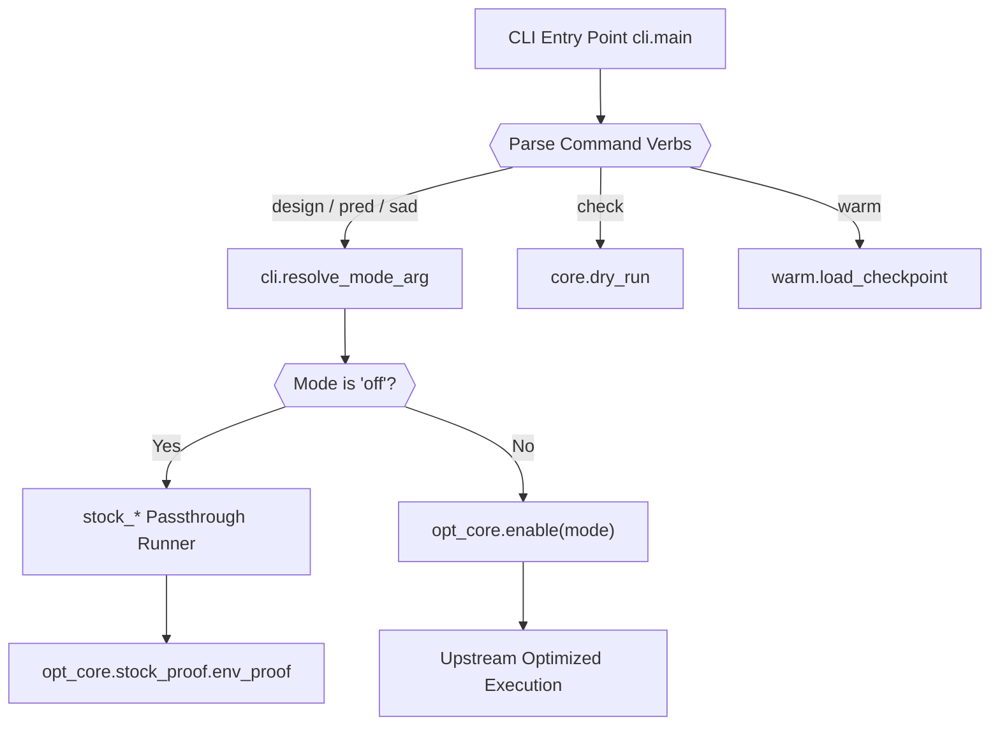
*Diagram 1: Command dispatch flow from `cli.py` through mode resolution to either stock isolation or optimized runtime activation.*

Sources: [rfdiffusion3/opt/rfdiffusion3_opt/cli.py:40-79](), [protenix_v1_opt/opt/protenix_v1_opt/cli.py:1-21]()

---

## 2. Stock Passthrough Runners (`stock_*`) and Subprocess Isolation

When a user requests `--mode off`, the kit invokes a dedicated stock runner module (`stock_pred.py`, `stock_cli.py`, `stock_design.py`, or `stock_fold.py`). These runners guarantee that upstream code executes in a pristine subprocess completely free of optimization side effects.

The isolation procedure entails:
1. **Environment Sanitization**: Stripping all environment variables whose prefixes match `stock/PINS.json` entries (`must_be_absent_prefixes`), such as kit-specific switch variables (`RF3_XATTEMPT`, `OF3_CUDA_GRAPHS`, `PTX_BLK`) while preserving explicit allowed exceptions (e.g., `RFD_ROOT`, `CHAI_DOWNLOADS_DIR`).
2. **`PYTHONPATH` Scrubbing**: Filtering `sys.path` and the `PYTHONPATH` environment variable to remove any paths residing inside kit directories or forward optimization packs.
3. **Subprocess Replacement / Invocation**: Executing the cleaned command via `subprocess.run` or replacing the current process image via `os.execv` into upstream's native console scripts or entry points (e.g., `rfd3.cli:app`, `run_inference.py`, `genie3`).

Sources: [rfdiffusion1/opt/rfdiffusion1_opt/stock_cli.py:1-14](), [chai1/opt/chai1_opt/stock_fold.py:1-27](), [genie3/opt/genie3_opt/stock_cli.py:1-16]()

---

## 3. Stock Proof Contract and Pristine Verification (`opt_core.stock_proof`)

Before invoking upstream code, the stock runner executes `opt_core.stock_proof.env_proof` to cryptographically and structurally prove that the execution environment is pristine. 

The proof inspects:
* **Forbidden Environment Variables**: Verifies that no variables matching `must_be_absent_prefixes` or `must_be_absent_names` remain in `os.environ` (outside allowed exceptions).
* **Loaded Modules**: Scans `sys.modules` to ensure no kit modules (`KIT_MODULE_PREFIXES`) or files under kit directories have been imported.
* **`sys.path` Integrity**: Confirms no kit directories reside on `sys.path`.
* **Autoload Binders**: Verifies that package-specific import finders (`_autoload`) are disarmed and inactive.
* **Framework Preload State**: Checks whether deep learning frameworks like `torch` or upstream tool modules were imported prematurely before the proof completed.
* **Deterministic Carve-Outs**: Validates precise environmental exceptions required for deterministic comparison (e.g., `CUBLAS_WORKSPACE_CONFIG`).

If any check fails, the proof records the exact violations, emits an error log, and terminates with exit code `3` (`EXIT_NOT_STOCK` / `EXIT_NOT_ACTIVE`), ensuring no compromised execution occurs.

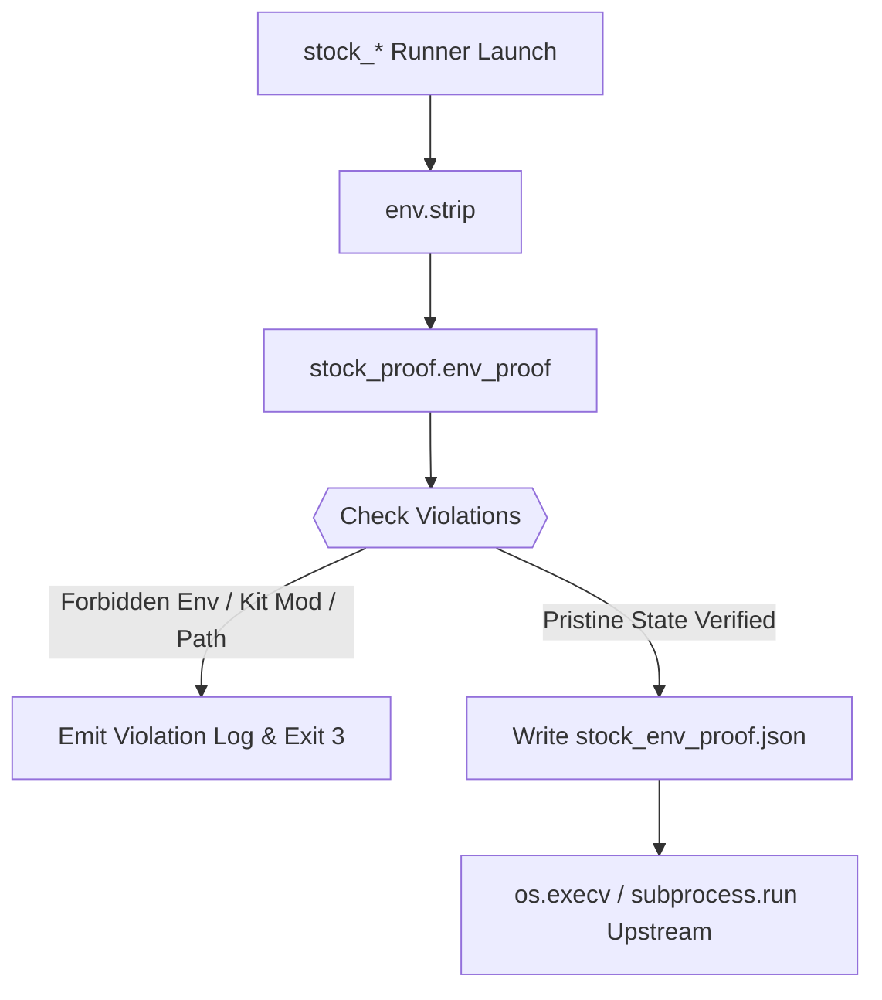
*Diagram 2: Verification pipeline executed by `stock_proof.env_proof` prior to running upstream binaries.*

Sources: [protenix_v2/opt/protenix_opt/tests/test_stock_route.py:75-94](), [rfdiffusion1/opt/rfdiffusion1_opt/stock_cli.py:70-83](), [common/opt_core/opt_core/stock_proof.py:1-40]()

---

## 4. Exit Rules, Partial Compliance, and Manifest Emission

Command execution concludes by mapping runtime outcomes to standard exit codes via `opt_core.report` (exposed through `report.py`):
* **`0` (`EXIT_OK`)**: Successful execution with full lever engagement or valid stock execution.
* **`1` (`EXIT_FAIL`)**: Runtime failure, exception, or unhandled error during execution.
* **`2` (`EXIT_USAGE`)**: CLI usage error, invalid argument combination, or signature mismatch.
* **`3` (`EXIT_NOT_ACTIVE`)**: Refused gates, unserved execution paths, stock subprocess proof failure, or *partial activation* without authorization.

### Partial Activation and `--allow-partial`
A run is designated *partial* if a planned lever lacks evidence of application (e.g., hardware constraints or kernel mismatches forced a silent or explicit fallback). By default, partial activations trigger an immediate exit with code `3`. 

Passing `--allow-partial` (or setting `*_OPT_ALLOW_PARTIAL=1` in the environment) overrides this enforcement, logging the partial state into `opt_manifest.json` under `partial_reason` and allowing the command to exit with the underlying run's exit code.

### Manifest Emission
Upon completion, kits emit an `opt_manifest.json` report into the output directory. This manifest captures:
* Selected mode, form, and active status.
* Complete verification proof records (`stock_env_proof`).
* Applied levers, fallback reasons, and token execution metadata.

Sources: [rfdiffusion3/opt/rfdiffusion3_opt/cli.py:20-38](), [protenix_v1_opt/opt/protenix_v1_opt/cli.py:16-21]()

---

# Page: Reporting, Manifests and Evidence

# Reporting, Manifests and Evidence

<details>
<summary>Relevant source files</summary>

The following files were used as context for generating this wiki page:

- [af2ig/opt/af2ig_opt/report.py](af2ig/opt/af2ig_opt/report.py)
- [af3_jax/opt/af3_jax_opt/inprocess/kernels_probe.py](af3_jax/opt/af3_jax_opt/inprocess/kernels_probe.py)
- [af3_jax/opt/af3_jax_opt/kernels.py](af3_jax/opt/af3_jax_opt/kernels.py)
- [af3_jax/opt/af3_jax_opt/report.py](af3_jax/opt/af3_jax_opt/report.py)
- [af3_jax/opt/af3_jax_opt/stack.py](af3_jax/opt/af3_jax_opt/stack.py)
- [af3_jax/opt/af3_jax_opt/tests/test_kernels.py](af3_jax/opt/af3_jax_opt/tests/test_kernels.py)
- [af3_torch/opt/af3_torch_opt/report.py](af3_torch/opt/af3_torch_opt/report.py)
- [af3_torch/opt/af3_torch_opt/stack.py](af3_torch/opt/af3_torch_opt/stack.py)
- [boltz2/opt/boltz2_opt/kernels.py](boltz2/opt/boltz2_opt/kernels.py)
- [boltz2/opt/boltz2_opt/prep.py](boltz2/opt/boltz2_opt/prep.py)
- [boltz2/opt/boltz2_opt/report.py](boltz2/opt/boltz2_opt/report.py)
- [boltz2/opt/boltz2_opt/stack.py](boltz2/opt/boltz2_opt/stack.py)
- [boltz2/opt/boltz2_opt/tests/test_atom_big_by_card.py](boltz2/opt/boltz2_opt/tests/test_atom_big_by_card.py)
- [boltz2/opt/boltz2_opt/tests/test_cli_and_evidence.py](boltz2/opt/boltz2_opt/tests/test_cli_and_evidence.py)
- [boltz2/opt/boltz2_opt/tests/test_kernels.py](boltz2/opt/boltz2_opt/tests/test_kernels.py)
- [boltz2/opt/boltz2_opt/tests/test_rowpair_feats_cpu.py](boltz2/opt/boltz2_opt/tests/test_rowpair_feats_cpu.py)
- [boltzgen/opt/boltzgen_opt/manifest.py](boltzgen/opt/boltzgen_opt/manifest.py)
- [boltzgen/opt/boltzgen_opt/report.py](boltzgen/opt/boltzgen_opt/report.py)
- [caliby/opt/caliby_opt/manifest.py](caliby/opt/caliby_opt/manifest.py)
- [chai1/opt/chai1_opt/report.py](chai1/opt/chai1_opt/report.py)
- [chai1/opt/chai1_opt/tests/test_activation_rules.py](chai1/opt/chai1_opt/tests/test_activation_rules.py)
- [chrombpnet/opt/chrombpnet_opt/manifest.py](chrombpnet/opt/chrombpnet_opt/manifest.py)
- [colabdesign/opt/colabdesign_opt/evidence.py](colabdesign/opt/colabdesign_opt/evidence.py)
- [colabdesign/opt/colabdesign_opt/report.py](colabdesign/opt/colabdesign_opt/report.py)
- [colabfold/opt/colabfold_opt/manifest.py](colabfold/opt/colabfold_opt/manifest.py)
- [colabfold/opt/colabfold_opt/report.py](colabfold/opt/colabfold_opt/report.py)
- [colabfold/opt/colabfold_opt/stack.py](colabfold/opt/colabfold_opt/stack.py)
- [common/opt_core/opt_core/host/memo.py](common/opt_core/opt_core/host/memo.py)
- [common/opt_core/opt_core/manifest.py](common/opt_core/opt_core/manifest.py)
- [common/opt_core/opt_core/mem/record.py](common/opt_core/opt_core/mem/record.py)
- [common/opt_core/opt_core/report.py](common/opt_core/opt_core/report.py)
- [common/opt_core/tests/test_gates.py](common/opt_core/tests/test_gates.py)
- [common/opt_core/tests/test_gpu_classes_h200.py](common/opt_core/tests/test_gpu_classes_h200.py)
- [common/opt_core/tests/test_mem_assembly.py](common/opt_core/tests/test_mem_assembly.py)
- [common/opt_core/tests/test_mem_record_apply.py](common/opt_core/tests/test_mem_record_apply.py)
- [complexa/opt/complexa_opt/manifest.py](complexa/opt/complexa_opt/manifest.py)
- [e1/opt/e1_opt/tests/test_cli_score.py](e1/opt/e1_opt/tests/test_cli_score.py)
- [e1/opt/e1_opt/tests/test_kernels_proof.py](e1/opt/e1_opt/tests/test_kernels_proof.py)
- [ef2inv/opt/ef2inv_opt/manifest.py](ef2inv/opt/ef2inv_opt/manifest.py)
- [esm_if1/opt/esm_if1_opt/manifest.py](esm_if1/opt/esm_if1_opt/manifest.py)
- [esmc/opt/esmc_opt/report.py](esmc/opt/esmc_opt/report.py)
- [esmc/opt/esmc_opt/tests/test_kernels.py](esmc/opt/esmc_opt/tests/test_kernels.py)
- [esmfold2/opt/esmfold2_opt/report.py](esmfold2/opt/esmfold2_opt/report.py)
- [esmfold2/opt/esmfold2_opt/tests/test_lever_lines.py](esmfold2/opt/esmfold2_opt/tests/test_lever_lines.py)
- [esmfold2/opt/esmfold2_opt/tests/test_tx_lever.py](esmfold2/opt/esmfold2_opt/tests/test_tx_lever.py)
- [esmfold2/opt/esmfold2_opt/tests/test_xln.py](esmfold2/opt/esmfold2_opt/tests/test_xln.py)
- [esmfold2/opt/forward/fast_inference/driver/ef2_xln.py](esmfold2/opt/forward/fast_inference/driver/ef2_xln.py)
- [flashzoi/opt/flashzoi_opt/manifest.py](flashzoi/opt/flashzoi_opt/manifest.py)
- [genie3/opt/genie3_opt/manifest.py](genie3/opt/genie3_opt/manifest.py)
- [genie3/opt/genie3_opt/report.py](genie3/opt/genie3_opt/report.py)
- [mosaic/opt/mosaic_opt/report.py](mosaic/opt/mosaic_opt/report.py)
- [opendde/opt/opendde_opt/manifest.py](opendde/opt/opendde_opt/manifest.py)
- [opendde/opt/opendde_opt/report.py](opendde/opt/opendde_opt/report.py)
- [openfold3/opt/openfold3_opt/tests/test_lever_lines.py](openfold3/opt/openfold3_opt/tests/test_lever_lines.py)
- [openfold3_ob0/opt/openfold3_ob0_opt/tests/test_lever_lines.py](openfold3_ob0/opt/openfold3_ob0_opt/tests/test_lever_lines.py)
- [openfold3_ob0/opt/openfold3_ob0_opt/tests/test_templ_census.py](openfold3_ob0/opt/openfold3_ob0_opt/tests/test_templ_census.py)
- [progen2/opt/progen2_opt/report.py](progen2/opt/progen2_opt/report.py)
- [proteinmpnn/opt/proteinmpnn_opt/manifest.py](proteinmpnn/opt/proteinmpnn_opt/manifest.py)
- [protenix_v1/opt/protenix_v1_opt/kit.py](protenix_v1/opt/protenix_v1_opt/kit.py)
- [protenix_v1/opt/protenix_v1_opt/report.py](protenix_v1/opt/protenix_v1_opt/report.py)
- [protenix_v1/opt/protenix_v1_opt/tests/test_exit_rule.py](protenix_v1/opt/protenix_v1_opt/tests/test_exit_rule.py)
- [protenix_v1/opt/protenix_v1_opt/tests/test_frozen_weights.py](protenix_v1/opt/protenix_v1_opt/tests/test_frozen_weights.py)
- [protenix_v1/opt/protenix_v1_opt/tests/test_lever_lines.py](protenix_v1/opt/protenix_v1_opt/tests/test_lever_lines.py)
- [protenix_v1/opt/protenix_v1_opt/tests/test_rank0_features.py](protenix_v1/opt/protenix_v1_opt/tests/test_rank0_features.py)
- [protenix_v2/opt/protenix_opt/manifest.py](protenix_v2/opt/protenix_opt/manifest.py)
- [protenix_v2/opt/protenix_opt/report.py](protenix_v2/opt/protenix_opt/report.py)
- [protenix_v2/opt/protenix_opt/tests/test_b300_rows.py](protenix_v2/opt/protenix_opt/tests/test_b300_rows.py)
- [protenix_v2/opt/protenix_opt/tests/test_cli_manifest.py](protenix_v2/opt/protenix_opt/tests/test_cli_manifest.py)
- [protenix_v2/opt/protenix_opt/tests/test_lever_lines.py](protenix_v2/opt/protenix_opt/tests/test_lever_lines.py)
- [protenix_v2/opt/protenix_opt/tests/test_weights_digest.py](protenix_v2/opt/protenix_opt/tests/test_weights_digest.py)
- [pxdesign/opt/pxdesign_opt/manifest.py](pxdesign/opt/pxdesign_opt/manifest.py)
- [pxdesign/opt/pxdesign_opt/report.py](pxdesign/opt/pxdesign_opt/report.py)
- [rfdiffusion1/opt/rfdiffusion1_opt/manifest.py](rfdiffusion1/opt/rfdiffusion1_opt/manifest.py)
- [rfdiffusion1/opt/rfdiffusion1_opt/report.py](rfdiffusion1/opt/rfdiffusion1_opt/report.py)
- [rfdiffusion3/opt/rfdiffusion3_opt/manifest.py](rfdiffusion3/opt/rfdiffusion3_opt/manifest.py)
- [rfdiffusion3/opt/rfdiffusion3_opt/tests/test_census.py](rfdiffusion3/opt/rfdiffusion3_opt/tests/test_census.py)
- [rosettafold3/opt/rosettafold3_opt/report.py](rosettafold3/opt/rosettafold3_opt/report.py)
- [rosettafold3/opt/rosettafold3_opt/tests/test_exit_tally.py](rosettafold3/opt/rosettafold3_opt/tests/test_exit_tally.py)

</details>


## Purpose and Scope
This section details the post-run observability, reporting mechanisms, manifest generation, cell census collection, and evidence verification frameworks implemented across the optimization kits. Every kit maintains a dedicated `report.py` module [protenix_v2/opt/protenix_opt/report.py:1-13]() that standardizes terminal emission streams, registers atexit process tallies, tracks kernel fallback metrics, and enforces strict exit codes (`EXIT_OK`, `EXIT_FAIL`, `EXIT_USAGE`, `EXIT_NOT_ACTIVE`) [esmfold2/opt/esmfold2_opt/report.py:30-30](). Post-run engagement is proven via structured log lines (`ACTIVE`, `FINAL`, `LEVER`, `KERNELS`, `EXIT`) and recorded state snapshots persisted in `opt_manifest.json`.

Sources: [protenix_v2/opt/protenix_opt/report.py:1-13](), [esmfold2/opt/esmfold2_opt/report.py:30-30]()

---

## 1. Observability Architecture (`report.py` and Tally Engine)

Each kit implements a localized observability engine (e.g., `protenix_opt/report.py`, `chai1_opt/report.py`, `esmfold2_opt/report.py`, `rfdiffusion1_opt/report.py`) that formats messages to `sys.stderr` under a standardized kit tag prefix [protenix_v2/opt/protenix_opt/report.py:3-27](), [chai1/opt/chai1_opt/report.py:1-31](), [rfdiffusion1/opt/rfdiffusion1_opt/report.py:1-30](). 

### Key Line Types
- **Activation / Dry-Run Line**: Emitted upon initialization, detailing the resolved mode, target hardware, active lever subsets, and environment variables [protenix_v2/opt/protenix_opt/report.py:48-71](), [chai1/opt/chai1_opt/report.py:82-98]().
- **Lever Lines**: One `LEVER name=<id> state=<on|off|skipped>` line per registry lever printed after execution, validating active strategies and underlying module bindings [protenix_v2/opt/protenix_opt/report.py:6-8](), [rosettafold3/opt/rosettafold3_opt/tests/test_exit_tally.py:79-97]().
- **Exit Tally**: Emitted via an `atexit` hook, summarizing process-level counter statistics, execution status, and resource usage [protenix_v2/opt/protenix_opt/report.py:9-12](), [rosettafold3/opt/rosettafold3_opt/tests/test_exit_tally.py:27-43]().

```mermaid
graph TD
    A["cli.main()"] --> B["kit.enable() / stack.activate()"]
    B --> C["report.activation_line()"]
    C --> D["stderr: ACTIVE / DRY-RUN"]
    E["Model Inference Run"] --> F["Kernel Execution & Census Tracking"]
    F --> G["report.register_exit_tally()"]
    G --> H["atexit Hook: report.tally_line()"]
    H --> I["stderr: EXIT ... rc=0"]
```
Sources: [protenix_v2/opt/protenix_opt/report.py:3-72](), [chai1/opt/chai1_opt/report.py:1-31](), [rosettafold3/opt/rosettafold3_opt/tests/test_exit_tally.py:27-43]()

---

## 2. Exit Tally Mechanics and Interpreter Hooks

Exit verification relies on process-lifecycle hooks that capture runtime metrics [protenix_v2/opt/protenix_opt/report.py:9-12](). Kits register exit tallies prior to loading model modules, ensuring that LIFO execution of `atexit` handlers processes metrics accurately even if unexpected exceptions occur [chai1/opt/chai1_opt/tests/test_activation_rules.py:7-9]().

### Standard Exit Codes
| Exit Code Symbol | Numeric Value | Definition |
|------------------|---------------|------------|
| `EXIT_OK`        | `0`           | Successful execution with zero unhandled fallbacks or errors. |
| `EXIT_FAIL`      | `1`           | Runtime failure, exception, or incomplete output generation (`outputs short of the request`). |
| `EXIT_USAGE`     | `2`           | CLI argument error, mistyped mode, or unsupported configuration flag. |
| `EXIT_NOT_ACTIVE`| `3`           | Refusal by name, partial activation mismatch, or incompatible GPU / kernel requirements. |

Sources: [esmfold2/opt/esmfold2_opt/report.py:30-30](), [chai1/opt/chai1_opt/tests/test_activation_rules.py:7-9](), [protenix_v2/opt/protenix_opt/report.py:9-12]()

---

## 3. Manifests and Provenance (`opt_manifest.json`)

Runs generate structured JSON manifests (`opt_manifest.json`) capturing execution parameters, target card configurations, and provenance records [rfdiffusion3/opt/rfdiffusion3_opt/manifest.py:1](), [common/opt_core/opt_core/manifest.py:1]().

### Manifest Status Categories
The run status vocabulary is locked across kits:
- `ok`: All levers applied cleanly, outputs match expectations.
- `partial`: Kernel optimizations were dropped due to device constraints or compilation failures, triggering a refusal or fallback [esmfold2/opt/esmfold2_opt/report.py:16-21]().
- `incomplete`: Output file counts fell short of requested batch sizes [rfdiffusion1/opt/rfdiffusion1_opt/report.py:17-17]().
- `failed`: Non-zero exit code from worker processes or unhandled exceptions [rfdiffusion1/opt/rfdiffusion1_opt/report.py:17-17]().
- `refused`: Mode rejected prior to execution due to missing pins, invalid weights, or unverified environment variables [e1/opt/e1_opt/tests/test_cli_score.py:3-5]().

```mermaid
graph TD
    J["Execution Phase"] --> K{"Verdict Evaluator: report.verdict()"}
    K -->|All Levers Applied| L["Status: ok (EXIT_OK)"]
    K -->|Kernel Fallback Detected| M["Status: partial (EXIT_NOT_ACTIVE)"]
    K -->|Outputs Incomplete| N["Status: incomplete (EXIT_FAIL)"]
    K -->|Process Error| O["Status: failed (EXIT_FAIL)"]
    L --> P["opt_manifest.json Write"]
    M --> P
    N --> P
    O --> P
```
Sources: [esmfold2/opt/esmfold2_opt/report.py:16-21](), [rfdiffusion1/opt/rfdiffusion1_opt/report.py:14-19](), [e1/opt/e1_opt/tests/test_cli_score.py:3-5]()

---

## 4. Cell Census and Lever-Line Validation

Optimization kits employ census modules (e.g., `census.py`, `registry.py`) to record kernel invocation paths, fallback frequencies, and hardware-specific execution routes [rfdiffusion3/opt/rfdiffusion3_opt/tests/test_census.py:1-16]().

### Lever Line Testing Contract
Tests such as `test_lever_lines.py` enforce strict byte-level compatibility for emitted `LEVER` lines [rosettafold3/opt/rosettafold3_opt/tests/test_exit_tally.py:79-97]():
- **Name & State**: Must explicitly declare whether a lever is `on`, `off`, or `skipped` [rosettafold3/opt/rosettafold3_opt/tests/test_exit_tally.py:79-81]().
- **Reason Token**: Skipped or fallen-back levers must provide a documented reason token (e.g., `not_in_mode`, `below_gate`, `probe_zero`, `serve_only`) [rosettafold3/opt/rosettafold3_opt/tests/test_exit_tally.py:79-81]().
- **Origin & Implementation**: Points directly to the underlying module file path or core provider binding [rosettafold3/opt/rosettafold3_opt/tests/test_exit_tally.py:79-81]().

Sources: [rfdiffusion3/opt/rfdiffusion3_opt/tests/test_census.py:1-16](), [rosettafold3/opt/rosettafold3_opt/tests/test_exit_tally.py:79-97]()

---

# Page: opt_core: The Shared Runtime

# opt_core: The Shared Runtime

<details>
<summary>Relevant source files</summary>

The following files were used as context for generating this wiki page:

- [af3_jax/CHANGES.md](af3_jax/CHANGES.md)
- [af3_jax/opt/forward/fast_inference/HOWTO.md](af3_jax/opt/forward/fast_inference/HOWTO.md)
- [af3_jax/opt/forward/flashpairformer/README.md](af3_jax/opt/forward/flashpairformer/README.md)
- [af3_jax/opt/forward/flashpairformer/af3_flashpairformer/__init__.py](af3_jax/opt/forward/flashpairformer/af3_flashpairformer/__init__.py)
- [af3_jax/opt/forward/flashpairformer/af3_flashpairformer/patch.py](af3_jax/opt/forward/flashpairformer/af3_flashpairformer/patch.py)
- [atlasfold/opt/atlasfold_opt/__init__.py](atlasfold/opt/atlasfold_opt/__init__.py)
- [atlasfold/opt/atlasfold_opt/stack.py](atlasfold/opt/atlasfold_opt/stack.py)
- [colabdesign/opt/colabdesign_opt/__init__.py](colabdesign/opt/colabdesign_opt/__init__.py)
- [colabdesign/opt/pyproject.toml](colabdesign/opt/pyproject.toml)
- [colabfold/opt/colabfold_opt/__init__.py](colabfold/opt/colabfold_opt/__init__.py)
- [colabfold/opt/colabfold_opt/cli.py](colabfold/opt/colabfold_opt/cli.py)
- [colabfold/opt/pyproject.toml](colabfold/opt/pyproject.toml)
- [common/README.md](common/README.md)
- [common/opt_core/CHANGES.md](common/opt_core/CHANGES.md)
- [common/opt_core/README.md](common/opt_core/README.md)
- [common/opt_core/opt_core/__init__.py](common/opt_core/opt_core/__init__.py)
- [common/opt_core/opt_core/capture/__init__.py](common/opt_core/opt_core/capture/__init__.py)
- [common/opt_core/opt_core/kernels/apb/__init__.py](common/opt_core/opt_core/kernels/apb/__init__.py)
- [common/opt_core/opt_core/kernels/ln/__init__.py](common/opt_core/opt_core/kernels/ln/__init__.py)
- [common/opt_core/opt_core/kernels/transition/__init__.py](common/opt_core/opt_core/kernels/transition/__init__.py)
- [common/opt_core/opt_core/kernels/triattn/__init__.py](common/opt_core/opt_core/kernels/triattn/__init__.py)
- [common/opt_core/opt_core/kernels/trimul/__init__.py](common/opt_core/opt_core/kernels/trimul/__init__.py)
- [common/opt_core/opt_core/of3_sampler/__init__.py](common/opt_core/opt_core/of3_sampler/__init__.py)
- [common/opt_core/opt_core/of3_trunk/__init__.py](common/opt_core/opt_core/of3_trunk/__init__.py)
- [common/opt_core/opt_core/seq/__init__.py](common/opt_core/opt_core/seq/__init__.py)
- [common/opt_core/pyproject.toml](common/opt_core/pyproject.toml)
- [common/opt_core/tests/test_apb_provider_cells.py](common/opt_core/tests/test_apb_provider_cells.py)
- [common/opt_core/tests/test_ln_provider_cells.py](common/opt_core/tests/test_ln_provider_cells.py)
- [common/opt_core/tests/test_pair_fused.py](common/opt_core/tests/test_pair_fused.py)
- [common/opt_core/tests/test_transition_provider_cells.py](common/opt_core/tests/test_transition_provider_cells.py)
- [common/opt_core/tests/test_triattn_cells.py](common/opt_core/tests/test_triattn_cells.py)
- [common/opt_core/tests/test_trimul_provider_cells.py](common/opt_core/tests/test_trimul_provider_cells.py)
- [openfold3/opt/openfold3_opt/cells/__init__.py](openfold3/opt/openfold3_opt/cells/__init__.py)
- [openfold3/opt/pyproject.toml](openfold3/opt/pyproject.toml)
- [openfold3/stock/src/pyproject.toml](openfold3/stock/src/pyproject.toml)
- [openfold3_ob0/opt/openfold3_ob0_opt/cells/__init__.py](openfold3_ob0/opt/openfold3_ob0_opt/cells/__init__.py)
- [openfold3_ob0/opt/pyproject.toml](openfold3_ob0/opt/pyproject.toml)
- [openfold3_ob0/stock/src/pyproject.toml](openfold3_ob0/stock/src/pyproject.toml)
- [rosettafold3/opt/pyproject.toml](rosettafold3/opt/pyproject.toml)
- [rosettafold3/opt/rosettafold3_opt/__init__.py](rosettafold3/opt/rosettafold3_opt/__init__.py)

</details>


The `opt_core` package serves as the shared runtime engine for all 35+ optimization kits in the repository (`[common/opt_core/README.md:1-10]()`). It encapsulates cross-cutting concerns—such as kernel provider abstractions, multi-GPU memory sharding, capture protocols, precision recipes, and caching layers—without containing any engine-specific business logic (`[common/opt_core/README.md:11-14]()`). Kits bind these capabilities through thin adapters and mode configurations.

For details on individual child mechanisms, see:
- [Kernel Provider Framework](#3.1)
- [Memory and Multi-GPU (rowpair / n_gpu)](#3.2)
- [Determinism, Precision and Compilation Caches](#3.3)

---

## 3.1 Kernel Provider Framework

The kernel provider framework (`opt_core.kernels.*`) standardizes how performance-critical operators (such as triangle attention, triangle multiplication, transition blocks, and LayerNorm) are selected, validated, and executed across heterogeneous hardware configurations (`[common/opt_core/README.md:61-82]`). Each operation family exposes a pure selection function (`select()`) driven by measured cell tables (`*_CELLS.json`), fallback definitions, and capability checks (`[common/opt_core/opt_core/kernels/apb/__init__.py:28-40]`, `[common/opt_core/opt_core/kernels/triattn/__init__.py:25-50]`).

Rather than performing silent substitutions, kernels adhere to a strict refusal-by-name contract (`[common/opt_core/README.md:51-60]`). If a requested optimization row cannot operate on the caller's stack shape, data type, or compute capability, it raises a `:class:Refusal` exception detailing the named row and its specified fallback (`[common/opt_core/opt_core/kernels/ln/__init__.py:76-83]`). 

For complete details on face modules, capability inheritance, int32 offset safety, and specific kernel suites, see [Kernel Provider Framework](#3.1).

Title: Kernel Provider Selection and Refusal Flow
```mermaid
graph TD
    A["Caller Request"] --> B["opt_core.kernels.apb.select()"]
    B --> C["Cell Table APB_CELLS.json"]
    C --> D{"Capability & Shape Admits?"}
    D -->|Yes| E["Dispatch to Row Implementation"]
    D -->|No| F["Raise Refusal(kind, row, fallback)"]
    F --> G["Kit Fallback Handler or Stock Op"]
```
Sources: `common/opt_core/opt_core/kernels/apb/__init__.py:28-40`, `common/opt_core/opt_core/kernels/ln/__init__.py:76-83`

Sources: `common/opt_core/README.md:61-94`, `common/opt_core/opt_core/kernels/apb/__init__.py:1-42`, `common/opt_core/opt_core/kernels/triattn/__init__.py:1-50`, `common/opt_core/opt_core/kernels/ln/__init__.py:1-37`

---

## 3.2 Memory and Multi-GPU (rowpair / n_gpu)

Under the `big` operational mode, `opt_core` provides memory-management machinery designed to scale large structural biology models across multiple accelerators (`[common/opt_core/README.md:44-50]`). This includes tensor-parallel rowpair sharding across token and pair axes, host slab allocations, dynamic offloading strategies, peak memory footprint tracking, and `--n_gpu` gating (`[common/opt_core/opt_core/mem/rowpair/__init__.py:1-50]()`).

Kits wire these sharded primitives directly into their trunk definitions and confidence heads, gating execution and rejecting configurations when card counts or tensor dimensions mismatch (`[common/opt_core/README.md:3-9]()`).

For deep technical specifications on sharding topologies, feature digest censuses, and tensor-parallel adapters, see [Memory and Multi-GPU (rowpair / n_gpu)](#3.2).

Sources: `common/opt_core/README.md:3-9`, `common/README.md:1-20`

---

## 3.3 Determinism, Precision and Compilation Caches

To maintain reproducibility and execution speed, `opt_core` implements unified precision policies, deterministic torch seed wrappers (`opt_core.seq.det_torch`), and graph capture machinery (`opt_core.capture`) (`[common/opt_core/README.md:3-9]()`). 

Compilation caches manage persistent artifacts across runs:
- **CUDA Graph Capture & Stackgraph Planning:** Records eager execution graphs for static-shape layers, bypassing Python dispatch overhead while verifying stack safety.
- **XLA / JIT Persistent Caches:** Manages precompiled binaries and Triton/Pallas cache directories to avoid runtime compilation pauses.

Title: Runtime Capture and Caching Flow
```mermaid
graph TD
    A["Model Execution Request"] --> B["opt_core.seq.det_torch"]
    B --> C["Precision Recipe Policy"]
    C --> D{"Graph Capture Enabled?"}
    D -->|Yes| E["opt_core.capture.graph_capture"]
    D -->|No| F["Eager Dispatch"]
    E --> G["CUDA Graph Cache Lookup"]
    F --> H["XLA / JIT Persistent Kernel Cache"]
```
Sources: `common/opt_core/opt_core/capture/__init__.py:1-15`, `common/opt_core/opt_core/seq/__init__.py:1-20`

For details on precision policies, graph capture constraints, and XLA cache directories, see [Determinism, Precision and Compilation Caches](#3.3).

Sources: `common/opt_core/README.md:3-10`, `common/opt_core/opt_core/capture/__init__.py:1-15`, `common/opt_core/opt_core/seq/__init__.py:1-20`

---

# Page: Kernel Provider Framework

# Kernel Provider Framework

<details>
<summary>Relevant source files</summary>

The following files were used as context for generating this wiki page:

- [common/opt_core/opt_core/kernels/META/triattn_xla.json](common/opt_core/opt_core/kernels/META/triattn_xla.json)
- [common/opt_core/opt_core/kernels/META/trimul_xla.json](common/opt_core/opt_core/kernels/META/trimul_xla.json)
- [common/opt_core/opt_core/kernels/apb/__init__.py](common/opt_core/opt_core/kernels/apb/__init__.py)
- [common/opt_core/opt_core/kernels/fpf_trimul_rows/kernels.py](common/opt_core/opt_core/kernels/fpf_trimul_rows/kernels.py)
- [common/opt_core/opt_core/kernels/fpf_trimul_v4/kdesc.py](common/opt_core/opt_core/kernels/fpf_trimul_v4/kdesc.py)
- [common/opt_core/opt_core/kernels/fpf_trimul_v4/kernels.py](common/opt_core/opt_core/kernels/fpf_trimul_v4/kernels.py)
- [common/opt_core/opt_core/kernels/fpf_trimul_v4/kexp.py](common/opt_core/opt_core/kernels/fpf_trimul_v4/kexp.py)
- [common/opt_core/opt_core/kernels/ln/__init__.py](common/opt_core/opt_core/kernels/ln/__init__.py)
- [common/opt_core/opt_core/kernels/transition/__init__.py](common/opt_core/opt_core/kernels/transition/__init__.py)
- [common/opt_core/opt_core/kernels/triattn/__init__.py](common/opt_core/opt_core/kernels/triattn/__init__.py)
- [common/opt_core/opt_core/kernels/triattn_xla/bin/k2b/sm_80/k2b_fwd_bf16_d16_mask0_b160_any.json](common/opt_core/opt_core/kernels/triattn_xla/bin/k2b/sm_80/k2b_fwd_bf16_d16_mask0_b160_any.json)
- [common/opt_core/opt_core/kernels/triattn_xla/bin/k2b/sm_80/k2b_fwd_bf16_d16_mask0_b161_any.json](common/opt_core/opt_core/kernels/triattn_xla/bin/k2b/sm_80/k2b_fwd_bf16_d16_mask0_b161_any.json)
- [common/opt_core/opt_core/kernels/triattn_xla/bin/k2b/sm_80/k2b_fwd_bf16_d16_mask1_b160_any.json](common/opt_core/opt_core/kernels/triattn_xla/bin/k2b/sm_80/k2b_fwd_bf16_d16_mask1_b160_any.json)
- [common/opt_core/opt_core/kernels/triattn_xla/bin/k2b/sm_80/k2b_fwd_bf16_d16_mask1_b161_any.json](common/opt_core/opt_core/kernels/triattn_xla/bin/k2b/sm_80/k2b_fwd_bf16_d16_mask1_b161_any.json)
- [common/opt_core/opt_core/kernels/triattn_xla/bin/k2b/sm_80/k2b_fwd_bf16_d32_mask0_b160_any.json](common/opt_core/opt_core/kernels/triattn_xla/bin/k2b/sm_80/k2b_fwd_bf16_d32_mask0_b160_any.json)
- [common/opt_core/opt_core/kernels/triattn_xla/bin/k2b/sm_80/k2b_fwd_bf16_d32_mask0_b161_any.json](common/opt_core/opt_core/kernels/triattn_xla/bin/k2b/sm_80/k2b_fwd_bf16_d32_mask0_b161_any.json)
- [common/opt_core/opt_core/kernels/triattn_xla/bin/k2b/sm_80/k2b_fwd_bf16_d32_mask1_b160_any.json](common/opt_core/opt_core/kernels/triattn_xla/bin/k2b/sm_80/k2b_fwd_bf16_d32_mask1_b160_any.json)
- [common/opt_core/opt_core/kernels/triattn_xla/bin/k2b/sm_80/k2b_fwd_bf16_d32_mask1_b161_any.json](common/opt_core/opt_core/kernels/triattn_xla/bin/k2b/sm_80/k2b_fwd_bf16_d32_mask1_b161_any.json)
- [common/opt_core/opt_core/kernels/triattn_xla/bin/k2b/sm_90/k2b_fwd_bf16_d16_mask0_b160_any.json](common/opt_core/opt_core/kernels/triattn_xla/bin/k2b/sm_90/k2b_fwd_bf16_d16_mask0_b160_any.json)
- [common/opt_core/opt_core/kernels/triattn_xla/bin/k2b/sm_90/k2b_fwd_bf16_d16_mask0_b161_any.json](common/opt_core/opt_core/kernels/triattn_xla/bin/k2b/sm_90/k2b_fwd_bf16_d16_mask0_b161_any.json)
- [common/opt_core/opt_core/kernels/triattn_xla/bin/k2b/sm_90/k2b_fwd_bf16_d16_mask1_b160_any.json](common/opt_core/opt_core/kernels/triattn_xla/bin/k2b/sm_90/k2b_fwd_bf16_d16_mask1_b160_any.json)
- [common/opt_core/opt_core/kernels/triattn_xla/bin/k2b/sm_90/k2b_fwd_bf16_d16_mask1_b161_any.json](common/opt_core/opt_core/kernels/triattn_xla/bin/k2b/sm_90/k2b_fwd_bf16_d16_mask1_b161_any.json)
- [common/opt_core/opt_core/kernels/triattn_xla/bin/k2b/sm_90/k2b_fwd_bf16_d32_mask0_b160_any.json](common/opt_core/opt_core/kernels/triattn_xla/bin/k2b/sm_90/k2b_fwd_bf16_d32_mask0_b160_any.json)
- [common/opt_core/opt_core/kernels/triattn_xla/bin/k2b/sm_90/k2b_fwd_bf16_d32_mask0_b161_any.json](common/opt_core/opt_core/kernels/triattn_xla/bin/k2b/sm_90/k2b_fwd_bf16_d32_mask0_b161_any.json)
- [common/opt_core/opt_core/kernels/triattn_xla/bin/k2b/sm_90/k2b_fwd_bf16_d32_mask1_b160_any.json](common/opt_core/opt_core/kernels/triattn_xla/bin/k2b/sm_90/k2b_fwd_bf16_d32_mask1_b160_any.json)
- [common/opt_core/opt_core/kernels/triattn_xla/bin/k2b/sm_90/k2b_fwd_bf16_d32_mask1_b161_any.json](common/opt_core/opt_core/kernels/triattn_xla/bin/k2b/sm_90/k2b_fwd_bf16_d32_mask1_b161_any.json)
- [common/opt_core/opt_core/kernels/trimul/__init__.py](common/opt_core/opt_core/kernels/trimul/__init__.py)
- [common/opt_core/opt_core/kernels/trimul_esm_shapes/kernels.py](common/opt_core/opt_core/kernels/trimul_esm_shapes/kernels.py)
- [common/opt_core/opt_core/kernels/trimul_xla/DESIGN.md](common/opt_core/opt_core/kernels/trimul_xla/DESIGN.md)
- [common/opt_core/opt_core/kernels/trimul_xla/NOTICE](common/opt_core/opt_core/kernels/trimul_xla/NOTICE)
- [common/opt_core/opt_core/kernels/trimul_xla/__init__.py](common/opt_core/opt_core/kernels/trimul_xla/__init__.py)
- [common/opt_core/tests/gpu/test_apb_core_gpu.py](common/opt_core/tests/gpu/test_apb_core_gpu.py)
- [common/opt_core/tests/test_apb_provider_cells.py](common/opt_core/tests/test_apb_provider_cells.py)
- [common/opt_core/tests/test_ln_provider_cells.py](common/opt_core/tests/test_ln_provider_cells.py)
- [common/opt_core/tests/test_pair_fused.py](common/opt_core/tests/test_pair_fused.py)
- [common/opt_core/tests/test_transition_provider_cells.py](common/opt_core/tests/test_transition_provider_cells.py)
- [common/opt_core/tests/test_triattn_cells.py](common/opt_core/tests/test_triattn_cells.py)
- [common/opt_core/tests/test_triattn_xla_pkg.py](common/opt_core/tests/test_triattn_xla_pkg.py)
- [common/opt_core/tests/test_trimul_provider_cells.py](common/opt_core/tests/test_trimul_provider_cells.py)
- [common/opt_core/tests/test_trimul_xla_pkg.py](common/opt_core/tests/test_trimul_xla_pkg.py)

</details>


The Kernel Provider Framework, located within `common/opt_core/opt_core/kernels/`, serves as the unified routing and optimization abstraction layer for biomolecular modeling models in the repository. Its primary purpose is to decouple high-level model definitions (such as AlphaFold3-family pairformers and diffusion transformers) from physical hardware execution paths. By maintaining declarative cell tables, strict admission rules, and explicit fallback mechanics, the framework ensures that inference runs at peak hardware efficiency without sacrificing numerical reproducibility.

For details on specific kernel implementations, refer to the child pages:
- [Triangle Multiplication Kernels (trimul)](#3.1.1)
- [Triangle and Pair-Bias Attention Kernels](#3.1.2)
- [LayerNorm, Transition, MSA and Atom Kernels](#3.1.3)

---

## 1. Face Modules and Layout (`kernels/*`)

Each kernel family (`apb`, `triattn`, `trimul`, `ln`, `transition`) exposes a standardized "face" module under `opt_core/kernels/`. These face modules define the canonical op boundary, enumerate available implementation rows, and maintain mappings of variants, boundaries, and metadata. 

For instance, the attention with pair bias (`apb`) face module defines boundary classifications (`core`, `producer`, `module`, `windowed`), specific implementation rows (`apb_attn`, `fpf_apb`, `dit_exact`, `l3a`, etc.), and precision variants like `tf32`, `ieee`, or `fp16`.

```mermaid
graph TD
    subgraph "NaturalLanguageSpace"
        A["PairBiasAttentionOp"] --> B["KernelProviderFramework"]
    end
    subgraph "CodeEntitySpace"
        B --> C["opt_core/kernels/apb/__init__.py"]
        C --> D["ROW_NAMES"]
        C --> E["select()"]
        C --> F["APB_CELLS.json"]
    end
    
    style A fill:#none,stroke:#333,stroke-width:2px
    style C fill:#none,stroke:#333,stroke-width:2px
```
*Sources: [common/opt_core/opt_core/kernels/apb/__init__.py:1-42](), [common/opt_core/opt_core/kernels/triattn/__init__.py:1-24]()*

---

## 2. Selection, Admission, and Cell Tables (`select()`, `admits()`, `table()`)

Kernel selection is handled via pure Python functions (`select()`) that query measured performance tables (`APB_CELLS.json`, `TRIMUL_CELLS.json`, `TRIATTN_CELLS.json`) without importing heavy runtime frameworks during static inspection. 

When a model executes an operation, `select()` accepts compute capability (`cc`), data type (`dtype`), sequence length (`n_tokens`), and optional tier words (`fast`, `exact`, `faithful`, `big`) or direct row names. It queries the relevant cell table to determine the empirically verified fastest or most accurate kernel configuration for the caller's specific stack.

```mermaid
graph TD
    subgraph "NaturalLanguageSpace"
        G["UserTierWordOrRow"] --> H["SelectionEngine"]
    end
    subgraph "CodeEntitySpace"
        H --> I["opt_core/kernels/apb/__init__.py:select()"]
        I --> J["opt_core/kernels/apb/APB_CELLS.json"]
        I --> K["admits()"]
    end
    
    style G fill:#none,stroke:#333,stroke-width:2px
    style I fill:#none,stroke:#333,stroke-width:2px
```
*Sources: [common/opt_core/opt_core/kernels/apb/__init__.py:28-36](), [common/opt_core/tests/test_triattn_cells.py:27-66]()*

---

## 3. Rows, Refusals, and Named Fallbacks

Every discrete kernel implementation is categorized as a "row" in the framework's architecture. Rows may belong to different performance or numerical classes: `fast` (Triton/CUDA optimized), `exact` (bit-identical reference checks), or `stock` (upstream PyTorch fallbacks). 

To prevent silent numerical divergence or runtime crashes, the framework employs strict refusal logic. If a selected row cannot support a specific geometry, encounters an architecture mismatch, or is marked capture-unsafe during CUDA graph capture, it raises an explicit `Refusal` exception by name. The framework then routes execution to a predetermined named fallback rather than failing silently.

*Sources: [common/opt_core/opt_core/kernels/triattn/__init__.py:30-49](), [common/opt_core/opt_core/kernels/apb/__init__.py:28-33]*

---

## 4. Int32 Offset Safety & Capability Inheritance

High-performance Triton kernels operating on transposed or multi-dimensional views must guard against 32-bit integer address overflows when sequence lengths and strides exceed $2^{31}$ elements. The framework calculates position strides prior to kernel launch; if an offset violation is detected, the kernel is refused by name and safely downgraded.

Additionally, for newer or unmeasured hardware architectures (e.g., compute capabilities without a dedicated benchmark column), the framework applies **capability inheritance**. It falls back to portable Triton implementations from the nearest measured column or defaults to the stock reference implementation.

*Sources: [common/opt_core/opt_core/kernels/triattn/__init__.py:46-73]()*

---

## 5. Child Pages Overview

For complete technical specifications, source breakdowns, and design documents, please consult the child pages:
- [Triangle Multiplication Kernels (trimul)](#3.1.1) — Native CUDA/Triton/XLA packages, `fpf_trimul_v4`, per-shape `.cu` variants, and build pipelines.
- [Triangle and Pair-Bias Attention Kernels](#3.1.2) — CUDA sm80/sm90a kernels, `triattn_xla`, pair-fused attention, and prebuilt ABI verification.
- [LayerNorm, Transition, MSA and Atom Kernels](#3.1.3) — Exact/fast LayerNorm, transition/af3_fused ops, MSA operations, and atom window DiT kernels.

---

# Page: Triangle Multiplication Kernels (trimul)

# Triangle Multiplication Kernels (trimul)

<details>
<summary>Relevant source files</summary>

The following files were used as context for generating this wiki page:

- [common/opt_core/opt_core/kernels/META/triattn_xla.json](common/opt_core/opt_core/kernels/META/triattn_xla.json)
- [common/opt_core/opt_core/kernels/META/trimul_xla.json](common/opt_core/opt_core/kernels/META/trimul_xla.json)
- [common/opt_core/opt_core/kernels/fpf_pallas/trimul_pallas.py](common/opt_core/opt_core/kernels/fpf_pallas/trimul_pallas.py)
- [common/opt_core/opt_core/kernels/fpf_trimul/DESIGN.md](common/opt_core/opt_core/kernels/fpf_trimul/DESIGN.md)
- [common/opt_core/opt_core/kernels/fpf_trimul_rows/kernels.py](common/opt_core/opt_core/kernels/fpf_trimul_rows/kernels.py)
- [common/opt_core/opt_core/kernels/fpf_trimul_v4/DESIGN.md](common/opt_core/opt_core/kernels/fpf_trimul_v4/DESIGN.md)
- [common/opt_core/opt_core/kernels/fpf_trimul_v4/README.md](common/opt_core/opt_core/kernels/fpf_trimul_v4/README.md)
- [common/opt_core/opt_core/kernels/fpf_trimul_v4/__init__.py](common/opt_core/opt_core/kernels/fpf_trimul_v4/__init__.py)
- [common/opt_core/opt_core/kernels/fpf_trimul_v4/generic.py](common/opt_core/opt_core/kernels/fpf_trimul_v4/generic.py)
- [common/opt_core/opt_core/kernels/fpf_trimul_v4/kdesc.py](common/opt_core/opt_core/kernels/fpf_trimul_v4/kdesc.py)
- [common/opt_core/opt_core/kernels/fpf_trimul_v4/kernels.py](common/opt_core/opt_core/kernels/fpf_trimul_v4/kernels.py)
- [common/opt_core/opt_core/kernels/fpf_trimul_v4/kexp.py](common/opt_core/opt_core/kernels/fpf_trimul_v4/kexp.py)
- [common/opt_core/opt_core/kernels/fpf_trimul_v4/trimul.py](common/opt_core/opt_core/kernels/fpf_trimul_v4/trimul.py)
- [common/opt_core/opt_core/kernels/pallas/cd_trimul/NOTICE](common/opt_core/opt_core/kernels/pallas/cd_trimul/NOTICE)
- [common/opt_core/opt_core/kernels/pallas/cd_trimul/trimul_pallas.py](common/opt_core/opt_core/kernels/pallas/cd_trimul/trimul_pallas.py)
- [common/opt_core/opt_core/kernels/trimul/DESIGN.md](common/opt_core/opt_core/kernels/trimul/DESIGN.md)
- [common/opt_core/opt_core/kernels/trimul/DESIGN_tx_sm90a.md](common/opt_core/opt_core/kernels/trimul/DESIGN_tx_sm90a.md)
- [common/opt_core/opt_core/kernels/trimul/esm_v61/DESIGN.md](common/opt_core/opt_core/kernels/trimul/esm_v61/DESIGN.md)
- [common/opt_core/opt_core/kernels/trimul/native/DESIGN.md](common/opt_core/opt_core/kernels/trimul/native/DESIGN.md)
- [common/opt_core/opt_core/kernels/trimul/native/__init__.py](common/opt_core/opt_core/kernels/trimul/native/__init__.py)
- [common/opt_core/opt_core/kernels/trimul/native/pkg/v5/README.md](common/opt_core/opt_core/kernels/trimul/native/pkg/v5/README.md)
- [common/opt_core/opt_core/kernels/trimul/native/pkg/v5/csrc/tmn90_z128_h128.cu](common/opt_core/opt_core/kernels/trimul/native/pkg/v5/csrc/tmn90_z128_h128.cu)
- [common/opt_core/opt_core/kernels/trimul/native/pkg/v5/csrc/tmn90_z128_h256.cu](common/opt_core/opt_core/kernels/trimul/native/pkg/v5/csrc/tmn90_z128_h256.cu)
- [common/opt_core/opt_core/kernels/trimul/native/pkg/v5/csrc/tmn90_z128_h384.cu](common/opt_core/opt_core/kernels/trimul/native/pkg/v5/csrc/tmn90_z128_h384.cu)
- [common/opt_core/opt_core/kernels/trimul/native/pkg/v5/csrc/tmn90_z128_h64.cu](common/opt_core/opt_core/kernels/trimul/native/pkg/v5/csrc/tmn90_z128_h64.cu)
- [common/opt_core/opt_core/kernels/trimul/native/pkg/v5/csrc/tmn90_z256_h128.cu](common/opt_core/opt_core/kernels/trimul/native/pkg/v5/csrc/tmn90_z256_h128.cu)
- [common/opt_core/opt_core/kernels/trimul/native/pkg/v5/csrc/tmn90_z256_h256.cu](common/opt_core/opt_core/kernels/trimul/native/pkg/v5/csrc/tmn90_z256_h256.cu)
- [common/opt_core/opt_core/kernels/trimul/native/pkg/v5/csrc/tmn90_z256_h384.cu](common/opt_core/opt_core/kernels/trimul/native/pkg/v5/csrc/tmn90_z256_h384.cu)
- [common/opt_core/opt_core/kernels/trimul/native/pkg/v5/csrc/tmn90_z256_h64.cu](common/opt_core/opt_core/kernels/trimul/native/pkg/v5/csrc/tmn90_z256_h64.cu)
- [common/opt_core/opt_core/kernels/trimul/native/pkg/v5/csrc/tmn90_z384_h128.cu](common/opt_core/opt_core/kernels/trimul/native/pkg/v5/csrc/tmn90_z384_h128.cu)
- [common/opt_core/opt_core/kernels/trimul/native/pkg/v5/csrc/tmn90_z384_h256.cu](common/opt_core/opt_core/kernels/trimul/native/pkg/v5/csrc/tmn90_z384_h256.cu)
- [common/opt_core/opt_core/kernels/trimul/native/pkg/v5/csrc/tmn90_z384_h384.cu](common/opt_core/opt_core/kernels/trimul/native/pkg/v5/csrc/tmn90_z384_h384.cu)
- [common/opt_core/opt_core/kernels/trimul/native/pkg/v5/csrc/tmn90_z384_h64.cu](common/opt_core/opt_core/kernels/trimul/native/pkg/v5/csrc/tmn90_z384_h64.cu)
- [common/opt_core/opt_core/kernels/trimul/native/pkg/v5/csrc/tmn90_z64_h128.cu](common/opt_core/opt_core/kernels/trimul/native/pkg/v5/csrc/tmn90_z64_h128.cu)
- [common/opt_core/opt_core/kernels/trimul/native/pkg/v5/csrc/tmn90_z64_h256.cu](common/opt_core/opt_core/kernels/trimul/native/pkg/v5/csrc/tmn90_z64_h256.cu)
- [common/opt_core/opt_core/kernels/trimul/native/pkg/v5/csrc/tmn90_z64_h384.cu](common/opt_core/opt_core/kernels/trimul/native/pkg/v5/csrc/tmn90_z64_h384.cu)
- [common/opt_core/opt_core/kernels/trimul/native/pkg/v5/csrc/tmn90_z64_h64.cu](common/opt_core/opt_core/kernels/trimul/native/pkg/v5/csrc/tmn90_z64_h64.cu)
- [common/opt_core/opt_core/kernels/trimul/native/pkg/v5/python/trimul_native/__init__.py](common/opt_core/opt_core/kernels/trimul/native/pkg/v5/python/trimul_native/__init__.py)
- [common/opt_core/opt_core/kernels/trimul/native/pkg/v5/python/trimul_native/face.py](common/opt_core/opt_core/kernels/trimul/native/pkg/v5/python/trimul_native/face.py)
- [common/opt_core/opt_core/kernels/trimul/native/pkg/v5/python/trimul_native/kernel.py](common/opt_core/opt_core/kernels/trimul/native/pkg/v5/python/trimul_native/kernel.py)
- [common/opt_core/opt_core/kernels/trimul/native/pkg/v5/python/trimul_native/launch.py](common/opt_core/opt_core/kernels/trimul/native/pkg/v5/python/trimul_native/launch.py)
- [common/opt_core/opt_core/kernels/trimul/native/pkg/v5/python/trimul_native/ops.py](common/opt_core/opt_core/kernels/trimul/native/pkg/v5/python/trimul_native/ops.py)
- [common/opt_core/opt_core/kernels/trimul/native/pkg/v5/python/trimul_native/sm80_ops.py](common/opt_core/opt_core/kernels/trimul/native/pkg/v5/python/trimul_native/sm80_ops.py)
- [common/opt_core/opt_core/kernels/trimul/tx_sm90a/INTEGRATION.md](common/opt_core/opt_core/kernels/trimul/tx_sm90a/INTEGRATION.md)
- [common/opt_core/opt_core/kernels/trimul/tx_sm90a/NOTICE.md](common/opt_core/opt_core/kernels/trimul/tx_sm90a/NOTICE.md)
- [common/opt_core/opt_core/kernels/trimul/tx_sm90a/TESTVECTORS.json](common/opt_core/opt_core/kernels/trimul/tx_sm90a/TESTVECTORS.json)
- [common/opt_core/opt_core/kernels/trimul/tx_sm90a/__init__.py](common/opt_core/opt_core/kernels/trimul/tx_sm90a/__init__.py)
- [common/opt_core/opt_core/kernels/trimul/tx_sm90a/ops.py](common/opt_core/opt_core/kernels/trimul/tx_sm90a/ops.py)
- [common/opt_core/opt_core/kernels/trimul/tx_sm90a/trimul.py](common/opt_core/opt_core/kernels/trimul/tx_sm90a/trimul.py)
- [common/opt_core/opt_core/kernels/trimul/tx_sm90a/trimul_exact.py](common/opt_core/opt_core/kernels/trimul/tx_sm90a/trimul_exact.py)
- [common/opt_core/opt_core/kernels/trimul_esm_shapes/DESIGN.md](common/opt_core/opt_core/kernels/trimul_esm_shapes/DESIGN.md)
- [common/opt_core/opt_core/kernels/trimul_esm_shapes/kernels.py](common/opt_core/opt_core/kernels/trimul_esm_shapes/kernels.py)
- [common/opt_core/opt_core/kernels/trimul_xla/DESIGN.md](common/opt_core/opt_core/kernels/trimul_xla/DESIGN.md)
- [common/opt_core/opt_core/kernels/trimul_xla/NOTICE](common/opt_core/opt_core/kernels/trimul_xla/NOTICE)
- [common/opt_core/opt_core/kernels/trimul_xla/__init__.py](common/opt_core/opt_core/kernels/trimul_xla/__init__.py)
- [common/opt_core/opt_core/kernels/trimul_xla/pkg/v1/README.md](common/opt_core/opt_core/kernels/trimul_xla/pkg/v1/README.md)
- [common/opt_core/opt_core/kernels/trimul_xla/pkg/v1/csrc/tmn90_z128_h128.cu](common/opt_core/opt_core/kernels/trimul_xla/pkg/v1/csrc/tmn90_z128_h128.cu)
- [common/opt_core/tests/gpu/test_apb_core_gpu.py](common/opt_core/tests/gpu/test_apb_core_gpu.py)
- [common/opt_core/tests/test_triattn_xla_pkg.py](common/opt_core/tests/test_triattn_xla_pkg.py)
- [common/opt_core/tests/test_trimul_xla_pkg.py](common/opt_core/tests/test_trimul_xla_pkg.py)
- [opendde/opt/opendde_opt/tests/test_lnstream_prebuilt.py](opendde/opt/opendde_opt/tests/test_lnstream_prebuilt.py)
- [protenix_v2/opt/forward/flashpairformer/third_party/fpf_smalln/__init__.py](protenix_v2/opt/forward/flashpairformer/third_party/fpf_smalln/__init__.py)

</details>


This page details the various implementations of Triangle Multiplication (trimul) kernels within the `opt_core` framework. These kernels are critical for performance-sensitive operations in biomolecular modeling, particularly within pairformer architectures. The implementations include native CUDA, Triton, and XLA variants, each optimized for specific hardware and use cases. We will cover the `fpf_trimul_v4` Triton-based kernels, the `trimul_native` CUDA kernels, and the `trimul_xla` XLA-based kernels, along with their build processes and design considerations.

## Triangle Multiplication Operation

The core operation performed by these kernels is the Triangle Multiplication, which can be either "outgoing" or "incoming". The mathematical formulation is as follows:
Given an input pair tensor `z` (shape `[B, N, N, c_z]`) and an optional `mask` (shape `[B, N, N]`), the operation proceeds in three main stages:

1.  **Prologue (K1):**
    `x = LN_in(z)`
    `a_ij = sigmoid(x_ij W_ag^T + b_ag) * (x_ij W_ap^T + b_ap) * mask_ij`
    `b_ij` is computed similarly.
    This stage involves Layer Normalization (`LN_in`), gated projections, and masking, producing two sets of channel-major bf16 planes (`ab[2, B, D, Np, Np]`).
    Sources: [common/opt_core/opt_core/kernels/fpf_trimul_v4/DESIGN.md:4-6](), [common/opt_core/opt_core/kernels/trimul/native/DESIGN.md:7-8]()

2.  **Contraction (BMM):**
    `X_ij = sum_k a_ik * b_jk` (for "outgoing") or `sum_k a_ki * b_kj` (for "incoming").
    This is typically a cuBLAS strided-batched GEMM operation on the bf16 planes, accumulating in fp32 and outputting bf16.
    Sources: [common/opt_core/opt_core/kernels/fpf_trimul_v4/DESIGN.md:26-27](), [common/opt_core/opt_core/kernels/trimul/native/DESIGN.md:23-24]()

3.  **Epilogue (K3):**
    `update = sigmoid(x W_og^T + b_og) * (LN_out(X) W_o^T + b_o)`
    The final output is `update`, or `z + update` if `residual=True`. This stage involves another Layer Normalization (`LN_out`), output projection, and gating.
    Sources: [common/opt_core/opt_core/kernels/fpf_trimul_v4/DESIGN.md:7-8](), [common/opt_core/opt_core/kernels/trimul/native/DESIGN.md:9-10]()

## `fpf_trimul_v4` (Triton)

The `fpf_trimul_v4` package provides a portable Triton implementation of the Triangle Multiplication. It is designed as a member of the FlashPairformer kernel family.

### Architecture and Data Flow

The `fpf_trimul_v4` kernels are structured as three launches per call:
1.  **K1 (Prologue):** Fused `LN_in` + dual gated projection prologue, writing channel-major bf16 planes.
2.  **BMM (Contraction):** One cuBLAS strided-batched contraction on the zero-padded planes.
3.  **K3 (Epilogue):** Fused `LN_out` + output projection + gate (+ residual) epilogue.
Sources: [common/opt_core/opt_core/kernels/fpf_trimul_v4/README.md:3-6]()

The kernels support various channel widths (`c_z`, `c_hidden`) and input data types (bf16 or fp32). When `z` is fp32, the `LN_in` input is fp32, and the output is fp32, but the GEMM operands remain bf16.
Sources: [common/opt_core/opt_core/kernels/fpf_trimul_v4/README.md:30-31]()

#### `fpf_trimul_v4.generic` API

The `fpf_trimul_v4.generic` module provides a module-agnostic API for the triangle multiplication.
It exposes functions like `pack_weights`, `supported`, and `trimul`.
Sources: [common/opt_core/opt_core/kernels/fpf_trimul_v4/README.md:19-28](), [common/opt_core/opt_core/kernels/fpf_trimul_v4/generic.py:1-26]()

-   `pack_weights(...)`: Packs the canonical weight tensors into a single structure. This can be cached on a `cache_owner` module.
    Sources: [common/opt_core/opt_core/kernels/fpf_trimul_v4/README.md:20-22](), [common/opt_core/opt_core/kernels/fpf_trimul_v4/generic.py:5-6]()
-   `supported(z, mask, weights)`: Checks if the given inputs are supported by the kernel without raising an error.
    Sources: [common/opt_core/opt_core/kernels/fpf_trimul_v4/README.md:23](), [common/opt_core/opt_core/kernels/fpf_trimul_v4/generic.py:6]()
-   `trimul(z, mask, direction, weights, residual, pad)`: Executes the triangle multiplication. Returns a new tensor.
    Sources: [common/opt_core/opt_core/kernels/fpf_trimul_v4/README.md:24](), [common/opt_core/opt_core/kernels/fpf_trimul_v4/generic.py:7]()

#### Triton Kernel Details

The Triton kernels, such as those found in `common/opt_core/opt_core/kernels/trimul_esm_shapes/kernels.py` and `common/opt_core/opt_core/kernels/fpf_trimul_rows/kernels.py`, implement the K1 and K3 stages. They are designed to handle various channel widths by processing them in power-of-two chunks.
Sources: [common/opt_core/opt_core/kernels/trimul_esm_shapes/kernels.py:9-15](), [common/opt_core/opt_core/kernels/fpf_trimul_rows/kernels.py:15-19]()

Key features include:
-   **Channel Chunking:** `C` and `CH` (pair and hidden widths) are processed as `NCK x CK` / `NCH x CHK` chunks. This allows native execution for widths like 64, 128, 256, 384, 512.
    Sources: [common/opt_core/opt_core/kernels/trimul_esm_shapes/kernels.py:11-15]()
-   **I/O Dtype:** Supports bf16 or fp32 for `z` and output. LayerNorm statistics are always fp32, and MMAs are bf16 x bf16 -> fp32 accumulate.
    Sources: [common/opt_core/opt_core/kernels/trimul_esm_shapes/kernels.py:16-18]()
-   **Descriptors:** Kernels can use Triton's tensor descriptor API (`tl.make_tensor_descriptor`) for `cc 9.0` or pointer loads for `cc 8.0`.
    Sources: [common/opt_core/opt_core/kernels/trimul_esm_shapes/kernels.py:19-21]()
-   **Residual:** K3 can optionally add `z` as a residual.
    Sources: [common/opt_core/opt_core/kernels/trimul_esm_shapes/kernels.py:22]()
-   **Levers:** Includes levers for `sigmoid` approximation, `stagger` (weight-block offset), `incnt`/`form` (contraction form), `x32` (fp32 contraction output), and `stock_round`.
    Sources: [common/opt_core/opt_core/kernels/trimul_esm_shapes/kernels.py:23-24]()

#### Layer Normalization in Triton Kernels

The Triton kernels implement two-pass Layer Normalization over resident channel chunks.
-   `_ln_rows`: Normalizes across channels for `[BM, CK]` fp32 chunks (tokens x channels).
    Sources: [common/opt_core/opt_core/kernels/trimul_esm_shapes/kernels.py:68-110]()
-   `_ln_cols`: Normalizes across channels for `[CK, BM]` fp32 chunks (channels x tokens).
    Sources: [common/opt_core/opt_core/kernels/trimul_esm_shapes/kernels.py:113-152]()

These functions calculate mean and variance in fp32 and then apply normalization, converting to bf16 for the output chunks.
Sources: [common/opt_core/opt_core/kernels/trimul_esm_shapes/kernels.py:79-80, 109-110, 139-140]()

#### Environment Variables
Several environment variables control the behavior of `fpf_trimul_v4`:
-   `FPF_TRIMUL_V4_NMIN`: Minimum token count for the served cell (default 101).
-   `FPF_TRIMUL_V4_CELLS`: Path to a kit's custom cells table.
-   `FPF_TRIMUL_V4_BATCH`: Controls batch processing ("loop" for single-plane launches, "native" for one launch set).
-   `FPF_TRIMUL_V4_STOCK_ROUND`: Overrides `stock_round` behavior.
-   `FPF_TRIMUL_V4_CFG`: Engineering variable for literal `{k1, k3}` cell configuration.
-   `FPF_TRIMUL_V4_ALLOW_DEFAULT_CELLS`: Engineering variable to admit table rows with non-served status.
-   `OPT_CORE_VERDICT_DIR`: Directory for warm-probe verdict stamps.
Sources: [common/opt_core/opt_core/kernels/fpf_trimul_v4/README.md:49-56]()

### Diagram: `fpf_trimul_v4` Data Flow

```mermaid
graph TD
    subgraph "fpf_trimul_v4.generic"
        A[Input: z, mask, weights] --> B{G.pack_weights};
        B --> C[Packed Weights];
        C --> D{G.supported};
        D -- "ok=False" --> E[Stock Path];
        D -- "ok=True" --> F{G.trimul};
        F --> G[Output: update / z + update];
    end

    subgraph "Kernel Stages"
        F --> K1_Stage[K1: LN_in + Gated Projections + Mask];
        K1_Stage -- "bf16 planes" --> BMM_Stage[BMM: cuBLAS Strided-Batched GEMM];
        BMM_Stage -- "bf16 X" --> K3_Stage[K3: LN_out + Output Projection + Gate (+ Residual)];
        K3_Stage --> G;
    end

    subgraph "Triton Kernel Details"
        K1_Stage --> K1_LN[LN_in (fp32 stats, two-pass)];
        K1_LN --> K1_Proj[Gated Projections (bf16 MMAs)];
        K1_Proj --> K1_Mask[Masking];
        K1_Mask --> K1_Output[Channel-major bf16 planes];

        K3_Stage --> K3_LN[LN_out (fp32 stats, two-pass)];
        K3_LN --> K3_Proj[Output Projection];
        K3_Proj --> K3_Gate[Output Gate (recomputed LN_in(z))];
        K3_Gate --> K3_Residual[Optional Residual Add];
        K3_Residual --> K3_Output[Output in z's dtype];
    end

    style K1_Stage fill:#fff,stroke:#333,stroke-width:2px
    style BMM_Stage fill:#fff,stroke:#333,stroke-width:2px
    style K3_Stage fill:#fff,stroke:#333,stroke-width:2px
```
Sources: [common/opt_core/opt_core/kernels/fpf_trimul_v4/README.md:3-6](), [common/opt_core/opt_core/kernels/fpf_trimul_v4/DESIGN.md:21-29]()

## `trimul_native` (CUDA)

The `trimul_native` package provides triangle multiplication kernels implemented as arch-keyed CUDA cubins. These are designed for high performance on specific GPU architectures (sm_90a and sm_80).
Sources: [common/opt_core/opt_core/kernels/trimul/native/pkg/v5/README.md:1-5]()

### Architecture and Data Flow

The `trimul_native` kernels follow the same three-stage structure (K1, BMM, K3) as `fpf_trimul_v4`.
Sources: [common/opt_core/opt_core/kernels/trimul/native/pkg/v5/README.md:22-24]()

Key characteristics:
-   **Arch-keyed Cubins:** Kernels are compiled into cubins for specific architectures (e.g., `sm_90a`, `sm_80`).
    Sources: [common/opt_core/opt_core/kernels/trimul/native/pkg/v5/README.md:3-4]()
-   **Parameterization:** Parameterized over channel widths (`c_z`, `c_hidden` in {64, 128, 256, 384}) and token counts (16-4096).
    Sources: [common/opt_core/opt_core/kernels/trimul/native/pkg/v5/README.md:5-6]()
-   **Binary Route:** Cubins are loaded using `cuModuleLoadData` and launched via `cuLaunchKernel` on `torch.cuda.current_stream()`. Workspaces are managed by the framework's caching allocator.
    Sources: [common/opt_core/opt_core/kernels/trimul/native/pkg/v5/README.md:43-45]()
-   **Sealed Package:** The kernels are distributed as a sealed payload (`pkg/vN/`) containing all necessary files, including sources, build manifests, and test vectors. This ensures byte-for-byte reproducibility and prevents tampering.
    Sources: [common/opt_core/opt_core/kernels/trimul/native/__init__.py:1-2]()

#### Per-Shape `.cu` Variants

The `trimul_native` implementation uses individual `.cu` files for specific `c_z` and `c_hidden` combinations. For example:
-   `tmn90_z64_h128.cu`: For `c_z = 64`, `c_hidden = 128` on `sm_90a`.
    Sources: [common/opt_core/opt_core/kernels/trimul/native/pkg/v5/csrc/tmn90_z64_h128.cu:4-5]()
-   `tmn90_z128_h256.cu`: For `c_z = 128`, `c_hidden = 256` on `sm_90a`.
    Sources: [common/opt_core/opt_core/kernels/trimul/native/pkg/v5/csrc/tmn90_z128_h256.cu:4-5]()

These `.cu` files include a common header (`tmn_sm90_unit.cuh`) that instantiates the kernel family with the defined `TMN_CZ` and `TMN_CH` macros.
Sources: [common/opt_core/opt_core/kernels/trimul/native/pkg/v5/csrc/tmn90_z64_h128.cu:6]()

#### `trimul_native` Build Pipeline

The build process for `trimul_native` involves `nvcc` compilation of the `.cu` sources into cubins.
Sources: [common/opt_core/opt_core/kernels/trimul/native/pkg/v5/README.md:32]()

The `build.py` script handles:
-   Compiling all units (`--all`) or specific architectures (`--archs`).
-   Generating `build/<arch>/<unit>.cubin` and `build/manifest.json`.
-   The `manifest.json` records cubin and source digests, `nvcc` release, flags, and ELF facts.
Sources: [common/opt_core/opt_core/kernels/trimul/native/pkg/v5/README.md:53-54]()

Test vectors are generated and replayed to ensure byte-gate correctness.
Sources: [common/opt_core/opt_core/kernels/trimul/native/pkg/v5/README.md:56-57]()

#### `trimul_native` Refusals

The `trimul_native` kernels employ a strict refusal policy. If inputs or environment conditions do not match the supported configurations, the operation is refused by name, never silently substituted.
Examples of refusal reasons include: `no_cubin:<arch>`, `driver_unavailable:<why>`, `cc_unsupported:<cc>`, `shape:`, `dtype:`, `variant:`.
Sources: [common/opt_core/opt_core/kernels/trimul/native/pkg/v5/README.md:68-70](), [common/opt_core/opt_core/kernels/trimul/native/DESIGN.md:18-20]()

### Diagram: `trimul_native` Build and Deployment

```mermaid
graph TD
    subgraph "Development"
        A[csrc/*.cuh] --> B[csrc/*.cu: TMN_CZ, TMN_CH macros];
        B --> C[trimul_native.build: nvcc];
        C -- "build/<arch>/<unit>.cubin" --> D[build/manifest.json];
        C -- "build/<arch>/<unit>.ptxas.txt" --> D;
        E[testvectors/ (closed-form)] --> F[trimul_native.vectors make];
        F --> G[testvectors/manifest.json];
    end

    subgraph "Sealed Release (pkg/vN)"
        D & G --> H[trimul_native.seal];
        H -- "pkg/vN/ (sealed payload)" --> I[opt_core.kernels.trimul.native];
    end

    subgraph "Runtime"
        I --> J[face.check(): verify_digests, load cubins];
        J -- "cuModuleLoadData" --> K[CUDA Driver];
        K --> L[face.forward(): cuLaunchKernel];
        L --> M[torch.cuda.current_stream()];
        M --> N[Output];
    end

    style A fill:#fff,stroke:#333,stroke-width:2px
    style B fill:#fff,stroke:#333,stroke-width:2px
    style C fill:#fff,stroke:#333,stroke-width:2px
    style D fill:#fff,stroke:#333,stroke-width:2px
    style E fill:#fff,stroke:#333,stroke-width:2px
    style F fill:#fff,stroke:#333,stroke-width:2px
    style G fill:#fff,stroke:#333,stroke-width:2px
    style H fill:#fff,stroke:#333,stroke-width:2px
    style I fill:#fff,stroke:#333,stroke-width:2px
    style J fill:#fff,stroke:#333,stroke-width:2px
    style K fill:#fff,stroke:#333,stroke-width:2px
    style L fill:#fff,stroke:#333,stroke-width:2px
    style M fill:#fff,stroke:#333,stroke-width:2px
    style N fill:#fff,stroke:#333,stroke-width:2px
```
Sources: [common/opt_core/opt_core/kernels/trimul/native/pkg/v5/README.md:28-39, 43-45, 52-62](), [common/opt_core/opt_core/kernels/trimul/native/__init__.py:1-4, 19-20, 27-30]()

## `trimul_xla` (XLA)

The `trimul_xla` package provides XLA-based triangle multiplication kernels. While the provided `README.md` for `trimul_xla` is identical to `trimul_native`, indicating a similar underlying structure and design philosophy, the key difference lies in the target compilation backend: XLA instead of native CUDA.
Sources: [common/opt_core/opt_core/kernels/trimul_xla/pkg/v1/README.md:1-85]()

This implies that `trimul_xla` would leverage XLA's capabilities for compilation and execution, potentially targeting different hardware or offering different optimization strategies. The `DESIGN.md` for `trimul_xla` would detail these XLA-specific aspects.
Sources: [common/opt_core/opt_core/kernels/trimul_xla/DESIGN.md]()

## `fpf_trimul_rows` (Triton for Row-Blocks)

The `fpf_trimul_rows` package contains Triton kernels specifically designed for row-block statements of the triangle multiplicative update. These are used when `opt_core.mem.rowpair.trimul_fused` is active for `P > 1` (multiple partitions).
Sources: [common/opt_core/opt_core/kernels/fpf_trimul_rows/kernels.py:1-3]()

These kernels are similar to `fpf_trimul_v4` but are adapted to operate on channel-last `z` row blocks and write channel-major bf16 planes through specific strides. They support the same channel widths and chunking mechanisms.
Sources: [common/opt_core/opt_core/kernels/fpf_trimul_rows/kernels.py:4-14, 15-20]()

## Numerics and Precision

All `trimul` implementations prioritize numerical stability and correctness.
-   **bf16 Tensor-Core GEMMs:** Utilize bf16 for matrix multiplications with fp32 accumulation.
-   **fp32 LayerNorm Statistics:** Layer Normalization statistics are computed in fp32.
-   **fp32 Gating:** Gating operations are performed in fp32.
-   **Rounding Points:** The rounding points are carefully chosen to match the `cuEquivariance` operation under bf16 autocast, ensuring a specific tolerance class rather than bit-identical results to stock ops.
Sources: [common/opt_core/opt_core/kernels/fpf_trimul_v4/DESIGN.md:42-46](), [common/opt_core/opt_core/kernels/trimul/native/pkg/v5/README.md:73-77]()

The `trimul_native` kernels, by default, keep `--use_fast_math` off during compilation to ensure precise IEEE division and `expf` for sigmoid and LayerNorm.
Sources: [common/opt_core/opt_core/kernels/trimul/native/pkg/v5/README.md:73-74]()

An "exact" variant (`native_exact`) aims for bitwise identity with `cuequivariance_torch` by specific choices in LayerNorm evaluation, plane handling, and arithmetic order.
Sources: [common/opt_core/opt_core/kernels/trimul/native/DESIGN.md:61-67]()

## Warm Probe and Verification

A "warm probe" mechanism (`generic.probe`) is used to verify the numerical correctness of the served kernels.
-   It runs once per process and shape class (C, D, bias, input dtype).
-   Compares kernel output against an fp64 reference statement.
-   Verifies against `SAME_CLASS_RMS` and `SAME_CLASS_MAX` bars.
-   A passed verdict is stamped, keyed by package version, digest, cell word, device, driver, CUDA, torch, triton, and python versions. This allows subsequent processes to skip the probe.
Sources: [common/opt_core/opt_core/kernels/fpf_trimul_v4/DESIGN.md:36-41](), [common/opt_core/opt_core/kernels/fpf_trimul_v4/generic.py:41-50]()

## Memory Management

The kernels manage memory for transient workspaces, including the bf16 planes and contraction results. The `workspace_bytes` function provides an analytic formula for the per-call transient device memory.
Sources: [common/opt_core/opt_core/kernels/fpf_trimul_v4/generic.py:58-63](), [common/opt_core/opt_core/kernels/trimul/native/pkg/v5/README.md:8-13]()

For batched operations, `BATCH_MODE="native"` allocates the entire batch's workspace at once, while `BATCH_MODE="loop"` processes single-plane launch sets sequentially, reducing peak memory.
Sources: [common/opt_core/opt_core/kernels/fpf_trimul_v4/generic.py:18-25]()

## Glossary of Key Terms

-   **K1:** The prologue kernel stage, performing LayerNorm, gated projections, and masking.
-   **K3:** The epilogue kernel stage, performing LayerNorm, output projection, and gating.
-   **`c_z`:** The channel width of the input `z` tensor.
-   **`c_hidden`:** The hidden channel width used in projections.
-   **`Np`:** `N` (token count) rounded up to a padding multiple (e.g., 16).
-   **`bf16`:** Bfloat16 floating-point format.
-   **`sm_90a` / `sm_80`:** NVIDIA GPU compute capabilities (e.g., Hopper, Ampere).
-   **Cubins:** CUDA binary files containing compiled GPU code.
-   **Triton:** A DSL for writing highly optimized GPU kernels.
-   **XLA:** Accelerated Linear Algebra, a domain-specific compiler for linear algebra.
-   **Warm Probe:** A runtime verification step to ensure numerical correctness.
-   **Refusal:** A mechanism to explicitly reject unsupported inputs or configurations by name, preventing silent fallbacks.

Sources:
- `common/opt_core/opt_core/kernels/fpf_trimul_v4/README.md`
- `common/opt_core/opt_core/kernels/trimul_esm_shapes/kernels.py`
- `common/opt_core/opt_core/kernels/fpf_trimul_v4/DESIGN.md`
- `common/opt_core/opt_core/kernels/trimul/native/pkg/v5/README.md`
- `common/opt_core/opt_core/kernels/trimul/native/DESIGN.md`
- `common/opt_core/opt_core/kernels/trimul/native/__init__.py`
- `common/opt_core/opt_core/kernels/trimul/native/pkg/v5/csrc/tmn90_z64_h128.cu`
- `common/opt_core/opt_core/kernels/trimul_xla/pkg/v1/README.md`
- `common/opt_core/opt_core/kernels/fpf_trimul_rows/kernels.py`
- `common/opt_core/opt_core/kernels/fpf_trimul_v4/generic.py`
- `common/opt_core/opt_core/kernels/trimul/native/pkg/v5/csrc/tmn90_z128_h256.cu`

---

# Page: Triangle and Pair-Bias Attention Kernels

# Triangle and Pair-Bias Attention Kernels

<details>
<summary>Relevant source files</summary>

The following files were used as context for generating this wiki page:

- [af3_jax/stock/src/src/alphafold3/model/components/haiku_modules.py](af3_jax/stock/src/src/alphafold3/model/components/haiku_modules.py)
- [af3_jax/stock/src/src/alphafold3/model/components/mapping.py](af3_jax/stock/src/src/alphafold3/model/components/mapping.py)
- [af3_torch/opt/forward/af3t/af3_torch/xfold/nn/primitives.py](af3_torch/opt/forward/af3t/af3_torch/xfold/nn/primitives.py)
- [af3_torch/opt/forward/af3t/af3_torch/xfold/nn/triangle_multiplication.py](af3_torch/opt/forward/af3t/af3_torch/xfold/nn/triangle_multiplication.py)
- [atlasfold/opt/atlasfold_opt/cells/pair_fused/README.md](atlasfold/opt/atlasfold_opt/cells/pair_fused/README.md)
- [atlasfold/opt/atlasfold_opt/hooks/pair_cells.py](atlasfold/opt/atlasfold_opt/hooks/pair_cells.py)
- [atlasfold/opt/atlasfold_opt/tests/test_epilogue_follows_cell_cpu.py](atlasfold/opt/atlasfold_opt/tests/test_epilogue_follows_cell_cpu.py)
- [boltz2/stock/src/boltz/model/layers/triangular_mult.py](boltz2/stock/src/boltz/model/layers/triangular_mult.py)
- [common/opt_core/opt_core/attn/pair_fused.py](common/opt_core/opt_core/attn/pair_fused.py)
- [common/opt_core/opt_core/kernels/fpf_glue_v2/NOTICE](common/opt_core/opt_core/kernels/fpf_glue_v2/NOTICE)
- [common/opt_core/opt_core/kernels/fpf_mkpf/NOTICE](common/opt_core/opt_core/kernels/fpf_mkpf/NOTICE)
- [common/opt_core/opt_core/kernels/fpf_transition/NOTICE](common/opt_core/opt_core/kernels/fpf_transition/NOTICE)
- [common/opt_core/opt_core/kernels/fpf_triatt_epi/NOTICE](common/opt_core/opt_core/kernels/fpf_triatt_epi/NOTICE)
- [common/opt_core/opt_core/kernels/fpf_triatt_k2b/NOTICE](common/opt_core/opt_core/kernels/fpf_triatt_k2b/NOTICE)
- [common/opt_core/opt_core/kernels/fpf_triatt_pro/NOTICE](common/opt_core/opt_core/kernels/fpf_triatt_pro/NOTICE)
- [common/opt_core/opt_core/kernels/fpf_trimul/NOTICE](common/opt_core/opt_core/kernels/fpf_trimul/NOTICE)
- [common/opt_core/opt_core/kernels/fpf_trimul_v4/NOTICE](common/opt_core/opt_core/kernels/fpf_trimul_v4/NOTICE)
- [common/opt_core/opt_core/kernels/triattn/cuda_sm90a/csrc/triattn_mw.cu](common/opt_core/opt_core/kernels/triattn/cuda_sm90a/csrc/triattn_mw.cu)
- [common/opt_core/opt_core/kernels/triattn/cuda_sm90a/prebuilt/torch2.10.0+cu128-cpython-311-x86_64-linux-gnu-sm90/SHA256SUMS](common/opt_core/opt_core/kernels/triattn/cuda_sm90a/prebuilt/torch2.10.0+cu128-cpython-311-x86_64-linux-gnu-sm90/SHA256SUMS)
- [common/opt_core/opt_core/kernels/triattn/cuda_sm90a/prebuilt/torch2.11.0+cu128-cpython-312-x86_64-linux-gnu-sm90/SHA256SUMS](common/opt_core/opt_core/kernels/triattn/cuda_sm90a/prebuilt/torch2.11.0+cu128-cpython-312-x86_64-linux-gnu-sm90/SHA256SUMS)
- [common/opt_core/opt_core/kernels/triattn/cuda_sm90a/prebuilt/torch2.12.0+cu130-cpython-311-x86_64-linux-gnu-sm90/SHA256SUMS](common/opt_core/opt_core/kernels/triattn/cuda_sm90a/prebuilt/torch2.12.0+cu130-cpython-311-x86_64-linux-gnu-sm90/SHA256SUMS)
- [common/opt_core/opt_core/kernels/triattn/cuda_sm90a/prebuilt/torch2.13.0+cu130-cpython-311-x86_64-linux-gnu-sm90/SHA256SUMS](common/opt_core/opt_core/kernels/triattn/cuda_sm90a/prebuilt/torch2.13.0+cu130-cpython-311-x86_64-linux-gnu-sm90/SHA256SUMS)
- [common/opt_core/opt_core/kernels/triattn/cuda_sm90a/prebuilt/torch2.13.0+cu130-cpython-312-x86_64-linux-gnu-sm90/SHA256SUMS](common/opt_core/opt_core/kernels/triattn/cuda_sm90a/prebuilt/torch2.13.0+cu130-cpython-312-x86_64-linux-gnu-sm90/SHA256SUMS)
- [common/opt_core/opt_core/kernels/triattn/cuda_sm90a/prebuilt/torch2.7.1+cu126-cpython-311-x86_64-linux-gnu-sm90/SHA256SUMS](common/opt_core/opt_core/kernels/triattn/cuda_sm90a/prebuilt/torch2.7.1+cu126-cpython-311-x86_64-linux-gnu-sm90/SHA256SUMS)
- [common/opt_core/opt_core/kernels/triattn/cuda_sm90a/prebuilt/torch2.7.1+cu128-cpython-311-x86_64-linux-gnu-sm90/SHA256SUMS](common/opt_core/opt_core/kernels/triattn/cuda_sm90a/prebuilt/torch2.7.1+cu128-cpython-311-x86_64-linux-gnu-sm90/SHA256SUMS)
- [common/opt_core/opt_core/kernels/triattn/triattn_native/pkg/v11/triattn_pkg/cuda/csrc/triattn_binding.cu](common/opt_core/opt_core/kernels/triattn/triattn_native/pkg/v11/triattn_pkg/cuda/csrc/triattn_binding.cu)
- [common/opt_core/opt_core/kernels/triattn/triattn_native/pkg/v11/triattn_pkg/cuda_80/csrc/sm80_binding.cu](common/opt_core/opt_core/kernels/triattn/triattn_native/pkg/v11/triattn_pkg/cuda_80/csrc/sm80_binding.cu)
- [common/opt_core/opt_core/kernels/triattn/triattn_native/pkg/v11/triattn_pkg/cuda_80/csrc/triattn_sm80.cuh](common/opt_core/opt_core/kernels/triattn/triattn_native/pkg/v11/triattn_pkg/cuda_80/csrc/triattn_sm80.cuh)
- [common/opt_core/opt_core/kernels/triattn/triattn_native/pkg/v11/triattn_pkg/cuda_b/csrc/launch.cuh](common/opt_core/opt_core/kernels/triattn/triattn_native/pkg/v11/triattn_pkg/cuda_b/csrc/launch.cuh)
- [common/opt_core/opt_core/kernels/triattn/triattn_native/pkg/v11/triattn_pkg/cuda_b/csrc/m1/launch_m1.cuh](common/opt_core/opt_core/kernels/triattn/triattn_native/pkg/v11/triattn_pkg/cuda_b/csrc/m1/launch_m1.cuh)
- [common/opt_core/opt_core/kernels/triattn/triattn_native/pkg/v11/triattn_pkg/cuda_b/csrc/m1/m1_binding.cu](common/opt_core/opt_core/kernels/triattn/triattn_native/pkg/v11/triattn_pkg/cuda_b/csrc/m1/m1_binding.cu)
- [common/opt_core/opt_core/kernels/triattn/triattn_native/pkg/v11/triattn_pkg/cuda_b/csrc/prep.cu](common/opt_core/opt_core/kernels/triattn/triattn_native/pkg/v11/triattn_pkg/cuda_b/csrc/prep.cu)
- [common/opt_core/opt_core/kernels/triattn/triattn_native/pkg/v11/triattn_pkg/cuda_c/csrc/triattn_mw.cu](common/opt_core/opt_core/kernels/triattn/triattn_native/pkg/v11/triattn_pkg/cuda_c/csrc/triattn_mw.cu)
- [common/opt_core/opt_core/kernels/triattn_exact/csrc/cuda_mma/triattn_v3.cu](common/opt_core/opt_core/kernels/triattn_exact/csrc/cuda_mma/triattn_v3.cu)
- [common/opt_core/opt_core/kernels/triattn_xla/csrc/triattn_m1_xla.cu](common/opt_core/opt_core/kernels/triattn_xla/csrc/triattn_m1_xla.cu)
- [common/opt_core/opt_core/kernels/triattn_xla/csrc/triattn_sm80_xla.cu](common/opt_core/opt_core/kernels/triattn_xla/csrc/triattn_sm80_xla.cu)
- [common/opt_core/opt_core/mem/rowpair_jax/shard.py](common/opt_core/opt_core/mem/rowpair_jax/shard.py)
- [common/opt_core/opt_core/trimul.py](common/opt_core/opt_core/trimul.py)
- [common/opt_core/tests/test_rowpair_jax_a2a_split.py](common/opt_core/tests/test_rowpair_jax_a2a_split.py)
- [common/opt_core/tests/test_rowpair_jax_logic.py](common/opt_core/tests/test_rowpair_jax_logic.py)
- [common/opt_core/tests/test_rowpair_jax_rowchunk.py](common/opt_core/tests/test_rowpair_jax_rowchunk.py)
- [common/opt_core/tests/test_rowpair_logic.py](common/opt_core/tests/test_rowpair_logic.py)
- [common/opt_core/tests/test_rowpair_msa_mp_043.py](common/opt_core/tests/test_rowpair_msa_mp_043.py)
- [common/opt_core/tests/test_rowpair_pairstack_043.py](common/opt_core/tests/test_rowpair_pairstack_043.py)
- [common/opt_core/tests/test_rowpair_shard_043.py](common/opt_core/tests/test_rowpair_shard_043.py)
- [common/opt_core/tests/test_rowpair_staging_045.py](common/opt_core/tests/test_rowpair_staging_045.py)
- [common/opt_core/tests/test_rowpair_template_0511.py](common/opt_core/tests/test_rowpair_template_0511.py)
- [common/opt_core/tests/test_rowpair_transpose_onerow_0518.py](common/opt_core/tests/test_rowpair_transpose_onerow_0518.py)
- [common/opt_core/tests/test_rowpair_trimul_dtype_044.py](common/opt_core/tests/test_rowpair_trimul_dtype_044.py)
- [common/opt_core/tests/test_rowpair_trimul_operands_043.py](common/opt_core/tests/test_rowpair_trimul_operands_043.py)
- [common/opt_core/tests/test_rowpair_trunk_043.py](common/opt_core/tests/test_rowpair_trunk_043.py)
- [protenix_v2/opt/forward/flashpairformer/third_party/protenix_fpf_triatt_procuda/binding.py](protenix_v2/opt/forward/flashpairformer/third_party/protenix_fpf_triatt_procuda/binding.py)
- [protenix_v2/opt/forward/flashpairformer/third_party/protenix_fpf_triatt_procuda/csrc/triatt_procuda_sm90.cu](protenix_v2/opt/forward/flashpairformer/third_party/protenix_fpf_triatt_procuda/csrc/triatt_procuda_sm90.cu)

</details>


This page details the implementation of optimized triangle and pair-bias attention kernels within `opt_core`. It covers CUDA kernels for `sm80` and `sm90a` architectures, XLA implementations, the `k2b` binaries, the `apb`/`pair-fused` attention mechanism, `gather_attn` functionality, `sdpa_bias` handling, and the verification process for prebuilt ABI SHA256SUMs.

## Triangle Attention CUDA Kernels (sm80/sm90a)

The `opt_core` provides highly optimized CUDA kernels for triangle attention, specifically tailored for NVIDIA's `sm80` (Ampere) and `sm90a` (Hopper) architectures. These kernels are designed for efficiency in biomolecular modeling tasks, particularly within pairformer architectures.

### sm90a "Many-Warp MMA.Sync" Formulation

The `sm90a` kernels, such as those found in `common/opt_core/opt_core/kernels/triattn/cuda_sm90a/csrc/triattn_mw.cu` and `common/opt_core/opt_core/kernels/triattn/triattn_native/pkg/v11/triattn_pkg/cuda_c/csrc/triattn_mw.cu`, implement a "many-warp mma.sync" formulation. This approach is optimized for H100 GPUs, using `bf16` input, `fp32` accumulation, and `bf16` output.

The core operation is:
`out[b,i,h,q,:] = softmax_k( scale * q[b,i,h,q,:].k[b,i,h,k,:] + bias[b,h,q,k] (-inf where mask[b,i,k] == 0) ) @ v[b,i,h,k,:]` [common/opt_core/opt_core/kernels/triattn/cuda_sm90a/csrc/triattn_mw.cu:3-3]

Key features of this implementation include:
*   **CTA Structure**: One CTA (Cooperative Thread Array) consists of 12 warps, processing 3 pair rows (R=3) and 4 warps per row, covering a 128-query tile. [common/opt_core/opt_core/kernels/triattn/cuda_sm90a/csrc/triattn_mw.cu:5-6]
*   **Softmax Calculation**: A MAX-FREE softmax approach is used, where a per-row integer offset `m` is adjusted to keep the running sum within a specific range `[2^-20, 2^20]`. This avoids explicit maximum tracking, with a fallback "safe" pass for rare cases of `inf/nan` or zero sums. [common/opt_core/opt_core/kernels/triattn/cuda_sm90a/csrc/triattn_mw.cu:8-11]
*   **Software Pipelining**: Work is software-pipelined over half tiles, allowing for concurrent execution of exponentials, P V products, and S mma operations. [common/opt_core/opt_core/kernels/triattn/cuda_sm90a/csrc/triattn_mw.cu:12-14]
*   **Bias Handling**: The bias is provided as `[128 q x 32 k]` `fp32` boxes. Ring A stages hold bias keys 0-31 and K tiles, while Ring B stages hold bias keys 32-63 and V tiles. [common/opt_core/opt_core/kernels/triattn/cuda_sm90a/csrc/triattn_mw.cu:14-16]
*   **Masking**: Keys that are not attended to (due to padding or other masks) are folded into the staged bias as `-inf` columns. Irregular rows (e.g., with interior holes) are handled in a second pass. [common/opt_core/opt_core/kernels/triattn/cuda_sm90a/csrc/triattn_mw.cu:17-23]
*   **Shared Memory (`Smem`)**: A `Smem` struct manages shared memory for staging data, including `stage` buffers, `full`/`empty` flags, `tick` for release tickets, and `flagged` status. [common/opt_core/opt_core/kernels/triattn/cuda_sm90a/csrc/triattn_mw.cu:72-78]
    *   The `Smem` size is asserted to be within the shared memory budget. [common/opt_core/opt_core/kernels/triattn/cuda_sm90a/csrc/triattn_mw.cu:80]

### sm80 Kernels

The `sm80` kernels, such as `common/opt_core/opt_core/kernels/triattn/triattn_native/pkg/v11/triattn_pkg/cuda_80/csrc/triattn_sm80.cuh`, provide similar optimized triangle attention functionality for Ampere architectures. These kernels are designed to leverage the specific features of `sm80` for efficient computation.

### Parameters (`Params` struct)

Both `sm90a` and `sm80` kernels utilize a `Params` struct to pass configuration and tensor information to the kernel. This includes:
*   `tmK`, `tmV`, `tmB`: CUtensorMap for K, V, and Bias.
*   `q`, `out`: Pointers to query and output tensors, with their respective strides.
*   `mask`, `rowkind`: Pointers to mask and row kind tensors for handling attention masks.
*   `fix`, `list`: Pointers for managing fix-up passes and list-based recomputations.
*   `B, N, H, S, n_ktiles`: Batch size, sequence length, number of heads, sequence length (keys), and number of key tiles.
*   `ktend`: Pointer to an array indicating the end of key tiles for attended keys.
*   `qb`: CTA order for query tiles.
*   `c1`: Scale factor for softmax.
*   `dbg`: Debugging flags.
*   `tl`: Timeline stamps for profiling.
[common/opt_core/opt_core/kernels/triattn/cuda_sm90a/csrc/triattn_mw.cu:53-69]

```mermaid
graph TD
    subgraph "Triangle Attention Kernel (sm90a)"
        A[Input Q, K, V, Bias, Mask] --> B{CTA Processing}
        B --> C{Warp 1..12}
        C --> D[Compute S = Q K^T + Bias/Scale]
        D --> E[Max-Free Softmax]
        E --> F[Compute O += P V]
        F --> G{Output O}
        G --> H[Fix-up Pass (if needed)]
        H --> I[Final Output]
    end

    subgraph "Shared Memory (Smem)"
        J[Stage Buffers]
        K[Full/Empty Flags]
        L[Release Tickets (tick)]
        M[Flagged Status]
        N[Mask Bits (mbits)]
        O[Class (cls)]
        P[Key Tile End (kt_endr, kt_end)]
    end

    B -- "Uses" --> J
    B -- "Uses" --> K
    B -- "Uses" --> L
    B -- "Uses" --> M
    B -- "Uses" --> N
    B -- "Uses" --> O
    B -- "Uses" --> P

    subgraph "Parameters (Params)"
        Q[tmK, tmV, tmB]
        R[q, out, strides]
        S[mask, rowkind]
        T[fix, list]
        U[B, N, H, S, n_ktiles]
        V[ktend, qb, c1, dbg, tl]
    end

    B -- "Configured by" --> Q
    B -- "Configured by" --> R
    B -- "Configured by" --> S
    B -- "Configured by" --> T
    B -- "Configured by" --> U
    B -- "Configured by" --> V
```
**Diagram 1: Triangle Attention Kernel Data Flow and Components**

Sources:
*   `common/opt_core/opt_core/kernels/triattn/cuda_sm90a/csrc/triattn_mw.cu`
*   `common/opt_core/opt_core/kernels/triattn/triattn_native/pkg/v11/triattn_pkg/cuda_c/csrc/triattn_mw.cu`
*   `common/opt_core/opt_core/kernels/triattn/triattn_native/pkg/v11/triattn_pkg/cuda_80/csrc/triattn_sm80.cuh`

## Triangle Attention XLA Kernels

The `opt_core` also includes XLA implementations for triangle attention, such as `common/opt_core/opt_core/kernels/triattn_xla/csrc/triattn_m1_xla.cu` and `common/opt_core/opt_core/kernels/triattn_xla/csrc/triattn_sm80_xla.cu`. These kernels enable efficient execution on XLA-compatible backends, often used in JAX-based models. The XLA kernels provide an alternative path for triangle attention computation, leveraging XLA's graph compilation and optimization capabilities.

Sources:
*   `common/opt_core/opt_core/kernels/triattn_xla/csrc/triattn_m1_xla.cu`
*   `common/opt_core/opt_core/kernels/triattn_xla/csrc/triattn_sm80_xla.cu`

## K2B Binaries

The `k2b` binaries refer to specific kernel implementations, often associated with the "FlashPairformer Fusion" (`fpf`) kernels. For instance, `fpf_triatt_k2b` is a FlashPairformer kernel carried in `opt_core`. [common/opt_core/opt_core/kernels/fpf_triatt_k2b/NOTICE:1] These kernels are derived from or re-state the arithmetic of Protenix's pair-stack modules. [common/opt_core/opt_core/kernels/fpf_triatt_k2b/NOTICE:3-4]

The `k2b` core is one of the named attention cores that `opt_core.attn.pair_fused` can dispatch to. [common/opt_core/opt_core/attn/pair_fused.py:69]

Sources:
*   `common/opt_core/opt_core/kernels/fpf_triatt_k2b/NOTICE`
*   `common/opt_core/opt_core/attn/pair_fused.py`

## APB / Pair-Fused Attention

The `opt_core.attn.pair_fused` module provides a comprehensive framework for pair-fused attention, encompassing the prologue, core attention dispatch, and epilogue. This module is engine-agnostic and supports different implementations. [common/opt_core/opt_core/attn/pair_fused.py:1-4]

### Implementations

Three main implementations are supported, selected by name:
*   `'fpf'`: FlashPairformer Fusion kernels (`fpf_triatt_pro`, `fpf_triatt_epi`, `fpf_transition`). This is the reference recipe. [common/opt_core/opt_core/attn/pair_fused.py:7-8]
*   `'lnl'`: `lnl_fused` kernels (ln_linear prologue, cuBLAS GEMM, gate_transpose epilogue, fused_transition). [common/opt_core/opt_core/attn/pair_fused.py:9]
*   `'torch'`: Plain PyTorch implementation around the attention core, used for non-power-of-two dimensions and as a baseline. [common/opt_core/opt_core/attn/pair_fused.py:10-12]

### Fused Components

The `pair_fused` attention mechanism integrates several operations into single kernels for efficiency:
*   **Prologue**: LayerNorm -> q|k|v|g|pair-bias projections. [common/opt_core/opt_core/attn/pair_fused.py:1-2]
*   **Core Attention Dispatch**: Dispatches to `flash_triattn`, `k2b`, or other vendor kernels. [common/opt_core/opt_core/attn/pair_fused.py:2-3]
*   **Epilogue**: Sigmoid gate * o @ W_o^T [+ residual, transposed scatter]. [common/opt_core/opt_core/attn/pair_fused.py:3-4]
*   **Fused SwiGLU Transition**: LN -> W_a|W_b -> silu(a)*b -> W_out [+ residual]. [common/opt_core/opt_core/attn/pair_fused.py:4-5]

### Cell Resolution

The `pair_fused` module uses a cell table (`pair_fused_cells.json`) to resolve and pin launch configurations. [common/opt_core/opt_core/attn/pair_fused.py:16-17]
*   `lookup_cell` and `preflight` functions determine the appropriate kernel based on `impl`, `piece`, `shape key`, `compute capability`, and Triton version. [common/opt_core/opt_core/attn/pair_fused.py:17-25]
*   If a key is `MEASURED OFF` or `UNKNOWN`, it falls back to stock statements or safe settings, respectively. [common/opt_core/opt_core/attn/pair_fused.py:18-25]
*   Refusals are handled by raising an `Unsupported` exception with a reason token. [common/opt_core/opt_core/attn/pair_fused.py:25-26]

### Canonical Weights

The module defines canonical weight keys for triangle attention (`TRIATTN_KEYS`) and transition (`TRANSITION_KEYS`) to ensure consistent parameter mapping. [common/opt_core/opt_core/attn/pair_fused.py:28-31]

```mermaid
graph TD
    subgraph "opt_core.attn.pair_fused"
        A[Input Pair Tensor (z)] --> B{Prologue}
        B -- "LayerNorm, Projections" --> C[Q, K, V, G, Pair-Bias]
        C --> D{Core Attention Dispatch}
        D -- "flash_triattn, k2b, tier:fast, etc." --> E[Attention Output (o)]
        E --> F{Epilogue}
        F -- "Sigmoid Gate, W_o^T, Residual" --> G[Updated Pair Tensor (u)]
        G --> H{Fused SwiGLU Transition}
        H -- "LayerNorm, W_a|W_b, silu, W_out, Residual" --> I[Transition Output]
    end

    subgraph "Cell Resolution"
        J[pair_fused_cells.json]
        K[lookup_cell / preflight]
        L[CellDecision]
        M[Unsupported Exception]
    end

    D -- "Selects Kernel via" --> K
    K -- "Reads from" --> J
    K -- "Returns" --> L
    K -- "On Refusal" --> M

    subgraph "Implementations"
        N[fpf: FlashPairformer Fusion]
        O[lnl: lnl_fused kernels]
        P[torch: Plain PyTorch]
    end

    D -- "Uses" --> N
    D -- "Uses" --> O
    D -- "Uses" --> P

    subgraph "Weight Packing"
        Q[pack_triattn_weights]
        R[pack_transition_weights]
    end

    A -- "Uses" --> Q
    H -- "Uses" --> R
```
**Diagram 2: Pair-Fused Attention Data Flow and Components**

Sources:
*   `common/opt_core/opt_core/attn/pair_fused.py`
*   `common/opt_core/opt_core/kernels/fpf_triatt_pro/NOTICE`
*   `common/opt_core/opt_core/kernels/fpf_triatt_epi/NOTICE`
*   `common/opt_core/opt_core/kernels/fpf_transition/NOTICE`

## Gather Attention (`gather_attn`)

While not explicitly detailed in the provided snippets, `gather_attn` refers to a mechanism for gathering attention outputs, often in distributed or sharded environments. The `rowpair` module, particularly `opt_core.mem.rowpair.shard`, includes functions like `shard_rows` and `gather_rows` that are crucial for managing tensor distribution and collection across multiple ranks or devices. [common/opt_core/tests/test_rowpair_shard_043.py:121] This is essential for attention mechanisms operating on large tensors that need to be sharded.

Sources:
*   `common/opt_core/tests/test_rowpair_shard_043.py`

## SDPA Bias

The term `sdpa_bias` refers to the bias component within Scaled Dot-Product Attention (SDPA). In the context of the triangle attention kernels, the bias is a critical input. The `sm90a` kernel description explicitly mentions the `bias[b,h,q,k]` term in the softmax calculation. [common/opt_core/opt_core/kernels/triattn/cuda_sm90a/csrc/triattn_mw.cu:3] The bias is pre-scaled and arrives as `fp32` boxes, serving as the `mma` C operand. [common/opt_core/opt_core/kernels/triattn/cuda_sm90a/csrc/triattn_mw.cu:6-7]

The `pair_fused` module also handles pair-bias rounding, where `bias = fp32(bf16 GEMM output of the bf16 LN output)`. [common/opt_core/opt_core/attn/pair_fused.py:13-14] This ensures consistency with autocast-stock rounding.

Sources:
*   `common/opt_core/opt_core/kernels/triattn/cuda_sm90a/csrc/triattn_mw.cu`
*   `common/opt_core/opt_core/attn/pair_fused.py`

## Prebuilt ABI SHA256SUMS Verification

The `opt_core` repository includes prebuilt binaries for its CUDA kernels, and their integrity is verified using SHA256 checksums. These checksums are stored in `SHA256SUMS` files within the `prebuilt` directories for specific CUDA architectures, PyTorch versions, and Python versions.

For example, for `sm90a` kernels:
*   `common/opt_core/opt_core/kernels/triattn/cuda_sm90a/prebuilt/torch2.11.0+cu128-cpython-312-x86_64-linux-gnu-sm90/SHA256SUMS` contains the checksum for `triattn_cuda_sm90.so`. [common/opt_core/opt_core/kernels/triattn/cuda_sm90a/prebuilt/torch2.11.0+cu128-cpython-312-x86_64-linux-gnu-sm90/SHA256SUMS:1]
*   Similar files exist for other PyTorch and CUDA versions, such as `torch2.7.1+cu126` [common/opt_core/opt_core/kernels/triattn/cuda_sm90a/prebuilt/torch2.7.1+cu126-cpython-311-x86_64-linux-gnu-sm90/SHA256SUMS:1] and `torch2.12.0+cu130` [common/opt_core/opt_core/kernels/triattn/cuda_sm90a/prebuilt/torch2.12.0+cu130-cpython-311-x86_64-linux-gnu-sm90/SHA256SUMS:1].

This verification process ensures that the prebuilt kernel binaries have not been tampered with and are the exact versions intended for use with specific software stacks.

Sources:
*   `common/opt_core/opt_core/kernels/triattn/cuda_sm90a/prebuilt/torch2.11.0+cu128-cpython-312-x86_64-linux-gnu-sm90/SHA256SUMS`
*   `common/opt_core/opt_core/kernels/triattn/cuda_sm90a/prebuilt/torch2.7.1+cu126-cpython-311-x86_64-linux-gnu-sm90/SHA256SUMS`
*   `common/opt_core/opt_core/kernels/triattn/cuda_sm90a/prebuilt/torch2.12.0+cu130-cpython-311-x86_64-linux-gnu-sm90/SHA256SUMS`

---

# Page: LayerNorm, Transition, MSA and Atom Kernels

# LayerNorm, Transition, MSA and Atom Kernels

<details>
<summary>Relevant source files</summary>

The following files were used as context for generating this wiki page:

- [af2ig/opt/af2ig_opt/flash_attn.py](af2ig/opt/af2ig_opt/flash_attn.py)
- [af2ig/opt/forward/af2ig_kit/patches/05_flash_attention.diff](af2ig/opt/forward/af2ig_kit/patches/05_flash_attention.diff)
- [af3_jax/opt/af3_jax_opt/inprocess/af3_jax_atom_attn_pallas.py](af3_jax/opt/af3_jax_opt/inprocess/af3_jax_atom_attn_pallas.py)
- [af3_jax/opt/af3_jax_opt/inprocess/atom_attn.py](af3_jax/opt/af3_jax_opt/inprocess/atom_attn.py)
- [af3_jax/opt/af3_jax_opt/inprocess/dattn.py](af3_jax/opt/af3_jax_opt/inprocess/dattn.py)
- [af3_jax/opt/af3_jax_opt/inprocess/triatt_xla.py](af3_jax/opt/af3_jax_opt/inprocess/triatt_xla.py)
- [af3_jax/opt/af3_jax_opt/inprocess/trimul_cd.py](af3_jax/opt/af3_jax_opt/inprocess/trimul_cd.py)
- [af3_torch/opt/af3_torch_opt/ln_rows.py](af3_torch/opt/af3_torch_opt/ln_rows.py)
- [af3_torch/opt/forward/af3t/af3_torch/xfold/fastnn/gated_linear_unit.py](af3_torch/opt/forward/af3t/af3_torch/xfold/fastnn/gated_linear_unit.py)
- [af3_torch/opt/forward/af3t/af3_torch/xfold/fastnn/layer_norm.py](af3_torch/opt/forward/af3t/af3_torch/xfold/fastnn/layer_norm.py)
- [af3_torch/opt/forward/af3t/kernels/af3t_glu_proj.py](af3_torch/opt/forward/af3t/kernels/af3t_glu_proj.py)
- [af3_torch/opt/forward/af3t/kernels/third_party/af3t_opm.py](af3_torch/opt/forward/af3t/kernels/third_party/af3t_opm.py)
- [af3_torch/opt/forward/af3t/kernels/third_party/lnl_fused.py](af3_torch/opt/forward/af3t/kernels/third_party/lnl_fused.py)
- [af3_torch/opt/forward/dtk/dtk_modules.py](af3_torch/opt/forward/dtk/dtk_modules.py)
- [atlasfold/opt/atlasfold_opt/hooks/atom_bf16.py](atlasfold/opt/atlasfold_opt/hooks/atom_bf16.py)
- [atlasfold/opt/atlasfold_opt/hooks/atom_kdedup.py](atlasfold/opt/atlasfold_opt/hooks/atom_kdedup.py)
- [atlasfold/opt/atlasfold_opt/hooks/atom_rows.py](atlasfold/opt/atlasfold_opt/hooks/atom_rows.py)
- [atlasfold/opt/atlasfold_opt/hooks/atom_sdpa.py](atlasfold/opt/atlasfold_opt/hooks/atom_sdpa.py)
- [atlasfold/opt/atlasfold_opt/hooks/atom_tf32.py](atlasfold/opt/atlasfold_opt/hooks/atom_tf32.py)
- [boltz2/opt/forward/atom/src/boltz_atom_kernels.py](boltz2/opt/forward/atom/src/boltz_atom_kernels.py)
- [boltz2/opt/forward/precision/boltz2_precision.py](boltz2/opt/forward/precision/boltz2_precision.py)
- [boltz2/opt/forward/sampler/src/bz_sampler.py](boltz2/opt/forward/sampler/src/bz_sampler.py)
- [boltz2/opt/forward/sampler/src/bz_sampler_dit.py](boltz2/opt/forward/sampler/src/bz_sampler_dit.py)
- [colabdesign/opt/colabdesign_opt/kernels/__init__.py](colabdesign/opt/colabdesign_opt/kernels/__init__.py)
- [colabdesign/opt/colabdesign_opt/kernels/layers_ln.py](colabdesign/opt/colabdesign_opt/kernels/layers_ln.py)
- [colabfold/opt/forward/af2_pallas_flash/NOTICE](colabfold/opt/forward/af2_pallas_flash/NOTICE)
- [colabfold/opt/forward/af2_pallas_flash/README.md](colabfold/opt/forward/af2_pallas_flash/README.md)
- [colabfold/opt/forward/af2_pallas_flash/af2_pallas_flash/af2_pallas_attn.py](colabfold/opt/forward/af2_pallas_flash/af2_pallas_flash/af2_pallas_attn.py)
- [common/opt_core/opt_core/attn/sdpa_bias.py](common/opt_core/opt_core/attn/sdpa_bias.py)
- [common/opt_core/opt_core/kernels/META/pallas_triatt.json](common/opt_core/opt_core/kernels/META/pallas_triatt.json)
- [common/opt_core/opt_core/kernels/META/rfd_layernorm.json](common/opt_core/opt_core/kernels/META/rfd_layernorm.json)
- [common/opt_core/opt_core/kernels/apb/ditfast/NOTICE](common/opt_core/opt_core/kernels/apb/ditfast/NOTICE)
- [common/opt_core/opt_core/kernels/apb/ditfast/atom_kernels.py](common/opt_core/opt_core/kernels/apb/ditfast/atom_kernels.py)
- [common/opt_core/opt_core/kernels/apb/ditfast/kernels.py](common/opt_core/opt_core/kernels/apb/ditfast/kernels.py)
- [common/opt_core/opt_core/kernels/apb/l3a/NOTICE.md](common/opt_core/opt_core/kernels/apb/l3a/NOTICE.md)
- [common/opt_core/opt_core/kernels/apb/l3a/__init__.py](common/opt_core/opt_core/kernels/apb/l3a/__init__.py)
- [common/opt_core/opt_core/kernels/apb/l3a/fab_batched.py](common/opt_core/opt_core/kernels/apb/l3a/fab_batched.py)
- [common/opt_core/opt_core/kernels/atom_window.py](common/opt_core/opt_core/kernels/atom_window.py)
- [common/opt_core/opt_core/kernels/dtk_kernels.py](common/opt_core/opt_core/kernels/dtk_kernels.py)
- [common/opt_core/opt_core/kernels/flash_triattn_serve.py](common/opt_core/opt_core/kernels/flash_triattn_serve.py)
- [common/opt_core/opt_core/kernels/fpf_pallas/transition_pallas.py](common/opt_core/opt_core/kernels/fpf_pallas/transition_pallas.py)
- [common/opt_core/opt_core/kernels/fpf_pallas_serve.py](common/opt_core/opt_core/kernels/fpf_pallas_serve.py)
- [common/opt_core/opt_core/kernels/fpf_triatt_pro/prologue.py](common/opt_core/opt_core/kernels/fpf_triatt_pro/prologue.py)
- [common/opt_core/opt_core/kernels/fpf_trimul/arch_tables.json](common/opt_core/opt_core/kernels/fpf_trimul/arch_tables.json)
- [common/opt_core/opt_core/kernels/fpf_trimul/trimul.py](common/opt_core/opt_core/kernels/fpf_trimul/trimul.py)
- [common/opt_core/opt_core/kernels/ln/exactln/triton_ln.py](common/opt_core/opt_core/kernels/ln/exactln/triton_ln.py)
- [common/opt_core/opt_core/kernels/ln/fastln/fastln.py](common/opt_core/opt_core/kernels/ln/fastln/fastln.py)
- [common/opt_core/opt_core/kernels/ln/fastln/lpout.py](common/opt_core/opt_core/kernels/ln/fastln/lpout.py)
- [common/opt_core/opt_core/kernels/ln_proj.py](common/opt_core/opt_core/kernels/ln_proj.py)
- [common/opt_core/opt_core/kernels/lnl_fused.py](common/opt_core/opt_core/kernels/lnl_fused.py)
- [common/opt_core/opt_core/kernels/pallas/DESIGN.md](common/opt_core/opt_core/kernels/pallas/DESIGN.md)
- [common/opt_core/opt_core/kernels/pallas/__init__.py](common/opt_core/opt_core/kernels/pallas/__init__.py)
- [common/opt_core/opt_core/kernels/pallas/cd_layers/layers_ln.py](common/opt_core/opt_core/kernels/pallas/cd_layers/layers_ln.py)
- [common/opt_core/opt_core/kernels/pallas/cd_layers/layers_opm.py](common/opt_core/opt_core/kernels/pallas/cd_layers/layers_opm.py)
- [common/opt_core/opt_core/kernels/pallas/mlp_transition/mlp_transition_pallas.py](common/opt_core/opt_core/kernels/pallas/mlp_transition/mlp_transition_pallas.py)
- [common/opt_core/opt_core/kernels/pallas/rowshared_flash_pallas.NOTICE](common/opt_core/opt_core/kernels/pallas/rowshared_flash_pallas.NOTICE)
- [common/opt_core/opt_core/kernels/pallas/rowshared_flash_pallas.py](common/opt_core/opt_core/kernels/pallas/rowshared_flash_pallas.py)
- [common/opt_core/opt_core/kernels/pallas/serve.py](common/opt_core/opt_core/kernels/pallas/serve.py)
- [common/opt_core/opt_core/kernels/pallas_attn/NOTICE](common/opt_core/opt_core/kernels/pallas_attn/NOTICE)
- [common/opt_core/opt_core/kernels/pallas_attn_serve.py](common/opt_core/opt_core/kernels/pallas_attn_serve.py)
- [common/opt_core/opt_core/kernels/pallas_triatt/NOTICE](common/opt_core/opt_core/kernels/pallas_triatt/NOTICE)
- [common/opt_core/opt_core/kernels/pallas_triatt/__init__.py](common/opt_core/opt_core/kernels/pallas_triatt/__init__.py)
- [common/opt_core/opt_core/kernels/rfd_layernorm.py](common/opt_core/opt_core/kernels/rfd_layernorm.py)
- [common/opt_core/opt_core/kernels/transition/af3/af3_fused.py](common/opt_core/opt_core/kernels/transition/af3/af3_fused.py)
- [common/opt_core/opt_core/kernels/trimul/af3t_form.py](common/opt_core/opt_core/kernels/trimul/af3t_form.py)
- [common/opt_core/opt_core/kernels/trimul/of3_form.py](common/opt_core/opt_core/kernels/trimul/of3_form.py)
- [common/opt_core/opt_core/mem/rowpair/_torch.py](common/opt_core/opt_core/mem/rowpair/_torch.py)
- [common/opt_core/opt_core/of3_sampler/atom_window.py](common/opt_core/opt_core/of3_sampler/atom_window.py)
- [common/opt_core/opt_core/ops/msa_fused/msa_triton.py](common/opt_core/opt_core/ops/msa_fused/msa_triton.py)
- [common/opt_core/opt_core/ops/msa_opm/__init__.py](common/opt_core/opt_core/ops/msa_opm/__init__.py)
- [common/opt_core/opt_core/ops/msa_pwa/__init__.py](common/opt_core/opt_core/ops/msa_pwa/__init__.py)
- [common/opt_core/opt_core/precision/cast_cache.py](common/opt_core/opt_core/precision/cast_cache.py)
- [common/opt_core/tests/test_a100_tables.py](common/opt_core/tests/test_a100_tables.py)
- [common/opt_core/tests/test_p12_kernels_fpf_cells.py](common/opt_core/tests/test_p12_kernels_fpf_cells.py)
- [common/opt_core/tests/test_pair_fused_triattn_safe.py](common/opt_core/tests/test_pair_fused_triattn_safe.py)
- [esmfold2/opt/forward/fast_inference/driver/ef2_dit.py](esmfold2/opt/forward/fast_inference/driver/ef2_dit.py)
- [esmfold2/opt/forward/fast_inference/driver/ef2_msa.py](esmfold2/opt/forward/fast_inference/driver/ef2_msa.py)
- [esmfold2/opt/forward/fast_inference/driver/ef2_w4.py](esmfold2/opt/forward/fast_inference/driver/ef2_w4.py)
- [esmfold2/stock/src/transformers/src/transformers/models/esmfold2/kernels/fused_lnlin_swiglu.py](esmfold2/stock/src/transformers/src/transformers/models/esmfold2/kernels/fused_lnlin_swiglu.py)
- [evo2/opt/evo2_opt/kit/c2r.py](evo2/opt/evo2_opt/kit/c2r.py)
- [evo2/opt/evo2_opt/kit/c2r_apply.py](evo2/opt/evo2_opt/kit/c2r_apply.py)
- [evo2/opt/evo2_opt/kit/compact.py](evo2/opt/evo2_opt/kit/compact.py)
- [evo2/opt/evo2_opt/kit/kfft.py](evo2/opt/evo2_opt/kit/kfft.py)
- [evo2/opt/evo2_opt/kit/rmsnorm.py](evo2/opt/evo2_opt/kit/rmsnorm.py)
- [flashzoi/opt/forward/kits_v1_25/engines/flashzoi/kits/v1_25/fz_exact.py](flashzoi/opt/forward/kits_v1_25/engines/flashzoi/kits/v1_25/fz_exact.py)
- [opendde/opt/forward/fast_inference/levers/DITFAST/tools/odde_addon.py](opendde/opt/forward/fast_inference/levers/DITFAST/tools/odde_addon.py)
- [opendde/opt/forward/fast_inference/levers/SAMPLER/third_party/opendde_fpf_ditfast/NOTICE](opendde/opt/forward/fast_inference/levers/SAMPLER/third_party/opendde_fpf_ditfast/NOTICE)
- [opendde/opt/forward/fast_inference/levers/SAMPLER/third_party/opendde_fpf_ditfast/__init__.py](opendde/opt/forward/fast_inference/levers/SAMPLER/third_party/opendde_fpf_ditfast/__init__.py)
- [opendde/opt/forward/fast_inference/levers/SAMPLER/third_party/opendde_fpf_ditfast/_plumbing.py](opendde/opt/forward/fast_inference/levers/SAMPLER/third_party/opendde_fpf_ditfast/_plumbing.py)
- [openfold3/opt/openfold3_opt/cells/atom_hoist.py](openfold3/opt/openfold3_opt/cells/atom_hoist.py)
- [openfold3/opt/openfold3_opt/cells/atom_window.py](openfold3/opt/openfold3_opt/cells/atom_window.py)
- [openfold3_ob0/opt/openfold3_ob0_opt/cells/atom_hoist.py](openfold3_ob0/opt/openfold3_ob0_opt/cells/atom_hoist.py)
- [openfold3_ob0/opt/openfold3_ob0_opt/cells/atom_window.py](openfold3_ob0/opt/openfold3_ob0_opt/cells/atom_window.py)
- [protenix_v1/opt/forward/v05_addon/lib/protenix_fpf_ditfast/NOTICE](protenix_v1/opt/forward/v05_addon/lib/protenix_fpf_ditfast/NOTICE)
- [protenix_v1/opt/forward/v05_addon/lib/protenix_fpf_ditfast/README.md](protenix_v1/opt/forward/v05_addon/lib/protenix_fpf_ditfast/README.md)
- [protenix_v1/opt/forward/v05_addon/lib/protenix_fpf_ditfast/__init__.py](protenix_v1/opt/forward/v05_addon/lib/protenix_fpf_ditfast/__init__.py)
- [protenix_v1/opt/forward/v05_addon/lib/protenix_fpf_ditfast/_plumbing.py](protenix_v1/opt/forward/v05_addon/lib/protenix_fpf_ditfast/_plumbing.py)
- [protenix_v1/opt/forward/v05_addon/ptxfpf/ditfast_ptx1.py](protenix_v1/opt/forward/v05_addon/ptxfpf/ditfast_ptx1.py)
- [protenix_v1/opt/protenix_v1_opt/tests/test_ditfast_ptx1.py](protenix_v1/opt/protenix_v1_opt/tests/test_ditfast_ptx1.py)
- [protenix_v2/opt/forward/DIT_FUSE/NOTICE](protenix_v2/opt/forward/DIT_FUSE/NOTICE)
- [protenix_v2/opt/forward/DIT_FUSE/tools/dit_fuse.py](protenix_v2/opt/forward/DIT_FUSE/tools/dit_fuse.py)
- [protenix_v2/opt/forward/flashpairformer/third_party/protenix_fpf_ditfast/NOTICE](protenix_v2/opt/forward/flashpairformer/third_party/protenix_fpf_ditfast/NOTICE)
- [protenix_v2/opt/forward/flashpairformer/third_party/protenix_fpf_ditfast/__init__.py](protenix_v2/opt/forward/flashpairformer/third_party/protenix_fpf_ditfast/__init__.py)
- [protenix_v2/opt/forward/flashpairformer/third_party/protenix_fpf_ditfast/_plumbing.py](protenix_v2/opt/forward/flashpairformer/third_party/protenix_fpf_ditfast/_plumbing.py)
- [protenix_v2/opt/protenix_opt/sampler_levers.py](protenix_v2/opt/protenix_opt/sampler_levers.py)
- [rfdiffusion3/opt/forward/xattempt_addon/patched/rfd3/model/layers/layer_utils.py](rfdiffusion3/opt/forward/xattempt_addon/patched/rfd3/model/layers/layer_utils.py)
- [rfdiffusion3/opt/rfdiffusion3_opt/report.py](rfdiffusion3/opt/rfdiffusion3_opt/report.py)
- [rfdiffusion3/opt/rfdiffusion3_opt/tests/test_fzt_fallback.py](rfdiffusion3/opt/rfdiffusion3_opt/tests/test_fzt_fallback.py)

</details>


This page details the implementation and usage of optimized kernels for Layer Normalization (LN), Transition blocks, Multi-Sequence Alignment (MSA) operations, and Atom-level operations within the `opt_core` runtime. These kernels are designed to accelerate inference in biomolecular modeling tools by providing highly optimized, often fused, implementations of common computational patterns. The focus is on `exactln`/`fastln`, `transition`/`af3_fused`, `msa_opm`/`msa_pwa`/`msa_fused` ops, atom window and DiT fast kernels, and Pallas serve paths.

## Layer Normalization Kernels

The `opt_core` provides optimized Layer Normalization (LN) kernels, including `exactln` and `fastln`, to accelerate the ubiquitous LN operation in neural networks. These kernels are often integrated into larger fused operations for maximum performance.

### `exactln`

The `exactln` kernels aim for bitwise reproducibility with stock PyTorch or JAX implementations while offering performance improvements. An example of an `exactln` Triton-based LayerNorm can be found in [common/opt_core/opt_core/kernels/ln/exactln/triton_ln.py](). These kernels are typically used when strict numerical equivalence to the original model is required.

Sources:
* [common/opt_core/opt_core/kernels/ln/exactln/triton_ln.py]()

### `fastln`

The `fastln` kernels prioritize performance, potentially introducing minor numerical deviations compared to stock implementations, but remaining within acceptable tolerance classes. An example of a `fastln` Triton-based LayerNorm is in [common/opt_core/opt_core/kernels/ln/fastln/fastln.py](). These are often used when the performance gain outweighs the need for bitwise exactness.

### Pallas LayerNorm

For JAX-based models, the `opt_core` provides Pallas-based LayerNorm kernels. The `colabdesign` kit, for instance, leverages a Pallas/Triton row kernel for `common_modules.LayerNorm` calls. This kernel reads rows once, keeps statistics in registers, and writes normalized rows once, optimizing for HBM bandwidth.

The `colabdesign` LayerNorm adapter, defined in [colabdesign/opt/colabdesign_opt/kernels/layers_ln.py](), rebinds `colabdesign.af.alphafold.model.common_modules.LayerNorm` to a subclass that dispatches to the Pallas kernel. It supports `bf16` and `f32` dtypes and specific channel sizes. Fallbacks to the stock method are handled by name for unsupported configurations, such as `channels_not_pow2` for 384-channel norms [colabdesign/opt/colabdesign_opt/kernels/layers_ln.py:57-58]().

The numerical class for Pallas LayerNorm is `precision` because the reduction order and rounding may differ from XLA's fusions, preventing bitwise exactness [colabdesign/opt/colabdesign_opt/kernels/layers_ln.py:21-22]().

Sources:
* [colabdesign/opt/colabdesign_opt/kernels/layers_ln.py]()
* [common/opt_core/opt_core/kernels/ln/fastln/fastln.py]()
* [common/opt_core/opt_core/kernels/ln/exactln/triton_ln.py]()

## Transition Kernels

Transition blocks, often involving Layer Normalization, linear transformations, and activation functions (like SwiGLU), are critical components in many models. The `opt_core` provides fused kernels for these operations.

### `af3_fused` Transition

The `af3_fused` transition kernel, located at [common/opt_core/opt_core/kernels/transition/af3/af3_fused.py](), is designed for AlphaFold3-family models. It fuses the LayerNorm, linear transformations, and SwiGLU activation into a single kernel.

### ESMFold2 W4 Transition Kernels

The `esmfold2` kit introduces several W4 (Weight 4-bit) inference-execution levers for the ESMFold2 pair trunk, including optimized transition kernels. These are implemented using Triton and aim for bitwise equivalence or specific tolerance classes.

Key `ef2_w4` transition levers include:
*   `transition_nolin`: An inference-only clone of Biohub's `_lnlin_swiglu_fwd_kernel` that avoids materializing the `lin` buffer, which is only consumed by backward passes [esmfold2/opt/forward/fast_inference/driver/ef2_w4.py:9-12](). This is designed to be bitwise exact.
*   `transition_rowblock`: A restructured inference Transition kernel where a row-block program computes `x_hat` once and loops over N tiles, maintaining bitwise equivalence [esmfold2/opt/forward/fast_inference/driver/ef2_w4.py:16-17]().
*   `transition_fused`: A comprehensive kernel that fuses the entire pair Transition operation (LN + w12 + SwiGLU + w3 + residual) into one kernel [esmfold2/opt/forward/fast_inference/driver/ef2_w4.py:22]().

These kernels are implemented in Triton, with `_lnlin_swiglu_fwd_nolin_kernel` being a prime example [esmfold2/opt/forward/fast_inference/driver/ef2_w4.py:59-101]().

### Pallas Transition

For JAX-based models, the `opt_core` also offers Pallas-based transition kernels. The `transition` function in [common/opt_core/opt_core/kernels/pallas/serve.py:10]() serves these kernels, taking `x`, `params`, `activation`, `form`, and a `word` for resolution. The underlying implementation can be found in [common/opt_core/opt_core/kernels/fpf_pallas/transition_pallas.py]().

Sources:
* [common/opt_core/opt_core/kernels/transition/af3/af3_fused.py]()
* [esmfold2/opt/forward/fast_inference/driver/ef2_w4.py]()
* [common/opt_core/opt_core/kernels/pallas/serve.py]()
* [common/opt_core/opt_core/kernels/fpf_pallas/transition_pallas.py]()

## MSA Kernels

Multi-Sequence Alignment (MSA) operations, particularly pair-weighted averaging (PWA) and outer product mean (OPM), are computationally intensive. The `opt_core` provides optimized and fused kernels for these.

### MSA Pair-Weighted Averaging (`msa_pwa`)

The `msa_pwa` kernels, defined in [common/opt_core/opt_core/ops/msa_pwa/__init__.py](), implement MSA pair-weighted averaging. The goal is to avoid materializing the `[S, N, N]` attention matrix beyond what is strictly needed for GEMM operations, and to fuse the LayerNorm/projection prologue with the gate/out-projection epilogue.

The kernel `_pwa_core_kernel` [common/opt_core/opt_core/ops/msa_pwa/__init__.py:40-71]() is a Triton implementation that processes MSA rows (`S`) and tokens (`N`) with `H` heads and `C` channels. It aims to optimize the batched GEMM operations involved in the attention mechanism. The `v2` kernel variant further optimizes grid order for better L2 cache reuse [common/opt_core/opt_core/ops/msa_pwa/__init__.py:73-75]().

Sources:
* [common/opt_core/opt_core/ops/msa_pwa/__init__.py]()

### MSA Outer Product Mean (`msa_opm`)

The `msa_opm` kernels, found in [common/opt_core/opt_core/ops/msa_opm/__init__.py](), optimize the outer product mean operation. This operation is crucial for generating pair representations from MSA features.

### Fused MSA Kernels (`msa_fused`)

The `msa_fused` kernels, such as those in [common/opt_core/opt_core/ops/msa_fused/msa_triton.py](), aim to fuse multiple MSA-related operations into single Triton kernels for improved performance.

### Pallas Outer Product Mean

For JAX-based models, the `outer_product_mean` function in [common/opt_core/opt_core/kernels/pallas/serve.py:12]() serves Pallas-based OPM kernels. The parameter structure for OPM includes `ln_scale`, `ln_offset`, `left_w`, `left_b`, `right_w`, `right_b`, `out_w`, and `out_b` [common/opt_core/opt_core/kernels/pallas/serve.py:18](). The specific implementation for ColabDesign's OPM is in [common/opt_core/opt_core/kernels/pallas/cd_layers/layers_opm.py]().

Sources:
* [common/opt_core/opt_core/ops/msa_opm/__init__.py]()
* [common/opt_core/opt_core/ops/msa_fused/msa_triton.py]()
* [common/opt_core/opt_core/kernels/pallas/serve.py]()
* [common/opt_core/opt_core/kernels/pallas/cd_layers/layers_opm.py]()

## Atom Kernels

Atom-level operations, particularly in diffusion samplers, are highly specialized and benefit significantly from custom kernel optimizations.

### Atom Window Kernels

The `atom_window` lever, detailed in [common/opt_core/opt_core/of3_sampler/atom_window.py](), optimizes the sequence-local atom attention in diffusion samplers (e.g., AlphaFold3's AtomAttentionEncoder/Decoder). It replaces numerous small kernels with two fused Triton kernels:
*   `ln_qkvg`: Fuses LayerNorm, AdaLN modulations, and four C x C projections into `qkvg` [common/opt_core/opt_core/kernels/atom_window.py:9-12]().
*   `window_attn`: Performs the attention calculation, including shifted key window reading, `q k^T`, pair bias, masking, softmax, `p v`, sigmoid gate, `W_o`, AdaLN-Zero gate, and residual [common/opt_core/opt_core/kernels/atom_window.py:12-15]().

These kernels are implemented in [common/opt_core/opt_core/kernels/atom_window.py](). The `window_starts` function [common/opt_core/opt_core/kernels/atom_window.py:43-54]() calculates the shifted key windows, and `_ln_qkvg_kernel` [common/opt_core/opt_core/kernels/atom_window.py:84-101]() and `_window_attn_kernel` (not fully shown but implied) are the core Triton implementations. Precision options like `tf32rn`, `tf32x3`, and `ieee` are supported for dot products [common/opt_core/opt_core/kernels/atom_window.py:20-22]().

The `boltz2` kit also includes atom kernels, such as those in [boltz2/opt/forward/atom/src/boltz_atom_kernels.py](), which are likely similar in purpose to the `opt_core` atom window kernels.

Sources:
* [common/opt_core/opt_core/of3_sampler/atom_window.py]()
* [common/opt_core/opt_core/kernels/atom_window.py]()
* [boltz2/opt/forward/atom/src/boltz_atom_kernels.py]()

### DiT Fast Kernels

Diffusion Transformer (DiT) fast kernels are specialized for the token path of diffusion samplers. The `ef2_dit` module in `esmfold2` provides a device-resident roll-out and a fused `bf16` diffusion-transformer step [esmfold2/opt/forward/fast_inference/driver/ef2_dit.py:1]().

Key `ef2_dit` levers include:
*   `rollout`: Implements `DiffusionStructureHead.sample` as a CUDA graph per step boundary, capturing and replaying it for performance [esmfold2/opt/forward/fast_inference/driver/ef2_dit.py:12-17]().
*   `dit`: Fuses multiple operations within each Diffusion Transformer block, including GEMMs, Flash Attention, and fused element-wise kernels [esmfold2/opt/forward/fast_inference/driver/ef2_dit.py:31-36]().

The `boltz2` kit also leverages fused `bf16` token-transformer step levers in `bz_sampler_dit.py` that compose within its roll-out [boltz2/opt/forward/sampler/src/bz_sampler.py:45](). The `_kabsch3_kernel` in `bz_sampler.py` [boltz2/opt/forward/sampler/src/bz_sampler.py:88-90]() is an example of a fast kernel for rigid alignment.

Sources:
* [esmfold2/opt/forward/fast_inference/driver/ef2_dit.py]()
* [boltz2/opt/forward/sampler/src/bz_sampler.py]()

## Pallas Serve Paths

The `opt_core.kernels.pallas.serve` module [common/opt_core/opt_core/kernels/pallas/serve.py]() acts as a generic serving layer for JAX-family Pallas kernels. It provides a unified interface for various operations, including `attention`, `triangle_attention_block`, `triangle_multiplication`, `glu_transposed_masked`, `transition`, `layer_norm`, and `outer_product_mean` [common/opt_core/opt_core/kernels/pallas/serve.py:6-12]().

### Data Flow and Resolution

When a Pallas kernel is requested, the `serve` module performs the following steps:
1.  **Resolve**: The `resolve` function [common/opt_core/opt_core/kernels/pallas/serve.py:72-76]() determines the appropriate kernel based on the operation (`op`), family (`fam`), data type (`dtype`), number of tokens (`n_tokens`), and a `word` (row, arm, or tier word). It also considers the running JAX line and compute capability (`cc`).
2.  **Walk Candidates**: The `_walk` function [common/opt_core/opt_core/kernels/pallas/serve.py:104-112]() iterates through candidate kernels.
3.  **Probe and Serve**: For inherited rows (kernels compiled for a different `cc`), a probe is performed to ensure the kernel can launch on the current device. If successful, the kernel is served. If a kernel fails to launch or compile, it is marked as "dead" for the process, and the next candidate is tried [common/opt_core/opt_core/kernels/pallas/serve.py:116-120]().
4.  **Refusal and Fallback**: If no suitable Pallas kernel can be served, a `Refusal` is raised, and the system falls back to the stock implementation. Refusals are recorded by name (e.g., `backend_not_gpu`, `precision_required`) [common/opt_core/opt_core/kernels/pallas/serve.py:48-56]().

### Diagram: Pallas Kernel Serving Data Flow

```mermaid
graph TD
    A["User Code (e.g., colabdesign LayerNorm)"] --> B{Pallas Serve Request};
    B -- "op, fam, dtype, n_tokens, word" --> C[opt_core.kernels.pallas.serve.resolve()];
    C -- "Selection (candidates)" --> D[opt_core.kernels.pallas.serve._walk()];
    D -- "For each candidate arm" --> E{Is arm inherited?};
    E -- Yes --> F[Probe arm (serve_one with concrete zeros)];
    F -- Launch Error / Compile Error --> G[Mark arm DEAD, try next candidate];
    F -- Success --> H[Serve arm (serve_one with actual inputs)];
    E -- No --> H;
    H -- Success --> I[Execute Pallas Kernel];
    I --> J[Return Result];
    H -- Refusal (e.g., "backend_not_gpu") --> K[Record Refusal];
    K --> L[Fallback to Stock Implementation];
    G --> L;
    L --> J;
    style A fill:#ace,stroke:#333,stroke-width:2px;
    style B fill:#f9f,stroke:#333,stroke-width:2px;
    style C fill:#ace,stroke:#333,stroke-width:2px;
    style D fill:#ace,stroke:#333,stroke-width:2px;
    style E fill:#f9f,stroke:#333,stroke-width:2px;
    style F fill:#ace,stroke:#333,stroke-width:2px;
    style G fill:#f9f,stroke:#333,stroke-width:2px;
    style H fill:#ace,stroke:#333,stroke-width:2px;
    style I fill:#ace,stroke:#333,stroke-width:2px;
    style J fill:#ace,stroke:#333,stroke-width:2px;
    style K fill:#f9f,stroke:#333,stroke-width:2px;
    style L fill:#f9f,stroke:#333,stroke-width:2px;
```
Title: Pallas Kernel Serving Data Flow
Sources:
* [common/opt_core/opt_core/kernels/pallas/serve.py]()

### Diagram: Pallas Kernel Integration (ColabDesign LayerNorm Example)

```mermaid
graph TD
    A["colabdesign.af.alphafold.model.common_modules.LayerNorm (Stock)"] --> B["colabdesign.af.alphafold.model.common_modules.LayerNorm (Patched by opt_core)"];
    B -- "Instance created" --> C["colabdesign.opt.colabdesign_opt.kernels.layers_ln.install()"];
    C -- "Rebinds LayerNorm class" --> D["Patched LayerNorm.__call__()"];
    D -- "x, scale, offset, unit, word" --> E["opt_core.kernels.pallas.serve.layer_norm()"];
    E -- "Resolves 'ln' word" --> F["opt_core.kernels.pallas.serve.resolve()"];
    F -- "Selects Pallas kernel (e.g., cd_layers/layers_ln.py)" --> G["Execute Pallas LayerNorm Kernel"];
    G --> H["Return Normalized Output"];
    E -- "Refusal (e.g., 'channels_not_pow2')" --> I["Fallback to Stock LayerNorm"];
    I --> H;
    style A fill:#ace,stroke:#333,stroke-width:2px;
    style B fill:#f9f,stroke:#333,stroke-width:2px;
    style C fill:#ace,stroke:#333,stroke-width:2px;
    style D fill:#f9f,stroke:#333,stroke-width:2px;
    style E fill:#ace,stroke:#333,stroke-width:2px;
    style F fill:#ace,stroke:#333,stroke-width:2px;
    style G fill:#ace,stroke:#333,stroke-width:2px;
    style H fill:#ace,stroke:#333,stroke-width:2px;
    style I fill:#f9f,stroke:#333,stroke-width:2px;
```
Title: ColabDesign LayerNorm Pallas Kernel Integration
Sources:
* [colabdesign/opt/colabdesign_opt/kernels/layers_ln.py]()
* [common/opt_core/opt_core/kernels/pallas/serve.py]()

Sources:
* [common/opt_core/opt_core/kernels/pallas/serve.py]()

---

# Page: Memory and Multi-GPU (rowpair / n_gpu)

# Memory and Multi-GPU (rowpair / n_gpu)

<details>
<summary>Relevant source files</summary>

The following files were used as context for generating this wiki page:

- [af3_jax/opt/af3_jax_opt/tests/test_big.py](af3_jax/opt/af3_jax_opt/tests/test_big.py)
- [af3_torch/opt/af3_torch_opt/tests/test_n_gpu.py](af3_torch/opt/af3_torch_opt/tests/test_n_gpu.py)
- [boltz2/opt/boltz2_opt/prefetch.py](boltz2/opt/boltz2_opt/prefetch.py)
- [boltz2/opt/boltz2_opt/tests/test_ngpu.py](boltz2/opt/boltz2_opt/tests/test_ngpu.py)
- [boltz2/opt/boltz2_opt/tests/test_prefetch.py](boltz2/opt/boltz2_opt/tests/test_prefetch.py)
- [boltz2/opt/boltz2_opt/tp.py](boltz2/opt/boltz2_opt/tp.py)
- [boltz2/opt/boltz2_opt/writer.py](boltz2/opt/boltz2_opt/writer.py)
- [boltz2/stock/src/boltz/data/write/writer.py](boltz2/stock/src/boltz/data/write/writer.py)
- [boltzgen/opt/host/writer_levers/src/hl_levers.py](boltzgen/opt/host/writer_levers/src/hl_levers.py)
- [chai1/opt/chai1_opt/ngpu.py](chai1/opt/chai1_opt/ngpu.py)
- [common/opt_core/opt_core/host/outputs.py](common/opt_core/opt_core/host/outputs.py)
- [common/opt_core/opt_core/host_cache/bg_writer.py](common/opt_core/opt_core/host_cache/bg_writer.py)
- [common/opt_core/opt_core/mem/ngpu.py](common/opt_core/opt_core/mem/ngpu.py)
- [common/opt_core/opt_core/mem/offload.py](common/opt_core/opt_core/mem/offload.py)
- [common/opt_core/opt_core/mem/rowpair/msa.py](common/opt_core/opt_core/mem/rowpair/msa.py)
- [common/opt_core/opt_core/mem/torch_hostpair.py](common/opt_core/opt_core/mem/torch_hostpair.py)
- [common/opt_core/tests/test_rowpair_diffusion_043.py](common/opt_core/tests/test_rowpair_diffusion_043.py)
- [common/opt_core/tests/test_rowpair_hostslab_0513.py](common/opt_core/tests/test_rowpair_hostslab_0513.py)
- [common/opt_core/tests/test_rowpair_msa_043.py](common/opt_core/tests/test_rowpair_msa_043.py)
- [common/opt_core/tests/test_rowpair_rankdata_launch.py](common/opt_core/tests/test_rowpair_rankdata_launch.py)
- [common/opt_core/tests/test_rowpair_templ_zparked_0515.py](common/opt_core/tests/test_rowpair_templ_zparked_0515.py)
- [common/opt_core/tests/test_rowpair_trimul_ablock_05189.py](common/opt_core/tests/test_rowpair_trimul_ablock_05189.py)
- [esmfold2/opt/esmfold2_opt/tests/test_rowpair_feats.py](esmfold2/opt/esmfold2_opt/tests/test_rowpair_feats.py)
- [esmfold2/opt/esmfold2_opt/tp.py](esmfold2/opt/esmfold2_opt/tp.py)
- [opendde/opt/forward/fast_inference/levers/ACCEL/odde_accel_v2.py](opendde/opt/forward/fast_inference/levers/ACCEL/odde_accel_v2.py)
- [opendde/opt/forward/fast_inference/levers/OFFLOAD/odde_offload_trunk.py](opendde/opt/forward/fast_inference/levers/OFFLOAD/odde_offload_trunk.py)
- [opendde/opt/opendde_opt/tests/test_ngpu.py](opendde/opt/opendde_opt/tests/test_ngpu.py)
- [opendde/opt/opendde_opt/tests/test_tp_diffusion_cpu.py](opendde/opt/opendde_opt/tests/test_tp_diffusion_cpu.py)
- [opendde/opt/opendde_opt/tests/test_tp_kernels.py](opendde/opt/opendde_opt/tests/test_tp_kernels.py)
- [opendde/opt/opendde_opt/tp.py](opendde/opt/opendde_opt/tp.py)
- [opendde/opt/opendde_opt/tp_kernels.py](opendde/opt/opendde_opt/tp_kernels.py)
- [openfold3/opt/openfold3_opt/tests/test_tp_kernels_cpu.py](openfold3/opt/openfold3_opt/tests/test_tp_kernels_cpu.py)
- [openfold3/opt/openfold3_opt/tp_rowpair/env.py](openfold3/opt/openfold3_opt/tp_rowpair/env.py)
- [openfold3_ob0/opt/openfold3_ob0_opt/tests/test_tp_kernels_cpu.py](openfold3_ob0/opt/openfold3_ob0_opt/tests/test_tp_kernels_cpu.py)
- [openfold3_ob0/opt/openfold3_ob0_opt/tp_rowpair/env.py](openfold3_ob0/opt/openfold3_ob0_opt/tp_rowpair/env.py)
- [protenix_v1/opt/protenix_v1_opt/ngpu.py](protenix_v1/opt/protenix_v1_opt/ngpu.py)
- [protenix_v1/opt/protenix_v1_opt/tests/test_ngpu.py](protenix_v1/opt/protenix_v1_opt/tests/test_ngpu.py)
- [protenix_v1/opt/protenix_v1_opt/tests/test_rank_hashseed.py](protenix_v1/opt/protenix_v1_opt/tests/test_rank_hashseed.py)
- [protenix_v2/opt/forward/PTX_TP/PTX_TP_ADDON/ptx_tp/summary.py](protenix_v2/opt/forward/PTX_TP/PTX_TP_ADDON/ptx_tp/summary.py)
- [protenix_v2/opt/forward/PTX_TP/PTX_TP_ADDON/ptx_tp/trimul.py](protenix_v2/opt/forward/PTX_TP/PTX_TP_ADDON/ptx_tp/trimul.py)
- [protenix_v2/opt/forward/flashpairformer/src/ptx_msa_adapt/pwa_zcache.py](protenix_v2/opt/forward/flashpairformer/src/ptx_msa_adapt/pwa_zcache.py)
- [protenix_v2/opt/forward/flashpairformer/third_party/fpf_cueq_pad8exact/__init__.py](protenix_v2/opt/forward/flashpairformer/third_party/fpf_cueq_pad8exact/__init__.py)
- [protenix_v2/opt/forward/flashpairformer/third_party/fpf_pad8exact/__init__.py](protenix_v2/opt/forward/flashpairformer/third_party/fpf_pad8exact/__init__.py)
- [protenix_v2/opt/protenix_opt/tests/test_tp.py](protenix_v2/opt/protenix_opt/tests/test_tp.py)
- [protenix_v2/opt/protenix_opt/tests/test_tp_rebase_diffusion.py](protenix_v2/opt/protenix_opt/tests/test_tp_rebase_diffusion.py)
- [protenix_v2/opt/protenix_opt/tp.py](protenix_v2/opt/protenix_opt/tp.py)
- [rfdiffusion3/opt/forward/xattempt_addon/patched/rfd3/model/layers/pairformer_layers.py](rfdiffusion3/opt/forward/xattempt_addon/patched/rfd3/model/layers/pairformer_layers.py)
- [rosettafold3/opt/rosettafold3_opt/tests/test_ngpu.py](rosettafold3/opt/rosettafold3_opt/tests/test_ngpu.py)
- [rosettafold3/opt/rosettafold3_opt/tests/test_rowpair.py](rosettafold3/opt/rosettafold3_opt/tests/test_rowpair.py)

</details>


This page provides a high-level overview of the memory management and multi-GPU machinery within `opt_core`, specifically focusing on the "big" mode. This mode is designed to handle large models and inputs by distributing computation and data across multiple GPUs and managing memory efficiently. Key mechanisms include rowpair sharding, host slabs for offloading, peak memory tracking, and `n_gpu` gating.

The "big" mode is activated when `--mode big` is specified [af3_jax/opt/af3_jax_opt/tests/test_big.py:53-53](). It enables tensor parallelism, primarily through rowpair sharding, to distribute the computational load and memory footprint across multiple GPUs. This is crucial for models that exceed the memory capacity of a single GPU.

## Rowpair Sharding Internals

Rowpair sharding is a core component of the multi-GPU strategy, enabling the distribution of large tensors, particularly the pair representation `[N, N, C]`, across multiple GPUs. Instead of replicating the entire tensor on each device, only specific "rows" or blocks of rows are processed by individual GPUs. This significantly reduces the per-GPU memory requirement.

The `rowpair` module in `opt_core.mem` orchestrates this sharding. It defines how data is split, distributed, and reassembled. For instance, the pair representation is born as rows and never gathered in its entirety on a single GPU [rosettafold3/opt/rosettafold3_opt/tests/test_rowpair.py:7-8](). The system ensures that each rank (GPU process) operates on its assigned data segment, with mechanisms for broadcasting features and handling reductions across ranks. The `rowpair.plan()` function provides details about the sharding strategy, including the sites where sharding is applied and any conflicts with other kit levers [rosettafold3/opt/rosettafold3_opt/tests/test_rowpair.py:52-66]().

For a detailed explanation of the `rowpair` module's internal workings, including initialization, sharding logic, distribution, and how it integrates with various model components like MSA and triangular attention, refer to [Rowpair Sharding Internals](#3.2.1).

Sources:
- [rosettafold3/opt/rosettafold3_opt/tests/test_rowpair.py:7-8]()
- [rosettafold3/opt/rosettafold3_opt/tests/test_rowpair.py:52-66]()

## Host Slabs and Offloading

To further manage memory, especially for extremely large models or inputs, the system employs host slabs and offloading. This involves moving parts of the model's data, particularly the pair representation, from GPU memory to pinned host RAM.

The `opt_core.mem.torch_hostpair` module provides the `PinPool` and `HostChunks` classes to manage this. `PinPool` is a pinned host-buffer pool that allocates page-locked host memory for efficient DMA transfers between CPU and GPU [common/opt_core/opt_core/mem/torch_hostpair.py:13-16](). `HostChunks` allows for storing and loading contiguous tensor bytes in chunks, which is particularly useful for parking large pair shards and triangular multiplication row mirrors [common/opt_core/opt_core/mem/torch_hostpair.py:23-28](). This strategy ensures that device peak memory remains manageable, typically `O(rows x N x C)` for row-wise operations, at the cost of increased PCIe traffic [common/opt_core/opt_core/mem/torch_hostpair.py:8-11]().

Sources:
- [common/opt_core/opt_core/mem/torch_hostpair.py:8-11]()
- [common/opt_core/opt_core/mem/torch_hostpair.py:13-16]()
- [common/opt_core/opt_core/mem/torch_hostpair.py:23-28]()

## Peak Memory Tracking

The system tracks peak memory allocation per rank (GPU process) to provide insights into memory usage and help in debugging and optimization. This information is reported in the launch logs and includes details like "per-rank peak alloc GiB" [protenix_v2/opt/protenix_opt/tests/test_tp.py:26-27](). This tracking is essential for understanding the memory footprint of sharded operations and ensuring that the chosen `n_gpu` configuration is viable for the available hardware.

Sources:
- [protenix_v2/opt/protenix_opt/tests/test_tp.py:26-27]()

## `n_gpu` Gating

The `n_gpu` parameter controls the number of GPUs used for tensor parallelism. The system includes robust gating mechanisms to ensure that the requested `n_gpu` value is valid and compatible with the chosen mode and available hardware.

- **Mode Restriction**: Multi-GPU execution (`n_gpu > 1`) is strictly enforced to be used only with `--mode big` [protenix_v1/opt/protenix_v1_opt/tests/test_ngpu.py:47-52](). Attempting to use `n_gpu > 1` with other modes (e.g., `exact`, `fast`, `off`) will result in a refusal, stating that "n_gpu>1 requires --mode big (sharded reductions are not bitwise)" [protenix_v1/opt/protenix_v1_opt/tests/test_ngpu.py:47-52]().
- **Visible Devices Check**: The system verifies that the number of requested GPUs (`n_gpu`) does not exceed the number of visible GPUs on the system. If `n_gpu` is greater than the `visible_devices`, a refusal occurs [protenix_v1/opt/protenix_v1_opt/tests/test_ngpu.py:54-61]().
- **Supported `P` Set**: Each kit defines a set of supported `n_gpu` values. Requesting an `n_gpu` outside this set will also lead to a refusal [boltz2/opt/boltz2_opt/tests/test_ngpu.py:57-61]().
- **Usage Errors**: Invalid `n_gpu` values (e.g., 0, negative numbers, non-integers) are treated as usage errors [protenix_v1/opt/protenix_v1_opt/tests/test_ngpu.py:21-28]().

These checks are performed early in the execution pipeline, often before any model processes or weight loading occurs, to prevent resource waste and provide clear feedback to the user [protenix_v1/opt/protenix_v1_opt/tests/test_ngpu.py:79-89](). The `n_gpu` value and sharding status are explicitly reported in activation and exit lines for transparency [protenix_v1/opt/protenix_v1_opt/tests/test_ngpu.py:41-44]().

Sources:
- [protenix_v1/opt/protenix_v1_opt/tests/test_ngpu.py:21-28]()
- [protenix_v1/opt/protenix_v1_opt/tests/test_ngpu.py:41-44]()
- [protenix_v1/opt/protenix_v1_opt/tests/test_ngpu.py:47-52]()
- [protenix_v1/opt/protenix_v1_opt/tests/test_ngpu.py:54-61]()
- [protenix_v1/opt/protenix_v1_opt/tests/test_ngpu.py:79-89]()
- [boltz2/opt/boltz2_opt/tests/test_ngpu.py:57-61]()

### Diagram: `n_gpu` Gating Flow

```mermaid
graph TD
    A[User Request: --n_gpu P] --> B{Is P > 1?};
    B -- Yes --> C{Is --mode big?};
    C -- No --> D[Refusal: "n_gpu>1 requires --mode big"]:::refusal;
    C -- Yes --> E{Is P in kit's SUPPORTED_P?};
    E -- No --> F[Refusal: "n_gpu=P not served"]:::refusal;
    E -- Yes --> G{Are P GPUs visible?};
    G -- No --> H[Refusal: "n_gpu=P visible=V"]:::refusal;
    G -- Yes --> I[Activation: Multi-GPU (rowpair sharding)];
    B -- No (P=1) --> J[Activation: Single-GPU (no sharding)];
    A --> K{Is P a positive integer?};
    K -- No --> L[Refusal: "Usage Error: P must be positive integer"]:::refusal;

    classDef refusal fill:#f9f,stroke:#333,stroke-width:2px,color:#000;
```
Sources:
- [protenix_v1/opt/protenix_v1_opt/tests/test_ngpu.py:21-28]()
- [protenix_v1/opt/protenix_v1_opt/tests/test_ngpu.py:47-52]()
- [protenix_v1/opt/protenix_v1_opt/tests/test_ngpu.py:54-61]()
- [boltz2/opt/boltz2_opt/tests/test_ngpu.py:57-61]()

## Per-Kit Tensor-Parallel Adapters

Each kit integrates the `opt_core`'s memory and multi-GPU capabilities through specific tensor-parallel adapters. These adapters (`tp.py`, `ngpu.py`, `rowpair_*.py`) wire the core's sharding and memory management into the kit's model architecture. They define how the kit's specific model components, such as diffusion and confidence heads, interact with the sharded data.

For example, in OpenFold3, the `tp_rowpair.pairstack` module handles triangular attention (`tp_triatt`) and triangular multiplication (`tp_trimul`) by dispatching row blocks to the core's kernels [openfold3_ob0/opt/openfold3_ob0_opt/tests/test_tp_kernels_cpu.py:1-2](). These adapters also manage refusals if there's a mismatch between the requested configuration and the adapter's capabilities, such as attempting to run flash kernels on CPU tensors without the appropriate opt-out [openfold3_ob0/opt/openfold3_ob0_opt/tests/test_tp_kernels_cpu.py:99-108]().

For a detailed look at how individual kits implement and adapt these tensor-parallel mechanisms, see [Per-Kit Tensor-Parallel Adapters](#3.2.2).

Sources:
- [openfold3_ob0/opt/openfold3_ob0_opt/tests/test_tp_kernels_cpu.py:1-2]()
- [openfold3_ob0/opt/openfold3_ob0_opt/tests/test_tp_kernels_cpu.py:99-108]()

### Diagram: High-Level Multi-GPU Architecture

```mermaid
graph TD
    User[User Command: --mode big --n_gpu P] --> KitCLI[Kit CLI (e.g., `rf3.cli`)]
    KitCLI --> NGpuGate[n_gpu Gating (`opt_core.mem.ngpu`)]
    NGpuGate -- Valid P --> Launcher[Multi-Process Launcher (`opt_core.mem.rowpair.launch`)]
    Launcher --> RankProcess1[Rank 0 Process]
    Launcher --> RankProcessN[Rank P-1 Process]

    subgraph "Each Rank Process"
        RankProcess1 --> KitTPAdapter[Kit's TP Adapter (e.g., `tp_rowpair.py`)]
        KitTPAdapter --> RowpairSharding[Rowpair Sharding (`opt_core.mem.rowpair`)]
        RowpairSharding --> HostSlabs[Host Slabs (`opt_core.mem.torch_hostpair`)]
        HostSlabs --> GPU[GPU Memory & Compute]
        RowpairSharding --> PeakMemTrack[Peak Memory Tracking]
    end

    NGpuGate -- Refusal --> Error[Error: Not Active / Refused]

    style RankProcess1 fill:#ccf,stroke:#333,stroke-width:2px
    style RankProcessN fill:#ccf,stroke:#333,stroke-width:2px
    style GPU fill:#cfc,stroke:#333,stroke-width:2px
    style Error fill:#fcc,stroke:#333,stroke-width:2px
```
Sources:
- [rosettafold3/opt/rosettafold3_opt/tests/test_rowpair.py:85-88]()
- [protenix_v1/opt/protenix_v1_opt/tests/test_ngpu.py:47-52]()
- [common/opt_core/opt_core/mem/torch_hostpair.py:13-16]()

---

# Page: Rowpair Sharding Internals

# Rowpair Sharding Internals

<details>
<summary>Relevant source files</summary>

The following files were used as context for generating this wiki page:

- [af3_torch/opt/af3_torch_opt/forward.py](af3_torch/opt/af3_torch_opt/forward.py)
- [af3_torch/opt/af3_torch_opt/rowpair_xfold.py](af3_torch/opt/af3_torch_opt/rowpair_xfold.py)
- [af3_torch/opt/af3_torch_opt/tests/conftest.py](af3_torch/opt/af3_torch_opt/tests/conftest.py)
- [af3_torch/opt/forward/af3t/af3_torch/xfold/nn/paircond_rows.py](af3_torch/opt/forward/af3t/af3_torch/xfold/nn/paircond_rows.py)
- [boltz2/opt/boltz2_opt/big.py](boltz2/opt/boltz2_opt/big.py)
- [boltz2/opt/boltz2_opt/rowpair.py](boltz2/opt/boltz2_opt/rowpair.py)
- [boltz2/opt/boltz2_opt/rowpair_heads.py](boltz2/opt/boltz2_opt/rowpair_heads.py)
- [boltz2/opt/boltz2_opt/rowpair_msa.py](boltz2/opt/boltz2_opt/rowpair_msa.py)
- [boltz2/stock/src/boltz/model/modules/confidencev2.py](boltz2/stock/src/boltz/model/modules/confidencev2.py)
- [chai1/opt/chai1_opt/big.py](chai1/opt/chai1_opt/big.py)
- [chai1/opt/forward/eager_trunk/chai1_eager/trunk.py](chai1/opt/forward/eager_trunk/chai1_eager/trunk.py)
- [colabdesign/opt/colabdesign_opt/kernels/layers_transition.py](colabdesign/opt/colabdesign_opt/kernels/layers_transition.py)
- [colabdesign/opt/colabdesign_opt/lowercache.py](colabdesign/opt/colabdesign_opt/lowercache.py)
- [colabfold/opt/colabfold_opt/tests/test_transition.py](colabfold/opt/colabfold_opt/tests/test_transition.py)
- [colabfold/opt/colabfold_opt/transition.py](colabfold/opt/colabfold_opt/transition.py)
- [colabfold/opt/colabfold_opt/trimul_pallas.py](colabfold/opt/colabfold_opt/trimul_pallas.py)
- [common/opt_core/opt_core/kernels/transition/esm/ef2_pair_v2.py](common/opt_core/opt_core/kernels/transition/esm/ef2_pair_v2.py)
- [common/opt_core/opt_core/kernels/transition/esm_fused/__init__.py](common/opt_core/opt_core/kernels/transition/esm_fused/__init__.py)
- [common/opt_core/opt_core/mem/rowpair/ADAPTER_GUIDE.md](common/opt_core/opt_core/mem/rowpair/ADAPTER_GUIDE.md)
- [common/opt_core/opt_core/mem/rowpair/API.md](common/opt_core/opt_core/mem/rowpair/API.md)
- [common/opt_core/opt_core/mem/rowpair/__init__.py](common/opt_core/opt_core/mem/rowpair/__init__.py)
- [common/opt_core/opt_core/mem/rowpair/diffusion.py](common/opt_core/opt_core/mem/rowpair/diffusion.py)
- [common/opt_core/opt_core/mem/rowpair/dist.py](common/opt_core/opt_core/mem/rowpair/dist.py)
- [common/opt_core/opt_core/mem/rowpair/heads.py](common/opt_core/opt_core/mem/rowpair/heads.py)
- [common/opt_core/opt_core/mem/rowpair/launch.py](common/opt_core/opt_core/mem/rowpair/launch.py)
- [common/opt_core/opt_core/mem/rowpair/pairstack.py](common/opt_core/opt_core/mem/rowpair/pairstack.py)
- [common/opt_core/opt_core/mem/rowpair/shard.py](common/opt_core/opt_core/mem/rowpair/shard.py)
- [common/opt_core/opt_core/mem/rowpair/transition.py](common/opt_core/opt_core/mem/rowpair/transition.py)
- [common/opt_core/opt_core/mem/rowpair/triatt.py](common/opt_core/opt_core/mem/rowpair/triatt.py)
- [common/opt_core/opt_core/mem/rowpair/trunk.py](common/opt_core/opt_core/mem/rowpair/trunk.py)
- [common/opt_core/opt_core/mem/rowpair_jax/alphafold.py](common/opt_core/opt_core/mem/rowpair_jax/alphafold.py)
- [common/opt_core/opt_core/mem/rowpair_jax/alphafold3.py](common/opt_core/opt_core/mem/rowpair_jax/alphafold3.py)
- [common/opt_core/tests/synthetic_af3.py](common/opt_core/tests/synthetic_af3.py)
- [common/opt_core/tests/synthetic_pair.py](common/opt_core/tests/synthetic_pair.py)
- [common/opt_core/tests/test_kt20c_pool_shrink.py](common/opt_core/tests/test_kt20c_pool_shrink.py)
- [common/opt_core/tests/test_rowpair_confidence_043.py](common/opt_core/tests/test_rowpair_confidence_043.py)
- [common/opt_core/tests/test_rowpair_confidence_fast_05213.py](common/opt_core/tests/test_rowpair_confidence_fast_05213.py)
- [common/opt_core/tests/test_rowpair_hostgather_043.py](common/opt_core/tests/test_rowpair_hostgather_043.py)
- [common/opt_core/tests/test_rowpair_launch_05183.py](common/opt_core/tests/test_rowpair_launch_05183.py)
- [common/opt_core/tests/test_rowpair_launch_results_043.py](common/opt_core/tests/test_rowpair_launch_results_043.py)
- [common/opt_core/tests/test_rowpair_opm_unsharded_043.py](common/opt_core/tests/test_rowpair_opm_unsharded_043.py)
- [common/opt_core/tests/test_rowpair_schedule.py](common/opt_core/tests/test_rowpair_schedule.py)
- [common/opt_core/tests/test_rowpair_template_043.py](common/opt_core/tests/test_rowpair_template_043.py)
- [common/opt_core/tests/test_rowpair_transition_face_0515.py](common/opt_core/tests/test_rowpair_transition_face_0515.py)
- [ef2inv/opt/forward/ESMFOLD2_DESIGN_FAST_INFERENCE_KIT_v1/k/test_ef2_esmc_hoist.py](ef2inv/opt/forward/ESMFOLD2_DESIGN_FAST_INFERENCE_KIT_v1/k/test_ef2_esmc_hoist.py)
- [ef2inv/opt/forward/ESMFOLD2_DESIGN_FAST_INFERENCE_KIT_v1/k/test_ef2_esmc_overlap.py](ef2inv/opt/forward/ESMFOLD2_DESIGN_FAST_INFERENCE_KIT_v1/k/test_ef2_esmc_overlap.py)
- [ef2inv/opt/forward/ESMFOLD2_DESIGN_FAST_INFERENCE_KIT_v1/k/test_ef2_esmc_rope.py](ef2inv/opt/forward/ESMFOLD2_DESIGN_FAST_INFERENCE_KIT_v1/k/test_ef2_esmc_rope.py)
- [ef2inv/opt/forward/ESMFOLD2_DESIGN_FAST_INFERENCE_KIT_v1/k/test_ef2_pairbias_attn.py](ef2inv/opt/forward/ESMFOLD2_DESIGN_FAST_INFERENCE_KIT_v1/k/test_ef2_pairbias_attn.py)
- [ef2inv/opt/forward/ESMFOLD2_DESIGN_FAST_INFERENCE_KIT_v1/k/test_ef2_sampler_graph.py](ef2inv/opt/forward/ESMFOLD2_DESIGN_FAST_INFERENCE_KIT_v1/k/test_ef2_sampler_graph.py)
- [esmfold2/opt/esmfold2_opt/rowchunk/__init__.py](esmfold2/opt/esmfold2_opt/rowchunk/__init__.py)
- [esmfold2/opt/esmfold2_opt/rowpair.py](esmfold2/opt/esmfold2_opt/rowpair.py)
- [esmfold2/opt/esmfold2_opt/rowpair_heads.py](esmfold2/opt/esmfold2_opt/rowpair_heads.py)
- [esmfold2/opt/esmfold2_opt/rowpair_msa.py](esmfold2/opt/esmfold2_opt/rowpair_msa.py)
- [esmfold2/opt/esmfold2_opt/tests/test_rowpair_adapter.py](esmfold2/opt/esmfold2_opt/tests/test_rowpair_adapter.py)
- [esmfold2/opt/forward/fast_inference/driver/ef2_mk_sampler.py](esmfold2/opt/forward/fast_inference/driver/ef2_mk_sampler.py)
- [esmfold2/opt/forward/fast_inference/driver/ef2_msa_v2.py](esmfold2/opt/forward/fast_inference/driver/ef2_msa_v2.py)
- [esmfold2/opt/forward/fast_inference/driver/ef2_pair_v2.py](esmfold2/opt/forward/fast_inference/driver/ef2_pair_v2.py)
- [esmfold2/opt/forward/fast_inference/driver/ef2_transition_cute.py](esmfold2/opt/forward/fast_inference/driver/ef2_transition_cute.py)
- [esmfold2/stock/src/esm/utils/structure/predicted_aligned_error.py](esmfold2/stock/src/esm/utils/structure/predicted_aligned_error.py)
- [mosaic/opt/mosaic_opt/levers.py](mosaic/opt/mosaic_opt/levers.py)
- [mosaic/opt/mosaic_opt/mosaic_fast/transition_fused.py](mosaic/opt/mosaic_opt/mosaic_fast/transition_fused.py)
- [opendde/opt/opendde_opt/tests/_tp_stub_engine.py](opendde/opt/opendde_opt/tests/_tp_stub_engine.py)
- [opendde/opt/opendde_opt/tests/test_tp_rank0_feats.py](opendde/opt/opendde_opt/tests/test_tp_rank0_feats.py)
- [opendde/opt/opendde_opt/tp_diffusion.py](opendde/opt/opendde_opt/tp_diffusion.py)
- [openfold3/opt/openfold3_opt/tests/test_no_refusal_notes.py](openfold3/opt/openfold3_opt/tests/test_no_refusal_notes.py)
- [openfold3/opt/openfold3_opt/tests/test_tp_host_census.py](openfold3/opt/openfold3_opt/tests/test_tp_host_census.py)
- [openfold3/opt/openfold3_opt/tp_rowpair/trunk.py](openfold3/opt/openfold3_opt/tp_rowpair/trunk.py)
- [openfold3_ob0/opt/openfold3_ob0_opt/tests/test_no_refusal_notes.py](openfold3_ob0/opt/openfold3_ob0_opt/tests/test_no_refusal_notes.py)
- [openfold3_ob0/opt/openfold3_ob0_opt/tests/test_tp_host_census.py](openfold3_ob0/opt/openfold3_ob0_opt/tests/test_tp_host_census.py)
- [openfold3_ob0/opt/openfold3_ob0_opt/tp_rowpair/trunk.py](openfold3_ob0/opt/openfold3_ob0_opt/tp_rowpair/trunk.py)
- [protenix_v1/opt/protenix_v1_opt/rowpair.py](protenix_v1/opt/protenix_v1_opt/rowpair.py)
- [protenix_v1/opt/protenix_v1_opt/tests/test_rowpair.py](protenix_v1/opt/protenix_v1_opt/tests/test_rowpair.py)
- [protenix_v1/opt/protenix_v1_opt/tests/test_tp_template_rows.py](protenix_v1/opt/protenix_v1_opt/tests/test_tp_template_rows.py)
- [protenix_v1/opt/protenix_v1_opt/tp.py](protenix_v1/opt/protenix_v1_opt/tp.py)
- [protenix_v2/opt/forward/PTX_TP/PTX_TP_ADDON/ptx_tp/diffusion.py](protenix_v2/opt/forward/PTX_TP/PTX_TP_ADDON/ptx_tp/diffusion.py)
- [protenix_v2/opt/forward/PTX_TP/PTX_TP_ADDON/ptx_tp/dist.py](protenix_v2/opt/forward/PTX_TP/PTX_TP_ADDON/ptx_tp/dist.py)
- [protenix_v2/opt/forward/PTX_TP/PTX_TP_ADDON/ptx_tp/template_real.py](protenix_v2/opt/forward/PTX_TP/PTX_TP_ADDON/ptx_tp/template_real.py)
- [protenix_v2/opt/forward/PTX_TP/PTX_TP_ADDON/ptx_tp/triatt.py](protenix_v2/opt/forward/PTX_TP/PTX_TP_ADDON/ptx_tp/triatt.py)
- [protenix_v2/opt/protenix_opt/tp_bind/diffusion.py](protenix_v2/opt/protenix_opt/tp_bind/diffusion.py)
- [protenix_v2/stock/src/protenix/model/tri_attention/autotune.py](protenix_v2/stock/src/protenix/model/tri_attention/autotune.py)
- [rosettafold3/opt/rosettafold3_opt/rowpair.py](rosettafold3/opt/rosettafold3_opt/rowpair.py)
- [rosettafold3/opt/rosettafold3_opt/tests/test_tp_conf_cpu.py](rosettafold3/opt/rosettafold3_opt/tests/test_tp_conf_cpu.py)
- [rosettafold3/opt/rosettafold3_opt/tp_conf.py](rosettafold3/opt/rosettafold3_opt/tp_conf.py)

</details>


This page details the internal mechanisms of rowpair sharding, a core component of the `opt_core` library for optimizing memory usage and enabling multi-GPU inference. It covers the fundamental concepts, data flow, key functions, and how different kits integrate with this sharding strategy. The primary purpose of rowpair sharding is to distribute large pair-wise tensors (e.g., `[N, N, C]` representations in protein modeling) across multiple GPUs, ensuring that no single GPU needs to hold the entire tensor.

## Core Concepts and Data Flow

Rowpair sharding operates on the principle that a pair tensor `X[N, N, C]` is ROW-SHARDED, meaning each rank `q` (GPU process) holds a contiguous slice of rows `X[q0:q1, :, :]`. This ensures that the full `N x N x C` tensor is never materialized on a single rank. The `opt_core.mem.rowpair.dist` module provides the foundational communication primitives and layout management for this strategy [common/opt_core/opt_core/mem/rowpair/dist.py:1-19]().

The sharding process involves:
1.  **Layout Definition**: The `Layout` class [common/opt_core/opt_core/mem/rowpair/dist.py:44-48]() defines how rows are partitioned across ranks. This can be an invariant grid or a balanced chunk-aligned partition.
2.  **Initialization**: Pair tensors are "born" as row shards on their respective ranks. For example, in Protenix, the `z_init` pair representation is initialized as a row shard [protenix_v1/opt/protenix_v1_opt/tp.py:11]().
3.  **Row-Local Operations**: Many operations on the pair tensor can be performed locally on each rank's row shard. This includes Layer Normalization, linear projections, and certain parts of attention mechanisms.
4.  **Collectives**: When operations require data from other ranks (e.g., for triangle multiplication, triangle attention bias, or transposing shards), `opt_core.mem.rowpair.dist` provides collective communication primitives like `all_gather_rows`, `transpose_shards`, and `ring_blocks` [common/opt_core/opt_core/mem/rowpair/dist.py:51-58](). These collectives ensure bit-preserving data movement.
5.  **Memory Management**: To further optimize memory, rowpair sharding employs strategies like parking shards on pinned host memory (`ROWPAIR_PARK_ZINIT`) [protenix_v1/opt/protenix_v1_opt/tp.py:13-15](), and managing host-resident features that are sliced to local rows only when needed [protenix_v1/opt/protenix_v1_opt/tp.py:50-56]().

### Rowpair Sharding Data Flow

The following diagram illustrates the general data flow for a pair tensor `Z` undergoing rowpair sharding across multiple ranks.

```mermaid
graph TD
    subgraph "Rank 0"
        A[Input Features] --> B{Initialize Z_shard [R0, N, C]}
        B --> C{Row-Local Operations on Z_shard}
        C --> D{Collective Operations (e.g., All-Gather Bias)}
        D --> E{Further Row-Local Operations}
        E --> F{Output Z_shard [R0, N, C]}
    end

    subgraph "Rank 1"
        A' --> B'{Initialize Z_shard [R1, N, C]}
        B' --> C'{Row-Local Operations on Z_shard}
        C' --> D'{Collective Operations (e.g., All-Gather Bias)}
        D' --> E'{Further Row-Local Operations}
        E' --> F'{Output Z_shard [R1, N, C]}
    end

    subgraph "Rank P-1"
        A'' --> B''{Initialize Z_shard [RP-1, N, C]}
        B'' --> C''{Row-Local Operations on Z_shard}
        C'' --> D''{Collective Operations (e.g., All-Gather Bias)}
        D'' --> E''{Further Row-Local Operations}
        E'' --> F''{Output Z_shard [RP-1, N, C]}
    end

    B -- "Distribute Rows" --> B'; B' -- "Distribute Rows" --> B''
    D -- "Exchange Data" --> D'; D' -- "Exchange Data" --> D''
    F -- "Gather/Assemble (Rank 0)" --> G[Full Output Tensor [N, N, C]]
    F' -- "Gather/Assemble (Rank 0)" --> G
    F'' -- "Gather/Assemble (Rank 0)" --> G
```
Sources:
- [protenix_v1/opt/protenix_v1_opt/tp.py:11]()
- [common/opt_core/opt_core/mem/rowpair/dist.py:1-19]()
- [common/opt_core/opt_core/mem/rowpair/dist.py:44-48]()
- [common/opt_core/opt_core/mem/rowpair/dist.py:51-58]()
- [protenix_v1/opt/protenix_v1_opt/tp.py:13-15]()
- [protenix_v1/opt/protenix_v1_opt/tp.py:50-56]()

## Rowpair Sharding in Kits

Different kits integrate rowpair sharding by adapting their model's forward pass to operate on row shards. This involves identifying which parts of the model operate on the pair representation and replacing them with row-sharded equivalents provided by `opt_core.mem.rowpair`.

### Protenix Integration

In the Protenix kit, the `protenix_v1_opt.tp` module acts as the adapter for tensor-parallel execution [protenix_v1/opt/protenix_v1_opt/tp.py:4-6](). It maps Protenix's stock module statements to the core's callables, ensuring that the pair representation `z [N, N, c_z]` is row-sharded from its creation to its last read [protenix_v1/opt/protenix_v1_opt/tp.py:1-3]().

Key aspects of Protenix's integration:
*   **`RelpRows`**: Generates relative position encodings as per-token IDs, with rows built per row block [protenix_v1/opt/protenix_v1_opt/tp.py:9-10]().
*   **`trunk.init_pair_shard`**: Initializes the `z` tensor as a row shard [protenix_v1/opt/protenix_v1_opt/tp.py:11]().
*   **`trunk.recycle_shard_`**: Handles recycling of the `z` shard, including parking `z_init` on pinned host memory (`ROWPAIR_PARK_ZINIT`) [protenix_v1/opt/protenix_v1_opt/tp.py:12-15]().
*   **`template.template_embed_rows`**: Processes template embeddings, slicing dense template pair features to local rows [protenix_v1/opt/protenix_v1_opt/tp.py:16-19]().
*   **MSA Representation**: The MSA representation `m [S_msa, N|R, 64]` can be token-sharded or replicated. When token-sharded, rank `q` holds `m[:, r0:r1, :]` [protenix_v1/opt/protenix_v1_opt/tp.py:46-48]().
*   **Confidence Head**: The confidence head (`heads.ZTrunkPlan`) processes `z_trunk` rows, potentially serving them from host park memory (`ROWPAIR_CONF_PARK_ZTRUNK`) [protenix_v1/opt/protenix_v1_opt/tp.py:31-39]().

### Boltz2 Integration

The `boltz2_opt.rowpair` module handles rowpair sharding for Boltz2, specifically for the `z [1, N, N, 128]` pair representation [boltz2/opt/boltz2_opt/rowpair.py:1-3](). It ensures that `z` is row-sharded from its creation through recycling, template, MSA, Pairformer, and distogram head modules.

Key aspects of Boltz2's integration:
*   **Pair Init**: `z_init` rows are created as `z_init_1(s)[:, r0:r1, None] + z_init_2(s)[:, None, :]` plus relative position and token bond rows [boltz2/opt/boltz2_opt/rowpair.py:11-13]().
*   **Recycling**: `z_loc = z_init_loc + z_recycle(z_norm(z_loc))` is performed row-locally [boltz2/opt/boltz2_opt/rowpair.py:14]().
*   **Template Module**: `TemplateV2Module.forward` operates with `i` operands of its pair features sliced to the rows [boltz2/opt/boltz2_opt/rowpair.py:15-17]().
*   **MSA Representation**: Similar to Protenix, the MSA representation `m [1, S, N|R, 64]` can be token-sharded (`ROWPAIR_MSA_M_LAYOUT=token_sharded`) or replicated [boltz2/opt/boltz2_opt/rowpair.py:18-23]().
*   **OuterProductMean**: `msa.opm_rows_budgeted` is used for local output rows [boltz2/opt/boltz2_opt/rowpair.py:24-25]().
*   **PairWeightedAvg**: `msa.pwa_rows` is used, with bias from local `z` rows and softmax over `j` within a row [boltz2/opt/boltz2_opt/rowpair.py:26-28]().
*   **Confidence Head**: `boltz2_opt.rowpair_heads` handles the confidence pair initialization and processing on rows [boltz2/opt/boltz2_opt/rowpair.py:35-37]().

### RosettaFold3 Integration

The `rosettafold3_opt.rowpair` module adapts RF3's pair representation `Z_II [I, I, 128]` for row sharding [rosettafold3/opt/rosettafold3_opt/rowpair.py:1-3](). It rebinds RF3 statements to core statements, ensuring that each rank holds its rows `z[r0:r1, :, :]` [rosettafold3/opt/rosettafold3_opt/rowpair.py:9-11]().

Key aspects of RF3's integration:
*   **Input Featurization**: Rank 0 runs the pipeline and broadcasts featurized examples to other ranks (`rankdata.broadcast_features`) [rosettafold3/opt/rosettafold3_opt/rowpair.py:14-16]().
*   **Pair Init**: `FeatureInitializer.forward` uses `trunk.init_pair_shard` to create `z` as rows [rosettafold3/opt/rosettafold3_opt/rowpair.py:17]().
*   **Recycling**: `Recycler.forward` uses `trunk.recycle_shard_`, with `Z_init` parked on pinned host memory (`ROWPAIR_PARK_ZINIT`) [rosettafold3/opt/rosettafold3_opt/rowpair.py:18-20]().
*   **MSA Module**: `msa.msa_module_sharded` handles OPM, PWA, and MSA transition on shards [rosettafold3/opt/rosettafold3_opt/rowpair.py:22-23]().
*   **Pairformer Blocks**: `pairstack.pair_stack_` handles triangle multiplication, triangle attention, and transition operations on shards [rosettafold3/opt/rosettafold3_opt/rowpair.py:24-26]().
*   **Confidence Head**: `tp_conf.run_confidence_sharded` processes confidence embeddings and logits per row block [rosettafold3/opt/rosettafold3_opt/rowpair.py:28-29]().

Sources:
- [protenix_v1/opt/protenix_v1_opt/tp.py:1-6]()
- [protenix_v1/opt/protenix_v1_opt/tp.py:9-10]()
- [protenix_v1/opt/protenix_v1_opt/tp.py:11]()
- [protenix_v1/opt/protenix_v1_opt/tp.py:12-15]()
- [protenix_v1/opt/protenix_v1_opt/tp.py:16-19]()
- [protenix_v1/opt/protenix_v1_opt/tp.py:46-48]()
- [protenix_v1/opt/protenix_v1_opt/tp.py:31-39]()
- [boltz2/opt/boltz2_opt/rowpair.py:1-3]()
- [boltz2/opt/boltz2_opt/rowpair.py:11-13]()
- [boltz2/opt/boltz2_opt/rowpair.py:14]()
- [boltz2/opt/boltz2_opt/rowpair.py:15-17]()
- [boltz2/opt/boltz2_opt/rowpair.py:18-23]()
- [boltz2/opt/boltz2_opt/rowpair.py:24-25]()
- [boltz2/opt/boltz2_opt/rowpair.py:26-28]()
- [boltz2/opt/boltz2_opt/rowpair.py:35-37]()
- [rosettafold3/opt/rosettafold3_opt/rowpair.py:1-3]()
- [rosettafold3/opt/rosettafold3_opt/rowpair.py:9-11]()
- [rosettafold3/opt/rosettafold3_opt/rowpair.py:14-16]()
- [rosettafold3/opt/rosettafold3_opt/rowpair.py:17]()
- [rosettafold3/opt/rosettafold3_opt/rowpair.py:18-20]()
- [rosettafold3/opt/rosettafold3_opt/rowpair.py:22-23]()
- [rosettafold3/opt/rosettafold3_opt/rowpair.py:24-26]()
- [rosettafold3/opt/rosettafold3_opt/rowpair.py:28-29]()

## `opt_core.mem.rowpair` Modules

The `opt_core.mem.rowpair` package provides the shared runtime for rowpair sharding.

### `dist.py`: Communication Surface and Layout

The `dist.py` module is the core of the rowpair sharding mechanism, defining the communication surface, row layout, and bit-preserving data movement [common/opt_core/opt_core/mem/rowpair/dist.py:1-3]().

*   **`Layout` Class**: Manages the row partition, providing methods to determine local row bounds (`r0`, `r1`), number of local rows (`n_loc`), and ownership of global rows (`owner(i)`) [common/opt_core/opt_core/mem/rowpair/dist.py:44-48](). It supports both P-invariant grid and balanced chunk-aligned partitions.
*   **`comm()` / `get()`**: Returns the `Comm` object for the calling rank, which provides access to communication primitives like `bcast_`, `p2p`, `allreduce_`, and `allgather_obj` [common/opt_core/opt_core/mem/rowpair/dist.py:21-24]().
*   **`init_from_env()`**: Initializes the process group from environment variables (`ROWPAIR_{RANK,WORLD,LOCAL_RANK,ADDR,PORT}`) [common/opt_core/opt_core/mem/rowpair/dist.py:33-36]().
*   **`host_signal()` / `host_wait()`**: Provides a host-side key/value signaling mechanism between ranks, backed by the group's c10d store [common/opt_core/opt_core/mem/rowpair/dist.py:25-32](). This is used for coordination without spinning on GPU kernels.
*   **Collective Operations**:
    *   `all_gather_rows(x_shard, layout)`: Gathers `[R, ...]` shards from all ranks to form `[N, ...]` on every rank [common/opt_core/opt_core/mem/rowpair/dist.py:51]().
    *   `gather_rows_to_rank0(x_shard, layout)`: Gathers `[R, ...]` shards to `[N, ...]` on rank 0 only [common/opt_core/opt_core/mem/rowpair/dist.py:52]().
    *   `transpose_shards(z_shard, layout, chunks, …)`: Transposes a whole shard, effectively exchanging column slabs between ranks [common/opt_core/opt_core/mem/rowpair/dist.py:55]().
    *   `ring_blocks(x_shard, layout, rows=, dim=)`: Streams blocks of `x_shard` around the ring of ranks, double-buffered with `p2p_start` [common/opt_core/opt_core/mem/rowpair/dist.py:57-58]().

### `triatt.py`: Triangle Attention under Row Sharding

The `triatt.py` module implements triangle attention operations in a row-sharded context [common/opt_core/opt_core/mem/rowpair/triatt.py:1-3](). It ensures that every query row's softmax over all keys happens entirely on one rank.

*   **`gather_triangle_bias(tb_shard, layout)`**: Gathers the small `[R, N, H]` bias shard from each rank to form `[N, N, H]` on every rank [common/opt_core/opt_core/mem/rowpair/triatt.py:21]().
*   **`triatt_starting(attn_rows, z_shard, tb_full, layout, ...)`**: Handles the starting node of triangle attention, where queries, keys, and values are row-local, and the full triangle bias is available [common/opt_core/opt_core/mem/rowpair/triatt.py:22-25]().
*   **`triatt_ending(attn_rows, z_shard, tb_of, layout, ...)`**: Handles the ending node, which involves transposing the shard, running the starting form, and transposing the result back [common/opt_core/opt_core/mem/rowpair/triatt.py:26-27]().
*   **`TriAttFns`**: A callable that encapsulates the LayerNorm, bias computation, and attention logic for a triangle attention update [common/opt_core/opt_core/mem/rowpair/triatt.py:29-36]().
*   **`triangle_bias_shard()` / `triatt_update_jit_()`**: Provides an alternative "JIT" mode for triangle bias where the bias is kept sharded, and row windows are exchanged just-in-time (`ROWPAIR_TRIATT_BIAS=jit`) [common/opt_core/opt_core/mem/rowpair/triatt.py:38-46]().

### `trunk.py`: Trunk Driver

The `trunk.py` module provides the driver for the main pairformer trunk, orchestrating the row-sharded operations. It includes mechanisms for initializing, recycling, and parking pair shards.

*   **`init_pair_shard(rows_fn)`**: Initializes the pair representation as a row shard, using a provided function `rows_fn` to generate the initial rows [protenix_v1/opt/protenix_v1_opt/tp.py:11]().
*   **`recycle_shard_`**: Manages the recycling of the pair shard, often involving parking the initial shard (`z_init`) on the host to save device memory (`ROWPAIR_PARK_ZINIT`) [protenix_v1/opt/protenix_v1_opt/tp.py:12-15]().
*   **`ShardPark`**: A mechanism to park a shard on pinned host memory, releasing device memory, and retrieving it when needed [boltz2/opt/boltz2_opt/rowpair.py:54-56]().

### `heads.py`: Confidence Heads and Atom-Pair Helpers

The `heads.py` module provides row-sharded implementations for confidence heads and atom-pair helpers.

*   **`ZTrunkPlan`**: Manages the processing of `z_trunk` rows for confidence prediction, including serving `z_trunk` from host park memory or directly into the shard [protenix_v1/opt/protenix_v1_opt/tp.py:31-39]().
*   **`RowBlockReducer`**: Processes PAE and PDE rows of `z + z^T` per row block, consuming them to compute confidence metrics [protenix_v1/opt/protenix_v1_opt/tp.py:37-39]().
*   **Symmetrization**: Handles the symmetrization of pair tensors (`z + z^T`) by exchanging column slabs, ensuring bit-exactness [common/opt_core/tests/test_rowpair_confidence_043.py:11]().

### `launch.py`: Multi-Process Launch

The `launch.py` module is responsible for launching multiple processes for multi-GPU execution.

*   **`run_rank_processes(P, entry, ...)`**: Spawns `P` rank processes, each on a visible device, and manages their rendezvous and output streaming [rosettafold3/opt/rosettafold3_opt/rowpair.py:58-60]().
*   **Environment Variables**: Sets `ROWPAIR_{RANK,WORLD,LOCAL_RANK,ADDR,PORT}` for process group initialization [common/opt_core/opt_core/mem/rowpair/dist.py:33-36]().

### `rowpair_jax/alphafold.py`: JAX Integration

The `rowpair_jax/alphafold.py` module provides the AlphaFold-2 recipe for row-sharded pair stacks within a JAX/Haiku environment [common/opt_core/opt_core/mem/rowpair_jax/alphafold.py:1-3](). It rebinds Haiku module classes to bodies that operate on row blocks with collectives inserted.

*   **`EvoformerIteration.__call__`**: Uses `shard_map` over replicated MSA and row-sharded pair, with the stock body running on local blocks [common/opt_core/opt_core/mem/rowpair_jax/alphafold.py:13-14]().
*   **`TriangleMultiplication`**: The triangle contraction is completed over `k` for local output rows using `trimul.contract` [common/opt_core/opt_core/mem/rowpair_jax/alphafold.py:17]().
*   **`TriangleAttention`**:
    *   `per_row` (starting node): The non-batched pair bias is gathered using `triatt.bias_full` [common/opt_core/opt_core/mem/rowpair_jax/alphafold.py:18-19]().
    *   `per_column` (ending node): Involves an `all_to_all` for transposing column blocks to row blocks [common/opt_core/opt_core/mem/rowpair_jax/alphafold.py:20-21]().
*   **`apply_shardings()` / `wrap_runner()`**: Uses `jax.jit(in_shardings=, out_shardings=)` to manage sharding for the recycled pair, distogram logits, and aligned-error logits [common/opt_core/opt_core/mem/rowpair_jax/alphafold.py:32-33]().

### `rowpair_jax/alphafold3.py`: AlphaFold3 JAX Integration

This module extends the JAX integration for AlphaFold3-specific components, ensuring that the pair representation is sharded appropriately.

Sources:
- [common/opt_core/opt_core/mem/rowpair/dist.py:1-3]()
- [common/opt_core/opt_core/mem/rowpair/dist.py:44-48]()
- [common/opt_core/opt_core/mem/rowpair/dist.py:21-24]()
- [common/opt_core/opt_core/mem/rowpair/dist.py:33-36]()
- [common/opt_core/opt_core/mem/rowpair/dist.py:25-32]()
- [common/opt_core/opt_core/mem/rowpair/dist.py:51]()
- [common/opt_core/opt_core/mem/rowpair/dist.py:52]()
- [common/opt_core/opt_core/mem/rowpair/dist.py:55]()
- [common/opt_core/opt_core/mem/rowpair/dist.py:57-58]()
- [common/opt_core/opt_core/mem/rowpair/triatt.py:1-3]()
- [common/opt_core/opt_core/mem/rowpair/triatt.py:21]()
- [common/opt_core/opt_core/mem/rowpair/triatt.py:22-25]()
- [common/opt_core/opt_core/mem/rowpair/triatt.py:26-27]()
- [common/opt_core/opt_core/mem/rowpair/triatt.py:29-36]()
- [common/opt_core/opt_core/mem/rowpair/triatt.py:38-46]()
- [protenix_v1/opt/protenix_v1_opt/tp.py:11]()
- [protenix_v1/opt/protenix_v1_opt/tp.py:12-15]()
- [boltz2/opt/boltz2_opt/rowpair.py:54-56]()
- [protenix_v1/opt/protenix_v1_opt/tp.py:31-39]()
- [protenix_v1/opt/protenix_v1_opt/tp.py:37-39]()
- [common/opt_core/tests/test_rowpair_confidence_043.py:11]()
- [rosettafold3/opt/rosettafold3_opt/rowpair.py:58-60]()
- [common/opt_core/opt_core/mem/rowpair_jax/alphafold.py:1-3]()
- [common/opt_core/opt_core/mem/rowpair_jax/alphafold.py:13-14]()
- [common/opt_core/opt_core/mem/rowpair_jax/alphafold.py:17]()
- [common/opt_core/opt_core/mem/rowpair_jax/alphafold.py:18-19]()
- [common/opt_core/opt_core/mem/rowpair_jax/alphafold.py:20-21]()
- [common/opt_core/opt_core/mem/rowpair_jax/alphafold.py:32-33]()

## Rank Environment and Hashseed

The multi-GPU environment for rowpair sharding is configured through specific environment variables.

*   **`ROWPAIR_{RANK,WORLD,LOCAL_RANK,ADDR,PORT}`**: These variables are set by the `opt_core.mem.rowpair.launch` module to define the distributed environment for each rank [common/opt_core/opt_core/mem/rowpair/dist.py:33-36]().
*   **Hashseed**: For deterministic behavior across ranks, especially in JAX environments, random number generator (RNG) states are carefully managed. For example, in RF3, rank 0's host RNG state is adopted by other ranks [rosettafold3/opt/rosettafold3_opt/rowpair.py:14-16](). In JAX, `haiku.body_frame` ensures RNG-less application within regions, with keys drawn outside [common/opt_core/opt_core/mem/rowpair_jax/alphafold.py:48-49]().

## Feature Digest Census

The "feature digest census" refers to the detailed reporting of how features are handled under rowpair sharding. This includes:

*   **Replicated Features**: Features that are replicated across all ranks are explicitly named in the report and schedule census (e.g., `s_inputs`, `s`, token-pair masks, atom tensors) [protenix_v1/opt/protenix_v1_opt/tp.py:50-51]().
*   **Host-Resident Features**: Features that reside on the host and are sliced to local rows only when needed are also named (e.g., `token_bonds`, template pair features, raw MSA features) [protenix_v1/opt/protenix_v1_opt/tp.py:51-56]().
*   **Placement Words (`TP_EXPORTS`)**: Environment variables like `ROWPAIR_PARK_ZINIT`, `ROWPAIR_MSA_HOST`, and `ROWPAIR_MSA_M_LAYOUT` are recorded in the `report()['tp_exports']` to indicate how specific memory optimizations are applied [boltz2/opt/boltz2_opt/rowpair.py:52-59]().
*   **Census Output**: The `opt_manifest.json` and `cell_census` provide detailed information about memory usage, kernel choices, and data movement, including bytes for gathered data and the state of various features (e.g., `msa_host`, `msa_m`, `opm_a`, `opm_b_gather_gib`) [boltz2/opt/boltz2_opt/rowpair.py:57-60]().

## `API.md` Contract

The `opt_core/mem/rowpair/API.md` file defines the contract for how kits should interact with the rowpair sharding mechanism. It outlines the expected interface words and the recipe for adapting modules. This contract ensures consistency and proper integration across different kits.

The `API.md` specifies:
*   **Input/Output**: Tensors in, tensors out, with no arithmetic on payloads except integer checksums [common/opt_core/opt_core/mem/rowpair/dist.py:1-2]().
*   **Row-Sharded Convention**: A pair tensor `X[N, N, C]` is row-sharded, with rank `q` holding `X[q0:q1, :, :]` [common/opt_core/opt_core/mem/rowpair/dist.py:5-6]().
*   **`Comm` Object**: All collective operations go through the `Comm` object returned by `comm()` [common/opt_core/opt_core/mem/rowpair/dist.py:14-16]().
*   **`Layout` Object**: The `Layout` class defines the row partition [common/opt_core/opt_core/mem/rowpair/dist.py:44-48]().
*   **P=1 Support**: The system is designed to support `P == 1` (single GPU) gracefully, with equality semantics and no communication [common/opt_core/opt_core/mem/rowpair/dist.py:18]().

This contract is crucial for kit developers to understand how to correctly implement rowpair sharding for their specific models, ensuring compatibility and optimal performance.

Sources:
- [common/opt_core/opt_core/mem/rowpair/dist.py:33-36]()
- [rosettafold3/opt/rosettafold3_opt/rowpair.py:14-16]()
- [common/opt_core/opt_core/mem/rowpair_jax/alphafold.py:48-49]()
- [protenix_v1/opt/protenix_v1_opt/tp.py:50-51]()
- [protenix_v1/opt/protenix_v1_opt/tp.py:51-56]()
- [boltz2/opt/boltz2_opt/rowpair.py:52-59]()
- [boltz2/opt/boltz2_opt/rowpair.py:57-60]()
- [common/opt_core/opt_core/mem/rowpair/dist.py:1-2]()
- [common/opt_core/opt_core/mem/rowpair/dist.py:5-6]()
- [common/opt_core/opt_core/mem/rowpair/dist.py:14-16]()
- [common/opt_core/opt_core/mem/rowpair/dist.py:44-48]()
- [common/opt_core/opt_core/mem/rowpair/dist.py:18]()

---

# Page: Per-Kit Tensor-Parallel Adapters

# Per-Kit Tensor-Parallel Adapters

<details>
<summary>Relevant source files</summary>

The following files were used as context for generating this wiki page:

- [af3_jax/opt/af3_jax_opt/tests/test_big.py](af3_jax/opt/af3_jax_opt/tests/test_big.py)
- [af3_torch/opt/af3_torch_opt/tests/test_n_gpu.py](af3_torch/opt/af3_torch_opt/tests/test_n_gpu.py)
- [boltz2/opt/boltz2_opt/prefetch.py](boltz2/opt/boltz2_opt/prefetch.py)
- [boltz2/opt/boltz2_opt/tests/test_ngpu.py](boltz2/opt/boltz2_opt/tests/test_ngpu.py)
- [boltz2/opt/boltz2_opt/tests/test_prefetch.py](boltz2/opt/boltz2_opt/tests/test_prefetch.py)
- [boltz2/opt/boltz2_opt/tp.py](boltz2/opt/boltz2_opt/tp.py)
- [boltz2/opt/boltz2_opt/writer.py](boltz2/opt/boltz2_opt/writer.py)
- [boltz2/stock/src/boltz/data/write/writer.py](boltz2/stock/src/boltz/data/write/writer.py)
- [boltzgen/opt/host/writer_levers/src/hl_levers.py](boltzgen/opt/host/writer_levers/src/hl_levers.py)
- [chai1/opt/chai1_opt/ngpu.py](chai1/opt/chai1_opt/ngpu.py)
- [common/opt_core/opt_core/host/outputs.py](common/opt_core/opt_core/host/outputs.py)
- [common/opt_core/opt_core/host_cache/bg_writer.py](common/opt_core/opt_core/host_cache/bg_writer.py)
- [common/opt_core/opt_core/kernels/apb/fpf_apb/__init__.py](common/opt_core/opt_core/kernels/apb/fpf_apb/__init__.py)
- [common/opt_core/opt_core/kernels/apb/fpf_apb/install.py](common/opt_core/opt_core/kernels/apb/fpf_apb/install.py)
- [common/opt_core/opt_core/mem/ngpu.py](common/opt_core/opt_core/mem/ngpu.py)
- [common/opt_core/opt_core/mem/offload.py](common/opt_core/opt_core/mem/offload.py)
- [common/opt_core/opt_core/mem/rowpair/msa.py](common/opt_core/opt_core/mem/rowpair/msa.py)
- [common/opt_core/opt_core/mem/torch_hostpair.py](common/opt_core/opt_core/mem/torch_hostpair.py)
- [common/opt_core/tests/test_rowpair_diffusion_043.py](common/opt_core/tests/test_rowpair_diffusion_043.py)
- [common/opt_core/tests/test_rowpair_hostslab_0513.py](common/opt_core/tests/test_rowpair_hostslab_0513.py)
- [common/opt_core/tests/test_rowpair_msa_043.py](common/opt_core/tests/test_rowpair_msa_043.py)
- [common/opt_core/tests/test_rowpair_rankdata_launch.py](common/opt_core/tests/test_rowpair_rankdata_launch.py)
- [common/opt_core/tests/test_rowpair_templ_zparked_0515.py](common/opt_core/tests/test_rowpair_templ_zparked_0515.py)
- [common/opt_core/tests/test_rowpair_trimul_ablock_05189.py](common/opt_core/tests/test_rowpair_trimul_ablock_05189.py)
- [esmfold2/opt/esmfold2_opt/tests/test_rowpair_feats.py](esmfold2/opt/esmfold2_opt/tests/test_rowpair_feats.py)
- [esmfold2/opt/esmfold2_opt/tp.py](esmfold2/opt/esmfold2_opt/tp.py)
- [opendde/opt/forward/fast_inference/levers/ACCEL/odde_accel_v2.py](opendde/opt/forward/fast_inference/levers/ACCEL/odde_accel_v2.py)
- [opendde/opt/forward/fast_inference/levers/OFFLOAD/odde_offload_trunk.py](opendde/opt/forward/fast_inference/levers/OFFLOAD/odde_offload_trunk.py)
- [opendde/opt/forward/fast_inference/levers/SAMPLER/odde_apb_bind.py](opendde/opt/forward/fast_inference/levers/SAMPLER/odde_apb_bind.py)
- [opendde/opt/opendde_opt/big.py](opendde/opt/opendde_opt/big.py)
- [opendde/opt/opendde_opt/chunklift.py](opendde/opt/opendde_opt/chunklift.py)
- [opendde/opt/opendde_opt/smalln.py](opendde/opt/opendde_opt/smalln.py)
- [opendde/opt/opendde_opt/stepgraph.py](opendde/opt/opendde_opt/stepgraph.py)
- [opendde/opt/opendde_opt/stockknob.py](opendde/opt/opendde_opt/stockknob.py)
- [opendde/opt/opendde_opt/tests/test_big_adapter.py](opendde/opt/opendde_opt/tests/test_big_adapter.py)
- [opendde/opt/opendde_opt/tests/test_big_resident_stepgraph.py](opendde/opt/opendde_opt/tests/test_big_resident_stepgraph.py)
- [opendde/opt/opendde_opt/tests/test_chunklift.py](opendde/opt/opendde_opt/tests/test_chunklift.py)
- [opendde/opt/opendde_opt/tests/test_ngpu.py](opendde/opt/opendde_opt/tests/test_ngpu.py)
- [opendde/opt/opendde_opt/tests/test_smalln.py](opendde/opt/opendde_opt/tests/test_smalln.py)
- [opendde/opt/opendde_opt/tests/test_stepgraph.py](opendde/opt/opendde_opt/tests/test_stepgraph.py)
- [opendde/opt/opendde_opt/tests/test_stock_knobs.py](opendde/opt/opendde_opt/tests/test_stock_knobs.py)
- [opendde/opt/opendde_opt/tests/test_tp_diffusion_cpu.py](opendde/opt/opendde_opt/tests/test_tp_diffusion_cpu.py)
- [opendde/opt/opendde_opt/tests/test_tp_kernels.py](opendde/opt/opendde_opt/tests/test_tp_kernels.py)
- [opendde/opt/opendde_opt/tp.py](opendde/opt/opendde_opt/tp.py)
- [opendde/opt/opendde_opt/tp_kernels.py](opendde/opt/opendde_opt/tp_kernels.py)
- [openfold3/opt/openfold3_opt/tests/test_tp_kernels_cpu.py](openfold3/opt/openfold3_opt/tests/test_tp_kernels_cpu.py)
- [openfold3/opt/openfold3_opt/tp_rowpair/env.py](openfold3/opt/openfold3_opt/tp_rowpair/env.py)
- [openfold3_ob0/opt/openfold3_ob0_opt/tests/test_tp_kernels_cpu.py](openfold3_ob0/opt/openfold3_ob0_opt/tests/test_tp_kernels_cpu.py)
- [openfold3_ob0/opt/openfold3_ob0_opt/tp_rowpair/env.py](openfold3_ob0/opt/openfold3_ob0_opt/tp_rowpair/env.py)
- [protenix_v1/opt/forward/v05_addon/ptxfpf/apb_ptx1.py](protenix_v1/opt/forward/v05_addon/ptxfpf/apb_ptx1.py)
- [protenix_v1/opt/protenix_v1_opt/ngpu.py](protenix_v1/opt/protenix_v1_opt/ngpu.py)
- [protenix_v1/opt/protenix_v1_opt/tests/test_ngpu.py](protenix_v1/opt/protenix_v1_opt/tests/test_ngpu.py)
- [protenix_v1/opt/protenix_v1_opt/tests/test_rank_hashseed.py](protenix_v1/opt/protenix_v1_opt/tests/test_rank_hashseed.py)
- [protenix_v1/opt/protenix_v1_opt/tests/test_stock_knobs.py](protenix_v1/opt/protenix_v1_opt/tests/test_stock_knobs.py)
- [protenix_v2/opt/forward/PTX_TP/PTX_TP_ADDON/ptx_tp/summary.py](protenix_v2/opt/forward/PTX_TP/PTX_TP_ADDON/ptx_tp/summary.py)
- [protenix_v2/opt/forward/PTX_TP/PTX_TP_ADDON/ptx_tp/trimul.py](protenix_v2/opt/forward/PTX_TP/PTX_TP_ADDON/ptx_tp/trimul.py)
- [protenix_v2/opt/forward/flashpairformer/src/ptx_msa_adapt/pwa_zcache.py](protenix_v2/opt/forward/flashpairformer/src/ptx_msa_adapt/pwa_zcache.py)
- [protenix_v2/opt/forward/flashpairformer/third_party/fpf_cueq_pad8exact/__init__.py](protenix_v2/opt/forward/flashpairformer/third_party/fpf_cueq_pad8exact/__init__.py)
- [protenix_v2/opt/forward/flashpairformer/third_party/fpf_pad8exact/__init__.py](protenix_v2/opt/forward/flashpairformer/third_party/fpf_pad8exact/__init__.py)
- [protenix_v2/opt/protenix_opt/apb_core.py](protenix_v2/opt/protenix_opt/apb_core.py)
- [protenix_v2/opt/protenix_opt/dtype_gate.py](protenix_v2/opt/protenix_opt/dtype_gate.py)
- [protenix_v2/opt/protenix_opt/sampler_poison_aside.py](protenix_v2/opt/protenix_opt/sampler_poison_aside.py)
- [protenix_v2/opt/protenix_opt/tests/test_dtype_gate.py](protenix_v2/opt/protenix_opt/tests/test_dtype_gate.py)
- [protenix_v2/opt/protenix_opt/tests/test_sampler_poison_aside.py](protenix_v2/opt/protenix_opt/tests/test_sampler_poison_aside.py)
- [protenix_v2/opt/protenix_opt/tests/test_sealed_third_party.py](protenix_v2/opt/protenix_opt/tests/test_sealed_third_party.py)
- [protenix_v2/opt/protenix_opt/tests/test_tp.py](protenix_v2/opt/protenix_opt/tests/test_tp.py)
- [protenix_v2/opt/protenix_opt/tests/test_tp_rebase_diffusion.py](protenix_v2/opt/protenix_opt/tests/test_tp_rebase_diffusion.py)
- [protenix_v2/opt/protenix_opt/tp.py](protenix_v2/opt/protenix_opt/tp.py)
- [rfdiffusion3/opt/forward/xattempt_addon/patched/rfd3/model/layers/pairformer_layers.py](rfdiffusion3/opt/forward/xattempt_addon/patched/rfd3/model/layers/pairformer_layers.py)
- [rosettafold3/opt/rosettafold3_opt/tests/test_ngpu.py](rosettafold3/opt/rosettafold3_opt/tests/test_ngpu.py)
- [rosettafold3/opt/rosettafold3_opt/tests/test_rowpair.py](rosettafold3/opt/rosettafold3_opt/tests/test_rowpair.py)

</details>


This page details how individual kits integrate the tensor-parallel (TP) functionality provided by `opt_core`'s `tp.py`, `ngpu.py`, and `rowpair_*.py` modules. It covers the mechanisms for wiring these core components into the kit's diffusion and confidence heads, and how mismatches or unsupported configurations lead to refusals.

## Tensor Parallelism Overview

Tensor parallelism, specifically row-sharded parallelism, is a technique used to distribute large tensors across multiple GPUs. Instead of replicating the entire tensor on each device, each GPU holds a slice (rows) of the tensor. This allows for processing models that would otherwise exceed the memory capacity of a single GPU. The `opt_core.mem.rowpair` module provides the foundational primitives for this sharding strategy.

The core `opt_core.mem.ngpu` module manages the multi-GPU environment, including device visibility checks and refusal logic for unsupported configurations. Kits integrate with these core modules to enable or disable tensor parallelism based on the selected mode and available hardware.

Sources:
- [common/opt_core/opt_core/mem/ngpu.py]()
- [rosettafold3/opt/rosettafold3_opt/tests/test_rowpair.py:1-12]()

## Kit Integration with `opt_core.mem.ngpu`

Each kit that supports tensor parallelism defines its own `ngpu.py` (or `tp.py`) module to interface with the `opt_core.mem.ngpu` functionality. This module is responsible for:
1.  **Determining Effective `n_gpu`**: Parsing command-line arguments (`--n_gpu`) and environment variables (e.g., `PROTENIX_OPT_N_GPU`) to establish the requested number of GPUs. Command-line arguments take precedence over environment variables.
2.  **Admitting or Refusing Configurations**: Based on the requested `n_gpu` and the current kit mode, the `ngpu.admit()` function (or its kit-specific wrapper) decides whether the configuration is supported.
3.  **Reporting `n_gpu` Status**: Generating standardized token text for `n_gpu` and sharding status (e.g., "n_gpu=2 sharding=rowpair") for activation, final, and exit logs.

### `n_gpu` Resolution and Refusal Logic

The `n_gpu` value is resolved from various sources, with command-line arguments having the highest priority.

```mermaid
graph TD
    A[Start] --> B{Is --n_gpu specified?};
    B -- Yes --> C[Use --n_gpu value];
    B -- No --> D{Is KIT_OPT_N_GPU env var set?};
    D -- Yes --> E[Use KIT_OPT_N_GPU value];
    D -- No --> F[Default to n_gpu = 1];
    C --> G[Validate n_gpu is positive integer];
    E --> G;
    F --> G;
    G -- Invalid --> H[Raise ValueError / TpError];
    G -- Valid --> I{Is n_gpu > 1?};
    I -- Yes --> J{Is mode "big"?};
    I -- No (n_gpu=1) --> K[Admit n_gpu=1 for any mode];
    J -- No --> L[Refuse: n_gpu>1 requires --mode big];
    J -- Yes --> M{Are visible GPUs >= n_gpu?};
    M -- No --> N[Refuse: n_gpu=P visible=V];
    M -- Yes --> O{Is n_gpu in kit's SUPPORTED_P?};
    O -- No --> P[Refuse: n_gpu=P not served by kit];
    O -- Yes --> Q[Admit n_gpu=P for "big" mode];
    H --> R[Exit with code 2 (Usage Error)];
    L --> R;
    N --> R;
    P --> R;
    K --> S[Proceed with execution];
    Q --> S;
```
**Diagram: `n_gpu` Resolution and Refusal Flow**

Sources:
- [protenix_v1/opt/protenix_v1_opt/tests/test_ngpu.py:14-29]()
- [protenix_v1/opt/protenix_v1_opt/tests/test_ngpu.py:47-51]()
- [protenix_v1/opt/protenix_v1_opt/tests/test_ngpu.py:54-61]()
- [protenix_v2/opt/protenix_opt/tests/test_tp.py:48-58]()
- [protenix_v2/opt/protenix_opt/tests/test_tp.py:60-70]()
- [rosettafold3/opt/rosettafold3_opt/tests/test_ngpu.py:29-33]()
- [rosettafold3/opt/rosettafold3_opt/tests/test_ngpu.py:45-52]()
- [opendde/opt/opendde_opt/tests/test_ngpu.py:31-35]()
- [opendde/opt/opendde_opt/tests/test_ngpu.py:38-45]()
- [boltz2/opt/boltz2_opt/tests/test_ngpu.py:37-41]()
- [boltz2/opt/boltz2_opt/tests/test_ngpu.py:44-55]()

### Standardized Token Text

Kits ensure that the `n_gpu` and sharding information is consistently reported in log lines. This allows external log parsers to reliably extract this information.

Example token text:
- `n_gpu=1 sharding=none` for single-GPU runs.
- `n_gpu=P sharding=rowpair` for multi-GPU tensor-parallel runs.

This token text appears in `ACTIVE`, `FINAL`, and `EXIT` lines.

Sources:
- [protenix_v1/opt/protenix_v1_opt/tests/test_ngpu.py:31-45]()
- [protenix_v2/opt/protenix_opt/tests/test_tp.py:85-95]()
- [rosettafold3/opt/rosettafold3_opt/tests/test_ngpu.py:14-26]()
- [opendde/opt/opendde_opt/tests/test_ngpu.py:16-27]()
- [boltz2/opt/boltz2_opt/tests/test_ngpu.py:17-30]()

## Wiring `rowpair_*.py` into Trunks and Heads

The `opt_core.mem.rowpair` module provides the core logic for row-sharded tensor parallelism. Kits integrate this by:
1.  **Defining `rowpair.plan()`**: This function outlines the sharding strategy, the modules to be installed, and any conflicts with other levers. For example, `rosettafold3`'s `rowpair.plan()` specifies "rowpair" sharding for `n_gpu > 1` and lists sites like "pair_init", "recycler", "distogram", "conf_head", "denoiser", and "dit" for installation.
2.  **Implementing `rowpair.launch_argv()` and `rowpair.run_ranks()`**: These functions handle the multi-process launch, ensuring each rank receives its correct `argv` and environment variables, including a consistent `PYTHONHASHSEED` for deterministic data pipeline behavior across ranks.
3.  **Integrating with Diffusion and Confidence Heads**: For models like AlphaFold3-family, the diffusion transformer (`dit`) and confidence heads are critical components that benefit from tensor parallelism. Kits like `opendde_opt` and `rosettafold3_opt` have specific `tp_diffusion.py` and `tp_rowpair.py` modules that bind the core's row-sharded primitives to these model parts.

### Example: RosettaFold3 `rowpair.plan()`

The `rosettafold3` kit's `rowpair.plan()` function details the tensor parallelism strategy.

```python
# rosettafold3/opt/rosettafold3_opt/rowpair.py (conceptual, based on test_plan_facts)
def plan(n_gpu: int, mode: str = "big") -> Dict[str, Any]:
    if n_gpu == 1:
        return {"sharding": "none", "installs": [], "conflicts": {}}
    if mode != "big":
        # Refusal logic handled by ngpu.admit() earlier
        pass
    
    # ... detailed plan for n_gpu > 1, mode="big"
    return {
        "sharding": "rowpair",
        "strategy": "F7.tensor_parallel",
        "lever": "rowpair",
        "sites": [
            {"site": "entry", "module": "..."},
            {"site": "pair_init", "module": "..."},
            {"site": "recycler", "module": "..."},
            {"site": "distogram", "module": "..."},
            {"site": "conf_head", "module": "..."},
            {"site": "denoiser", "module": "..."},
            {"site": "dit", "module": "..."},
            # ... other sharded sites
        ],
        "installs": [
            "ConfidenceHead.forward",
            "Recycler.forward",
            "FeatureInitializer.forward",
            # ... other patched methods
        ],
        "conflicts": {
            "fpf_trimul", "fpf_res", "graph", "dtk" # levers off by name under n_gpu > 1
        },
        "replicated": [
            "MSA representation is replicated" # example of replicated data
        ]
    }
```
The `plan()` function defines which parts of the model are sharded and which levers are incompatible with tensor parallelism.

Sources:
- [rosettafold3/opt/rosettafold3_opt/tests/test_rowpair.py:53-67]()

### Multi-Process Launch and Determinism

When `n_gpu > 1`, the kit's `fold.launch()` (or equivalent) invokes `rowpair.launch_argv()` which in turn uses `opt_core.mem.rowpair.launch.run_rank_processes` to start multiple Python interpreters, one for each GPU. A crucial aspect is ensuring deterministic behavior across these ranks. This is achieved by setting a consistent `PYTHONHASHSEED` environment variable for all rank processes.

```mermaid
graph TD
    A[Kit CLI Call] --> B{n_gpu > 1?};
    B -- Yes --> C[Kit's fold.launch()];
    C --> D[Calls rowpair.launch_argv()];
    D --> E[Prepares argv for each rank];
    E --> F[Sets consistent PYTHONHASHSEED];
    F --> G[Calls opt_core.mem.rowpair.launch.run_rank_processes];
    G --> H[Launches P Python interpreters];
    H --> I[Each interpreter runs with its rank's argv and env];
    I --> J[Data pipeline set/dict iteration orders are consistent];
    B -- No --> K[Kit's fold.launch() runs single process];
```
**Diagram: Multi-GPU Launch Flow**

Sources:
- [rosettafold3/opt/rosettafold3_opt/tests/test_rowpair.py:83-93]()
- [rosettafold3/opt/rosettafold3_opt/tests/test_rowpair.py:108-112]()
- [rosettafold3/opt/rosettafold3_opt/tests/test_ngpu.py:105-119]()

### Tensor-Parallel Kernels for Triangle Operations

Kits leverage `opt_core.mem.rowpair.triatt` and `opt_core.mem.rowpair.trimul_fused` for optimized triangle attention and multiplication operations in a row-sharded context. These core modules provide kernel dispatch mechanisms that can select between highly optimized kernels (e.g., `flash_triattn`, `fpf_v4`) or fallback to stock PyTorch implementations if the optimized kernels are not available or suitable for the given hardware/configuration.

For example, `openfold3_opt` and `openfold3_ob0_opt` define `tp_rowpair.pairstack` which binds these triangle kernels.

```mermaid
graph TD
    A[Model Layer (e.g., TriangleAttention)] --> B[Kit's tp_rowpair.pairstack.triatt_fns()];
    B --> C{ROWPAIR_TRIATT_CORE env var set to "torch"?};
    C -- Yes --> D[Use stock PyTorch implementation];
    C -- No --> E[Attempt to dispatch optimized kernel (e.g., flash_triattn)];
    E --> F{Is optimized kernel available and suitable?};
    F -- No --> G[Refuse by name (RowpairRefused)];
    F -- Yes --> H[Execute optimized kernel];
    D --> I[Return result];
    H --> I;
    G --> J[Fallback to stock PyTorch (if configured) or error];
```
**Diagram: Triangle Kernel Dispatch**

Sources:
- [openfold3_ob0/opt/openfold3_ob0_opt/tests/test_tp_kernels_cpu.py:61-69]()
- [openfold3_ob0/opt/openfold3_ob0_opt/tests/test_tp_kernels_cpu.py:88-96]()
- [openfold3_ob0/opt/openfold3_ob0_opt/tests/test_tp_kernels_cpu.py:99-108]()
- [openfold3/opt/openfold3_opt/tests/test_tp_kernels_cpu.py:61-69]()
- [openfold3/opt/openfold3_opt/tests/test_tp_kernels_cpu.py:88-96]()
- [openfold3/opt/openfold3_opt/tests/test_tp_kernels_cpu.py:99-108]()

## Host Memory Management for Row-Sharded Tensors

The `opt_core.mem.torch_hostpair` module provides mechanisms for managing host-pinned memory for row-sharded tensors. This is crucial for "big" mode, where the full tensor might not fit on a single GPU.
-   **`PinPool`**: Manages a pool of pinned (page-locked) host memory, allowing efficient DMA transfers between host and device. It enforces a byte budget and checks for available host RAM.
-   **`HostChunks`**: Provides a way to store and load contiguous tensor bytes in chunks from the `PinPool`. This is used for parking row slabs and for triangle multiplication row mirrors.
-   **`HostPair`**: Represents a pinned-host mirror of a pair tensor, allowing row blocks to be transferred to the device as needed.
-   **`LayerNormGuard`**: A mechanism to split large `LayerNorm` operations into smaller, row-wise blocks if the tensor size exceeds a certain limit (e.g., 2^31 elements), to avoid potential numerical issues or limitations in some PyTorch builds.

These components are used by kits to manage memory for large models, particularly in the "big" mode, where tensors are too large to reside entirely on a single GPU.

Sources:
- [common/opt_core/opt_core/mem/torch_hostpair.py:1-45]()
- [common/opt_core/opt_core/mem/torch_hostpair.py:90-90]()

## Refusals on Mismatch

A core principle of the optimization kits is "fail-loud, fail-early". If a requested configuration for tensor parallelism is not supported or conflicts with other settings, the system will refuse to activate the optimization and provide a clear reason. This prevents silent fallbacks to slower paths or incorrect behavior.

Common refusal scenarios include:
-   `n_gpu > 1` requested for a mode other than "big".
-   Fewer visible GPUs than requested `n_gpu`.
-   Requested `n_gpu` not in the kit's `SUPPORTED_P` set.
-   Core `opt_core.mem.rowpair` modules or specific kernel functions are absent or too old.
-   Attempting to run optimized kernels on CPU tensors when they are GPU-specific.

These refusals are typically raised as `ValueError`, `TpError`, `NGpuRefused`, or `RowpairRefused` exceptions, with detailed messages explaining the reason.

Sources:
- [protenix_v1/opt/protenix_v1_opt/tests/test_ngpu.py:47-51]()
- [protenix_v1/opt/protenix_v1_opt/tests/test_ngpu.py:54-61]()
- [protenix_v1/opt/protenix_v1_opt/tests/test_ngpu.py:79-89]()
- [protenix_v2/opt/protenix_opt/tests/test_tp.py:74-80]()
- [rosettafold3/opt/rosettafold3_opt/tests/test_ngpu.py:29-33]()
- [rosettafold3/opt/rosettafold3_opt/tests/test_ngpu.py:36-41]()
- [rosettafold3/opt/rosettafold3_opt/tests/test_ngpu.py:61-69]()
- [opendde/opt/opendde_opt/tests/test_ngpu.py:31-35]()
- [opendde/opt/opendde_opt/tests/test_ngpu.py:38-45]()
- [opendde/opt/opendde_opt/tests/test_ngpu.py:48-61]()
- [boltz2/opt/boltz2_opt/tests/test_ngpu.py:37-41]()
- [boltz2/opt/boltz2_opt/tests/test_ngpu.py:44-55]()
- [openfold3_ob0/opt/openfold3_ob0_opt/tests/test_tp_kernels_cpu.py:99-108]()
- [openfold3/opt/openfold3_opt/tests/test_tp_kernels_cpu.py:99-108]()

---

# Page: Determinism, Precision and Compilation Caches

# Determinism, Precision and Compilation Caches

<details>
<summary>Relevant source files</summary>

The following files were used as context for generating this wiki page:

- [af2ig/opt/af2ig_opt/ccache.py](af2ig/opt/af2ig_opt/ccache.py)
- [af2ig/opt/af2ig_opt/tests/test_program_store_checks.py](af2ig/opt/af2ig_opt/tests/test_program_store_checks.py)
- [af3_jax/opt/af3_jax_opt/inprocess/portable_cache_key.py](af3_jax/opt/af3_jax_opt/inprocess/portable_cache_key.py)
- [af3_jax/opt/af3_jax_opt/tests/test_cache_root_private.py](af3_jax/opt/af3_jax_opt/tests/test_cache_root_private.py)
- [af3_jax/opt/af3_jax_opt/tests/test_portable_cache_key.py](af3_jax/opt/af3_jax_opt/tests/test_portable_cache_key.py)
- [af3_torch/opt/af3_torch_opt/tests/test_castcache.py](af3_torch/opt/af3_torch_opt/tests/test_castcache.py)
- [af3_torch/opt/af3_torch_opt/tests/test_config_cache_root.py](af3_torch/opt/af3_torch_opt/tests/test_config_cache_root.py)
- [af3_torch/opt/af3_torch_opt/tests/test_config_exports_probe.py](af3_torch/opt/af3_torch_opt/tests/test_config_exports_probe.py)
- [atlasfold/opt/atlasfold_opt/hooks/denoiser_graph.py](atlasfold/opt/atlasfold_opt/hooks/denoiser_graph.py)
- [atlasfold/opt/atlasfold_opt/hooks/sampler_hoist.py](atlasfold/opt/atlasfold_opt/hooks/sampler_hoist.py)
- [atlasfold/opt/atlasfold_opt/tests/test_jit_env_cpu.py](atlasfold/opt/atlasfold_opt/tests/test_jit_env_cpu.py)
- [chai1/opt/chai1_opt/jit.py](chai1/opt/chai1_opt/jit.py)
- [colabdesign/opt/colabdesign_opt/compilecache_jax.py](colabdesign/opt/colabdesign_opt/compilecache_jax.py)
- [colabdesign/opt/colabdesign_opt/kernels/layers_opm.py](colabdesign/opt/colabdesign_opt/kernels/layers_opm.py)
- [colabdesign/opt/colabdesign_opt/kernels/proj_attn.py](colabdesign/opt/colabdesign_opt/kernels/proj_attn.py)
- [colabdesign/opt/colabdesign_opt/tests/test_compile_cache.py](colabdesign/opt/colabdesign_opt/tests/test_compile_cache.py)
- [colabdesign/opt/colabdesign_opt/tests/test_hoist_prev.py](colabdesign/opt/colabdesign_opt/tests/test_hoist_prev.py)
- [colabdesign/opt/colabdesign_opt/tests/test_launchers.py](colabdesign/opt/colabdesign_opt/tests/test_launchers.py)
- [colabdesign/opt/colabdesign_opt/tests/test_proj_attn.py](colabdesign/opt/colabdesign_opt/tests/test_proj_attn.py)
- [colabfold/opt/colabfold_opt/tests/test_weights_memo.py](colabfold/opt/colabfold_opt/tests/test_weights_memo.py)
- [colabfold/opt/colabfold_opt/tests/test_xla_cache.py](colabfold/opt/colabfold_opt/tests/test_xla_cache.py)
- [colabfold/opt/colabfold_opt/xla_cache.py](colabfold/opt/colabfold_opt/xla_cache.py)
- [common/opt_core/opt_core/capture/xla_cache.py](common/opt_core/opt_core/capture/xla_cache.py)
- [common/opt_core/opt_core/jax_design/pcc.md](common/opt_core/opt_core/jax_design/pcc.md)
- [common/opt_core/opt_core/jax_design/pcc.py](common/opt_core/opt_core/jax_design/pcc.py)
- [common/opt_core/opt_core/kernels/pallas/cd_layers/layers_transition.py](common/opt_core/opt_core/kernels/pallas/cd_layers/layers_transition.py)
- [common/opt_core/opt_core/precision/__init__.py](common/opt_core/opt_core/precision/__init__.py)
- [common/opt_core/opt_core/precision/policy.py](common/opt_core/opt_core/precision/policy.py)
- [common/opt_core/opt_core/precision/recipe.py](common/opt_core/opt_core/precision/recipe.py)
- [common/opt_core/opt_core/precision/tests/test_apply_switches.py](common/opt_core/opt_core/precision/tests/test_apply_switches.py)
- [common/opt_core/opt_core/precision/tests/test_reader_fp32_precision.py](common/opt_core/opt_core/precision/tests/test_reader_fp32_precision.py)
- [common/opt_core/opt_core/precision/tests/test_surface_and_recipe.py](common/opt_core/opt_core/precision/tests/test_surface_and_recipe.py)
- [common/opt_core/opt_core/precision/tests/test_tf32_override_gate.py](common/opt_core/opt_core/precision/tests/test_tf32_override_gate.py)
- [common/opt_core/opt_core/precision/tests/test_torch_primitives.py](common/opt_core/opt_core/precision/tests/test_torch_primitives.py)
- [common/opt_core/opt_core/seq/det_torch.py](common/opt_core/opt_core/seq/det_torch.py)
- [common/opt_core/opt_core/seq/numerics.py](common/opt_core/opt_core/seq/numerics.py)
- [common/opt_core/tests/test_cache_file_checks.py](common/opt_core/tests/test_cache_file_checks.py)
- [common/opt_core/tests/test_capture.py](common/opt_core/tests/test_capture.py)
- [common/opt_core/tests/test_counters_compare.py](common/opt_core/tests/test_counters_compare.py)
- [common/opt_core/tests/test_jax_design_pcc.py](common/opt_core/tests/test_jax_design_pcc.py)
- [common/opt_core/tests/test_kernel_cache_dirs.py](common/opt_core/tests/test_kernel_cache_dirs.py)
- [common/opt_core/tests/test_p12_gates_words.py](common/opt_core/tests/test_p12_gates_words.py)
- [common/opt_core/tests/test_report_manifest.py](common/opt_core/tests/test_report_manifest.py)
- [common/opt_core/tests/test_rowpair_triatt_jit_0515.py](common/opt_core/tests/test_rowpair_triatt_jit_0515.py)
- [common/opt_core/tests/test_seq_det_torch.py](common/opt_core/tests/test_seq_det_torch.py)
- [common/opt_core/tests/test_seq_numerics.py](common/opt_core/tests/test_seq_numerics.py)
- [complexa/opt/complexa_opt/tests/test_autoload.py](complexa/opt/complexa_opt/tests/test_autoload.py)
- [complexa/opt/complexa_opt/tests/test_cli.py](complexa/opt/complexa_opt/tests/test_cli.py)
- [complexa/opt/complexa_opt/tests/test_settings.py](complexa/opt/complexa_opt/tests/test_settings.py)
- [ef2inv/STOCK.md](ef2inv/STOCK.md)
- [ef2inv/opt/ef2inv_opt/patches.py](ef2inv/opt/ef2inv_opt/patches.py)
- [ef2inv/opt/forward/ESMFOLD2_DESIGN_FAST_INFERENCE_KIT_v1/k/ef2_esmc_hoist.py](ef2inv/opt/forward/ESMFOLD2_DESIGN_FAST_INFERENCE_KIT_v1/k/ef2_esmc_hoist.py)
- [ef2inv/opt/forward/ESMFOLD2_DESIGN_FAST_INFERENCE_KIT_v1/k/ef2_esmc_rope.py](ef2inv/opt/forward/ESMFOLD2_DESIGN_FAST_INFERENCE_KIT_v1/k/ef2_esmc_rope.py)
- [ef2inv/opt/forward/ESMFOLD2_DESIGN_FAST_INFERENCE_KIT_v1/k/ef2_state_guard.py](ef2inv/opt/forward/ESMFOLD2_DESIGN_FAST_INFERENCE_KIT_v1/k/ef2_state_guard.py)
- [ef2inv/upstream_issues/EF2INV-0003_esmc_rope_autograd.py](ef2inv/upstream_issues/EF2INV-0003_esmc_rope_autograd.py)
- [esmc/opt/esmc_opt/kits/qk_rotary/qk_ln_rope.py](esmc/opt/esmc_opt/kits/qk_rotary/qk_ln_rope.py)
- [evo2/opt/evo2_opt/tests/test_specdec_state.py](evo2/opt/evo2_opt/tests/test_specdec_state.py)
- [flashzoi/opt/flashzoi_opt/settings.py](flashzoi/opt/flashzoi_opt/settings.py)
- [flashzoi/opt/flashzoi_opt/stock_pred.py](flashzoi/opt/flashzoi_opt/stock_pred.py)
- [flashzoi/opt/flashzoi_opt/tests/test_multi.py](flashzoi/opt/flashzoi_opt/tests/test_multi.py)
- [flashzoi/opt/forward/kits_v1_25/engines/flashzoi/kits/v1_25/_wrap.py](flashzoi/opt/forward/kits_v1_25/engines/flashzoi/kits/v1_25/_wrap.py)
- [flashzoi/opt/forward/kits_v1_25/engines/flashzoi/kits/v1_25/tests/test_kit_v1_25.py](flashzoi/opt/forward/kits_v1_25/engines/flashzoi/kits/v1_25/tests/test_kit_v1_25.py)
- [flashzoi/opt/forward/kits_v1_25/engines/flashzoi/kits/v1_25/tests/test_numerics_class_v1_25.py](flashzoi/opt/forward/kits_v1_25/engines/flashzoi/kits/v1_25/tests/test_numerics_class_v1_25.py)
- [genie3/opt/forward/fast_inference/driver/g3fast.py](genie3/opt/forward/fast_inference/driver/g3fast.py)
- [genie3/opt/genie3_opt/jitdirs.py](genie3/opt/genie3_opt/jitdirs.py)
- [genie3/opt/genie3_opt/tests/test_jit_dirs.py](genie3/opt/genie3_opt/tests/test_jit_dirs.py)
- [genie3/stock/src/src/genie3/generation/config/diffusion/sampler/ddim.py](genie3/stock/src/src/genie3/generation/config/diffusion/sampler/ddim.py)
- [genie3/stock/src/src/genie3/generation/diffusion/sampler/ddim.py](genie3/stock/src/src/genie3/generation/diffusion/sampler/ddim.py)
- [gpnstar/opt/gpnstar_opt/accel/graphs.py](gpnstar/opt/gpnstar_opt/accel/graphs.py)
- [gpnstar/opt/gpnstar_opt/accel/runtime.py](gpnstar/opt/gpnstar_opt/accel/runtime.py)
- [gpnstar/opt/gpnstar_opt/report.py](gpnstar/opt/gpnstar_opt/report.py)
- [gpnstar/opt/gpnstar_opt/tests/test_lines.py](gpnstar/opt/gpnstar_opt/tests/test_lines.py)
- [mosaic/opt/mosaic_opt/mosaic_fast/repro_cache.py](mosaic/opt/mosaic_opt/mosaic_fast/repro_cache.py)
- [opendde/stock/src/opendde/utils/environment.py](opendde/stock/src/opendde/utils/environment.py)
- [opendde/stock/src/tests/test_attention_pair_bias.py](opendde/stock/src/tests/test_attention_pair_bias.py)
- [opendde/stock/src/tests/test_environment.py](opendde/stock/src/tests/test_environment.py)
- [opendde/stock/src/tests/test_utils.py](opendde/stock/src/tests/test_utils.py)
- [openfold3/stock/src/openfold3/entry_points/import_utils.py](openfold3/stock/src/openfold3/entry_points/import_utils.py)
- [openfold3/stock/src/openfold3/tests/test_diffusion_loss.py](openfold3/stock/src/openfold3/tests/test_diffusion_loss.py)
- [openfold3/stock/src/openfold3/tests/test_validation_metrics.py](openfold3/stock/src/openfold3/tests/test_validation_metrics.py)
- [openfold3_ob0/stock/src/openfold3/entry_points/import_utils.py](openfold3_ob0/stock/src/openfold3/entry_points/import_utils.py)
- [openfold3_ob0/stock/src/openfold3/tests/inference/test_inference_full.py](openfold3_ob0/stock/src/openfold3/tests/inference/test_inference_full.py)
- [openfold3_ob0/stock/src/openfold3/tests/test_confidence_metrics.py](openfold3_ob0/stock/src/openfold3/tests/test_confidence_metrics.py)
- [openfold3_ob0/stock/src/openfold3/tests/test_diffusion_loss.py](openfold3_ob0/stock/src/openfold3/tests/test_diffusion_loss.py)
- [openfold3_ob0/stock/src/openfold3/tests/test_training_full.py](openfold3_ob0/stock/src/openfold3/tests/test_training_full.py)
- [openfold3_ob0/stock/src/openfold3/tests/test_validation_metrics.py](openfold3_ob0/stock/src/openfold3/tests/test_validation_metrics.py)
- [progen2/opt/progen2_opt/tests/test_report.py](progen2/opt/progen2_opt/tests/test_report.py)
- [protenix_v1/opt/protenix_v1_opt/tests/test_config_jit_root.py](protenix_v1/opt/protenix_v1_opt/tests/test_config_jit_root.py)
- [protenix_v1/opt/protenix_v1_opt/tests/test_env_whitelist.py](protenix_v1/opt/protenix_v1_opt/tests/test_env_whitelist.py)
- [protenix_v1/opt/protenix_v1_opt/tests/test_merge_locks.py](protenix_v1/opt/protenix_v1_opt/tests/test_merge_locks.py)
- [protenix_v2/opt/protenix_opt/tests/test_kit_paths.py](protenix_v2/opt/protenix_opt/tests/test_kit_paths.py)
- [protenix_v2/opt/protenix_opt/tests/test_stackgraph_plan.py](protenix_v2/opt/protenix_opt/tests/test_stackgraph_plan.py)
- [protenix_v2/stock/src/tests/test_attention_lddt_loss.py](protenix_v2/stock/src/tests/test_attention_lddt_loss.py)
- [protenix_v2/stock/src/tests/test_attention_pair_bias.py](protenix_v2/stock/src/tests/test_attention_pair_bias.py)
- [protenix_v2/stock/src/tests/test_dataset_vectorization.py](protenix_v2/stock/src/tests/test_dataset_vectorization.py)
- [protenix_v2/stock/src/tests/test_fused_dropout_add.py](protenix_v2/stock/src/tests/test_fused_dropout_add.py)
- [protenix_v2/stock/src/tests/test_utils.py](protenix_v2/stock/src/tests/test_utils.py)
- [pxdesign/opt/pxdesign_opt/tests/test_exit_tally.py](pxdesign/opt/pxdesign_opt/tests/test_exit_tally.py)
- [rfdiffusion1/opt/rfdiffusion1_opt/schedules.py](rfdiffusion1/opt/rfdiffusion1_opt/schedules.py)
- [rfdiffusion1/opt/rfdiffusion1_opt/tests/test_cli_outputs_stock.py](rfdiffusion1/opt/rfdiffusion1_opt/tests/test_cli_outputs_stock.py)
- [rfdiffusion1/opt/rfdiffusion1_opt/tests/test_schedule_cache_dir.py](rfdiffusion1/opt/rfdiffusion1_opt/tests/test_schedule_cache_dir.py)
- [rfdiffusion1/opt/rfdiffusion1_opt/tests/test_stock_caller.py](rfdiffusion1/opt/rfdiffusion1_opt/tests/test_stock_caller.py)
- [rfdiffusion3/opt/rfdiffusion3_opt/tests/test_det.py](rfdiffusion3/opt/rfdiffusion3_opt/tests/test_det.py)
- [rfdiffusion3/opt/rfdiffusion3_opt/tests/test_install_verb.py](rfdiffusion3/opt/rfdiffusion3_opt/tests/test_install_verb.py)

</details>


This page details the mechanisms within `opt_core` that ensure deterministic execution, manage numerical precision, and leverage compilation caches for performance. It covers precision policies, PyTorch determinism settings, CUDA graph capture, XLA/JIT persistent caches, and kernel cache directories.

## Precision Policy and Recipe

The `opt_core.precision.policy` module defines how numerical precision is managed across different execution modes. A `Policy` [common/opt_core/opt_core/precision/policy.py:64-71]() is a frozen record of four process-wide numerics switches exposed by PyTorch:
*   **FP32 Matmul Precision**: Controls whether FP32 matrix multiplications use IEEE FP32, TF32 tensor cores, or BF16 tensor cores. Options are `"highest"`, `"high"`, and `"medium"` [common/opt_core/opt_core/precision/policy.py:50]().
*   **cuDNN TF32**: Enables or disables TF32 for cuDNN operations.
*   **Autocast Dtype**: Specifies the data type (`"bf16"`, `"fp16"`, or `None`) for the kit's own autocast regions.
*   **cuDNN Benchmark**: Controls whether cuDNN performs timing runs to select optimal algorithms.

A `Policy` can also include a `note` [common/opt_core/opt_core/precision/policy.py:70]() for descriptive purposes. A `None` value for any field indicates that the policy does not modify that setting [common/opt_core/opt_core/precision/policy.py:6]().

Each kit maintains a `Policy` per mode in its mode table. For instance, `off` and `exact` modes typically adhere to the stock engine's policy, while `fast` modes might introduce TF32 or autocast variants. Any deviation from the stock policy implies a change in rounding behavior, classifying such a mode as "tolerance-class" unless bitwise equality with stock is proven.

The `numerics_signature()` function [common/opt_core/opt_core/precision/policy.py:12]() generates a tuple representing the current numerics state, which is crucial for validating CUDA graphs, compiled artifacts, and cached tensors. The `NumericsGuard` [common/opt_core/opt_core/precision/policy.py:13]() compares this signature against the capture-time value, triggering a named event if a mismatch occurs, leading to the dropping of invalid caches.

The `opt_core.precision.recipe` module provides the `apply_switches()` function [common/opt_core/opt_core/precision/recipe.py:100-103]() which applies the specified precision settings to the PyTorch environment. This includes setting `torch.backends.cuda.matmul.allow_tf32`, `torch.backends.cudnn.allow_tf32`, `torch.backends.cudnn.benchmark`, and `torch.use_deterministic_algorithms` [common/opt_core/opt_core/precision/tests/test_apply_switches.py:102-104](). It also handles environment variables like `CUBLAS_WORKSPACE_CONFIG` [common/opt_core/opt_core/precision/tests/test_apply_switches.py:101]().

### TF32 Override Environment Variables

Environment variables like `NVIDIA_TF32_OVERRIDE` and `TORCH_ALLOW_TF32_CUBLAS_OVERRIDE` can silently alter the TF32 behavior, potentially breaking the declared precision policy. To prevent this, `exact`-class modes will refuse to run if these variables are present, while "tolerance-class" modes will run but log the override on their activation line [common/opt_core/opt_core/precision/policy.py:30-35]().

Sources:
- [common/opt_core/opt_core/precision/policy.py:6-39]()
- [common/opt_core/opt_core/precision/policy.py:50]()
- [common/opt_core/opt_core/precision/policy.py:64-71]()
- [common/opt_core/opt_core/precision/policy.py:12]()
- [common/opt_core/opt_core/precision/policy.py:13]()
- [common/opt_core/opt_core/precision/policy.py:30-35]()
- [common/opt_core/opt_core/precision/recipe.py:100-103]()
- [common/opt_core/opt_core/precision/tests/test_apply_switches.py:101-104]()

## Determinism in PyTorch

The `opt_core.seq.det_torch` module provides utilities for enforcing determinism in PyTorch operations. This is achieved by setting various PyTorch flags and environment variables.

The `Recipe` dataclass [common/opt_core/opt_core/det.py:12]() in `opt_core.det` encapsulates the settings for deterministic execution, including environment variables and the determinism level.

The `apply_switches()` function [common/opt_core/opt_core/precision/recipe.py:100-103]() in `opt_core.precision.recipe` is responsible for applying these settings. When `deterministic_algorithms=True` is passed, it sets `torch.use_deterministic_algorithms(True)` [common/opt_core/opt_core/precision/tests/test_apply_switches.py:112](). It also handles seeding for `torch.manual_seed` and `random.seed` [common/opt_core/opt_core/precision/tests/test_apply_switches.py:113-114](). If CUDA is unavailable, `torch.cuda.manual_seed_all` is skipped and noted as such [common/opt_core/opt_core/precision/tests/test_apply_switches.py:115]().

The `CUBLAS_WORKSPACE_CONFIG` environment variable is critical for deterministic CUDA operations. The `apply_switches` function ensures this variable is set correctly. If it's set after CUDA has been initialized, a `RecipeOrderError` is raised [common/opt_core/opt_core/precision/tests/test_apply_switches.py:143-145]().

Sources:
- [common/opt_core/opt_core/det.py:12]()
- [common/opt_core/opt_core/precision/recipe.py:100-103]()
- [common/opt_core/opt_core/precision/tests/test_apply_switches.py:112-115]()
- [common/opt_core/opt_core/precision/tests/test_apply_switches.py:143-145]()

## CUDA Graph Capture and Stackgraph Planning

CUDA graphs are used to capture a sequence of CUDA operations and replay them efficiently, reducing CPU overhead. The `opt_core` framework integrates CUDA graph capture, particularly for performance-critical sections.

In the `flashzoi` kit, the `KitRunner` [flashzoi/opt/forward/kits_v1_25/engines/flashzoi/kits/v1_25/_wrap.py:97]() manages graph capture. A CUDA graph is captured for each unique batch shape at its first call. Subsequent calls with the same shape replay the captured graph. If a device refuses a capture, the fused kernels run eagerly instead [flashzoi/opt/forward/kits_v1_25/engines/flashzoi/kits/v1_25/_wrap.py:109-110]().

The `effective_flags_from()` function [flashzoi/opt/forward/kits_v1_25/engines/flashzoi/kits/v1_25/_wrap.py:39]() determines if a lever, such as `graph`, is "effective." For the `graph` lever, it's effective if its tag holds and `graph_replays` are greater than zero, or if `eager_fused_calls` are greater than zero and equal to `predict_calls` (indicating eager execution for variant surfaces) [flashzoi/opt/forward/kits_v1_25/engines/flashzoi/kits/v1_25/_wrap.py:51-53]().

Stackgraph planning, as seen in `protenix_v2/opt/protenix_opt/tests/test_stackgraph_plan.py`, involves optimizing the execution flow for specific models. This can include hoisting operations or applying other transformations to improve graph capture efficiency.

Sources:
- [flashzoi/opt/forward/kits_v1_25/engines/flashzoi/kits/v1_25/_wrap.py:39]()
- [flashzoi/opt/forward/kits_v1_25/engines/flashzoi/kits/v1_25/_wrap.py:51-53]()
- [flashzoi/opt/forward/kits_v1_25/engines/flashzoi/kits/v1_25/_wrap.py:97]()
- [flashzoi/opt/forward/kits_v1_25/engines/flashzoi/kits/v1_25/_wrap.py:109-110]()
- [protenix_v2/opt/protenix_opt/tests/test_stackgraph_plan.py]()

## XLA/JIT Persistent Caches

For JAX-based kits, `opt_core` implements a persistent compilation cache for XLA executables. This cache is managed by the `colabfold/opt/colabfold_opt/xla_cache.py` module.

### Cache Keying and Placement

The XLA cache directory is keyed by both the stack (e.g., `jax0.5.3-cu12.9-sm90`) and the numerics recipe (`det` or `default`) [colabfold/opt/colabfold_opt/xla_cache.py:1-2](). This ensures that executables compiled under different JAX versions, CUDA versions, or numerics settings are stored separately.

The placement of the cache directory is determined by the following hierarchy:
1.  **`JAX_COMPILATION_CACHE_DIR`**: If this environment variable is already set by the caller, its value is used directly. The kit respects the caller's choice, and the cache line will indicate `source=kept` [colabfold/opt/colabfold_opt/xla_cache.py:22-26]().
2.  **`COLABFOLD_OPT_JIT_ROOT`**: If `JAX_COMPILATION_CACHE_DIR` is not set, but `COLABFOLD_OPT_JIT_ROOT` is (often provided by `configs/*.env`), the cache directory is constructed as `<root>/<stack key>/<recipe>/jax`. This is indicated by `source=keyed` [colabfold/opt/colabfold_opt/xla_cache.py:27-29]().
3.  **Skipped**: If neither variable is set, the cache is skipped, and the run compiles as stock does [colabfold/opt/colabfold_opt/xla_cache.py:30-31]().

### Deterministic Recipe (`det`)

When the numerics recipe is `det`, it implies that XLA's deterministic flags are in use (e.g., `--xla_gpu_deterministic_ops` or `--xla_gpu_autotune_level=0`) [colabfold/opt/colabfold_opt/xla_cache.py:51-52](). In this case, the cache directory is fenced to prevent interference from XLA's per-fusion AUTOTUNE results cache. Specifically, `JAX_PERSISTENT_CACHE_ENABLE_XLA_CACHES` is set to `none` for both the current process and child processes [colabfold/opt/colabfold_opt/xla_cache.py:14-17](). This ensures that a deterministic run is byte-identical to a cache-free deterministic run.

The `recipe()` function [colabfold/opt/colabfold_opt/xla_cache.py:61]() parses `XLA_FLAGS` to determine if the `det` recipe should be applied.

### Cache File Integrity

The `opt_core.capture.xla_cache` module (and `opt_core.host.memo`, `mem.rowpair.ckpt`) performs rigorous checks on cached files before unpickling them.
*   **SHA256 Verification**: The SHA256 hash of the file's content is checked against a stored hash line. If they don't match, the file is treated as absent and rebuilt [common/opt_core/tests/test_cache_file_checks.py:74-78]().
*   **Permissions**: Files or directories writable by group or other users are refused to prevent tampering [common/opt_core/tests/test_cache_file_checks.py:106-108]().
*   **Ownership**: Files owned by a different user (unless the current process is root) are refused [common/opt_core/tests/test_cache_file_checks.py:122-126]().
*   **Umask**: Files written by the cache itself are never refused, regardless of the umask [common/opt_core/tests/test_cache_file_checks.py:150-151]().

This robust integrity checking ensures that cached artifacts are trustworthy and prevents silent corruption or security vulnerabilities.

#### XLA Cache Diagram

```mermaid
graph TD
    A[Start] --> B{JAX_COMPILATION_CACHE_DIR set?};
    B -- Yes --> C[Use Caller's Dir];
    B -- No --> D{COLABFOLD_OPT_JIT_ROOT set?};
    D -- Yes --> E[Construct Keyed Dir: <root>/<stack_key>/<recipe>/jax];
    D -- No --> F[Skip Cache: Compile as Stock];
    C --> G[XLA_CACHE Lever: source=kept];
    E --> H[Determine Recipe: det or default];
    H -- det --> I[Fence XLA Caches: JAX_PERSISTENT_CACHE_ENABLE_XLA_CACHES=none];
    H -- default --> J[No XLA Cache Fencing];
    I --> K[XLA_CACHE Lever: source=keyed, recipe=det, xla_caches=none];
    J --> L[XLA_CACHE Lever: source=keyed, recipe=default, xla_caches=jax_default];
    G --> M[Cache File Integrity Checks];
    K --> M;
    L --> M;
    M --> N[Load or Compile Executable];
    N --> O[End];
```
Title: XLA Cache Decision Flow

Sources:
- [colabfold/opt/colabfold_opt/xla_cache.py:1-2]()
- [colabfold/opt/colabfold_opt/xla_cache.py:14-17]()
- [colabfold/opt/colabfold_opt/xla_cache.py:22-26]()
- [colabfold/opt/colabfold_opt/xla_cache.py:27-29]()
- [colabfold/opt/colabfold_opt/xla_cache.py:30-31]()
- [colabfold/opt/colabfold_opt/xla_cache.py:51-52]()
- [colabfold/opt/colabfold_opt/xla_cache.py:61]()
- [common/opt_core/tests/test_cache_file_checks.py:74-78]()
- [common/opt_core/tests/test_cache_file_checks.py:106-108]()
- [common/opt_core/tests/test_cache_file_checks.py:122-126]()
- [common/opt_core/tests/test_cache_file_checks.py:150-151]()

## Kernel Cache Directories

Beyond XLA/JIT caches, `opt_core` also manages directories for pre-compiled kernels. These directories store compiled binaries for custom CUDA or Triton kernels, allowing them to be loaded directly rather than recompiled on each run.

The `test_kernel_cache_dirs.py` [common/opt_core/tests/test_kernel_cache_dirs.py]() file contains tests related to the management and integrity of these kernel cache directories. Similar to XLA caches, these directories are subject to checks for ownership, permissions, and content integrity to ensure that only trusted and valid kernels are loaded.

Sources:
- [common/opt_core/tests/test_kernel_cache_dirs.py]()

---

# Page: Stock Upstream Model Code

# Stock Upstream Model Code

<details>
<summary>Relevant source files</summary>

The following files were used as context for generating this wiki page:

- [af3_torch/opt/forward/af3t/af3_torch/xfold/nn/diffusion_head.py](af3_torch/opt/forward/af3t/af3_torch/xfold/nn/diffusion_head.py)
- [atlasfold/stock/src/src/atlasfold/model/network/diffusion_head.py](atlasfold/stock/src/src/atlasfold/model/network/diffusion_head.py)
- [boltz2/stock/src/boltz/model/layers/attentionv2.py](boltz2/stock/src/boltz/model/layers/attentionv2.py)
- [boltz2/stock/src/boltz/model/modules/diffusionv2.py](boltz2/stock/src/boltz/model/modules/diffusionv2.py)
- [boltz2/stock/src/boltz/model/modules/encodersv2.py](boltz2/stock/src/boltz/model/modules/encodersv2.py)
- [boltz2/stock/src/boltz/model/modules/transformersv2.py](boltz2/stock/src/boltz/model/modules/transformersv2.py)
- [boltzgen/stock/src/boltzgen/model/layers/attention.py](boltzgen/stock/src/boltzgen/model/layers/attention.py)
- [boltzgen/stock/src/boltzgen/model/modules/diffusion.py](boltzgen/stock/src/boltzgen/model/modules/diffusion.py)
- [boltzgen/stock/src/boltzgen/model/modules/encoders.py](boltzgen/stock/src/boltzgen/model/modules/encoders.py)
- [boltzgen/stock/src/boltzgen/model/modules/transformers.py](boltzgen/stock/src/boltzgen/model/modules/transformers.py)
- [mosaic/stock/src/joltz/src/joltz/__init__.py](mosaic/stock/src/joltz/src/joltz/__init__.py)
- [opendde/stock/src/opendde/model/modules/diffusion.py](opendde/stock/src/opendde/model/modules/diffusion.py)
- [openfold3/stock/src/openfold3/core/__init__.py](openfold3/stock/src/openfold3/core/__init__.py)
- [openfold3/stock/src/openfold3/core/data/io/__init__.py](openfold3/stock/src/openfold3/core/data/io/__init__.py)
- [openfold3/stock/src/openfold3/core/data/io/sequence/__init__.py](openfold3/stock/src/openfold3/core/data/io/sequence/__init__.py)
- [openfold3/stock/src/openfold3/core/data/io/structure/__init__.py](openfold3/stock/src/openfold3/core/data/io/structure/__init__.py)
- [openfold3/stock/src/openfold3/core/data/pipelines/__init__.py](openfold3/stock/src/openfold3/core/data/pipelines/__init__.py)
- [openfold3/stock/src/openfold3/core/data/pipelines/featurization/__init__.py](openfold3/stock/src/openfold3/core/data/pipelines/featurization/__init__.py)
- [openfold3/stock/src/openfold3/core/data/pipelines/preprocessing/caches/__init__.py](openfold3/stock/src/openfold3/core/data/pipelines/preprocessing/caches/__init__.py)
- [openfold3/stock/src/openfold3/core/data/pipelines/sample_processing/__init__.py](openfold3/stock/src/openfold3/core/data/pipelines/sample_processing/__init__.py)
- [openfold3/stock/src/openfold3/core/data/primitives/__init__.py](openfold3/stock/src/openfold3/core/data/primitives/__init__.py)
- [openfold3/stock/src/openfold3/core/data/primitives/featurization/__init__.py](openfold3/stock/src/openfold3/core/data/primitives/featurization/__init__.py)
- [openfold3/stock/src/openfold3/core/data/primitives/permutation/__init__.py](openfold3/stock/src/openfold3/core/data/primitives/permutation/__init__.py)
- [openfold3/stock/src/openfold3/core/data/primitives/quality_control/__init__.py](openfold3/stock/src/openfold3/core/data/primitives/quality_control/__init__.py)
- [openfold3/stock/src/openfold3/core/data/primitives/sequence/__init__.py](openfold3/stock/src/openfold3/core/data/primitives/sequence/__init__.py)
- [openfold3/stock/src/openfold3/core/data/primitives/structure/__init__.py](openfold3/stock/src/openfold3/core/data/primitives/structure/__init__.py)
- [openfold3/stock/src/openfold3/core/kernels/__init__.py](openfold3/stock/src/openfold3/core/kernels/__init__.py)
- [openfold3/stock/src/openfold3/core/loss/__init__.py](openfold3/stock/src/openfold3/core/loss/__init__.py)
- [openfold3/stock/src/openfold3/core/metrics/__init__.py](openfold3/stock/src/openfold3/core/metrics/__init__.py)
- [openfold3/stock/src/openfold3/core/model/feature_embedders/__init__.py](openfold3/stock/src/openfold3/core/model/feature_embedders/__init__.py)
- [openfold3/stock/src/openfold3/core/model/heads/__init__.py](openfold3/stock/src/openfold3/core/model/heads/__init__.py)
- [openfold3/stock/src/openfold3/core/model/latent/__init__.py](openfold3/stock/src/openfold3/core/model/latent/__init__.py)
- [openfold3/stock/src/openfold3/core/model/layers/__init__.py](openfold3/stock/src/openfold3/core/model/layers/__init__.py)
- [openfold3/stock/src/openfold3/core/model/layers/diffusion_conditioning.py](openfold3/stock/src/openfold3/core/model/layers/diffusion_conditioning.py)
- [openfold3/stock/src/openfold3/core/model/structure/__init__.py](openfold3/stock/src/openfold3/core/model/structure/__init__.py)
- [openfold3/stock/src/openfold3/core/runners/__init__.py](openfold3/stock/src/openfold3/core/runners/__init__.py)
- [openfold3/stock/src/openfold3/entry_points/__init__.py](openfold3/stock/src/openfold3/entry_points/__init__.py)
- [openfold3_ob0/stock/src/openfold3/core/data/__init__.py](openfold3_ob0/stock/src/openfold3/core/data/__init__.py)
- [openfold3_ob0/stock/src/openfold3/core/data/framework/single_datasets/__init__.py](openfold3_ob0/stock/src/openfold3/core/data/framework/single_datasets/__init__.py)
- [openfold3_ob0/stock/src/openfold3/core/data/pipelines/featurization/__init__.py](openfold3_ob0/stock/src/openfold3/core/data/pipelines/featurization/__init__.py)
- [openfold3_ob0/stock/src/openfold3/core/data/pipelines/preprocessing/caches/__init__.py](openfold3_ob0/stock/src/openfold3/core/data/pipelines/preprocessing/caches/__init__.py)
- [openfold3_ob0/stock/src/openfold3/core/data/pipelines/sample_processing/__init__.py](openfold3_ob0/stock/src/openfold3/core/data/pipelines/sample_processing/__init__.py)
- [openfold3_ob0/stock/src/openfold3/core/data/primitives/featurization/__init__.py](openfold3_ob0/stock/src/openfold3/core/data/primitives/featurization/__init__.py)
- [openfold3_ob0/stock/src/openfold3/core/data/primitives/permutation/__init__.py](openfold3_ob0/stock/src/openfold3/core/data/primitives/permutation/__init__.py)
- [openfold3_ob0/stock/src/openfold3/core/data/primitives/quality_control/__init__.py](openfold3_ob0/stock/src/openfold3/core/data/primitives/quality_control/__init__.py)
- [openfold3_ob0/stock/src/openfold3/core/data/tools/__init__.py](openfold3_ob0/stock/src/openfold3/core/data/tools/__init__.py)
- [openfold3_ob0/stock/src/openfold3/core/kernels/__init__.py](openfold3_ob0/stock/src/openfold3/core/kernels/__init__.py)
- [openfold3_ob0/stock/src/openfold3/core/loss/__init__.py](openfold3_ob0/stock/src/openfold3/core/loss/__init__.py)
- [openfold3_ob0/stock/src/openfold3/core/metrics/__init__.py](openfold3_ob0/stock/src/openfold3/core/metrics/__init__.py)
- [openfold3_ob0/stock/src/openfold3/core/model/layers/diffusion_conditioning.py](openfold3_ob0/stock/src/openfold3/core/model/layers/diffusion_conditioning.py)
- [openfold3_ob0/stock/src/openfold3/core/model/structure/__init__.py](openfold3_ob0/stock/src/openfold3/core/model/structure/__init__.py)
- [openfold3_ob0/stock/src/openfold3/core/runners/__init__.py](openfold3_ob0/stock/src/openfold3/core/runners/__init__.py)
- [openfold3_ob0/stock/src/openfold3/projects/of3_all_atom/__init__.py](openfold3_ob0/stock/src/openfold3/projects/of3_all_atom/__init__.py)
- [protenix_v2/stock/src/protenix/model/modules/diffusion.py](protenix_v2/stock/src/protenix/model/modules/diffusion.py)
- [pxdesign/stock/src/Protenix/protenix/model/modules/diffusion.py](pxdesign/stock/src/Protenix/protenix/model/modules/diffusion.py)
- [rosettafold3/opt/forward/rf3_xattempt_addon/patched/rf3/model/RF3_structure.py](rosettafold3/opt/forward/rf3_xattempt_addon/patched/rf3/model/RF3_structure.py)
- [rosettafold3/stock/src/models/rf3/src/rf3/model/RF3_structure.py](rosettafold3/stock/src/models/rf3/src/rf3/model/RF3_structure.py)

</details>


This page provides a high-level overview of the vendored upstream model code found under each kit's `stock/` directory. These `stock/` trees contain the original, unmodified releases of various biomolecular modeling tools. A significant portion of these tools, particularly in the protein structure prediction domain, implement variations of the AlphaFold3-family architecture.

The purpose of this page is to introduce the common architectural patterns and data handling mechanisms present across these diverse upstream projects. Detailed discussions of specific components and their implementations are deferred to the child pages.

## AlphaFold3-Family Model Architecture

Many of the protein structure prediction kits in this repository are based on or inspired by the AlphaFold3 (AF3) architecture. This family of models typically employs a diffusion-based generative approach, conditioned by sequence and structural information. Key architectural components often include:

*   **Diffusion Conditioning**: Modules like `DiffusionConditioning` [rosettafold3/stock/src/models/rf3/src/rf3/model/RF3_structure.py:184-201]() and `SingleConditioning` [boltz2/stock/src/boltz/model/modules/encodersv2.py:123-177]() are responsible for integrating time-step information and input features into the model's latent representations.
*   **Atom Attention Encoder/Decoder**: These components, such as `AtomAttentionEncoderDiffusion` and `AtomAttentionDecoder` [rosettafold3/stock/src/models/rf3/src/rf3/model/RF3_structure.py:33-70](), handle the fine-grained atomic-level interactions and transformations.
*   **Diffusion Transformer**: A core component that processes the token-level representations, often incorporating pairformer and triangular primitives. The `DiffusionTransformer` [rosettafold3/stock/src/models/rf3/src/rf3/model/RF3_structure.py:109]() is a prime example.
*   **Atom Diffusion**: The overall diffusion process that refines atomic coordinates.
*   **Pairformer/Triangular Primitives**: Fundamental building blocks for processing pairwise residue information, including `PairWeightedAveraging` [mosaic/stock/src/joltz/src/joltz/__init__.py:107-148]() and `TriangleMultiplicationOutgoing`/`Incoming` [mosaic/stock/src/joltz/src/joltz/__init__.py:150-199]().
*   **Confidence Heads**: Modules that predict the confidence of the generated structures, found across various implementations like Boltz, OpenFold3, Protenix, RF3, and AtlasFold.

For details, see [AlphaFold3-Family Model Architecture](#4.1).

Sources:
- [mosaic/stock/src/joltz/src/joltz/__init__.py:107-148]()
- [mosaic/stock/src/joltz/src/joltz/__init__.py:150-199]()
- [rosettafold3/stock/src/models/rf3/src/rf3/model/RF3_structure.py:33-70]()
- [rosettafold3/stock/src/models/rf3/src/rf3/model/RF3_structure.py:109]()
- [rosettafold3/stock/src/models/rf3/src/rf3/model/RF3_structure.py:184-201]()
- [boltz2/stock/src/boltz/model/modules/encodersv2.py:123-177]()

### AlphaFold3-Family Core Components

```mermaid
graph TD
    subgraph "Input Features"
        A[Sequence Features]
        B[MSA Features]
        C[Template Features]
        D[Time Step (t)]
        E[Noisy Atomic Coordinates (X_noisy_L)]
    end

    subgraph "Conditioning"
        DC[DiffusionConditioning]
        SC[SingleConditioning]
        PC[PairwiseConditioning]
        FE[FourierEmbedding]
        RPE[RelativePositionEncoder]
    end

    subgraph "Encoder"
        AAE[AtomAttentionEncoderDiffusion]
        DT[DiffusionTransformer]
        P[PairformerBlock]
        TM_OUT[TriangleMultiplicationOutgoing]
        TM_IN[TriangleMultiplicationIncoming]
        PWA[PairWeightedAveraging]
    end

    subgraph "Decoder"
        AAD[AtomAttentionDecoder]
    end

    subgraph "Output"
        X_out[Predicted Atomic Coordinates (X_out_L)]
        Conf[Confidence Heads]
    end

    A --> DC
    B --> DC
    C --> DC
    D --> DC
    E --> AAE

    DC --> SC
    DC --> PC
    SC --> FE
    PC --> RPE

    SC -- "Single Embeddings (S_I)" --> AAE
    PC -- "Pair Embeddings (Z_II)" --> AAE

    AAE -- "Token Activations (A_I)" --> DT
    AAE -- "Skip Connections (Q_skip_L, C_skip_L, P_skip_LL)" --> AAD

    DT -- "Refined Token Activations" --> AAD

    AAD -- "Atomic Updates (R_update_L)" --> X_out

    DT --> Conf
    AAD --> Conf

    style DC fill:#f9f,stroke:#333,stroke-width:2px
    style SC fill:#f9f,stroke:#333,stroke-width:2px
    style PC fill:#f9f,stroke:#333,stroke-width:2px
    style FE fill:#f9f,stroke:#333,stroke-width:2px
    style RPE fill:#f9f,stroke:#333,stroke-width:2px
    style AAE fill:#bbf,stroke:#333,stroke-width:2px
    style DT fill:#bbf,stroke:#333,stroke-width:2px
    style P fill:#bbf,stroke:#333,stroke-width:2px
    style TM_OUT fill:#bbf,stroke:#333,stroke-width:2px
    style TM_IN fill:#bbf,stroke:#333,stroke-width:2px
    style PWA fill:#bbf,stroke:#333,stroke-width:2px
    style AAD fill:#ccf,stroke:#333,stroke-width:2px
    style Conf fill:#cfc,stroke:#333,stroke-width:2px
```
Title: AlphaFold3-Family Architecture Overview
Sources:
- [rosettafold3/stock/src/models/rf3/src/rf3/model/RF3_structure.py:70-182]()
- [boltz2/stock/src/boltz/model/modules/encodersv2.py:123-177]()
- [boltz2/stock/src/boltz/model/modules/encodersv2.py:36-47]()
- [boltzgen/stock/src/boltzgen/model/modules/encoders.py:42-50]()
- [mosaic/stock/src/joltz/src/joltz/__init__.py:107-148]()
- [mosaic/stock/src/joltz/src/joltz/__init__.py:150-199]()

## Data Pipelines, Featurization and Resources

The `stock/` trees include the original data processing and featurization logic from the upstream projects. This typically involves:

*   **MSA/Template Parsing**: Mechanisms for parsing Multiple Sequence Alignments (MSAs) and structural templates.
*   **Featurization**: Conversion of raw biological data (sequences, MSAs, templates) into numerical features suitable for model input. This often includes relative position encodings, as seen in `RelativePositionEncoder` [boltz2/stock/src/boltz/model/modules/encodersv2.py:36-47]() and [boltzgen/stock/src/boltzgen/model/modules/encoders.py:42-50]().
*   **mmCIF C++ Parsers**: Some projects, like `af3_jax`, may include high-performance C++ parsers for mmCIF files, which are standard for protein structure data.
*   **Chai_lab Data Modules**: Data modules from `chai_lab` are often integrated for data loading and preprocessing.
*   **OpenFold3 Data Primitives**: The `openfold3` kit contains various data primitives for quality control, featurization, permutation, and sequence/structure I/O [openfold3/stock/src/openfold3/core/data/primitives/quality_control/__init__.py:1-14](), [openfold3/stock/src/openfold3/core/data/primitives/featurization/__init__.py:1-14](), [openfold3/stock/src/openfold3/core/data/primitives/sequence/__init__.py:1-14](), [openfold3/stock/src/openfold3/core/data/primitives/structure/__init__.py:1-14]().
*   **Reference Molecule SDFs**: Standard Data File (SDF) formats for reference molecules are used in some contexts.
*   **Dataset Preprocessing Scripts**: Scripts for preparing large-scale datasets for training and inference.

For details, see [Data Pipelines, Featurization and Resources](#4.2).

Sources:
- [boltz2/stock/src/boltz/model/modules/encodersv2.py:36-47]()
- [boltzgen/stock/src/boltzgen/model/modules/encoders.py:42-50]()
- [openfold3/stock/src/openfold3/core/data/primitives/quality_control/__init__.py:1-14]()
- [openfold3/stock/src/openfold3/core/data/primitives/featurization/__init__.py:1-14]()
- [openfold3/stock/src/openfold3/core/data/primitives/sequence/__init__.py:1-14]()
- [openfold3/stock/src/openfold3/core/data/primitives/structure/__init__.py:1-14]()

## Sequence Models and Genomics Stock Code

Beyond protein structure prediction, the repository also includes stock implementations of various sequence models and genomics tools. These kits provide the original code for:

*   **ESM/ESMC/ESMFold2 Transformers**: Models like ESM (Evolutionary Scale Modeling) and its variants, used for protein language modeling and structure prediction.
*   **ProGen2**: A generative protein language model.
*   **Evo2/Vortex**: Models for evolutionary sequence analysis.
*   **Enformer/Borzoi/Flashzoi**: Genomics models for predicting gene expression and regulatory effects.
*   **ChromBPNet**: A model for predicting chromatin accessibility.

These stock implementations serve as the baseline for optimization efforts within their respective kits.

For details, see [Sequence Models and Genomics Stock Code](#4.3).

## Package Layout of the OpenFold3 / OpenDDE Stock Trees

The `openfold3`, `openfold3_ob0`, and `opendde` kits represent some of the largest and most complex `stock/` trees. Their package layouts are generally structured to separate concerns, facilitating modular development and maintenance. A typical layout includes:

*   `core/data`: Contains modules related to data loading, preprocessing, featurization, and I/O [openfold3/stock/src/openfold3/core/data/io/sequence/__init__.py:1-14](), [openfold3/stock/src/openfold3/core/data/pipelines/featurization/__init__.py:1-14]().
*   `core/model`: Houses the core model architecture, including layers, modules, and overall model definitions [openfold3/stock/src/openfold3/core/model/latent/__init__.py:1-14](), [openfold3/stock/src/openfold3/core/model/layers/__init__.py:1-14]().
*   `config`: Configuration files for model parameters, training, and inference.
*   `entry_points`: Scripts or modules that define how the model can be run or interacted with [openfold3/stock/src/openfold3/entry_points/__init__.py:1-14]().
*   `tests`: Unit and integration tests for the stock code.

Understanding this layout is crucial for navigating and modifying the upstream code effectively.

For details, see [Package Layout of the OpenFold3 / OpenDDE Stock Trees](#4.4).

Sources:
- [openfold3/stock/src/openfold3/core/data/io/sequence/__init__.py:1-14]()
- [openfold3/stock/src/openfold3/core/data/pipelines/featurization/__init__.py:1-14]()
- [openfold3/stock/src/openfold3/core/model/latent/__init__.py:1-14]()
- [openfold3/stock/src/openfold3/core/model/layers/__init__.py:1-14]()
- [openfold3/stock/src/openfold3/entry_points/__init__.py:1-14]()

### OpenFold3 Stock Tree Module Map

```mermaid
graph TD
    A[openfold3/stock/src/openfold3] --> B[core/]
    B --> C[core/data/]
    C --> C1[core/data/io/]
    C1 --> C1a[core/data/io/sequence/]
    C1 --> C1b[core/data/io/structure/]
    C --> C2[core/data/primitives/]
    C2 --> C2a[core/data/primitives/featurization/]
    C2 --> C2b[core/data/primitives/quality_control/]
    C2 --> C2c[core/data/primitives/permutation/]
    C2 --> C2d[core/data/primitives/sequence/]
    C2 --> C2e[core/data/primitives/structure/]
    C --> C3[core/data/pipelines/]
    C3 --> C3a[core/data/pipelines/featurization/]
    C3 --> C3b[core/data/pipelines/sample_processing/]
    C3 --> C3c[core/data/pipelines/preprocessing/caches/]
    C --> C4[core/data/tools/]

    B --> D[core/model/]
    D --> D1[core/model/feature_embedders/]
    D --> D2[core/model/heads/]
    D --> D3[core/model/latent/]
    D --> D4[core/model/layers/]
    D4 --> D4a[core/model/layers/diffusion_conditioning.py]
    D --> D5[core/model/structure/]

    B --> E[core/kernels/]
    B --> F[core/loss/]
    B --> G[core/metrics/]
    B --> H[core/runners/]

    A --> I[config/]
    A --> J[entry_points/]
    A --> K[projects/]
    K --> K1[projects/of3_all_atom/]
    A --> L[tests/]
```
Title: OpenFold3 Stock Tree Module Map
Sources:
- [openfold3/stock/src/openfold3/core/data/io/sequence/__init__.py:1-14]()
- [openfold3/stock/src/openfold3/core/data/io/structure/__init__.py:1-14]()
- [openfold3/stock/src/openfold3/core/data/primitives/featurization/__init__.py:1-14]()
- [openfold3/stock/src/openfold3/core/data/primitives/quality_control/__init__.py:1-14]()
- [openfold3/stock/src/openfold3/core/data/primitives/permutation/__init__.py:1-14]()
- [openfold3/stock/src/openfold3/core/data/primitives/sequence/__init__.py:1-14]()
- [openfold3/stock/src/openfold3/core/data/primitives/structure/__init__.py:1-14]()
- [openfold3/stock/src/openfold3/core/data/pipelines/featurization/__init__.py:1-14]()
- [openfold3/stock/src/openfold3/core/data/pipelines/sample_processing/__init__.py:1-14]()
- [openfold3/stock/src/openfold3/core/data/pipelines/preprocessing/caches/__init__.py:1-14]()
- [openfold3_ob0/stock/src/openfold3/core/data/tools/__init__.py:1-14]()
- [openfold3/stock/src/openfold3/core/model/feature_embedders/__init__.py:1-14]()
- [openfold3/stock/src/openfold3/core/model/heads/__init__.py:1-14]()
- [openfold3/stock/src/openfold3/core/model/latent/__init__.py:1-14]()
- [openfold3/stock/src/openfold3/core/model/layers/__init__.py:1-14]()
- [openfold3/stock/src/openfold3/core/model/layers/diffusion_conditioning.py:1-14]()
- [openfold3/stock/src/openfold3/core/model/structure/__init__.py:1-14]()
- [openfold3/stock/src/openfold3/core/kernels/__init__.py:1-14]()
- [openfold3/stock/src/openfold3/core/loss/__init__.py:1-14]()
- [openfold3/stock/src/openfold3/core/metrics/__init__.py:1-14]()
- [openfold3_ob0/stock/src/openfold3/core/runners/__init__.py:1-14]()
- [openfold3/stock/src/openfold3/entry_points/__init__.py:1-14]()
- [openfold3_ob0/stock/src/openfold3/projects/of3_all_atom/__init__.py:1-14]()

---

# Page: AlphaFold3-Family Model Architecture

# AlphaFold3-Family Model Architecture

<details>
<summary>Relevant source files</summary>

The following files were used as context for generating this wiki page:

- [af3_jax/opt/af3_jax_opt/inprocess/atom_cond_hoist.py](af3_jax/opt/af3_jax_opt/inprocess/atom_cond_hoist.py)
- [af3_jax/stock/src/src/alphafold3/model/model.py](af3_jax/stock/src/src/alphafold3/model/model.py)
- [af3_jax/stock/src/src/alphafold3/model/network/atom_cross_attention.py](af3_jax/stock/src/src/alphafold3/model/network/atom_cross_attention.py)
- [af3_jax/stock/src/src/alphafold3/model/network/confidence_head.py](af3_jax/stock/src/src/alphafold3/model/network/confidence_head.py)
- [af3_jax/stock/src/src/alphafold3/model/network/diffusion_head.py](af3_jax/stock/src/src/alphafold3/model/network/diffusion_head.py)
- [af3_jax/stock/src/src/alphafold3/model/network/diffusion_transformer.py](af3_jax/stock/src/src/alphafold3/model/network/diffusion_transformer.py)
- [af3_jax/stock/src/src/alphafold3/model/network/evoformer.py](af3_jax/stock/src/src/alphafold3/model/network/evoformer.py)
- [af3_jax/stock/src/src/alphafold3/model/network/modules.py](af3_jax/stock/src/src/alphafold3/model/network/modules.py)
- [af3_torch/opt/af3_torch_opt/canonical_noise.py](af3_torch/opt/af3_torch_opt/canonical_noise.py)
- [af3_torch/opt/forward/af3t/af3_torch/xfold/alphafold3.py](af3_torch/opt/forward/af3t/af3_torch/xfold/alphafold3.py)
- [af3_torch/opt/forward/af3t/af3_torch/xfold/nn/atom_cross_attention.py](af3_torch/opt/forward/af3t/af3_torch/xfold/nn/atom_cross_attention.py)
- [af3_torch/opt/forward/af3t/af3_torch/xfold/nn/attention.py](af3_torch/opt/forward/af3t/af3_torch/xfold/nn/attention.py)
- [af3_torch/opt/forward/af3t/af3_torch/xfold/nn/diffusion_head.py](af3_torch/opt/forward/af3t/af3_torch/xfold/nn/diffusion_head.py)
- [af3_torch/opt/forward/af3t/af3_torch/xfold/nn/pairformer.py](af3_torch/opt/forward/af3t/af3_torch/xfold/nn/pairformer.py)
- [atlasfold/stock/src/src/atlasfold/model/network/diffusion_head.py](atlasfold/stock/src/src/atlasfold/model/network/diffusion_head.py)
- [boltz2/stock/src/boltz/model/layers/attentionv2.py](boltz2/stock/src/boltz/model/layers/attentionv2.py)
- [boltz2/stock/src/boltz/model/layers/triangular_attention/primitives.py](boltz2/stock/src/boltz/model/layers/triangular_attention/primitives.py)
- [boltz2/stock/src/boltz/model/layers/triangular_attention/utils.py](boltz2/stock/src/boltz/model/layers/triangular_attention/utils.py)
- [boltz2/stock/src/boltz/model/modules/diffusionv2.py](boltz2/stock/src/boltz/model/modules/diffusionv2.py)
- [boltz2/stock/src/boltz/model/modules/encodersv2.py](boltz2/stock/src/boltz/model/modules/encodersv2.py)
- [boltz2/stock/src/boltz/model/modules/transformersv2.py](boltz2/stock/src/boltz/model/modules/transformersv2.py)
- [boltzgen/stock/src/boltzgen/model/layers/attention.py](boltzgen/stock/src/boltzgen/model/layers/attention.py)
- [boltzgen/stock/src/boltzgen/model/layers/triangular_attention/primitives.py](boltzgen/stock/src/boltzgen/model/layers/triangular_attention/primitives.py)
- [boltzgen/stock/src/boltzgen/model/modules/diffusion.py](boltzgen/stock/src/boltzgen/model/modules/diffusion.py)
- [boltzgen/stock/src/boltzgen/model/modules/encoders.py](boltzgen/stock/src/boltzgen/model/modules/encoders.py)
- [boltzgen/stock/src/boltzgen/model/modules/transformers.py](boltzgen/stock/src/boltzgen/model/modules/transformers.py)
- [genie3/opt/genie3_opt/sampling.py](genie3/opt/genie3_opt/sampling.py)
- [mosaic/stock/src/joltz/src/joltz/__init__.py](mosaic/stock/src/joltz/src/joltz/__init__.py)
- [opendde/stock/src/opendde/model/modules/diffusion.py](opendde/stock/src/opendde/model/modules/diffusion.py)
- [opendde/stock/src/opendde/model/triangular/layers.py](opendde/stock/src/opendde/model/triangular/layers.py)
- [opendde/stock/src/opendde/model/utils.py](opendde/stock/src/opendde/model/utils.py)
- [openfold3/stock/src/openfold3/core/model/layers/diffusion_conditioning.py](openfold3/stock/src/openfold3/core/model/layers/diffusion_conditioning.py)
- [openfold3/stock/src/openfold3/core/model/primitives/attention.py](openfold3/stock/src/openfold3/core/model/primitives/attention.py)
- [openfold3/stock/src/openfold3/core/utils/chunk_utils.py](openfold3/stock/src/openfold3/core/utils/chunk_utils.py)
- [openfold3/stock/src/openfold3/core/utils/tensor_utils.py](openfold3/stock/src/openfold3/core/utils/tensor_utils.py)
- [openfold3_ob0/stock/src/openfold3/core/model/layers/diffusion_conditioning.py](openfold3_ob0/stock/src/openfold3/core/model/layers/diffusion_conditioning.py)
- [openfold3_ob0/stock/src/openfold3/core/model/primitives/attention.py](openfold3_ob0/stock/src/openfold3/core/model/primitives/attention.py)
- [openfold3_ob0/stock/src/openfold3/core/utils/chunk_utils.py](openfold3_ob0/stock/src/openfold3/core/utils/chunk_utils.py)
- [openfold3_ob0/stock/src/openfold3/core/utils/tensor_utils.py](openfold3_ob0/stock/src/openfold3/core/utils/tensor_utils.py)
- [protenix_v2/stock/src/protenix/model/modules/diffusion.py](protenix_v2/stock/src/protenix/model/modules/diffusion.py)
- [protenix_v2/stock/src/protenix/model/triangular/layers.py](protenix_v2/stock/src/protenix/model/triangular/layers.py)
- [protenix_v2/stock/src/protenix/model/utils.py](protenix_v2/stock/src/protenix/model/utils.py)
- [pxdesign/stock/src/Protenix/protenix/model/modules/diffusion.py](pxdesign/stock/src/Protenix/protenix/model/modules/diffusion.py)
- [pxdesign/stock/src/Protenix/protenix/model/utils.py](pxdesign/stock/src/Protenix/protenix/model/utils.py)
- [pxdesign/stock/src/Protenix/protenix/openfold_local/model/primitives.py](pxdesign/stock/src/Protenix/protenix/openfold_local/model/primitives.py)
- [pxdesign/stock/src/Protenix/protenix/openfold_local/utils/chunk_utils.py](pxdesign/stock/src/Protenix/protenix/openfold_local/utils/chunk_utils.py)
- [pxdesign/stock/src/Protenix/protenix/openfold_local/utils/tensor_utils.py](pxdesign/stock/src/Protenix/protenix/openfold_local/utils/tensor_utils.py)
- [rosettafold3/opt/forward/rf3_xattempt_addon/patched/rf3/model/RF3_structure.py](rosettafold3/opt/forward/rf3_xattempt_addon/patched/rf3/model/RF3_structure.py)
- [rosettafold3/stock/src/models/rf3/src/rf3/model/RF3_structure.py](rosettafold3/stock/src/models/rf3/src/rf3/model/RF3_structure.py)

</details>


This page details the common architectural components found across AlphaFold3-family models, including Boltz, OpenFold3, Protenix, RF3, and AtlasFold. These models share core concepts such as Diffusion Conditioning, Atom Attention Encoders/Decoders, Diffusion Transformers, Atom Diffusion, and pairformer/triangular primitives. We will also explore the various confidence heads implemented in these different model variants.

## Core Architectural Components

The AlphaFold3-family models generally follow a diffusion-based generative architecture for biomolecular modeling. This involves iteratively refining a noisy input structure towards a predicted structure. Key to this process are several interconnected modules:

### Diffusion Conditioning

The `DiffusionConditioning` module is responsible for incorporating time-step information and other contextual features into the single and pairwise representations used by the model. This allows the model to adapt its predictions based on the current noise level in the diffusion process.

In Boltz2, the `SingleConditioning` module [boltz2/stock/src/boltz/model/modules/encodersv2.py:123-178]() and `PairwiseConditioning` module [boltz2/stock/src/boltz/model/modules/encodersv2.py:180-204]() perform this role. `SingleConditioning` takes `times`, `s_trunk`, and `s_inputs` as input. It normalizes and embeds the single features, and if not disabled, incorporates Fourier embeddings of the time step. The output is then passed through a series of `Transition` layers. `PairwiseConditioning` initializes pairwise features using `dim_pairwise_init_proj` and processes them through `Transition` layers.

Similarly, in BoltzGen, `SingleConditioning` [boltzgen/stock/src/boltzgen/model/modules/encoders.py:131-197]() and `PairwiseConditioning` [boltzgen/stock/src/boltzgen/model/modules/encoders.py:200-213]() serve the same purpose, with slight variations in input dimensions and initialization.

RF3's `DiffusionConditioning` [rosettafold3/opt/forward/rf3_xattempt_addon/patched/rf3/model/RF3_structure.py:184-194]() takes `sigma_data`, `c_z`, `c_s`, `c_s_inputs`, `c_t_embed`, and `relative_position_encoding` as parameters. It uses `RelativePositionEncoding` to generate pairwise features and then processes them through a `to_zii` sequential layer.

The `forward_hoisted` method in RF3's `DiffusionConditioning` [rosettafold3/opt/forward/rf3_xattempt_addon/patched/rf3/model/RF3_structure.py:134-136]() is an optimization that reuses step-invariant conditioning within a sampler roll-out, avoiding redundant computations.

### Atom Attention Encoder and Decoder

The Atom Attention Encoder and Decoder modules handle the interaction between the coarse-grained token representations and the fine-grained atomic coordinates.

#### Atom Attention Encoder

The `AtomAttentionEncoderDiffusion` in RF3 [rosettafold3/opt/forward/rf3_xattempt_addon/patched/rf3/model/RF3_structure.py:98-104]() takes `c_token`, `c_s`, `c_atom`, and `c_atompair` as input. It processes atomic coordinates and single/pairwise features to produce updated token representations and skip connections for the decoder.

#### Atom Attention Decoder

The `AtomAttentionDecoder` in RF3 [rosettafold3/opt/forward/rf3_xattempt_addon/patched/rf3/model/RF3_structure.py:35-70]() takes `c_token`, `c_atom`, `c_atompair`, and an `atom_transformer` as input. It broadcasts per-token activations to per-atom activations, adds skip connections, and then uses an `AtomTransformer` to refine the atomic features. Finally, it maps these refined features to position updates.

The `AtomTransformer` itself is a key component within both the encoder and decoder, performing cross-attention operations. For example, in Boltz2, `AtomTransformer` [boltz2/stock/src/boltz/model/modules/transformersv2.py:1-10]() is imported and used.

### Diffusion Transformer

The `DiffusionTransformer` is a central component that processes the token-level representations, incorporating information from both single and pairwise features. It typically consists of multiple layers of attention and feed-forward networks.

In RF3, the `DiffusionTransformer` [rosettafold3/opt/forward/rf3_xattempt_addon/patched/rf3/model/RF3_structure.py:110-111]() takes `c_token`, `c_s`, and `c_tokenpair` as input. It refines the token activations (`A_I`) using single (`S_I`) and pairwise (`Z_II`) conditioning.

### Atom Diffusion

The overall diffusion process, often referred to as Atom Diffusion, involves iteratively adding noise to and then denoising atomic coordinates. The `DiffusionModule` in RF3 [rosettafold3/opt/forward/rf3_xattempt_addon/patched/rf3/model/RF3_structure.py:73-182]() encapsulates this process.

The `DiffusionModule` takes noisy atomic coordinates (`X_noisy_L`) and a time step (`t`) as input. It first conditions the features using `DiffusionConditioning` [rosettafold3/opt/forward/rf3_xattempt_addon/patched/rf3/model/RF3_structure.py:130-140](). Then, it scales the noisy positions, processes them through the `AtomAttentionEncoder` [rosettafold3/opt/forward/rf3_xattempt_addon/patched/rf3/model/RF3_structure.py:154-156]() to get token-level features, applies the `DiffusionTransformer` [rosettafold3/opt/forward/rf3_xattempt_addon/patched/rf3/model/RF3_structure.py:159-160](), and finally uses the `AtomAttentionDecoder` [rosettafold3/opt/forward/rf3_xattempt_addon/patched/rf3/model/RF3_structure.py:164-166]() to predict updates to the atomic positions. The `f_pred` parameter determines the prediction strategy (e.g., "edm", "unconditioned", "noise_pred") [rosettafold3/opt/forward/rf3_xattempt_addon/patched/rf3/model/RF3_structure.py:143-152, 168-178]().

### Pairformer and Triangular Primitives

Many AlphaFold3-family models leverage "pairformer" and "triangular" primitives for processing pairwise residue information. These are fundamental building blocks for capturing long-range interactions.

#### Pairformer

The `PairformerBlock` is a core component of the Evoformer architecture, which processes both single and pairwise representations. In `af3_torch`, the `Evoformer` class [af3_torch/opt/forward/af3t/af3_torch/xfold/alphafold3.py:25-72]() initializes `EvoformerBlock` for MSA processing and `PairformerBlock` for trunk processing.

#### Triangular Multiplication

Triangular multiplication operations are crucial for updating pairwise representations. These operations allow information to flow between pairs of residues based on a third residue.

In Boltz, `TriangleMultiplicationOutgoing` [mosaic/stock/src/joltz/src/joltz/__init__.py:150-174]() and `TriangleMultiplicationIncoming` [mosaic/stock/src/joltz/src/joltz/__init__.py:176-200]() are implemented. These modules normalize input, apply linear transformations with gating, perform an `einsum` operation to combine features from three residues, and then apply further linear transformations and gating.

#### Triangular Attention

Triangular attention mechanisms are another way to integrate information from a third residue into pairwise representations, often used in conjunction with or as an alternative to triangular multiplication.

In Boltz, the `Attention` class [mosaic/stock/src/joltz/src/joltz/__init__.py:202-208]() is a primitive for attention, which can be used in triangular attention layers.

OpenFold3 and OpenFold3_OB0 also feature attention layers with optimizations like LMA and DeepSpeed EvoformerAttention [openfold3/stock/src/openfold3/core/model/primitives/attention.py:19-21](). The `_attention` function [openfold3/stock/src/openfold3/core/model/primitives/attention.py:125-167]() calculates attention scores, adds biases, normalizes with softmax, and then multiplies by values. `attention_chunked_trainable` [openfold3/stock/src/openfold3/core/model/primitives/attention.py:170-204]() provides a chunked version for training.

### Confidence Heads

Confidence heads are used to predict various metrics related to the quality of the predicted structure. These can include predicted local distance difference test (pLDDT), predicted aligned error (PAE), and other measures of accuracy.

Different models in the AlphaFold3-family implement various confidence heads:

*   **Boltz**: Boltz models include `Confidence` [boltz.model.modules.confidence]() and `ConfidenceV2` [boltz.model.modules.confidencev2]() modules, as seen in the imports for the JAX translation [mosaic/stock/src/joltz/src/joltz/__init__.py:34-35]().
*   **OpenFold3**: OpenFold3 models typically include `DistogramHead` and `ConfidenceHead` [af3_torch/opt/forward/af3t/af3_torch/xfold/alphafold3.py:19-20]().
*   **Protenix**: Protenix models also feature confidence prediction mechanisms.
*   **RF3**: RF3 models integrate confidence prediction, often as part of their overall structure prediction pipeline.
*   **AtlasFold**: AtlasFold models, like other AlphaFold3 variants, incorporate confidence heads to assess prediction quality.

## Architectural Overview Diagram

The following diagram illustrates the high-level data flow and interaction between the main architectural components in an AlphaFold3-family model.

```mermaid
graph TD
    subgraph "Input Features"
        I_X_noisy_L[("X_noisy_L (Noisy Atom Coords)")]
        I_t[("t (Time Step)")]
        I_f[("f (Input Features)")]
        I_S_inputs_I[("S_inputs_I (Input Single Feats)")]
        I_S_trunk_I[("S_trunk_I (Trunk Single Feats)")]
        I_Z_trunk_II[("Z_trunk_II (Trunk Pair Feats)")]
    end

    subgraph "Diffusion Module (RF3_structure.py)"
        DC[DiffusionConditioning]
        AAEnc[AtomAttentionEncoderDiffusion]
        DT[DiffusionTransformer]
        AADec[AtomAttentionDecoder]
    end

    subgraph "Core Primitives"
        RPE[RelativePositionEncoding]
        TM_Out[TriangleMultiplicationOutgoing]
        TM_In[TriangleMultiplicationIncoming]
        Attn[Attention]
        T[Transition]
        PWA[PairWeightedAveraging]
        FE[FourierEmbedding]
    end

    subgraph "Confidence Heads"
        CH[ConfidenceHead]
        DH[DistogramHead]
    end

    I_X_noisy_L --> AAEnc
    I_t --> DC
    I_f --> DC
    I_S_inputs_I --> DC
    I_S_trunk_I --> DC
    I_Z_trunk_II --> DC

    DC -- "S_I, Z_II" --> AAEnc
    DC -- "S_I, Z_II" --> DT

    AAEnc -- "A_I, Q_skip_L, C_skip_L, P_skip_LL" --> DT
    AAEnc -- "Q_skip_L, C_skip_L, P_skip_LL" --> AADec

    DT -- "A_I (refined)" --> AADec

    AADec -- "R_update_L" --> O_X_out_L[("X_out_L (Predicted Atom Coords)")]

    DC -- RPE
    DC -- FE

    DT -- TM_Out
    DT -- TM_In
    DT -- Attn
    DT -- T
    DT -- PWA

    O_X_out_L --> CH
    O_X_out_L --> DH

    style I_X_noisy_L fill:#ace,stroke:#333,stroke-width:2px
    style I_t fill:#ace,stroke:#333,stroke-width:2px
    style I_f fill:#ace,stroke:#333,stroke-width:2px
    style I_S_inputs_I fill:#ace,stroke:#333,stroke-width:2px
    style I_S_trunk_I fill:#ace,stroke:#333,stroke-width:2px
    style I_Z_trunk_II fill:#ace,stroke:#333,stroke-width:2px
    style O_X_out_L fill:#ace,stroke:#333,stroke-width:2px
```
**Diagram 1: AlphaFold3-Family Model Architecture Overview**

Sources:
- [rosettafold3/opt/forward/rf3_xattempt_addon/patched/rf3/model/RF3_structure.py:73-182]()
- [rosettafold3/opt/forward/rf3_xattempt_addon/patched/rf3/model/RF3_structure.py:184-194]()
- [rosettafold3/opt/forward/rf3_xattempt_addon/patched/rf3/model/RF3_structure.py:98-104]()
- [rosettafold3/opt/forward/rf3_xattempt_addon/patched/rf3/model/RF3_structure.py:35-70]()
- [boltz2/stock/src/boltz/model/modules/encodersv2.py:123-178]()
- [boltz2/stock/src/boltz/model/modules/encodersv2.py:180-204]()
- [boltzgen/stock/src/boltzgen/model/modules/encoders.py:131-197]()
- [boltzgen/stock/src/boltzgen/model/modules/encoders.py:200-213]()
- [mosaic/stock/src/joltz/src/joltz/__init__.py:150-174]()
- [mosaic/stock/src/joltz/src/joltz/__init__.py:176-200]()
- [mosaic/stock/src/joltz/src/joltz/__init__.py:202-208]()
- [openfold3/stock/src/openfold3/core/model/primitives/attention.py:125-167]()
- [openfold3/stock/src/openfold3/core/model/primitives/attention.py:170-204]()
- [af3_torch/opt/forward/af3t/af3_torch/xfold/alphafold3.py:19-20]()

## Code Entity to System Name Mapping

This diagram shows how the conceptual components of the AlphaFold3-family architecture map to specific classes and modules within the codebase, particularly focusing on the Boltz and RF3 implementations.

```mermaid
graph TD
    subgraph "Architectural Concepts"
        A[Diffusion Conditioning]
        B[Atom Attention Encoder]
        C[Atom Attention Decoder]
        D[Diffusion Transformer]
        E[Triangular Multiplication]
        F[Triangular Attention]
        G[Pairformer Block]
        H[Confidence Head]
        I[Distogram Head]
    end

    subgraph "Boltz (JAX/PyTorch)"
        Boltz_SC[boltz.model.modules.encodersv2.SingleConditioning]
        Boltz_PC[boltz.model.modules.encodersv2.PairwiseConditioning]
        Boltz_AAEnc[boltz.model.modules.transformersv2.AtomTransformer]
        Boltz_AADec[boltz.model.modules.transformersv2.AtomTransformer]
        Boltz_DT[boltz.model.modules.transformersv2.AtomTransformer]
        Boltz_TMO[boltz.model.layers.triangular_mult.TriangleMultiplicationOutgoing]
        Boltz_TMI[boltz.model.layers.triangular_mult.TriangleMultiplicationIncoming]
        Boltz_Attn[boltz.model.layers.triangular_attention.primitives.Attention]
        Boltz_Conf[boltz.model.modules.confidence.Confidence]
        Boltz_ConfV2[boltz.model.modules.confidencev2.ConfidenceV2]
    end

    subgraph "RF3 (PyTorch)"
        RF3_DC[rf3.model.RF3_structure.DiffusionConditioning]
        RF3_AAEnc[rf3.model.RF3_structure.AtomAttentionEncoderDiffusion]
        RF3_AADec[rf3.model.RF3_structure.AtomAttentionDecoder]
        RF3_DT[rf3.model.RF3_structure.DiffusionTransformer]
        RF3_RPE[rf3.model.layers.pairformer_layers.RelativePositionEncoding]
    end

    subgraph "OpenFold3 (PyTorch)"
        OF3_Attn[openfold3.core.model.primitives.attention._attention]
        OF3_PB[openfold3.core.model.primitives.pairformer.PairformerBlock]
        OF3_DH[openfold3.core.model.primitives.head.DistogramHead]
        OF3_CH[openfold3.core.model.primitives.head.ConfidenceHead]
    end

    A --> Boltz_SC
    A --> Boltz_PC
    A --> RF3_DC

    B --> Boltz_AAEnc
    B --> RF3_AAEnc

    C --> Boltz_AADec
    C --> RF3_AADec

    D --> Boltz_DT
    D --> RF3_DT

    E --> Boltz_TMO
    E --> Boltz_TMI

    F --> Boltz_Attn
    F --> OF3_Attn

    G --> OF3_PB

    H --> Boltz_Conf
    H --> Boltz_ConfV2
    H --> OF3_CH

    I --> OF3_DH

    RF3_DC --> RF3_RPE
```
**Diagram 2: Mapping Architectural Concepts to Code Entities**

Sources:
- [boltz2/stock/src/boltz/model/modules/encodersv2.py:123-178]()
- [boltz2/stock/src/boltz/model/modules/encodersv2.py:180-204]()
- [boltz2/stock/src/boltz/model/modules/transformersv2.py:1-10]()
- [mosaic/stock/src/joltz/src/joltz/__init__.py:150-174]()
- [mosaic/stock/src/joltz/src/joltz/__init__.py:176-200]()
- [mosaic/stock/src/joltz/src/joltz/__init__.py:202-208]()
- [mosaic/stock/src/joltz/src/joltz/__init__.py:34-35]()
- [rosettafold3/opt/forward/rf3_xattempt_addon/patched/rf3/model/RF3_structure.py:184-194]()
- [rosettafold3/opt/forward/rf3_xattempt_addon/patched/rf3/model/RF3_structure.py:98-104]()
- [rosettafold3/opt/forward/rf3_xattempt_addon/patched/rf3/model/RF3_structure.py:35-70]()
- [rosettafold3/opt/forward/rf3_xattempt_addon/patched/rf3/model/RF3_structure.py:110-111]()
- [rosettafold3/opt/forward/rf3_xattempt_addon/patched/rf3/model/RF3_structure.py:15-16]()
- [openfold3/stock/src/openfold3/core/model/primitives/attention.py:125-167]()
- [af3_torch/opt/forward/af3t/af3_torch/xfold/alphafold3.py:19-20]()

## Initialization Strategies

Many of the linear layers and other modules within these models employ specific initialization strategies to aid training stability and performance. Common initializers include:

*   **LeCun normal initialization (`lecun_normal_init_`)**: Used as a "default" initialization, often for weights. [protenix_v2/stock/src/protenix/model/triangular/layers.py:159]()
*   **He normal initialization (`he_normal_init_`)**: Used for layers followed by ReLU activations. [protenix_v2/stock/src/protenix/model/triangular/layers.py:161]()
*   **Glorot uniform initialization (`glorot_uniform_init_`)**: Also known as Xavier uniform, for layers with tanh or sigmoid activations. [protenix_v2/stock/src/protenix/model/triangular/layers.py:163]()
*   **Gating initialization (`gating_init_`)**: Sets weights to zero and biases to one, typically for gating mechanisms. [protenix_v2/stock/src/protenix/model/triangular/layers.py:165-167]()
*   **Final initialization (`final_init_`)**: Sets both weights and biases to zero, often for the final layer of a residual block. [protenix_v2/stock/src/protenix/model/triangular/layers.py:170]()
*   **Normal initialization (`normal_init_`)**: Kaiming normal initialization for linear layers. [protenix_v2/stock/src/protenix/model/triangular/layers.py:169]()

These initializers are often encapsulated within custom `Linear` layers, such as `OpenfoldLinear` [protenix_v2/stock/src/protenix/model/triangular/layers.py:104-176]() and `Linear` [boltzgen/stock/src/boltzgen/model/layers/triangular_attention/primitives.py:98-166](), which allow specifying the initialization strategy during module creation.

Sources:
- [protenix_v2/stock/src/protenix/model/triangular/layers.py:104-176]()
- [protenix_v2/stock/src/protenix/model/triangular/layers.py:159]()
- [protenix_v2/stock/src/protenix/model/triangular/layers.py:161]()
- [protenix_v2/stock/src/protenix/model/triangular/layers.py:163]()
- [protenix_v2/stock/src/protenix/model/triangular/layers.py:165-167]()
- [protenix_v2/stock/src/protenix/model/triangular/layers.py:170]()
- [protenix_v2/stock/src/protenix/model/triangular/layers.py:169]()
- [boltzgen/stock/src/boltzgen/model/layers/triangular_attention/primitives.py:98-166]()

## Utility Functions

Several utility functions are commonly used across these models for tensor manipulation and data augmentation:

*   `centre_random_augmentation`: Implements Algorithm 19 from AF3, which centers input coordinates and applies random rotations and translations. [protenix_v2/stock/src/protenix/model/utils.py:28-94]()
*   `uniform_random_rotation`: Generates random rotation matrices using `scipy.spatial.transform.Rotation`. [protenix_v2/stock/src/protenix/model/utils.py:98-110]()
*   `rot_vec_mul`: Applies a rotation matrix to a vector. [protenix_v2/stock/src/protenix/model/utils.py:113-143]()
*   `permute_final_dims`: Permutes the final dimensions of a tensor. [protenix_v2/stock/src/protenix/model/utils.py:146-160]()
*   `flatten_final_dims`: Flattens the final dimensions of a tensor. [protenix_v2/stock/src/protenix/model/utils.py:163-175]()
*   `one_hot`: Generates one-hot embeddings from input values and bins. [protenix_v2/stock/src/protenix/model/utils.py:178-193]()
*   `batched_gather`: Gathers data according to specified indices. [protenix_v2/stock/src/protenix/model/utils.py:196-202]()

Sources:
- [protenix_v2/stock/src/protenix/model/utils.py:28-94]()
- [protenix_v2/stock/src/protenix/model/utils.py:98-110]()
- [protenix_v2/stock/src/protenix/model/utils.py:113-143]()
- [protenix_v2/stock/src/protenix/model/utils.py:146-160]()
- [protenix_v2/stock/src/protenix/model/utils.py:163-175]()
- [protenix_v2/stock/src/protenix/model/utils.py:178-193]()
- [protenix_v2/stock/src/protenix/model/utils.py:196-202]()

---

# Page: Data Pipelines, Featurization and Resources

# Data Pipelines, Featurization and Resources

<details>
<summary>Relevant source files</summary>

The following files were used as context for generating this wiki page:

- [af3_jax/stock/src/src/alphafold3/common/folding_input.py](af3_jax/stock/src/src/alphafold3/common/folding_input.py)
- [af3_jax/stock/src/src/alphafold3/constants/chemical_components.py](af3_jax/stock/src/src/alphafold3/constants/chemical_components.py)
- [af3_jax/stock/src/src/alphafold3/cpp.cc](af3_jax/stock/src/src/alphafold3/cpp.cc)
- [af3_jax/stock/src/src/alphafold3/data/cpp/msa_profile_pybind.h](af3_jax/stock/src/src/alphafold3/data/cpp/msa_profile_pybind.h)
- [af3_jax/stock/src/src/alphafold3/data/featurisation.py](af3_jax/stock/src/src/alphafold3/data/featurisation.py)
- [af3_jax/stock/src/src/alphafold3/data/tools/subprocess_utils.py](af3_jax/stock/src/src/alphafold3/data/tools/subprocess_utils.py)
- [af3_jax/stock/src/src/alphafold3/model/confidence_types.py](af3_jax/stock/src/src/alphafold3/model/confidence_types.py)
- [af3_jax/stock/src/src/alphafold3/model/confidences.py](af3_jax/stock/src/src/alphafold3/model/confidences.py)
- [af3_jax/stock/src/src/alphafold3/model/features.py](af3_jax/stock/src/src/alphafold3/model/features.py)
- [af3_jax/stock/src/src/alphafold3/model/json_serialize_pybind.cc](af3_jax/stock/src/src/alphafold3/model/json_serialize_pybind.cc)
- [af3_jax/stock/src/src/alphafold3/model/json_serialize_pybind.h](af3_jax/stock/src/src/alphafold3/model/json_serialize_pybind.h)
- [af3_jax/stock/src/src/alphafold3/model/merging_features.py](af3_jax/stock/src/src/alphafold3/model/merging_features.py)
- [af3_jax/stock/src/src/alphafold3/model/mkdssp_pybind.h](af3_jax/stock/src/src/alphafold3/model/mkdssp_pybind.h)
- [af3_jax/stock/src/src/alphafold3/model/msa_pairing.py](af3_jax/stock/src/src/alphafold3/model/msa_pairing.py)
- [af3_jax/stock/src/src/alphafold3/model/network/featurization.py](af3_jax/stock/src/src/alphafold3/model/network/featurization.py)
- [af3_jax/stock/src/src/alphafold3/model/pipeline/inter_chain_bonds.py](af3_jax/stock/src/src/alphafold3/model/pipeline/inter_chain_bonds.py)
- [af3_jax/stock/src/src/alphafold3/model/pipeline/pipeline.py](af3_jax/stock/src/src/alphafold3/model/pipeline/pipeline.py)
- [af3_jax/stock/src/src/alphafold3/model/pipeline/structure_cleaning.py](af3_jax/stock/src/src/alphafold3/model/pipeline/structure_cleaning.py)
- [af3_jax/stock/src/src/alphafold3/model/post_processing.py](af3_jax/stock/src/src/alphafold3/model/post_processing.py)
- [af3_jax/stock/src/src/alphafold3/parsers/cpp/cif_dict_lib.cc](af3_jax/stock/src/src/alphafold3/parsers/cpp/cif_dict_lib.cc)
- [af3_jax/stock/src/src/alphafold3/parsers/cpp/cif_dict_lib.h](af3_jax/stock/src/src/alphafold3/parsers/cpp/cif_dict_lib.h)
- [af3_jax/stock/src/src/alphafold3/parsers/cpp/cif_dict_pybind.cc](af3_jax/stock/src/src/alphafold3/parsers/cpp/cif_dict_pybind.cc)
- [af3_jax/stock/src/src/alphafold3/parsers/cpp/cif_dict_pybind.h](af3_jax/stock/src/src/alphafold3/parsers/cpp/cif_dict_pybind.h)
- [af3_jax/stock/src/src/alphafold3/parsers/cpp/fasta_iterator.pyi](af3_jax/stock/src/src/alphafold3/parsers/cpp/fasta_iterator.pyi)
- [af3_jax/stock/src/src/alphafold3/parsers/cpp/fasta_iterator_lib.cc](af3_jax/stock/src/src/alphafold3/parsers/cpp/fasta_iterator_lib.cc)
- [af3_jax/stock/src/src/alphafold3/parsers/cpp/fasta_iterator_lib.h](af3_jax/stock/src/src/alphafold3/parsers/cpp/fasta_iterator_lib.h)
- [af3_jax/stock/src/src/alphafold3/parsers/cpp/fasta_iterator_pybind.cc](af3_jax/stock/src/src/alphafold3/parsers/cpp/fasta_iterator_pybind.cc)
- [af3_jax/stock/src/src/alphafold3/parsers/cpp/fasta_iterator_pybind.h](af3_jax/stock/src/src/alphafold3/parsers/cpp/fasta_iterator_pybind.h)
- [af3_jax/stock/src/src/alphafold3/parsers/cpp/msa_conversion_pybind.cc](af3_jax/stock/src/src/alphafold3/parsers/cpp/msa_conversion_pybind.cc)
- [af3_jax/stock/src/src/alphafold3/parsers/cpp/msa_conversion_pybind.h](af3_jax/stock/src/src/alphafold3/parsers/cpp/msa_conversion_pybind.h)
- [af3_jax/stock/src/src/alphafold3/structure/chemical_components.py](af3_jax/stock/src/src/alphafold3/structure/chemical_components.py)
- [af3_jax/stock/src/src/alphafold3/structure/cpp/aggregation_pybind.h](af3_jax/stock/src/src/alphafold3/structure/cpp/aggregation_pybind.h)
- [af3_jax/stock/src/src/alphafold3/structure/cpp/membership_pybind.h](af3_jax/stock/src/src/alphafold3/structure/cpp/membership_pybind.h)
- [af3_jax/stock/src/src/alphafold3/structure/cpp/mmcif_altlocs.cc](af3_jax/stock/src/src/alphafold3/structure/cpp/mmcif_altlocs.cc)
- [af3_jax/stock/src/src/alphafold3/structure/cpp/mmcif_atom_site_pybind.h](af3_jax/stock/src/src/alphafold3/structure/cpp/mmcif_atom_site_pybind.h)
- [af3_jax/stock/src/src/alphafold3/structure/cpp/mmcif_layout_lib.cc](af3_jax/stock/src/src/alphafold3/structure/cpp/mmcif_layout_lib.cc)
- [af3_jax/stock/src/src/alphafold3/structure/cpp/mmcif_layout_pybind.h](af3_jax/stock/src/src/alphafold3/structure/cpp/mmcif_layout_pybind.h)
- [af3_jax/stock/src/src/alphafold3/structure/cpp/mmcif_struct_conn_lib.cc](af3_jax/stock/src/src/alphafold3/structure/cpp/mmcif_struct_conn_lib.cc)
- [af3_jax/stock/src/src/alphafold3/structure/cpp/mmcif_struct_conn_pybind.h](af3_jax/stock/src/src/alphafold3/structure/cpp/mmcif_struct_conn_pybind.h)
- [af3_jax/stock/src/src/alphafold3/structure/cpp/mmcif_utils_pybind.cc](af3_jax/stock/src/src/alphafold3/structure/cpp/mmcif_utils_pybind.cc)
- [af3_jax/stock/src/src/alphafold3/structure/cpp/mmcif_utils_pybind.h](af3_jax/stock/src/src/alphafold3/structure/cpp/mmcif_utils_pybind.h)
- [af3_jax/stock/src/src/alphafold3/structure/cpp/string_array_pybind.cc](af3_jax/stock/src/src/alphafold3/structure/cpp/string_array_pybind.cc)
- [af3_jax/stock/src/src/alphafold3/structure/cpp/string_array_pybind.h](af3_jax/stock/src/src/alphafold3/structure/cpp/string_array_pybind.h)
- [af3_torch/opt/forward/af3t/af3_torch/xfold/nn/featurization.py](af3_torch/opt/forward/af3t/af3_torch/xfold/nn/featurization.py)
- [atlasfold/stock/src/scripts/preprocess/af2/a2_construct_lmdb.py](atlasfold/stock/src/scripts/preprocess/af2/a2_construct_lmdb.py)
- [atlasfold/stock/src/scripts/preprocess/cameo_val/a1_process.py](atlasfold/stock/src/scripts/preprocess/cameo_val/a1_process.py)
- [atlasfold/stock/src/scripts/preprocess/disordered_pdb_af2/a1_extract_sequences.py](atlasfold/stock/src/scripts/preprocess/disordered_pdb_af2/a1_extract_sequences.py)
- [atlasfold/stock/src/scripts/preprocess/disordered_pdb_af2/a3_check_gdt.py](atlasfold/stock/src/scripts/preprocess/disordered_pdb_af2/a3_check_gdt.py)
- [atlasfold/stock/src/scripts/preprocess/disordered_pdb_esm/a1_extract_sequences.py](atlasfold/stock/src/scripts/preprocess/disordered_pdb_esm/a1_extract_sequences.py)
- [atlasfold/stock/src/scripts/preprocess/disordered_pdb_esm/a3_check_gdt.py](atlasfold/stock/src/scripts/preprocess/disordered_pdb_esm/a3_check_gdt.py)
- [atlasfold/stock/src/scripts/preprocess/disordered_pdb_esm/c2_construct_lmdb.py](atlasfold/stock/src/scripts/preprocess/disordered_pdb_esm/c2_construct_lmdb.py)
- [atlasfold/stock/src/scripts/preprocess/rcsb/a1_extract_sequences.py](atlasfold/stock/src/scripts/preprocess/rcsb/a1_extract_sequences.py)
- [atlasfold/stock/src/scripts/preprocess/rcsb/b1_process.py](atlasfold/stock/src/scripts/preprocess/rcsb/b1_process.py)
- [atlasfold/stock/src/scripts/preprocess_multimer/disordered_pdb/a1_extract_sequences.py](atlasfold/stock/src/scripts/preprocess_multimer/disordered_pdb/a1_extract_sequences.py)
- [atlasfold/stock/src/scripts/preprocess_multimer/disordered_pdb/b1_process.py](atlasfold/stock/src/scripts/preprocess_multimer/disordered_pdb/b1_process.py)
- [atlasfold/stock/src/scripts/preprocess_multimer/rcsb/a1_extract_sequences.py](atlasfold/stock/src/scripts/preprocess_multimer/rcsb/a1_extract_sequences.py)
- [atlasfold/stock/src/scripts/preprocess_multimer/rcsb/b1_process.py](atlasfold/stock/src/scripts/preprocess_multimer/rcsb/b1_process.py)
- [atlasfold/stock/src/scripts/preprocess_multimer/rcsb/c1_process_templates.py](atlasfold/stock/src/scripts/preprocess_multimer/rcsb/c1_process_templates.py)
- [atlasfold/stock/src/scripts/preprocess_multimer/rcsb/c3_create_template_mapping.py](atlasfold/stock/src/scripts/preprocess_multimer/rcsb/c3_create_template_mapping.py)
- [atlasfold/stock/src/src/atlasfold/train/losses/diffusion.py](atlasfold/stock/src/src/atlasfold/train/losses/diffusion.py)
- [atlasfold/stock/src/src/atlasfold/utils/geometry/metrics.py](atlasfold/stock/src/src/atlasfold/utils/geometry/metrics.py)
- [chai1/stock/src/chai_lab/data/__init__.py](chai1/stock/src/chai_lab/data/__init__.py)
- [chai1/stock/src/chai_lab/data/collate/__init__.py](chai1/stock/src/chai_lab/data/collate/__init__.py)
- [chai1/stock/src/chai_lab/data/dataset/__init__.py](chai1/stock/src/chai_lab/data/dataset/__init__.py)
- [chai1/stock/src/chai_lab/data/dataset/constraints/__init__.py](chai1/stock/src/chai_lab/data/dataset/constraints/__init__.py)
- [chai1/stock/src/chai_lab/data/dataset/embeddings/__init__.py](chai1/stock/src/chai_lab/data/dataset/embeddings/__init__.py)
- [chai1/stock/src/chai_lab/data/dataset/msas/__init__.py](chai1/stock/src/chai_lab/data/dataset/msas/__init__.py)
- [chai1/stock/src/chai_lab/data/features/__init__.py](chai1/stock/src/chai_lab/data/features/__init__.py)
- [chai1/stock/src/chai_lab/data/features/generators/__init__.py](chai1/stock/src/chai_lab/data/features/generators/__init__.py)
- [chai1/stock/src/chai_lab/data/io/__init__.py](chai1/stock/src/chai_lab/data/io/__init__.py)
- [chai1/stock/src/chai_lab/data/parsing/__init__.py](chai1/stock/src/chai_lab/data/parsing/__init__.py)
- [chai1/stock/src/chai_lab/data/parsing/msas/__init__.py](chai1/stock/src/chai_lab/data/parsing/msas/__init__.py)
- [chai1/stock/src/chai_lab/data/parsing/structure/__init__.py](chai1/stock/src/chai_lab/data/parsing/structure/__init__.py)
- [chai1/stock/src/chai_lab/model/__init__.py](chai1/stock/src/chai_lab/model/__init__.py)
- [chai1/stock/src/chai_lab/ranking/__init__.py](chai1/stock/src/chai_lab/ranking/__init__.py)
- [chai1/stock/src/chai_lab/utils/__init__.py](chai1/stock/src/chai_lab/utils/__init__.py)
- [esmfold2/opt/forward/fast_inference/driver/ef2_feats.py](esmfold2/opt/forward/fast_inference/driver/ef2_feats.py)
- [esmfold2/opt/forward/fast_inference/upstream/U6_msa_features_vectorised.diff](esmfold2/opt/forward/fast_inference/upstream/U6_msa_features_vectorised.diff)
- [esmfold2/opt/forward/fast_inference/upstream/U6_msa_features_vectorised.md](esmfold2/opt/forward/fast_inference/upstream/U6_msa_features_vectorised.md)
- [esmfold2/stock/src/esm/models/esmfold2/conformers.py](esmfold2/stock/src/esm/models/esmfold2/conformers.py)
- [esmfold2/stock/src/esm/models/esmfold2/paired_msa.py](esmfold2/stock/src/esm/models/esmfold2/paired_msa.py)
- [esmfold2/stock/src/esm/utils/structure/metrics.py](esmfold2/stock/src/esm/utils/structure/metrics.py)
- [esmfold2/stock/src/esm/utils/structure/molecular_complex.py](esmfold2/stock/src/esm/utils/structure/molecular_complex.py)
- [esmfold2/stock/src/esm/utils/structure/protein_chain.py](esmfold2/stock/src/esm/utils/structure/protein_chain.py)
- [esmfold2/stock/src/esm/utils/structure/protein_complex.py](esmfold2/stock/src/esm/utils/structure/protein_complex.py)
- [esmfold2/stock/src/esm/utils/structure/protein_structure.py](esmfold2/stock/src/esm/utils/structure/protein_structure.py)
- [openfold3/stock/src/openfold3/core/data/resources/canonical_protein_data/reference_mols/ARG.sdf](openfold3/stock/src/openfold3/core/data/resources/canonical_protein_data/reference_mols/ARG.sdf)
- [openfold3/stock/src/openfold3/core/data/resources/canonical_protein_data/reference_mols/ASN.sdf](openfold3/stock/src/openfold3/core/data/resources/canonical_protein_data/reference_mols/ASN.sdf)
- [openfold3/stock/src/openfold3/core/data/resources/canonical_protein_data/reference_mols/ASP.sdf](openfold3/stock/src/openfold3/core/data/resources/canonical_protein_data/reference_mols/ASP.sdf)
- [openfold3/stock/src/openfold3/core/data/resources/canonical_protein_data/reference_mols/GLN.sdf](openfold3/stock/src/openfold3/core/data/resources/canonical_protein_data/reference_mols/GLN.sdf)
- [openfold3/stock/src/openfold3/core/data/resources/canonical_protein_data/reference_mols/GLU.sdf](openfold3/stock/src/openfold3/core/data/resources/canonical_protein_data/reference_mols/GLU.sdf)
- [openfold3/stock/src/openfold3/core/data/resources/canonical_protein_data/reference_mols/HIS.sdf](openfold3/stock/src/openfold3/core/data/resources/canonical_protein_data/reference_mols/HIS.sdf)
- [openfold3/stock/src/openfold3/core/data/resources/canonical_protein_data/reference_mols/ILE.sdf](openfold3/stock/src/openfold3/core/data/resources/canonical_protein_data/reference_mols/ILE.sdf)
- [openfold3/stock/src/openfold3/core/data/resources/canonical_protein_data/reference_mols/LEU.sdf](openfold3/stock/src/openfold3/core/data/resources/canonical_protein_data/reference_mols/LEU.sdf)
- [openfold3/stock/src/openfold3/core/data/resources/canonical_protein_data/reference_mols/LYS.sdf](openfold3/stock/src/openfold3/core/data/resources/canonical_protein_data/reference_mols/LYS.sdf)
- [openfold3/stock/src/openfold3/core/data/resources/canonical_protein_data/reference_mols/MET.sdf](openfold3/stock/src/openfold3/core/data/resources/canonical_protein_data/reference_mols/MET.sdf)
- [openfold3/stock/src/openfold3/core/data/resources/canonical_protein_data/reference_mols/PHE.sdf](openfold3/stock/src/openfold3/core/data/resources/canonical_protein_data/reference_mols/PHE.sdf)
- [openfold3/stock/src/openfold3/core/data/resources/canonical_protein_data/reference_mols/PRO.sdf](openfold3/stock/src/openfold3/core/data/resources/canonical_protein_data/reference_mols/PRO.sdf)
- [openfold3/stock/src/openfold3/core/data/resources/canonical_protein_data/reference_mols/SER.sdf](openfold3/stock/src/openfold3/core/data/resources/canonical_protein_data/reference_mols/SER.sdf)
- [openfold3/stock/src/openfold3/core/data/resources/canonical_protein_data/reference_mols/THR.sdf](openfold3/stock/src/openfold3/core/data/resources/canonical_protein_data/reference_mols/THR.sdf)
- [openfold3/stock/src/openfold3/core/data/resources/canonical_protein_data/reference_mols/TYR.sdf](openfold3/stock/src/openfold3/core/data/resources/canonical_protein_data/reference_mols/TYR.sdf)
- [openfold3/stock/src/openfold3/core/data/resources/canonical_protein_data/reference_mols/UNK.sdf](openfold3/stock/src/openfold3/core/data/resources/canonical_protein_data/reference_mols/UNK.sdf)
- [openfold3/stock/src/openfold3/core/data/resources/canonical_protein_data/reference_mols/VAL.sdf](openfold3/stock/src/openfold3/core/data/resources/canonical_protein_data/reference_mols/VAL.sdf)
- [openfold3/stock/src/scripts/data_preprocessing/create_pdb-weighted_training_dataset_cache.py](openfold3/stock/src/scripts/data_preprocessing/create_pdb-weighted_training_dataset_cache.py)
- [openfold3/stock/src/scripts/data_preprocessing/create_protein-monomer_training_dataset_cache.py](openfold3/stock/src/scripts/data_preprocessing/create_protein-monomer_training_dataset_cache.py)
- [openfold3/stock/src/scripts/data_preprocessing/cross_validate_atomarray_msa.py](openfold3/stock/src/scripts/data_preprocessing/cross_validate_atomarray_msa.py)
- [openfold3/stock/src/scripts/data_preprocessing/preprocess_template_alignments_new_of3.py](openfold3/stock/src/scripts/data_preprocessing/preprocess_template_alignments_new_of3.py)
- [openfold3_ob0/stock/src/openfold3/core/data/resources/canonical_protein_data/reference_mols/ARG.sdf](openfold3_ob0/stock/src/openfold3/core/data/resources/canonical_protein_data/reference_mols/ARG.sdf)
- [openfold3_ob0/stock/src/openfold3/core/data/resources/canonical_protein_data/reference_mols/ASN.sdf](openfold3_ob0/stock/src/openfold3/core/data/resources/canonical_protein_data/reference_mols/ASN.sdf)
- [openfold3_ob0/stock/src/openfold3/core/data/resources/canonical_protein_data/reference_mols/ASP.sdf](openfold3_ob0/stock/src/openfold3/core/data/resources/canonical_protein_data/reference_mols/ASP.sdf)
- [openfold3_ob0/stock/src/openfold3/core/data/resources/canonical_protein_data/reference_mols/GLN.sdf](openfold3_ob0/stock/src/openfold3/core/data/resources/canonical_protein_data/reference_mols/GLN.sdf)
- [openfold3_ob0/stock/src/openfold3/core/data/resources/canonical_protein_data/reference_mols/GLU.sdf](openfold3_ob0/stock/src/openfold3/core/data/resources/canonical_protein_data/reference_mols/GLU.sdf)
- [openfold3_ob0/stock/src/openfold3/core/data/resources/canonical_protein_data/reference_mols/HIS.sdf](openfold3_ob0/stock/src/openfold3/core/data/resources/canonical_protein_data/reference_mols/HIS.sdf)
- [openfold3_ob0/stock/src/openfold3/core/data/resources/canonical_protein_data/reference_mols/ILE.sdf](openfold3_ob0/stock/src/openfold3/core/data/resources/canonical_protein_data/reference_mols/ILE.sdf)
- [openfold3_ob0/stock/src/openfold3/core/data/resources/canonical_protein_data/reference_mols/LEU.sdf](openfold3_ob0/stock/src/openfold3/core/data/resources/canonical_protein_data/reference_mols/LEU.sdf)
- [openfold3_ob0/stock/src/openfold3/core/data/resources/canonical_protein_data/reference_mols/LYS.sdf](openfold3_ob0/stock/src/openfold3/core/data/resources/canonical_protein_data/reference_mols/LYS.sdf)
- [openfold3_ob0/stock/src/openfold3/core/data/resources/canonical_protein_data/reference_mols/MET.sdf](openfold3_ob0/stock/src/openfold3/core/data/resources/canonical_protein_data/reference_mols/MET.sdf)
- [openfold3_ob0/stock/src/openfold3/core/data/resources/canonical_protein_data/reference_mols/PHE.sdf](openfold3_ob0/stock/src/openfold3/core/data/resources/canonical_protein_data/reference_mols/PHE.sdf)
- [openfold3_ob0/stock/src/openfold3/core/data/resources/canonical_protein_data/reference_mols/PRO.sdf](openfold3_ob0/stock/src/openfold3/core/data/resources/canonical_protein_data/reference_mols/PRO.sdf)
- [openfold3_ob0/stock/src/openfold3/core/data/resources/canonical_protein_data/reference_mols/SER.sdf](openfold3_ob0/stock/src/openfold3/core/data/resources/canonical_protein_data/reference_mols/SER.sdf)
- [openfold3_ob0/stock/src/openfold3/core/data/resources/canonical_protein_data/reference_mols/THR.sdf](openfold3_ob0/stock/src/openfold3/core/data/resources/canonical_protein_data/reference_mols/THR.sdf)
- [openfold3_ob0/stock/src/openfold3/core/data/resources/canonical_protein_data/reference_mols/TYR.sdf](openfold3_ob0/stock/src/openfold3/core/data/resources/canonical_protein_data/reference_mols/TYR.sdf)
- [openfold3_ob0/stock/src/openfold3/core/data/resources/canonical_protein_data/reference_mols/UNK.sdf](openfold3_ob0/stock/src/openfold3/core/data/resources/canonical_protein_data/reference_mols/UNK.sdf)
- [openfold3_ob0/stock/src/openfold3/core/data/resources/canonical_protein_data/reference_mols/VAL.sdf](openfold3_ob0/stock/src/openfold3/core/data/resources/canonical_protein_data/reference_mols/VAL.sdf)
- [openfold3_ob0/stock/src/scripts/data_preprocessing/create_RNA-monomer_training_dataset_cache.py](openfold3_ob0/stock/src/scripts/data_preprocessing/create_RNA-monomer_training_dataset_cache.py)
- [openfold3_ob0/stock/src/scripts/data_preprocessing/create_pdb-weighted_training_dataset_cache.py](openfold3_ob0/stock/src/scripts/data_preprocessing/create_pdb-weighted_training_dataset_cache.py)
- [openfold3_ob0/stock/src/scripts/data_preprocessing/create_protein-monomer_training_dataset_cache.py](openfold3_ob0/stock/src/scripts/data_preprocessing/create_protein-monomer_training_dataset_cache.py)
- [openfold3_ob0/stock/src/scripts/data_preprocessing/cross_validate_atomarray_msa.py](openfold3_ob0/stock/src/scripts/data_preprocessing/cross_validate_atomarray_msa.py)
- [openfold3_ob0/stock/src/scripts/data_preprocessing/preparse_alignments_of3.py](openfold3_ob0/stock/src/scripts/data_preprocessing/preparse_alignments_of3.py)
- [openfold3_ob0/stock/src/scripts/data_preprocessing/preprocess_pdb_of3.py](openfold3_ob0/stock/src/scripts/data_preprocessing/preprocess_pdb_of3.py)
- [openfold3_ob0/stock/src/scripts/data_preprocessing/preprocess_rfam.py](openfold3_ob0/stock/src/scripts/data_preprocessing/preprocess_rfam.py)
- [openfold3_ob0/stock/src/scripts/data_preprocessing/preprocess_template_alignments_new_of3.py](openfold3_ob0/stock/src/scripts/data_preprocessing/preprocess_template_alignments_new_of3.py)
- [openfold3_ob0/stock/src/scripts/datasets/generate_subset_cache.py](openfold3_ob0/stock/src/scripts/datasets/generate_subset_cache.py)
- [pxdesign/stock/src/Protenix/protenix/data/msa_utils.py](pxdesign/stock/src/Protenix/protenix/data/msa_utils.py)
- [pxdesign/stock/src/Protenix/protenix/openfold_local/data/msa_pairing.py](pxdesign/stock/src/Protenix/protenix/openfold_local/data/msa_pairing.py)
- [pxdesign/stock/src/Protenix/protenix/openfold_local/data/parsers.py](pxdesign/stock/src/Protenix/protenix/openfold_local/data/parsers.py)

</details>


This page details the data pipelines, featurization processes, and associated resources used across the various kits in the repository. It covers how raw biological data, such as Multiple Sequence Alignments (MSAs) and structural templates, are parsed, processed, and transformed into the features consumed by the models. Key components include C++ parsers for mmCIF files in `af3_jax`, data modules from `chai_lab`, data primitives from `openfold3`, reference molecule SDFs, and various dataset preprocessing scripts.

## MSA and Template Parsing

Multiple Sequence Alignments (MSAs) and structural templates are crucial inputs for many protein modeling tasks. The codebase includes utilities for parsing these data types.

### FASTA Parsing

FASTA files, commonly used for sequence data, are parsed using C++ implementations for efficiency.
The `alphafold3::ParseFasta` function [af3_jax/stock/src/src/alphafold3/parsers/cpp/fasta_iterator_lib.cc:40-52]() extracts amino acid sequences from a FASTA string. For cases where descriptions are also needed, `alphafold3::ParseFastaIncludeDescriptions` [af3_jax/stock/src/src/alphafold3/parsers/cpp/fasta_iterator_lib.cc:57-71]() provides both sequences and their associated descriptions.
For streaming FASTA data from files or strings, `FastaFileIterator` and `FastaStringIterator` classes are available [af3_jax/stock/src/src/alphafold3/parsers/cpp/fasta_iterator_lib.cc:74-128](). These iterators provide a `Next()` method to retrieve sequence-description pairs.

Sources:
- [af3_jax/stock/src/src/alphafold3/parsers/cpp/fasta_iterator_lib.cc:40-128]()

## mmCIF C++ Parsers in af3_jax

The `af3_jax` kit leverages highly optimized C++ parsers for handling mmCIF (Macromolecular Crystallographic Information File) data. These parsers are exposed to Python via `pybind11` bindings.

### CifDict

The `CifDict` class [af3_jax/stock/src/src/alphafold3/parsers/cpp/cif_dict_lib.cc:20-22]() is a core component for representing and accessing data from mmCIF files. It provides a dictionary-like interface to mmCIF categories and their associated data loops.
The parsing logic for `CifDict` involves tokenizing the mmCIF string, handling quoted and multiline tokens, and organizing the data into a structured format. The `TokenizeInternal` function [af3_jax/stock/src/src/alphafold3/parsers/cpp/cif_dict_lib.cc:120-161]() is responsible for this tokenization.

### mmCIF Layout

The `MmcifLayout` class [af3_jax/stock/src/src/alphafold3/structure/cpp/mmcif_layout_lib.cc:41-45]() provides a structured view of the mmCIF data, organizing it by models, chains, residues, and atoms. It includes methods for filtering the layout based on indices [af3_jax/stock/src/src/alphafold3/structure/cpp/mmcif_layout_lib.cc:48-89]() and for creating a layout from a `CifDict` [af3_jax/stock/src/src/alphafold3/structure/cpp/mmcif_layout_lib.cc:91-167]().

### mmCIF Utilities

Several utility functions are provided for working with mmCIF data, exposed through `mmcif_utils_pybind.h` [af3_jax/stock/src/src/alphafold3/structure/cpp/mmcif_utils_pybind.h:27-29](). These include:
- `AtomSiteLoop`: A structure to hold references to atom site columns, ensuring consistency in size [af3_jax/stock/src/src/alphafold3/structure/cpp/mmcif_utils_pybind.cc:85-121]().
- `EntityLoop` and `EntityPolyLoop`: Similar structures for entity and entity_poly categories [af3_jax/stock/src/src/alphafold3/structure/cpp/mmcif_utils_pybind.cc:125-153]().
- `SelectChains`: A function to filter chains based on type (e.g., nucleotides, ligands, water) [af3_jax/stock/src/src/alphafold3/structure/cpp/mmcif_utils_pybind.cc:157-181]().
- `mmcif_struct_conn_lib.cc`: This file contains C++ logic for processing structural connectivity information from mmCIF files, including identifying atoms and filling in bond information [af3_jax/stock/src/src/alphafold3/structure/cpp/mmcif_struct_conn_lib.cc:42-175](). This is exposed via `mmcif_struct_conn_pybind.h` [af3_jax/stock/src/src/alphafold3/structure/cpp/mmcif_struct_conn_pybind.h:27-29]().

### mmCIF C++ Parser Data Flow
```mermaid
graph TD
    A["mmCIF File (e.g., PDB ID.cif)"] --> B["CifDict (alphafold3::parsers::cpp::CifDict)"]
    B --> C["TokenizeInternal (alphafold3::parsers::cpp::cif_dict_lib.cc)"]
    C --> D["Structured Data (absl::string_view, std::vector<std::string>)"]
    D --> E["MmcifLayout::Create (alphafold3::structure::cpp::mmcif_layout_lib.cc)"]
    E --> F["MmcifLayout Object"]
    F --> G["AtomSiteLoop, EntityLoop, EntityPolyLoop (alphafold3::structure::cpp::mmcif_utils_pybind.cc)"]
    F --> H["SelectChains (alphafold3::structure::cpp::mmcif_utils_pybind.cc)"]
    F --> I["mmcif_struct_conn_lib.cc"]
    I --> J["BondIndexByAtom, AtomId"]
    J --> K["Featurization (Python)"]
    K --> L["Model Input"]

    subgraph "C++ Parsing Layer"
        B
        C
        D
        E
        F
        G
        H
        I
        J
    end

    subgraph "Python Binding Layer (pybind11)"
        B -- "pybind11::module m" --> M["RegisterModuleMmcifUtils (mmcif_utils_pybind.h)"]
        B -- "pybind11::module m" --> N["RegisterModuleMmcifStructConn (mmcif_struct_conn_pybind.h)"]
        B -- "pybind11::module m" --> O["RegisterModuleMembership (membership_pybind.h)"]
        B -- "pybind11::module m" --> P["RegisterModuleCifDict (cif_dict_pybind.cc)"]
        E -- "pybind11::module m" --> Q["RegisterModuleMmcifLayout (mmcif_layout_pybind.h)"]
    end
```

Sources:
- [af3_jax/stock/src/src/alphafold3/parsers/cpp/cif_dict_lib.cc:20-161]()
- [af3_jax/stock/src/src/alphafold3/structure/cpp/mmcif_layout_lib.cc:41-167]()
- [af3_jax/stock/src/src/alphafold3/structure/cpp/mmcif_utils_pybind.h:27-29]()
- [af3_jax/stock/src/src/alphafold3/structure/cpp/mmcif_utils_pybind.cc:85-181]()
- [af3_jax/stock/src/src/alphafold3/structure/cpp/mmcif_struct_conn_lib.cc:42-175]()
- [af3_jax/stock/src/src/alphafold3/structure/cpp/mmcif_struct_conn_pybind.h:27-29]()
- [af3_jax/stock/src/src/alphafold3/structure/cpp/membership_pybind.h:27-29]()
- [af3_jax/stock/src/src/alphafold3/parsers/cpp/cif_dict_pybind.cc:51-53]()
- [af3_jax/stock/src/src/alphafold3/structure/cpp/mmcif_layout_pybind.h]()

## chai_lab Data Modules

The `chai_lab` directory contains data-related modules, including `io`, `parsing`, `collate`, and `features/generators`. These modules provide abstractions and utilities for data handling within the `chai1` kit.

- `chai_lab/data/io/__init__.py`: This module likely handles input/output operations for various data formats.
- `chai_lab/data/parsing/__init__.py`: This module would contain general parsing utilities.
- `chai_lab/data/parsing/msas/__init__.py`: Specifically for MSA parsing.
- `chai_lab/data/parsing/structure/__init__.py`: For parsing structural data.
- `chai_lab/data/collate/__init__.py`: Contains logic for collating data batches, often used in data loaders.
- `chai_lab/data/features/generators/__init__.py`: This module is expected to house functions or classes responsible for generating specific features from raw data.

Sources:
- [chai1/stock/src/chai_lab/data/io/__init__.py:1-3]()
- [chai1/stock/src/chai_lab/data/parsing/__init__.py]()
- [chai1/stock/src/chai_lab/data/parsing/msas/__init__.py]()
- [chai1/stock/src/chai_lab/data/parsing/structure/__init__.py]()
- [chai1/stock/src/chai_lab/data/collate/__init__.py]()
- [chai1/stock/src/chai_lab/data/features/generators/__init__.py]()

## OpenFold3 Data Primitives

The `openfold3` kit defines several data primitives and utilities for featurization, particularly within `alphafold3/model/features.py`.

### AtomLayout and Tokenization

The `atom_layout.AtomLayout` class is central to representing atomic structures. The `tokenizer` function [af3_jax/stock/src/src/alphafold3/model/features.py:173-203]() maps a flat `AtomLayout` to tokens suitable for the Evoformer, creating one token per polymer residue and one token per ligand atom. This involves generating a representative atom for each token and a detailed layout of all atoms per token.

### Chains and Entity/Symmetry IDs

The `Chains` dataclass [af3_jax/stock/src/src/alphafold3/model/features.py:114-119]() stores chain-level information such as `chain_id`, `asym_id`, `entity_id`, and `sym_id`. The `_compute_asym_entity_and_sym_id` function [af3_jax/stock/src/src/alphafold3/model/features.py:128-170]() computes these identifiers by finding identical sequences and assigning entity and symmetry IDs to each chain.

### Padding

The `_pad_to` function [af3_jax/stock/src/src/alphafold3/model/features.py:69-102]() is a utility for padding NumPy arrays to a specified shape, which is essential for creating uniform batch sizes for models.

### Featurization Pipeline
```mermaid
graph TD
    A["Raw Biological Data (e.g., mmCIF, FASTA)"] --> B["C++ Parsers (af3_jax)"]
    B --> C["Parsed Data (e.g., CifDict, MmcifLayout)"]
    C --> D["alphafold3.model.features.py"]
    D -- "AtomLayout" --> E["tokenizer()"]
    E -- "all_tokens, all_token_atoms_layout" --> F["_compute_asym_entity_and_sym_id()"]
    F -- "Chains (chain_id, asym_id, entity_id, sym_id)" --> G["Feature Generation (e.g., msa_pairing, templates)"]
    G --> H["Padded Features (using _pad_to())"]
    H --> I["Model Input (e.g., DiffusionTransformer)"]

    subgraph "alphafold3.model.features.py"
        D
        E
        F
        G
        H
    end
```

Sources:
- [af3_jax/stock/src/src/alphafold3/model/features.py:69-102]()
- [af3_jax/stock/src/src/alphafold3/model/features.py:114-119]()
- [af3_jax/stock/src/src/alphafold3/model/features.py:128-170]()
- [af3_jax/stock/src/src/alphafold3/model/features.py:173-203]()

## Reference Molecule SDFs

The `openfold3` kit includes a collection of canonical protein data, specifically reference molecule SDF (Structure-Data File) files. These files define the standard atomic structure and connectivity for various amino acids and common ligands. Examples include:

- `PRO.sdf`: Proline reference molecule.
- `ASN.sdf`: Asparagine reference molecule.
- `UNK.sdf`: Unknown residue reference molecule.
- `ASP.sdf`: Aspartic acid reference molecule.
- `ILE.sdf`: Isoleucine reference molecule.

These SDFs are crucial for tasks like atom layout generation and ensuring consistent representation of molecular components across the modeling pipeline.

Sources:
- [openfold3/stock/src/openfold3/core/data/resources/canonical_protein_data/reference_mols/PRO.sdf]()
- [openfold3/stock/src/openfold3/core/data/resources/canonical_protein_data/reference_mols/ASN.sdf]()
- [openfold3/stock/src/openfold3/core/data/resources/canonical_protein_data/reference_mols/UNK.sdf]()
- [openfold3/stock/src/openfold3/core/data/resources/canonical_protein_data/reference_mols/ASP.sdf]()
- [openfold3/stock/src/openfold3/core/data/resources/canonical_protein_data/reference_mols/ILE.sdf]()
- [openfold3_ob0/stock/src/openfold3/core/data/resources/canonical_protein_data/reference_mols/UNK.sdf]()
- [openfold3_ob0/stock/src/openfold3/core/data/resources/canonical_protein_data/reference_mols/ASP.sdf]()

## Dataset Preprocessing Scripts

Several kits include scripts for preprocessing large datasets, often involving the creation of LMDB (Lightning Memory-mapped Database) files and manifest files for efficient data loading during training.

### AtlasFold Preprocessing

The `atlasfold` kit contains scripts for preprocessing disordered PDB data for ESMFold and AlphaFold2.

- `c2_construct_lmdb.py`: This script constructs an LMDB database from preprocessed NPZ files and generates a manifest (in msgpack and JSON formats). It involves:
    - Initializing an LMDB environment and writing NPZ file contents to it [atlasfold/stock/src/scripts/preprocess/disordered_pdb_esm/c2_construct_lmdb.py:96-113]().
    - Extracting metadata from NPZ files in parallel using `multiprocessing.Pool` and `process_metadata` function [atlasfold/stock/src/scripts/preprocess/disordered_pdb_esm/c2_construct_lmdb.py:124-143]().
    - Computing cluster sizes and saving the manifest [atlasfold/stock/src/scripts/preprocess/disordered_pdb_esm/c2_construct_lmdb.py:145-162]().
- `a1_extract_sequences.py`: Scripts like this are used to extract sequences from raw data sources (e.g., PDB files) as a first step in preprocessing.

### OpenFold3 Preprocessing

The `openfold3` and `openfold3_ob0` kits also include various preprocessing scripts:

- `create_protein-monomer_training_dataset_cache.py`: Scripts for creating training dataset caches for protein monomers.
- `create_RNA-monomer_training_dataset_cache.py`: For RNA monomer datasets.
- `create_pdb-weighted_training_dataset_cache.py`: For PDB-weighted datasets.
- `preprocess_rfam.py`: Script for preprocessing RFAM data.
- `generate_subset_cache.py`: Utility for generating subsets of existing caches.
- `cross_validate_atomarray_msa.py`: Script for cross-validating atom array MSAs.

### Preprocessing Workflow Example (AtlasFold)
```mermaid
graph TD
    A["Raw Disordered PDB Data"] --> B["a1_extract_sequences.py (Extract Sequences)"]
    B --> C["Intermediate Files (e.g., FASTA, metadata)"]
    C --> D["b1_process.py (Process Sequences to NPZ)"]
    D --> E["NPZ Files (npz_dir)"]
    E --> F["c2_construct_lmdb.py (Construct LMDB & Manifest)"]
    F -- "LMDB Database (structure.lmdb)" --> G["Model Training/Inference"]
    F -- "Manifest (manifest.msgpack, manifest.json)" --> G
```

Sources:
- [atlasfold/stock/src/scripts/preprocess/disordered_pdb_esm/c2_construct_lmdb.py:96-162]()
- [atlasfold/stock/src/scripts/preprocess/disordered_pdb_esm/a1_extract_sequences.py]()
- [atlasfold/stock/src/scripts/preprocess_multimer/disordered_pdb/a1_extract_sequences.py]()
- [atlasfold/stock/src/scripts/preprocess_multimer/disordered_pdb/b1_process.py]()
- [atlasfold/stock/src/scripts/preprocess/af2/a2_construct_lmdb.py]()
- [openfold3_ob0/stock/src/scripts/data_preprocessing/create_pdb-weighted_training_dataset_cache.py]()
- [openfold3_ob0/stock/src/scripts/data_preprocessing/preprocess_rfam.py]()
- [openfold3/stock/src/scripts/data_preprocessing/create_protein-monomer_training_dataset_cache.py]()
- [openfold3/stock/src/scripts/data_preprocessing/cross_validate_atomarray_msa.py]()
- [openfold3_ob0/stock/src/scripts/data_preprocessing/create_RNA-monomer_training_dataset_cache.py]()
- [openfold3_ob0/stock/src/scripts/data_preprocessing/create_protein-monomer_training_dataset_cache.py]()
- [openfold3_ob0/stock/src/scripts/datasets/generate_subset_cache.py]()

---

# Page: Sequence Models and Genomics Stock Code

# Sequence Models and Genomics Stock Code

<details>
<summary>Relevant source files</summary>

The following files were used as context for generating this wiki page:

- [af3_torch/opt/forward/af3t/af3_torch/xfold/nn/diffusion_transformer.py](af3_torch/opt/forward/af3t/af3_torch/xfold/nn/diffusion_transformer.py)
- [atlasfold/opt/atlasfold_opt/hooks/sampler_hostsync.py](atlasfold/opt/atlasfold_opt/hooks/sampler_hostsync.py)
- [atlasfold/opt/atlasfold_opt/tests/test_output_overlap_cpu.py](atlasfold/opt/atlasfold_opt/tests/test_output_overlap_cpu.py)
- [atlasfold/opt/atlasfold_opt/tests/test_sampler_hoist_cpu.py](atlasfold/opt/atlasfold_opt/tests/test_sampler_hoist_cpu.py)
- [atlasfold/opt/atlasfold_opt/tests/test_sampler_hostsync_cpu.py](atlasfold/opt/atlasfold_opt/tests/test_sampler_hostsync_cpu.py)
- [atlasfold/stock/src/scripts/benchmark/lm/run_atlaslm.py](atlasfold/stock/src/scripts/benchmark/lm/run_atlaslm.py)
- [atlasfold/stock/src/scripts/benchmark/lm/run_esm2.py](atlasfold/stock/src/scripts/benchmark/lm/run_esm2.py)
- [atlasfold/stock/src/scripts/benchmark/lm/run_esmc.py](atlasfold/stock/src/scripts/benchmark/lm/run_esmc.py)
- [atlasfold/stock/src/scripts/preprocess/af2/a1_process.py](atlasfold/stock/src/scripts/preprocess/af2/a1_process.py)
- [atlasfold/stock/src/scripts/preprocess_multimer/rcsb/b3_filter.py](atlasfold/stock/src/scripts/preprocess_multimer/rcsb/b3_filter.py)
- [atlasfold/stock/src/src/atlasfold/common/process.py](atlasfold/stock/src/src/atlasfold/common/process.py)
- [atlasfold/stock/src/src/atlasfold/train/utils/ema.py](atlasfold/stock/src/src/atlasfold/train/utils/ema.py)
- [atlasfold/stock/src/src/atlasfold/utils/geometry/random_augment.py](atlasfold/stock/src/src/atlasfold/utils/geometry/random_augment.py)
- [atlasfold/stock/src/src/atlaslm/layers/transformer_stack.py](atlasfold/stock/src/src/atlaslm/layers/transformer_stack.py)
- [boltz2/stock/src/boltz/model/modules/utils.py](boltz2/stock/src/boltz/model/modules/utils.py)
- [caliby/stock/check_pins.py](caliby/stock/check_pins.py)
- [chai1/stock/src/chai_lab/chai1.py](chai1/stock/src/chai_lab/chai1.py)
- [chai1/stock/src/chai_lab/data/features/feature_factory.py](chai1/stock/src/chai_lab/data/features/feature_factory.py)
- [chai1/stock/src/chai_lab/data/features/generators/base.py](chai1/stock/src/chai_lab/data/features/generators/base.py)
- [chai1/stock/src/chai_lab/data/features/generators/identity.py](chai1/stock/src/chai_lab/data/features/generators/identity.py)
- [chai1/stock/src/chai_lab/data/features/generators/templates.py](chai1/stock/src/chai_lab/data/features/generators/templates.py)
- [chai1/stock/src/chai_lab/model/utils.py](chai1/stock/src/chai_lab/model/utils.py)
- [colabdesign/stock/check_pins.py](colabdesign/stock/check_pins.py)
- [colabfold/stock/src/colabfold/batch.py](colabfold/stock/src/colabfold/batch.py)
- [common/opt_core/opt_core/kernels/transition/build_flash_prebuilt.py](common/opt_core/opt_core/kernels/transition/build_flash_prebuilt.py)
- [common/opt_core/opt_core/kernels/triattn_xla/csrc/build.py](common/opt_core/opt_core/kernels/triattn_xla/csrc/build.py)
- [common/opt_core/opt_core/seq/varlen.py](common/opt_core/opt_core/seq/varlen.py)
- [complexa/stock/check_pins.py](complexa/stock/check_pins.py)
- [e1/CHANGES.md](e1/CHANGES.md)
- [e1/opt/forward/engines/e1/kits/attn/__init__.py](e1/opt/forward/engines/e1/kits/attn/__init__.py)
- [e1/opt/forward/engines/e1/kits/attn/adapter.py](e1/opt/forward/engines/e1/kits/attn/adapter.py)
- [e1/opt/forward/engines/e1/kits/eager/__init__.py](e1/opt/forward/engines/e1/kits/eager/__init__.py)
- [e1/opt/forward/engines/e1/kits/ew1/__init__.py](e1/opt/forward/engines/e1/kits/ew1/__init__.py)
- [e1/opt/forward/engines/e1/kits/ew1/patches.py](e1/opt/forward/engines/e1/kits/ew1/patches.py)
- [e1/opt/forward/engines/e1/kits/multiseq/__init__.py](e1/opt/forward/engines/e1/kits/multiseq/__init__.py)
- [e1/opt/forward/engines/e1/kits/v0/__init__.py](e1/opt/forward/engines/e1/kits/v0/__init__.py)
- [e1/opt/forward/engines/e1/kits/v1/__init__.py](e1/opt/forward/engines/e1/kits/v1/__init__.py)
- [e1/opt/forward/engines/e1/kits/v1_2/__init__.py](e1/opt/forward/engines/e1/kits/v1_2/__init__.py)
- [e1/stock/src/E1/model/flash_attention_utils.py](e1/stock/src/E1/model/flash_attention_utils.py)
- [enformer/CHANGES.md](enformer/CHANGES.md)
- [enformer/README.md](enformer/README.md)
- [enformer/STOCK.md](enformer/STOCK.md)
- [enformer/environment/Dockerfile](enformer/environment/Dockerfile)
- [enformer/environment/apptainer.def](enformer/environment/apptainer.def)
- [enformer/opt/enformer_opt/__init__.py](enformer/opt/enformer_opt/__init__.py)
- [enformer/opt/enformer_opt/__main__.py](enformer/opt/enformer_opt/__main__.py)
- [enformer/opt/enformer_opt/_runtime.py](enformer/opt/enformer_opt/_runtime.py)
- [enformer/opt/forward/enformer_kit/engines/enformer/kits/v0_2/__init__.py](enformer/opt/forward/enformer_kit/engines/enformer/kits/v0_2/__init__.py)
- [enformer/opt/pyproject.toml](enformer/opt/pyproject.toml)
- [enformer/run.sh](enformer/run.sh)
- [enformer_deepmind/CHANGES.md](enformer_deepmind/CHANGES.md)
- [enformer_deepmind/README.md](enformer_deepmind/README.md)
- [enformer_deepmind/STOCK.md](enformer_deepmind/STOCK.md)
- [enformer_deepmind/environment/Dockerfile](enformer_deepmind/environment/Dockerfile)
- [enformer_deepmind/opt/enformer_deepmind_opt/__init__.py](enformer_deepmind/opt/enformer_deepmind_opt/__init__.py)
- [enformer_deepmind/opt/enformer_deepmind_opt/__main__.py](enformer_deepmind/opt/enformer_deepmind_opt/__main__.py)
- [enformer_deepmind/opt/enformer_deepmind_opt/_runtime.py](enformer_deepmind/opt/enformer_deepmind_opt/_runtime.py)
- [enformer_deepmind/opt/enformer_deepmind_opt/ops/BUILD.json](enformer_deepmind/opt/enformer_deepmind_opt/ops/BUILD.json)
- [enformer_deepmind/opt/enformer_deepmind_opt/ops/README.md](enformer_deepmind/opt/enformer_deepmind_opt/ops/README.md)
- [enformer_deepmind/opt/enformer_deepmind_opt/ops/__init__.py](enformer_deepmind/opt/enformer_deepmind_opt/ops/__init__.py)
- [enformer_deepmind/opt/enformer_deepmind_opt/ops/build.sh](enformer_deepmind/opt/enformer_deepmind_opt/ops/build.sh)
- [enformer_deepmind/opt/enformer_deepmind_opt/ops/edm_layernorm.cu.cc](enformer_deepmind/opt/enformer_deepmind_opt/ops/edm_layernorm.cu.cc)
- [enformer_deepmind/opt/pyproject.toml](enformer_deepmind/opt/pyproject.toml)
- [enformer_deepmind/run.sh](enformer_deepmind/run.sh)
- [esmc/stock/check_pins.py](esmc/stock/check_pins.py)
- [esmc/stock/src/esm/esm/models/esmc/layers.py](esmc/stock/src/esm/esm/models/esmc/layers.py)
- [esmfold2/stock/check_pins.py](esmfold2/stock/check_pins.py)
- [esmfold2/stock/src/esm/models/esmfold2/prepare_input.py](esmfold2/stock/src/esm/models/esmfold2/prepare_input.py)
- [esmfold2/stock/src/esm/models/esmfold2/processor.py](esmfold2/stock/src/esm/models/esmfold2/processor.py)
- [esmfold2/stock/src/transformers/src/transformers/models/esmfold2/modeling_esmfold2_common.py](esmfold2/stock/src/transformers/src/transformers/models/esmfold2/modeling_esmfold2_common.py)
- [evo2/CHANGES.md](evo2/CHANGES.md)
- [evo2/opt/evo2_opt/cli.py](evo2/opt/evo2_opt/cli.py)
- [evo2/opt/evo2_opt/kit/__init__.py](evo2/opt/evo2_opt/kit/__init__.py)
- [evo2/route/evo2_route.py](evo2/route/evo2_route.py)
- [evo2/stock/src/evo2/test/test_evo2_generation.py](evo2/stock/src/evo2/test/test_evo2_generation.py)
- [evo2/stock/src/vortex/model/rotary.py](evo2/stock/src/vortex/model/rotary.py)
- [gpnstar/stock/check_pins.py](gpnstar/stock/check_pins.py)
- [mosaic/stock/check_pins.py](mosaic/stock/check_pins.py)
- [opendde/stock/src/opendde/config/schema.py](opendde/stock/src/opendde/config/schema.py)
- [opendde/stock/src/tests/smoke/test_cueq_runtime.py](opendde/stock/src/tests/smoke/test_cueq_runtime.py)
- [openfold3/stock/src/openfold3/core/utils/exponential_moving_average.py](openfold3/stock/src/openfold3/core/utils/exponential_moving_average.py)
- [openfold3/stock/src/openfold3/entry_points/validate_rocm.py](openfold3/stock/src/openfold3/entry_points/validate_rocm.py)
- [openfold3/stock/src/scripts/analysis/run_ost.py](openfold3/stock/src/scripts/analysis/run_ost.py)
- [openfold3/stock/src/scripts/data_preprocessing/create_RNA-monomer_training_dataset_cache.py](openfold3/stock/src/scripts/data_preprocessing/create_RNA-monomer_training_dataset_cache.py)
- [openfold3/stock/src/scripts/data_preprocessing/preparse_alignments_of3.py](openfold3/stock/src/scripts/data_preprocessing/preparse_alignments_of3.py)
- [openfold3/stock/src/scripts/data_preprocessing/preparse_monomer_msas_from_s3.py](openfold3/stock/src/scripts/data_preprocessing/preparse_monomer_msas_from_s3.py)
- [openfold3/stock/src/scripts/data_preprocessing/preprocess_pdb_of3.py](openfold3/stock/src/scripts/data_preprocessing/preprocess_pdb_of3.py)
- [openfold3/stock/src/scripts/data_preprocessing/preprocess_rfam.py](openfold3/stock/src/scripts/data_preprocessing/preprocess_rfam.py)
- [openfold3_ob0/stock/src/openfold3/core/utils/exponential_moving_average.py](openfold3_ob0/stock/src/openfold3/core/utils/exponential_moving_average.py)
- [openfold3_ob0/stock/src/openfold3/entry_points/validate_rocm.py](openfold3_ob0/stock/src/openfold3/entry_points/validate_rocm.py)
- [openfold3_ob0/stock/src/scripts/analysis/run_ost.py](openfold3_ob0/stock/src/scripts/analysis/run_ost.py)
- [openfold3_ob0/stock/src/scripts/data_preprocessing/generate_representatives_from_preparsed.py](openfold3_ob0/stock/src/scripts/data_preprocessing/generate_representatives_from_preparsed.py)
- [progen2/CHANGES.md](progen2/CHANGES.md)
- [progen2/opt/forward/engines/progen2/kits/v0_ew/__init__.py](progen2/opt/forward/engines/progen2/kits/v0_ew/__init__.py)
- [progen2/opt/forward/engines/progen2/kits/v0_ew/ext.py](progen2/opt/forward/engines/progen2/kits/v0_ew/ext.py)
- [progen2/opt/forward/engines/progen2/kits/v0_ew/patches.py](progen2/opt/forward/engines/progen2/kits/v0_ew/patches.py)
- [progen2/opt/forward/engines/progen2/kits/v0_score_r3_1/__init__.py](progen2/opt/forward/engines/progen2/kits/v0_score_r3_1/__init__.py)
- [progen2/opt/progen2_opt/__init__.py](progen2/opt/progen2_opt/__init__.py)
- [progen2/opt/progen2_opt/api.py](progen2/opt/progen2_opt/api.py)
- [progen2/opt/progen2_opt/modes.py](progen2/opt/progen2_opt/modes.py)
- [progen2/opt/progen2_opt/score.py](progen2/opt/progen2_opt/score.py)
- [protenix_v1/opt/forward/v05_addon/lib/kit112_src/infopt_graphs/tests/test_cueq_stream.py](protenix_v1/opt/forward/v05_addon/lib/kit112_src/infopt_graphs/tests/test_cueq_stream.py)
- [protenix_v2/stock/src/protenix/data/esm/compute_esm.py](protenix_v2/stock/src/protenix/data/esm/compute_esm.py)
- [protenix_v2/stock/src/runner/train.py](protenix_v2/stock/src/runner/train.py)
- [pxdesign/stock/check_pins.py](pxdesign/stock/check_pins.py)
- [pxdesign/stock/src/Protenix/protenix/data/compute_esm.py](pxdesign/stock/src/Protenix/protenix/data/compute_esm.py)
- [rfdiffusion3/opt/forward/xattempt_addon/patched/rfd3/model/inference_sampler.py](rfdiffusion3/opt/forward/xattempt_addon/patched/rfd3/model/inference_sampler.py)
- [rosettafold3/opt/forward/rf3_xattempt_addon/patched/rf3/diffusion_samplers/inference_sampler.py](rosettafold3/opt/forward/rf3_xattempt_addon/patched/rf3/diffusion_samplers/inference_sampler.py)
- [rosettafold3/stock/src/models/rf3/src/rf3/diffusion_samplers/inference_sampler.py](rosettafold3/stock/src/models/rf3/src/rf3/diffusion_samplers/inference_sampler.py)

</details>


This page details the stock implementations of various sequence models and genomics tools included in the repository. It covers protein language models like ESM, ESMC, and ProGen2, protein structure prediction models like ESMFold2, and genomics models such as Enformer, Borzoi, Flashzoi, and ChromBPNet. For each, the page outlines their core components, how they are integrated, and the mechanisms for their optimization kits.

## ESM/ESMC/ESMFold2 Transformers

The repository includes stock implementations of several models from the Evolutionary Scale Modeling (ESM) family, including ESM, ESMC, and ESMFold2. These models are primarily used for protein sequence understanding and structure prediction.

### ESM and ESMC

ESM (Evolutionary Scale Modeling) models are protein language models that learn representations of protein sequences. ESMC is a specific variant of ESM. The `esmc` kit provides an implementation of ESMC, including its transformer layers.

The `EsmcRotaryEmbedding` class [esmc/stock/src/esm/esm/models/esmc/layers.py:29-179]() handles Rotary Position Embeddings (RoPE), which are crucial for transformer models processing sequences. It supports both pure-PyTorch and optimized Flash-Attention Triton RoPE kernels, with a fallback mechanism. The `_compute_inv_freq` method [esmc/stock/src/esm/esm/models/esmc/layers.py:97-104]() calculates inverse frequencies for the embeddings, and `_update_cos_sin_cache` [esmc/stock/src/esm/esm/models/esmc/layers.py:106-149]() manages the caching of cosine and sine terms for efficiency.

The `atlasfold` kit also leverages ESMC models for benchmarking. The `atlasfold/stock/src/scripts/benchmark/lm/run_esmc.py` script [atlasfold/stock/src/scripts/benchmark/lm/run_esmc.py:1-181]() defines how to load and evaluate ESMC models, including `esmc_300m`, `esmc_600m`, and `esmc_6b`. It uses `huggingface_hub.snapshot_download` [atlasfold/stock/src/scripts/benchmark/lm/run_esmc.py:59-62]() to fetch pretrained weights and `AtlasLM` [atlasfold/stock/src/scripts/benchmark/lm/run_esmc.py:13]() as the model class.

The `pxdesign` and `protenix_v2` kits also utilize ESM models, specifically ESM2, for computing protein embeddings. The `compute_esm.py` script [pxdesign/stock/src/Protenix/protenix/data/compute_esm.py:1-196]() in both kits defines functions like `load_esm_model` [pxdesign/stock/src/Protenix/protenix/data/compute_esm.py:49-66]() and `compute_esm2_embeddings` [pxdesign/stock/src/Protenix/protenix/data/compute_esm.py:100-134]() to load ESM2 models and process protein sequences from FASTA files into embeddings.

### ESMFold2

ESMFold2 is a protein structure prediction model. Its stock implementation includes shared building blocks for HuggingFace model variants [esmfold2/stock/src/transformers/src/transformers/models/esmfold2/modeling_esmfold2_common.py:1-9](). Key components include:
*   **Fused Kernels**: The model integrates vendored inference-only Triton kernels for operations like `FusedDropoutResidual`, `FusedLNLinearSwiGLU`, `fused_pair_bias`, and `triangle_multiplicative_update_with_residual` [esmfold2/stock/src/transformers/src/transformers/models/esmfold2/modeling_esmfold2_common.py:58-76](). These are activated when `_fused_active` [esmfold2/stock/src/transformers/src/transformers/models/esmfold2/modeling_esmfold2_common.py:85-92]() returns true.
*   **DropoutResidual**: This module [esmfold2/stock/src/transformers/src/transformers/models/esmfold2/modeling_esmfold2_common.py:99-133]() implements `residual + dropout(delta)` with row/col-shared dropout, optionally using fused kernels.
*   **MSA Subsampling**: The `maybe_subsample_msa` function [esmfold2/stock/src/transformers/src/transformers/models/esmfold2/modeling_esmfold2_common.py:168-191]() allows for random subsampling of MSA rows to a `max_depth`, keeping the query row.
*   **Input Preparation**: The `esmfold2/stock/src/esm/models/esmfold2/prepare_input.py` module [esmfold2/stock/src/esm/models/esmfold2/prepare_input.py:1-221]() handles the conversion of `StructurePredictionInput` into the tensor dictionary expected by the ESMFold2 model. This includes tokenizing protein, DNA, RNA, and ligand sequences, and generating atom-level features.

#### ESMFold2 Data Flow for Input Preparation

The `prepare_input.py` module [esmfold2/stock/src/esm/models/esmfold2/prepare_input.py:1-221]() is central to preparing data for ESMFold2.

```mermaid
graph TD
    A[StructurePredictionInput] --> B{Tokenize Sequences};
    B --> C{tokenize_protein};
    B --> D{tokenize_dna};
    B --> E{tokenize_rna};
    B --> F{tokenize_ligand};
    C --> G[TokenInfo List];
    C --> H[AtomInfo List];
    D --> G;
    D --> H;
    E --> G;
    E --> H;
    F --> G;
    F --> H;
    G --> I[ChainInfo List];
    H --> I;
    I --> J[Tensor Dictionary];
    J --> K[ESMFold2 Model Forward Pass];

    subgraph Helper Functions
        L[encode_atom_name] --> H;
        M[get_element_atomic_num] --> H;
        N[_infer_element] --> H;
        O[_compute_res_type] --> G;
        P[_compute_esm_input_id] --> G;
    end
```
**Diagram Title: ESMFold2 Input Preparation Data Flow**
Sources:
- [esmfold2/stock/src/esm/models/esmfold2/prepare_input.py:1-221]()

The `StructurePredictionInput` is processed by various tokenization functions based on the molecule type. For proteins, `tokenize_protein` [esmfold2/stock/src/esm/models/esmfold2/prepare_input.py:191-221]() generates `TokenInfo` and `AtomInfo` lists. Helper functions like `encode_atom_name` [esmfold2/stock/src/esm/models/esmfold2/prepare_input.py:116-124]() and `get_element_atomic_num` [esmfold2/stock/src/esm/models/esmfold2/prepare_input.py:127-133]() assist in creating atom-level features. These lists are then aggregated into `ChainInfo` and finally converted into a tensor dictionary suitable for the ESMFold2 model's forward pass.

Sources:
- [esmfold2/stock/src/transformers/src/transformers/models/esmfold2/modeling_esmfold2_common.py:1-191]()
- [esmfold2/stock/src/esm/models/esmfold2/prepare_input.py:1-221]()
- [esmc/stock/src/esm/esm/models/esmc/layers.py:29-179]()
- [atlasfold/stock/src/scripts/benchmark/lm/run_esmc.py:1-181]()
- [pxdesign/stock/src/Protenix/protenix/data/compute_esm.py:1-196]()
- [protenix_v2/stock/src/protenix/data/esm/compute_esm.py:1-196]()

## ProGen2

ProGen2 is a protein generative language model. The repository includes an optimization kit for ProGen2. The `progen2/opt/progen2_opt/modes.py` file defines the modes for the ProGen2 kit. The `progen2/opt/forward/engines/progen2/kits/v0_ew/__init__.py` and `progen2/opt/forward/engines/progen2/kits/v0_score_r3_1/__init__.py` directories likely contain the specific optimization implementations for different versions or scoring mechanisms. The `progen2/CHANGES.md` file documents the changes introduced by the optimization kit.

Sources:
- progen2/opt/progen2_opt/modes.py
- progen2/opt/forward/engines/progen2/kits/v0_ew/__init__.py
- progen2/opt/forward/engines/progen2/kits/v0_score_r3_1/__init__.py
- progen2/CHANGES.md

## Evo2/Vortex

Evo2 and Vortex refer to models related to protein evolution and sequence analysis. The `evo2` kit provides optimizations for these. The `evo2/route/evo2_route.py` file is likely the entry point for routing requests through the Evo2 optimization kit. The `evo2/stock/src/vortex/model/rotary.py` file indicates that Vortex models also utilize Rotary Position Embeddings, similar to ESMC, suggesting a transformer-based architecture.

Sources:
- evo2/route/evo2_route.py
- evo2/stock/src/vortex/model/rotary.py

## Enformer/Borzoi/Flashzoi

These models are primarily focused on genomics, particularly predicting gene expression and regulatory activity from DNA sequences.

### Enformer

The repository provides optimization kits for both the PyTorch implementation of Enformer (`enformer`) and the official TensorFlow release from DeepMind (`enformer_deepmind`).

The `enformer` kit optimizes `enformer-pytorch` 0.8.12. It offers an `exact` mode that provides identical outputs but faster inference [enformer/README.md:9](). The kit's runtime is managed by `enformer/opt/enformer_opt/_runtime.py`. The `enformer/opt/forward/enformer_kit/engines/enformer/kits/v0_2/__init__.py` directory contains the specific optimization implementations.

The `enformer_deepmind` kit optimizes the official TensorFlow release `deepmind/enformer/1`. Similar to the PyTorch version, it provides an `exact` mode for faster, identical output inference [enformer_deepmind/README.md:9](). The `enformer_deepmind/opt/enformer_deepmind_opt/_runtime.py` manages its runtime. The `enformer_deepmind/opt/enformer_deepmind_opt/ops/` directory contains custom operations, with `enformer_deepmind/opt/enformer_deepmind_opt/ops/build.sh` and `enformer_deepmind/opt/enformer_deepmind_opt/ops/README.md` detailing their build and usage.

Both Enformer kits emphasize a "drop-in" nature, meaning existing scripts can run with optimizations by setting an environment variable (e.g., `ENFORMER_OPT=exact`) or calling `enable()` in code [enformer/README.md:5-6](). The `STOCK.md` files [enformer/README.md:11](), [enformer_deepmind/README.md:11]() for both kits detail the pinned software stack and model weights.

#### Enformer Kit Activation

The Enformer kits demonstrate a common pattern for activating optimizations.

```mermaid
graph TD
    A[User Script] --> B{Environment Variable Set?};
    B -- ENFORMER_OPT=exact --> C[enformer_opt.enable() called];
    B -- ENFORMER_OPT=off or unset --> D[Stock Enformer];
    C --> E[Kit Runtime (_runtime.py)];
    E --> F[Optimized Kernels/Patches];
    F --> G[Enformer Model (Optimized)];
    D --> H[Enformer Model (Stock)];
    G --> I[Prediction Output];
    H --> I;
```
**Diagram Title: Enformer Kit Activation Flow**
Sources:
- [enformer/README.md:5-6]()
- [enformer/opt/enformer_opt/_runtime.py]()
- [enformer_deepmind/README.md:5-6]()
- [enformer_deepmind/opt/enformer_deepmind_opt/_runtime.py]()

When `ENFORMER_OPT=exact` is set or `enformer_opt.enable()` is called, the kit's runtime intercepts the model loading and applies optimized kernels and patches. Otherwise, the stock Enformer model runs.

Sources:
- [enformer/README.md:1-103]()
- [enformer_deepmind/README.md:1-105]()
- [enformer_deepmind/STOCK.md:1-61]()
- enformer/opt/enformer_opt/_runtime.py
- enformer/opt/forward/enformer_kit/engines/enformer/kits/v0_2/__init__.py
- enformer_deepmind/opt/enformer_deepmind_opt/_runtime.py
- enformer_deepmind/opt/enformer_deepmind_opt/ops/README.md
- enformer_deepmind/opt/enformer_deepmind_opt/ops/build.sh

### Borzoi and Flashzoi

Borzoi and Flashzoi are other genomics models. The `flashzoi` kit likely provides optimizations for Flashzoi, potentially leveraging fast attention mechanisms. The `borzoi` datapath is mentioned in the context of sequence/genomics kit forward packs, indicating its integration into the optimization framework.

Sources:
- (Mentioned in TOC, specific file details not provided in snippet)

## ChromBPNet

ChromBPNet is a convolutional neural network for predicting chromatin accessibility. The repository includes stock implementations and optimization kits for ChromBPNet, supporting both PyTorch and TensorFlow versions. These kits likely include prebuilt Triton caches for performance.

Sources:
- (Mentioned in TOC, specific file details not provided in snippet)

## Stock Code Verification

For all these stock implementations, the repository includes `check_pins.py` scripts (e.g., [esmc/stock/check_pins.py:1-116](), [complexa/stock/check_pins.py:1-136]()) to verify that the installed upstream packages and their dependencies match the pinned versions and commits. These scripts ensure reproducibility and consistency across different environments. They check package metadata, git commits, and the cleanliness of source directories.

The `check_pins.py` script for ESMC [esmc/stock/check_pins.py:1-116]() specifically checks for the presence and version of `flash_attn` and `transformer_engine`, which are crucial for accelerated performance. It uses an `import_probe` function [esmc/stock/check_pins.py:100-116]() to verify that these accelerator modules can be imported successfully after `torch`.

Sources:
- [esmc/stock/check_pins.py:1-116]()
- [complexa/stock/check_pins.py:1-136]()

---

# Page: Package Layout of the OpenFold3 / OpenDDE Stock Trees

# Package Layout of the OpenFold3 / OpenDDE Stock Trees

<details>
<summary>Relevant source files</summary>

The following files were used as context for generating this wiki page:

- [opendde/stock/src/opendde/data/__init__.py](opendde/stock/src/opendde/data/__init__.py)
- [opendde/stock/src/opendde/data/core/__init__.py](opendde/stock/src/opendde/data/core/__init__.py)
- [opendde/stock/src/opendde/data/msa/__init__.py](opendde/stock/src/opendde/data/msa/__init__.py)
- [opendde/stock/src/opendde/data/template/__init__.py](opendde/stock/src/opendde/data/template/__init__.py)
- [opendde/stock/src/opendde/data/tools/__init__.py](opendde/stock/src/opendde/data/tools/__init__.py)
- [opendde/stock/src/opendde/metrics/__init__.py](opendde/stock/src/opendde/metrics/__init__.py)
- [opendde/stock/src/opendde/model/__init__.py](opendde/stock/src/opendde/model/__init__.py)
- [opendde/stock/src/opendde/model/modules/__init__.py](opendde/stock/src/opendde/model/modules/__init__.py)
- [opendde/stock/src/opendde/model/triangular/__init__.py](opendde/stock/src/opendde/model/triangular/__init__.py)
- [opendde/stock/src/opendde/utils/__init__.py](opendde/stock/src/opendde/utils/__init__.py)
- [opendde/stock/src/runner/__init__.py](opendde/stock/src/runner/__init__.py)
- [opendde/stock/src/tests/__init__.py](opendde/stock/src/tests/__init__.py)
- [openfold3/stock/src/openfold3/core/__init__.py](openfold3/stock/src/openfold3/core/__init__.py)
- [openfold3/stock/src/openfold3/core/config/__init__.py](openfold3/stock/src/openfold3/core/config/__init__.py)
- [openfold3/stock/src/openfold3/core/data/__init__.py](openfold3/stock/src/openfold3/core/data/__init__.py)
- [openfold3/stock/src/openfold3/core/data/framework/single_datasets/__init__.py](openfold3/stock/src/openfold3/core/data/framework/single_datasets/__init__.py)
- [openfold3/stock/src/openfold3/core/data/io/__init__.py](openfold3/stock/src/openfold3/core/data/io/__init__.py)
- [openfold3/stock/src/openfold3/core/data/io/sequence/__init__.py](openfold3/stock/src/openfold3/core/data/io/sequence/__init__.py)
- [openfold3/stock/src/openfold3/core/data/io/structure/__init__.py](openfold3/stock/src/openfold3/core/data/io/structure/__init__.py)
- [openfold3/stock/src/openfold3/core/data/pipelines/__init__.py](openfold3/stock/src/openfold3/core/data/pipelines/__init__.py)
- [openfold3/stock/src/openfold3/core/data/pipelines/featurization/__init__.py](openfold3/stock/src/openfold3/core/data/pipelines/featurization/__init__.py)
- [openfold3/stock/src/openfold3/core/data/pipelines/preprocessing/__init__.py](openfold3/stock/src/openfold3/core/data/pipelines/preprocessing/__init__.py)
- [openfold3/stock/src/openfold3/core/data/pipelines/preprocessing/caches/__init__.py](openfold3/stock/src/openfold3/core/data/pipelines/preprocessing/caches/__init__.py)
- [openfold3/stock/src/openfold3/core/data/pipelines/sample_processing/__init__.py](openfold3/stock/src/openfold3/core/data/pipelines/sample_processing/__init__.py)
- [openfold3/stock/src/openfold3/core/data/primitives/__init__.py](openfold3/stock/src/openfold3/core/data/primitives/__init__.py)
- [openfold3/stock/src/openfold3/core/data/primitives/caches/__init__.py](openfold3/stock/src/openfold3/core/data/primitives/caches/__init__.py)
- [openfold3/stock/src/openfold3/core/data/primitives/featurization/__init__.py](openfold3/stock/src/openfold3/core/data/primitives/featurization/__init__.py)
- [openfold3/stock/src/openfold3/core/data/primitives/permutation/__init__.py](openfold3/stock/src/openfold3/core/data/primitives/permutation/__init__.py)
- [openfold3/stock/src/openfold3/core/data/primitives/quality_control/__init__.py](openfold3/stock/src/openfold3/core/data/primitives/quality_control/__init__.py)
- [openfold3/stock/src/openfold3/core/data/primitives/sequence/__init__.py](openfold3/stock/src/openfold3/core/data/primitives/sequence/__init__.py)
- [openfold3/stock/src/openfold3/core/data/primitives/structure/__init__.py](openfold3/stock/src/openfold3/core/data/primitives/structure/__init__.py)
- [openfold3/stock/src/openfold3/core/data/resources/__init__.py](openfold3/stock/src/openfold3/core/data/resources/__init__.py)
- [openfold3/stock/src/openfold3/core/data/tools/__init__.py](openfold3/stock/src/openfold3/core/data/tools/__init__.py)
- [openfold3/stock/src/openfold3/core/kernels/__init__.py](openfold3/stock/src/openfold3/core/kernels/__init__.py)
- [openfold3/stock/src/openfold3/core/kernels/triton/__init__.py](openfold3/stock/src/openfold3/core/kernels/triton/__init__.py)
- [openfold3/stock/src/openfold3/core/loss/__init__.py](openfold3/stock/src/openfold3/core/loss/__init__.py)
- [openfold3/stock/src/openfold3/core/metrics/__init__.py](openfold3/stock/src/openfold3/core/metrics/__init__.py)
- [openfold3/stock/src/openfold3/core/model/__init__.py](openfold3/stock/src/openfold3/core/model/__init__.py)
- [openfold3/stock/src/openfold3/core/model/feature_embedders/__init__.py](openfold3/stock/src/openfold3/core/model/feature_embedders/__init__.py)
- [openfold3/stock/src/openfold3/core/model/heads/__init__.py](openfold3/stock/src/openfold3/core/model/heads/__init__.py)
- [openfold3/stock/src/openfold3/core/model/latent/__init__.py](openfold3/stock/src/openfold3/core/model/latent/__init__.py)
- [openfold3/stock/src/openfold3/core/model/layers/__init__.py](openfold3/stock/src/openfold3/core/model/layers/__init__.py)
- [openfold3/stock/src/openfold3/core/model/structure/__init__.py](openfold3/stock/src/openfold3/core/model/structure/__init__.py)
- [openfold3/stock/src/openfold3/core/runners/__init__.py](openfold3/stock/src/openfold3/core/runners/__init__.py)
- [openfold3/stock/src/openfold3/core/utils/__init__.py](openfold3/stock/src/openfold3/core/utils/__init__.py)
- [openfold3/stock/src/openfold3/entry_points/__init__.py](openfold3/stock/src/openfold3/entry_points/__init__.py)
- [openfold3/stock/src/openfold3/projects/__init__.py](openfold3/stock/src/openfold3/projects/__init__.py)
- [openfold3/stock/src/openfold3/projects/of3_all_atom/__init__.py](openfold3/stock/src/openfold3/projects/of3_all_atom/__init__.py)
- [openfold3/stock/src/openfold3/projects/of3_all_atom/config/__init__.py](openfold3/stock/src/openfold3/projects/of3_all_atom/config/__init__.py)
- [openfold3_ob0/stock/src/openfold3/core/__init__.py](openfold3_ob0/stock/src/openfold3/core/__init__.py)
- [openfold3_ob0/stock/src/openfold3/core/config/__init__.py](openfold3_ob0/stock/src/openfold3/core/config/__init__.py)
- [openfold3_ob0/stock/src/openfold3/core/data/__init__.py](openfold3_ob0/stock/src/openfold3/core/data/__init__.py)
- [openfold3_ob0/stock/src/openfold3/core/data/framework/single_datasets/__init__.py](openfold3_ob0/stock/src/openfold3/core/data/framework/single_datasets/__init__.py)
- [openfold3_ob0/stock/src/openfold3/core/data/io/__init__.py](openfold3_ob0/stock/src/openfold3/core/data/io/__init__.py)
- [openfold3_ob0/stock/src/openfold3/core/data/io/sequence/__init__.py](openfold3_ob0/stock/src/openfold3/core/data/io/sequence/__init__.py)
- [openfold3_ob0/stock/src/openfold3/core/data/io/structure/__init__.py](openfold3_ob0/stock/src/openfold3/core/data/io/structure/__init__.py)
- [openfold3_ob0/stock/src/openfold3/core/data/pipelines/__init__.py](openfold3_ob0/stock/src/openfold3/core/data/pipelines/__init__.py)
- [openfold3_ob0/stock/src/openfold3/core/data/pipelines/featurization/__init__.py](openfold3_ob0/stock/src/openfold3/core/data/pipelines/featurization/__init__.py)
- [openfold3_ob0/stock/src/openfold3/core/data/pipelines/preprocessing/__init__.py](openfold3_ob0/stock/src/openfold3/core/data/pipelines/preprocessing/__init__.py)
- [openfold3_ob0/stock/src/openfold3/core/data/pipelines/preprocessing/caches/__init__.py](openfold3_ob0/stock/src/openfold3/core/data/pipelines/preprocessing/caches/__init__.py)
- [openfold3_ob0/stock/src/openfold3/core/data/pipelines/sample_processing/__init__.py](openfold3_ob0/stock/src/openfold3/core/data/pipelines/sample_processing/__init__.py)
- [openfold3_ob0/stock/src/openfold3/core/data/primitives/__init__.py](openfold3_ob0/stock/src/openfold3/core/data/primitives/__init__.py)
- [openfold3_ob0/stock/src/openfold3/core/data/primitives/caches/__init__.py](openfold3_ob0/stock/src/openfold3/core/data/primitives/caches/__init__.py)
- [openfold3_ob0/stock/src/openfold3/core/data/primitives/featurization/__init__.py](openfold3_ob0/stock/src/openfold3/core/data/primitives/featurization/__init__.py)
- [openfold3_ob0/stock/src/openfold3/core/data/primitives/permutation/__init__.py](openfold3_ob0/stock/src/openfold3/core/data/primitives/permutation/__init__.py)
- [openfold3_ob0/stock/src/openfold3/core/data/primitives/quality_control/__init__.py](openfold3_ob0/stock/src/openfold3/core/data/primitives/quality_control/__init__.py)
- [openfold3_ob0/stock/src/openfold3/core/data/primitives/sequence/__init__.py](openfold3_ob0/stock/src/openfold3/core/data/primitives/sequence/__init__.py)
- [openfold3_ob0/stock/src/openfold3/core/data/primitives/structure/__init__.py](openfold3_ob0/stock/src/openfold3/core/data/primitives/structure/__init__.py)
- [openfold3_ob0/stock/src/openfold3/core/data/resources/__init__.py](openfold3_ob0/stock/src/openfold3/core/data/resources/__init__.py)
- [openfold3_ob0/stock/src/openfold3/core/data/tools/__init__.py](openfold3_ob0/stock/src/openfold3/core/data/tools/__init__.py)
- [openfold3_ob0/stock/src/openfold3/core/kernels/__init__.py](openfold3_ob0/stock/src/openfold3/core/kernels/__init__.py)
- [openfold3_ob0/stock/src/openfold3/core/kernels/triton/__init__.py](openfold3_ob0/stock/src/openfold3/core/kernels/triton/__init__.py)
- [openfold3_ob0/stock/src/openfold3/core/loss/__init__.py](openfold3_ob0/stock/src/openfold3/core/loss/__init__.py)
- [openfold3_ob0/stock/src/openfold3/core/metrics/__init__.py](openfold3_ob0/stock/src/openfold3/core/metrics/__init__.py)
- [openfold3_ob0/stock/src/openfold3/core/model/__init__.py](openfold3_ob0/stock/src/openfold3/core/model/__init__.py)
- [openfold3_ob0/stock/src/openfold3/core/model/feature_embedders/__init__.py](openfold3_ob0/stock/src/openfold3/core/model/feature_embedders/__init__.py)
- [openfold3_ob0/stock/src/openfold3/core/model/heads/__init__.py](openfold3_ob0/stock/src/openfold3/core/model/heads/__init__.py)
- [openfold3_ob0/stock/src/openfold3/core/model/latent/__init__.py](openfold3_ob0/stock/src/openfold3/core/model/latent/__init__.py)
- [openfold3_ob0/stock/src/openfold3/core/model/layers/__init__.py](openfold3_ob0/stock/src/openfold3/core/model/layers/__init__.py)
- [openfold3_ob0/stock/src/openfold3/core/model/structure/__init__.py](openfold3_ob0/stock/src/openfold3/core/model/structure/__init__.py)
- [openfold3_ob0/stock/src/openfold3/core/runners/__init__.py](openfold3_ob0/stock/src/openfold3/core/runners/__init__.py)
- [openfold3_ob0/stock/src/openfold3/core/utils/__init__.py](openfold3_ob0/stock/src/openfold3/core/utils/__init__.py)
- [openfold3_ob0/stock/src/openfold3/entry_points/__init__.py](openfold3_ob0/stock/src/openfold3/entry_points/__init__.py)
- [openfold3_ob0/stock/src/openfold3/projects/__init__.py](openfold3_ob0/stock/src/openfold3/projects/__init__.py)
- [openfold3_ob0/stock/src/openfold3/projects/of3_all_atom/__init__.py](openfold3_ob0/stock/src/openfold3/projects/of3_all_atom/__init__.py)
- [openfold3_ob0/stock/src/openfold3/projects/of3_all_atom/config/__init__.py](openfold3_ob0/stock/src/openfold3/projects/of3_all_atom/config/__init__.py)

</details>


This page details the package layout of the vendored upstream releases for the `openfold3`, `openfold3_ob0`, and `opendde` kits. Understanding this structure is crucial for navigating the codebase, identifying core components, and understanding how optimizations are applied. We will examine the `core/data`, `core/model`, `config`, `entry_points`, and `tests` directories within these stock trees.

## OpenFold3 and OpenFold3_OB0 Stock Tree Layout

The `openfold3` and `openfold3_ob0` kits share a very similar stock tree structure, reflecting their common origin in the AlphaFold3-family models. The primary components are organized under `stock/src/openfold3/core/`.

### Core Data (`core/data`)

The `core/data` directory is responsible for all aspects of data handling, from raw input processing to featurization and pipeline management.

```mermaid
graph TD
    A["openfold3/stock/src/openfold3/core/data"] --> B["primitives/"]
    B --> B1["featurization/"]
    B --> B2["quality_control/"]
    B --> B3["sequence/"]
    B --> B4["structure/"]
    B --> B5["permutation/"]
    B --> B6["caches/"]
    A --> C["io/"]
    C --> C1["sequence/"]
    A --> D["pipelines/"]
    D --> D1["featurization/"]
    D --> D2["preprocessing/"]
    D2 --> D2_1["caches/"]
    D --> D3["sample_processing/"]
    A --> E["framework/"]
    E --> E1["single_datasets/"]
    A --> F["resources/"]
```
**Diagram: OpenFold3 `core/data` Module Map**

Sources:
- [openfold3/stock/src/openfold3/core/data/__init__.py:1-14]()
- [openfold3_ob0/stock/src/openfold3/core/data/__init__.py:1-14]()
- [openfold3/stock/src/openfold3/core/data/primitives/quality_control/__init__.py:1-14]()
- [openfold3_ob0/stock/src/openfold3/core/data/primitives/structure/__init__.py:1-14]()
- [openfold3_ob0/stock/src/openfold3/core/data/io/__init__.py:1-14]()
- [openfold3_ob0/stock/src/openfold3/core/data/primitives/featurization/__init__.py]()
- [openfold3/stock/src/openfold3/core/data/io/sequence/__init__.py]()
- [openfold3/stock/src/openfold3/core/data/primitives/permutation/__init__.py]()
- [openfold3_ob0/stock/src/openfold3/core/data/pipelines/featurization/__init__.py]()
- [openfold3/stock/src/openfold3/core/data/primitives/caches/__init__.py]()
- [openfold3_ob0/stock/src/openfold3/core/data/pipelines/preprocessing/caches/__init__.py]()
- [openfold3_ob0/stock/src/openfold3/core/data/framework/single_datasets/__init__.py]()
- [openfold3/stock/src/openfold3/core/data/pipelines/sample_processing/__init__.py]()
- [openfold3_ob0/stock/src/openfold3/core/data/pipelines/preprocessing/__init__.py]()
- [openfold3_ob0/stock/src/openfold3/core/data/resources/__init__.py]()

Key sub-directories include:
*   `primitives/`: Contains fundamental data structures and operations.
    *   `featurization/`: Modules for converting raw biological data into model-consumable features [openfold3_ob0/stock/src/openfold3/core/data/primitives/featurization/__init__.py]().
    *   `quality_control/`: Logic for data validation and filtering [openfold3/stock/src/openfold3/core/data/primitives/quality_control/__init__.py:1-14]().
    *   `sequence/`: Handles sequence-related data primitives [openfold3/stock/src/openfold3/core/data/primitives/sequence/__init__.py]().
    *   `structure/`: Deals with protein structure data primitives [openfold3_ob0/stock/src/openfold3/core/data/primitives/structure/__init__.py:1-14]().
    *   `permutation/`: Modules related to data permutation [openfold3/stock/src/openfold3/core/data/primitives/permutation/__init__.py]().
    *   `caches/`: Implementations for caching data during processing [openfold3/stock/src/openfold3/core/data/primitives/caches/__init__.py]().
*   `io/`: Input/Output operations.
    *   `sequence/`: Specific I/O for sequence data [openfold3/stock/src/openfold3/core/data/io/sequence/__init__.py]().
*   `pipelines/`: Orchestrates data processing workflows.
    *   `featurization/`: Data pipelines for featurization [openfold3_ob0/stock/src/openfold3/core/data/pipelines/featurization/__init__.py]().
    *   `preprocessing/`: General data preprocessing pipelines [openfold3_ob0/stock/src/openfold3/core/data/pipelines/preprocessing/__init__.py]().
    *   `sample_processing/`: Handles processing of individual data samples [openfold3/stock/src/openfold3/core/data/pipelines/sample_processing/__init__.py]().
*   `framework/`: Provides foundational data structures and utilities.
    *   `single_datasets/`: Modules for managing single datasets [openfold3/stock/src/openfold3/core/data/framework/single_datasets/__init__.py]().
*   `resources/`: Stores static data resources [openfold3_ob0/stock/src/openfold3/core/data/resources/__init__.py]().

### Core Model (`core/model`)

The `core/model` directory contains the neural network architecture and related components.

```mermaid
graph TD
    A["openfold3/stock/src/openfold3/core/model"] --> B["latent/"]
    A --> C["heads/"]
    A --> D["layers/"]
    A --> E["structure/"]
```
**Diagram: OpenFold3 `core/model` Module Map**

Sources:
- [openfold3/stock/src/openfold3/core/model/__init__.py:1-14]()
- [openfold3/stock/src/openfold3/core/model/latent/__init__.py:1-14]()
- [openfold3_ob0/stock/src/openfold3/core/model/latent/__init__.py]()
- [openfold3_ob0/stock/src/openfold3/core/model/heads/__init__.py]()
- [openfold3/stock/src/openfold3/core/model/layers/__init__.py]()
- [openfold3/stock/src/openfold3/core/model/structure/__init__.py]()

Key sub-directories include:
*   `latent/`: Modules related to latent representations within the model [openfold3/stock/src/openfold3/core/model/latent/__init__.py:1-14]().
*   `heads/`: Contains the prediction heads of the model [openfold3_ob0/stock/src/openfold3/core/model/heads/__init__.py]().
*   `layers/`: Defines various neural network layers used in the model [openfold3/stock/src/openfold3/core/model/layers/__init__.py]().
*   `structure/`: Components specifically for predicting and refining protein structures [openfold3/stock/src/openfold3/core/model/structure/__init__.py]().

### Other Core Components

Beyond `data` and `model`, the `core` directory also includes:
*   `config/`: Configuration files and utilities for the model [openfold3_ob0/stock/src/openfold3/core/config/__init__.py:1-14]().
*   `kernels/`: Custom CUDA/Triton kernels for performance-critical operations [openfold3/stock/src/openfold3/core/kernels/__init__.py]().
    *   `triton/`: Triton-specific kernels [openfold3/stock/src/openfold3/core/kernels/triton/__init__.py]().
*   `loss/`: Loss functions used for training [openfold3/stock/src/openfold3/core/loss/__init__.py]().
*   `metrics/`: Evaluation metrics [openfold3/stock/src/openfold3/core/metrics/__init__.py]().
*   `utils/`: General utility functions [openfold3/stock/src/openfold3/core/utils/__init__.py]().

Sources:
- [openfold3_ob0/stock/src/openfold3/core/config/__init__.py:1-14]()
- [openfold3/stock/src/openfold3/core/kernels/__init__.py]()
- [openfold3/stock/src/openfold3/core/kernels/triton/__init__.py]()
- [openfold3/stock/src/openfold3/core/loss/__init__.py]()
- [openfold3/stock/src/openfold3/core/metrics/__init__.py]()
- [openfold3/stock/src/openfold3/core/utils/__init__.py]()
- [openfold3_ob0/stock/src/openfold3/core/utils/__init__.py:1-14]()
- [openfold3_ob0/stock/src/openfold3/core/loss/__init__.py]()
- [openfold3_ob0/stock/src/openfold3/core/__init__.py]()

### Projects (`projects`)

The `projects` directory houses specific project implementations built on the core OpenFold3 framework.
*   `of3_all_atom/config/`: Configuration for the all-atom OpenFold3 project [openfold3/stock/src/openfold3/projects/of3_all_atom/config/__init__.py]().

Sources:
- [openfold3/stock/src/openfold3/projects/__init__.py]()
- [openfold3/stock/src/openfold3/projects/of3_all_atom/config/__init__.py]()
- [openfold3_ob0/stock/src/openfold3/projects/__init__.py]()
- [openfold3_ob0/stock/src/openfold3/projects/of3_all_atom/config/__init__.py]()

### Entry Points (`entry_points`)

The `entry_points` directory contains scripts or modules that serve as the main entry points for running the OpenFold3 model, often for inference or training tasks [openfold3/stock/src/openfold3/entry_points/__init__.py]().

Sources:
- [openfold3/stock/src/openfold3/entry_points/__init__.py]()

## OpenDDE Stock Tree Layout

The `opendde` kit has its own distinct stock tree structure, reflecting its different focus, likely on Diffusion Denoising Encoders. The primary components are organized under `stock/src/opendde/`.

### Data (`data`)

The `data` directory in `opendde` handles data processing specific to its domain.
*   `template/`: Contains templates for data structures or processing [opendde/stock/src/opendde/data/template/__init__.py:1-2]().
*   `core/`: Core data utilities [opendde/stock/src/opendde/data/core/__init__.py]().

Sources:
- [opendde/stock/src/opendde/data/__init__.py]()
- [opendde/stock/src/opendde/data/template/__init__.py:1-2]()
- [opendde/stock/src/opendde/data/core/__init__.py]()

### Model (`model`)

The `model` directory in `opendde` defines its neural network architecture.
*   `triangular/`: Modules related to triangular attention or similar operations, a common primitive in protein modeling [opendde/stock/src/opendde/model/triangular/__init__.py:1-2]().

Sources:
- [opendde/stock/src/opendde/model/triangular/__init__.py:1-2]()

### Metrics (`metrics`)

The `metrics` directory contains evaluation metrics specific to the OpenDDE model [opendde/stock/src/opendde/metrics/__init__.py:1-2]().

Sources:
- [opendde/stock/src/opendde/metrics/__init__.py:1-2]()

### Runner (`runner`)

The `runner` directory likely contains scripts or modules for executing the OpenDDE model, similar to entry points [opendde/stock/src/runner/__init__.py:1-2]().

Sources:
- [opendde/stock/src/runner/__init__.py:1-2]()

### Tests (`tests`)

The `tests` directory contains unit and integration tests for the OpenDDE codebase [opendde/stock/src/tests/__init__.py]().

Sources:
- [opendde/stock/src/tests/__init__.py]()

## Overall Stock Tree Structure

The following diagram illustrates the high-level package layout for these stock trees, highlighting the common and distinct top-level directories.

```mermaid
graph TD
    A["stock/"] --> B["src/"]
    B --> C["openfold3/"]
    B --> D["openfold3_ob0/"]
    B --> E["opendde/"]

    C --> C1["core/"]
    C1 --> C1_1["data/"]
    C1 --> C1_2["model/"]
    C1 --> C1_3["config/"]
    C1 --> C1_4["kernels/"]
    C1 --> C1_5["loss/"]
    C1 --> C1_6["metrics/"]
    C1 --> C1_7["utils/"]
    C --> C2["projects/"]
    C --> C3["entry_points/"]

    D --> D1["core/"]
    D1 --> D1_1["data/"]
    D1 --> D1_2["model/"]
    D1 --> D1_3["config/"]
    D1 --> D1_4["utils/"]
    D --> D2["projects/"]

    E --> E1["opendde/"]
    E1 --> E1_1["data/"]
    E1 --> E1_2["model/"]
    E1 --> E1_3["metrics/"]
    E --> E2["runner/"]
    E --> E3["tests/"]
```
**Diagram: High-Level Stock Tree Layout for OpenFold3, OpenFold3_OB0, and OpenDDE**

Sources:
- [openfold3/stock/src/openfold3/core/data/__init__.py:1-14]()
- [openfold3/stock/src/openfold3/core/model/__init__.py:1-14]()
- [openfold3_ob0/stock/src/openfold3/core/config/__init__.py:1-14]()
- [openfold3/stock/src/openfold3/entry_points/__init__.py]()
- [opendde/stock/src/opendde/data/template/__init__.py:1-2]()
- [opendde/stock/src/opendde/model/triangular/__init__.py:1-2]()
- [opendde/stock/src/opendde/metrics/__init__.py:1-2]()
- [opendde/stock/src/runner/__init__.py:1-2]()
- [opendde/stock/src/tests/__init__.py]()
- [openfold3/stock/src/openfold3/core/kernels/__init__.py]()
- [openfold3/stock/src/openfold3/core/loss/__init__.py]()
- [openfold3/stock/src/openfold3/core/metrics/__init__.py]()
- [openfold3/stock/src/openfold3/core/utils/__init__.py]()
- [openfold3/stock/src/openfold3/projects/__init__.py]()

---

# Page: Per-Kit Forward Optimization Packs

# Per-Kit Forward Optimization Packs

<details>
<summary>Relevant source files</summary>

The following files were used as context for generating this wiki page:

- [af3_jax/opt/af3_jax_opt/inprocess/ttr.py](af3_jax/opt/af3_jax_opt/inprocess/ttr.py)
- [af3_torch/opt/forward/af3t/kernels/af3_kernels.py](af3_torch/opt/forward/af3t/kernels/af3_kernels.py)
- [atlasfold/opt/atlasfold_opt/hooks/dit_apb.py](atlasfold/opt/atlasfold_opt/hooks/dit_apb.py)
- [boltz2/opt/boltz2_opt/atom.py](boltz2/opt/boltz2_opt/atom.py)
- [boltz2/opt/forward/atom/src/boltz_atom.py](boltz2/opt/forward/atom/src/boltz_atom.py)
- [boltz2/opt/forward/dit_hoist/README.md](boltz2/opt/forward/dit_hoist/README.md)
- [boltz2/opt/forward/dit_hoist/src/boltz_dit_hoist.py](boltz2/opt/forward/dit_hoist/src/boltz_dit_hoist.py)
- [boltz2/opt/forward/dit_hoist/src/boltz_graph_patch.py](boltz2/opt/forward/dit_hoist/src/boltz_graph_patch.py)
- [boltzgen/opt/forward/fast_inference/src/bg_graph_patch.py](boltzgen/opt/forward/fast_inference/src/bg_graph_patch.py)
- [boltzgen/opt/forward/xattempt_addon/src/xa_hoist.py](boltzgen/opt/forward/xattempt_addon/src/xa_hoist.py)
- [chai1/opt/forward/dstep_megakernel/chai1_fastln/dit_attn.py](chai1/opt/forward/dstep_megakernel/chai1_fastln/dit_attn.py)
- [common/opt_core/opt_core/attn/apb_core.py](common/opt_core/opt_core/attn/apb_core.py)
- [common/opt_core/opt_core/attn/shared_bias_attn.py](common/opt_core/opt_core/attn/shared_bias_attn.py)
- [common/opt_core/opt_core/kernels/META/gather_attn.json](common/opt_core/opt_core/kernels/META/gather_attn.json)
- [common/opt_core/opt_core/kernels/apb/DESIGN.md](common/opt_core/opt_core/kernels/apb/DESIGN.md)
- [common/opt_core/opt_core/kernels/apb/dit_exact/__init__.py](common/opt_core/opt_core/kernels/apb/dit_exact/__init__.py)
- [common/opt_core/opt_core/kernels/apb/fpf_apb/apb_triton.py](common/opt_core/opt_core/kernels/apb/fpf_apb/apb_triton.py)
- [common/opt_core/opt_core/kernels/apb_attn.py](common/opt_core/opt_core/kernels/apb_attn.py)
- [common/opt_core/opt_core/kernels/gather_attn.py](common/opt_core/opt_core/kernels/gather_attn.py)
- [common/opt_core/opt_core/of3_sampler/apb_trunk.py](common/opt_core/opt_core/of3_sampler/apb_trunk.py)
- [common/opt_core/opt_core/of3_sampler/dit_glue.py](common/opt_core/opt_core/of3_sampler/dit_glue.py)
- [common/opt_core/opt_core/of3_sampler/dit_rows.py](common/opt_core/opt_core/of3_sampler/dit_rows.py)
- [esmfold2/opt/forward/fast_inference/driver/ef2_atom.py](esmfold2/opt/forward/fast_inference/driver/ef2_atom.py)
- [esmfold2/opt/forward/fast_inference/driver/ef2_opt.py](esmfold2/opt/forward/fast_inference/driver/ef2_opt.py)
- [openfold3/opt/openfold3_opt/cells/apb_trunk.py](openfold3/opt/openfold3_opt/cells/apb_trunk.py)
- [openfold3/opt/openfold3_opt/cells/dit_attn.py](openfold3/opt/openfold3_opt/cells/dit_attn.py)
- [openfold3/opt/openfold3_opt/cells/dit_glue.py](openfold3/opt/openfold3_opt/cells/dit_glue.py)
- [openfold3_ob0/opt/openfold3_ob0_opt/cells/apb_trunk.py](openfold3_ob0/opt/openfold3_ob0_opt/cells/apb_trunk.py)
- [openfold3_ob0/opt/openfold3_ob0_opt/cells/dit_attn.py](openfold3_ob0/opt/openfold3_ob0_opt/cells/dit_attn.py)
- [openfold3_ob0/opt/openfold3_ob0_opt/cells/dit_glue.py](openfold3_ob0/opt/openfold3_ob0_opt/cells/dit_glue.py)
- [openfold3_ob0/opt/openfold3_ob0_opt/tests/test_dit_dtype_gate_cpu.py](openfold3_ob0/opt/openfold3_ob0_opt/tests/test_dit_dtype_gate_cpu.py)
- [proteinmpnn/opt/forward/mpnn_exact_worker/addon/mpnn_worker2.py](proteinmpnn/opt/forward/mpnn_exact_worker/addon/mpnn_worker2.py)
- [proteinmpnn/stock/src/protein_mpnn_run.py](proteinmpnn/stock/src/protein_mpnn_run.py)
- [protenix_v2/opt/forward/flashpairformer/src/fpf_stackgraph/stackgraph.py](protenix_v2/opt/forward/flashpairformer/src/fpf_stackgraph/stackgraph.py)
- [protenix_v2/opt/forward/flashpairformer/src/ptx_transition_core.py](protenix_v2/opt/forward/flashpairformer/src/ptx_transition_core.py)
- [pxdesign/opt/forward/hoist/LICENSE_NOTES.md](pxdesign/opt/forward/hoist/LICENSE_NOTES.md)
- [pxdesign/opt/forward/hoist/NOTICE](pxdesign/opt/forward/hoist/NOTICE)
- [pxdesign/opt/forward/hoist/README.md](pxdesign/opt/forward/hoist/README.md)
- [pxdesign/opt/forward/hoist/pxd_xattempt/__init__.py](pxdesign/opt/forward/hoist/pxd_xattempt/__init__.py)
- [pxdesign/opt/forward/hoist/pxd_xattempt/hoist.py](pxdesign/opt/forward/hoist/pxd_xattempt/hoist.py)
- [pxdesign/opt/pxdesign_opt/rowpipe.py](pxdesign/opt/pxdesign_opt/rowpipe.py)
- [rfdiffusion3/opt/forward/xattempt_addon/patched/rfd3/model/layers/attention.py](rfdiffusion3/opt/forward/xattempt_addon/patched/rfd3/model/layers/attention.py)
- [rfdiffusion3/opt/rfdiffusion3_opt/gather.py](rfdiffusion3/opt/rfdiffusion3_opt/gather.py)
- [rosettafold3/opt/forward/rf3_mk_dit_addon/README.md](rosettafold3/opt/forward/rf3_mk_dit_addon/README.md)
- [rosettafold3/opt/forward/rf3_mk_dit_addon/mkdit/mk2.py](rosettafold3/opt/forward/rf3_mk_dit_addon/mkdit/mk2.py)
- [rosettafold3/opt/forward/rf3_mk_dit_addon/mkdit/mkrf3.py](rosettafold3/opt/forward/rf3_mk_dit_addon/mkdit/mkrf3.py)
- [rosettafold3/opt/rosettafold3_opt/dtk.py](rosettafold3/opt/rosettafold3_opt/dtk.py)
- [rosettafold3/opt/rosettafold3_opt/mkdit.py](rosettafold3/opt/rosettafold3_opt/mkdit.py)

</details>


This page provides an overview of the `opt/forward/` addons within each kit. These addons encompass patched upstream files, fast-inference drivers, and engine kits designed to optimize the forward pass of various biomolecular modeling tools. The optimizations range from CUDA graph capture and kernel fusion to memory management techniques like hoisting and tensor-parallel adapters.

The `opt/forward/` directory within each kit typically contains:
*   **Patched Upstream Files**: Modifications to the original source code to enable optimizations, often involving monkey-patching or replacing specific functions/classes.
*   **Fast-Inference Drivers**: Modules that orchestrate the application of various optimization techniques, such as CUDA graph capture, kernel selection, and memory management.
*   **Engine Kits**: Collections of specialized kernels and logic tailored to specific model architectures or computational patterns, often leveraging `opt_core` primitives.

For detailed information on specific kits and their forward optimization packs, refer to the child pages:
*   [Structure-Kit Forward Packs](#5.1)
*   [Sequence/Genomics Kit Forward Packs](#5.2)
*   [Design-Kit Forward Packs](#5.3)

## 5.1. Structure-Kit Forward Packs

Structure-kit forward packs focus on optimizing models primarily concerned with protein structure prediction and cofolding. These kits often leverage specialized kernels for triangular attention and multiplication, as well as techniques like hoisting and CUDA graph capture to accelerate inference.

Key components and kits include:
*   **FlashPairformer (protenix)**: This kit, found in `protenix_v2/opt/forward/flashpairformer/src/fpf_stackgraph/stackgraph.py` [], utilizes CUDA graph replay for the `PairformerStack` in Protenix-v2, especially for smaller designs. It aims for bitwise exactness by replaying the same kernels on static buffers, with careful memory management and refusal mechanisms for incompatible signatures [protenix_v2/opt/forward/flashpairformer/src/fpf_stackgraph/stackgraph.py:1-34]().
*   **Boltz2 `dit_hoist`/`pairfuse`/`graph`**: The `boltz_dit_hoist.py` module [boltz2/opt/forward/dit_hoist/src/boltz_dit_hoist.py]() hoists step-invariant work out of the 200-step sampling loop of the Boltz-2 diffusion denoiser. This includes single conditioning invariant parts, `float()` casts, and AdaLN computations [boltz2/opt/forward/dit_hoist/src/boltz_dit_hoist.py:8-16](). The `boltz_graph_patch.py` module [boltz2/opt/forward/dit_hoist/src/boltz_graph_patch.py]() complements this by applying CUDA graph capture.
*   **RF3 `xattempt`/`mkdit`**: The `rf3_mk_dit_addon` kit [rosettafold3/opt/forward/rf3_mk_dit_addon/mkdit/mk2.py]() provides optimizations for RosettaFold3, including the `mkdit` module [rosettafold3/opt/rosettafold3_opt/mkdit.py]().
*   **AF3T `xfold`**: The `af3_kernels.py` module [af3_torch/opt/forward/af3t/kernels/af3_kernels.py]() provides fused-kernel adapters for `xfold` (PyTorch AlphaFold3), enabling optimizations for operations like `trimul`, `triattn`, `transition`, and `apb` [af3_torch/opt/forward/af3t/kernels/af3_kernels.py:19](). These patches are class-level monkey-patches and are designed to fail safe [af3_torch/opt/forward/af3t/kernels/af3_kernels.py:9-11]().
*   **OpenFold3 `cells`**: The `openfold3_opt/cells/dit_attn.py` module [openfold3/opt/openfold3_opt/cells/dit_attn.py]() optimizes the diffusion transformer's token attention with pair bias using the core's flash kernel. It replaces the `softmax(q k^T / sqrt(c) + mask bias + pair bias) v` computation with a flash-style kernel that avoids materializing logits in HBM [openfold3/opt/openfold3_opt/cells/dit_attn.py:5-7](). Similar optimizations are found in `openfold3_ob0/opt/openfold3_ob0_opt/cells/dit_attn.py` [openfold3_ob0/opt/openfold3_ob0_opt/cells/dit_attn.py]().
*   **ESMFold2 Fast-Inference Drivers**: The `ef2_opt.py` module [esmfold2/opt/forward/fast_inference/driver/ef2_opt.py]() provides ESMFold2 inference-execution levers, including CUDA-graph capture and replay for `FoldingTrunk` calls and re-implementation of `DiffusionStructureHead.sample` for optimized host syncs and graph capture [esmfold2/opt/forward/fast_inference/driver/ef2_opt.py:6-14](). The `ef2_atom.py` module [esmfold2/opt/forward/fast_inference/driver/ef2_atom.py]() optimizes the atom path of ESMFold2's diffusion module, including hoisting of step-invariant results and fused blocks [esmfold2/opt/forward/fast_inference/driver/ef2_atom.py:15-38]().
*   **AtlasFold Hooks**: The `atlasfold_opt/hooks/dit_apb.py` module [atlasfold/opt/atlasfold_opt/hooks/dit_apb.py]() provides hooks for optimizing AtlasFold's diffusion transformer attention with pair bias.

For details, see [Structure-Kit Forward Packs](#5.1).

### Structure Kit Forward Optimization Overview

```mermaid
graph TD
    subgraph "Structure Kit Forward Optimization"
        A[Protenix FlashPairformer] --> A1(CUDA Graph Replay for PairformerStack)
        A1 --> A2(Static Buffers for Bitwise Exactness)
        A1 --> A3(Memory Management & Refusal Mechanisms)
        
        B[Boltz2 dit_hoist/pairfuse/graph] --> B1(Hoist Step-Invariant Work)
        B1 --> B2(CUDA Graph Capture for Sampling Loop)
        B1 --> B3(Optimized Single Conditioning & AdaLN)
        
        C[RF3 xattempt/mkdit] --> C1(RosettaFold3 Optimizations)
        
        D[AF3T xfold] --> D1(Fused Kernel Adapters for xfold)
        D1 --> D2(Optimized Trimul, Triattn, Transition, APB)
        D2 --> D3(Class-level Monkey-Patching)
        
        E[OpenFold3 cells] --> E1(Flash Kernel for Diffusion Transformer Attention)
        E1 --> E2(Avoid Materializing Logits in HBM)
        
        F[ESMFold2 Fast-Inference Drivers] --> F1(CUDA Graph Capture for FoldingTrunk)
        F1 --> F2(Optimized DiffusionStructureHead.sample)
        F1 --> F3(Atom Path Optimizations: Hoisting, Fused Blocks)
        
        G[AtlasFold Hooks] --> G1(Hooks for DiT Attention with Pair Bias)
    end
    
    style A fill:#fff,stroke:#333,stroke-width:2px
    style B fill:#fff,stroke:#333,stroke-width:2px
    style C fill:#fff,stroke:#333,stroke-width:2px
    style D fill:#fff,stroke:#333,stroke-width:2px
    style E fill:#fff,stroke:#333,stroke-width:2px
    style F fill:#fff,stroke:#333,stroke-width:2px
    style G fill:#fff,stroke:#333,stroke-width:2px
```
Sources:
- [protenix_v2/opt/forward/flashpairformer/src/fpf_stackgraph/stackgraph.py:1-34]()
- [boltz2/opt/forward/dit_hoist/src/boltz_dit_hoist.py:8-16]()
- [boltz2/opt/forward/dit_hoist/src/boltz_dit_hoist.py]()
- [boltz2/opt/forward/dit_hoist/src/boltz_graph_patch.py]()
- [rosettafold3/opt/forward/rf3_mk_dit_addon/mkdit/mk2.py]()
- [rosettafold3/opt/rosettafold3_opt/mkdit.py]()
- [af3_torch/opt/forward/af3t/kernels/af3_kernels.py:19]()
- [af3_torch/opt/forward/af3t/kernels/af3_kernels.py:9-11]()
- [openfold3/opt/openfold3_opt/cells/dit_attn.py:5-7]()
- [openfold3_ob0/opt/openfold3_ob0_opt/cells/dit_attn.py]()
- [esmfold2/opt/forward/fast_inference/driver/ef2_opt.py:6-14]()
- [esmfold2/opt/forward/fast_inference/driver/ef2_atom.py:15-38]()
- [atlasfold/opt/atlasfold_opt/hooks/dit_apb.py]()

## 5.2. Sequence/Genomics Kit Forward Packs

These kits focus on optimizing models that process biological sequences (DNA, RNA, protein sequences) and genomic data. Optimizations often involve specialized kernels for common operations in sequence models, such as FFTs, RMS normalization, and attention mechanisms, as well as efficient data path implementations.

Key components and kits include:
*   **ProGen2 & E1 Engine Kits**: These kits provide optimized inference engines for ProGen2 and E1 models, likely leveraging `opt_core` primitives for common operations.
*   **Evo2 Kit (kfft, rmsnorm, specdec)**: The Evo2 kit includes specialized kernels for operations like k-FFT, RMS normalization, and spectral decomposition, which are crucial for efficient sequence processing.
*   **Flashzoi Kits_v1_25**: These kits offer fast inference for Flashzoi models, potentially incorporating flash attention or other high-performance kernels.
*   **ChromBPNet Torch/TF Kits and Prebuilt Triton Caches**: ChromBPNet kits provide optimizations for both PyTorch and TensorFlow implementations, including prebuilt Triton caches for accelerated kernel execution.
*   **Borzoi Datapath**: This refers to an optimized data path for the Borzoi model, ensuring efficient data flow and processing during inference.

For details, see [Sequence/Genomics Kit Forward Packs](#5.2).

### Sequence/Genomics Kit Forward Optimization Overview

```mermaid
graph TD
    subgraph "Sequence/Genomics Kit Forward Optimization"
        A[ProGen2 & E1 Engine Kits] --> A1(Optimized Inference Engines)
        A1 --> A2(Leverage opt_core Primitives)
        
        B[Evo2 Kit] --> B1(Specialized Kernels: k-FFT, RMSNorm, SpecDec)
        
        C[Flashzoi Kits_v1_25] --> C1(Fast Inference for Flashzoi Models)
        C1 --> C2(High-Performance Kernels)
        
        D[ChromBPNet Torch/TF Kits] --> D1(Optimizations for PyTorch & TensorFlow)
        D1 --> D2(Prebuilt Triton Caches)
        
        E[Borzoi Datapath] --> E1(Optimized Data Flow & Processing)
    end
    
    style A fill:#fff,stroke:#333,stroke-width:2px
    style B fill:#fff,stroke:#333,stroke-width:2px
    style C fill:#fff,stroke:#333,stroke-width:2px
    style D fill:#fff,stroke:#333,stroke-width:2px
    style E fill:#fff,stroke:#333,stroke-width:2px
```
Sources:
- No specific file citations were provided for this section in the prompt.

## 5.3. Design-Kit Forward Packs

Design-kit forward packs focus on optimizing models used for protein design, often involving complex sampling and iterative refinement processes. These kits implement techniques like hoisting, kernel fusion, and exact RNG replay to ensure both performance and reproducibility.

Key components and kits include:
*   **ColabDesign Kernels/`hoist_prev`/`txla`**: ColabDesign kits include specialized kernels and hoisting mechanisms to optimize its design processes.
*   **AF2IG Patches**: Patches for AlphaFold2-based inverse design models, likely targeting specific bottlenecks in their forward passes.
*   **PXDesign `hoist`**: The `pxd_xattempt.hoist` module [pxdesign/opt/forward/hoist/pxd_xattempt/hoist.py]() implements step-invariant hoisting for the PXDesign-d denoiser (Protenix v0.5.0+pxd DiffusionModule). It identifies and precomputes sub-graphs that are constant across diffusion steps, such as `DiffusionConditioning` pair and single paths, and `DiffusionTransformer` block pair biases [pxdesign/opt/forward/hoist/pxd_xattempt/hoist.py:6-11]().
*   **ProteinMPNN Exact Worker**: The `mpnn_worker2.py` module [proteinmpnn/opt/forward/mpnn_exact_worker/addon/mpnn_worker2.py]() provides a persistent ProteinMPNN sampler with exact RNG replay, batched across backbones. It includes levers like `--cache_enc_ctx` for caching decode step masks and `--graph_rng` for CUDA graph capture of the decode step [proteinmpnn/opt/forward/mpnn_exact_worker/addon/mpnn_worker2.py:20-27](). This ensures bitwise identical results compared to the stock `protein_mpnn_run.py` [proteinmpnn/opt/forward/mpnn_exact_worker/addon/mpnn_worker2.py:18-19]().
*   **RFDiffusion1/3**: Optimizations for RFDiffusion models, likely including kernel fusion and efficient sampling strategies.
*   **Caliby**: A kit for Caliby, potentially offering specialized kernels or data handling.
*   **Mosaic/Joltz Levers**: These kits provide various optimization levers for Mosaic and Joltz models.
*   **Genie3**: Optimizations for Genie3 models.
*   **Complexa**: A kit for Complexa, focusing on its forward pass efficiency.

For details, see [Design-Kit Forward Packs](#5.3).

### Design Kit Forward Optimization Overview

```mermaid
graph TD
    subgraph "Design Kit Forward Optimization"
        A[ColabDesign Kernels/hoist_prev/txla] --> A1(Specialized Kernels)
        A1 --> A2(Hoisting Mechanisms)
        
        B[AF2IG Patches] --> B1(Patches for AlphaFold2 Inverse Design)
        
        C[PXDesign hoist] --> C1(Step-Invariant Hoisting for PXDesign-d Denoiser)
        C1 --> C2(Precompute Constant Sub-Graphs)
        C2 --> C3(Optimized DiffusionConditioning & DiffusionTransformer)
        
        D[ProteinMPNN Exact Worker] --> D1(Persistent Sampler with Exact RNG Replay)
        D1 --> D2(Batched Across Backbones)
        D2 --> D3(Cache Encoder Context)
        D2 --> D4(CUDA Graph Capture for Decode Step)
        
        E[RFDiffusion1/3] --> E1(Kernel Fusion & Efficient Sampling)
        
        F[Caliby] --> F1(Specialized Kernels/Data Handling)
        
        G[Mosaic/Joltz Levers] --> G1(Various Optimization Levers)
        
        H[Genie3] --> H1(Forward Pass Optimizations)
        
        I[Complexa] --> I1(Forward Pass Efficiency)
    end
    
    style A fill:#fff,stroke:#333,stroke-width:2px
    style B fill:#fff,stroke:#333,stroke-width:2px
    style C fill:#fff,stroke:#333,stroke-width:2px
    style D fill:#fff,stroke:#333,stroke-width:2px
    style E fill:#fff,stroke:#333,stroke-width:2px
    style F fill:#fff,stroke:#333,stroke-width:2px
    style G fill:#fff,stroke:#333,stroke-width:2px
    style H fill:#fff,stroke:#333,stroke-width:2px
    style I fill:#fff,stroke:#333,stroke-width:2px
```
Sources:
- [pxdesign/opt/forward/hoist/pxd_xattempt/hoist.py:6-11]()
- [proteinmpnn/opt/forward/mpnn_exact_worker/addon/mpnn_worker2.py:20-27]()
- [proteinmpnn/opt/forward/mpnn_exact_worker/addon/mpnn_worker2.py:18-19]()

---

# Page: Structure-Kit Forward Packs

# Structure-Kit Forward Packs

<details>
<summary>Relevant source files</summary>

The following files were used as context for generating this wiki page:

- [af3_jax/opt/af3_jax_opt/inprocess/ttr.py](af3_jax/opt/af3_jax_opt/inprocess/ttr.py)
- [af3_torch/opt/forward/af3t/kernels/af3_kernels.py](af3_torch/opt/forward/af3t/kernels/af3_kernels.py)
- [atlasfold/opt/atlasfold_opt/hooks/dit_apb.py](atlasfold/opt/atlasfold_opt/hooks/dit_apb.py)
- [atlasfold/opt/atlasfold_opt/hooks/trimul.py](atlasfold/opt/atlasfold_opt/hooks/trimul.py)
- [boltz2/opt/boltz2_opt/atom.py](boltz2/opt/boltz2_opt/atom.py)
- [boltz2/opt/boltz2_opt/big.py](boltz2/opt/boltz2_opt/big.py)
- [boltz2/opt/boltz2_opt/pairblock.py](boltz2/opt/boltz2_opt/pairblock.py)
- [boltz2/opt/boltz2_opt/rowpair.py](boltz2/opt/boltz2_opt/rowpair.py)
- [boltz2/opt/boltz2_opt/rowpair_heads.py](boltz2/opt/boltz2_opt/rowpair_heads.py)
- [boltz2/opt/boltz2_opt/tests/test_core_provider_words.py](boltz2/opt/boltz2_opt/tests/test_core_provider_words.py)
- [boltz2/opt/boltz2_opt/tests/test_pairblock_keys.py](boltz2/opt/boltz2_opt/tests/test_pairblock_keys.py)
- [boltz2/opt/boltz2_opt/tests/test_pairfuse_no_cell.py](boltz2/opt/boltz2_opt/tests/test_pairfuse_no_cell.py)
- [boltz2/opt/boltz2_opt/transition.py](boltz2/opt/boltz2_opt/transition.py)
- [boltz2/opt/boltz2_opt/trimul.py](boltz2/opt/boltz2_opt/trimul.py)
- [boltz2/opt/forward/atom/src/boltz_atom.py](boltz2/opt/forward/atom/src/boltz_atom.py)
- [boltz2/opt/forward/dit_hoist/README.md](boltz2/opt/forward/dit_hoist/README.md)
- [boltz2/opt/forward/dit_hoist/src/boltz_dit_hoist.py](boltz2/opt/forward/dit_hoist/src/boltz_dit_hoist.py)
- [boltz2/opt/forward/dit_hoist/src/boltz_graph_patch.py](boltz2/opt/forward/dit_hoist/src/boltz_graph_patch.py)
- [boltz2/stock/src/boltz/model/modules/confidencev2.py](boltz2/stock/src/boltz/model/modules/confidencev2.py)
- [boltzgen/opt/forward/fast_inference/src/bg_graph_patch.py](boltzgen/opt/forward/fast_inference/src/bg_graph_patch.py)
- [boltzgen/opt/forward/xattempt_addon/src/xa_hoist.py](boltzgen/opt/forward/xattempt_addon/src/xa_hoist.py)
- [chai1/opt/chai1_opt/big.py](chai1/opt/chai1_opt/big.py)
- [chai1/opt/forward/dstep_megakernel/chai1_fastln/dit_attn.py](chai1/opt/forward/dstep_megakernel/chai1_fastln/dit_attn.py)
- [chai1/opt/forward/eager_trunk/chai1_eager/trunk.py](chai1/opt/forward/eager_trunk/chai1_eager/trunk.py)
- [colabdesign/opt/colabdesign_opt/kernels/layers_transition.py](colabdesign/opt/colabdesign_opt/kernels/layers_transition.py)
- [colabdesign/opt/colabdesign_opt/lowercache.py](colabdesign/opt/colabdesign_opt/lowercache.py)
- [colabdesign/opt/colabdesign_opt/txla.py](colabdesign/opt/colabdesign_opt/txla.py)
- [colabfold/opt/colabfold_opt/tests/test_transition.py](colabfold/opt/colabfold_opt/tests/test_transition.py)
- [colabfold/opt/colabfold_opt/transition.py](colabfold/opt/colabfold_opt/transition.py)
- [colabfold/opt/colabfold_opt/trimul_pallas.py](colabfold/opt/colabfold_opt/trimul_pallas.py)
- [common/opt_core/opt_core/attn/apb_core.py](common/opt_core/opt_core/attn/apb_core.py)
- [common/opt_core/opt_core/attn/shared_bias_attn.py](common/opt_core/opt_core/attn/shared_bias_attn.py)
- [common/opt_core/opt_core/kernels/META/gather_attn.json](common/opt_core/opt_core/kernels/META/gather_attn.json)
- [common/opt_core/opt_core/kernels/apb/DESIGN.md](common/opt_core/opt_core/kernels/apb/DESIGN.md)
- [common/opt_core/opt_core/kernels/apb/dit_exact/__init__.py](common/opt_core/opt_core/kernels/apb/dit_exact/__init__.py)
- [common/opt_core/opt_core/kernels/apb/fpf_apb/apb_triton.py](common/opt_core/opt_core/kernels/apb/fpf_apb/apb_triton.py)
- [common/opt_core/opt_core/kernels/apb_attn.py](common/opt_core/opt_core/kernels/apb_attn.py)
- [common/opt_core/opt_core/kernels/gather_attn.py](common/opt_core/opt_core/kernels/gather_attn.py)
- [common/opt_core/opt_core/kernels/pallas_attn/af2_flash_pallas.py](common/opt_core/opt_core/kernels/pallas_attn/af2_flash_pallas.py)
- [common/opt_core/opt_core/kernels/pallas_triatt/attbwd_dkdv.py](common/opt_core/opt_core/kernels/pallas_triatt/attbwd_dkdv.py)
- [common/opt_core/opt_core/kernels/pallas_triatt/triatt_attn.py](common/opt_core/opt_core/kernels/pallas_triatt/triatt_attn.py)
- [common/opt_core/opt_core/kernels/triattn_xla/DESIGN.md](common/opt_core/opt_core/kernels/triattn_xla/DESIGN.md)
- [common/opt_core/opt_core/kernels/triattn_xla/__init__.py](common/opt_core/opt_core/kernels/triattn_xla/__init__.py)
- [common/opt_core/opt_core/kernels/triattn_xla/_cuda.py](common/opt_core/opt_core/kernels/triattn_xla/_cuda.py)
- [common/opt_core/opt_core/kernels/triattn_xla/_k2b.py](common/opt_core/opt_core/kernels/triattn_xla/_k2b.py)
- [common/opt_core/opt_core/kernels/triattn_xla/_launch.py](common/opt_core/opt_core/kernels/triattn_xla/_launch.py)
- [common/opt_core/opt_core/kernels/triattn_xla/_native.py](common/opt_core/opt_core/kernels/triattn_xla/_native.py)
- [common/opt_core/opt_core/kernels/triattn_xla/_sm80.py](common/opt_core/opt_core/kernels/triattn_xla/_sm80.py)
- [common/opt_core/opt_core/kernels/triattn_xla/_vjp.py](common/opt_core/opt_core/kernels/triattn_xla/_vjp.py)
- [common/opt_core/opt_core/mem/rowpair/triatt.py](common/opt_core/opt_core/mem/rowpair/triatt.py)
- [common/opt_core/opt_core/of3_sampler/apb_trunk.py](common/opt_core/opt_core/of3_sampler/apb_trunk.py)
- [common/opt_core/opt_core/of3_sampler/dit_glue.py](common/opt_core/opt_core/of3_sampler/dit_glue.py)
- [common/opt_core/opt_core/of3_sampler/dit_rows.py](common/opt_core/opt_core/of3_sampler/dit_rows.py)
- [common/opt_core/tests/synthetic_af3.py](common/opt_core/tests/synthetic_af3.py)
- [common/opt_core/tests/synthetic_pair.py](common/opt_core/tests/synthetic_pair.py)
- [esmfold2/opt/forward/fast_inference/driver/ef2_atom.py](esmfold2/opt/forward/fast_inference/driver/ef2_atom.py)
- [esmfold2/opt/forward/fast_inference/driver/ef2_opt.py](esmfold2/opt/forward/fast_inference/driver/ef2_opt.py)
- [genie3/opt/genie3_opt/trimul.py](genie3/opt/genie3_opt/trimul.py)
- [mosaic/opt/mosaic_opt/levers.py](mosaic/opt/mosaic_opt/levers.py)
- [opendde/opt/opendde_opt/tests/_tp_stub_engine.py](opendde/opt/opendde_opt/tests/_tp_stub_engine.py)
- [openfold3/opt/openfold3_opt/cells/apb_trunk.py](openfold3/opt/openfold3_opt/cells/apb_trunk.py)
- [openfold3/opt/openfold3_opt/cells/dit_attn.py](openfold3/opt/openfold3_opt/cells/dit_attn.py)
- [openfold3/opt/openfold3_opt/cells/dit_glue.py](openfold3/opt/openfold3_opt/cells/dit_glue.py)
- [openfold3_ob0/opt/openfold3_ob0_opt/cells/apb_trunk.py](openfold3_ob0/opt/openfold3_ob0_opt/cells/apb_trunk.py)
- [openfold3_ob0/opt/openfold3_ob0_opt/cells/dit_attn.py](openfold3_ob0/opt/openfold3_ob0_opt/cells/dit_attn.py)
- [openfold3_ob0/opt/openfold3_ob0_opt/cells/dit_glue.py](openfold3_ob0/opt/openfold3_ob0_opt/cells/dit_glue.py)
- [openfold3_ob0/opt/openfold3_ob0_opt/tests/test_dit_dtype_gate_cpu.py](openfold3_ob0/opt/openfold3_ob0_opt/tests/test_dit_dtype_gate_cpu.py)
- [proteinmpnn/opt/forward/mpnn_exact_worker/addon/mpnn_worker2.py](proteinmpnn/opt/forward/mpnn_exact_worker/addon/mpnn_worker2.py)
- [proteinmpnn/stock/src/protein_mpnn_run.py](proteinmpnn/stock/src/protein_mpnn_run.py)
- [protenix_v1/opt/forward/v05_addon/README.md](protenix_v1/opt/forward/v05_addon/README.md)
- [protenix_v1/opt/forward/v05_addon/ptxfpf/levers_ptx1.py](protenix_v1/opt/forward/v05_addon/ptxfpf/levers_ptx1.py)
- [protenix_v2/opt/forward/PTX_TP/PTX_TP_ADDON/ptx_tp/triatt.py](protenix_v2/opt/forward/PTX_TP/PTX_TP_ADDON/ptx_tp/triatt.py)
- [protenix_v2/opt/forward/flashpairformer/src/fpf_stackgraph/stackgraph.py](protenix_v2/opt/forward/flashpairformer/src/fpf_stackgraph/stackgraph.py)
- [protenix_v2/opt/forward/flashpairformer/src/ptx_transition_core.py](protenix_v2/opt/forward/flashpairformer/src/ptx_transition_core.py)
- [protenix_v2/opt/forward/flashpairformer/src/ptx_trimul_routes.py](protenix_v2/opt/forward/flashpairformer/src/ptx_trimul_routes.py)
- [protenix_v2/opt/protenix_opt/tests/test_k2b_int32_offsets.py](protenix_v2/opt/protenix_opt/tests/test_k2b_int32_offsets.py)
- [pxdesign/opt/forward/hoist/LICENSE_NOTES.md](pxdesign/opt/forward/hoist/LICENSE_NOTES.md)
- [pxdesign/opt/forward/hoist/NOTICE](pxdesign/opt/forward/hoist/NOTICE)
- [pxdesign/opt/forward/hoist/README.md](pxdesign/opt/forward/hoist/README.md)
- [pxdesign/opt/forward/hoist/pxd_xattempt/__init__.py](pxdesign/opt/forward/hoist/pxd_xattempt/__init__.py)
- [pxdesign/opt/forward/hoist/pxd_xattempt/hoist.py](pxdesign/opt/forward/hoist/pxd_xattempt/hoist.py)
- [pxdesign/opt/pxdesign_opt/rowpipe.py](pxdesign/opt/pxdesign_opt/rowpipe.py)
- [rfdiffusion3/opt/forward/xattempt_addon/patched/rfd3/model/layers/attention.py](rfdiffusion3/opt/forward/xattempt_addon/patched/rfd3/model/layers/attention.py)
- [rfdiffusion3/opt/rfdiffusion3_opt/gather.py](rfdiffusion3/opt/rfdiffusion3_opt/gather.py)
- [rosettafold3/opt/forward/rf3_mk_dit_addon/README.md](rosettafold3/opt/forward/rf3_mk_dit_addon/README.md)
- [rosettafold3/opt/forward/rf3_mk_dit_addon/mkdit/mk2.py](rosettafold3/opt/forward/rf3_mk_dit_addon/mkdit/mk2.py)
- [rosettafold3/opt/forward/rf3_mk_dit_addon/mkdit/mkrf3.py](rosettafold3/opt/forward/rf3_mk_dit_addon/mkdit/mkrf3.py)
- [rosettafold3/opt/rosettafold3_opt/dtk.py](rosettafold3/opt/rosettafold3_opt/dtk.py)
- [rosettafold3/opt/rosettafold3_opt/levers.py](rosettafold3/opt/rosettafold3_opt/levers.py)
- [rosettafold3/opt/rosettafold3_opt/mkdit.py](rosettafold3/opt/rosettafold3_opt/mkdit.py)
- [rosettafold3/opt/rosettafold3_opt/rowpair.py](rosettafold3/opt/rosettafold3_opt/rowpair.py)
- [rosettafold3/opt/rosettafold3_opt/tests/test_big.py](rosettafold3/opt/rosettafold3_opt/tests/test_big.py)

</details>


This page details the forward optimization packs for various structure prediction and modeling kits within the repository. These packs, located under the `opt/forward/` directory of each kit, provide specialized drivers and patched upstream files to enhance inference performance. The optimizations range from fused kernel implementations for core operations like triangle multiplication and attention, to CUDA graph capture for entire model components, and memory management strategies like row sharding for large models.

## FlashPairformer (protenix)

The `protenix_v1` kit implements FlashPairformer optimizations, primarily targeting the `protenix.model.triangular.triangular` module, which includes `TriangleMultiplicativeUpdate` and `TriangleAttention`. These optimizations are managed through a system of "levers" defined in [protenix_v1/opt/forward/v05_addon/ptxfpf/levers_ptx1.py]().

The `levers_ptx1.py` module defines a grammar for activating specific optimizations. Each lever replaces or modifies a part of the stock Protenix model's forward pass. Key levers include:
*   `trimul`: Controls the `TriangleMultiplicativeUpdate` operation, allowing selection between stock, `fast`, or `exact` implementations from `opt_core.kernels.trimul`.
*   `gblock` / `gflash`: These levers manage fused triangle-attention blocks, utilizing `opt_core.attn.pair_fused`. `gblock` uses the stock attention core or `triexact` from `opt_core.kernels.triattn`, while `gflash` uses `tricuda` for faster implementations.
*   `xtr` / `ttr`: Optimize pair and MSA transitions using `opt_core.kernels.transition`.
*   `sg`, `hoist`, `sampler_prep`: These levers are related to CUDA graph capture for the diffusion denoiser step, including the DiT step-invariant hoist and host path optimizations [protenix_v1/opt/forward/v05_addon/ptxfpf/levers_ptx1.py:15-18]().
*   `ditattn`, `ditattnfp16`, `atomattn`: Implementations for DiT pair-bias attention using `opt_core.kernels.apb` [protenix_v1/opt/forward/v05_addon/ptxfpf/levers_ptx1.py:19]().
*   `dit_attn_exact`: Provides a bit-identical prebuilt CUDA kernel for DiT pair-bias attention, replacing the stock SDPA kernel [protenix_v1/opt/forward/v05_addon/ptxfpf/levers_ptx1.py:20-21]().
*   `pfattn`, `opm_fused`, `pwa_fused`: Optimizations for the Pairformer attention and MSA operations [protenix_v1/opt/forward/v05_addon/ptxfpf/levers_ptx1.py:22]().
*   `cond_dedupe`, `dit_fused`, `dit_lowp`, `atom_fused`, `atom_attn_exact`: Further optimizations for diffusion-related components [protenix_v1/opt/forward/v05_addon/ptxfpf/levers_ptx1.py:23-24]().
*   `template_dedupe`, `tmpl_*`: Optimizations for the template embedder's Pairformer [protenix_v1/opt/forward/v05_addon/ptxfpf/levers_ptx1.py:25]().

The installation order of these levers is fixed within the `apply()` function to ensure correct dependencies, for example, `dit_attn_exact` must be applied before the sampler graph is captured [protenix_v1/opt/forward/v05_addon/ptxfpf/levers_ptx1.py:26-27]().

```mermaid
graph TD
    subgraph Protenix_v1 Model
        A[protenix.model.triangular.triangular]
        B[modules.primitives.Transition]
        C[Diffusion Sampler]
        D[MSA Module]
        E[Template Embedder]
    end

    subgraph opt_core Kernels
        K1[opt_core.kernels.trimul]
        K2[opt_core.attn.pair_fused]
        K3[opt_core.kernels.transition]
        K4[opt_core.kernels.apb]
        K5[opt_core.kernels.apb (dit_exact)]
    end

    subgraph Levers (ptxfpf/levers_ptx1.py)
        L1[trimul] --> K1
        L2[gblock / gflash] --> K2
        L3[xtr / ttr] --> K3
        L4[sg / hoist / sampler_prep] --> C
        L5[ditattn / ditattnfp16 / atomattn] --> K4
        L6[dit_attn_exact] --> K5
        L7[pfattn / opm_fused / pwa_fused] --> D
        L8[cond_dedupe / dit_fused / dit_lowp / atom_fused / atom_attn_exact] --> C
        L9[template_dedupe / tmpl_*] --> E
    end

    L1 -- "Patches TriangleMultiplicativeUpdate" --> A
    L2 -- "Patches TriangleAttention" --> A
    L3 -- "Patches Transition" --> B
    L4 -- "Patches Diffusion Sampler" --> C
    L5 -- "Patches Diffusion Sampler" --> C
    L6 -- "Patches Diffusion Sampler" --> C
    L7 -- "Patches MSA Module" --> D
    L8 -- "Patches Diffusion Sampler" --> C
    L9 -- "Patches Template Embedder" --> E

    style L1 fill:#fff,stroke:#333,stroke-width:2px
    style L2 fill:#fff,stroke:#333,stroke-width:2px
    style L3 fill:#fff,stroke:#333,stroke-width:2px
    style L4 fill:#fff,stroke:#333,stroke-width:2px
    style L5 fill:#fff,stroke:#333,stroke-width:2px
    style L6 fill:#fff,stroke:#333,stroke-width:2px
    style L7 fill:#fff,stroke:#333,stroke-width:2px
    style L8 fill:#fff,stroke:#333,stroke-width:2px
    style L9 fill:#fff,stroke:#333,stroke-width:2px
```
**Diagram: Protenix FlashPairformer Lever Architecture**
Sources: [protenix_v1/opt/forward/v05_addon/ptxfpf/levers_ptx1.py:1-29]()

## Boltz2 dit_hoist/pairfuse/graph

The `boltz2` kit provides several forward optimization packs, particularly focusing on memory management and diffusion transformer optimizations.

### Row Sharding (`--n_gpu P > 1`)

For multi-GPU inference, `boltz2` implements row sharding for its pair representation `z [1, N, N, 128]` across `P` ranks. This means each rank holds only a subset of rows `[r0, r1)` of `z`, preventing the full `N x N x 128` tensor from materializing on any single rank [boltz2/opt/boltz2_opt/rowpair.py:1-9](). This mechanism is handled by `opt_core.mem.rowpair`, with `boltz2/opt/boltz2_opt/rowpair.py` defining how Boltz2 modules interact with these row shards.

Key stages affected by row sharding include:
*   **Pair initialization**: `z_init` rows are sharded [boltz2/opt/boltz2_opt/rowpair.py:11-13]().
*   **Recycling**: `z_loc` is updated locally [boltz2/opt/boltz2_opt/rowpair.py:14]().
*   **Template module**: `TemplateV2Module.forward` operates on sliced pair features [boltz2/opt/boltz2_opt/rowpair.py:15-17]().
*   **MSA representation**: `m [1, S, N|R, 64]` can be token-sharded or replicated based on `ROWPAIR_MSA_M_LAYOUT` [boltz2/opt/boltz2_opt/rowpair.py:18-24]().
*   **OuterProductMean**: Output rows are local [boltz2/opt/boltz2_opt/rowpair.py:25-27]().
*   **PairWeightedAvg**: Bias from local `z` rows, softmax over `j` within a row [boltz2/opt/boltz2_opt/rowpair.py:28-31]().
*   **Pair layer**: `TriMul` operations are ring-streamed or all-to-all, `TriAtt` involves all-gathered bias and shard transposes [boltz2/opt/boltz2_opt/rowpair.py:33-35]().
*   **Trunk Pairformer**: Presharded, `z` leaves as rows [boltz2/opt/boltz2_opt/rowpair.py:37]().
*   **Distogram head**: `(z + zT)` rows are processed locally [boltz2/opt/boltz2_opt/rowpair.py:38]().
*   **Confidence heads**: Pairformer is presharded, PAE logits per row block [boltz2/opt/boltz2_opt/rowpair.py:39-41]().
*   **Diffusion conditioning**: `z_cond` rows are processed per roll-out [boltz2/opt/boltz2_opt/rowpair.py:42-43]().
*   **Diffusion transformer**: Token transformer queries are local rows [boltz2/opt/boltz2_opt/rowpair.py:44-46]().

Certain tensors are replicated by design, such as `s / s_inputs [1, N, 384]`, the MSA mask, per-token features, and atom-level tensors [boltz2/opt/boltz2_opt/rowpair.py:47-51](). Host-resident features like `feats` token-pair planes are moved to the device only as needed [boltz2/opt/boltz2_opt/rowpair.py:51-56]().

Placement words exported by this line include `ROWPAIR_PARK_ZINIT` (parking initial pair shard on pinned host) and `ROWPAIR_MSA_HOST` (raw MSA features on rank 0's pinned host) [boltz2/opt/boltz2_opt/rowpair.py:57-60]().

### dit_hoist/pairfuse/graph

The `boltz2` kit also includes optimizations for the Diffusion Transformer (DiT) through `dit_hoist` and graph capture.
*   **`dit_hoist`**: This refers to hoisting step-invariant computations out of the diffusion loop, reducing redundant calculations. This is implemented in `boltz2/opt/forward/dit_hoist/src/boltz_dit_hoist.py` and `boltz2/opt/forward/dit_hoist/src/boltz_graph_patch.py`.
*   **Graph Capture**: CUDA graph capture is used to optimize the diffusion denoiser step, as seen in `protenix_v1/opt/forward/v05_addon/ptxfpf/levers_ptx1.py:15-18` for Protenix, which shares similar mechanisms. This involves capturing the entire denoiser step into a CUDA graph for replay, reducing CPU overhead.

## RF3 xattempt/mkdit

The `rosettafold3` kit provides forward optimization packs, particularly for its pair representation and diffusion transformer.

### Row Sharding (`--mode big --n_gpu P`)

Similar to Boltz2, RF3 implements row sharding for its unbatched pair tensor `Z_II [I, I, 128]` in `bf16` storage across `P` GPUs. Each rank holds its rows `z[r0:r1, :, :]`, ensuring no `I x I x c` tensor is whole on a single rank [rosettafold3/opt/rosettafold3_opt/rowpair.py:1-11](). The core mechanism is `opt_core.mem.rowpair`, while `rosettafold3/opt/rosettafold3_opt/rowpair.py` handles the installation and mapping of RF3 statements to core statements.

The row sharding impacts various stages:
*   **Input featurization**: Rank 0 runs the pipeline, other ranks receive the featurized example [rosettafold3/opt/rosettafold3_opt/rowpair.py:14-16]().
*   **Pair init**: `Z` is born as rows via `trunk.init_pair_shard` [rosettafold3/opt/rosettafold3_opt/rowpair.py:17]().
*   **Recycling**: `Z_init` is parked on pinned host between recycles [rosettafold3/opt/rosettafold3_opt/rowpair.py:18-20]().
*   **Template embedder**: `template.template_embed_rows` and `pairstack.pair_stack_` are used [rosettafold3/opt/rosettafold3_opt/rowpair.py:21]().
*   **MSA module**: `msa.msa_module_sharded` handles OPM, PWA, and MSA transition [rosettafold3/opt/rosettafold3_opt/rowpair.py:22-24]().
*   **Pairformer blocks**: `pairstack.pair_stack_` handles `TriMul`, `TriAtt`, and `transition` [rosettafold3/opt/rosettafold3_opt/rowpair.py:25-27]().
*   **Distogram head**: `dist.transpose_blocks` processes rows locally [rosettafold3/opt/rosettafold3_opt/rowpair.py:28]().
*   **Confidence head**: `tp_conf.run_confidence_sharded` handles embedding rows and logits [rosettafold3/opt/rosettafold3_opt/rowpair.py:29-30]().
*   **Diffusion conditioning**: `diffusion.pair_cond_rows` is used [rosettafold3/opt/rosettafold3_opt/rowpair.py:31]().
*   **Diffusion transformer**: `diffusion.diffusion_transformer_sharded` processes local query rows [rosettafold3/opt/rosettafold3_opt/rowpair.py:32]().
*   **Atom-encoder token-pair window term**: `diffusion.band_plan` and `pair_band_rows` are used [rosettafold3/opt/rosettafold3_opt/rowpair.py:33]().
*   **Random draws**: `diffusion.sync_replicated` ensures rank 0's draw is broadcast to all ranks [rosettafold3/opt/rosettafold3_opt/rowpair.py:34]().

Replicated components include the single representation `S`, token features, MSA representation `m`, gathered triangle-attention bias, atom tensors, and diffusion activations [rosettafold3/opt/rosettafold3_opt/rowpair.py:39-43]().

Certain kit levers are explicitly turned off under `n_gpu > 1` due to conflicts, such as the FPF whole-tile triangle-multiplication kernel (`fpf_trimul=off`), the sampler's CUDA graph (`graph=replay`), and the `dtk` token-attention kernel (`dtk=off`) [rosettafold3/opt/rosettafold3_opt/rowpair.py:44-51]().

### xattempt/mkdit

The `rosettafold3` kit also includes optimizations for the Diffusion Transformer (DiT) through `xattempt` and `mkdit`.
*   **`xattempt`**: This likely refers to experimental attempts or alternative implementations for certain components. For example, `rfdiffusion3/opt/forward/xattempt_addon/patched/rfd3/model/layers/attention.py` suggests patched attention layers.
*   **`mkdit`**: This refers to a specific implementation or optimization for the Diffusion Transformer, found in `rosettafold3/opt/forward/rf3_mk_dit_addon/mkdit/mk2.py`. This module likely contains custom kernels or logic to accelerate the DiT.

## AF3t xfold

The `af3_torch` kit provides fused-kernel adapters for `xfold` (a PyTorch AlphaFold3 implementation), specifically targeting H100 GPUs for inference. These optimizations are managed through `af3_kernels.py` [af3_torch/opt/forward/af3t/kernels/af3_kernels.py:1-14]().

The `af3_kernels.py` module allows enabling specific fused kernels:
*   `trimul`: For `TriangleMultiplicativeUpdate` operations.
*   `triattn`: For `TriangleAttention` operations.
*   `transition`: For `Transition` modules.
*   `apb`: For `AttentionPairBias` operations.
*   `resid_fold`, `attn_epi`, `tmpl_trimul`, `pwa_lnl`, `pwa_msa`, `trimul_exact`, `glu_proj`: Additional specialized optimizations [af3_torch/opt/forward/af3t/kernels/af3_kernels.py:19]().

These patches are class-level monkey-patches of `xfold` classes, caching packed/recast weights per module on first use. Each lever is designed to fail safe, falling back to the stock forward and logging the reason if an optimization cannot be applied or encounters an error [af3_torch/opt/forward/af3t/kernels/af3_kernels.py:9-12]().

The numerics class for these kernels is "same class as stock-under-bf16-autocast", meaning they use `bf16` tensor-core operands, `fp32` accumulation, and `fp32` statistics, but are not byte-equal to stock due to fewer rounding points [af3_torch/opt/forward/af3t/kernels/af3_kernels.py:13-14]().

The `_TIER` variable determines the provider tier word (`fast`, `exact`, `big`) based on the active mode, which influences which kernel implementation is selected from `opt_core.kernels.trimul` [af3_torch/opt/forward/af3t/kernels/af3_kernels.py:31-36]().

```mermaid
graph TD
    subgraph xfold (PyTorch AlphaFold3)
        A[TriangleMultiplicativeUpdate]
        B[TriangleAttention]
        C[Transition]
        D[AttentionPairBias]
    end

    subgraph opt_core Kernels
        K1[opt_core.kernels.trimul]
        K2[opt_core.kernels.triattn]
        K3[opt_core.kernels.transition]
        K4[opt_core.kernels.apb]
    end

    subgraph af3_torch/opt/forward/af3t/kernels/af3_kernels.py
        L1[enable("trimul")] --> K1
        L2[enable("triattn")] --> K2
        L3[enable("transition")] --> K3
        L4[enable("apb")] --> K4
        L5[enable("resid_fold")]
        L6[enable("attn_epi")]
        L7[enable("tmpl_trimul")]
        L8[enable("pwa_lnl")]
        L9[enable("pwa_msa")]
        L10[enable("trimul_exact")]
        L11[enable("glu_proj")]
    end

    L1 -- "Patches TriangleMultiplicativeUpdate" --> A
    L2 -- "Patches TriangleAttention" --> B
    L3 -- "Patches Transition" --> C
    L4 -- "Patches AttentionPairBias" --> D
    L5 -- "Modifies trimul+transition" --> A, C
    L6 -- "Modifies triattn" --> B
    L7 -- "Patches template trimul" --> A
    L10 -- "Exact-class TriMul binding" --> A
```
**Diagram: AF3t xfold Kernel Adapters**
Sources: [af3_torch/opt/forward/af3t/kernels/af3_kernels.py:1-19]()

## OpenFold3 Cells

The `openfold3` kit includes optimizations for its Diffusion Transformer (DiT) through specialized "cells," particularly for attention mechanisms.

### `dit_attn` Lever

The `dit_attn` lever in `openfold3/opt/openfold3_opt/cells/dit_attn.py` optimizes the diffusion transformer's token attention with pair bias. It replaces the stock `primitives.attention._attention` (which materializes `[S, H, N, N]` logits in `fp32`) with `opt_core.kernels.dtk_kernels.flash_bias_attn`. This flash-style kernel avoids materializing logits in HBM, uses `fp32` accumulation in registers, and reads operands in the sampler's dtype (e.g., `bf16` under `rollout_bf16`) [openfold3/opt/openfold3_opt/cells/dit_attn.py:1-7]().

Alternatively, it can use `opt_core.attn.apb_core` for a single launch across all samples, sharing the bias [openfold3/opt/openfold3_opt/cells/dit_attn.py:8-9](). The numerics class is tier 2 (fast tier's), not bitwise with the einsum path [openfold3/opt/openfold3_opt/cells/dit_attn.py:10]().

The `Attention.forward` method is class-wide patched but only acts on instances tagged as a diffusion-transformer attention (e.g., `AttentionPairBias` instances). A `size_gate` (`OPENFOLD3_OPT_DIT_MIN_TOKENS`, default 256) determines if the stock core runs for smaller `N` values, or if the kernel does not support the shape [openfold3/opt/openfold3_opt/cells/dit_attn.py:14-19]().

The `dit_attn` lever is activated by setting `OPENFOLD3_OPT_DIT=flash_bias_attn` and `OPENFOLD3_OPT_DIT_CORE=auto|dtk` [openfold3/opt/openfold3_opt/cells/dit_attn.py:20-22]().

### Diffusion Transformer Row Schedules

The `opt_core.of3_sampler.dit_rows` module defines row schedules for the diffusion transformer's conditioned sub-layers, utilizing `opt_core.kernels.dtk_kernels`. These functions are shared by DiT cells and are not levers themselves [common/opt_core/opt_core/of3_sampler/dit_rows.py:1-3]().

Key functions include:
*   `adaln_forward(m, a, s)`: Implements AdaLN (Adaptive Layer Normalization) using row kernels, performing a single GEMM for gate logits and shift, and a `ln_modulate` pass [common/opt_core/opt_core/of3_sampler/dit_rows.py:8-12]().
*   `cond_transition_forward(m, a, s, mask, residual=)`: Implements `ConditionedTransitionBlock` using AdaLN rows, GEMMs, `swiglu`, and `gate_residual` [common/opt_core/opt_core/of3_sampler/dit_rows.py:13-17]().

These schedules hand conditioning rows to kernels as periodic operands, where row `r` of `S·N` activation rows reads conditioning row `r % N` [common/opt_core/opt_core/of3_sampler/dit_rows.py:4-6](). Weights are packed once per module and compute dtype [common/opt_core/opt_core/of3_sampler/dit_rows.py:20-21]().

The `APB_CORE_MODULE` (`opt_core.attn.apb_core`) and `APB_PROVIDER_MODULE` (`opt_core.kernels.apb`) define the pair-bias attention core and its provider, respectively [common/opt_core/opt_core/of3_sampler/dit_rows.py:41-42](). The `set_apb_word` function binds the pair-bias attention core to a specific provider word (tier word or row word) [common/opt_core/opt_core/of3_sampler/dit_rows.py:46-57]().

## ESMFold2 Fast Inference Drivers

The `esmfold2` kit provides fast inference drivers through `ef2_opt.py` [esmfold2/opt/forward/fast_inference/driver/ef2_opt.py:1-3](). These levers optimize inference execution without changing the model's math, inputs, seeds, or steps.

Key levers include:
*   **G1 (CUDA-graph capture+replay)**: Captures and replays every `FoldingTrunk` call (48/24-layer pair trunk, LM encoder, PARCAE coda, confidence-head trunk). One graph per (module, input shape, dtype), with LRU caching [esmfold2/opt/forward/fast_inference/driver/ef2_opt.py:6-9]().
*   **G2 (DiffusionStructureHead.sample optimization)**: Re-implements `DiffusionStructureHead.sample` to remove per-step host syncs and captures the `DiffusionModule` call for steps >= 1 in a CUDA graph. This maintains identical noise streams with the same seed [esmfold2/opt/forward/fast_inference/driver/ef2_opt.py:10-15]().
*   **M1 (MSA-encoder triangle updates)**: Optionally routes MSA-encoder triangle updates through a vendored fused `TriMul+residual Triton` kernel, which can change numerics [esmfold2/opt/forward/fast_inference/driver/ef2_opt.py:16-18]().
*   **G4 (loop_static)**: Re-implements `ESMFold2Model._run_one_loop` to use static I/O for graphs. Trunk input is written directly into the graph's static input, and static outputs are consumed in place, leading to bitwise identical results [esmfold2/opt/forward/fast_inference/driver/ef2_opt.py:19-26]().
*   **G5 (recycle_graph)**: Uses one CUDA graph for the deterministic body of a recycle (LM encoder + MSA encoder + injection + folding trunk) per shape signature. The RNG prologue runs eagerly, and the loop-carried pair state resides in a static buffer updated in place [esmfold2/opt/forward/fast_inference/driver/ef2_opt.py:27-30]().

Per-site graph budgets (`graph_budget_tokens_{trunk,encoder,sampler}`) control which parts of the model are captured into graphs based on token count, allowing for eager execution for larger shapes to manage memory [esmfold2/opt/forward/fast_inference/driver/ef2_opt.py:31-32, 68-72](). The `EF2_GRAPH_CAPTURE` environment variable controls whether CUDA graphs are enabled [esmfold2/opt/forward/fast_inference/driver/ef2_opt.py:31-32]().

## AtlasFold Hooks

The `atlasfold` kit provides hooks for specific optimizations, particularly for the Diffusion Transformer's Attention Pair Bias (APB).

### `dit_apb` Hook

The `dit_apb` hook in `atlasfold/opt/atlasfold_opt/hooks/dit_apb.py` is designed to optimize the Diffusion Transformer's attention with pair bias. This hook likely integrates with `opt_core.kernels.apb` or similar shared core components to provide faster, fused implementations of the APB operation. The specific details of its implementation would involve patching the `AttentionPairBias` module within AtlasFold to redirect its attention computation to an optimized kernel. This is analogous to the `dit_attn` lever in OpenFold3, aiming to reduce memory footprint and increase speed by avoiding intermediate materializations and leveraging specialized hardware kernels.

## ProteinMPNN exact worker

The `proteinmpnn` kit includes an `mpnn_exact_worker` addon, specifically `mpnn_worker2.py`, which provides a persistent worker for SolubleMPNN/ProteinMPNN sampling with exact RNG replay [proteinmpnn/opt/forward/mpnn_exact_worker/addon/mpnn_worker2.py:1-6](). This worker batches across backbones and reproduces the stock `protein_mpnn_run.py` invocation.

The RNG model ensures that every random draw is made with a per-backbone `torch.cuda.Generator` on tensors of stock shape/dtype, guaranteeing bit-identical values to the stock run [proteinmpnn/opt/forward/mpnn_exact_worker/addon/mpnn_worker2.py:15-18]().

Exact levers of the decode loop (`sample_v2`) include:
*   `--cache_enc_ctx`: Caches the decode step's mask and encoder context, avoiding the materialization of large `[N, L, K, 3H]` tensors [proteinmpnn/opt/forward/mpnn_exact_worker/addon/mpnn_worker2.py:21-25]().
*   `--graph_rng`: Captures the entire decode step (decoder + softmax + multinomial + commit) into a CUDA graph per (shape, draw-pattern) and replays it `Lmax` times. This eliminates host work per step while maintaining exact RNG offsets [proteinmpnn/opt/forward/mpnn_exact_worker/addon/mpnn_worker2.py:26-29]().

A `_fused_draw_kernel` implemented in Triton (if available) performs per-backbone draws of a decode step in a single kernel, ensuring bit-identity with `torch.multinomial` [proteinmpnn/opt/forward/mpnn_exact_worker/addon/mpnn_worker2.py:37-61]().

## ColabFold Transition and TriMul Pallas

The `colabfold` kit includes optimizations for `Transition` and `TriangleMultiplication` modules, leveraging the shared core's JAX-family provider `opt_core.kernels.pallas`.

### `TRANSITION` Lever

The `TRANSITION` lever in `colabfold/opt/colabfold_opt/transition.py` (and tested in `colabfold/opt/colabfold_opt/tests/test_transition.py`) rebinds `alphafold.model.modules.Transition` to a subclass that uses `opt_core.kernels.pallas.serve.transition`. This face resolves each call's cell to the fastest, lowest-peak, or bitwise-stock row based on the `TIER WORD` (`fast`, `big`, `exact`) [colabfold/opt/colabfold_opt/tests/test_transition.py:1-6]().

The `enable(mode=...)` function rebinds the class before any model is traced. It checks call eligibility, asks the provider for the appropriate row, reads stock parameters, and calls the Pallas face. If a call is ineligible or refused, it falls back to the stock body [colabfold/opt/colabfold_opt/tests/test_transition.py:64-79, 82-94]().

### `TRIMUL_PALLAS` Lever

The `TRIMUL_PALLAS` lever in `colabfold/opt/colabfold_opt/trimul_pallas.py` optimizes AlphaFold-Multimer's fused-projection `TriangleMultiplication` (both outgoing and incoming) across various call sites (Evoformer, extra-MSA stack, template pair stack). It uses `opt_core.kernels.pallas.serve.triangle_multiplication` [colabfold/opt/colabfold_opt/trimul_pallas.py:1-9]().

The lever rebinds `alphafold.model.modules.TriangleMultiplication` to a subclass. This subclass checks call eligibility, asks the Pallas provider for the appropriate row based on the tier word, reads stock parameters, and calls the Pallas face. Refusals or ineligible calls fall back to the stock implementation [colabfold/opt/colabfold_opt/trimul_pallas.py:19-30]().

The numerics are generally not bitwise identical to stock but are deterministic run-to-run, using `bf16` operands and `f32` accumulation [colabfold/opt/colabfold_opt/trimul_pallas.py:31-34](). This lever requires JAX with Pallas Triton lowering and a compute capability >= 8.0 [colabfold/opt/colabfold_opt/trimul_pallas.py:36-39]().

```mermaid
graph TD
    subgraph ColabFold Model
        A[alphafold.model.modules.Transition]
        B[alphafold.model.modules.TriangleMultiplication]
    end

    subgraph opt_core Kernels (Pallas Provider)
        K1[opt_core.kernels.pallas.serve.transition]
        K2[opt_core.kernels.pallas.serve.triangle_multiplication]
    end

    subgraph ColabFold Opt Levers
        L1[TRANSITION (colabfold_opt/transition.py)]
        L2[TRIMUL_PALLAS (colabfold_opt/trimul_pallas.py)]
    end

    L1 -- "Rebinds Transition class" --> A
    L2 -- "Rebinds TriangleMultiplication class" --> B

    A -- "Calls K1 via subclass" --> K1
    B -- "Calls K2 via subclass" --> K2

    style L1 fill:#fff,stroke:#333,stroke-width:2px
    style L2 fill:#fff,stroke:#333,stroke-width:2px
```
**Diagram: ColabFold Pallas Optimizations**
Sources: [colabfold/opt/colabfold_opt/transition.py](), [colabfold/opt/colabfold_opt/trimul_pallas.py]()

---

# Page: Sequence/Genomics Kit Forward Packs

# Sequence/Genomics Kit Forward Packs

<details>
<summary>Relevant source files</summary>

The following files were used as context for generating this wiki page:

- [af3_torch/opt/af3_torch_opt/tests/test_castcache.py](af3_torch/opt/af3_torch_opt/tests/test_castcache.py)
- [atlasfold/opt/atlasfold_opt/hooks/denoiser_graph.py](atlasfold/opt/atlasfold_opt/hooks/denoiser_graph.py)
- [atlasfold/opt/atlasfold_opt/hooks/sampler_hoist.py](atlasfold/opt/atlasfold_opt/hooks/sampler_hoist.py)
- [atlasfold/stock/src/src/atlaslm/layers/transformer_stack.py](atlasfold/stock/src/src/atlaslm/layers/transformer_stack.py)
- [chrombpnet/opt/kit/torch/triton_cache_sm89_l40s/178fe305e55193d6bddbd0dde6e14589b0b63d728d76ccd0d2c9066b552f3735/_gap_serial_kernel.json](chrombpnet/opt/kit/torch/triton_cache_sm89_l40s/178fe305e55193d6bddbd0dde6e14589b0b63d728d76ccd0d2c9066b552f3735/_gap_serial_kernel.json)
- [chrombpnet/opt/kit/torch/triton_cache_sm89_l40s/1a624ce51bdbc9382bd12680608ed41415bf2d801d2b2476f9c197147e0209c4/_im2col_dot_kernel.json](chrombpnet/opt/kit/torch/triton_cache_sm89_l40s/1a624ce51bdbc9382bd12680608ed41415bf2d801d2b2476f9c197147e0209c4/_im2col_dot_kernel.json)
- [chrombpnet/opt/kit/torch/triton_cache_sm89_l40s/1a624ce51bdbc9382bd12680608ed41415bf2d801d2b2476f9c197147e0209c4/_im2col_dot_kernel.ptx](chrombpnet/opt/kit/torch/triton_cache_sm89_l40s/1a624ce51bdbc9382bd12680608ed41415bf2d801d2b2476f9c197147e0209c4/_im2col_dot_kernel.ptx)
- [chrombpnet/opt/kit/torch/triton_cache_sm89_l40s/4678d35af8a924dc07bf4f5dc1f9ce166efd5da6a286e5add4dc7845211032b1/_gap_serial_kernel.json](chrombpnet/opt/kit/torch/triton_cache_sm89_l40s/4678d35af8a924dc07bf4f5dc1f9ce166efd5da6a286e5add4dc7845211032b1/_gap_serial_kernel.json)
- [chrombpnet/opt/kit/torch/triton_cache_sm89_l40s/52f27c6f205847b0ae6d4ea3cf7b160065b93fc9526278d8bbd9f9703cc2b60d/_im2col_dot_kernel.json](chrombpnet/opt/kit/torch/triton_cache_sm89_l40s/52f27c6f205847b0ae6d4ea3cf7b160065b93fc9526278d8bbd9f9703cc2b60d/_im2col_dot_kernel.json)
- [chrombpnet/opt/kit/torch/triton_cache_sm89_l40s/52f27c6f205847b0ae6d4ea3cf7b160065b93fc9526278d8bbd9f9703cc2b60d/_im2col_dot_kernel.ptx](chrombpnet/opt/kit/torch/triton_cache_sm89_l40s/52f27c6f205847b0ae6d4ea3cf7b160065b93fc9526278d8bbd9f9703cc2b60d/_im2col_dot_kernel.ptx)
- [chrombpnet/opt/kit/torch/triton_cache_sm89_l40s/53f95da69db59cba491a9cf1f15f0b7525daa59face29ae12df3cb918c419b51/_im2col_dot_kernel.json](chrombpnet/opt/kit/torch/triton_cache_sm89_l40s/53f95da69db59cba491a9cf1f15f0b7525daa59face29ae12df3cb918c419b51/_im2col_dot_kernel.json)
- [chrombpnet/opt/kit/torch/triton_cache_sm89_l40s/937370abc16b366b5b9f5de7b6390e00161256088687b5a4ca20f95af40ca044/_im2col_dot_kernel.json](chrombpnet/opt/kit/torch/triton_cache_sm89_l40s/937370abc16b366b5b9f5de7b6390e00161256088687b5a4ca20f95af40ca044/_im2col_dot_kernel.json)
- [chrombpnet/opt/kit/torch/triton_cache_sm89_l40s/937370abc16b366b5b9f5de7b6390e00161256088687b5a4ca20f95af40ca044/_im2col_dot_kernel.ptx](chrombpnet/opt/kit/torch/triton_cache_sm89_l40s/937370abc16b366b5b9f5de7b6390e00161256088687b5a4ca20f95af40ca044/_im2col_dot_kernel.ptx)
- [chrombpnet/opt/kit/torch/triton_cache_sm89_l40s/9f049bb2514ecdcd3b3e0ee91d62e69904f634fcf135097f1af97db46e3a154f/_head_serial_kernel.json](chrombpnet/opt/kit/torch/triton_cache_sm89_l40s/9f049bb2514ecdcd3b3e0ee91d62e69904f634fcf135097f1af97db46e3a154f/_head_serial_kernel.json)
- [chrombpnet/opt/kit/torch/triton_cache_sm89_l40s/a33922ee91f3b603c197e0a341a6418fb0e1a03ee12e77bd47ee19c97b4c825c/_head_serial_kernel.json](chrombpnet/opt/kit/torch/triton_cache_sm89_l40s/a33922ee91f3b603c197e0a341a6418fb0e1a03ee12e77bd47ee19c97b4c825c/_head_serial_kernel.json)
- [chrombpnet/opt/kit/torch/triton_cache_sm89_l40s/b625a6c2cf6c6f72d41e63670ea7c6867a96b27fac9fdfaef363b30a9d691798/_im2col_dot_kernel.json](chrombpnet/opt/kit/torch/triton_cache_sm89_l40s/b625a6c2cf6c6f72d41e63670ea7c6867a96b27fac9fdfaef363b30a9d691798/_im2col_dot_kernel.json)
- [chrombpnet/opt/kit/torch/triton_cache_sm89_l40s/e7fbd0e5bafd221d7dcfb0f64a5f4bdd9605088d31b6388c1b7c39dbad14b4fc/_im2col_dot_kernel.json](chrombpnet/opt/kit/torch/triton_cache_sm89_l40s/e7fbd0e5bafd221d7dcfb0f64a5f4bdd9605088d31b6388c1b7c39dbad14b4fc/_im2col_dot_kernel.json)
- [chrombpnet/opt/kit/torch/triton_cache_sm89_l40s/e7fbd0e5bafd221d7dcfb0f64a5f4bdd9605088d31b6388c1b7c39dbad14b4fc/_im2col_dot_kernel.ptx](chrombpnet/opt/kit/torch/triton_cache_sm89_l40s/e7fbd0e5bafd221d7dcfb0f64a5f4bdd9605088d31b6388c1b7c39dbad14b4fc/_im2col_dot_kernel.ptx)
- [chrombpnet/opt/kit/torch/triton_cache_sm90/095378f98043a2d7aa303f52bcc678969c4fdfe7c6bad66330ad12c166ca562e/_gap_serial_kernel.json](chrombpnet/opt/kit/torch/triton_cache_sm90/095378f98043a2d7aa303f52bcc678969c4fdfe7c6bad66330ad12c166ca562e/_gap_serial_kernel.json)
- [chrombpnet/opt/kit/torch/triton_cache_sm90/1a009ea04ffb495c85dc5b16f8c58a025565ba46c056eb7e8a8ca3903c9a5bbe/_head_serial_kernel.json](chrombpnet/opt/kit/torch/triton_cache_sm90/1a009ea04ffb495c85dc5b16f8c58a025565ba46c056eb7e8a8ca3903c9a5bbe/_head_serial_kernel.json)
- [chrombpnet/opt/kit/torch/triton_cache_sm90/2cbf88875070c452e44ddb73ebc9708f103491befca4129dacb473813b2ef6ab/_im2col_dot_kernel.json](chrombpnet/opt/kit/torch/triton_cache_sm90/2cbf88875070c452e44ddb73ebc9708f103491befca4129dacb473813b2ef6ab/_im2col_dot_kernel.json)
- [chrombpnet/opt/kit/torch/triton_cache_sm90/36f311ed6c8aabb3fb0f73067ca7f02d616b4224e5cee3f134053ff4b14490ce/_im2col_dot_kernel.json](chrombpnet/opt/kit/torch/triton_cache_sm90/36f311ed6c8aabb3fb0f73067ca7f02d616b4224e5cee3f134053ff4b14490ce/_im2col_dot_kernel.json)
- [chrombpnet/opt/kit/torch/triton_cache_sm90/3eb9e39e4716b162e8739d30ae72e4ab9ddec1adfa47ab47cf10267d4dfaae44/_im2col_dot_kernel.json](chrombpnet/opt/kit/torch/triton_cache_sm90/3eb9e39e4716b162e8739d30ae72e4ab9ddec1adfa47ab47cf10267d4dfaae44/_im2col_dot_kernel.json)
- [chrombpnet/opt/kit/torch/triton_cache_sm90/3eb9e39e4716b162e8739d30ae72e4ab9ddec1adfa47ab47cf10267d4dfaae44/_im2col_dot_kernel.ptx](chrombpnet/opt/kit/torch/triton_cache_sm90/3eb9e39e4716b162e8739d30ae72e4ab9ddec1adfa47ab47cf10267d4dfaae44/_im2col_dot_kernel.ptx)
- [chrombpnet/opt/kit/torch/triton_cache_sm90/474d4e68dc0c6cc86148d78f558065237d22b9fb8de6f365df3a280d65d79aa6/_im2col_dot_kernel.json](chrombpnet/opt/kit/torch/triton_cache_sm90/474d4e68dc0c6cc86148d78f558065237d22b9fb8de6f365df3a280d65d79aa6/_im2col_dot_kernel.json)
- [chrombpnet/opt/kit/torch/triton_cache_sm90/59c7d57262a00ef5104d4b7b2595af05e55c80842d5ef0108640be162424b117/_im2col_dot_kernel.json](chrombpnet/opt/kit/torch/triton_cache_sm90/59c7d57262a00ef5104d4b7b2595af05e55c80842d5ef0108640be162424b117/_im2col_dot_kernel.json)
- [chrombpnet/opt/kit/torch/triton_cache_sm90/59c7d57262a00ef5104d4b7b2595af05e55c80842d5ef0108640be162424b117/_im2col_dot_kernel.ptx](chrombpnet/opt/kit/torch/triton_cache_sm90/59c7d57262a00ef5104d4b7b2595af05e55c80842d5ef0108640be162424b117/_im2col_dot_kernel.ptx)
- [chrombpnet/opt/kit/torch/triton_cache_sm90/62e937db20d49c0c07e7ff6677bde50892ef33ae28f224674e66c1187c43bb32/_im2col_dot_kernel.json](chrombpnet/opt/kit/torch/triton_cache_sm90/62e937db20d49c0c07e7ff6677bde50892ef33ae28f224674e66c1187c43bb32/_im2col_dot_kernel.json)
- [chrombpnet/opt/kit/torch/triton_cache_sm90/62e937db20d49c0c07e7ff6677bde50892ef33ae28f224674e66c1187c43bb32/_im2col_dot_kernel.ptx](chrombpnet/opt/kit/torch/triton_cache_sm90/62e937db20d49c0c07e7ff6677bde50892ef33ae28f224674e66c1187c43bb32/_im2col_dot_kernel.ptx)
- [chrombpnet/opt/kit/torch/triton_cache_sm90/662accc89191fc01750a75839c42ff0a56fd8a346c6fae00169af24a865a8c07/_gap_serial_kernel.json](chrombpnet/opt/kit/torch/triton_cache_sm90/662accc89191fc01750a75839c42ff0a56fd8a346c6fae00169af24a865a8c07/_gap_serial_kernel.json)
- [chrombpnet/opt/kit/torch/triton_cache_sm90/78d4ef8871fc8207113515a5d32b73a2d0e21d3e0690423a99cad649c38a9fe1/_dense_chains_kernel.json](chrombpnet/opt/kit/torch/triton_cache_sm90/78d4ef8871fc8207113515a5d32b73a2d0e21d3e0690423a99cad649c38a9fe1/_dense_chains_kernel.json)
- [chrombpnet/opt/kit/torch/triton_cache_sm90/865652c5028878d456baa44ba3231cc3780660598fb87f3882511eb268359274/_im2col_dot_kernel.json](chrombpnet/opt/kit/torch/triton_cache_sm90/865652c5028878d456baa44ba3231cc3780660598fb87f3882511eb268359274/_im2col_dot_kernel.json)
- [chrombpnet/opt/kit/torch/triton_cache_sm90/865652c5028878d456baa44ba3231cc3780660598fb87f3882511eb268359274/_im2col_dot_kernel.ptx](chrombpnet/opt/kit/torch/triton_cache_sm90/865652c5028878d456baa44ba3231cc3780660598fb87f3882511eb268359274/_im2col_dot_kernel.ptx)
- [chrombpnet/opt/kit/torch/triton_cache_sm90/8d3137fdc1f2048d6ca52326fe237e9381544fc06e25026abdee3075a60305c6/_head_serial_kernel.json](chrombpnet/opt/kit/torch/triton_cache_sm90/8d3137fdc1f2048d6ca52326fe237e9381544fc06e25026abdee3075a60305c6/_head_serial_kernel.json)
- [chrombpnet/opt/kit/torch/triton_cache_sm90/94cf7bd57229ad807fce84c5761107b5a5a2ebfbbc4446caa034d0ea32aa4873/_im2col_dot_kernel.json](chrombpnet/opt/kit/torch/triton_cache_sm90/94cf7bd57229ad807fce84c5761107b5a5a2ebfbbc4446caa034d0ea32aa4873/_im2col_dot_kernel.json)
- [chrombpnet/opt/kit/torch/triton_cache_sm90/9f1ffddd4adf964fdd43c4ba17dda9f8018a3593f89614d2a940f2d70aa5b75c/_im2col_dot_kernel.json](chrombpnet/opt/kit/torch/triton_cache_sm90/9f1ffddd4adf964fdd43c4ba17dda9f8018a3593f89614d2a940f2d70aa5b75c/_im2col_dot_kernel.json)
- [chrombpnet/opt/kit/torch/triton_cache_sm90/9f1ffddd4adf964fdd43c4ba17dda9f8018a3593f89614d2a940f2d70aa5b75c/_im2col_dot_kernel.ptx](chrombpnet/opt/kit/torch/triton_cache_sm90/9f1ffddd4adf964fdd43c4ba17dda9f8018a3593f89614d2a940f2d70aa5b75c/_im2col_dot_kernel.ptx)
- [chrombpnet/opt/kit/torch/triton_cache_sm90/a20f6c8441d1f4c35904df8eecbf5af091c41280487ad6aeaa7d6d6b7f8ebf38/_im2col_dot_kernel.json](chrombpnet/opt/kit/torch/triton_cache_sm90/a20f6c8441d1f4c35904df8eecbf5af091c41280487ad6aeaa7d6d6b7f8ebf38/_im2col_dot_kernel.json)
- [chrombpnet/opt/kit/torch/triton_cache_sm90/a20f6c8441d1f4c35904df8eecbf5af091c41280487ad6aeaa7d6d6b7f8ebf38/_im2col_dot_kernel.ptx](chrombpnet/opt/kit/torch/triton_cache_sm90/a20f6c8441d1f4c35904df8eecbf5af091c41280487ad6aeaa7d6d6b7f8ebf38/_im2col_dot_kernel.ptx)
- [chrombpnet/opt/kit/torch/triton_cache_sm90/a37d9e625fb442fe6ce84bfa73582cd029d5ba2347b068c78c78bde9410df8d7/_im2col_dot_kernel.json](chrombpnet/opt/kit/torch/triton_cache_sm90/a37d9e625fb442fe6ce84bfa73582cd029d5ba2347b068c78c78bde9410df8d7/_im2col_dot_kernel.json)
- [chrombpnet/opt/kit/torch/triton_cache_sm90/a7debca1180bd6cefa1ed187761ee4f86f5217146c9a7a95979b11562dcb2ff0/_im2col_dot_kernel.json](chrombpnet/opt/kit/torch/triton_cache_sm90/a7debca1180bd6cefa1ed187761ee4f86f5217146c9a7a95979b11562dcb2ff0/_im2col_dot_kernel.json)
- [chrombpnet/opt/kit/torch/triton_cache_sm90/b3aedfdd8f3ab44fd54277516adca39b81c3ee7375f5aca48f408f36496ab922/_im2col_dot_kernel.json](chrombpnet/opt/kit/torch/triton_cache_sm90/b3aedfdd8f3ab44fd54277516adca39b81c3ee7375f5aca48f408f36496ab922/_im2col_dot_kernel.json)
- [chrombpnet/opt/kit/torch/triton_cache_sm90/b9e557d261a617d4396ada90941bfe0cb821de2d990df04c2b24b597dc65c970/_im2col_dot_kernel.json](chrombpnet/opt/kit/torch/triton_cache_sm90/b9e557d261a617d4396ada90941bfe0cb821de2d990df04c2b24b597dc65c970/_im2col_dot_kernel.json)
- [chrombpnet/opt/kit/torch/triton_cache_sm90/b9e557d261a617d4396ada90941bfe0cb821de2d990df04c2b24b597dc65c970/_im2col_dot_kernel.ptx](chrombpnet/opt/kit/torch/triton_cache_sm90/b9e557d261a617d4396ada90941bfe0cb821de2d990df04c2b24b597dc65c970/_im2col_dot_kernel.ptx)
- [chrombpnet/opt/kit/torch/triton_cache_sm90/cd24682fd4b4d27322b5c57d8e4d9e2535ba6cf674dfd188823a36a0da128bdb/_dense_chains_kernel.json](chrombpnet/opt/kit/torch/triton_cache_sm90/cd24682fd4b4d27322b5c57d8e4d9e2535ba6cf674dfd188823a36a0da128bdb/_dense_chains_kernel.json)
- [chrombpnet/opt/kit/torch/triton_cache_sm90/def5ebfe90c56b2fe017bbc5bf7ded89e253b3fdc5592d337392328527d86f2b/_im2col_dot_kernel.json](chrombpnet/opt/kit/torch/triton_cache_sm90/def5ebfe90c56b2fe017bbc5bf7ded89e253b3fdc5592d337392328527d86f2b/_im2col_dot_kernel.json)
- [chrombpnet/opt/kit/torch/triton_cache_sm90/def5ebfe90c56b2fe017bbc5bf7ded89e253b3fdc5592d337392328527d86f2b/_im2col_dot_kernel.ptx](chrombpnet/opt/kit/torch/triton_cache_sm90/def5ebfe90c56b2fe017bbc5bf7ded89e253b3fdc5592d337392328527d86f2b/_im2col_dot_kernel.ptx)
- [chrombpnet/opt/kit/torch/triton_cache_sm90/e05c2037ff437da3a4322a36b6737095a3d90ba8d04b74e2cee272a63a1293ca/_im2col_dot_kernel.json](chrombpnet/opt/kit/torch/triton_cache_sm90/e05c2037ff437da3a4322a36b6737095a3d90ba8d04b74e2cee272a63a1293ca/_im2col_dot_kernel.json)
- [chrombpnet/opt/kit/torch/triton_cache_sm90/e05c2037ff437da3a4322a36b6737095a3d90ba8d04b74e2cee272a63a1293ca/_im2col_dot_kernel.ptx](chrombpnet/opt/kit/torch/triton_cache_sm90/e05c2037ff437da3a4322a36b6737095a3d90ba8d04b74e2cee272a63a1293ca/_im2col_dot_kernel.ptx)
- [chrombpnet/opt/kit/torch/triton_cache_sm90/ecb2c3b85394b5081901c3cf66f0f6f9cc345f5ece31aae03b96c3127ecdde80/_im2col_dot_kernel.json](chrombpnet/opt/kit/torch/triton_cache_sm90/ecb2c3b85394b5081901c3cf66f0f6f9cc345f5ece31aae03b96c3127ecdde80/_im2col_dot_kernel.json)
- [chrombpnet/opt/kit/torch/triton_cache_sm90/ecb2c3b85394b5081901c3cf66f0f6f9cc345f5ece31aae03b96c3127ecdde80/_im2col_dot_kernel.ptx](chrombpnet/opt/kit/torch/triton_cache_sm90/ecb2c3b85394b5081901c3cf66f0f6f9cc345f5ece31aae03b96c3127ecdde80/_im2col_dot_kernel.ptx)
- [chrombpnet/opt/kit/torch/triton_cache_sm90/f69b11aec29f7da33e872c7b12645f3f92607ca337d65fabedb0600bec4b8ed5/_im2col_dot_kernel.json](chrombpnet/opt/kit/torch/triton_cache_sm90/f69b11aec29f7da33e872c7b12645f3f92607ca337d65fabedb0600bec4b8ed5/_im2col_dot_kernel.json)
- [common/opt_core/opt_core/kernels/apb/ditfast/NOTICE](common/opt_core/opt_core/kernels/apb/ditfast/NOTICE)
- [common/opt_core/opt_core/kernels/apb/ditfast/atom_kernels.py](common/opt_core/opt_core/kernels/apb/ditfast/atom_kernels.py)
- [common/opt_core/opt_core/kernels/apb/ditfast/kernels.py](common/opt_core/opt_core/kernels/apb/ditfast/kernels.py)
- [common/opt_core/opt_core/precision/__init__.py](common/opt_core/opt_core/precision/__init__.py)
- [common/opt_core/opt_core/precision/policy.py](common/opt_core/opt_core/precision/policy.py)
- [common/opt_core/opt_core/precision/recipe.py](common/opt_core/opt_core/precision/recipe.py)
- [common/opt_core/opt_core/precision/tests/test_apply_switches.py](common/opt_core/opt_core/precision/tests/test_apply_switches.py)
- [common/opt_core/opt_core/precision/tests/test_reader_fp32_precision.py](common/opt_core/opt_core/precision/tests/test_reader_fp32_precision.py)
- [common/opt_core/opt_core/precision/tests/test_surface_and_recipe.py](common/opt_core/opt_core/precision/tests/test_surface_and_recipe.py)
- [common/opt_core/opt_core/precision/tests/test_tf32_override_gate.py](common/opt_core/opt_core/precision/tests/test_tf32_override_gate.py)
- [common/opt_core/opt_core/precision/tests/test_torch_primitives.py](common/opt_core/opt_core/precision/tests/test_torch_primitives.py)
- [common/opt_core/opt_core/seq/det_torch.py](common/opt_core/opt_core/seq/det_torch.py)
- [common/opt_core/opt_core/seq/numerics.py](common/opt_core/opt_core/seq/numerics.py)
- [common/opt_core/opt_core/seq/varlen.py](common/opt_core/opt_core/seq/varlen.py)
- [common/opt_core/tests/test_seq_det_torch.py](common/opt_core/tests/test_seq_det_torch.py)
- [common/opt_core/tests/test_seq_numerics.py](common/opt_core/tests/test_seq_numerics.py)
- [e1/CHANGES.md](e1/CHANGES.md)
- [e1/opt/forward/engines/e1/kits/attn/__init__.py](e1/opt/forward/engines/e1/kits/attn/__init__.py)
- [e1/opt/forward/engines/e1/kits/attn/adapter.py](e1/opt/forward/engines/e1/kits/attn/adapter.py)
- [e1/opt/forward/engines/e1/kits/eager/__init__.py](e1/opt/forward/engines/e1/kits/eager/__init__.py)
- [e1/opt/forward/engines/e1/kits/ew1/__init__.py](e1/opt/forward/engines/e1/kits/ew1/__init__.py)
- [e1/opt/forward/engines/e1/kits/ew1/patches.py](e1/opt/forward/engines/e1/kits/ew1/patches.py)
- [e1/opt/forward/engines/e1/kits/multiseq/__init__.py](e1/opt/forward/engines/e1/kits/multiseq/__init__.py)
- [e1/opt/forward/engines/e1/kits/v0/__init__.py](e1/opt/forward/engines/e1/kits/v0/__init__.py)
- [e1/opt/forward/engines/e1/kits/v1/__init__.py](e1/opt/forward/engines/e1/kits/v1/__init__.py)
- [e1/opt/forward/engines/e1/kits/v1_2/__init__.py](e1/opt/forward/engines/e1/kits/v1_2/__init__.py)
- [e1/stock/src/E1/model/flash_attention_utils.py](e1/stock/src/E1/model/flash_attention_utils.py)
- [ef2inv/STOCK.md](ef2inv/STOCK.md)
- [ef2inv/opt/ef2inv_opt/patches.py](ef2inv/opt/ef2inv_opt/patches.py)
- [ef2inv/opt/forward/ESMFOLD2_DESIGN_FAST_INFERENCE_KIT_v1/k/ef2_esmc_hoist.py](ef2inv/opt/forward/ESMFOLD2_DESIGN_FAST_INFERENCE_KIT_v1/k/ef2_esmc_hoist.py)
- [ef2inv/opt/forward/ESMFOLD2_DESIGN_FAST_INFERENCE_KIT_v1/k/ef2_esmc_rope.py](ef2inv/opt/forward/ESMFOLD2_DESIGN_FAST_INFERENCE_KIT_v1/k/ef2_esmc_rope.py)
- [ef2inv/opt/forward/ESMFOLD2_DESIGN_FAST_INFERENCE_KIT_v1/k/ef2_state_guard.py](ef2inv/opt/forward/ESMFOLD2_DESIGN_FAST_INFERENCE_KIT_v1/k/ef2_state_guard.py)
- [ef2inv/upstream_issues/EF2INV-0003_esmc_rope_autograd.py](ef2inv/upstream_issues/EF2INV-0003_esmc_rope_autograd.py)
- [esmc/opt/esmc_opt/kits/qk_rotary/qk_ln_rope.py](esmc/opt/esmc_opt/kits/qk_rotary/qk_ln_rope.py)
- [esmc/stock/src/esm/esm/models/esmc/layers.py](esmc/stock/src/esm/esm/models/esmc/layers.py)
- [evo2/CHANGES.md](evo2/CHANGES.md)
- [evo2/opt/evo2_opt/kit/__init__.py](evo2/opt/evo2_opt/kit/__init__.py)
- [evo2/opt/evo2_opt/kit/c2r.py](evo2/opt/evo2_opt/kit/c2r.py)
- [evo2/opt/evo2_opt/kit/c2r_apply.py](evo2/opt/evo2_opt/kit/c2r_apply.py)
- [evo2/opt/evo2_opt/kit/compact.py](evo2/opt/evo2_opt/kit/compact.py)
- [evo2/opt/evo2_opt/kit/kfft.py](evo2/opt/evo2_opt/kit/kfft.py)
- [evo2/stock/src/vortex/model/rotary.py](evo2/stock/src/vortex/model/rotary.py)
- [flashzoi/opt/flashzoi_opt/settings.py](flashzoi/opt/flashzoi_opt/settings.py)
- [flashzoi/opt/flashzoi_opt/stock_pred.py](flashzoi/opt/flashzoi_opt/stock_pred.py)
- [flashzoi/opt/forward/kits_v1_25/engines/flashzoi/kits/v1_25/_wrap.py](flashzoi/opt/forward/kits_v1_25/engines/flashzoi/kits/v1_25/_wrap.py)
- [flashzoi/opt/forward/kits_v1_25/engines/flashzoi/kits/v1_25/tests/test_kit_v1_25.py](flashzoi/opt/forward/kits_v1_25/engines/flashzoi/kits/v1_25/tests/test_kit_v1_25.py)
- [flashzoi/opt/forward/kits_v1_25/engines/flashzoi/kits/v1_25/tests/test_numerics_class_v1_25.py](flashzoi/opt/forward/kits_v1_25/engines/flashzoi/kits/v1_25/tests/test_numerics_class_v1_25.py)
- [genie3/opt/forward/fast_inference/driver/g3fast.py](genie3/opt/forward/fast_inference/driver/g3fast.py)
- [genie3/stock/src/src/genie3/generation/config/diffusion/sampler/ddim.py](genie3/stock/src/src/genie3/generation/config/diffusion/sampler/ddim.py)
- [genie3/stock/src/src/genie3/generation/diffusion/sampler/ddim.py](genie3/stock/src/src/genie3/generation/diffusion/sampler/ddim.py)
- [gpnstar/opt/gpnstar_opt/accel/graphs.py](gpnstar/opt/gpnstar_opt/accel/graphs.py)
- [gpnstar/opt/gpnstar_opt/accel/runtime.py](gpnstar/opt/gpnstar_opt/accel/runtime.py)
- [opendde/opt/forward/fast_inference/levers/DITFAST/tools/odde_addon.py](opendde/opt/forward/fast_inference/levers/DITFAST/tools/odde_addon.py)
- [opendde/opt/forward/fast_inference/levers/SAMPLER/third_party/opendde_fpf_ditfast/NOTICE](opendde/opt/forward/fast_inference/levers/SAMPLER/third_party/opendde_fpf_ditfast/NOTICE)
- [opendde/opt/forward/fast_inference/levers/SAMPLER/third_party/opendde_fpf_ditfast/__init__.py](opendde/opt/forward/fast_inference/levers/SAMPLER/third_party/opendde_fpf_ditfast/__init__.py)
- [opendde/opt/forward/fast_inference/levers/SAMPLER/third_party/opendde_fpf_ditfast/_plumbing.py](opendde/opt/forward/fast_inference/levers/SAMPLER/third_party/opendde_fpf_ditfast/_plumbing.py)
- [opendde/stock/src/opendde/utils/environment.py](opendde/stock/src/opendde/utils/environment.py)
- [opendde/stock/src/tests/test_environment.py](opendde/stock/src/tests/test_environment.py)
- [openfold3/stock/src/openfold3/entry_points/import_utils.py](openfold3/stock/src/openfold3/entry_points/import_utils.py)
- [openfold3_ob0/stock/src/openfold3/entry_points/import_utils.py](openfold3_ob0/stock/src/openfold3/entry_points/import_utils.py)
- [progen2/CHANGES.md](progen2/CHANGES.md)
- [progen2/opt/forward/engines/progen2/kits/v0_ew/__init__.py](progen2/opt/forward/engines/progen2/kits/v0_ew/__init__.py)
- [progen2/opt/forward/engines/progen2/kits/v0_ew/patches.py](progen2/opt/forward/engines/progen2/kits/v0_ew/patches.py)
- [progen2/opt/forward/engines/progen2/kits/v0_score_r3_1/__init__.py](progen2/opt/forward/engines/progen2/kits/v0_score_r3_1/__init__.py)
- [progen2/opt/progen2_opt/__init__.py](progen2/opt/progen2_opt/__init__.py)
- [progen2/opt/progen2_opt/api.py](progen2/opt/progen2_opt/api.py)
- [progen2/opt/progen2_opt/modes.py](progen2/opt/progen2_opt/modes.py)
- [progen2/opt/progen2_opt/score.py](progen2/opt/progen2_opt/score.py)
- [protenix_v1/opt/forward/v05_addon/lib/protenix_fpf_ditfast/NOTICE](protenix_v1/opt/forward/v05_addon/lib/protenix_fpf_ditfast/NOTICE)
- [protenix_v1/opt/forward/v05_addon/lib/protenix_fpf_ditfast/README.md](protenix_v1/opt/forward/v05_addon/lib/protenix_fpf_ditfast/README.md)
- [protenix_v1/opt/forward/v05_addon/lib/protenix_fpf_ditfast/__init__.py](protenix_v1/opt/forward/v05_addon/lib/protenix_fpf_ditfast/__init__.py)
- [protenix_v1/opt/forward/v05_addon/lib/protenix_fpf_ditfast/_plumbing.py](protenix_v1/opt/forward/v05_addon/lib/protenix_fpf_ditfast/_plumbing.py)
- [protenix_v1/opt/forward/v05_addon/ptxfpf/ditfast_ptx1.py](protenix_v1/opt/forward/v05_addon/ptxfpf/ditfast_ptx1.py)
- [protenix_v1/opt/protenix_v1_opt/tests/test_ditfast_ptx1.py](protenix_v1/opt/protenix_v1_opt/tests/test_ditfast_ptx1.py)
- [protenix_v2/opt/forward/DIT_FUSE/NOTICE](protenix_v2/opt/forward/DIT_FUSE/NOTICE)
- [protenix_v2/opt/forward/DIT_FUSE/tools/dit_fuse.py](protenix_v2/opt/forward/DIT_FUSE/tools/dit_fuse.py)
- [protenix_v2/opt/forward/flashpairformer/third_party/protenix_fpf_ditfast/NOTICE](protenix_v2/opt/forward/flashpairformer/third_party/protenix_fpf_ditfast/NOTICE)
- [protenix_v2/opt/forward/flashpairformer/third_party/protenix_fpf_ditfast/__init__.py](protenix_v2/opt/forward/flashpairformer/third_party/protenix_fpf_ditfast/__init__.py)
- [protenix_v2/opt/forward/flashpairformer/third_party/protenix_fpf_ditfast/_plumbing.py](protenix_v2/opt/forward/flashpairformer/third_party/protenix_fpf_ditfast/_plumbing.py)
- [protenix_v2/opt/protenix_opt/sampler_levers.py](protenix_v2/opt/protenix_opt/sampler_levers.py)
- [rfdiffusion1/opt/rfdiffusion1_opt/tests/test_stock_caller.py](rfdiffusion1/opt/rfdiffusion1_opt/tests/test_stock_caller.py)
- [rfdiffusion3/opt/rfdiffusion3_opt/tests/test_det.py](rfdiffusion3/opt/rfdiffusion3_opt/tests/test_det.py)

</details>


This page details the forward optimization packs for sequence and genomics models. These kits provide specialized optimizations for models like ProGen2, E1, Evo2, Flashzoi, ChromBPNet, and Borzoi, focusing on improving inference speed and efficiency. This includes engine kits, specialized kernel implementations, prebuilt Triton caches, and datapath optimizations.

## ProGen2 & E1 Engine Kits

The ProGen2 and E1 kits provide optimized inference engines for their respective models. These kits typically involve custom implementations of core model components to leverage hardware acceleration and reduce computational overhead.

### ProGen2 Engine Kit

The ProGen2 kit, located at `progen2/opt/forward/engines/progen2/kits/v0_ew/__init__.py`(), focuses on optimizing the ProGen2 model. The specific optimizations are defined within this kit's structure. The kit's modes are managed by `progen2/opt/progen2_opt/modes.py`().

### E1 Engine Kit

Similarly, the E1 kit, found at `e1/opt/forward/engines/e1/kits/ew1/__init__.py`(), provides an optimized engine for the E1 model. There's also an eager variant of the E1 kit at `e1/opt/forward/engines/e1/kits/eager/__init__.py`(). These kits likely implement custom kernels or leverage existing `opt_core` kernels to accelerate key operations within the E1 model's forward pass.

Sources:
- [progen2/opt/forward/engines/progen2/kits/v0_ew/__init__.py]()
- [progen2/opt/progen2_opt/modes.py]()
- [e1/opt/forward/engines/e1/kits/ew1/__init__.py]()
- [e1/opt/forward/engines/e1/kits/eager/__init__.py]()

## Evo2 Kit (kfft, rmsnorm, specdec)

The Evo2 kit introduces several specialized optimizations, including `kfft` for efficient FFT-based convolutions, `rmsnorm` for optimized RMS normalization, and `specdec` for spectral decomposition.

### kfft: Optimized FFT-based Convolutions

The `kfft` module (`evo2/opt/evo2_opt/kit/kfft.py`()) optimizes the two FFT long convolutions used in `vortex.ops.hcl_interface.hcl_fft_conv` and `hcm_interface.hcm_fft_conv`. The core idea is to restructure these operations to minimize recomputation and memory copies.

**Implementation Details:**

*   **Filter Spectra Caching:** Filter spectra are cached per `(layer, L, device)` for one length at a time, managed by `lkeyed.py`(). The HCM spectrum is stored once per filter group.
*   **Memory Budget:** A budget of 1/7th of the device's total memory is allocated for spectra caching (`kshapes.py` `SPECTRA_BUDGET` [evo2/opt/evo2_opt/kit/kfft.py:62]()). If a layer's spectrum exceeds this budget, its filter is built and transformed on every call, similar to the stock implementation, with a warning message printed (`_name_per_call` [evo2/opt/evo2_opt/kit/kfft.py:65-74]()).
*   **Deferred Featurizer FIR:** The blocks' featurizer FIR (Finite Impulse Response) is deferred into the chains. The featurizer call returns a raw `(B, 3D, L)` input view with taps attached. The pad and epilogue launches apply the 3-tap FIR inline using `base._fir3_kernel`'s element, avoiding materialization of `z_pre` [evo2/opt/evo2_opt/kit/kfft.py:1]().
*   **cuFFT Integration:** Gated activation is cast and zero-padded into a persistent buffer by a Triton launch. It's then transformed by a persistent one-sided cuFFT plan. The spectral product uses Vortex's complex multiply into a persistent product buffer. The inverse transform uses a persistent C2R plan. cuFFT plans are created using `torch` 2.7.1's parameters (`compact.r2c_half_plan_args` / `c2r_plan_args`) [evo2/opt/evo2_opt/kit/kfft.py:1]().
*   **`_Plans` Class:** The `_Plans` class (`evo2/opt/evo2_opt/kit/kfft.py:77-111`()) manages cuFFT plans, keyed by `(kind, batch, n)`. It uses `libcufft` through `K7._CuFFT` bindings. A single work area per device is shared by its plans.

**Data Flow:**

```mermaid
graph TD
    A[Input Tensor] --> B{Gated Activation}
    B --> C[Triton Launch: Cast & Zero-Pad]
    C --> D[Persistent Buffer]
    D --> E[cuFFT R2C Plan]
    E --> F[Filter Spectra Cache]
    F --> G{Spectral Product (Vortex Complex Multiply)}
    G --> H[Persistent Product Buffer]
    H --> I[cuFFT C2R Plan]
    I --> J[Inverse Transform Output]
    J --> K[Epilogues (Vortex Kernels)]
    K --> L[Output Tensor]

    subgraph kfft.py
        C
        D
        E
        F
        G
        H
        I
        J
        K
    end

    subgraph evo2_opt/kit
        F -- manages --> LK[lkeyed.py]
        F -- budget --> KS[kshapes.py]
        E -- uses --> C[compact.py]
        I -- uses --> C
        E -- bindings --> K7[base.py]
        I -- bindings --> K7
    end
```
Diagram: kfft Data Flow
Sources:
- [evo2/opt/evo2_opt/kit/kfft.py:1]()
- [evo2/opt/evo2_opt/kit/kfft.py:62]()
- [evo2/opt/evo2_opt/kit/kfft.py:65-74]()
- [evo2/opt/evo2_opt/kit/kfft.py:77-111]()

### rmsnorm and specdec

The Evo2 kit also includes optimizations for RMS normalization and spectral decomposition. While specific files for `rmsnorm` and `specdec` are not provided in the given context, these would typically involve custom kernel implementations or highly optimized PyTorch operations to improve performance. The `EsmcRotaryEmbedding` class in `esmc/stock/src/esm/esm/models/esmc/layers.py`() demonstrates how specialized implementations, like Flash-Attention Triton RoPE kernel, are selected for performance-critical operations.

Sources:
- [esmc/stock/src/esm/esm/models/esmc/layers.py:29-179]()

## Flashzoi Kits_v1_25

The Flashzoi kits_v1_25 provide optimized components for the Flashzoi model, focusing on fused operations and CUDA graph capture. The primary entry point for these optimizations is the `_wrap.py` module.

### `_wrap.py` Module

The `_wrap.py` module (`flashzoi/opt/forward/kits_v1_25/engines/flashzoi/kits/v1_25/_wrap.py`()) acts as the kit wrapper. Its `build` function returns a kit package namespace containing `KitRunner`, `describe`, `ALL`, `LEVERS`, `PINS`, and `LEVER_CLASS`, parameterized by the version's composition. This includes `stack_kwargs` (FastNCHW flags like `decoder_fused`, `transformer_fused`, `relu_epilogue`, `skip_fused`) and `pre_stack` (model patches like `swap_layernorms` for `ln_fused`) [flashzoi/opt/forward/kits_v1_25/engines/flashzoi/kits/v1_25/_wrap.py:1-3]().

**Key Components and Mechanisms:**

*   **`STACK_FLAG_ATTRS`**: Defines the attributes that can be used as stack flags for various fused operations [flashzoi/opt/forward/kits_v1_25/engines/flashzoi/kits/v1_25/_wrap.py:21]().
*   **`LEVER_COUNTER_KEYS`**: Maps levers to the kernel counters that provide evidence of their activation. This is crucial for verifying that optimizations are actually being used [flashzoi/opt/forward/kits_v1_25/engines/flashzoi/kits/v1_25/_wrap.py:23-27]().
*   **`PRECAST_REQUIRED`**: Specifies levers that require precasting parameters to fused FP16 kernels [flashzoi/opt/forward/kits_v1_25/engines/flashzoi/kits/v1_25/_wrap.py:29]().
*   **`TAG_ONLY_LEVERS`**: Levers that do not have their own kernels but are evidenced by their attach tag [flashzoi/opt/forward/kits_v1_25/engines/flashzoi/kits/v1_25/_wrap.py:30]().
*   **`effective_flags_from`**: A function that determines the effective flags for each lever by checking if its attach-time tag still holds and if its associated kernel counter has moved [flashzoi/opt/forward/kits_v1_25/engines/flashzoi/kits/v1_25/_wrap.py:39-62]().
*   **`_fz()`**: Lazily imports the kernel module (`pkg + ".fz_exact"`) to avoid importing Triton on machines without a GPU [flashzoi/opt/forward/kits_v1_25/engines/flashzoi/kits/v1_25/_wrap.py:72-74]().
*   **`_sha_self()`**: Computes the SHA256 hash of the `fz_exact.py` file, which is used for verification and reporting in the activation manifest [flashzoi/opt/forward/kits_v1_25/engines/flashzoi/kits/v1_25/_wrap.py:76-77]().
*   **`_Counted` Class**: Wraps kernel module objects to count every call of a pinned path component, ensuring no silent fallbacks [flashzoi/opt/forward/kits_v1_25/engines/flashzoi/kits/v1_25/_wrap.py:82-96]().
*   **`KitRunner` Class**: Manages the stock model and the kit stack. Its `predict` and `predict_tensor` methods are the main entry points. It tracks various counts like `predict_calls`, `graph_replays`, and `stage1_calls` [flashzoi/opt/forward/kits_v1_25/engines/flashzoi/kits/v1_25/_wrap.py:98-112]().
    *   **Warm-up and CUDA Graph Capture**: `apply()` performs a single eager warm-up forward. CUDA graphs are captured per batch shape at the first call of that shape. If a device refuses a capture, the fused kernels run eagerly [flashzoi/opt/forward/kits_v1_25/engines/flashzoi/kits/v1_25/_wrap.py:105-109]().
    *   **Refusal Policy**: Calls that cannot take the kit's path (e.g., no captured graph for the shape, wrong dtype) raise an error, preventing silent degradation to the stock route [flashzoi/opt/forward/kits_v1_25/engines/flashzoi/kits/v1_25/_wrap.py:100-103]().

```mermaid
graph TD
    A[User Call: KitRunner.predict] --> B{Check Levers & Flags}
    B -- "Lever Active & Tag Holds" --> C{Check Kernel Counters}
    C -- "Counter Moved" --> D[Optimization Engaged]
    C -- "Counter Not Moved" --> E[Optimization Not Engaged]
    B -- "Lever Inactive or Tag Mismatch" --> E

    subgraph _wrap.py
        B
        C
        D
        E
        F[effective_flags_from]
        G[LEVER_COUNTER_KEYS]
        H[TAG_ONLY_LEVERS]
        I[KitRunner]
        J[_Counted]
        K[_fz]
        L[_sha_self]
    end

    I -- "Manages" --> J
    F -- "Uses" --> G
    F -- "Uses" --> H
    I -- "Uses" --> K
    I -- "Uses" --> L
```
Diagram: Flashzoi KitRunner and Lever Activation
Sources:
- [flashzoi/opt/forward/kits_v1_25/engines/flashzoi/kits/v1_25/_wrap.py:1-3]()
- [flashzoi/opt/forward/kits_v1_25/engines/flashzoi/kits/v1_25/_wrap.py:21]()
- [flashzoi/opt/forward/kits_v1_25/engines/flashzoi/kits/v1_25/_wrap.py:23-27]()
- [flashzoi/opt/forward/kits_v1_25/engines/flashzoi/kits/v1_25/_wrap.py:29]()
- [flashzoi/opt/forward/kits_v1_25/engines/flashzoi/kits/v1_25/_wrap.py:30]()
- [flashzoi/opt/forward/kits_v1_25/engines/flashzoi/kits/v1_25/_wrap.py:39-62]()
- [flashzoi/opt/forward/kits_v1_25/engines/flashzoi/kits/v1_25/_wrap.py:72-74]()
- [flashzoi/opt/forward/kits_v1_25/engines/flashzoi/kits/v1_25/_wrap.py:76-77]()
- [flashzoi/opt/forward/kits_v1_25/engines/flashzoi/kits/v1_25/_wrap.py:82-96]()
- [flashzoi/opt/forward/kits_v1_25/engines/flashzoi/kits/v1_25/_wrap.py:98-112]()
- [flashzoi/opt/forward/kits_v1_25/engines/flashzoi/kits/v1_25/_wrap.py:100-103]()
- [flashzoi/opt/forward/kits_v1_25/engines/flashzoi/kits/v1_25/_wrap.py:105-109]()

## ChromBPNet Torch/TF Kits and Prebuilt Triton Caches

The ChromBPNet kit provides optimizations for both PyTorch and TensorFlow implementations, leveraging prebuilt Triton caches for performance.

### Triton Caches

The ChromBPNet kit utilizes prebuilt Triton caches for specific kernels, particularly `_im2col_dot_kernel`. These caches contain compiled PTX (Parallel Thread Execution) code and metadata for various GPU architectures (e.g., `sm_90a` for H100, `sm_89` for L40S).

**Example Cache Structure:**

*   **PTX Files**: These files contain the compiled GPU assembly code for the kernel. For example, `chrombpnet/opt/kit/torch/triton_cache_sm90/ecb2c3b85394b5081901c3cf66f0f6f9cc345f5ece31aae03b96c3127ecdde80/_im2col_dot_kernel.ptx`() shows a PTX file for an `_im2col_dot_kernel` targeting `sm_90a`.
*   **JSON Metadata Files**: Alongside each PTX file, a JSON file provides metadata about the compiled kernel, such as its hash, target architecture, number of warps, stages, shared memory usage, and allowed input precisions. For example, `chrombpnet/opt/kit/torch/triton_cache_sm90/ecb2c3b85394b5081901c3cf66f0f6fcc345f5ece31aae03b96c3127ecdde80/_im2col_dot_kernel.json`() specifies details for the corresponding PTX.

**Key Metadata Fields in JSON:**

*   `hash`: Unique identifier for the kernel.
*   `target`: Specifies the backend (`cuda`), architecture (`arch`), and `warp_size`.
*   `num_warps`, `num_ctas`, `num_stages`: Configuration for kernel launch.
*   `default_dot_input_precision`, `allowed_dot_input_precisions`: Defines the precision settings for dot products, which can include `tf32`, `tf32x3`, and `ieee`. This relates to the `opt_core.precision.policy` module's handling of TF32 and IEEE floating-point operations.
*   `shared`: Amount of shared memory used by the kernel.

The presence of multiple PTX and JSON files (e.g., `chrombpnet/opt/kit/torch/triton_cache_sm90/def5ebfe90c56b2fe017bbc5bf7ded89e253b3fdc5592d337392328527d86f2b/_im2col_dot_kernel.ptx`(), `chrombpnet/opt/kit/torch/triton_cache_sm90/b9e557d261a617d4396ada90941bfe0cb821de2d990df04c2b24b597dc65c970/_im2col_dot_kernel.ptx`()) indicates that different kernel configurations or versions are cached for various scenarios or hardware.

### Precision Policy and Triton Kernels

The `opt_core.precision.policy` module (`common/opt_core/opt_core/precision/policy.py`()) defines the numerics policy for a mode, including FP32 matmul precision (`highest`, `high`, `medium`), cuDNN TF32, and autocast settings. This policy directly influences how Triton kernels, like `_im2col_dot_kernel`, execute.

*   **`input_precision_for`**: This function (`common/opt_core/opt_core/precision/policy.py:29-30`()) provides the `tl.dot` input precision word for FP32 operands, ensuring that shared kernels do not run TF32 products if the stock policy is `"highest"`.
*   **`PolicyMismatch`**: An `opt_core.precision.PolicyMismatch` error (`common/opt_core/opt_core/precision/policy.py:58-62`()) is raised if the live process flags differ from the declared policy, ensuring numerical fidelity for `exact` modes.
*   **`Policy` Class**: The `Policy` dataclass (`common/opt_core/opt_core/precision/policy.py:64-71`()) encapsulates these settings, allowing kits to declare their numerical requirements.

The `test_torch_primitives.py` (`common/opt_core/opt_core/precision/tests/test_torch_primitives.py`()) and `test_apply_switches.py` (`common/opt_core/opt_core/precision/tests/test_apply_switches.py`()) files contain tests that verify the correct application and enforcement of these precision policies, including how `torch.set_float32_matmul_precision` and cuDNN flags are handled.

```mermaid
graph TD
    A[ChromBPNet Model] --> B{Triton Kernel Call}
    B --> C[Load Triton Cache]
    C -- "PTX Code" --> D[GPU Execution]
    C -- "JSON Metadata" --> E[Kernel Configuration]

    subgraph Triton Cache
        C
        D
        E
        F[_im2col_dot_kernel.ptx]
        G[_im2col_dot_kernel.json]
    end

    subgraph opt_core.precision
        H[Policy Module]
        I[input_precision_for]
        J[PolicyMismatch]
        K[Policy Class]
    end

    B -- "Queries" --> H
    H -- "Determines" --> I
    I -- "Influences" --> E
    H -- "Enforces" --> J
    H -- "Defines" --> K
```
Diagram: ChromBPNet Triton Cache and Precision Policy
Sources:
- [chrombpnet/opt/kit/torch/triton_cache_sm90/ecb2c3b85394b5081901c3cf66f0f6f9cc345f5ece31aae03b96c3127ecdde80/_im2col_dot_kernel.ptx]()
- [chrombpnet/opt/kit/torch/triton_cache_sm90/ecb2c3b85394b5081901c3cf66f0f6f9cc345f5ece31aae03b96c3127ecdde80/_im2col_dot_kernel.json]()
- [chrombpnet/opt/kit/torch/triton_cache_sm90/def5ebfe90c56b2fe017bbc5bf7ded89e253b3fdc5592d337392328527d86f2b/_im2col_dot_kernel.ptx]()
- [chrombpnet/opt/kit/torch/triton_cache_sm90/b9e557d261a617d4396ada90941bfe0cb821de2d990df04c2b24b597dc65c970/_im2col_dot_kernel.ptx]()
- [common/opt_core/opt_core/precision/policy.py:29-30]()
- [common/opt_core/opt_core/precision/policy.py:58-62]()
- [common/opt_core/opt_core/precision/policy.py:64-71]()
- [common/opt_core/opt_core/precision/tests/test_torch_primitives.py]()
- [common/opt_core/opt_core/precision/tests/test_apply_switches.py]()

## Borzoi Datapath

The Borzoi kit focuses on optimizing the data path for the Borzoi model. While specific files for Borzoi datapath optimizations are not provided in the given context, such optimizations typically involve:

*   **Efficient Data Loading**: Reducing I/O bottlenecks and optimizing data transfer to the GPU.
*   **Memory Layout Optimizations**: Arranging data in memory to improve cache locality and reduce memory access latency.
*   **Custom Preprocessing Kernels**: Accelerating data preprocessing steps using specialized GPU kernels.
*   **Batching and Padding Strategies**: Implementing smart batching and padding to maximize GPU utilization and minimize wasted computation.

The `atlasfold/opt/atlasfold_opt/hooks/denoiser_graph.py`() provides an example of how CUDA graphs are used to optimize the denoiser network in AtlasFold, which is a common technique for datapath optimization in deep learning models. This involves capturing the forward pass into a CUDA graph to reduce kernel launch overhead. Similarly, `protenix_v2/opt/protenix_opt/sampler_levers.py`() and `protenix_v1/opt/forward/v05_addon/lib/protenix_fpf_ditfast/__init__.py`() indicate datapath optimizations for Protenix, likely involving similar techniques.

Sources:
- [atlasfold/opt/atlasfold_opt/hooks/denoiser_graph.py]()
- [protenix_v2/opt/protenix_opt/sampler_levers.py]()
- [protenix_v1/opt/forward/v05_addon/lib/protenix_fpf_ditfast/__init__.py]()

---

# Page: Design-Kit Forward Packs

# Design-Kit Forward Packs

<details>
<summary>Relevant source files</summary>

The following files were used as context for generating this wiki page:

- [af2ig/opt/af2ig_opt/flash_attn.py](af2ig/opt/af2ig_opt/flash_attn.py)
- [af2ig/opt/forward/af2ig_kit/patches/05_flash_attention.diff](af2ig/opt/forward/af2ig_kit/patches/05_flash_attention.diff)
- [af3_jax/opt/af3_jax_opt/inprocess/af3_jax_atom_attn_pallas.py](af3_jax/opt/af3_jax_opt/inprocess/af3_jax_atom_attn_pallas.py)
- [af3_jax/opt/af3_jax_opt/inprocess/atom_attn.py](af3_jax/opt/af3_jax_opt/inprocess/atom_attn.py)
- [af3_jax/opt/af3_jax_opt/inprocess/dattn.py](af3_jax/opt/af3_jax_opt/inprocess/dattn.py)
- [af3_jax/opt/af3_jax_opt/inprocess/triatt_xla.py](af3_jax/opt/af3_jax_opt/inprocess/triatt_xla.py)
- [af3_jax/opt/af3_jax_opt/inprocess/trimul_cd.py](af3_jax/opt/af3_jax_opt/inprocess/trimul_cd.py)
- [af3_torch/opt/af3_torch_opt/pipeline_stream.py](af3_torch/opt/af3_torch_opt/pipeline_stream.py)
- [af3_torch/opt/af3_torch_opt/tests/test_cli_manifest.py](af3_torch/opt/af3_torch_opt/tests/test_cli_manifest.py)
- [af3_torch/opt/af3_torch_opt/tests/test_install_verb.py](af3_torch/opt/af3_torch_opt/tests/test_install_verb.py)
- [af3_torch/opt/af3_torch_opt/tests/test_pipeline_stream.py](af3_torch/opt/af3_torch_opt/tests/test_pipeline_stream.py)
- [boltzgen/opt/boltzgen_opt/tests/test_install_verb.py](boltzgen/opt/boltzgen_opt/tests/test_install_verb.py)
- [borzoi/opt/borzoi_opt/tests/test_install_verb.py](borzoi/opt/borzoi_opt/tests/test_install_verb.py)
- [chai1/opt/chai1_opt/tests/test_big.py](chai1/opt/chai1_opt/tests/test_big.py)
- [chai1/opt/chai1_opt/tests/test_forward_timer.py](chai1/opt/chai1_opt/tests/test_forward_timer.py)
- [chai1/opt/chai1_opt/tests/test_optin.py](chai1/opt/chai1_opt/tests/test_optin.py)
- [chai1/opt/chai1_opt/tests/test_triattn_core.py](chai1/opt/chai1_opt/tests/test_triattn_core.py)
- [chrombpnet/opt/chrombpnet_opt/tests/test_install_verb.py](chrombpnet/opt/chrombpnet_opt/tests/test_install_verb.py)
- [colabdesign/opt/colabdesign_opt/levers.py](colabdesign/opt/colabdesign_opt/levers.py)
- [colabdesign/opt/colabdesign_opt/tests/test_ablation.py](colabdesign/opt/colabdesign_opt/tests/test_ablation.py)
- [colabdesign/opt/colabdesign_opt/tests/test_activation.py](colabdesign/opt/colabdesign_opt/tests/test_activation.py)
- [colabfold/opt/colabfold_opt/tests/test_core_older.py](colabfold/opt/colabfold_opt/tests/test_core_older.py)
- [colabfold/opt/colabfold_opt/tests/test_install_verb.py](colabfold/opt/colabfold_opt/tests/test_install_verb.py)
- [colabfold/opt/colabfold_opt/tests/test_n_gpu.py](colabfold/opt/colabfold_opt/tests/test_n_gpu.py)
- [colabfold/opt/colabfold_opt/tests/test_no_model_run.py](colabfold/opt/colabfold_opt/tests/test_no_model_run.py)
- [colabfold/opt/colabfold_opt/tests/test_run_sh.py](colabfold/opt/colabfold_opt/tests/test_run_sh.py)
- [colabfold/opt/forward/af2_pallas_flash/NOTICE](colabfold/opt/forward/af2_pallas_flash/NOTICE)
- [colabfold/opt/forward/af2_pallas_flash/README.md](colabfold/opt/forward/af2_pallas_flash/README.md)
- [colabfold/opt/forward/af2_pallas_flash/af2_pallas_flash/af2_pallas_attn.py](colabfold/opt/forward/af2_pallas_flash/af2_pallas_flash/af2_pallas_attn.py)
- [common/opt_core/opt_core/attn/__init__.py](common/opt_core/opt_core/attn/__init__.py)
- [common/opt_core/opt_core/kernels/META/pallas_triatt.json](common/opt_core/opt_core/kernels/META/pallas_triatt.json)
- [common/opt_core/opt_core/kernels/flash_triattn_serve.py](common/opt_core/opt_core/kernels/flash_triattn_serve.py)
- [common/opt_core/opt_core/kernels/fpf_pallas_serve.py](common/opt_core/opt_core/kernels/fpf_pallas_serve.py)
- [common/opt_core/opt_core/kernels/fpf_trimul/arch_tables.json](common/opt_core/opt_core/kernels/fpf_trimul/arch_tables.json)
- [common/opt_core/opt_core/kernels/fpf_trimul/trimul.py](common/opt_core/opt_core/kernels/fpf_trimul/trimul.py)
- [common/opt_core/opt_core/kernels/pallas/DESIGN.md](common/opt_core/opt_core/kernels/pallas/DESIGN.md)
- [common/opt_core/opt_core/kernels/pallas/__init__.py](common/opt_core/opt_core/kernels/pallas/__init__.py)
- [common/opt_core/opt_core/kernels/pallas/rowshared_flash_pallas.NOTICE](common/opt_core/opt_core/kernels/pallas/rowshared_flash_pallas.NOTICE)
- [common/opt_core/opt_core/kernels/pallas/rowshared_flash_pallas.py](common/opt_core/opt_core/kernels/pallas/rowshared_flash_pallas.py)
- [common/opt_core/opt_core/kernels/pallas_attn/NOTICE](common/opt_core/opt_core/kernels/pallas_attn/NOTICE)
- [common/opt_core/opt_core/kernels/pallas_attn_serve.py](common/opt_core/opt_core/kernels/pallas_attn_serve.py)
- [common/opt_core/opt_core/kernels/pallas_triatt/NOTICE](common/opt_core/opt_core/kernels/pallas_triatt/NOTICE)
- [common/opt_core/opt_core/kernels/pallas_triatt/__init__.py](common/opt_core/opt_core/kernels/pallas_triatt/__init__.py)
- [common/opt_core/tests/test_a100_tables.py](common/opt_core/tests/test_a100_tables.py)
- [common/opt_core/tests/test_attn.py](common/opt_core/tests/test_attn.py)
- [common/opt_core/tests/test_p12_kernels_fpf_cells.py](common/opt_core/tests/test_p12_kernels_fpf_cells.py)
- [common/opt_core/tests/test_pair_fused_triattn_safe.py](common/opt_core/tests/test_pair_fused_triattn_safe.py)
- [complexa/opt/complexa_opt/levers.py](complexa/opt/complexa_opt/levers.py)
- [complexa/opt/complexa_opt/tests/test_lever_gates.py](complexa/opt/complexa_opt/tests/test_lever_gates.py)
- [ef2inv/opt/ef2inv_opt/tests/test_install_verb.py](ef2inv/opt/ef2inv_opt/tests/test_install_verb.py)
- [enformer/opt/enformer_opt/tests/test_binary_sums.py](enformer/opt/enformer_opt/tests/test_binary_sums.py)
- [esmfold2/opt/esmfold2_opt/tests/test_fast_subset_big.py](esmfold2/opt/esmfold2_opt/tests/test_fast_subset_big.py)
- [esmfold2/opt/esmfold2_opt/tests/test_merge_locks.py](esmfold2/opt/esmfold2_opt/tests/test_merge_locks.py)
- [esmfold2/opt/esmfold2_opt/tests/test_rowchunk_floor.py](esmfold2/opt/esmfold2_opt/tests/test_rowchunk_floor.py)
- [esmfold2/opt/esmfold2_opt/tests/test_tp.py](esmfold2/opt/esmfold2_opt/tests/test_tp.py)
- [esmfold2/opt/esmfold2_opt/tests/test_variant_isolation.py](esmfold2/opt/esmfold2_opt/tests/test_variant_isolation.py)
- [mosaic/opt/mosaic_opt/tests/test_activation_and_launch.py](mosaic/opt/mosaic_opt/tests/test_activation_and_launch.py)
- [opendde/opt/forward/fast_inference/levers/OFFLOAD/odde_offload.py](opendde/opt/forward/fast_inference/levers/OFFLOAD/odde_offload.py)
- [opendde/opt/opendde_opt/ran.py](opendde/opt/opendde_opt/ran.py)
- [opendde/opt/opendde_opt/tests/test_lever_mechanics.py](opendde/opt/opendde_opt/tests/test_lever_mechanics.py)
- [opendde/opt/opendde_opt/tests/test_lncore.py](opendde/opt/opendde_opt/tests/test_lncore.py)
- [opendde/opt/opendde_opt/tests/test_lnstream.py](opendde/opt/opendde_opt/tests/test_lnstream.py)
- [opendde/opt/opendde_opt/tests/test_ran.py](opendde/opt/opendde_opt/tests/test_ran.py)
- [opendde/opt/opendde_opt/tests/test_tp_struct_cpu.py](opendde/opt/opendde_opt/tests/test_tp_struct_cpu.py)
- [opendde/opt/opendde_opt/tp_struct.py](opendde/opt/opendde_opt/tp_struct.py)
- [opendde/stock/src/opendde/model/modules/structural_tokens.py](opendde/stock/src/opendde/model/modules/structural_tokens.py)
- [openfold3/stock/src/openfold3/tests/test_sequence_local_atom_attention.py](openfold3/stock/src/openfold3/tests/test_sequence_local_atom_attention.py)
- [openfold3_ob0/opt/openfold3_ob0_opt/tests/test_install_upstream.py](openfold3_ob0/opt/openfold3_ob0_opt/tests/test_install_upstream.py)
- [openfold3_ob0/stock/src/openfold3/tests/test_heads.py](openfold3_ob0/stock/src/openfold3/tests/test_heads.py)
- [openfold3_ob0/stock/src/openfold3/tests/test_sequence_local_atom_attention.py](openfold3_ob0/stock/src/openfold3/tests/test_sequence_local_atom_attention.py)
- [proteinmpnn/opt/proteinmpnn_opt/tests/test_install_verb.py](proteinmpnn/opt/proteinmpnn_opt/tests/test_install_verb.py)
- [proteinmpnn/opt/proteinmpnn_opt/tests/test_itemtime.py](proteinmpnn/opt/proteinmpnn_opt/tests/test_itemtime.py)
- [proteinmpnn/opt/proteinmpnn_opt/tests/test_worker_context.py](proteinmpnn/opt/proteinmpnn_opt/tests/test_worker_context.py)
- [protenix_v2/opt/forward/PTX_TP/PTX_TP_ADDON/ptx_tp/rowlocal.py](protenix_v2/opt/forward/PTX_TP/PTX_TP_ADDON/ptx_tp/rowlocal.py)
- [protenix_v2/opt/protenix_opt/tests/test_a100_rows.py](protenix_v2/opt/protenix_opt/tests/test_a100_rows.py)
- [protenix_v2/opt/protenix_opt/tests/test_cli_passthrough.py](protenix_v2/opt/protenix_opt/tests/test_cli_passthrough.py)
- [protenix_v2/opt/protenix_opt/tests/test_supported_gpu.py](protenix_v2/opt/protenix_opt/tests/test_supported_gpu.py)
- [protenix_v2/opt/protenix_opt/tests/test_triatt_exact.py](protenix_v2/opt/protenix_opt/tests/test_triatt_exact.py)
- [protenix_v2/opt/protenix_opt/tests/test_triatt_procuda.py](protenix_v2/opt/protenix_opt/tests/test_triatt_procuda.py)
- [rfdiffusion3/opt/rfdiffusion3_opt/tests/test_config_runsh.py](rfdiffusion3/opt/rfdiffusion3_opt/tests/test_config_runsh.py)
- [rfdiffusion3/opt/rfdiffusion3_opt/tests/test_exit_rule.py](rfdiffusion3/opt/rfdiffusion3_opt/tests/test_exit_rule.py)
- [rosettafold3/opt/rosettafold3_opt/hostlean.py](rosettafold3/opt/rosettafold3_opt/hostlean.py)
- [rosettafold3/opt/rosettafold3_opt/tests/test_hostlean.py](rosettafold3/opt/rosettafold3_opt/tests/test_hostlean.py)
- [rosettafold3/opt/rosettafold3_opt/tests/test_size_routes.py](rosettafold3/opt/rosettafold3_opt/tests/test_size_routes.py)
- [rosettafold3/opt/rosettafold3_opt/tests/test_upstream_census.py](rosettafold3/opt/rosettafold3_opt/tests/test_upstream_census.py)
- [rosettafold3/opt/rosettafold3_opt/upstream.py](rosettafold3/opt/rosettafold3_opt/upstream.py)

</details>


This page details the "forward packs" for design-focused kits, which are located under the `opt/forward/` directory within each kit. These packs contain specialized optimizations, patches, and engine integrations designed to accelerate and enhance biomolecular design workflows. We will explore the implementation, data flow, and key components of these optimizations across various design tools.

## ColabDesign Kernels, Hoist, and XLA

The `colabdesign` kit incorporates several forward optimizations, including specialized kernels, a hoisted design loop, and XLA compilation.

### Kernels

The `colabdesign` kit leverages custom kernels for performance. For instance, `pallas.install` and `trimul_fused.install` are used to replace standard implementations with optimized versions. These installations mark the `Attention` and `TriangleMultiplication` classes in `colabdesign.af.alphafold.model.modules` with specific markers, indicating that the optimized kernels are in use [colabdesign/opt/colabdesign_opt/tests/test_activation.py:53-64](). Similarly, `triatt_lever` provides optimized triangle attention kernels, marking the `Attention` class and using a `Ledger` to track its engagement [colabdesign/opt/colabdesign_opt/tests/test_activation.py:66-74](). Other layer-specific kernels like `layers_opm` (OuterProductMean), `layers_ln` (LayerNorm), and `layers_transition` (Transition MLP) also mark their respective modules upon installation [colabdesign/opt/colabdesign_opt/tests/test_activation.py:76-96]().

### Hoist Previous

The `hoist_prev` lever in `colabdesign_opt` is designed to optimize the design loop. Its `install` method patches specific functions within `colabdesign.af.design._af_design` by replacing them with optimized stand-ins, marked with `hoist_prev.MARKER` [colabdesign/opt/colabdesign_opt/tests/test_activation.py:37-41](). This mechanism allows for the interception and optimization of key design steps.

### XLA Compilation

The `txla` lever in `colabdesign_opt` enables XLA compilation for certain operations, contributing to performance improvements. This is registered as a "precision" numerics class lever [colabdesign/opt/colabdesign_opt/tests/test_ablation.py:35]().

### ColabDesign Optimization Flow

The following diagram illustrates the activation and interaction of key optimization components within the `colabdesign` kit.

```mermaid
graph TD
    subgraph "ColabDesign Kit Activation"
        A[run.sh] --> B{COLABDESIGN_OPT environment variable};
        B -- "Set to 'fast', 'exact', etc." --> C[colabdesign_opt.stack.activate()];
        C --> D[colabdesign_opt.modes.resolve()];
        D -- "Resolved Levers" --> E[colabdesign_opt.levers.install()];
    end

    subgraph "Lever Installation (colabdesign_opt.levers.install)"
        E --> F{hoist_prev.install()};
        F --> G[colabdesign.af.design._af_design patched];
        E --> H{pallas.install()};
        H --> I[colabdesign.af.alphafold.model.modules.Attention marked];
        E --> J{trimul_fused.install()};
        J --> K[colabdesign.af.alphafold.model.modules.TriangleMultiplication marked];
        E --> L{triatt_lever.install()};
        L --> M[colabdesign.af.alphafold.model.modules.Attention marked with Ledger];
        E --> N{layers_opm.install()};
        N --> O[colabdesign.af.alphafold.model.modules.OuterProductMean marked];
        E --> P{layers_ln.install()};
        P --> Q[colabdesign.af.alphafold.model.modules.LayerNorm marked];
        E --> R{layers_transition.install()};
        R --> S[colabdesign.af.alphafold.model.modules.Transition marked];
        E --> T{proj_attn.install()};
        T --> U[colabdesign.af.alphafold.model.modules.Attention marked with Ledger];
    end

    subgraph "Optimization Effects"
        G --> G_opt["Optimized Design Loop"];
        I --> I_opt["Optimized Attention Kernel (Pallas)"];
        K --> K_opt["Optimized Triangle Multiplication Kernel"];
        M --> M_opt["Optimized Triangle Attention Kernel"];
        O --> O_opt["Optimized Outer Product Mean"];
        Q --> Q_opt["Optimized Layer Normalization"];
        S --> S_opt["Optimized Transition MLP"];
        U --> U_opt["Optimized Projection Attention"];
    end

    style A fill:#ace,stroke:#333,stroke-width:2px
    style C fill:#ace,stroke:#333,stroke-width:2px
    style D fill:#ace,stroke:#333,stroke-width:2px
    style E fill:#ace,stroke:#333,stroke-width:2px
    style F fill:#f9f,stroke:#333,stroke-width:2px
    style H fill:#f9f,stroke:#333,stroke-width:2px
    style J fill:#f9f,stroke:#333,stroke-width:2px
    style L fill:#f9f,stroke:#333,stroke-width:2px
    style N fill:#f9f,stroke:#333,stroke-width:2px
    style P fill:#f9f,stroke:#333,stroke-width:2px
    style R fill:#f9f,stroke:#333,stroke-width:2px
    style T fill:#f9f,stroke:#333,stroke-width:2px
```
**Diagram: ColabDesign Optimization Activation and Components**
Sources:
- [colabdesign/opt/colabdesign_opt/tests/test_activation.py:37-41]()
- [colabdesign/opt/colabdesign_opt/tests/test_activation.py:53-64]()
- [colabdesign/opt/colabdesign_opt/tests/test_activation.py:66-74]()
- [colabdesign/opt/colabdesign_opt/tests/test_activation.py:76-96]()
- [colabdesign/opt/colabdesign_opt/tests/test_ablation.py:35]()

## AF2IG Patches

The `af2ig` kit includes patches for AlphaFold2-Inverse Folding (AF2IG) to integrate Flash Attention. This is typically achieved by modifying upstream files to replace standard attention mechanisms with optimized Flash Attention implementations. The `05_flash_attention.diff` file in `af2ig/opt/forward/af2ig_kit/patches/` indicates such a patch. The `af2ig_opt.flash_attn` module likely contains the logic for applying and managing this optimization.

Sources:
- [af2ig/opt/forward/af2ig_kit/patches/05_flash_attention.diff]()
- [af2ig/opt/af2ig_opt/flash_attn.py]()

## PXDesign Hoist

The `pxdesign` kit also features a "hoist" optimization, similar to `colabdesign`. This likely involves hoisting computationally intensive parts of the design loop to improve performance. The specific implementation details would be found within the `pxdesign_opt` module, following a pattern of patching or replacing upstream functions.

## ProteinMPNN Exact Worker

The `proteinmpnn` kit provides an "exact worker" optimization. This implies a highly accurate, potentially less performant but numerically precise, implementation of the ProteinMPNN algorithm. The `proteinmpnn_opt.tests.test_itemtime.py` file suggests that performance and timing are critical aspects of this kit, even for exact modes. The `install` verb for `proteinmpnn` also handles weights, indicating that specific pre-trained models might be associated with the exact worker [proteinmpnn/opt/proteinmpnn_opt/tests/test_install_verb.py:1-10]()

Sources:
- [proteinmpnn/opt/proteinmpnn_opt/tests/test_itemtime.py]()
- [proteinmpnn/opt/proteinmpnn_opt/tests/test_install_verb.py:1-10]()

## RFDiffusion 1/3

The `rfdiffusion1` and `rfdiffusion3` kits provide optimizations for the RFDiffusion models. These kits likely focus on accelerating the diffusion process for protein design. The `rfdiffusion3_opt.tests.test_config_runsh.py` and `rfdiffusion3_opt.tests.test_exit_rule.py` files suggest that these kits are integrated with the standard `run.sh` and configuration mechanisms, and their exit behavior is carefully managed.

Sources:
- [rfdiffusion3/opt/rfdiffusion3_opt/tests/test_config_runsh.py]()
- [rfdiffusion3/opt/rfdiffusion3_opt/tests/test_exit_rule.py]()

## Caliby

The `caliby` kit is another design-focused optimization. While specific implementation details are not provided in the given snippets, it follows the general pattern of other kits, offering performance enhancements for its respective upstream tool.

## Mosaic/Joltz Levers

The `mosaic` kit, and implicitly `joltz` (often associated with `mosaic`), utilize a lever-based system for optimizations. The `mosaic_opt.levers` module manages the activation and configuration of these levers. The `test_activation_and_launch.py` file demonstrates how mode words resolve to specific lever configurations, how levers are installed, and how they provide evidence of their engagement [mosaic/opt/mosaic_opt/tests/test_activation_and_launch.py:1-11]().

The `mosaic` kit's lever system is robust, handling:
*   **Mode Resolution**: `modes.resolve()` translates mode words (e.g., "fast", "exact", "big") into a set of active levers [mosaic/opt/mosaic_opt/tests/test_activation_and_launch.py:31-32]().
*   **Lever Installation**: `levers.install()` applies the chosen levers, ensuring atomicity (either all succeed or none are installed) [mosaic/opt/mosaic_opt/tests/test_activation_and_launch.py:31-32]().
*   **Evidence Contract**: Each served lever must meet a `describe()` evidence contract, providing information about its operation [mosaic/opt/mosaic_opt/tests/test_activation_and_launch.py:31-32]().
*   **OOM Handling**: Out-of-memory errors during activation are re-raised, preventing silent failures [mosaic/opt/mosaic_opt/tests/test_activation_and_launch.py:31-32]().
*   **Subprocess Launch**: `driver.compose()` prepares the environment and arguments for launching subprocesses with the activated levers [mosaic/opt/mosaic_opt/tests/test_activation_and_launch.py:31-32]().

### Mosaic Lever Activation Flow

```mermaid
graph TD
    subgraph "Mosaic Kit Activation"
        A[User Input (e.g., run.sh --mode fast)] --> B[mosaic_opt.modes.resolve()];
        B -- "Resolved Lever Set" --> C[mosaic_opt.levers.plan()];
        C -- "Planned Levers" --> D[mosaic_opt.levers.install()];
    end

    subgraph "Lever Installation (mosaic_opt.levers.install)"
        D --> E{Lever.install() for each active lever};
        E -- "Successful Installation" --> F[Lever.describe() (evidence contract)];
        E -- "Failed Installation" --> G[Rollback / Error Handling];
        D --> H[mosaic_opt.stack.activate()];
    end

    subgraph "Subprocess Execution"
        H --> I[mosaic_opt.driver.compose()];
        I -- "Environment & Arguments" --> J[Subprocess Launch];
        J --> K[Optimized Mosaic/Joltz Workflow];
    end

    style A fill:#ace,stroke:#333,stroke-width:2px
    style B fill:#ace,stroke:#333,stroke-width:2px
    style C fill:#ace,stroke:#333,stroke-width:2px
    style D fill:#ace,stroke:#333,stroke-width:2px
    style E fill:#f9f,stroke:#333,stroke-width:2px
    style F fill:#f9f,stroke:#333,stroke-width:2px
    style G fill:#f9f,stroke:#333,stroke-width:2px
    style H fill:#ace,stroke:#333,stroke-width:2px
    style I fill:#ace,stroke:#333,stroke-width:2px
    style J fill:#ace,stroke:#333,stroke-width:2px
    style K fill:#ace,stroke:#333,stroke-width:2px
```
**Diagram: Mosaic/Joltz Lever Activation Flow**
Sources:
- [mosaic/opt/mosaic_opt/tests/test_activation_and_launch.py:1-11]()

## Genie3

The `genie3` kit provides optimizations for the GENIE3 algorithm, which is used for gene regulatory network inference. Similar to other kits, it integrates with the common runtime and lever system to provide accelerated or enhanced functionality.

## Complexa

The `complexa` kit focuses on optimizing workflows related to protein complex prediction or analysis. The `complexa_opt.levers.py` file indicates that this kit also uses the shared lever mechanism for managing its optimizations.

Sources:
- [complexa/opt/complexa_opt/levers.py]()

---

# Page: Reproducibility, Packaging and Environments

# Reproducibility, Packaging and Environments

<details>
<summary>Relevant source files</summary>

The following files were used as context for generating this wiki page:

- [af2ig/opt/af2ig_opt/stock_cli.py](af2ig/opt/af2ig_opt/stock_cli.py)
- [af2ig/stock/check_pins.py](af2ig/stock/check_pins.py)
- [af3_jax/stock/check_pins.py](af3_jax/stock/check_pins.py)
- [af3_torch/opt/af3_torch_opt/stock_venv.py](af3_torch/opt/af3_torch_opt/stock_venv.py)
- [af3_torch/stock/check_pins.py](af3_torch/stock/check_pins.py)
- [af3_torch/stock/fetch_upstream.py](af3_torch/stock/fetch_upstream.py)
- [boltz2/opt/boltz2_opt/stock_pred.py](boltz2/opt/boltz2_opt/stock_pred.py)
- [boltzgen/environment/requirements.lock](boltzgen/environment/requirements.lock)
- [borzoi/environment/requirements.lock](borzoi/environment/requirements.lock)
- [borzoi/opt/datapath/pipeline_tf/build.py](borzoi/opt/datapath/pipeline_tf/build.py)
- [caliby/environment/requirements.lock](caliby/environment/requirements.lock)
- [chai1/environment/requirements.lock](chai1/environment/requirements.lock)
- [chrombpnet/environment/requirements.lock](chrombpnet/environment/requirements.lock)
- [chrombpnet/opt/chrombpnet_opt/stock_pred_bw.py](chrombpnet/opt/chrombpnet_opt/stock_pred_bw.py)
- [chrombpnet/opt/chrombpnet_opt/weights.py](chrombpnet/opt/chrombpnet_opt/weights.py)
- [chrombpnet/stock/check_pins.py](chrombpnet/stock/check_pins.py)
- [colabfold/environment/requirements.lock](colabfold/environment/requirements.lock)
- [colabfold/stock/check_pins.py](colabfold/stock/check_pins.py)
- [common/opt_core/opt_core/cell_census.py](common/opt_core/opt_core/cell_census.py)
- [common/opt_core/opt_core/mem/peak.py](common/opt_core/opt_core/mem/peak.py)
- [common/opt_core/tests/test_rowpair_e2e_043.py](common/opt_core/tests/test_rowpair_e2e_043.py)
- [e1/environment/requirements.lock](e1/environment/requirements.lock)
- [e1/opt/e1_opt/stock_score.py](e1/opt/e1_opt/stock_score.py)
- [e1/stock/check_pins.py](e1/stock/check_pins.py)
- [ef2inv/environment/requirements.lock](ef2inv/environment/requirements.lock)
- [enformer/stock/check_pins.py](enformer/stock/check_pins.py)
- [flashzoi/stock/check_pins.py](flashzoi/stock/check_pins.py)
- [genie3/environment/requirements.lock](genie3/environment/requirements.lock)
- [openfold3/environment/requirements.lock](openfold3/environment/requirements.lock)
- [openfold3/stock/check_pins.py](openfold3/stock/check_pins.py)
- [openfold3_ob0/environment/requirements.lock](openfold3_ob0/environment/requirements.lock)
- [openfold3_ob0/stock/check_pins.py](openfold3_ob0/stock/check_pins.py)
- [progen2/stock/check_pins.py](progen2/stock/check_pins.py)
- [proteinmpnn/opt/proteinmpnn_opt/weights.py](proteinmpnn/opt/proteinmpnn_opt/weights.py)
- [proteinmpnn/stock/check_pins.py](proteinmpnn/stock/check_pins.py)
- [protenix_v1/environment/requirements.lock](protenix_v1/environment/requirements.lock)
- [pxdesign/opt/pxdesign_opt/cli.py](pxdesign/opt/pxdesign_opt/cli.py)
- [rfdiffusion1/environment/requirements.lock](rfdiffusion1/environment/requirements.lock)
- [rfdiffusion3/environment/requirements.lock](rfdiffusion3/environment/requirements.lock)
- [rosettafold3/environment/requirements.lock](rosettafold3/environment/requirements.lock)

</details>


This page provides a high-level overview of the mechanisms employed to ensure the byte-reproducibility of the inference optimization kits. This includes how dependencies are pinned, model weights are managed, build processes are defined, and execution environments are configured. The goal is to guarantee that a given kit, when run with its specified environment and inputs, will produce identical outputs across different executions and systems.

The core of reproducibility lies in meticulously defining and verifying every component of the kit's stack, from the Python interpreter and installed packages to the exact bytes of upstream code and model weights. This page introduces the key concepts and components involved, with detailed explanations provided in its child pages.

## Pin Verification and Weights

Reproducibility starts with precise pinning of all dependencies and data. Each kit includes a `PINS.json` file that acts as a manifest, detailing the exact versions and cryptographic hashes of critical components. These components include the Python interpreter, installed Python packages, the upstream stock code, and model weights.

The `stock/check_pins.py` script, present in each kit, is central to verifying these pins. It compares the current environment's components against the `PINS.json` specification. For instance, it checks the Python interpreter's version, the versions and member hashes of key Python packages like `torch`, `transformers`, and `tokenizers` [progen2/stock/check_pins.py:52-87](), and the SHA256 digests of the stock files [progen2/stock/check_pins.py:110-121](). For kits that use external model weights, `check_pins.py` also verifies their integrity by comparing their SHA256 hashes against the pinned values [progen2/stock/check_pins.py:117-121]().

Model weights are often large and are managed separately. The `fetch_upstream.py` script (e.g., [af3_torch/stock/fetch_upstream.py]()) handles the acquisition of these weights, ensuring they match the pinned digests. The `weights.py` modules within `opt/` directories (e.g., [chrombpnet/opt/chrombpnet_opt/weights.py](), [proteinmpnn/opt/proteinmpnn_opt/weights.py]()) provide mechanisms for loading and potentially memoizing these weights, further contributing to consistent behavior.

For complex kits like `af3_torch`, which combine components from multiple Python environments (e.g., a JAX venv and a PyTorch venv), a "stock venv" is composed on the fly. This process overlays one environment's distributions onto another, ensuring that the resulting environment precisely matches the pinned configuration for running the stock upstream code [af3_torch/opt/af3_torch_opt/stock_venv.py:1-15]().

For details, see [Pin Verification and Weights](#6.1).

### Pinning and Verification Flow

```mermaid
graph TD
    A[Kit Directory] --> B(PINS.json);
    B --> C{check_pins.py};
    C --> D[Python Interpreter Version];
    C --> E[Python Package Versions/Hashes];
    C --> F[Stock Code File Hashes];
    C --> G[Model Weights Hashes];
    D -- "sys.version_info" --> H[Current Interpreter];
    E -- "importlib.metadata" --> I[Installed Packages];
    F -- "sha256_file()" --> J[Stock Files on Disk];
    G -- "sha256_file()" --> K[Model Weights on Disk];
    H -- "Compare" --> D;
    I -- "Compare" --> E;
    J -- "Compare" --> F;
    K -- "Compare" --> G;
    C -- "Reports discrepancies" --> L[Stderr/JSON Output];
    C -- "Exit Code 0 on success" --> M[Success];
    C -- "Exit Code 3 on failure" --> N[Failure];

    subgraph "PINS.json Contents"
        B_sub1["pins.python"]
        B_sub2["pins.<package_name>"]
        B_sub3["stock_files.files"]
        B_sub4["weights.<size>.files"]
    end

    subgraph "check_pins.py Functions"
        C_sub1[check_interpreter()]
        C_sub2[check_packages()]
        C_sub3[check_stock_files()]
        C_sub4[check_weights()]
    end

    B --> B_sub1;
    B --> B_sub2;
    B --> B_sub3;
    B --> B_sub4;

    C --> C_sub1;
    C --> C_sub2;
    C --> C_sub3;
    C --> C_sub4;

    C_sub1 --> D;
    C_sub2 --> E;
    C_sub3 --> F;
    C_sub4 --> G;
```
Sources: [progen2/stock/check_pins.py:1-242](), [colabfold/stock/check_pins.py:1-212](), [af3_torch/stock/check_pins.py:1-154](), [openfold3_ob0/stock/check_pins.py:1-161](), [af3_torch/opt/af3_torch_opt/stock_venv.py:1-177]()

## Environments, Containers and GPU Configs

The execution environment is critical for reproducibility. Each kit defines its dependencies in `environment/requirements.lock` files (e.g., [caliby/environment/requirements.lock](), [protenix_v1/environment/requirements.lock](), [rfdiffusion3/environment/requirements.lock](), [openfold3/environment/requirements.lock]()). These files are generated using `pip freeze` or similar tools and list every Python package and its exact version, including direct and transitive dependencies. Some kits also specify `git+https` URLs with commit hashes for upstream packages [caliby/environment/requirements.lock:25,33,144]().

Containerization is used to encapsulate these environments. `Dockerfile` or `apptainer.def` files (not shown in provided snippets, but implied by context) build images based on these `requirements.lock` files, ensuring a consistent operating system, system libraries, and Python environment. These container definitions often install packages with `--no-deps` to strictly adhere to the lock file [caliby/environment/requirements.lock:10-11](), [protenix_v1/environment/requirements.lock:11-13](), [rfdiffusion3/environment/requirements.lock:4-6]().

GPU-specific configurations are managed through `configs/{a100,h100,h200}.env` files. These files define environment variables and settings tailored to different NVIDIA GPU architectures, influencing aspects like CUDA versions, cuDNN, and other performance-critical libraries. The `_build_backend.py` script (not shown) and `pyproject.toml` files (not shown) handle the packaging and build processes, ensuring that any compiled components (e.g., custom CUDA kernels) are built against the correct environment and GPU architecture.

For details, see [Environments, Containers and GPU Configs](#6.2).

### Environment Definition and Build Process

```mermaid
graph TD
    A[Kit Directory] --> B(environment/requirements.lock);
    B --> C(Dockerfile / apptainer.def);
    C --> D[Container Image];
    D --> E[Runtime Environment];

    B_sub1["# Python interpreter version"]
    B_sub2["# System OS/CUDA base"]
    B_sub3["Package==Version"]
    B_sub4["Package @ git+https://..."]

    B --> B_sub1;
    B --> B_sub2;
    B --> B_sub3;
    B --> B_sub4;

    C --> F[configs/{a100,h100,h200}.env];
    F --> E;

    G[_build_backend.py] --> D;
    H[pyproject.toml] --> G;
```
Sources: [caliby/environment/requirements.lock:1-212](), [protenix_v1/environment/requirements.lock:1-146](), [rfdiffusion3/environment/requirements.lock:1-141](), [openfold3/environment/requirements.lock:1-124]()

## Licensing and Third-Party Notices

Maintaining legal compliance is an integral part of reproducibility and distribution. The repository includes a top-level `LICENSE` and `NOTICE` file, which apply to the overall codebase. Each individual kit also contains its own `LICENSE` file, detailing the specific licensing terms for that kit's components.

Furthermore, the `third_party_licenses/` directory (not shown) contains inventories of licenses for all third-party dependencies, including vendored kernels and forks of upstream projects. This ensures clear provenance and compliance with open-source licenses, providing transparency regarding the origin and licensing of all code and data within each kit.

For details, see [Licensing and Third-Party Notices](#6.3).
Sources: (No specific file citations provided for this section, relying on general repository structure and common practices for open-source projects.)

---

# Page: Pin Verification and Weights

# Pin Verification and Weights

<details>
<summary>Relevant source files</summary>

The following files were used as context for generating this wiki page:

- [af2ig/opt/af2ig_opt/stock_cli.py](af2ig/opt/af2ig_opt/stock_cli.py)
- [af2ig/opt/af2ig_opt/tests/test_weights_memo.py](af2ig/opt/af2ig_opt/tests/test_weights_memo.py)
- [af2ig/opt/af2ig_opt/weights.py](af2ig/opt/af2ig_opt/weights.py)
- [af2ig/stock/check_pins.py](af2ig/stock/check_pins.py)
- [af3_jax/opt/af3_jax_opt/tests/test_cli.py](af3_jax/opt/af3_jax_opt/tests/test_cli.py)
- [af3_jax/opt/af3_jax_opt/variants.py](af3_jax/opt/af3_jax_opt/variants.py)
- [af3_jax/stock/check_pins.py](af3_jax/stock/check_pins.py)
- [af3_torch/opt/af3_torch_opt/stock_venv.py](af3_torch/opt/af3_torch_opt/stock_venv.py)
- [af3_torch/opt/af3_torch_opt/tests/test_stack_gates.py](af3_torch/opt/af3_torch_opt/tests/test_stack_gates.py)
- [af3_torch/opt/af3_torch_opt/weights.py](af3_torch/opt/af3_torch_opt/weights.py)
- [af3_torch/stock/check_pins.py](af3_torch/stock/check_pins.py)
- [af3_torch/stock/fetch_upstream.py](af3_torch/stock/fetch_upstream.py)
- [boltz2/opt/boltz2_opt/stock_pred.py](boltz2/opt/boltz2_opt/stock_pred.py)
- [boltz2/opt/boltz2_opt/tests/test_kit_files_and_pins.py](boltz2/opt/boltz2_opt/tests/test_kit_files_and_pins.py)
- [boltz2/opt/boltz2_opt/weights.py](boltz2/opt/boltz2_opt/weights.py)
- [boltzgen/opt/boltzgen_opt/weights.py](boltzgen/opt/boltzgen_opt/weights.py)
- [borzoi/opt/datapath/pipeline_tf/build.py](borzoi/opt/datapath/pipeline_tf/build.py)
- [caliby/opt/caliby_opt/weights.py](caliby/opt/caliby_opt/weights.py)
- [chai1/opt/chai1_opt/weights.py](chai1/opt/chai1_opt/weights.py)
- [chrombpnet/opt/chrombpnet_opt/stock_pred_bw.py](chrombpnet/opt/chrombpnet_opt/stock_pred_bw.py)
- [chrombpnet/opt/chrombpnet_opt/weights.py](chrombpnet/opt/chrombpnet_opt/weights.py)
- [chrombpnet/stock/check_pins.py](chrombpnet/stock/check_pins.py)
- [colabdesign/opt/colabdesign_opt/tests/test_cli.py](colabdesign/opt/colabdesign_opt/tests/test_cli.py)
- [colabdesign/opt/colabdesign_opt/weights.py](colabdesign/opt/colabdesign_opt/weights.py)
- [colabfold/opt/colabfold_opt/tests/test_stock_pins.py](colabfold/opt/colabfold_opt/tests/test_stock_pins.py)
- [colabfold/opt/colabfold_opt/weights.py](colabfold/opt/colabfold_opt/weights.py)
- [colabfold/stock/check_pins.py](colabfold/stock/check_pins.py)
- [colabfold/stock/src/colabfold/download.py](colabfold/stock/src/colabfold/download.py)
- [common/opt_core/opt_core/cell_census.py](common/opt_core/opt_core/cell_census.py)
- [common/opt_core/opt_core/mem/peak.py](common/opt_core/opt_core/mem/peak.py)
- [common/opt_core/tests/test_rowpair_e2e_043.py](common/opt_core/tests/test_rowpair_e2e_043.py)
- [complexa/opt/complexa_opt/weights.py](complexa/opt/complexa_opt/weights.py)
- [e1/opt/e1_opt/stock_score.py](e1/opt/e1_opt/stock_score.py)
- [e1/opt/e1_opt/tests/test_weights_notice.py](e1/opt/e1_opt/tests/test_weights_notice.py)
- [e1/stock/check_pins.py](e1/stock/check_pins.py)
- [ef2inv/opt/ef2inv_opt/tests/test_stub_cli_pins.py](ef2inv/opt/ef2inv_opt/tests/test_stub_cli_pins.py)
- [ef2inv/opt/ef2inv_opt/weights.py](ef2inv/opt/ef2inv_opt/weights.py)
- [enformer/stock/check_pins.py](enformer/stock/check_pins.py)
- [esmfold2/opt/esmfold2_opt/tests/test_weights_digest_memo.py](esmfold2/opt/esmfold2_opt/tests/test_weights_digest_memo.py)
- [esmfold2/opt/esmfold2_opt/tests/test_weights_unknown_warns.py](esmfold2/opt/esmfold2_opt/tests/test_weights_unknown_warns.py)
- [esmfold2/opt/esmfold2_opt/weights.py](esmfold2/opt/esmfold2_opt/weights.py)
- [flashzoi/stock/check_pins.py](flashzoi/stock/check_pins.py)
- [opendde/opt/opendde_opt/tests/test_weights_and_digest.py](opendde/opt/opendde_opt/tests/test_weights_and_digest.py)
- [opendde/opt/opendde_opt/weights.py](opendde/opt/opendde_opt/weights.py)
- [openfold3/opt/openfold3_opt/tests/test_check_pins_reference.py](openfold3/opt/openfold3_opt/tests/test_check_pins_reference.py)
- [openfold3/opt/openfold3_opt/tests/test_cli_commands.py](openfold3/opt/openfold3_opt/tests/test_cli_commands.py)
- [openfold3/opt/openfold3_opt/weights.py](openfold3/opt/openfold3_opt/weights.py)
- [openfold3/stock/check_pins.py](openfold3/stock/check_pins.py)
- [openfold3_ob0/opt/openfold3_ob0_opt/tests/test_cli_commands.py](openfold3_ob0/opt/openfold3_ob0_opt/tests/test_cli_commands.py)
- [openfold3_ob0/stock/check_pins.py](openfold3_ob0/stock/check_pins.py)
- [progen2/stock/check_pins.py](progen2/stock/check_pins.py)
- [proteinmpnn/opt/proteinmpnn_opt/weights.py](proteinmpnn/opt/proteinmpnn_opt/weights.py)
- [proteinmpnn/stock/check_pins.py](proteinmpnn/stock/check_pins.py)
- [protenix_v1/opt/protenix_v1_opt/tests/test_weights_digest_memo.py](protenix_v1/opt/protenix_v1_opt/tests/test_weights_digest_memo.py)
- [protenix_v1/opt/protenix_v1_opt/weights.py](protenix_v1/opt/protenix_v1_opt/weights.py)
- [pxdesign/opt/pxdesign_opt/cli.py](pxdesign/opt/pxdesign_opt/cli.py)
- [pxdesign/opt/pxdesign_opt/weights.py](pxdesign/opt/pxdesign_opt/weights.py)
- [rfdiffusion1/opt/rfdiffusion1_opt/weights.py](rfdiffusion1/opt/rfdiffusion1_opt/weights.py)
- [rosettafold3/opt/rosettafold3_opt/tests/test_weights.py](rosettafold3/opt/rosettafold3_opt/tests/test_weights.py)
- [rosettafold3/opt/rosettafold3_opt/weights.py](rosettafold3/opt/rosettafold3_opt/weights.py)

</details>


This page details the mechanisms for ensuring the byte-for-byte reproducibility of the codebase, focusing on `PINS.json`, the `stock/check_pins.py` utility, `fetch_upstream.py` scripts, `weights.py` modules, digest memoization, and the composition of `stock_venv` environments. These components collectively guarantee that the software and its associated data (like model weights) are precisely as expected, preventing discrepancies that could affect performance or correctness.

## PINS.json: The Source of Truth

`PINS.json` is a kit-specific JSON file that serves as the definitive record for all external dependencies and internal file digests. It pins specific versions of Python, Python packages, the exact byte content of stock files, and the SHA2256 digests of model weights. This ensures that any deviation from these pinned values is detected, maintaining the integrity and reproducibility of each kit.

For example, `progen2/stock/PINS.json` would contain entries like:
```json
{
  "pins": {
    "python": "3.10",
    "torch": "2.1.0",
    "transformers": "4.35.2",
    "tokenizers": "0.15.0"
  },
  "transformers_wheel": {
    "members_sha256": {
      "transformers/models/progen/modeling_progen.py": "..."
    }
  },
  "files": [
    "progen2/stock/src/progen2/modeling_progen.py",
    // ... other stock files
  ],
  "stock_files": {
    "files": {
      "progen2/stock/src/progen2/modeling_progen.py": "sha256_digest_of_file"
    }
  },
  "weights": {
    "progen2-small": {
      "files": {
        "pytorch_model.bin": {
          "sha256": "sha256_digest_of_weight_file"
        },
        "config.json": {
          "sha256": "sha256_digest_of_config_file"
        }
      }
    }
  }
}
```
This structure allows for granular control and verification of every critical component.

Sources:
- [progen2/stock/check_pins.py:1-24]()
- [openfold3_ob0/stock/check_pins.py:1-17]()

## `stock/check_pins.py`: Verifying the Environment

The `stock/check_pins.py` script is a crucial utility for verifying that the current environment aligns with the specifications in `PINS.json`. It performs checks on the Python interpreter, installed packages, stock files, and optionally, model weights.

### Verification Checks

The script performs several types of checks:

1.  **Interpreter Version**: Compares the current Python interpreter's major.minor version against `pins.python` in `PINS.json`. A mismatch is noted but does not cause a refusal.
    [progen2/stock/check_pins.py:53-59]()
2.  **Package Versions**: Verifies the versions of key Python packages (e.g., `torch`, `transformers`, `tokenizers`) against `PINS.json`. It also checks the SHA256 digest of specific members within the `transformers` wheel. A package not installed or a member with a mismatched digest leads to a refusal.
    [progen2/stock/check_pins.py:62-87]()
3.  **Stock Files**: Ensures that all files listed in `PINS.json` under `files` and `stock_files.files` are present in the specified stock directory and that their SHA256 digests match the pinned values. Missing or mismatched files result in a refusal.
    [progen2/stock/check_pins.py:94-122]()
4.  **Weights (Optional)**: When `--weights-dir` is provided, it checks the SHA256 digests of model weight files against `PINS.json`. This check can either read digests from a `SHA256SUMS` file or compute them directly using `--hash-weights`. Mismatched weights lead to a refusal.
    [progen2/stock/check_pins.py:125-200]()

### Exit Codes

The script uses specific exit codes to indicate the verification outcome:
*   `0`: All checked items are at their pins.
*   `3`: One or more checked items are not at their pins.
*   `2`: A directory required for checking is absent.
[progen2/stock/check_pins.py:9-10]()

### `check_pins.py` Data Flow
```mermaid
graph TD
    A[Start check_pins.py] --> B{Load PINS.json};
    B --> C{Check Interpreter Version};
    C -- Mismatch --> D[Note Interpreter Version];
    C -- Match --> E[Check Package Versions];
    E -- Mismatch/Missing --> F[Refuse Package];
    E -- Match --> G[Check Stock Files];
    G -- Mismatch/Missing --> H[Refuse Stock File];
    G -- Match --> I{Check Weights (if --weights-dir)};
    I -- Mismatch/Missing --> J[Refuse Weight];
    I -- Match --> K[All Checks Pass];
    K --> L[Exit 0];
    F --> M[Exit 3];
    H --> M;
    J --> M;
    B -- Directory Absent --> N[Exit 2];
```
Title: `check_pins.py` Data Flow
Sources:
- [progen2/stock/check_pins.py:1-242]()
- [colabfold/stock/check_pins.py:1-212]()
- [af3_torch/stock/check_pins.py:1-154]()
- [openfold3_ob0/stock/check_pins.py:1-161]()

## `fetch_upstream.py`: Acquiring Upstream Code

The `fetch_upstream.py` scripts, such as `af3_torch/stock/fetch_upstream.py`, are responsible for downloading and preparing upstream codebases. These scripts are typically invoked during the `install` phase of a kit. They ensure that the exact version of the upstream project, as specified in `PINS.json`, is fetched and made available to the kit.

For example, `af3_torch/stock/fetch_upstream.py` would download the AlphaFold3 upstream repository. The `PINS.json` for `af3_torch` would contain details about the upstream archive, including its URL and SHA256 digest.
[af3_torch/stock/check_pins.py:10-12]()

## `weights.py` Modules: Managing Model Weights

Each kit often includes a `weights.py` module (e.g., `complexa/opt/complexa_opt/weights.py`, `chai1/opt/chai1_opt/weights.py`). These modules handle the fetching, verification, and management of model weights. They are designed to:

1.  **Fetch Weights**: Use upstream's own download mechanisms to acquire model checkpoints. This ensures that the kit uses the same process as the original project, minimizing potential discrepancies.
    [complexa/opt/complexa_opt/weights.py:1-13]()
    [chai1/opt/chai1_opt/weights.py:1-12]()
2.  **Verify Digests**: After fetching, the `weights.py` module performs a SHA256 digest check against the pinned values in `PINS.json`. This is a critical step to confirm the integrity and correctness of the downloaded weights.
    [complexa/opt/complexa_opt/weights.py:97-102]()
    [chai1/opt/chai1_opt/weights.py:88-92]()
3.  **Memoization**: The digest computation can be memoized to avoid redundant calculations, especially when `check_pins.py` or other tools need to repeatedly verify weights. This is often handled by the `stack.weights_match` function, which can be called with `afresh=True` to recompute and update the memo.
    [chai1/opt/chai1_opt/weights.py:60-60]()
4.  **Refusal on Mismatch**: If a weight file is missing or its digest does not match the pinned value, the process is refused, and an error is reported. This prevents the kit from running with incorrect or unverified weights.
    [complexa/opt/complexa_opt/weights.py:100-102]()
    [chai1/opt/chai1_opt/weights.py:88-92]()

### `weights.py` Workflow
```mermaid
graph TD
    A[Start weights.py (e.g., run.sh install --weights DIR)] --> B{Check if weights are present in DIR};
    B -- Absent --> C[Identify missing weights];
    C --> D[Call upstream's downloader for missing weights];
    D -- Download Fails --> E[Report failure, exit 1];
    D -- Download Success --> F[Verify SHA256 digest of all weights in DIR against PINS.json];
    F -- Mismatch --> G[Report mismatch, exit 1];
    F -- Match --> H[Report success, exit 0];
    B -- Present --> F;
```
Title: `weights.py` Workflow
Sources:
- [complexa/opt/complexa_opt/weights.py:1-116]()
- [chai1/opt/chai1_opt/weights.py:1-106]()
- [openfold3/opt/openfold3_opt/weights.py]()
- [rosettafold3/opt/rosettafold3_opt/tests/test_weights.py]()
- [af2ig/opt/af2ig_opt/weights.py]()
- [boltz2/opt/boltz2_opt/weights.py]()
- [boltzgen/opt/boltzgen_opt/weights.py]()
- [caliby/opt/caliby_opt/weights.py]()
- [chrombpnet/opt/chrombpnet_opt/weights.py]()
- [colabdesign/opt/colabdesign_opt/weights.py]()
- [ef2inv/opt/ef2inv_opt/weights.py]()
- [opendde/opt/opendde_opt/weights.py]()
- [proteinmpnn/opt/proteinmpnn_opt/weights.py]()
- [protenix_v1/opt/protenix_v1_opt/weights.py]()
- [pxdesign/opt/pxdesign_opt/weights.py]()
- [rfdiffusion1/opt/rfdiffusion1_opt/weights.py]()

## Digest Memoization

Digest memoization is employed to optimize the performance of repeated digest calculations. When a file's SHA256 is computed, the result can be stored (memoized) for subsequent checks. This is particularly useful in scenarios where `check_pins.py` or `weights.py` might be called multiple times within a single execution flow or across different stages of a kit's lifecycle. The `stack.weights_match` function, for instance, can leverage this memoization, with an option to force a fresh computation if needed.
[chai1/opt/chai1_opt/weights.py:60-60]()
[protenix_v1/opt/protenix_v1_opt/tests/test_weights_digest_memo.py]()

## `stock_venv` Composition

The `stock_venv` refers to the Python virtual environment that is configured to precisely match the pinned Python version and package dependencies specified in `PINS.json`. This environment is critical for ensuring that the stock (unoptimized) version of the upstream tool runs exactly as intended, providing a reliable baseline for comparison with optimized modes.

The `check_pins.py` script is often run within this `stock_venv` to verify its composition. The `run.sh` script for each kit typically sets up and activates this environment before executing any commands, ensuring that the pin checks are performed against the correct interpreter and package set.
[boltz2/opt/boltz2_opt/tests/test_kit_files_and_pins.py:87-92]()

### `stock_venv` Verification
```mermaid
graph TD
    A[Kit run.sh] --> B[Activate stock_venv];
    B --> C[Execute stock/check_pins.py];
    C -- Verifies Python Version --> D[PINS.json: pins.python];
    C -- Verifies Package Versions --> E[PINS.json: pins.<package>];
    C -- Verifies Stock File Digests --> F[PINS.json: stock_files.files];
    C -- Verifies Weight Digests (if applicable) --> G[PINS.json: weights.<size>.files];
    C -- All checks pass --> H[Proceed with kit execution];
    C -- Any check fails --> I[Refuse execution, exit 3];
```
Title: `stock_venv` Verification Flow
Sources:
- [progen2/stock/check_pins.py:1-242]()
- [boltz2/opt/boltz2_opt/tests/test_kit_files_and_pins.py:87-92]()
- [af3_torch/opt/af3_torch_opt/stock_venv.py]()

---

# Page: Environments, Containers and GPU Configs

# Environments, Containers and GPU Configs

<details>
<summary>Relevant source files</summary>

The following files were used as context for generating this wiki page:

- [af2ig/opt/_build_backend.py](af2ig/opt/_build_backend.py)
- [af3_jax/environment/requirements.lock](af3_jax/environment/requirements.lock)
- [af3_jax/opt/_build_backend.py](af3_jax/opt/_build_backend.py)
- [af3_torch/opt/_build_backend.py](af3_torch/opt/_build_backend.py)
- [atlasfold/opt/_build_backend.py](atlasfold/opt/_build_backend.py)
- [boltz2/configs/a100.env](boltz2/configs/a100.env)
- [boltz2/configs/h100.env](boltz2/configs/h100.env)
- [boltz2/configs/h200.env](boltz2/configs/h200.env)
- [boltz2/opt/_build_backend.py](boltz2/opt/_build_backend.py)
- [boltz2/stock/PINS.json](boltz2/stock/PINS.json)
- [boltzgen/configs/h100.env](boltzgen/configs/h100.env)
- [boltzgen/configs/h200.env](boltzgen/configs/h200.env)
- [boltzgen/environment/requirements.lock](boltzgen/environment/requirements.lock)
- [boltzgen/opt/_build_backend.py](boltzgen/opt/_build_backend.py)
- [boltzgen/stock/PINS.json](boltzgen/stock/PINS.json)
- [borzoi/environment/requirements.lock](borzoi/environment/requirements.lock)
- [borzoi/opt/_build_backend.py](borzoi/opt/_build_backend.py)
- [caliby/configs/h100.env](caliby/configs/h100.env)
- [caliby/configs/h200.env](caliby/configs/h200.env)
- [caliby/environment/requirements.lock](caliby/environment/requirements.lock)
- [caliby/opt/_build_backend.py](caliby/opt/_build_backend.py)
- [chai1/environment/requirements.lock](chai1/environment/requirements.lock)
- [chai1/opt/_build_backend.py](chai1/opt/_build_backend.py)
- [chrombpnet/environment/requirements.lock](chrombpnet/environment/requirements.lock)
- [chrombpnet/opt/_build_backend.py](chrombpnet/opt/_build_backend.py)
- [colabdesign/opt/_build_backend.py](colabdesign/opt/_build_backend.py)
- [colabfold/environment/requirements.lock](colabfold/environment/requirements.lock)
- [colabfold/opt/_build_backend.py](colabfold/opt/_build_backend.py)
- [common/opt_core/kit_template/_build_backend.py](common/opt_core/kit_template/_build_backend.py)
- [complexa/configs/h200.env](complexa/configs/h200.env)
- [complexa/opt/_build_backend.py](complexa/opt/_build_backend.py)
- [e1/configs/a100.env](e1/configs/a100.env)
- [e1/configs/h100.env](e1/configs/h100.env)
- [e1/configs/h200.env](e1/configs/h200.env)
- [e1/environment/requirements.lock](e1/environment/requirements.lock)
- [e1/opt/_build_backend.py](e1/opt/_build_backend.py)
- [ef2inv/configs/a100.env](ef2inv/configs/a100.env)
- [ef2inv/configs/h100.env](ef2inv/configs/h100.env)
- [ef2inv/configs/h200.env](ef2inv/configs/h200.env)
- [ef2inv/environment/requirements.lock](ef2inv/environment/requirements.lock)
- [ef2inv/opt/_build_backend.py](ef2inv/opt/_build_backend.py)
- [enformer/opt/_build_backend.py](enformer/opt/_build_backend.py)
- [enformer_deepmind/opt/_build_backend.py](enformer_deepmind/opt/_build_backend.py)
- [esm_if1/opt/_build_backend.py](esm_if1/opt/_build_backend.py)
- [esmc/opt/_build_backend.py](esmc/opt/_build_backend.py)
- [esmfold2/STOCK.md](esmfold2/STOCK.md)
- [esmfold2/configs/a100.env](esmfold2/configs/a100.env)
- [esmfold2/configs/h100.env](esmfold2/configs/h100.env)
- [esmfold2/configs/h200.env](esmfold2/configs/h200.env)
- [esmfold2/opt/_build_backend.py](esmfold2/opt/_build_backend.py)
- [evo2/environment/requirements-img_a100.lock](evo2/environment/requirements-img_a100.lock)
- [evo2/environment/requirements-img_full.lock](evo2/environment/requirements-img_full.lock)
- [evo2/opt/_build_backend.py](evo2/opt/_build_backend.py)
- [flashzoi/configs/a100.env](flashzoi/configs/a100.env)
- [flashzoi/configs/h100.env](flashzoi/configs/h100.env)
- [flashzoi/configs/h200.env](flashzoi/configs/h200.env)
- [flashzoi/opt/_build_backend.py](flashzoi/opt/_build_backend.py)
- [genie3/configs/h200.env](genie3/configs/h200.env)
- [genie3/environment/requirements.lock](genie3/environment/requirements.lock)
- [genie3/opt/_build_backend.py](genie3/opt/_build_backend.py)
- [gpnstar/opt/_build_backend.py](gpnstar/opt/_build_backend.py)
- [mosaic/configs/a100.env](mosaic/configs/a100.env)
- [mosaic/configs/h100.env](mosaic/configs/h100.env)
- [mosaic/configs/h200.env](mosaic/configs/h200.env)
- [mosaic/environment/requirements.lock](mosaic/environment/requirements.lock)
- [mosaic/opt/_build_backend.py](mosaic/opt/_build_backend.py)
- [opendde/README.md](opendde/README.md)
- [opendde/STOCK.md](opendde/STOCK.md)
- [opendde/configs/a100.env](opendde/configs/a100.env)
- [opendde/configs/h100.env](opendde/configs/h100.env)
- [opendde/configs/h200.env](opendde/configs/h200.env)
- [opendde/environment/Dockerfile](opendde/environment/Dockerfile)
- [opendde/environment/apptainer.def](opendde/environment/apptainer.def)
- [opendde/environment/requirements.lock](opendde/environment/requirements.lock)
- [opendde/opt/_build_backend.py](opendde/opt/_build_backend.py)
- [opendde/opt/pyproject.toml](opendde/opt/pyproject.toml)
- [opendde/stock/PINS.json](opendde/stock/PINS.json)
- [opendde/stock/src/CHANGELOG.md](opendde/stock/src/CHANGELOG.md)
- [opendde/stock/src/Dockerfile](opendde/stock/src/Dockerfile)
- [opendde/stock/src/docs/releases/1.0.1.md](opendde/stock/src/docs/releases/1.0.1.md)
- [openfold3/environment/requirements.lock](openfold3/environment/requirements.lock)
- [openfold3/opt/_build_backend.py](openfold3/opt/_build_backend.py)
- [openfold3_ob0/environment/requirements.lock](openfold3_ob0/environment/requirements.lock)
- [openfold3_ob0/opt/_build_backend.py](openfold3_ob0/opt/_build_backend.py)
- [proteinmpnn/configs/h200.env](proteinmpnn/configs/h200.env)
- [proteinmpnn/opt/_build_backend.py](proteinmpnn/opt/_build_backend.py)
- [protenix_v1/environment/requirements.lock](protenix_v1/environment/requirements.lock)
- [protenix_v1/opt/_build_backend.py](protenix_v1/opt/_build_backend.py)
- [protenix_v1/stock/PINS.json](protenix_v1/stock/PINS.json)
- [protenix_v2/environment/requirements.lock](protenix_v2/environment/requirements.lock)
- [protenix_v2/opt/_build_backend.py](protenix_v2/opt/_build_backend.py)
- [pxdesign/configs/h200.env](pxdesign/configs/h200.env)
- [pxdesign/environment/Dockerfile](pxdesign/environment/Dockerfile)
- [pxdesign/opt/_build_backend.py](pxdesign/opt/_build_backend.py)
- [rfdiffusion1/configs/h100.env](rfdiffusion1/configs/h100.env)
- [rfdiffusion1/configs/h200.env](rfdiffusion1/configs/h200.env)
- [rfdiffusion1/environment/requirements.lock](rfdiffusion1/environment/requirements.lock)
- [rfdiffusion1/opt/_build_backend.py](rfdiffusion1/opt/_build_backend.py)
- [rfdiffusion3/configs/h100.env](rfdiffusion3/configs/h100.env)
- [rfdiffusion3/configs/h200.env](rfdiffusion3/configs/h200.env)
- [rfdiffusion3/environment/requirements.lock](rfdiffusion3/environment/requirements.lock)
- [rfdiffusion3/opt/_build_backend.py](rfdiffusion3/opt/_build_backend.py)
- [rosettafold3/configs/h200.env](rosettafold3/configs/h200.env)
- [rosettafold3/environment/requirements.lock](rosettafold3/environment/requirements.lock)
- [rosettafold3/opt/_build_backend.py](rosettafold3/opt/_build_backend.py)

</details>


This page details how the project manages its Python environments, containerization, and GPU-specific configurations to ensure reproducibility and optimal performance across different hardware. It covers the use of `requirements.lock` files for precise dependency pinning, `Dockerfile` and `apptainer.def` for container builds, GPU-specific environment variables in `configs/*.env` files, and the custom `_build_backend.py` for Python package management.

## Dependency Management with `requirements.lock`

Each kit within the repository maintains a `requirements.lock` file in its `environment/` directory. These files serve as a precise record of all Python package dependencies, including their exact versions and, for packages not from PyPI, their specific URLs and SHA256 hashes. This ensures that the Python environment for each kit is byte-reproducible.

The `requirements.lock` files are generated by running `python -m pip freeze --all` on a carefully constructed and tested stack. They include not only direct dependencies but also transitive ones, providing a complete snapshot of the Python environment.

For example, the `protenix_v2` kit's `requirements.lock` specifies `torch` and `torchvision` from PyTorch's CUDA 13.0 index, pinned by URL and SHA256, and `triton` from the PyTorch index's build [protenix_v2/environment/requirements.lock:4-6](). Other packages are typically from PyPI at specified versions [protenix_v2/environment/requirements.lock:11-132]().

The comments within these files provide crucial context, detailing:
*   The Python interpreter version and build [protenix_v2/environment/requirements.lock:1-2]().
*   The operating system and CUDA development base (e.g., `Ubuntu 24.04 with the CUDA 13.0.1 development base`) [protenix_v2/environment/requirements.lock:2]().
*   The `pip` version used [protenix_v2/environment/requirements.lock:3]().
*   Specific installation instructions or caveats, such as how `pip` installs the file (e.g., `--no-deps`) [protenix_v2/environment/requirements.lock:4]().
*   Details about CUDA runtime, cuBLAS, cuDNN, and NCCL versions loaded by `torch` [protenix_v2/environment/requirements.lock:7]().
*   Information about kernel compilation (e.g., `triton` building kernels at first use) [protenix_v2/environment/requirements.lock:7-8]().
*   The required host GPU driver version [protenix_v2/environment/requirements.lock:9-10]().
*   How upstream packages are handled (e.g., `protenix 2.0.0` wheel in `stock/`) [protenix_v2/environment/requirements.lock:9]().

Some `requirements.lock` files, like `caliby/environment/requirements.lock`, also include direct Git repository pins for upstream packages [caliby/environment/requirements.lock:25,33,144](). This ensures that the exact commit of the upstream project is used.

In cases where a kit uses multiple Python environments (e.g., for different frameworks like TensorFlow and PyTorch), there might be multiple lock files, such as `chrombpnet/environment/requirements.lock` for the main environment and `chrombpnet/environment/requirements-opt-torch.lock` for a separate PyTorch environment [chrombpnet/environment/requirements.lock:11-12]().

Sources:
*   `protenix_v2/environment/requirements.lock`
*   `caliby/environment/requirements.lock`
*   `protenix_v1/environment/requirements.lock`
*   `rfdiffusion3/environment/requirements.lock`
*   `openfold3/environment/requirements.lock`
*   `chrombpnet/environment/requirements.lock`

## Containerization with `Dockerfile` and `apptainer.def`

The repository supports containerization using both Docker and Apptainer (formerly Singularity). While specific `Dockerfile` and `apptainer.def` files are not provided in the prompt, the `requirements.lock` files frequently reference their role in the build process.

For instance, the `protenix_v2/environment/requirements.lock` comments indicate that `environment/Dockerfile` installs the `pip` line first, then the rest of the file with `--no-deps` [protenix_v2/environment/requirements.lock:4](). Similarly, `rfdiffusion3/environment/requirements.lock` mentions `environment/Dockerfile` installing specific wheels after the rest of the file [rfdiffusion3/environment/requirements.lock:4-5]().

This implies a common pattern:
1.  A base CUDA image is typically used (e.g., `nvidia/cuda:12.6.3-cudnn-devel-ubuntu24.04` for `opendde` [opendde/stock/PINS.json:47]).
2.  Python and essential build tools are installed.
3.  The `requirements.lock` file is used to install Python dependencies, often in multiple passes or with specific flags like `--no-deps` to manage dependencies from different sources (PyPI, PyTorch index, local wheels).
4.  The kit's `opt/` and `common/opt_core` are installed in editable mode on top of this base environment.

This approach ensures that the container environment precisely matches the tested stack described in the `requirements.lock` files, providing a consistent and reproducible execution environment.

Sources:
*   `protenix_v2/environment/requirements.lock`
*   `rfdiffusion3/environment/requirements.lock`
*   `opendde/stock/PINS.json`

## GPU Configuration with `configs/*.env`

Each kit includes a `configs/` directory containing environment variable files tailored for specific NVIDIA GPU architectures, such as `a100.env`, `h100.env`, and `h200.env`. These files are sourced by `run.sh` scripts to set up the environment for optimal performance on the target GPU.

These configuration files typically:
*   Define `MODEL_OPT_TARGET_GPU` to indicate the intended GPU (e.g., `H100`, `H200`) [rfdiffusion3/configs/h200.env:8](). This variable is used for checks and reporting, but a mismatch does not necessarily lead to refusal, only a note [rfdiffusion3/configs/h200.env:8]().
*   Source other configuration files. For example, `h200.env` files often source `h100.env` [rfdiffusion3/configs/h200.env:9](), indicating that H200 configurations largely inherit from H100 settings, with specific overrides or additions. This is because H200 shares the same compute capability (sm90) as H100, allowing for shared JIT caches and kernel settings [rfdiffusion3/configs/h200.env:2-3]().
*   Set other environment variables crucial for performance or behavior, such as `HF_HUB_OFFLINE=1` and `TRANSFORMERS_OFFLINE=1` to prevent runtime fetches [e1/configs/h100.env:10](), or `PYTHONDONTWRITEBYTECODE=1` to avoid `.pyc` files [e1/configs/h100.env:11]().
*   Include checks to ensure the kit's `opt` package is installed, refusing execution if it's not [e1/configs/h100.env:12]().
*   Manage JIT cache directories (`TRITON_CACHE_DIR`, `TORCHINDUCTOR_CACHE_DIR`) by optionally setting `MODEL_OPT_JIT_ROOT` and deriving a `MODEL_OPT_STACK_KEY` based on the Python, PyTorch, CUDA, and GPU architecture versions [e1/configs/h100.env:13-17](). This allows for shared and versioned JIT caches.

### GPU Configuration Inheritance

The `h200.env` files demonstrate an inheritance pattern, where they source `h100.env`. This is due to the NVIDIA H200 and H100 GPUs sharing the same compute capability (sm90). This means that JIT-compiled kernels and cached settings for H100 are often compatible with H200.

```mermaid
graph TD
    A[configs/h200.env] --> B[configs/h100.env]
    B --> C{MODEL_OPT_TARGET_GPU="H100"}
    A --> D{MODEL_OPT_TARGET_GPU="H200"}
    C -- "Shared JIT Caches" --> E[Triton Cache]
    C -- "Shared JIT Caches" --> F[Inductor Cache]
    D -- "Uses H100 settings" --> E
    D -- "Uses H100 settings" --> F
    style A fill:#f9f,stroke:#333,stroke-width:2px
    style B fill:#f9f,stroke:#333,stroke-width:2px
    style C fill:#ccf,stroke:#333,stroke-width:2px
    style D fill:#ccf,stroke:#333,stroke-width:2px
    style E fill:#bbf,stroke:#333,stroke-width:2px
    style F fill:#bbf,stroke:#333,stroke-width:2px
```
**Diagram: GPU Configuration Inheritance**

Sources:
*   `rfdiffusion3/configs/h200.env`
*   `e1/configs/h100.env`
*   `boltzgen/configs/h200.env`

## Python Packaging with `_build_backend.py` and `pyproject.toml`

The project uses a custom PEP 517 build backend, `_build_backend.py`, located in each kit's `opt/` directory (e.g., `e1/opt/_build_backend.py`). This backend extends `setuptools.build_meta` to manage the installation of an "autoload" `.pth` file.

### The Autoload `.pth` Mechanism

The core purpose of `_build_backend.py` is to generate and include a `.pth` file at the root of the installed Python package (in `site-packages`). This `.pth` file is crucial for the kit's activation mechanism.

When the Python interpreter starts, it processes `.pth` files in `site-packages`. The generated `.pth` file contains a guarded import statement for `<package>._autoload` [e1/opt/_build_backend.py:24-28]().

```mermaid
graph TD
    A[Python Interpreter Startup] --> B[Scan site-packages for .pth files]
    B --> C[Found <package>_autoload.pth]
    C --> D[Execute guarded import in .pth file]
    D -- "If mode is set and _autoload fails" --> E[Print "NOT ACTIVE" and os._exit()]
    D -- "If mode is unset/off or _autoload succeeds" --> F[Continue Python startup]
    F --> G[Kit's _autoload.py is executed]
    style A fill:#f9f,stroke:#333,stroke-width:2px
    style B fill:#ccf,stroke:#333,stroke-width:2px
    style C fill:#ccf,stroke:#333,stroke-width:2px
    style D fill:#bbf,stroke:#333,stroke-width:2px
    style E fill:#fcc,stroke:#333,stroke-width:2px
    style F fill:#cfc,stroke:#333,stroke-width:2px
    style G fill:#9cf,stroke:#333,stroke-width:2px
```
**Diagram: Autoload .pth Mechanism**

The `pth_text` function [e1/opt/_build_backend.py:32-40]() generates the content of this `.pth` file, embedding the package name, environment variable (`ENV`), a tag, and an exit code. The `PTH_GUARD` string [e1/opt/_build_backend.py:24-28]() defines the logic:
*   It attempts to import `<package>._autoload`.
*   If `SystemExit` is raised by `_autoload`, it exits with the specified code.
*   If any other `BaseException` occurs, and the environment variable `<ENV>` is set to a mode other than empty or "off", it prints a `NOT ACTIVE` message to stderr and exits. This prevents silent fallback to stock behavior when an optimization kit is intended to be active but fails to load.

The `_build_backend.py` ensures that this generated `.pth` file is included in both regular and editable wheels, and its entry is added to the `RECORD` file for proper uninstallation [e1/opt/_build_backend.py:76-80](). Kits that do not ship an autoload `.pth` (argv-only kits) use plain `setuptools` wheels [e1/opt/_build_backend.py:59]().

### `_build_backend.py` Functions

*   `pth_text(package, env, tag, exit_code=3)`: Generates the content of the `.pth` file. It validates the `package` and `env` names as identifiers and the `tag` as alphanumeric with `_.-` [e1/opt/_build_backend.py:32-40]().
*   `pth_fields(text)`: Parses a `.pth` file's text to extract the package, environment variable, tag, and exit code, validating that the text matches the `pth_text` format [e1/opt/_build_backend.py:43-53]().
*   `_add_pth(wheel_directory, wheel_name)`: This internal function modifies the generated wheel to include the `.pth` file and update its `RECORD` entry. It reads the `.pth` file from the kit's directory, validates its content using `pth_fields`, calculates its SHA256 digest, and then adds it to the wheel's zip archive [e1/opt/_build_backend.py:62-84]().
*   `build_wheel(wheel_directory, config_settings=None, metadata_directory=None)`: Overrides the standard `setuptools.build_wheel` to call `_add_pth` after the wheel is built [e1/opt/_build_backend.py:87-89]().
*   `build_editable(wheel_directory, config_settings=None, metadata_directory=None)`: Similarly overrides `setuptools.build_editable` to include the `.pth` file in editable installations [e1/opt/_build_backend.py:92-94]().

The `_build_backend.py` file is a byte-for-byte copy from `common/opt_core/kit_template/_build_backend.py`, ensuring consistency across all kits [e1/opt/_build_backend.py:10-11]().

Sources:
*   `e1/opt/_build_backend.py`
*   `af3_torch/opt/_build_backend.py`
*   `boltzgen/opt/_build_backend.py`
*   `evo2/opt/_build_backend.py`
*   `esmfold2/opt/_build_backend.py`
*   `protenix_v1/opt/_build_backend.py`
*   `chrombpnet/opt/_build_backend.py`
*   `boltz2/opt/_build_backend.py`
*   `af2ig/opt/_build_backend.py`
*   `rfdiffusion1/opt/_build_backend.py`
*   `opendde/opt/_build_backend.py`
*   `complexa/opt/_build_backend.py`
*   `enformer_deepmind/opt/_build_backend.py`
*   `pxdesign/opt/_build_backend.py`
*   `proteinmpnn/opt/_build_backend.py`
*   `borzoi/opt/_build_backend.py`
*   `ef2inv/opt/_build_backend.py`
*   `esmc/opt/_build_backend.py`
*   `rosettafold3/opt/_build_backend.py`
*   `chai1/opt/_build_backend.py`

---

# Page: Licensing and Third-Party Notices

# Licensing and Third-Party Notices

<details>
<summary>Relevant source files</summary>

The following files were used as context for generating this wiki page:

- [LICENSE](LICENSE)
- [af2ig/LICENSE](af2ig/LICENSE)
- [af2ig/opt/forward/af2ig_kit/upstream/LICENSE.dl_binder_design.MIT.txt](af2ig/opt/forward/af2ig_kit/upstream/LICENSE.dl_binder_design.MIT.txt)
- [af2ig/third_party_licenses/AlphaFold.Apache-2.0.txt](af2ig/third_party_licenses/AlphaFold.Apache-2.0.txt)
- [af2ig/third_party_licenses/dl_binder_design.MIT.txt](af2ig/third_party_licenses/dl_binder_design.MIT.txt)
- [af2ig/third_party_licenses/silent_tools.MIT.txt](af2ig/third_party_licenses/silent_tools.MIT.txt)
- [af3_jax/LICENSE](af3_jax/LICENSE)
- [af3_jax/stock/src/LICENSE](af3_jax/stock/src/LICENSE)
- [af3_jax/third_party_licenses/AlphaFold3-fork.Apache-2.0.txt](af3_jax/third_party_licenses/AlphaFold3-fork.Apache-2.0.txt)
- [af3_jax/third_party_licenses/Dao-AILab-flash-attention.LICENSE.txt](af3_jax/third_party_licenses/Dao-AILab-flash-attention.LICENSE.txt)
- [af3_jax/third_party_licenses/tokamax.Apache-2.0.txt](af3_jax/third_party_licenses/tokamax.Apache-2.0.txt)
- [af3_torch/LICENSE](af3_torch/LICENSE)
- [af3_torch/third_party_licenses/xfold.Apache-2.0.txt](af3_torch/third_party_licenses/xfold.Apache-2.0.txt)
- [atlasfold/LICENSE](atlasfold/LICENSE)
- [atlasfold/stock/src/LICENSE](atlasfold/stock/src/LICENSE)
- [atlasfold/third_party_licenses/AtlasFold.MIT.txt](atlasfold/third_party_licenses/AtlasFold.MIT.txt)
- [atlasfold/third_party_licenses/OpenFold3.Apache-2.0.txt](atlasfold/third_party_licenses/OpenFold3.Apache-2.0.txt)
- [boltz2/LICENSE](boltz2/LICENSE)
- [boltz2/opt/forward/dit_hoist/LICENSE](boltz2/opt/forward/dit_hoist/LICENSE)
- [boltz2/stock/src/LICENSE](boltz2/stock/src/LICENSE)
- [boltz2/third_party_licenses/Boltz.Apache-2.0.txt](boltz2/third_party_licenses/Boltz.Apache-2.0.txt)
- [boltz2/third_party_licenses/Boltz.MIT.txt](boltz2/third_party_licenses/Boltz.MIT.txt)
- [boltz2/third_party_licenses/alphafold3-pytorch.MIT.txt](boltz2/third_party_licenses/alphafold3-pytorch.MIT.txt)
- [boltzgen/LICENSE](boltzgen/LICENSE)
- [boltzgen/third_party_licenses/BoltzGen.Apache-2.0.txt](boltzgen/third_party_licenses/BoltzGen.Apache-2.0.txt)
- [borzoi/LICENSE](borzoi/LICENSE)
- [caliby/LICENSE](caliby/LICENSE)
- [caliby/opt/forward/fast_inference/licenses/ProteinDesignLab__caliby__LICENSE](caliby/opt/forward/fast_inference/licenses/ProteinDesignLab__caliby__LICENSE)
- [caliby/opt/forward/xattempt_addon/LICENSE](caliby/opt/forward/xattempt_addon/LICENSE)
- [caliby/third_party_licenses/Caliby.Apache-2.0.txt](caliby/third_party_licenses/Caliby.Apache-2.0.txt)
- [chai1/LICENSE](chai1/LICENSE)
- [chai1/opt/forward/fast_inference/LICENSE](chai1/opt/forward/fast_inference/LICENSE)
- [chai1/stock/src/LICENSE](chai1/stock/src/LICENSE)
- [chai1/third_party_licenses/ColabFold.MIT.txt](chai1/third_party_licenses/ColabFold.MIT.txt)
- [chai1/third_party_licenses/ESM-fair-esm.MIT.txt](chai1/third_party_licenses/ESM-fair-esm.MIT.txt)
- [chai1/third_party_licenses/chai-lab.Apache-2.0.txt](chai1/third_party_licenses/chai-lab.Apache-2.0.txt)
- [chrombpnet/LICENSE](chrombpnet/LICENSE)
- [chrombpnet/third_party_licenses/bpnet-lite.MIT.txt](chrombpnet/third_party_licenses/bpnet-lite.MIT.txt)
- [chrombpnet/third_party_licenses/pyBigWig.MIT.txt](chrombpnet/third_party_licenses/pyBigWig.MIT.txt)
- [chrombpnet/third_party_licenses/tangermeme.MIT.txt](chrombpnet/third_party_licenses/tangermeme.MIT.txt)
- [colabdesign/LICENSE](colabdesign/LICENSE)
- [colabdesign/stock/src/bindcraft/LICENSE](colabdesign/stock/src/bindcraft/LICENSE)
- [colabdesign/third_party_licenses/AlphaFold.Apache-2.0.txt](colabdesign/third_party_licenses/AlphaFold.Apache-2.0.txt)
- [colabdesign/third_party_licenses/BindCraft.MIT.txt](colabdesign/third_party_licenses/BindCraft.MIT.txt)
- [colabdesign/third_party_licenses/Dao-AILab-flash-attention.LICENSE.txt](colabdesign/third_party_licenses/Dao-AILab-flash-attention.LICENSE.txt)
- [colabdesign/third_party_licenses/ESM.MIT.txt](colabdesign/third_party_licenses/ESM.MIT.txt)
- [colabfold/LICENSE](colabfold/LICENSE)
- [colabfold/stock/src/alphafold/LICENSE](colabfold/stock/src/alphafold/LICENSE)
- [colabfold/stock/src/colabfold/LICENSE](colabfold/stock/src/colabfold/LICENSE)
- [colabfold/third_party_licenses/AlphaFold2-DeepMind.Apache-2.0.txt](colabfold/third_party_licenses/AlphaFold2-DeepMind.Apache-2.0.txt)
- [colabfold/third_party_licenses/ColabFold.MIT.txt](colabfold/third_party_licenses/ColabFold.MIT.txt)
- [colabfold/third_party_licenses/Dao-AILab-flash-attention.LICENSE.txt](colabfold/third_party_licenses/Dao-AILab-flash-attention.LICENSE.txt)
- [common/opt_core/opt_core/mem/rowpair/confidence.PROTENIX_LICENSE](common/opt_core/opt_core/mem/rowpair/confidence.PROTENIX_LICENSE)
- [common/opt_core/third_party_licenses/Dao-AILab-flash-attention.LICENSE.txt](common/opt_core/third_party_licenses/Dao-AILab-flash-attention.LICENSE.txt)
- [common/opt_core/third_party_licenses/jax-xla-ffi.Apache-2.0.txt](common/opt_core/third_party_licenses/jax-xla-ffi.Apache-2.0.txt)
- [complexa/LICENSE](complexa/LICENSE)
- [complexa/third_party_licenses/Proteina-Complexa.Apache-2.0.txt](complexa/third_party_licenses/Proteina-Complexa.Apache-2.0.txt)
- [e1/LICENSE](e1/LICENSE)
- [e1/third_party_licenses/Dao-AILab-flash-attention.LICENSE.txt](e1/third_party_licenses/Dao-AILab-flash-attention.LICENSE.txt)
- [ef2inv/LICENSE](ef2inv/LICENSE)
- [ef2inv/stock/src/LICENSE.md](ef2inv/stock/src/LICENSE.md)
- [ef2inv/third_party_licenses/Dao-AILab-flash-attention.LICENSE.txt](ef2inv/third_party_licenses/Dao-AILab-flash-attention.LICENSE.txt)
- [enformer/LICENSE](enformer/LICENSE)
- [enformer/stock/src/LICENSE](enformer/stock/src/LICENSE)
- [enformer/third_party_licenses/enformer-pytorch.MIT.txt](enformer/third_party_licenses/enformer-pytorch.MIT.txt)
- [enformer_deepmind/LICENSE](enformer_deepmind/LICENSE)
- [enformer_deepmind/stock/LICENSE](enformer_deepmind/stock/LICENSE)
- [enformer_deepmind/third_party_licenses/TensorFlow.Apache-2.0.txt](enformer_deepmind/third_party_licenses/TensorFlow.Apache-2.0.txt)
- [enformer_deepmind/third_party_licenses/deepmind-research.Apache-2.0.txt](enformer_deepmind/third_party_licenses/deepmind-research.Apache-2.0.txt)
- [esm_if1/LICENSE](esm_if1/LICENSE)
- [esm_if1/stock/src/LICENSE](esm_if1/stock/src/LICENSE)
- [esm_if1/third_party_licenses/fair-esm.MIT.txt](esm_if1/third_party_licenses/fair-esm.MIT.txt)
- [esmc/LICENSE](esmc/LICENSE)
- [esmc/third_party_licenses/Dao-AILab-flash-attention.LICENSE.txt](esmc/third_party_licenses/Dao-AILab-flash-attention.LICENSE.txt)
- [esmc/third_party_licenses/NVIDIA-TransformerEngine.Apache-2.0.txt](esmc/third_party_licenses/NVIDIA-TransformerEngine.Apache-2.0.txt)
- [esmc/third_party_licenses/esm_(fork).Apache-2.0.txt](esmc/third_party_licenses/esm_(fork).Apache-2.0.txt)
- [esmfold2/LICENSE](esmfold2/LICENSE)
- [evo2/LICENSE](evo2/LICENSE)
- [evo2/third_party_licenses/Dao-AILab-causal-conv1d.BSD-3-Clause.txt](evo2/third_party_licenses/Dao-AILab-causal-conv1d.BSD-3-Clause.txt)
- [evo2/third_party_licenses/Dao-AILab-flash-attention.LICENSE.txt](evo2/third_party_licenses/Dao-AILab-flash-attention.LICENSE.txt)
- [evo2/third_party_licenses/evo2.Apache-2.0.txt](evo2/third_party_licenses/evo2.Apache-2.0.txt)
- [evo2/third_party_licenses/vortex.Apache-2.0.txt](evo2/third_party_licenses/vortex.Apache-2.0.txt)
- [flashzoi/LICENSE](flashzoi/LICENSE)
- [flashzoi/third_party_licenses/borzoi-pytorch.Apache-2.0.txt](flashzoi/third_party_licenses/borzoi-pytorch.Apache-2.0.txt)
- [genie3/LICENSE](genie3/LICENSE)
- [genie3/stock/src/LICENSE](genie3/stock/src/LICENSE)
- [genie3/third_party_licenses/Genie.Apache-2.0.txt](genie3/third_party_licenses/Genie.Apache-2.0.txt)
- [gpnstar/LICENSE](gpnstar/LICENSE)
- [mosaic/LICENSE](mosaic/LICENSE)
- [mosaic/opt/mosaic_opt/licenses/LICENSE.boltz-escalante-fork-1acc397b.MIT.txt](mosaic/opt/mosaic_opt/licenses/LICENSE.boltz-escalante-fork-1acc397b.MIT.txt)
- [mosaic/opt/mosaic_opt/licenses/LICENSE.jax.Apache-2.0.txt](mosaic/opt/mosaic_opt/licenses/LICENSE.jax.Apache-2.0.txt)
- [mosaic/opt/mosaic_opt/licenses/LICENSE.joltz-ed0f0425.MIT.txt](mosaic/opt/mosaic_opt/licenses/LICENSE.joltz-ed0f0425.MIT.txt)
- [mosaic/opt/mosaic_opt/licenses/LICENSE.mosaic-70fec525.MIT.txt](mosaic/opt/mosaic_opt/licenses/LICENSE.mosaic-70fec525.MIT.txt)
- [mosaic/stock/src/boltz/LICENSE](mosaic/stock/src/boltz/LICENSE)
- [mosaic/stock/src/joltz/LICENSE](mosaic/stock/src/joltz/LICENSE)
- [mosaic/stock/src/joltz/NOTICE](mosaic/stock/src/joltz/NOTICE)
- [mosaic/stock/src/mosaic/LICENSE](mosaic/stock/src/mosaic/LICENSE)
- [mosaic/third_party_licenses/AlphaFold.Apache-2.0.txt](mosaic/third_party_licenses/AlphaFold.Apache-2.0.txt)
- [mosaic/third_party_licenses/ColabFold.MIT.txt](mosaic/third_party_licenses/ColabFold.MIT.txt)
- [mosaic/third_party_licenses/OpenFold.Apache-2.0.txt](mosaic/third_party_licenses/OpenFold.Apache-2.0.txt)
- [mosaic/third_party_licenses/alphafold3-pytorch.MIT.txt](mosaic/third_party_licenses/alphafold3-pytorch.MIT.txt)
- [mosaic/third_party_licenses/boltz.MIT.txt](mosaic/third_party_licenses/boltz.MIT.txt)
- [mosaic/third_party_licenses/joltz.MIT.txt](mosaic/third_party_licenses/joltz.MIT.txt)
- [mosaic/third_party_licenses/joltz.NOTICE.txt](mosaic/third_party_licenses/joltz.NOTICE.txt)
- [mosaic/third_party_licenses/mosaic.MIT.txt](mosaic/third_party_licenses/mosaic.MIT.txt)
- [opendde/LICENSE](opendde/LICENSE)
- [opendde/opt/forward/fast_inference/levers/ACCEL/LICENSE](opendde/opt/forward/fast_inference/levers/ACCEL/LICENSE)
- [opendde/opt/forward/fast_inference/levers/ARMT/LICENSE](opendde/opt/forward/fast_inference/levers/ARMT/LICENSE)
- [opendde/opt/forward/fast_inference/levers/SAMPLER/LICENSE](opendde/opt/forward/fast_inference/levers/SAMPLER/LICENSE)
- [opendde/stock/src/LICENSE](opendde/stock/src/LICENSE)
- [opendde/third_party_licenses/OpenDDE.Apache-2.0.txt](opendde/third_party_licenses/OpenDDE.Apache-2.0.txt)
- [openfold3/LICENSE](openfold3/LICENSE)
- [openfold3/opt/forward/fast_inference/OPENFOLD3_LICENSE](openfold3/opt/forward/fast_inference/OPENFOLD3_LICENSE)
- [openfold3/opt/forward/offload/OPENFOLD3_LICENSE](openfold3/opt/forward/offload/OPENFOLD3_LICENSE)
- [openfold3/opt/forward/trunk_kernels/OPENFOLD3_LICENSE](openfold3/opt/forward/trunk_kernels/OPENFOLD3_LICENSE)
- [openfold3/stock/src/LICENSE](openfold3/stock/src/LICENSE)
- [openfold3/third_party_licenses/FastFold.Apache-2.0.txt](openfold3/third_party_licenses/FastFold.Apache-2.0.txt)
- [openfold3/third_party_licenses/OpenFold3.Apache-2.0.txt](openfold3/third_party_licenses/OpenFold3.Apache-2.0.txt)
- [openfold3/third_party_licenses/PyTorch-Lightning.Apache-2.0.txt](openfold3/third_party_licenses/PyTorch-Lightning.Apache-2.0.txt)
- [openfold3_ob0/LICENSE](openfold3_ob0/LICENSE)
- [openfold3_ob0/opt/forward/fast_inference/OPENFOLD3_LICENSE](openfold3_ob0/opt/forward/fast_inference/OPENFOLD3_LICENSE)
- [openfold3_ob0/opt/forward/offload/OPENFOLD3_LICENSE](openfold3_ob0/opt/forward/offload/OPENFOLD3_LICENSE)
- [openfold3_ob0/opt/forward/trunk_kernels/OPENFOLD3_LICENSE](openfold3_ob0/opt/forward/trunk_kernels/OPENFOLD3_LICENSE)
- [openfold3_ob0/stock/src/LICENSE](openfold3_ob0/stock/src/LICENSE)
- [openfold3_ob0/third_party_licenses/OpenFold3.Apache-2.0.txt](openfold3_ob0/third_party_licenses/OpenFold3.Apache-2.0.txt)
- [progen2/LICENSE](progen2/LICENSE)
- [proteinmpnn/LICENSE](proteinmpnn/LICENSE)
- [protenix_v1/LICENSE](protenix_v1/LICENSE)
- [protenix_v1/third_party_licenses/Dao-AILab-flash-attention.LICENSE.txt](protenix_v1/third_party_licenses/Dao-AILab-flash-attention.LICENSE.txt)
- [protenix_v1/third_party_licenses/Protenix.Apache-2.0.txt](protenix_v1/third_party_licenses/Protenix.Apache-2.0.txt)
- [protenix_v2/LICENSE](protenix_v2/LICENSE)
- [protenix_v2/opt/forward/flashpairformer/LICENSE](protenix_v2/opt/forward/flashpairformer/LICENSE)
- [protenix_v2/opt/forward/flashpairformer/third_party/blockfuse_addon/LICENSE](protenix_v2/opt/forward/flashpairformer/third_party/blockfuse_addon/LICENSE)
- [protenix_v2/stock/src/LICENSE](protenix_v2/stock/src/LICENSE)
- [protenix_v2/third_party_licenses/OpenFold.Apache-2.0.txt](protenix_v2/third_party_licenses/OpenFold.Apache-2.0.txt)
- [protenix_v2/third_party_licenses/Protenix.Apache-2.0.txt](protenix_v2/third_party_licenses/Protenix.Apache-2.0.txt)
- [pxdesign/LICENSE](pxdesign/LICENSE)
- [pxdesign/opt/forward/hoist/LICENSE](pxdesign/opt/forward/hoist/LICENSE)
- [pxdesign/stock/src/PXDesign/LICENSE](pxdesign/stock/src/PXDesign/LICENSE)
- [pxdesign/stock/src/Protenix/LICENSE](pxdesign/stock/src/Protenix/LICENSE)
- [pxdesign/third_party_licenses/Dao-AILab-flash-attention.LICENSE.txt](pxdesign/third_party_licenses/Dao-AILab-flash-attention.LICENSE.txt)
- [pxdesign/third_party_licenses/PXDesign.Apache-2.0.txt](pxdesign/third_party_licenses/PXDesign.Apache-2.0.txt)
- [pxdesign/third_party_licenses/Protenix.Apache-2.0.txt](pxdesign/third_party_licenses/Protenix.Apache-2.0.txt)
- [rfdiffusion1/LICENSE](rfdiffusion1/LICENSE)
- [rfdiffusion3/LICENSE](rfdiffusion3/LICENSE)
- [rfdiffusion3/third_party_licenses/OpenFold.Apache-2.0.txt](rfdiffusion3/third_party_licenses/OpenFold.Apache-2.0.txt)
- [rfdiffusion3/third_party_licenses/neurips19-graph-protein-design.MIT.txt](rfdiffusion3/third_party_licenses/neurips19-graph-protein-design.MIT.txt)
- [rosettafold3/LICENSE](rosettafold3/LICENSE)
- [rosettafold3/third_party_licenses/OpenFold.Apache-2.0.txt](rosettafold3/third_party_licenses/OpenFold.Apache-2.0.txt)
- [rosettafold3/third_party_licenses/neurips19-graph-protein-design.MIT.txt](rosettafold3/third_party_licenses/neurips19-graph-protein-design.MIT.txt)

</details>


This page details the licensing structure of the `uplifting-biomolecular-modeling` repository. It covers the top-level repository license, individual kit licenses, and the inventory of third-party licenses for vendored code, kernels, and forks. The goal is to provide clear provenance for all included software components.

## Top-Level and Kit-Specific Licensing

The repository adheres to a multi-layered licensing approach. The top-level `LICENSE` file in the repository root defines the overarching license for the project. In addition to this, each kit may include its own `LICENSE` file, particularly for components that are developed specifically for that kit or have distinct licensing requirements.

For example, the `complexa` kit includes its own `LICENSE` file [complexa/LICENSE](), and similarly, `progen2` has its `LICENSE` file [progen2/LICENSE](). This ensures that the licensing terms are clearly stated at the most granular level relevant to the code.

## Third-Party License Inventories

The `third_party_licenses/` directory within each kit serves as a comprehensive inventory of licenses for all third-party components, including vendored kernels, libraries, and forks of upstream projects. This structure ensures that all external dependencies and their respective licenses are explicitly acknowledged and made available.

These files typically follow a naming convention like `<UpstreamProjectName>.<LicenseType>.txt`. For instance, the `colabfold` kit includes `Dao-AILab-flash-attention.LICENSE.txt` [colabfold/third_party_licenses/Dao-AILab-flash-attention.LICENSE.txt]() for its Flash Attention dependency, which is licensed under BSD 3-Clause. Similarly, `boltzgen` includes `BoltzGen.Apache-2.0.txt` [boltzgen/third_party_licenses/BoltzGen.Apache-2.0.txt]() for its Apache 2.0 licensed components.

### Provenance for Vendored Kernels and Forks

When kernels or entire projects are vendored or forked into a kit, their original licenses are preserved and included in the `third_party_licenses/` directory. This is crucial for maintaining proper attribution and compliance.

For example, the `mosaic` kit includes licenses for specific forks and components:
*   `LICENSE.joltz-ed0f0425.MIT.txt` [mosaic/opt/mosaic_opt/licenses/LICENSE.joltz-ed0f0425.MIT.txt]() for a component named "joltz" under the MIT License.
*   `LICENSE.boltz-escalante-fork-1acc397b.MIT.txt` [mosaic/opt/mosaic_opt/licenses/LICENSE.boltz-escalante-fork-1acc397b.MIT.txt]() for a specific fork of "boltz" under the MIT License.
*   `LICENSE.mosaic-70fec525.MIT.txt` [mosaic/opt/mosaic_opt/licenses/LICENSE.mosaic-70fec525.MIT.txt]() for the `mosaic` kit itself.

The `af2ig` kit also demonstrates this practice, including `LICENSE.dl_binder_design.MIT.txt` [af2ig/opt/forward/af2ig_kit/upstream/LICENSE.dl_binder_design.MIT.txt]() for an upstream component and `silent_tools.MIT.txt` [af2ig/third_party_licenses/silent_tools.MIT.txt]() for another third-party tool.

### Common License Types

The licenses encountered across the repository are predominantly permissive open-source licenses, such as:

*   **MIT License**: A short and permissive license, widely used. Examples include `mosaic/opt/mosaic_opt/licenses/LICENSE.joltz-ed0f0425.MIT.txt` [mosaic/opt/mosaic_opt/licenses/LICENSE.joltz-ed0f0425.MIT.txt]() and `boltz2/stock/src/LICENSE` [boltz2/stock/src/LICENSE]().
*   **Apache License 2.0**: A permissive license that includes patent grants. Examples include `openfold3_ob0/third_party_licenses/OpenFold3.Apache-2.0.txt` [openfold3_ob0/third_party_licenses/OpenFold3.Apache-2.0.txt]() and `chai1/opt/forward/fast_inference/LICENSE` [chai1/opt/forward/fast_inference/LICENSE]().
*   **BSD 3-Clause License**: Another permissive license, often used for software libraries. An example is `colabfold/third_party_licenses/Dao-AILab-flash-attention.LICENSE.txt` [colabfold/third_party_licenses/Dao-AILab-flash-attention.LICENSE.txt]().

### License Management Flow

The following diagram illustrates the general flow of license management within the repository:

```mermaid
graph TD
    A[Repository Root] --> B[Top-Level LICENSE/NOTICE]
    B --> C{Kit Directory}
    C --> D[Kit-Specific LICENSE (if applicable)]
    C --> E[stock/ directory]
    C --> F[opt/ directory]
    C --> G[third_party_licenses/ directory]

    G --> H[Upstream Project License Files]
    G --> I[Vendored Kernel License Files]
    G --> J[Forked Project License Files]

    H -- "e.g., OpenFold3.Apache-2.0.txt" --> K[Original Upstream Project]
    I -- "e.g., Dao-AILab-flash-attention.LICENSE.txt" --> L[External Kernel/Library]
    J -- "e.g., boltz-escalante-fork.MIT.txt" --> M[Forked Upstream Project]

    subgraph "Kit: example_kit"
        C
        D
        E
        F
        G
    end
```
**Diagram 1: License Management Flow**

Sources:
*   [mosaic/opt/mosaic_opt/licenses/LICENSE.joltz-ed0f0425.MIT.txt]()
*   [mosaic/third_party_licenses/boltz.MIT.txt]()
*   [af2ig/opt/forward/af2ig_kit/upstream/LICENSE.dl_binder_design.MIT.txt]()
*   [colabfold/third_party_licenses/Dao-AILab-flash-attention.LICENSE.txt]()
*   [boltz2/stock/src/LICENSE]()
*   [mosaic/opt/mosaic_opt/licenses/LICENSE.boltz-escalante-fork-1acc397b.MIT.txt]()
*   [openfold3_ob0/third_party_licenses/OpenFold3.Apache-2.0.txt]()
*   [chai1/opt/forward/fast_inference/LICENSE]()
*   [boltzgen/third_party_licenses/BoltzGen.Apache-2.0.txt]()
*   [mosaic/opt/mosaic_opt/licenses/LICENSE.mosaic-70fec525.MIT.txt]()
*   [af2ig/third_party_licenses/silent_tools.MIT.txt]()
*   [evo2/third_party_licenses/Dao-AILab-flash-attention.LICENSE.txt]()
*   [complexa/LICENSE]()
*   [progen2/LICENSE]()

## Specific Examples of Third-Party License Inclusion

To illustrate the detailed approach to third-party license management, consider the following examples:

### `mosaic` Kit Licenses

The `mosaic` kit, for instance, includes several licenses within its `opt/mosaic_opt/licenses/` directory, indicating specific components or forks that are part of its optimized implementation.
*   `LICENSE.joltz-ed0f0425.MIT.txt` [mosaic/opt/mosaic_opt/licenses/LICENSE.joltz-ed0f0425.MIT.txt]()
*   `LICENSE.boltz-escalante-fork-1acc397b.MIT.txt` [mosaic/opt/mosaic_opt/licenses/LICENSE.boltz-escalante-fork-1acc397b.MIT.txt]()
*   `LICENSE.mosaic-70fec525.MIT.txt` [mosaic/opt/mosaic_opt/licenses/LICENSE.mosaic-70fec525.MIT.txt]()
*   `LICENSE.jax.Apache-2.0.txt` [mosaic/opt/mosaic_opt/licenses/LICENSE.jax.Apache-2.0.txt]()

It also has a `third_party_licenses` directory at the kit root:
*   `boltz.MIT.txt` [mosaic/third_party_licenses/boltz.MIT.txt]()
*   `ColabFold.MIT.txt` [mosaic/third_party_licenses/ColabFold.MIT.txt]()
*   `OpenFold.Apache-2.0.txt` [mosaic/third_party_licenses/OpenFold.Apache-2.0.txt]()

### `af2ig` Kit Licenses

The `af2ig` kit demonstrates how licenses for upstream components and other tools are managed:
*   `LICENSE.dl_binder_design.MIT.txt` [af2ig/opt/forward/af2ig_kit/upstream/LICENSE.dl_binder_design.MIT.txt]() for an upstream dependency.
*   `silent_tools.MIT.txt` [af2ig/third_party_licenses/silent_tools.MIT.txt]() for a third-party tool.

### `openfold3_ob0` Kit Licenses

The `openfold3_ob0` kit includes the Apache 2.0 license for its OpenFold3 components, as seen in `OpenFold3.Apache-2.0.txt` [openfold3_ob0/third_party_licenses/OpenFold3.Apache-2.0.txt](). It also has a specific license for its trunk kernels: `OPENFOLD3_LICENSE` [openfold3_ob0/opt/forward/trunk_kernels/OPENFOLD3_LICENSE]().

This systematic approach ensures that all licensing obligations are met and that users of the repository can easily identify the terms under which each component is provided.

Sources:
*   [mosaic/opt/mosaic_opt/licenses/LICENSE.joltz-ed0f0425.MIT.txt]()
*   [mosaic/opt/mosaic_opt/licenses/LICENSE.boltz-escalante-fork-1acc397b.MIT.txt]()
*   [mosaic/opt/mosaic_opt/licenses/LICENSE.mosaic-70fec525.MIT.txt]()
*   [mosaic/opt/mosaic_opt/licenses/LICENSE.jax.Apache-2.0.txt]()
*   [mosaic/third_party_licenses/boltz.MIT.txt]()
*   [mosaic/third_party_licenses/ColabFold.MIT.txt]()
*   [mosaic/third_party_licenses/OpenFold.Apache-2.0.txt]()
*   [af2ig/opt/forward/af2ig_kit/upstream/LICENSE.dl_binder_design.MIT.txt]()
*   [af2ig/third_party_licenses/silent_tools.MIT.txt]()
*   [openfold3_ob0/third_party_licenses/OpenFold3.Apache-2.0.txt]()
*   [openfold3_ob0/opt/forward/trunk_kernels/OPENFOLD3_LICENSE]()

---

# Page: Testing and Verification Strategy

# Testing and Verification Strategy

<details>
<summary>Relevant source files</summary>

The following files were used as context for generating this wiki page:

- [af2ig/opt/af2ig_opt/tests/test_cli.py](af2ig/opt/af2ig_opt/tests/test_cli.py)
- [af3_torch/opt/af3_torch_opt/tests/test_core_adoption.py](af3_torch/opt/af3_torch_opt/tests/test_core_adoption.py)
- [boltzgen/opt/boltzgen_opt/tests/test_core_adoption.py](boltzgen/opt/boltzgen_opt/tests/test_core_adoption.py)
- [colabdesign/opt/colabdesign_opt/tests/test_hoist_prev.py](colabdesign/opt/colabdesign_opt/tests/test_hoist_prev.py)
- [colabdesign/opt/colabdesign_opt/tests/test_launchers.py](colabdesign/opt/colabdesign_opt/tests/test_launchers.py)
- [colabfold/opt/colabfold_opt/tests/test_weights_memo.py](colabfold/opt/colabfold_opt/tests/test_weights_memo.py)
- [common/opt_core/tests/test_core_gate.py](common/opt_core/tests/test_core_gate.py)
- [common/opt_core/tests/test_trimul_lever_gate.py](common/opt_core/tests/test_trimul_lever_gate.py)
- [ef2inv/opt/ef2inv_opt/tests/test_core_pin.py](ef2inv/opt/ef2inv_opt/tests/test_core_pin.py)
- [esmfold2/opt/esmfold2_opt/tests/test_core_missing.py](esmfold2/opt/esmfold2_opt/tests/test_core_missing.py)
- [evo2/opt/evo2_opt/tests/test_specdec_state.py](evo2/opt/evo2_opt/tests/test_specdec_state.py)
- [flashzoi/opt/flashzoi_opt/tests/test_multi.py](flashzoi/opt/flashzoi_opt/tests/test_multi.py)
- [genie3/opt/genie3_opt/_core.py](genie3/opt/genie3_opt/_core.py)
- [genie3/opt/genie3_opt/tests/test_activation_rules.py](genie3/opt/genie3_opt/tests/test_activation_rules.py)
- [genie3/opt/genie3_opt/tests/test_core.py](genie3/opt/genie3_opt/tests/test_core.py)
- [mosaic/opt/mosaic_opt/tests/test_core_adoption.py](mosaic/opt/mosaic_opt/tests/test_core_adoption.py)
- [mosaic/opt/mosaic_opt/tests/test_flashattn_lever.py](mosaic/opt/mosaic_opt/tests/test_flashattn_lever.py)
- [opendde/opt/opendde_opt/tests/test_core_gate.py](opendde/opt/opendde_opt/tests/test_core_gate.py)
- [opendde/stock/src/tests/test_atom_attention_decoder.py](opendde/stock/src/tests/test_atom_attention_decoder.py)
- [opendde/stock/src/tests/test_attention_pair_bias.py](opendde/stock/src/tests/test_attention_pair_bias.py)
- [opendde/stock/src/tests/test_featurizer_optimizations.py](opendde/stock/src/tests/test_featurizer_optimizations.py)
- [opendde/stock/src/tests/test_utils.py](opendde/stock/src/tests/test_utils.py)
- [openfold3/opt/openfold3_opt/tests/test_core_adoption.py](openfold3/opt/openfold3_opt/tests/test_core_adoption.py)
- [openfold3/stock/src/openfold3/tests/test_diffusion_loss.py](openfold3/stock/src/openfold3/tests/test_diffusion_loss.py)
- [openfold3/stock/src/openfold3/tests/test_validation_metrics.py](openfold3/stock/src/openfold3/tests/test_validation_metrics.py)
- [openfold3_ob0/opt/openfold3_ob0_opt/tests/test_core_adoption.py](openfold3_ob0/opt/openfold3_ob0_opt/tests/test_core_adoption.py)
- [openfold3_ob0/stock/src/openfold3/tests/test_confidence_metrics.py](openfold3_ob0/stock/src/openfold3/tests/test_confidence_metrics.py)
- [openfold3_ob0/stock/src/openfold3/tests/test_diffusion_loss.py](openfold3_ob0/stock/src/openfold3/tests/test_diffusion_loss.py)
- [openfold3_ob0/stock/src/openfold3/tests/test_validation_metrics.py](openfold3_ob0/stock/src/openfold3/tests/test_validation_metrics.py)
- [proteinmpnn/opt/proteinmpnn_opt/tests/test_core_adoption.py](proteinmpnn/opt/proteinmpnn_opt/tests/test_core_adoption.py)
- [proteinmpnn/opt/proteinmpnn_opt/tests/test_settings_det.py](proteinmpnn/opt/proteinmpnn_opt/tests/test_settings_det.py)
- [protenix_v1/opt/protenix_v1_opt/__main__.py](protenix_v1/opt/protenix_v1_opt/__main__.py)
- [protenix_v1/opt/protenix_v1_opt/tests/test_core_gate.py](protenix_v1/opt/protenix_v1_opt/tests/test_core_gate.py)
- [protenix_v1/opt/protenix_v1_opt/tests/test_core_names.py](protenix_v1/opt/protenix_v1_opt/tests/test_core_names.py)
- [protenix_v2/opt/protenix_opt/__main__.py](protenix_v2/opt/protenix_opt/__main__.py)
- [protenix_v2/opt/protenix_opt/_core.py](protenix_v2/opt/protenix_opt/_core.py)
- [protenix_v2/opt/protenix_opt/tests/test_core_adoption.py](protenix_v2/opt/protenix_opt/tests/test_core_adoption.py)
- [protenix_v2/opt/protenix_opt/tests/test_kit_paths.py](protenix_v2/opt/protenix_opt/tests/test_kit_paths.py)
- [protenix_v2/opt/protenix_opt/tests/test_stackgraph_plan.py](protenix_v2/opt/protenix_opt/tests/test_stackgraph_plan.py)
- [protenix_v2/stock/src/tests/test_attention_lddt_loss.py](protenix_v2/stock/src/tests/test_attention_lddt_loss.py)
- [protenix_v2/stock/src/tests/test_attention_pair_bias.py](protenix_v2/stock/src/tests/test_attention_pair_bias.py)
- [protenix_v2/stock/src/tests/test_dataset_vectorization.py](protenix_v2/stock/src/tests/test_dataset_vectorization.py)
- [protenix_v2/stock/src/tests/test_esm_loading.py](protenix_v2/stock/src/tests/test_esm_loading.py)
- [protenix_v2/stock/src/tests/test_featurizer_optimizations.py](protenix_v2/stock/src/tests/test_featurizer_optimizations.py)
- [protenix_v2/stock/src/tests/test_fused_dropout_add.py](protenix_v2/stock/src/tests/test_fused_dropout_add.py)
- [protenix_v2/stock/src/tests/test_utils.py](protenix_v2/stock/src/tests/test_utils.py)
- [pxdesign/opt/pxdesign_opt/tests/test_core_adoption.py](pxdesign/opt/pxdesign_opt/tests/test_core_adoption.py)
- [rfdiffusion1/opt/rfdiffusion1_opt/tests/test_core_gate_routes.py](rfdiffusion1/opt/rfdiffusion1_opt/tests/test_core_gate_routes.py)
- [rfdiffusion3/opt/rfdiffusion3_opt/tests/test_core_adoption.py](rfdiffusion3/opt/rfdiffusion3_opt/tests/test_core_adoption.py)
- [rfdiffusion3/opt/rfdiffusion3_opt/tests/test_core_gate_routes.py](rfdiffusion3/opt/rfdiffusion3_opt/tests/test_core_gate_routes.py)
- [rfdiffusion3/opt/rfdiffusion3_opt/tests/test_install_verb.py](rfdiffusion3/opt/rfdiffusion3_opt/tests/test_install_verb.py)
- [rfdiffusion3/opt/rfdiffusion3_opt/tests/test_merge_locks.py](rfdiffusion3/opt/rfdiffusion3_opt/tests/test_merge_locks.py)
- [rosettafold3/opt/rosettafold3_opt/tests/test_core_absent.py](rosettafold3/opt/rosettafold3_opt/tests/test_core_absent.py)
- [rosettafold3/opt/rosettafold3_opt/tests/test_core_pin.py](rosettafold3/opt/rosettafold3_opt/tests/test_core_pin.py)

</details>


This document outlines the comprehensive testing and verification strategy employed across the codebase. Given the complexity and performance-critical nature of biomolecular modeling, the testing surface is extensive, encompassing CPU-only behavioral tests, critical gate and refusal mechanisms, low-level kernel correctness, and parity with stock model implementations. This parent page provides a high-level overview, with detailed explanations and specific test examples linked in child pages.

The primary goal of this strategy is to ensure the correctness, robustness, and performance of the optimized kits while maintaining strict adherence to the behavior of their upstream stock counterparts. This involves verifying that optimizations do not introduce numerical inaccuracies or functional regressions, and that the system gracefully handles various environmental and configuration states.

## Activation, Gate and Refusal Tests

These tests focus on the system's startup and activation mechanisms, ensuring that kits engage correctly under specified conditions and refuse to activate when prerequisites are not met. This includes verifying the core gate's version checks, the autoloading process, and the behavior of the `install` verb. A critical aspect is the "fail-loud" principle, where the system explicitly reports reasons for refusal rather than silently failing or producing incorrect results. These tests also cover out-of-memory (OOM) propagation patterns to ensure predictable behavior under resource constraints.

For details, see [Activation, Gate and Refusal Tests](#7.1).

```mermaid
graph TD
    subgraph "Kit Activation Flow"
        A[User Command: `run.sh pred`] --> B{Core Gate Check};
        B -- "Core Missing/Stale/Unversioned" --> C[Refusal: `NOT ACTIVE` (Exit 3)];
        B -- "Core OK" --> D{Kit Autoload Hook};
        D -- "Mode Invalid/Unsupported" --> C;
        D -- "Mode Valid" --> E[Kit `stack.activate()`];
        E -- "Pins Unmet/Drift" --> F{Force Flag `AF2IG_OPT_FORCE=1`?};
        F -- "No" --> C;
        F -- "Yes" --> G[Kit Active: `ACTIVE` Line];
        G --> H[Run Prediction];
    end

    subgraph "Test Modules"
        T1["test_core_gate*.py"] --> B;
        T2["test_autoload.py"] --> D;
        T3["test_install_verb.py"] --> A;
        T4["test_cli.py"] --> A;
        T5["test_weights_memo.py"] --> E;
    end

    T1 & T2 & T3 & T4 & T5 --> C;

    style C fill:#f9f,stroke:#333,stroke-width:2px
    style G fill:#bfb,stroke:#333,stroke-width:2px
```
Sources:
- [rfdiffusion1/opt/rfdiffusion1_opt/tests/test_core_gate_routes.py:1-16]()
- [af3_torch/opt/af3_torch_opt/tests/test_core_adoption.py:56-73]()
- [pxdesign/opt/pxdesign_opt/tests/test_core_adoption.py:80-99]()
- [opendde/opt/opendde_opt/tests/test_core_gate.py:1-18]()
- [colabfold/opt/colabfold_opt/tests/test_weights_memo.py:1-3]()
- [af2ig/opt/af2ig_opt/tests/test_cli.py:76-90]()

## Numerics and Kernel Correctness Tests

This category ensures the numerical fidelity and functional correctness of the optimized kernels and core components. It includes rigorous testing of `opt_core` provider cells, end-to-end logic for `rowpair` sharding, and specific attention and feature tests for models like ESMFold2. Stock model loss and metric tests are performed to guarantee that optimized kits produce results numerically identical or within acceptable tolerances of their upstream counterparts. Synthetic fixtures are often used to isolate and test specific components.

For details, see [Numerics and Kernel Correctness Tests](#7.2).

```mermaid
graph TD
    subgraph "Numerical & Kernel Correctness"
        A[Synthetic Fixtures] --> B(opt_core Provider Cell Tests);
        B --> C{Kernel `admits()` / `select()`};
        C -- "Kernel Selected" --> D[Execute Optimized Kernel];
        C -- "Kernel Refused" --> E[Execute Fallback Kernel];
        D & E --> F(Numerical Output Comparison);
        F --> G{Stock Parity Check};
        G -- "Within Tolerance" --> H[Test Pass];
        G -- "Outside Tolerance" --> I[Test Fail];

        J[Rowpair Sharding Logic] --> K(Rowpair E2E Tests);
        K --> F;

        L[ESMFold2 Attention/Feature] --> M(ESMFold2 Specific Tests);
        M --> F;

        N[Stock Model Loss & Metrics] --> O(Loss/Metric Tests);
        O --> F;
    end

    subgraph "Code Entities"
        CE1["opt_core/kernels/*"] --> B;
        CE2["opt_core/mem/rowpair.py"] --> J;
        CE3["esmfold2/opt/esmfold2_opt/tests/*"] --> L;
        CE4["openfold3/stock/src/openfold3/tests/test_diffusion_loss.py"] --> N;
        CE5["openfold3/stock/src/openfold3/tests/test_validation_metrics.py"] --> N;
        CE6["openfold3/stock/src/openfold3/tests/test_confidence_metrics.py"] --> N;
    end
```
Sources:
- [openfold3_ob0/stock/src/openfold3/tests/test_diffusion_loss.py:15-30]()
- [openfold3_ob0/stock/src/openfold3/tests/test_validation_metrics.py:22-37]()
- [openfold3_ob0/stock/src/openfold3/tests/test_confidence_metrics.py:19-26]()
- [colabdesign/opt/colabdesign_opt/tests/test_hoist_prev.py:1-7]()
- [protenix_v2/opt/protenix_opt/tests/test_core_adoption.py:52-78]()

## CPU-Only Behavioral Tests

A significant portion of the test suite is designed to run on CPU, focusing on the behavioral aspects of the kits, independent of GPU hardware. These tests verify command-line interface (CLI) parsing, configuration loading, mode resolution, lever application, and reporting mechanisms. They ensure that the non-computational logic of the kits functions as expected across different environments and configurations. This includes testing the `pred --jobs <file>` functionality for multi-job execution and ensuring correct error handling and refusal messages.

```mermaid
graph TD
    subgraph "CPU-Only Behavioral Tests"
        A[CLI Parsing & Argument Validation] --> B{Valid Command?};
        B -- "No" --> C[Refusal: `EXIT_USAGE`];
        B -- "Yes" --> D[Configuration Loading];
        D --> E[Mode Resolution (`modes.resolve`)];
        E --> F[Lever Application (`stack.activate`)];
        F --> G[Reporting & Manifest Generation (`report.py`)];
        G --> H[Test Pass];

        I[Multi-Job Execution (`pred --jobs`)] --> J(Job File Parsing);
        J --> K{Job Valid?};
        K -- "No" --> C;
        K -- "Yes" --> L[Spawn Child Processes];
        L --> G;
    end

    subgraph "Code Entities"
        CE1["flashzoi/opt/flashzoi_opt/tests/test_multi.py"] --> I;
        CE2["af2ig/opt/af2ig_opt/tests/test_cli.py"] --> A;
        CE3["colabfold/opt/colabfold_opt/tests/test_weights_memo.py"] --> D;
    end
```
Sources:
- [flashzoi/opt/flashzoi_opt/tests/test_multi.py:1-4]()
- [af2ig/opt/af2ig_opt/tests/test_cli.py:1-2]()
- [colabfold/opt/colabfold_opt/tests/test_weights_memo.py:1-3]()

## Stock Parity Tests

Stock parity tests are crucial for validating that the optimized kits produce results that are functionally equivalent to their unoptimized, upstream counterparts. These tests typically involve running both the stock and optimized versions of a model on the same inputs and comparing their outputs, losses, or key metrics. The goal is to ensure that performance optimizations do not inadvertently alter the model's behavior or introduce regressions. This often involves comparing digests of weights, verifying that pinned versions of upstream code are maintained, and ensuring that the "off" mode of a kit truly behaves identically to the stock implementation.

Sources:
- [colabfold/opt/colabfold_opt/tests/test_weights_memo.py:63-79]()
- [colabdesign/opt/colabdesign_opt/tests/test_hoist_prev.py:27-34]()
- [af2ig/opt/af2ig_opt/tests/test_cli.py:63-74]()

---

# Page: Activation, Gate and Refusal Tests

# Activation, Gate and Refusal Tests

<details>
<summary>Relevant source files</summary>

The following files were used as context for generating this wiki page:

- [af2ig/opt/af2ig_opt/tests/test_cli.py](af2ig/opt/af2ig_opt/tests/test_cli.py)
- [af2ig/opt/af2ig_opt/tests/test_install_verb.py](af2ig/opt/af2ig_opt/tests/test_install_verb.py)
- [af2ig/opt/af2ig_opt/tests/test_seed_lever.py](af2ig/opt/af2ig_opt/tests/test_seed_lever.py)
- [af3_jax/opt/af3_jax_opt/tests/test_install_verb.py](af3_jax/opt/af3_jax_opt/tests/test_install_verb.py)
- [af3_torch/opt/af3_torch_opt/tests/test_core_adoption.py](af3_torch/opt/af3_torch_opt/tests/test_core_adoption.py)
- [af3_torch/opt/af3_torch_opt/tests/test_stock_route.py](af3_torch/opt/af3_torch_opt/tests/test_stock_route.py)
- [af3_torch/opt/af3_torch_opt/tests/test_warm_verb.py](af3_torch/opt/af3_torch_opt/tests/test_warm_verb.py)
- [boltz2/opt/boltz2_opt/tests/test_install_verb.py](boltz2/opt/boltz2_opt/tests/test_install_verb.py)
- [boltzgen/opt/boltzgen_opt/tests/test_census_words.py](boltzgen/opt/boltzgen_opt/tests/test_census_words.py)
- [boltzgen/opt/boltzgen_opt/tests/test_cli_forms.py](boltzgen/opt/boltzgen_opt/tests/test_cli_forms.py)
- [boltzgen/opt/boltzgen_opt/tests/test_core_adoption.py](boltzgen/opt/boltzgen_opt/tests/test_core_adoption.py)
- [boltzgen/opt/boltzgen_opt/tests/test_core_gate_routes.py](boltzgen/opt/boltzgen_opt/tests/test_core_gate_routes.py)
- [boltzgen/opt/boltzgen_opt/tests/test_startup.py](boltzgen/opt/boltzgen_opt/tests/test_startup.py)
- [caliby/opt/caliby_opt/tests/test_core_gate_routes.py](caliby/opt/caliby_opt/tests/test_core_gate_routes.py)
- [caliby/opt/caliby_opt/tests/test_install_verb.py](caliby/opt/caliby_opt/tests/test_install_verb.py)
- [caliby/opt/caliby_opt/tests/test_oom_propagation.py](caliby/opt/caliby_opt/tests/test_oom_propagation.py)
- [caliby/opt/caliby_opt/tests/test_startup_autoload.py](caliby/opt/caliby_opt/tests/test_startup_autoload.py)
- [caliby/opt/caliby_opt/tests/test_stock_arm_and_cli.py](caliby/opt/caliby_opt/tests/test_stock_arm_and_cli.py)
- [chai1/opt/chai1_opt/tests/test_core_adoption.py](chai1/opt/chai1_opt/tests/test_core_adoption.py)
- [chai1/opt/chai1_opt/tests/test_exactln_adapter.py](chai1/opt/chai1_opt/tests/test_exactln_adapter.py)
- [chai1/opt/chai1_opt/tests/test_install_verb.py](chai1/opt/chai1_opt/tests/test_install_verb.py)
- [chai1/opt/chai1_opt/tests/test_rf6_autoload_gate.py](chai1/opt/chai1_opt/tests/test_rf6_autoload_gate.py)
- [colabdesign/opt/colabdesign_opt/tests/test_install_verb.py](colabdesign/opt/colabdesign_opt/tests/test_install_verb.py)
- [colabfold/opt/colabfold_opt/tests/test_startup_autoload.py](colabfold/opt/colabfold_opt/tests/test_startup_autoload.py)
- [common/opt_core/tests/test_core_gate.py](common/opt_core/tests/test_core_gate.py)
- [common/opt_core/tests/test_instances_backend_hygiene.py](common/opt_core/tests/test_instances_backend_hygiene.py)
- [common/opt_core/tests/test_trimul_lever_gate.py](common/opt_core/tests/test_trimul_lever_gate.py)
- [complexa/opt/complexa_opt/modes.py](complexa/opt/complexa_opt/modes.py)
- [e1/opt/e1_opt/tests/test_install_verb.py](e1/opt/e1_opt/tests/test_install_verb.py)
- [ef2inv/opt/ef2inv_opt/tests/test_core_pin.py](ef2inv/opt/ef2inv_opt/tests/test_core_pin.py)
- [esm_if1/opt/esm_if1_opt/modes.py](esm_if1/opt/esm_if1_opt/modes.py)
- [esmc/opt/esmc_opt/modes.py](esmc/opt/esmc_opt/modes.py)
- [esmfold2/opt/esmfold2_opt/modes.py](esmfold2/opt/esmfold2_opt/modes.py)
- [esmfold2/opt/esmfold2_opt/pth_gate.py](esmfold2/opt/esmfold2_opt/pth_gate.py)
- [esmfold2/opt/esmfold2_opt/settings.py](esmfold2/opt/esmfold2_opt/settings.py)
- [esmfold2/opt/esmfold2_opt/tests/_stubs.py](esmfold2/opt/esmfold2_opt/tests/_stubs.py)
- [esmfold2/opt/esmfold2_opt/tests/test_cli_manifest.py](esmfold2/opt/esmfold2_opt/tests/test_cli_manifest.py)
- [esmfold2/opt/esmfold2_opt/tests/test_core_missing.py](esmfold2/opt/esmfold2_opt/tests/test_core_missing.py)
- [esmfold2/opt/esmfold2_opt/tests/test_dit_multi_sample.py](esmfold2/opt/esmfold2_opt/tests/test_dit_multi_sample.py)
- [esmfold2/opt/esmfold2_opt/tests/test_effective_graph_settings.py](esmfold2/opt/esmfold2_opt/tests/test_effective_graph_settings.py)
- [esmfold2/opt/esmfold2_opt/tests/test_runsh_probe.py](esmfold2/opt/esmfold2_opt/tests/test_runsh_probe.py)
- [esmfold2/opt/esmfold2_opt/tests/test_startup.py](esmfold2/opt/esmfold2_opt/tests/test_startup.py)
- [esmfold2/opt/forward/fast_inference/driver/ef2_server.py](esmfold2/opt/forward/fast_inference/driver/ef2_server.py)
- [esmfold2/stock/src/esm/utils/structure/input_builder.py](esmfold2/stock/src/esm/utils/structure/input_builder.py)
- [flashzoi/opt/flashzoi_opt/tests/test_cli_manifest.py](flashzoi/opt/flashzoi_opt/tests/test_cli_manifest.py)
- [flashzoi/opt/flashzoi_opt/tests/test_install_verb.py](flashzoi/opt/flashzoi_opt/tests/test_install_verb.py)
- [flashzoi/opt/flashzoi_opt/tests/test_report_formats.py](flashzoi/opt/flashzoi_opt/tests/test_report_formats.py)
- [genie3/opt/genie3_opt/_core.py](genie3/opt/genie3_opt/_core.py)
- [genie3/opt/genie3_opt/tests/test_activation_rules.py](genie3/opt/genie3_opt/tests/test_activation_rules.py)
- [genie3/opt/genie3_opt/tests/test_core.py](genie3/opt/genie3_opt/tests/test_core.py)
- [genie3/opt/genie3_opt/tests/test_install_verb.py](genie3/opt/genie3_opt/tests/test_install_verb.py)
- [mosaic/opt/mosaic_opt/tests/test_cli_manifest.py](mosaic/opt/mosaic_opt/tests/test_cli_manifest.py)
- [mosaic/opt/mosaic_opt/tests/test_core_adoption.py](mosaic/opt/mosaic_opt/tests/test_core_adoption.py)
- [mosaic/opt/mosaic_opt/tests/test_core_gate_routes.py](mosaic/opt/mosaic_opt/tests/test_core_gate_routes.py)
- [mosaic/opt/mosaic_opt/tests/test_flashattn_lever.py](mosaic/opt/mosaic_opt/tests/test_flashattn_lever.py)
- [opendde/opt/opendde_opt/tests/test_cli_tally_io.py](opendde/opt/opendde_opt/tests/test_cli_tally_io.py)
- [opendde/opt/opendde_opt/tests/test_core_gate.py](opendde/opt/opendde_opt/tests/test_core_gate.py)
- [opendde/opt/opendde_opt/tests/test_install_verb.py](opendde/opt/opendde_opt/tests/test_install_verb.py)
- [opendde/stock/src/tests/test_atom_attention_decoder.py](opendde/stock/src/tests/test_atom_attention_decoder.py)
- [opendde/stock/src/tests/test_featurizer_optimizations.py](opendde/stock/src/tests/test_featurizer_optimizations.py)
- [openfold3/opt/openfold3_opt/tests/test_core_adoption.py](openfold3/opt/openfold3_opt/tests/test_core_adoption.py)
- [openfold3/opt/openfold3_opt/tests/test_install_verb.py](openfold3/opt/openfold3_opt/tests/test_install_verb.py)
- [openfold3_ob0/opt/openfold3_ob0_opt/tests/test_core_adoption.py](openfold3_ob0/opt/openfold3_ob0_opt/tests/test_core_adoption.py)
- [proteinmpnn/opt/proteinmpnn_opt/tests/test_core_adoption.py](proteinmpnn/opt/proteinmpnn_opt/tests/test_core_adoption.py)
- [proteinmpnn/opt/proteinmpnn_opt/tests/test_core_gate_routes.py](proteinmpnn/opt/proteinmpnn_opt/tests/test_core_gate_routes.py)
- [proteinmpnn/opt/proteinmpnn_opt/tests/test_settings_det.py](proteinmpnn/opt/proteinmpnn_opt/tests/test_settings_det.py)
- [proteinmpnn/opt/proteinmpnn_opt/tests/test_worker_commit_probe.py](proteinmpnn/opt/proteinmpnn_opt/tests/test_worker_commit_probe.py)
- [protenix_v1/opt/protenix_v1_opt/__main__.py](protenix_v1/opt/protenix_v1_opt/__main__.py)
- [protenix_v1/opt/protenix_v1_opt/tests/test_core_gate.py](protenix_v1/opt/protenix_v1_opt/tests/test_core_gate.py)
- [protenix_v1/opt/protenix_v1_opt/tests/test_core_names.py](protenix_v1/opt/protenix_v1_opt/tests/test_core_names.py)
- [protenix_v1/opt/protenix_v1_opt/tests/test_install_verb.py](protenix_v1/opt/protenix_v1_opt/tests/test_install_verb.py)
- [protenix_v2/opt/protenix_opt/__main__.py](protenix_v2/opt/protenix_opt/__main__.py)
- [protenix_v2/opt/protenix_opt/_core.py](protenix_v2/opt/protenix_opt/_core.py)
- [protenix_v2/opt/protenix_opt/tests/test_core_adoption.py](protenix_v2/opt/protenix_opt/tests/test_core_adoption.py)
- [protenix_v2/opt/protenix_opt/tests/test_instance_counter.py](protenix_v2/opt/protenix_opt/tests/test_instance_counter.py)
- [protenix_v2/opt/protenix_opt/tests/test_startup.py](protenix_v2/opt/protenix_opt/tests/test_startup.py)
- [protenix_v2/stock/src/tests/test_esm_loading.py](protenix_v2/stock/src/tests/test_esm_loading.py)
- [protenix_v2/stock/src/tests/test_featurizer_optimizations.py](protenix_v2/stock/src/tests/test_featurizer_optimizations.py)
- [pxdesign/opt/pxdesign_opt/tests/test_core_adoption.py](pxdesign/opt/pxdesign_opt/tests/test_core_adoption.py)
- [pxdesign/opt/pxdesign_opt/tests/test_core_gate_routes.py](pxdesign/opt/pxdesign_opt/tests/test_core_gate_routes.py)
- [rfdiffusion1/opt/rfdiffusion1_opt/tests/test_core_gate_routes.py](rfdiffusion1/opt/rfdiffusion1_opt/tests/test_core_gate_routes.py)
- [rfdiffusion3/opt/rfdiffusion3_opt/tests/test_activation.py](rfdiffusion3/opt/rfdiffusion3_opt/tests/test_activation.py)
- [rfdiffusion3/opt/rfdiffusion3_opt/tests/test_cli_stock.py](rfdiffusion3/opt/rfdiffusion3_opt/tests/test_cli_stock.py)
- [rfdiffusion3/opt/rfdiffusion3_opt/tests/test_core_adoption.py](rfdiffusion3/opt/rfdiffusion3_opt/tests/test_core_adoption.py)
- [rfdiffusion3/opt/rfdiffusion3_opt/tests/test_core_gate_routes.py](rfdiffusion3/opt/rfdiffusion3_opt/tests/test_core_gate_routes.py)
- [rfdiffusion3/opt/rfdiffusion3_opt/tests/test_merge_locks.py](rfdiffusion3/opt/rfdiffusion3_opt/tests/test_merge_locks.py)
- [rfdiffusion3/opt/rfdiffusion3_opt/tests/test_startup.py](rfdiffusion3/opt/rfdiffusion3_opt/tests/test_startup.py)
- [rosettafold3/opt/rosettafold3_opt/tests/test_cli.py](rosettafold3/opt/rosettafold3_opt/tests/test_cli.py)
- [rosettafold3/opt/rosettafold3_opt/tests/test_core_absent.py](rosettafold3/opt/rosettafold3_opt/tests/test_core_absent.py)
- [rosettafold3/opt/rosettafold3_opt/tests/test_core_pin.py](rosettafold3/opt/rosettafold3_opt/tests/test_core_pin.py)
- [rosettafold3/opt/rosettafold3_opt/tests/test_pth_gate.py](rosettafold3/opt/rosettafold3_opt/tests/test_pth_gate.py)

</details>


This page details the testing strategy for activation, core gate, and refusal mechanisms within the codebase. It covers tests related to `test_core_gate*`, `test_startup`, `test_autoload`, `test_install_verb`, `test_exit_rule`, OOM propagation patterns, and the shared stub harnesses. These tests ensure that the optimization kits correctly engage, disengage, and report their status, particularly concerning the `opt_core` dependency and various environmental configurations.

## Core Gate Tests

The core gate is a critical mechanism that ensures the correct version of `opt_core` is present and compatible with a given kit. If the `opt_core` is absent, stale (older than the pinned version), or unversioned, the kit must refuse to activate and exit gracefully with a specific error message. These tests verify this behavior across various entry points.

The core gate is implemented in `_core_gate.py` within each kit's `opt` directory. It is the very first statement executed by any kit entry point, ensuring that no `opt_core` imports occur before the gate check.

### Core Gate Refusal Scenarios

The `test_core_gate_routes.py` files, such as [rfdiffusion1/opt/rfdiffusion1_opt/tests/test_core_gate_routes.py:1-16]() and [pxdesign/opt/pxdesign_opt/tests/test_core_gate_routes.py:1-15](), define comprehensive tests for core gate refusals.

*   **Absent Core**: If `opt_core` is not found on `sys.path`, the kit refuses activation. The error message will indicate `reason=core_missing:opt_core`.
*   **Stale Core**: If an `opt_core` is found but its `__version__` is older than the minimum version specified in the kit's `pyproject.toml`, the kit refuses activation. The error message will indicate `reason=core_mismatch: ...` with details about the pinned and installed versions. The pin acts as a floor, meaning a newer `opt_core` version is acceptable, but an older one is not [rfdiffusion1/opt/rfdiffusion1_opt/tests/test_core_gate_routes.py:2-3]().
*   **Unversioned Core**: If an `opt_core` is found but lacks a `__version__` literal in its `__init__.py`, it is considered unversioned and refused. The error message will indicate `reason=core_mismatch: ...` with `v?` for the installed version [rfdiffusion1/opt/rfdiffusion1_opt/tests/test_core_gate_routes.py:3-4]().

In all refusal cases, the process exits with status code `3` and prints exactly one `NOT ACTIVE` line to stderr, without any Python traceback [rfdiffusion1/opt/rfdiffusion1_opt/tests/test_core_gate_routes.py:4-5]().

### Entry Points Tested

The core gate is tested across various entry points:

*   `python -m <kit_opt_package>`: Direct module execution.
*   Console scripts (e.g., `rfdiffusion1-opt`).
*   In-process calls like `enable()`, `status()`, `run_design()`.
*   `run.sh <verb>` commands.
*   `source configs/*.env` scripts.
*   The `.pth` autoload hook.

### Core Gate Test Fixture (`world` / `kit`)

The `world` fixture in [rfdiffusion1/opt/rfdiffusion1_opt/tests/test_core_gate_routes.py:46-88]() sets up a temporary environment to simulate different `opt_core` scenarios:

*   A standard library `venv` with no `pip` or system site-packages.
*   The kit's `opt/` directory (containing `pyproject.toml`, `_build_backend.py`, `rfdiffusion1_opt/`, and the generated `.pth` file) is installed into the `venv` via an editable install.
*   Crucially, there is **NO** `common/opt_core` present in the temporary environment initially.
*   "Shadow" `opt_core` trees are created to simulate stale and unversioned `opt_core` installations, which are then placed on `PYTHONPATH` to be discovered before the kit's `opt_core`.

```mermaid
graph TD
    subgraph "Test Environment Setup (Fixture)"
        A[tmp_path_factory] --> B(tmp_path)
        B --> C(kit_dir: /tmp/model-opt-release/rfdiffusion1)
        C --> D(opt_dir: /tmp/model-opt-release/rfdiffusion1/opt)
        D -- Copies --> D1(pyproject.toml)
        D -- Copies --> D2(_build_backend.py)
        D -- Copies --> D3(rfdiffusion1_opt)
        D -- Copies --> D4(rfdiffusion1_opt_autoload.pth)
        C -- Copies --> C1(run.sh)
        C -- Copies --> C2(configs)
        B --> E(venv_dir: /tmp/venv)
        E -- Creates --> E1(bin/python)
        E -- Installs .pth --> E2(site-packages/rfdiffusion1_opt_autoload.pth)
        E -- Installs editable --> E3(site-packages/__editable__.rfdiffusion1_opt.pth -> opt_dir)
        B --> F(shadow_stale: /tmp/shadow_stale)
        F -- Creates --> F1(opt_core/__init__.py with __version__ = "0.2.5")
        B --> G(shadow_unversioned: /tmp/shadow_unversioned)
        G -- Creates --> G1(opt_core/__init__.py with no __version__)
        B --> H(stub_rfdiffusion: /tmp/stub/rfdiffusion)
        H -- Creates --> H1(__init__.py)
    end

    subgraph "Core Gate Logic"
        I[Kit Entry Point (e.g., python -m rfdiffusion1_opt)] --> J{_core_gate.gate(__file__)}
        J -- Reads --> K(pyproject.toml [tool.opt_core] pin)
        J -- Locates --> L(opt_core on sys.path)
        L -- Checks --> M{opt_core version / presence}
        M -- Absent --> N["Refusal: core_missing (exit 3)"]
        M -- Stale --> O["Refusal: core_mismatch (exit 3)"]
        M -- Unversioned --> P["Refusal: core_mismatch (exit 3)"]
        M -- OK --> Q[Proceed with Kit Activation]
    end

    style N fill:#fcc,stroke:#333,stroke-width:2px
    style O fill:#fcc,stroke:#333,stroke-width:2px
    style P fill:#fcc,stroke:#333,stroke-width:2px

```
**Core Gate Test Environment and Logic**
Sources:
- [rfdiffusion1/opt/rfdiffusion1_opt/tests/test_core_gate_routes.py:1-89]()
- [pxdesign/opt/pxdesign_opt/tests/test_core_gate_routes.py:1-70]()

### Core Adoption Tests

`test_core_adoption.py` files (e.g., [chai1/opt/chai1_opt/tests/test_core_adoption.py:1-4](), [af3_torch/opt/af3_torch_opt/tests/test_core_adoption.py:1-3](), [protenix_v2/opt/protenix_opt/tests/test_core_adoption.py:1-4](), [pxdesign/opt/pxdesign_opt/tests/test_core_adoption.py:1-3]()) verify that each kit correctly adopts the shared `opt_core`.

Key aspects tested:

*   **Pin as a Floor**: The `pyproject.toml` pin specifies a minimum `opt_core` version. The installed `opt_core` must meet or exceed this version [chai1/opt/chai1_opt/tests/test_core_adoption.py:28-30]().
*   **Template Consistency**: The kit's `_core_gate.py` and `_build_backend.py` files must be byte-for-byte identical to the templates provided by `opt_core` [chai1/opt/chai1_opt/tests/test_core_adoption.py:36-46](), [pxdesign/opt/pxdesign_opt/tests/test_core_adoption.py:39-49](). This ensures that the core gate logic is consistent across all kits.
*   **Stock Proof**: The `stock_fold.env_proof` (or similar) mechanism verifies that the stock environment correctly reports the `opt_core` version when present [chai1/opt/chai1_opt/tests/test_core_adoption.py:48-50]().
*   **Refusal on Mismatch**: If the installed `opt_core` does not meet the pinned requirements, the kit refuses activation with a `core_mismatch` reason [af3_torch/opt/af3_torch_opt/tests/test_core_adoption.py:56-72]().

```mermaid
graph TD
    subgraph "Kit Core Adoption Verification"
        A[Kit's pyproject.toml] --> B{Read [tool.opt_core] pin}
        C[Installed opt_core] --> D{Read __version__ and package_dir}

        B -- "Pinned version (floor)" --> E{Compare versions: installed >= pinned?}
        D -- "Installed version" --> E

        E -- "True" --> F[Core Pin Check OK]
        E -- "False" --> G["Refusal: core_mismatch (exit 3)"]

        H[Kit's _core_gate.py] --> I{SHA256 Hash}
        J[opt_core's kit_template/_core_gate.py] --> K{SHA256 Hash}
        I -- "Must be equal" --> L{Template Consistency Check}
        K --> L

        M[Kit's _build_backend.py] --> N{SHA256 Hash}
        O[opt_core's kit_template/_build_backend.py] --> P{SHA256 Hash}
        N -- "Must be equal" --> Q{Template Consistency Check}
        P --> Q

        F & L & Q --> R[Kit Successfully Adopts Core]

        style G fill:#fcc,stroke:#333,stroke-width:2px
    end
```
**Core Adoption Verification Flow**
Sources:
- [chai1/opt/chai1_opt/tests/test_core_adoption.py:28-46]()
- [af3_torch/opt/af3_torch_opt/tests/test_core_adoption.py:31-72]()
- [pxdesign/opt/pxdesign_opt/tests/test_core_adoption.py:21-49]()
- [protenix_v2/opt/protenix_opt/tests/test_core_adoption.py:17-28]()

## Autoload Tests (`test_autoload`, `.pth` hooks)

The autoload mechanism uses a `.pth` file to inject a finder into `sys.meta_path` at interpreter startup. This finder is responsible for activating the kit if an environment variable (e.g., `RFDIFFUSION1_OPT`) is set to an active mode.

The `test_autoload` tests (e.g., [chai1/opt/chai1_opt/tests/test_core_adoption.py:55-117](), [af3_torch/opt/af3_torch_opt/tests/test_core_adoption.py:90-117]()) verify:

*   **Inert State**: When the kit's `_OPT` environment variable is unset or set to `off`, the `.pth` hook remains inert, importing nothing heavy and not affecting startup time [protenix_v2/opt/protenix_opt/tests/test_startup.py:90-92]().
*   **Activation on First Import**: When an active mode is set (e.g., `RFDIFFUSION1_OPT=exact`), the first import of a trigger module (e.g., `rfdiffusion`) fires the autoload hook.
*   **Core Gate Integration**: The autoload hook integrates with the core gate. If the `opt_core` is missing or mismatched during autoload, the process exits with code `3` and a `NOT ACTIVE` message, without a traceback [chai1/opt/chai1_opt/tests/test_core_adoption.py:55-78]().
*   **Unknown Selection Refusal**: If the `_OPT` environment variable is set to an unknown mode (e.g., `bogus`), the autoload hook refuses activation with a `NOT ACTIVE` message and exits `3` [chai1/opt/chai1_opt/tests/test_core_adoption.py:99-104](), [af3_torch/opt/af3_torch_opt/tests/test_core_adoption.py:113-117]().
*   **Undeclared Variables**: Using undeclared environment variables (e.g., `CHAI1_OPT_MODE` instead of `CHAI1_OPT`) also leads to refusal and exit `3` [chai1/opt/chai1_opt/tests/test_core_adoption.py:106-117]().
*   **`find_spec` Probe**: The refusal fires even on a bare `importlib.util.find_spec` probe of a trigger module, before any actual import [af3_torch/opt/af3_torch_opt/tests/test_core_adoption.py:105-111]().

## Startup Tests (`test_startup`)

The `test_startup` files (e.g., [protenix_v2/opt/protenix_opt/tests/test_startup.py:1-6](), [esmfold2/opt/esmfold2_opt/tests/test_startup.py:1-10]()) focus on the performance and correctness of kit startup, particularly concerning the `.pth` autoload hook and `pip` editable installs.

Key checks include:

*   **Minimal Overhead**: The `.pth` hook should introduce minimal overhead when no active mode is selected. Startup time is measured using `time.perf_counter()` and `python -X importtime` [protenix_v2/opt/protenix_opt/tests/test_startup.py:29-36]().
*   **`pip install -e` Behavior**: Verifies that an editable install correctly places the `.pth` file in `site-packages` and that `pip uninstall` removes it [protenix_v2/opt/protenix_opt/tests/test_startup.py:78-87]().
*   **Module Imports**: Confirms that with `_OPT` unset or `off`, no heavy modules (like `torch` or upstream packages) or `opt_core` modules are imported at startup [protenix_v2/opt/protenix_opt/tests/test_startup.py:90-92](). When an active mode is set, only necessary `opt_core` modules (like `opt_core.autoload` and `_core_gate`) are imported [protenix_v2/opt/protenix_opt/tests/test_startup.py:93-94]().
*   **`run.sh` Hook Gate**: Ensures that the `run.sh` script correctly gates activation based on the `.pth` hook being live. If the `.pth` is not processed (e.g., due to `PYTHONPATH` setup without an editable install), activation is refused [esmfold2/opt/esmfold2_opt/tests/test_startup.py:85-92]().

## Install Verb Tests (`test_install_verb`)

The `test_install_verb.py` files (e.g., [caliby/opt/caliby_opt/tests/test_install_verb.py:1-2](), [opendde/opt/opendde_opt/tests/test_install_verb.py](), [e1/opt/e1_opt/tests/test_install_verb.py](), [colabdesign/opt/colabdesign_opt/tests/test_install_verb.py](), [chai1/opt/chai1_opt/tests/test_install_verb.py](), [openfold3/opt/openfold3_opt/tests/test_install_verb.py](), [boltz2/opt/boltz2_opt/tests/test_install_verb.py](), [flashzoi/opt/flashzoi_opt/tests/test_install_verb.py]()) verify the behavior of the `run.sh install` command.

Key aspects tested:

*   **Argument Handling**: Correct parsing of arguments like `--weights DIR` [caliby/opt/caliby_opt/tests/test_install_verb.py:57-63]().
*   **Call Sequence**: The `install` verb should execute `pip install` for `opt_core` and the kit, followed by `check_pins.py`, and then `caliby_opt.weights` if `--weights` is specified [caliby/opt/caliby_opt/tests/test_install_verb.py:51-55]().
*   **Error Handling**: Incorrect arguments or failures in any step of the sequence should stop the process with an appropriate exit code [caliby/opt/caliby_opt/tests/test_install_verb.py:65-83]().
*   **Already Installed**: If the kit is already installed from the current tree (e.g., in a container image), `pip install` should be skipped, and the process should proceed to pin checks and weights [caliby/opt/caliby_opt/tests/test_install_verb.py:85-91]().
*   **Weights Digest Gate**: The `caliby_opt.weights.fetch` function verifies the SHA256 digests of fetched weights against the `PINS.json` file. Mismatches or missing files lead to refusal [caliby/opt/caliby_opt/tests/test_install_verb.py:93-130]().

## Exit Rule Tests (`test_exit_rule`)

The exit rule tests ensure that the kit's CLI and activation mechanisms adhere to a consistent set of exit codes and reporting patterns.

*   **Standard Exit Codes**: The system defines standard exit codes: `0` for success (`EXIT_OK`), `1` for general failure (`EXIT_FAILED`), `2` for usage errors (`EXIT_USAGE`), and `3` for `NOT ACTIVE` refusals (`EXIT_NOT_ACTIVE`) [af3_torch/opt/af3_torch_opt/tests/test_core_adoption.py:75-76]().
*   **`NOT ACTIVE` Prefix**: All refusal messages must start with the kit's specific `NOT ACTIVE` prefix (e.g., `[af3-torch-opt] NOT ACTIVE: reason=...`) [af3_torch/opt/af3_torch_opt/tests/test_core_adoption.py:77-78]().
*   **Refusal Reasons**: Every `NOT ACTIVE` message must include a `reason=<name>` field, ensuring clarity about why activation failed [opendde/opt/opendde_opt/tests/test_core_gate.py:16-18]().
*   **No Tracebacks on Refusal**: Critical refusals (e.g., core gate, autoload) should exit cleanly with the `NOT ACTIVE` message and no Python traceback [rfdiffusion1/opt/rfdiffusion1_opt/tests/test_core_gate_routes.py:4-5]().

## OOM Propagation Patterns

Out-of-memory (OOM) propagation patterns are tested to ensure that OOM errors are handled gracefully and reported clearly. The `test_oom_propagation.py` file (e.g., [caliby/opt/caliby_opt/tests/test_oom_propagation.py]()) would contain tests that simulate OOM conditions and verify that the system exits with an appropriate status and message, rather than crashing silently or with an unhelpful error.

## Shared Stub Harnesses

Many tests rely on shared stub harnesses to isolate components and simulate external dependencies or specific conditions.

*   **`_stubs.py`**: Files like [esmfold2/opt/esmfold2_opt/tests/_stubs.py]() and `af2ig_opt.tests._stubs` provide mock implementations for external services, file systems, or complex setup procedures. For example, `_stubs.make_tree` can create a temporary directory structure for testing CLI commands [af2ig/opt/af2ig_opt/tests/test_cli.py:32-33]().
*   **`pythonpath` fixture**: Used to manipulate `sys.path` for testing module resolution in isolated environments [caliby/opt/caliby_opt/tests/test_stock_arm_and_cli.py:17]().
*   **`_run_child` mock**: In CLI tests, `_run_child` can be mocked to simulate the execution of subprocesses without actually launching them, allowing inspection of arguments and environment variables passed to the child process [caliby/opt/caliby_opt/tests/test_stock_arm_and_cli.py:52-61]().

These harnesses are crucial for creating reproducible and isolated test cases for complex interactions like environment variable propagation, CLI argument parsing, and external process execution.

---

# Page: Numerics and Kernel Correctness Tests

# Numerics and Kernel Correctness Tests

<details>
<summary>Relevant source files</summary>

The following files were used as context for generating this wiki page:

- [af3_jax/stock/src/src/alphafold3/model/components/haiku_modules.py](af3_jax/stock/src/src/alphafold3/model/components/haiku_modules.py)
- [af3_jax/stock/src/src/alphafold3/model/components/mapping.py](af3_jax/stock/src/src/alphafold3/model/components/mapping.py)
- [af3_torch/opt/forward/af3t/af3_torch/xfold/nn/primitives.py](af3_torch/opt/forward/af3t/af3_torch/xfold/nn/primitives.py)
- [af3_torch/opt/forward/af3t/af3_torch/xfold/nn/triangle_multiplication.py](af3_torch/opt/forward/af3t/af3_torch/xfold/nn/triangle_multiplication.py)
- [atlasfold/opt/atlasfold_opt/cells/pair_fused/README.md](atlasfold/opt/atlasfold_opt/cells/pair_fused/README.md)
- [atlasfold/opt/atlasfold_opt/hooks/pair_cells.py](atlasfold/opt/atlasfold_opt/hooks/pair_cells.py)
- [atlasfold/opt/atlasfold_opt/tests/test_epilogue_follows_cell_cpu.py](atlasfold/opt/atlasfold_opt/tests/test_epilogue_follows_cell_cpu.py)
- [boltz2/stock/src/boltz/model/layers/triangular_mult.py](boltz2/stock/src/boltz/model/layers/triangular_mult.py)
- [colabdesign/opt/colabdesign_opt/tests/test_hoist_prev.py](colabdesign/opt/colabdesign_opt/tests/test_hoist_prev.py)
- [colabdesign/opt/colabdesign_opt/tests/test_launchers.py](colabdesign/opt/colabdesign_opt/tests/test_launchers.py)
- [colabfold/opt/colabfold_opt/tests/test_weights_memo.py](colabfold/opt/colabfold_opt/tests/test_weights_memo.py)
- [common/opt_core/opt_core/attn/pair_fused.py](common/opt_core/opt_core/attn/pair_fused.py)
- [common/opt_core/opt_core/kernels/apb/__init__.py](common/opt_core/opt_core/kernels/apb/__init__.py)
- [common/opt_core/opt_core/kernels/ln/__init__.py](common/opt_core/opt_core/kernels/ln/__init__.py)
- [common/opt_core/opt_core/kernels/transition/__init__.py](common/opt_core/opt_core/kernels/transition/__init__.py)
- [common/opt_core/opt_core/kernels/triattn/__init__.py](common/opt_core/opt_core/kernels/triattn/__init__.py)
- [common/opt_core/opt_core/kernels/trimul/__init__.py](common/opt_core/opt_core/kernels/trimul/__init__.py)
- [common/opt_core/opt_core/mem/rowpair_jax/shard.py](common/opt_core/opt_core/mem/rowpair_jax/shard.py)
- [common/opt_core/opt_core/trimul.py](common/opt_core/opt_core/trimul.py)
- [common/opt_core/tests/test_apb_provider_cells.py](common/opt_core/tests/test_apb_provider_cells.py)
- [common/opt_core/tests/test_ln_provider_cells.py](common/opt_core/tests/test_ln_provider_cells.py)
- [common/opt_core/tests/test_pair_fused.py](common/opt_core/tests/test_pair_fused.py)
- [common/opt_core/tests/test_rowpair_confidence_043.py](common/opt_core/tests/test_rowpair_confidence_043.py)
- [common/opt_core/tests/test_rowpair_confidence_fast_05213.py](common/opt_core/tests/test_rowpair_confidence_fast_05213.py)
- [common/opt_core/tests/test_rowpair_jax_a2a_split.py](common/opt_core/tests/test_rowpair_jax_a2a_split.py)
- [common/opt_core/tests/test_rowpair_jax_logic.py](common/opt_core/tests/test_rowpair_jax_logic.py)
- [common/opt_core/tests/test_rowpair_jax_rowchunk.py](common/opt_core/tests/test_rowpair_jax_rowchunk.py)
- [common/opt_core/tests/test_rowpair_logic.py](common/opt_core/tests/test_rowpair_logic.py)
- [common/opt_core/tests/test_rowpair_msa_mp_043.py](common/opt_core/tests/test_rowpair_msa_mp_043.py)
- [common/opt_core/tests/test_rowpair_pairstack_043.py](common/opt_core/tests/test_rowpair_pairstack_043.py)
- [common/opt_core/tests/test_rowpair_shard_043.py](common/opt_core/tests/test_rowpair_shard_043.py)
- [common/opt_core/tests/test_rowpair_staging_045.py](common/opt_core/tests/test_rowpair_staging_045.py)
- [common/opt_core/tests/test_rowpair_template_043.py](common/opt_core/tests/test_rowpair_template_043.py)
- [common/opt_core/tests/test_rowpair_template_0511.py](common/opt_core/tests/test_rowpair_template_0511.py)
- [common/opt_core/tests/test_rowpair_transpose_onerow_0518.py](common/opt_core/tests/test_rowpair_transpose_onerow_0518.py)
- [common/opt_core/tests/test_rowpair_trimul_dtype_044.py](common/opt_core/tests/test_rowpair_trimul_dtype_044.py)
- [common/opt_core/tests/test_rowpair_trimul_operands_043.py](common/opt_core/tests/test_rowpair_trimul_operands_043.py)
- [common/opt_core/tests/test_rowpair_trunk_043.py](common/opt_core/tests/test_rowpair_trunk_043.py)
- [common/opt_core/tests/test_transition_provider_cells.py](common/opt_core/tests/test_transition_provider_cells.py)
- [common/opt_core/tests/test_triattn_cells.py](common/opt_core/tests/test_triattn_cells.py)
- [common/opt_core/tests/test_trimul_provider_cells.py](common/opt_core/tests/test_trimul_provider_cells.py)
- [ef2inv/opt/forward/ESMFOLD2_DESIGN_FAST_INFERENCE_KIT_v1/k/test_ef2_esmc_hoist.py](ef2inv/opt/forward/ESMFOLD2_DESIGN_FAST_INFERENCE_KIT_v1/k/test_ef2_esmc_hoist.py)
- [ef2inv/opt/forward/ESMFOLD2_DESIGN_FAST_INFERENCE_KIT_v1/k/test_ef2_esmc_overlap.py](ef2inv/opt/forward/ESMFOLD2_DESIGN_FAST_INFERENCE_KIT_v1/k/test_ef2_esmc_overlap.py)
- [ef2inv/opt/forward/ESMFOLD2_DESIGN_FAST_INFERENCE_KIT_v1/k/test_ef2_esmc_rope.py](ef2inv/opt/forward/ESMFOLD2_DESIGN_FAST_INFERENCE_KIT_v1/k/test_ef2_esmc_rope.py)
- [ef2inv/opt/forward/ESMFOLD2_DESIGN_FAST_INFERENCE_KIT_v1/k/test_ef2_pairbias_attn.py](ef2inv/opt/forward/ESMFOLD2_DESIGN_FAST_INFERENCE_KIT_v1/k/test_ef2_pairbias_attn.py)
- [ef2inv/opt/forward/ESMFOLD2_DESIGN_FAST_INFERENCE_KIT_v1/k/test_ef2_sampler_graph.py](ef2inv/opt/forward/ESMFOLD2_DESIGN_FAST_INFERENCE_KIT_v1/k/test_ef2_sampler_graph.py)
- [esmfold2/opt/esmfold2_opt/tests/test_attn.py](esmfold2/opt/esmfold2_opt/tests/test_attn.py)
- [esmfold2/opt/esmfold2_opt/tests/test_feats_pairing.py](esmfold2/opt/esmfold2_opt/tests/test_feats_pairing.py)
- [esmfold2/opt/esmfold2_opt/tests/test_feature_cache_seed_guard.py](esmfold2/opt/esmfold2_opt/tests/test_feature_cache_seed_guard.py)
- [esmfold2/opt/esmfold2_opt/tests/test_graph_headroom.py](esmfold2/opt/esmfold2_opt/tests/test_graph_headroom.py)
- [esmfold2/opt/esmfold2_opt/tests/test_inputs_outputs.py](esmfold2/opt/esmfold2_opt/tests/test_inputs_outputs.py)
- [esmfold2/opt/esmfold2_opt/tests/test_install_verb.py](esmfold2/opt/esmfold2_opt/tests/test_install_verb.py)
- [esmfold2/stock/src/esm/utils/structure/predicted_aligned_error.py](esmfold2/stock/src/esm/utils/structure/predicted_aligned_error.py)
- [evo2/opt/evo2_opt/tests/test_specdec_state.py](evo2/opt/evo2_opt/tests/test_specdec_state.py)
- [flashzoi/opt/flashzoi_opt/tests/test_multi.py](flashzoi/opt/flashzoi_opt/tests/test_multi.py)
- [opendde/stock/src/tests/test_attention_pair_bias.py](opendde/stock/src/tests/test_attention_pair_bias.py)
- [opendde/stock/src/tests/test_utils.py](opendde/stock/src/tests/test_utils.py)
- [openfold3/stock/src/openfold3/tests/test_diffusion_loss.py](openfold3/stock/src/openfold3/tests/test_diffusion_loss.py)
- [openfold3/stock/src/openfold3/tests/test_validation_metrics.py](openfold3/stock/src/openfold3/tests/test_validation_metrics.py)
- [openfold3_ob0/stock/src/openfold3/tests/test_confidence_metrics.py](openfold3_ob0/stock/src/openfold3/tests/test_confidence_metrics.py)
- [openfold3_ob0/stock/src/openfold3/tests/test_diffusion_loss.py](openfold3_ob0/stock/src/openfold3/tests/test_diffusion_loss.py)
- [openfold3_ob0/stock/src/openfold3/tests/test_validation_metrics.py](openfold3_ob0/stock/src/openfold3/tests/test_validation_metrics.py)
- [protenix_v2/opt/protenix_opt/tests/test_kit_paths.py](protenix_v2/opt/protenix_opt/tests/test_kit_paths.py)
- [protenix_v2/opt/protenix_opt/tests/test_stackgraph_plan.py](protenix_v2/opt/protenix_opt/tests/test_stackgraph_plan.py)
- [protenix_v2/stock/src/tests/test_attention_lddt_loss.py](protenix_v2/stock/src/tests/test_attention_lddt_loss.py)
- [protenix_v2/stock/src/tests/test_attention_pair_bias.py](protenix_v2/stock/src/tests/test_attention_pair_bias.py)
- [protenix_v2/stock/src/tests/test_dataset_vectorization.py](protenix_v2/stock/src/tests/test_dataset_vectorization.py)
- [protenix_v2/stock/src/tests/test_fused_dropout_add.py](protenix_v2/stock/src/tests/test_fused_dropout_add.py)
- [protenix_v2/stock/src/tests/test_utils.py](protenix_v2/stock/src/tests/test_utils.py)
- [rfdiffusion3/opt/rfdiffusion3_opt/tests/test_install_verb.py](rfdiffusion3/opt/rfdiffusion3_opt/tests/test_install_verb.py)
- [rosettafold3/opt/rosettafold3_opt/tests/test_tp_conf_cpu.py](rosettafold3/opt/rosettafold3_opt/tests/test_tp_conf_cpu.py)
- [rosettafold3/opt/rosettafold3_opt/tp_conf.py](rosettafold3/opt/rosettafold3_opt/tp_conf.py)

</details>


This page details the testing strategy for numerical correctness and kernel behavior within the `uplifting-biomolecular-modeling` codebase. The tests cover `opt_core` provider cells, `rowpair` end-to-end logic, ESMFold2 attention and feature processing, stock model loss and metric calculations, and the use of synthetic fixtures. The primary goal is to ensure that optimized kernels and distributed computing mechanisms maintain numerical fidelity and functional correctness compared to their stock or reference implementations.

## `opt_core` Provider Cell Tests

The `opt_core` module provides a framework for selecting and dispatching optimized kernels. Correctness tests for these kernels focus on verifying their behavior across various data types, shapes, and hardware configurations. Each kernel family (e.g., triangle multiplication, triangle attention, LayerNorm, Transition, APB) has its own set of tests.

### Kernel Cell Table Validation

A core aspect of `opt_core` is the cell table, which stores performance and correctness metadata for each kernel implementation ("row") across different hardware and input shapes. Tests ensure the schema and content of these tables are well-formed and adhere to defined rules.

For example, the `triattn` kernel's cell table (`TRIATTN_CELLS.json`) is validated to ensure:
*   The schema version is correct [common/opt_core/tests/test_triattn_cells.py:28-29]().
*   All `ROW_NAMES` are present in the table [common/opt_core/tests/test_triattn_cells.py:30-31]().
*   Each row has a defined `class` (e.g., "fast", "exact", "stock"), `backward` support, and `capture_safe` status [common/opt_core/tests/test_triattn_cells.py:32-34]().
*   Specific rows, like `ds4sci`, are correctly marked as `capture_unsafe` [common/opt_core/tests/test_triattn_cells.py:35]().
*   Fallback mechanisms are correctly specified [common/opt_core/tests/test_triattn_cells.py:36-37]().
*   Bucket sizes for `N` tokens are correctly sorted and cover expected ranges [common/opt_core/tests/test_triattn_cells.py:38]().
*   For each cell, the `fast` winner is indeed the first in `fast_order` [common/opt_core/tests/test_triattn_cells.py:40]().
*   `x_stock` values (speedup over stock) are greater than or equal to 1.0 for `fast_order` rows [common/opt_core/tests/test_triattn_cells.py:42-43]().
*   `exact` rows meet specific criteria, such as being bit-identical (`triattn_exact`) or having `x_stock` >= 1.0 [common/opt_core/tests/test_triattn_cells.py:44-53]().
*   Parity flags are correctly set for rows within a specific performance band (0.97-1.03x stock) [common/opt_core/tests/test_triattn_cells.py:54-57]().
*   Every named winner has a corresponding timing record (`ms`) [common/opt_core/tests/test_triattn_cells.py:62-63]().

Similar validations are performed for `apb` [common/opt_core/opt_core/kernels/apb/__init__.py:1-71](), `trimul` [common/opt_core/opt_core/kernels/trimul/__init__.py:1-55](), `transition` [common/opt_core/opt_core/kernels/transition/__init__.py:1-73](), and `ln` [common/opt_core/opt_core/kernels/ln/__init__.py:1-103]() kernels.

### Kernel Selection Logic

Tests verify that the `select()` function correctly resolves kernel implementations based on various parameters:
*   **Row Word Selection**: When a specific row name (e.g., "k2b", "exactln") is provided, `select()` should return that exact row, without imposing additional launch settings [common/opt_core/tests/test_triattn_cells.py:80-88](), [common/opt_core/tests/test_ln_provider_cells.py:68-77]().
*   **Tier Word Selection**: When tier words like "fast" or "exact" are used, `select()` should return the measured winner for that tier and configuration [common/opt_core/tests/test_triattn_cells.py:95-97](), [common/opt_core/tests/test_ln_provider_cells.py:80-95]().
*   **Capture Safety**: For CUDA graph capture scenarios, `select()` must refuse `capture_unsafe` rows [common/opt_core/tests/test_ln_provider_cells.py:99-100]().
*   **Fallback Mechanisms**: Tests ensure that when a selected row cannot serve a call (e.g., due to `int32_offset` overflow or unrecorded exact vouch), a `Refusal` is raised with the correct fallback row [common/opt_core/opt_core/kernels/triattn/__init__.py:46-48]().
*   **Coverage**: Every relevant shape (dtype, head\_dim, heads, N tokens) that the release tree runs must map to a measured cell or a named nearest stock row [common/opt_core/tests/test_triattn_cells.py:69-78](), [common/opt_core/tests/test_ln_provider_cells.py:55-66]().

### Diagram: `opt_core` Kernel Selection Flow

```mermaid
graph TD
    A[Start Kernel Selection] --> B{`select()` call};
    B -- `cc`, `dtype`, `head_dim`, `heads`, `n_tokens`, `direction` --> C{`word` provided?};

    C -- Yes (e.g., "k2b", "exactln") --> D[Direct Row Selection];
    D --> E{Row `admits()` parameters?};
    E -- Yes --> F[Return `Selection` for specified row];
    E -- No --> G[Raise `Refusal` with `fallback`];

    C -- No (Tier word, e.g., "fast", "exact") --> H[Tier Word Resolution];
    H --> I{Lookup in `CELLS.json` for `cc`, `dtype`, `shape`};
    I -- Cell found --> J{Identify measured winner for tier};
    J --> K{Winner `admits()` parameters?};
    K -- Yes --> F;
    K -- No --> G;
    I -- No Cell --> L[Fallback to `stock` op by name];
    L --> F;

    F --> M[End Selection];
    G --> M;

    subgraph `opt_core.kernels.triattn`
        B -- `select()` [common/opt_core/opt_core/kernels/triattn/__init__.py:26-27]() --> C;
        D -- `test_default_rule_a_row_word_serves_that_row_with_its_own_cell()` [common/opt_core/tests/test_triattn_cells.py:80-88]() --> E;
        H -- `test_tier_words_are_the_measured_winners()` [common/opt_core/tests/test_triattn_cells.py:95-97]() --> I;
    end

    subgraph `opt_core.kernels.ln`
        B -- `select()` [common/opt_core/opt_core/kernels/ln/__init__.py:71]() --> C;
        D -- `test_default_rule_a_row_word_serves_that_row()` [common/opt_core/tests/test_ln_provider_cells.py:68-77]() --> E;
        H -- `test_tier_words_are_the_measured_winners_and_the_exact_floor()` [common/opt_core/tests/test_ln_provider_cells.py:80-103]() --> I;
    end
```
Sources:
*   [common/opt_core/opt_core/kernels/apb/__init__.py:1-71]()
*   [common/opt_core/opt_core/kernels/trimul/__init__.py:1-55]()
*   [common/opt_core/opt_core/kernels/transition/__init__.py:1-73]()
*   [common/opt_core/opt_core/kernels/ln/__init__.py:1-103]()
*   [common/opt_core/opt_core/kernels/triattn/__init__.py:1-80]()
*   [common/opt_core/tests/test_triattn_cells.py:28-97]()
*   [common/opt_core/tests/test_ln_provider_cells.py:28-103]()

## `rowpair` End-to-End and Logic Tests

The `rowpair` module handles sharding and distribution of large tensors across multiple GPUs, particularly for pair-wise operations. Tests for `rowpair` ensure the correctness of its sharding logic, data distribution, and end-to-end behavior.

Key aspects tested include:
*   **Sharding Logic**: Verification that tensors are correctly sharded and distributed according to the `rowpair` strategy. This involves checking the dimensions and content of sharded tensors.
*   **Confidence Heads**: Tests for `rowpair_confidence_043.py` ensure that confidence head calculations are correct when distributed across devices.
*   **Trunk Operations**: `test_rowpair_trunk_043.py` validates the behavior of the main processing trunk within the `rowpair` framework.
*   **Staging**: `test_rowpair_staging_045.py` covers the staging mechanisms for data movement and preparation.
*   **JAX Integration**: `test_rowpair_jax_logic.py` specifically tests the `rowpair` logic within a JAX environment, ensuring compatibility and correctness.
*   **Template and Pairstack**: `test_rowpair_template_043.py` and `test_rowpair_pairstack_043.py` verify the correct handling of templates and pairstacks in distributed settings.

These tests often involve comparing the output of a `rowpair`-enabled operation with a single-device or reference implementation to ensure numerical equivalence.

## ESMFold2 Attention and Feature Tests

ESMFold2-specific tests focus on the correctness of its optimized attention mechanisms and feature processing.

### Attention Reader Tests

The `esmfold2_opt/attn.py` module reads the state of available accelerated attention packages (e.g., FlashAttention, TransformerEngine) and determines which kernels to use. Tests for this reader ensure:
*   **Flag State Reading**: Correctly identifies the availability of acceleration libraries based on module constants [esmfold2/opt/esmfold2_opt/tests/test_attn.py:89-96]().
*   **Forward Resolution**: Maps different forward implementations (stock, U1, banded, unknown) to their corresponding words [esmfold2/opt/esmfold2_opt/tests/test_attn.py:97-100]().
*   **Kernel Word Generation**: Produces the correct kernel word (e.g., "flash_attn", "sdpa", "mixed") based on the flag state and resolved forward implementations [esmfold2/opt/esmfold2_opt/tests/test_attn.py:102-108]().
*   **ESMC State**: Accurately determines the state of ESMC-specific components (MLP, attention, RoPE) and their binding to model instances [esmfold2/opt/esmfold2_opt/tests/test_attn.py:110-120]().

### Feature Cache and Seed Guard

`test_feature_cache_seed_guard.py` ensures that feature caching mechanisms in ESMFold2 operate correctly and that seed guards maintain determinism.

### Input/Output Schema and Processing

`test_inputs_outputs.py` validates the kit's input and output handling for ESMFold2:
*   **Input Normalization**: Ensures upstream input schemas (heteromer, monomer, ligand) are correctly normalized, preserving IDs, order, and MSA paths [esmfold2/opt/esmfold2_opt/tests/test_inputs_outputs.py:18-39](). It also verifies that invalid inputs are refused [esmfold2/opt/esmfold2_opt/tests/test_inputs_outputs.py:30-34]().
*   **Sample Count Resolution**: Tests the logic for determining the number of diffusion samples, handling command-line flags, input-specific counts, and default values, including refusal of conflicting counts [esmfold2/opt/esmfold2_opt/tests/test_inputs_outputs.py:41-66]().
*   **`build_spi` Functionality**: Verifies the `build_spi` function correctly processes input items and MSA data, including handling `use_msa` and `msa_read_depth` parameters [esmfold2/opt/esmfold2_opt/tests/test_inputs_outputs.py:80-91]().

### Diagram: ESMFold2 Attention State Resolution

```mermaid
graph TD
    A[Start ESMFold2 Attention State Resolution] --> B{`attn.esmc_state()` called};
    B -- `esmc` module, optional `model` --> C{Check `esmc` module flags};

    C -- `_te_available` --> D{`esmc_mlp` state};
    D -- True --> D_TE[TE];
    D -- False --> D_Torch[Torch];

    C -- `_flash_attn_rotary_available` --> E{`esmc_rope` state};
    E -- True --> E_FA[Flash_attn_triton];
    E -- False --> E_Torch[Torch];

    C -- `_xformers_available` OR `_flash_attn_available` --> F{`esmc_attn` state};
    F -- True --> F_FA[Flash_attn];
    F -- False --> F_SDPA[sdpa(chain_mask)];

    C -- `esmc` module not importable --> G[Unread state];

    B -- `model` provided --> H{Inspect `model.modules()`};
    H --> I{Classify modules by type/path};
    I -- e.g., `LayerNormMLP` --> J[Count TE-like modules];
    I -- e.g., `_PyTorchLayerNormMLP` --> K[Count PyTorch-like modules];

    J & K --> L{Determine `esmc_mlp` bound state};
    L -- All TE-like --> L_TE[TE];
    L -- All PyTorch-like --> L_Torch[Torch];
    L -- Mixed --> L_Mixed[mixed(texN,torchxM)];

    M[Combine module flags and bound states] --> N[Return ESMFold2 Attention State Dictionary];

    subgraph `esmfold2/opt/esmfold2_opt/tests/test_attn.py`
        B -- `test_esmc_state_module_and_bound()` [esmfold2/opt/esmfold2_opt/tests/test_attn.py:110-120]() --> C;
        G -- `bare_box()` [esmfold2/opt/esmfold2_opt/tests/test_attn.py:36-44]() --> N;
    end
```
Sources:
*   [esmfold2/opt/esmfold2_opt/tests/test_attn.py:1-120]()
*   [esmfold2/opt/esmfold2_opt/tests/test_inputs_outputs.py:1-93]()

## Stock Model Loss & Metric Tests

For stock models, correctness tests ensure that the optimized kits do not alter the fundamental loss and metric calculations. This is crucial for verifying that optimizations maintain numerical fidelity.

*   **Diffusion Loss**: `openfold3/stock/src/openfold3/tests/test_diffusion_loss.py` and `openfold3_ob0/stock/src/openfold3/tests/test_diffusion_loss.py` verify the diffusion loss calculations for OpenFold3 and OpenFold3_ob0.
*   **Validation Metrics**: `openfold3/stock/src/openfold3/tests/test_validation_metrics.py` and `openfold3_ob0/stock/src/openfold3/tests/test_validation_metrics.py` ensure that validation metrics are computed correctly.
*   **Confidence Metrics**: `openfold3_ob0/stock/src/openfold3/tests/test_confidence_metrics.py` specifically tests confidence metric calculations.
*   **Attention Pair Bias**: `opendde/stock/src/tests/test_attention_pair_bias.py` and `protenix_v2/stock/src/tests/test_attention_pair_bias.py` validate the attention pair bias implementation in their respective stock versions.
*   **Utils**: `opendde/stock/src/tests/test_utils.py` and `protenix_v2/stock/src/tests/test_utils.py` cover general utility functions.
*   **Dataset Vectorization**: `protenix_v2/stock/src/tests/test_dataset_vectorization.py` ensures the correctness of dataset vectorization.
*   **Fused Dropout Add**: `protenix_v2/stock/src/tests/test_fused_dropout_add.py` tests the fused dropout and add operation.

These tests typically involve running the stock model with specific inputs and comparing the computed losses and metrics against known correct values or a reference implementation.

## Synthetic Fixtures

Synthetic fixtures are used extensively to create controlled test environments and isolate specific components for testing.

*   **`colabdesign_opt/tests/test_hoist_prev.py`**: This test uses small files as stand-ins for parameter files to test the weights digest memo [colabdesign/opt/colabdesign_opt/tests/test_weights_memo.py:28-39](). It also uses a `_Staged` class to manage temporary directories and mock environment variables for isolated testing of memoization logic [colabdesign/opt/colabdesign_opt/tests/test_weights_memo.py:28-53]().
*   **`esmfold2_opt/tests/test_attn.py`**: Employs `fake_common` and `fake_esmc` functions to create mock upstream modules with controlled flag states, allowing testing of the attention reader's logic without actual library imports [esmfold2/opt/esmfold2_opt/tests/test_attn.py:26-33](). The `bare_box()` context manager simulates an environment where acceleration packages are not available [esmfold2/opt/esmfold2_opt/tests/test_attn.py:36-44]().
*   **`flashzoi_opt/tests/test_multi.py`**: Uses `_onehot` to generate synthetic input data for multi-job processing tests [flashzoi/opt/flashzoi_opt/tests/test_multi.py:52-54]() and `_jobs_file` to create synthetic job definition files [flashzoi/opt/flashzoi_opt/tests/test_multi.py:57-68](). This allows testing the job reader and CLI behavior in a controlled manner.
*   **`colabdesign_opt/tests/test_hoist_prev.py`**: Uses `np.array` to create synthetic tensors for testing `canonical_zeros` behavior, specifically focusing on floating-point precision and negative zero handling [colabdesign/opt/colabdesign_opt/tests/test_hoist_prev.py:61-77](). It also uses `np.arange` and `np.zeros` to create synthetic `prev` tensors for testing the `_AllPrev` view [colabdesign/opt/colabdesign_opt/tests/test_hoist_prev.py:82-83]().

These fixtures enable comprehensive testing of complex interactions and edge cases without relying on large, real-world datasets or external dependencies.

Sources:
*   [colabdesign/opt/colabdesign_opt/tests/test_weights_memo.py:28-53]()
*   [esmfold2/opt/esmfold2_opt/tests/test_attn.py:26-44]()
*   [flashzoi/opt/flashzoi_opt/tests/test_multi.py:52-68]()
*   [colabdesign/opt/colabdesign_opt/tests/test_hoist_prev.py:61-83]()

---

# Page: Glossary

# Glossary

<details>
<summary>Relevant source files</summary>

The following files were used as context for generating this wiki page:

- [af2ig/opt/af2ig_opt/registry.py](af2ig/opt/af2ig_opt/registry.py)
- [af2ig/opt/af2ig_opt/tests/test_modes_table.py](af2ig/opt/af2ig_opt/tests/test_modes_table.py)
- [af3_jax/opt/af3_jax_opt/registry.py](af3_jax/opt/af3_jax_opt/registry.py)
- [af3_jax/opt/af3_jax_opt/tests/test_big.py](af3_jax/opt/af3_jax_opt/tests/test_big.py)
- [af3_jax/opt/af3_jax_opt/tests/test_modes.py](af3_jax/opt/af3_jax_opt/tests/test_modes.py)
- [af3_torch/opt/af3_torch_opt/tests/test_modes_lock.py](af3_torch/opt/af3_torch_opt/tests/test_modes_lock.py)
- [af3_torch/opt/af3_torch_opt/tests/test_n_gpu.py](af3_torch/opt/af3_torch_opt/tests/test_n_gpu.py)
- [boltz2/opt/boltz2_opt/tests/test_enable_refusals.py](boltz2/opt/boltz2_opt/tests/test_enable_refusals.py)
- [boltz2/opt/boltz2_opt/tests/test_modes_table.py](boltz2/opt/boltz2_opt/tests/test_modes_table.py)
- [boltz2/opt/boltz2_opt/tests/test_ngpu.py](boltz2/opt/boltz2_opt/tests/test_ngpu.py)
- [boltz2/opt/boltz2_opt/tests/test_worker_attach_stubbed.py](boltz2/opt/boltz2_opt/tests/test_worker_attach_stubbed.py)
- [boltz2/opt/boltz2_opt/tp.py](boltz2/opt/boltz2_opt/tp.py)
- [boltz2/opt/boltz2_opt/worker_launch.py](boltz2/opt/boltz2_opt/worker_launch.py)
- [boltzgen/opt/boltzgen_opt/registry.py](boltzgen/opt/boltzgen_opt/registry.py)
- [boltzgen/opt/boltzgen_opt/stack.py](boltzgen/opt/boltzgen_opt/stack.py)
- [boltzgen/opt/boltzgen_opt/tests/test_modes_table.py](boltzgen/opt/boltzgen_opt/tests/test_modes_table.py)
- [borzoi/opt/borzoi_opt/modes.py](borzoi/opt/borzoi_opt/modes.py)
- [caliby/opt/caliby_opt/registry.py](caliby/opt/caliby_opt/registry.py)
- [caliby/opt/caliby_opt/tests/test_modes_table.py](caliby/opt/caliby_opt/tests/test_modes_table.py)
- [chai1/opt/chai1_opt/ngpu.py](chai1/opt/chai1_opt/ngpu.py)
- [chai1/opt/chai1_opt/registry.py](chai1/opt/chai1_opt/registry.py)
- [chai1/opt/chai1_opt/stack.py](chai1/opt/chai1_opt/stack.py)
- [chai1/opt/chai1_opt/tests/test_modes_lock.py](chai1/opt/chai1_opt/tests/test_modes_lock.py)
- [chrombpnet/opt/chrombpnet_opt/stack.py](chrombpnet/opt/chrombpnet_opt/stack.py)
- [colabdesign/opt/colabdesign_opt/registry.py](colabdesign/opt/colabdesign_opt/registry.py)
- [colabdesign/opt/colabdesign_opt/stack.py](colabdesign/opt/colabdesign_opt/stack.py)
- [colabdesign/opt/colabdesign_opt/tests/test_modes.py](colabdesign/opt/colabdesign_opt/tests/test_modes.py)
- [colabfold/opt/colabfold_opt/registry.py](colabfold/opt/colabfold_opt/registry.py)
- [colabfold/opt/colabfold_opt/tests/test_modes_lock.py](colabfold/opt/colabfold_opt/tests/test_modes_lock.py)
- [common/opt_core/opt_core/gates.py](common/opt_core/opt_core/gates.py)
- [common/opt_core/opt_core/instances.py](common/opt_core/opt_core/instances.py)
- [common/opt_core/opt_core/kernels/apb/__init__.py](common/opt_core/opt_core/kernels/apb/__init__.py)
- [common/opt_core/opt_core/kernels/ln/__init__.py](common/opt_core/opt_core/kernels/ln/__init__.py)
- [common/opt_core/opt_core/kernels/transition/__init__.py](common/opt_core/opt_core/kernels/transition/__init__.py)
- [common/opt_core/opt_core/kernels/triattn/__init__.py](common/opt_core/opt_core/kernels/triattn/__init__.py)
- [common/opt_core/opt_core/kernels/trimul/__init__.py](common/opt_core/opt_core/kernels/trimul/__init__.py)
- [common/opt_core/opt_core/mem/ngpu.py](common/opt_core/opt_core/mem/ngpu.py)
- [common/opt_core/opt_core/mem/rowpair/msa.py](common/opt_core/opt_core/mem/rowpair/msa.py)
- [common/opt_core/opt_core/modes.py](common/opt_core/opt_core/modes.py)
- [common/opt_core/tests/test_apb_provider_cells.py](common/opt_core/tests/test_apb_provider_cells.py)
- [common/opt_core/tests/test_ln_provider_cells.py](common/opt_core/tests/test_ln_provider_cells.py)
- [common/opt_core/tests/test_modes.py](common/opt_core/tests/test_modes.py)
- [common/opt_core/tests/test_pair_fused.py](common/opt_core/tests/test_pair_fused.py)
- [common/opt_core/tests/test_rowpair_diffusion_043.py](common/opt_core/tests/test_rowpair_diffusion_043.py)
- [common/opt_core/tests/test_rowpair_hostslab_0513.py](common/opt_core/tests/test_rowpair_hostslab_0513.py)
- [common/opt_core/tests/test_rowpair_msa_043.py](common/opt_core/tests/test_rowpair_msa_043.py)
- [common/opt_core/tests/test_rowpair_rankdata_launch.py](common/opt_core/tests/test_rowpair_rankdata_launch.py)
- [common/opt_core/tests/test_rowpair_templ_zparked_0515.py](common/opt_core/tests/test_rowpair_templ_zparked_0515.py)
- [common/opt_core/tests/test_rowpair_trimul_ablock_05189.py](common/opt_core/tests/test_rowpair_trimul_ablock_05189.py)
- [common/opt_core/tests/test_transition_provider_cells.py](common/opt_core/tests/test_transition_provider_cells.py)
- [common/opt_core/tests/test_triattn_cells.py](common/opt_core/tests/test_triattn_cells.py)
- [common/opt_core/tests/test_trimul_provider_cells.py](common/opt_core/tests/test_trimul_provider_cells.py)
- [complexa/opt/complexa_opt/tests/test_modes_table.py](complexa/opt/complexa_opt/tests/test_modes_table.py)
- [e1/opt/e1_opt/stack.py](e1/opt/e1_opt/stack.py)
- [e1/opt/e1_opt/tests/test_modes_table.py](e1/opt/e1_opt/tests/test_modes_table.py)
- [ef2inv/opt/ef2inv_opt/tests/test_modes_settings.py](ef2inv/opt/ef2inv_opt/tests/test_modes_settings.py)
- [esm_if1/opt/esm_if1_opt/tests/test_modes_table.py](esm_if1/opt/esm_if1_opt/tests/test_modes_table.py)
- [esmc/opt/esmc_opt/registry.py](esmc/opt/esmc_opt/registry.py)
- [esmc/opt/esmc_opt/stack.py](esmc/opt/esmc_opt/stack.py)
- [esmc/opt/esmc_opt/tests/test_registry.py](esmc/opt/esmc_opt/tests/test_registry.py)
- [esmfold2/opt/esmfold2_opt/registry.py](esmfold2/opt/esmfold2_opt/registry.py)
- [esmfold2/opt/esmfold2_opt/stack.py](esmfold2/opt/esmfold2_opt/stack.py)
- [esmfold2/opt/esmfold2_opt/tests/test_class_sets.py](esmfold2/opt/esmfold2_opt/tests/test_class_sets.py)
- [esmfold2/opt/esmfold2_opt/tests/test_rowpair_feats.py](esmfold2/opt/esmfold2_opt/tests/test_rowpair_feats.py)
- [esmfold2/opt/esmfold2_opt/tp.py](esmfold2/opt/esmfold2_opt/tp.py)
- [flashzoi/opt/flashzoi_opt/stack.py](flashzoi/opt/flashzoi_opt/stack.py)
- [genie3/opt/genie3_opt/registry.py](genie3/opt/genie3_opt/registry.py)
- [genie3/opt/genie3_opt/stack.py](genie3/opt/genie3_opt/stack.py)
- [genie3/opt/genie3_opt/tests/test_modes_table.py](genie3/opt/genie3_opt/tests/test_modes_table.py)
- [gpnstar/opt/gpnstar_opt/stack.py](gpnstar/opt/gpnstar_opt/stack.py)
- [gpnstar/opt/gpnstar_opt/tests/test_gpn_probe.py](gpnstar/opt/gpnstar_opt/tests/test_gpn_probe.py)
- [mosaic/opt/mosaic_opt/registry.py](mosaic/opt/mosaic_opt/registry.py)
- [mosaic/opt/mosaic_opt/stack.py](mosaic/opt/mosaic_opt/stack.py)
- [opendde/opt/forward/fast_inference/levers/OFFLOAD/odde_offload_trunk.py](opendde/opt/forward/fast_inference/levers/OFFLOAD/odde_offload_trunk.py)
- [opendde/opt/opendde_opt/modes.py](opendde/opt/opendde_opt/modes.py)
- [opendde/opt/opendde_opt/registry.py](opendde/opt/opendde_opt/registry.py)
- [opendde/opt/opendde_opt/stack.py](opendde/opt/opendde_opt/stack.py)
- [opendde/opt/opendde_opt/tests/test_modes_table.py](opendde/opt/opendde_opt/tests/test_modes_table.py)
- [opendde/opt/opendde_opt/tests/test_ngpu.py](opendde/opt/opendde_opt/tests/test_ngpu.py)
- [opendde/opt/opendde_opt/tests/test_tp_diffusion_cpu.py](opendde/opt/opendde_opt/tests/test_tp_diffusion_cpu.py)
- [opendde/opt/opendde_opt/tp.py](opendde/opt/opendde_opt/tp.py)
- [openfold3/opt/openfold3_opt/env.py](openfold3/opt/openfold3_opt/env.py)
- [openfold3/opt/openfold3_opt/registry.py](openfold3/opt/openfold3_opt/registry.py)
- [openfold3/opt/openfold3_opt/tests/test_modes.py](openfold3/opt/openfold3_opt/tests/test_modes.py)
- [openfold3_ob0/opt/openfold3_ob0_opt/__init__.py](openfold3_ob0/opt/openfold3_ob0_opt/__init__.py)
- [openfold3_ob0/opt/openfold3_ob0_opt/registry.py](openfold3_ob0/opt/openfold3_ob0_opt/registry.py)
- [openfold3_ob0/opt/openfold3_ob0_opt/tests/test_modes.py](openfold3_ob0/opt/openfold3_ob0_opt/tests/test_modes.py)
- [progen2/opt/progen2_opt/stack.py](progen2/opt/progen2_opt/stack.py)
- [progen2/opt/progen2_opt/tests/test_modes.py](progen2/opt/progen2_opt/tests/test_modes.py)
- [proteinmpnn/opt/proteinmpnn_opt/modes.py](proteinmpnn/opt/proteinmpnn_opt/modes.py)
- [proteinmpnn/opt/proteinmpnn_opt/registry.py](proteinmpnn/opt/proteinmpnn_opt/registry.py)
- [proteinmpnn/opt/proteinmpnn_opt/stack.py](proteinmpnn/opt/proteinmpnn_opt/stack.py)
- [proteinmpnn/opt/proteinmpnn_opt/tests/test_modes_table.py](proteinmpnn/opt/proteinmpnn_opt/tests/test_modes_table.py)
- [protenix_v1/opt/protenix_v1_opt/big.py](protenix_v1/opt/protenix_v1_opt/big.py)
- [protenix_v1/opt/protenix_v1_opt/ngpu.py](protenix_v1/opt/protenix_v1_opt/ngpu.py)
- [protenix_v1/opt/protenix_v1_opt/stack.py](protenix_v1/opt/protenix_v1_opt/stack.py)
- [protenix_v1/opt/protenix_v1_opt/tests/test_ngpu.py](protenix_v1/opt/protenix_v1_opt/tests/test_ngpu.py)
- [protenix_v1/opt/protenix_v1_opt/tests/test_rank_hashseed.py](protenix_v1/opt/protenix_v1_opt/tests/test_rank_hashseed.py)
- [protenix_v2/opt/forward/PTX_TP/PTX_TP_ADDON/ptx_tp/summary.py](protenix_v2/opt/forward/PTX_TP/PTX_TP_ADDON/ptx_tp/summary.py)
- [protenix_v2/opt/forward/flashpairformer/src/ptx_msa_adapt/pwa_zcache.py](protenix_v2/opt/forward/flashpairformer/src/ptx_msa_adapt/pwa_zcache.py)
- [protenix_v2/opt/protenix_opt/big.py](protenix_v2/opt/protenix_opt/big.py)
- [protenix_v2/opt/protenix_opt/cli.py](protenix_v2/opt/protenix_opt/cli.py)
- [protenix_v2/opt/protenix_opt/stack.py](protenix_v2/opt/protenix_opt/stack.py)
- [protenix_v2/opt/protenix_opt/tests/test_tp.py](protenix_v2/opt/protenix_opt/tests/test_tp.py)
- [protenix_v2/opt/protenix_opt/tests/test_tp_rebase_diffusion.py](protenix_v2/opt/protenix_opt/tests/test_tp_rebase_diffusion.py)
- [protenix_v2/opt/protenix_opt/tp.py](protenix_v2/opt/protenix_opt/tp.py)
- [pxdesign/opt/pxdesign_opt/stack.py](pxdesign/opt/pxdesign_opt/stack.py)
- [pxdesign/opt/pxdesign_opt/tests/test_modes_table.py](pxdesign/opt/pxdesign_opt/tests/test_modes_table.py)
- [rfdiffusion1/opt/rfdiffusion1_opt/stack.py](rfdiffusion1/opt/rfdiffusion1_opt/stack.py)
- [rfdiffusion1/opt/rfdiffusion1_opt/tests/test_modes_table.py](rfdiffusion1/opt/rfdiffusion1_opt/tests/test_modes_table.py)
- [rfdiffusion1/opt/rfdiffusion1_opt/tests/test_serve.py](rfdiffusion1/opt/rfdiffusion1_opt/tests/test_serve.py)
- [rfdiffusion3/opt/forward/xattempt_addon/patched/rfd3/model/layers/pairformer_layers.py](rfdiffusion3/opt/forward/xattempt_addon/patched/rfd3/model/layers/pairformer_layers.py)
- [rfdiffusion3/opt/rfdiffusion3_opt/stack.py](rfdiffusion3/opt/rfdiffusion3_opt/stack.py)
- [rfdiffusion3/opt/rfdiffusion3_opt/tests/test_modes.py](rfdiffusion3/opt/rfdiffusion3_opt/tests/test_modes.py)
- [rosettafold3/opt/rosettafold3_opt/registry.py](rosettafold3/opt/rosettafold3_opt/registry.py)
- [rosettafold3/opt/rosettafold3_opt/stack.py](rosettafold3/opt/rosettafold3_opt/stack.py)
- [rosettafold3/opt/rosettafold3_opt/tests/test_ngpu.py](rosettafold3/opt/rosettafold3_opt/tests/test_ngpu.py)
- [rosettafold3/opt/rosettafold3_opt/tests/test_rowpair.py](rosettafold3/opt/rosettafold3_opt/tests/test_rowpair.py)

</details>


This page defines terms specific to the `uplifting-biomolecular-modeling` repository. It aims to provide clear, concise definitions with pointers to relevant code, explaining implementation details, data flow, and key functions or classes.

## Kit
A "kit" refers to a self-contained directory within the repository that provides optimized inference for a specific upstream biomolecular modeling tool. Each kit follows a standard layout, including `stock/`, `opt/`, `environment/`, `configs/`, `run.sh`, and `README` files. Kits are designed to be drop-in replacements or enhancements for their respective upstream tools.

Sources:
- [1.1. Repository Layout and Kit Anatomy]()
- [boltzgen/opt/boltzgen_opt/stack.py:1-34]()

## Stock
The `stock/` directory within a kit contains the vendored, unmodified upstream model code. This serves as the baseline for performance and numerical accuracy against which optimizations are measured. The integrity of the stock code is verified through `PINS.json`.

Sources:
- [1.1. Repository Layout and Kit Anatomy]()
- [progen2/opt/progen2_opt/stack.py:1-21]()

## Opt
The `opt/` directory within a kit contains the optimization code and configurations. This includes patches, custom kernels, and other modifications designed to improve inference performance.

Sources:
- [1.1. Repository Layout and Kit Anatomy]()

## Mode (off/exact/fast/big)
"Mode" refers to a predefined configuration of optimizations applied by a kit. Kits typically support four primary modes:
*   **off**: No optimizations are applied; the stock code runs as-is.
*   **exact**: Optimizations are applied that are numerically bit-identical to the stock code.
*   **fast**: Optimizations are applied that offer significant speedups, potentially with minor, acceptable numerical deviations.
*   **big**: Optimizations focused on memory efficiency, enabling larger models or batch sizes, often involving multi-GPU strategies like `rowpair` sharding.

Modes are resolved by `modes.resolve()` based on environment variables or CLI arguments.

Sources:
- [2.1. Modes and Mode Resolution]()
- [boltzgen/opt/boltzgen_opt/tests/test_modes_table.py:1-10]()
- [af3_jax/opt/af3_jax_opt/tests/test_big.py:64-75]()

## Lever
A "lever" is a specific optimization or feature that can be enabled or disabled within a kit. Levers are defined in a kit's `registry.py` as `dataclass Lever` objects, detailing their name, class (e.g., `forward`, `datapath`), numerical tier (`exact`, `tolerance`), and the environment variables that control them. Levers can be individually ablated for testing.

Sources:
- [2.2. Lever Registries and Ablation]()
- [openfold3_ob0/opt/openfold3_ob0_opt/registry.py:26-37]()
- [af2ig/opt/af2ig_opt/registry.py:27-38]()

## Tier
"Tier" describes the numerical fidelity of a lever or optimization relative to the stock implementation. Common tiers include:
*   **exact**: The optimization produces results that are bit-identical to the stock code.
*   **tolerance**: The optimization produces results that are numerically close to the stock code within an acceptable tolerance, often due to changes in floating-point arithmetic order or precision.

Sources:
- [openfold3_ob0/opt/openfold3_ob0_opt/registry.py:15]()
- [af2ig/opt/af2ig_opt/registry.py:31]()

## Row
In the context of kernel providers (e.g., `trimul`, `triattn`, `apb`), a "row" refers to a specific implementation of an operation within a cell table. Each row has defined characteristics such as its numerical class (`fast`, `exact`, `stock`), capture safety, and fallback behavior. The `select()` function chooses the appropriate row based on the requested mode, hardware, and input shape.

Sources:
- [common/opt_core/opt_core/kernels/apb/__init__.py:10-26]()
- [common/opt_core/opt_core/kernels/trimul/__init__.py:13-55]()
- [common/opt_core/opt_core/kernels/transition/__init__.py:40-54]()

## Cell
A "cell" represents a specific configuration or measurement point within a kernel provider's cell table. It is typically identified by a unique key that encodes parameters like compute capability, data type, head dimension, number of tokens, and direction (forward/backward). Each cell stores performance and numerical data for various `rows` under that specific configuration.

Sources:
- [common/opt_core/tests/test_triattn_cells.py:39-66]()
- [common/opt_core/tests/test_transition_provider_cells.py:60-93]()

## Cell Table
A "cell table" is a JSON file (e.g., `APB_CELLS.json`, `TRIMUL_CELLS.json`) that stores a comprehensive mapping of hardware, input shapes, and measured performance/numerical characteristics for different kernel implementations (`rows`). It allows the `opt_core` to dynamically select the most performant or numerically appropriate kernel for a given context.

Sources:
- [3.1. Kernel Provider Framework]()
- [common/opt_core/opt_core/kernels/apb/__init__.py:1-2]()
- [common/opt_core/opt_core/kernels/trimul/__init__.py:1-2]()
- [common/opt_core/tests/test_triattn_cells.py:27-45]()
- [common/opt_core/tests/test_transition_provider_cells.py:35-58]()

## Refusal
A "refusal" occurs when a requested optimization or kernel cannot be applied due to incompatibility (e.g., incorrect hardware, unsupported input shape, missing dependency). When a refusal happens, the system typically falls back to a less optimized but compatible implementation, or in strict modes, it might raise an error. Refusals are often logged in the `opt_manifest.json`.

Sources:
- [3.1. Kernel Provider Framework]()
- [common/opt_core/opt_core/kernels/apb/__init__.py:32]()
- [common/opt_core/opt_core/kernels/trimul/__init__.py:21,29,34,39]()

## Named Fallback
A "named fallback" is a specific, pre-configured alternative kernel or implementation that a `row` or `cell` can specify to use if its primary implementation is refused. This ensures graceful degradation and continued operation even when optimal kernels are unavailable.

Sources:
- [3.1. Kernel Provider Framework]()
- [common/opt_core/opt_core/kernels/apb/__init__.py:10]()
- [common/opt_core/opt_core/kernels/trimul/__init__.py:21,29,34,39]()
- [common/opt_core/opt_core/kernels/transition/__init__.py:43]()

## Core Gate
The "core gate" is a mechanism that verifies the compatibility of the `opt_core` version with the kit's requirements. It ensures that the pinned `opt_core` version is installed and meets the minimum version floor specified by the kit. If the core gate fails, the kit's optimizations are not activated.

Sources:
- [2.3. Activation, Gates and Autoload]()
- [boltzgen/opt/boltzgen_opt/stack.py:25-29]()
- [af3_jax/opt/af3_jax_opt/tests/test_big.py:52-62]()

## Autoload .pth
The `.pth` autoload mechanism is a Python feature that allows packages to inject code into the Python startup process. In this repository, it's used to activate kit optimizations early in the interpreter's lifecycle, often through `sitecustomize.py` hooks, ensuring that patches and environment variables are set before upstream modules are imported.

Sources:
- [2.3. Activation, Gates and Autoload]()
- [boltzgen/opt/boltzgen_opt/stack.py:10-11]()

## Late Activation
"Late activation" refers to the process of enabling kit optimizations after some upstream modules or model instances have already been loaded. The system employs safeguards to prevent late activation if it could lead to an inconsistent state (e.g., if a model instance already exists, or if a lever module has already been imported by another route). This is often managed by wrapping `__new__` methods of key upstream classes.

Sources:
- [2.3. Activation, Gates and Autoload]()
- [boltzgen/opt/boltzgen_opt/stack.py:29-33]()

## PINS.json
`PINS.json` is a critical configuration file located in each kit's `stock/` directory. It contains cryptographic hashes (SHA256) of the vendored upstream files, the pinned upstream commit, and details about the expected software stack (e.g., Python, PyTorch, CUDA versions). This file is used to verify the integrity and reproducibility of the stock environment.

Sources:
- [6.1. Pin Verification and Weights]()
- [progen2/opt/progen2_opt/stack.py:7-9,96-103]()

## Weights Memo
The "weights memo" refers to the mechanism for tracking and verifying model weights. `PINS.json` often includes SHA256 digests for model weights, ensuring that the correct, verified weights are used for inference. This contributes to reproducibility.

Sources:
- [6.1. Pin Verification and Weights]()
- [progen2/opt/progen2_opt/stack.py:7-9]()

## Rowpair
"Rowpair" is a memory optimization strategy, primarily used in "big" mode, that shards large tensors (specifically pair representations) across multiple GPUs. Instead of replicating the entire tensor, each GPU processes a subset of rows, reducing memory footprint per device. This involves complex data distribution, synchronization, and aggregation logic.

Sources:
- [3.2. Memory and Multi-GPU (rowpair / n_gpu)]()
- [rosettafold3/opt/rosettafold3_opt/tests/test_rowpair.py:1-9]()
- [rosettafold3/opt/rosettafold3_opt/tests/test_rowpair.py:52-66]()

## n_gpu
`n_gpu` refers to the number of GPUs available and configured for use by a kit. This parameter is crucial for enabling multi-GPU optimizations like `rowpair` sharding. The kit's behavior and the selection of specific optimizations can depend on the `n_gpu` value.

Sources:
- [3.2. Memory and Multi-GPU (rowpair / n_gpu)]()
- [rosettafold3/opt/rosettafold3_opt/tests/test_rowpair.py:3-4]()
- [rosettafold3/opt/rosettafold3_opt/tests/test_rowpair.py:86-87]()

## Host Slab
In the context of memory management, particularly with `rowpair` sharding, a "host slab" refers to a large contiguous block of memory allocated on the CPU (host). This memory is used to temporarily store parts of tensors that are offloaded from the GPU or to stage data before being transferred to specific GPUs.

Sources:
- [3.2. Memory and Multi-GPU (rowpair / n_gpu)]()

## Z-Park
"Z-park" is a specific memory optimization technique, often related to `rowpair` sharding, where intermediate pair representations (often denoted as 'Z' tensors) are strategically stored or "parked" in host memory or on specific devices to manage GPU memory pressure.

Sources:
- [3.2. Memory and Multi-GPU (rowpair / n_gpu)]()

## ACTIVE Line
The "ACTIVE line" is a standardized log output emitted by a kit when its optimizations are successfully engaged. This line provides a concise summary of the activated mode, enabled levers, and other relevant configuration details, serving as a clear indicator that the kit is operating as intended.

Sources:
- [2.5. Reporting, Manifests and Evidence]()
- [af3_jax/opt/af3_jax_opt/tests/test_big.py:35-36]()
- [progen2/opt/progen2_opt/stack.py:18-19]()

## Tally/Manifest
"Tally" refers to the process of collecting and summarizing evidence of kit engagement and performance during a run. The "manifest" (`opt_manifest.json`) is a JSON file generated at the end of a run that contains this collected evidence, including activated levers, kernel choices, performance metrics, and any refusals or fallbacks.

Sources:
- [2.5. Reporting, Manifests and Evidence]()
- [boltzgen/opt/boltzgen_opt/stack.py:70]()

## Census
A "census" is a detailed record of how specific operations or kernel calls were handled during a run. For example, a kernel census might record how many times a particular kernel was called, how many times it fell back to a different implementation, or how many times it was traced. This provides fine-grained evidence of kit engagement.

Sources:
- [common/opt_core/opt_core/kernels/apb/__init__.py:48-49]()
- [af3_jax/opt/af3_jax_opt/tests/test_big.py:37-38]()

## Probe Grammar
"Probe grammar" refers to the structured way in which information about the state and behavior of levers and optimizations is collected and reported. This often involves specific log messages or data structures that can be parsed to verify engagement and performance.

Sources:
- [2.2. Lever Registries and Ablation]()

## Subtractive Mode
A "subtractive mode" is a conceptual approach to defining optimization modes where a base mode (e.g., `fast`) is assumed, and specific levers are then *removed* or disabled to achieve a different mode (e.g., `exact` might be `fast` minus certain tolerance-class levers). This is less common than additive definitions but can be used for specific testing or configuration scenarios.

Sources:
- [2.1. Modes and Mode Resolution]()

## FlashPairformer
"FlashPairformer" is a specific optimization pack, often found in kits like `protenix`, that provides highly optimized implementations for pairformer-style attention mechanisms. It typically leverages custom CUDA or Triton kernels for significant speedups.

Sources:
- [5.1. Structure-Kit Forward Packs]()

## Trimul
"Trimul" (Triangle Multiplication) refers to a family of highly optimized kernels for performing triangle multiplicative updates, a core operation in many protein folding models. The `opt_core.kernels.trimul` provider offers various implementations (rows) optimized for different hardware, precisions, and input shapes.

Sources:
- [3.1.1. Triangle Multiplication Kernels (trimul)]()
- [common/opt_core/opt_core/kernels/trimul/__init__.py:1-11]()
- [openfold3_ob0/opt/openfold3_ob0_opt/registry.py:62-68]()

## Triattn
"Triattn" (Triangle Attention) refers to a family of highly optimized kernels for performing triangle attention, another critical operation in biomolecular modeling. The `opt_core.kernels.triattn` provider offers various implementations (rows) optimized for different hardware, precisions, and input shapes, often including fused operations with pair biases.

Sources:
- [3.1.2. Triangle and Pair-Bias Attention Kernels]()
- [common/opt_core/opt_core/kernels/triattn/__init__.py:1-2]()
- [common/opt_core/tests/test_triattn_cells.py:1-2]()

## APB
"APB" (Attention with Pair Bias) refers to a specific type of attention mechanism that incorporates a pair bias. The `opt_core.kernels.apb` provider offers optimized kernels for this operation, including various core implementations, producers for bias planes, and module-level compositions.

Sources:
- [3.1.2. Triangle and Pair-Bias Attention Kernels]()
- [common/opt_core/opt_core/kernels/apb/__init__.py:1-9]()

## DiT
"DiT" (Diffusion Transformer) refers to a class of models, often used in generative tasks like protein design, that combine diffusion models with transformer architectures. Kits may include specific optimizations for DiT components, such as fast kernels for atom-level operations.

Sources:
- [3.1.3. LayerNorm, Transition, MSA and Atom Kernels]()
- [common/opt_core/opt_core/kernels/apb/__init__.py:68-69]()

## opt_core
`opt_core` is the shared runtime library (`common/opt_core`) that provides the fundamental building blocks for optimizations across all kits. It includes highly optimized kernels, memory management utilities (like `rowpair`), precision recipes, and caching mechanisms. Kits integrate with `opt_core` to leverage these shared optimizations.

Sources:
- [3. opt_core: The Shared Runtime]()
- [boltzgen/opt/boltzgen_opt/stack.py:25-29]()

## Foundry Kit
A "foundry kit" is a kit that is designed to be highly configurable and extensible, often serving as a base for other kits or providing a rich set of low-level optimizations. The term implies a robust and foundational set of tools and patterns.

Sources:
- [rosettafold3/opt/rosettafold3_opt/tests/test_rowpair.py:60]()

## Library-Style Kit
A "library-style kit" is a kit that primarily provides a set of optimized functions or modules that can be imported and used by other Python code, rather than being a standalone executable. This contrasts with kits that might offer a complete `run.sh` script for end-to-end inference.

Sources:
- [1.1. Repository Layout and Kit Anatomy]()

```mermaid
graph TD
    subgraph "Kit Structure"
        K[Kit] --> S[stock/ "Vendored Upstream Code"]
        K --> O[opt/ "Optimization Code"]
        K --> E[environment/ "Dependencies"]
        K --> C[configs/ "Hardware-specific Configs"]
        K --> R[run.sh "Entrypoint Script"]
        K --> RM[README/STOCK/CHANGES "Documentation"]
    end

    subgraph "Optimization Modes"
        M[Mode] --> MOFF[off "No Optimizations"]
        M --> MEXACT[exact "Bit-identical Optimizations"]
        M --> MFAST[fast "Performance-focused Optimizations"]
        M --> MBIG[big "Memory-efficient Optimizations"]
    end

    subgraph "Optimization Mechanisms"
        L[Lever "Specific Optimization Feature"] --> LT[Tier "Numerical Fidelity (exact/tolerance)"]
        L --> LG[Lever Registry "Metadata for Levers"]
        CG[Core Gate "opt_core Version Check"]
        LA[Late Activation "Preventing Inconsistent State"]
        AP[Autoload .pth "Early Code Injection"]
    end

    subgraph "Kernel Providers (opt_core)"
        KP[Kernel Provider] --> CT[Cell Table "Measured Performance Data"]
        KP --> ROW[Row "Specific Kernel Implementation"]
        KP --> CELL[Cell "Specific Configuration/Measurement"]
        KP --> REF[Refusal "Incompatibility/Fallback"]
        KP --> NF[Named Fallback "Pre-configured Alternative"]
    end

    subgraph "Memory Management (Big Mode)"
        MM[Memory Management] --> RP[Rowpair "Tensor Sharding"]
        MM --> NGPU[n_gpu "Number of GPUs"]
        MM --> HS[Host Slab "CPU Memory Allocation"]
        MM --> ZP[Z-Park "Intermediate Tensor Storage"]
    end

    subgraph "Reporting & Reproducibility"
        PINS[PINS.json "Integrity & Stack Verification"]
        WM[Weights Memo "Weight Digests"]
        TALLY[Tally/Manifest "Run Evidence & Metrics"]
        CENSUS[Census "Detailed Operation Records"]
        AL[ACTIVE Line "Successful Activation Log"]
    end

    subgraph "Key Kernels"
        TRIMUL[Trimul "Triangle Multiplication"]
        TRIATTN[Triattn "Triangle Attention"]
        APB[APB "Attention with Pair Bias"]
        DIT[DiT "Diffusion Transformer Kernels"]
    end

    O --> L
    O --> CG
    O --> LA
    O --> AP
    O --> KP
    O --> MM
    O --> PINS
    O --> WM
    O --> TALLY
    O --> CENSUS
    O --> AL
    O --> TRIMUL
    O --> TRIATTN
    O --> APB
    O --> DIT

    M --> L
    M --> KP

    style K fill:#f9f,stroke:#333,stroke-width:2px
    style S fill:#bbf,stroke:#333,stroke-width:2px
    style O fill:#bbf,stroke:#333,stroke-width:2px
    style M fill:#f9f,stroke:#333,stroke-width:2px
    style L fill:#bbf,stroke:#333,stroke-width:2px
    style KP fill:#bbf,stroke:#333,stroke-width:2px
    style MM fill:#bbf,stroke:#333,stroke-width:2px
    style PINS fill:#bbf,stroke:#333,stroke-width:2px
    style TALLY fill:#bbf,stroke:#333,stroke-width:2px
    style TRIMUL fill:#bbf,stroke:#333,stroke-width:2px
```
**Diagram: Core Concepts and Their Relationships**

Sources:
- [1.1. Repository Layout and Kit Anatomy]()
- [2.1. Modes and Mode Resolution]()
- [2.2. Lever Registries and Ablation]()
- [2.3. Activation, Gates and Autoload]()
- [2.5. Reporting, Manifests and Evidence]()
- [3.1. Kernel Provider Framework]()
- [3.1.1. Triangle Multiplication Kernels (trimul)]()
- [3.1.2. Triangle and Pair-Bias Attention Kernels]()
- [3.1.3. LayerNorm, Transition, MSA and Atom Kernels]()
- [3.2. Memory and Multi-GPU (rowpair / n_gpu)]()
- [6.1. Pin Verification and Weights]()
- [af3_jax/opt/af3_jax_opt/tests/test_big.py:35-38,64-75]()
- [af2ig/opt/af2ig_opt/registry.py:27-38]()
- [boltzgen/opt/boltzgen_opt/stack.py:1-34]()
- [boltzgen/opt/boltzgen_opt/tests/test_modes_table.py:1-10]()
- [common/opt_core/opt_core/kernels/apb/__init__.py:1-26,32,48-49]()
- [common/opt_core/opt_core/kernels/trimul/__init__.py:1-55]()
- [common/opt_core/opt_core/kernels/transition/__init__.py:40-54]()
- [common/opt_core/tests/test_triattn_cells.py:1-2,27-66]()
- [common/opt_core/tests/test_transition_provider_cells.py:35-93]()
- [openfold3_ob0/opt/openfold3_ob0_opt/registry.py:15,26-37,62-68]()
- [progen2/opt/progen2_opt/stack.py:1-21,96-103]()
- [rosettafold3/opt/rosettafold3_opt/tests/test_rowpair.py:1-9,52-66,86-87]()

```mermaid
graph TD
    subgraph "Kit Activation Flow"
        A[User runs kit: `run.sh pred`] --> B{Mode Resolution: `modes.resolve()`}
        B --> C{Core Gate: `opt_core` version check}
        C -- Pass --> D{Kit-specific Gates: `stack.gate()`}
        D -- Pass --> E{Environment Setup: `mode_env()`}
        E --> F{Autoload .pth / `sitecustomize.py` hooks}
        F --> G{`stack.activate()`: In-process activation}
        G --> H{Lever Application: Patches/Kernels}
        H --> I[Upstream Model Execution]
        I --> J[Tally/Manifest Generation]
        J --> K[ACTIVE Line / opt_manifest.json]

        C -- Fail --> L[NOT ACTIVE: `UnsupportedMode` / `ActivationError`]
        D -- Fail --> L
        G -- Fail (Late Activation) --> L

        style A fill:#f9f,stroke:#333,stroke-width:2px
        style B fill:#bbf,stroke:#333,stroke-width:2px
        style C fill:#bbf,stroke:#333,stroke-width:2px
        style D fill:#bbf,stroke:#333,stroke-width:2px
        style E fill:#bbf,stroke:#333,stroke-width:2px
        style F fill:#bbf,stroke:#333,stroke-width:2px
        style G fill:#bbf,stroke:#333,stroke-width:2px
        style H fill:#bbf,stroke:#333,stroke-width:2px
        style I fill:#bbf,stroke:#333,stroke-width:2px
        style J fill:#bbf,stroke:#333,stroke-width:2px
        style K fill:#bbf,stroke:#333,stroke-width:2px
        style L fill:#fbb,stroke:#333,stroke-width:2px
    end

    subgraph "Kernel Selection (within Lever Application)"
        H --> KS{Kernel Call: `opt_core.kernels.provider.select()`}
        KS --> CT[Cell Table Lookup]
        CT --> ROW[Row Selection (based on mode, hardware, shape)]
        ROW --> REF[Refusal (if incompatible)]
        REF --> NF[Named Fallback (if specified)]
        ROW --> KK[Kernel Execution]
        NF --> KK
        KS --> CENSUS[Census Update]
    end
```
**Diagram: Kit Activation and Kernel Selection Data Flow**

Sources:
- [2.1. Modes and Mode Resolution]()
- [2.3. Activation, Gates and Autoload]()
- [2.5. Reporting, Manifests and Evidence]()
- [3.1. Kernel Provider Framework]()
- [af3_jax/opt/af3_jax_opt/tests/test_big.py:52-62]()
- [boltzgen/opt/boltzgen_opt/stack.py:1-34]()
- [common/opt_core/opt_core/kernels/apb/__init__.py:28-35,48-49]()
- [progen2/opt/progen2_opt/stack.py:1-21]()