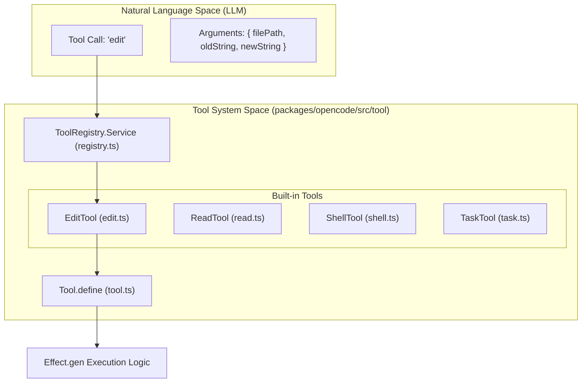
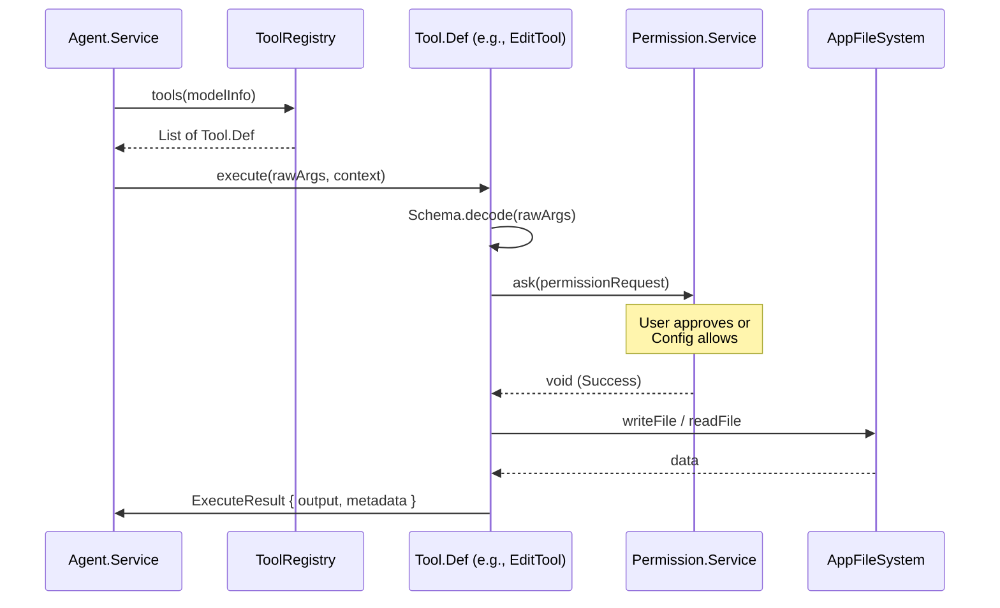

<!-- source: DeepWiki mcp.deepwiki.com · repo browser-use/browsercode · page 2.5 Tool System · fetched 2026-10-30 -->

# Tool System

Relevant source files

The following files were used as context for generating this wiki page:

- [packages/bcode-browser/README.md](packages/bcode-browser/README.md)
- [packages/bcode-browser/package.json](packages/bcode-browser/package.json)
- [packages/bcode-browser/skills/browser-execute/SKILL.md](packages/bcode-browser/skills/browser-execute/SKILL.md)
- [packages/bcode-browser/src/browser-execute.ts](packages/bcode-browser/src/browser-execute.ts)
- [packages/bcode-browser/src/fetch-use.ts](packages/bcode-browser/src/fetch-use.ts)
- [packages/bcode-browser/src/index.ts](packages/bcode-browser/src/index.ts)
- [packages/bcode-browser/src/skills.ts](packages/bcode-browser/src/skills.ts)
- [packages/bcode-browser/test/fetch-use.test.ts](packages/bcode-browser/test/fetch-use.test.ts)
- [packages/bcode-browser/test/skills.test.ts](packages/bcode-browser/test/skills.test.ts)
- [packages/bcode-browser/test/workspace-import.test.ts](packages/bcode-browser/test/workspace-import.test.ts)
- [packages/opencode/src/effect/runner.ts](packages/opencode/src/effect/runner.ts)
- [packages/opencode/src/file/index.ts](packages/opencode/src/file/index.ts)
- [packages/opencode/src/file/ripgrep.ts](packages/opencode/src/file/ripgrep.ts)
- [packages/opencode/src/plugin/index.ts](packages/opencode/src/plugin/index.ts)
- [packages/opencode/src/session/run-state.ts](packages/opencode/src/session/run-state.ts)
- [packages/opencode/src/session/system.ts](packages/opencode/src/session/system.ts)
- [packages/opencode/src/tool/apply_patch.ts](packages/opencode/src/tool/apply_patch.ts)
- [packages/opencode/src/tool/apply_patch.txt](packages/opencode/src/tool/apply_patch.txt)
- [packages/opencode/src/tool/browser-execute.ts](packages/opencode/src/tool/browser-execute.ts)
- [packages/opencode/src/tool/browser-execute.txt](packages/opencode/src/tool/browser-execute.txt)
- [packages/opencode/src/tool/edit.ts](packages/opencode/src/tool/edit.ts)
- [packages/opencode/src/tool/external-directory.ts](packages/opencode/src/tool/external-directory.ts)
- [packages/opencode/src/tool/glob.ts](packages/opencode/src/tool/glob.ts)
- [packages/opencode/src/tool/grep.ts](packages/opencode/src/tool/grep.ts)
- [packages/opencode/src/tool/lsp.ts](packages/opencode/src/tool/lsp.ts)
- [packages/opencode/src/tool/lsp.txt](packages/opencode/src/tool/lsp.txt)
- [packages/opencode/src/tool/read.ts](packages/opencode/src/tool/read.ts)
- [packages/opencode/src/tool/registry.ts](packages/opencode/src/tool/registry.ts)
- [packages/opencode/src/tool/shell.ts](packages/opencode/src/tool/shell.ts)
- [packages/opencode/src/tool/shell/prompt.ts](packages/opencode/src/tool/shell/prompt.ts)
- [packages/opencode/src/tool/skill.ts](packages/opencode/src/tool/skill.ts)
- [packages/opencode/src/tool/task.ts](packages/opencode/src/tool/task.ts)
- [packages/opencode/src/tool/task_status.ts](packages/opencode/src/tool/task_status.ts)
- [packages/opencode/src/tool/tool.ts](packages/opencode/src/tool/tool.ts)
- [packages/opencode/src/tool/webfetch.ts](packages/opencode/src/tool/webfetch.ts)
- [packages/opencode/src/tool/write.ts](packages/opencode/src/tool/write.ts)
- [packages/opencode/test/effect/runner.test.ts](packages/opencode/test/effect/runner.test.ts)
- [packages/opencode/test/file/ripgrep.test.ts](packages/opencode/test/file/ripgrep.test.ts)
- [packages/opencode/test/tool/__snapshots__/parameters.test.ts.snap](packages/opencode/test/tool/__snapshots__/parameters.test.ts.snap)
- [packages/opencode/test/tool/apply_patch.test.ts](packages/opencode/test/tool/apply_patch.test.ts)
- [packages/opencode/test/tool/edit.test.ts](packages/opencode/test/tool/edit.test.ts)
- [packages/opencode/test/tool/grep.test.ts](packages/opencode/test/tool/grep.test.ts)
- [packages/opencode/test/tool/lsp.test.ts](packages/opencode/test/tool/lsp.test.ts)
- [packages/opencode/test/tool/parameters.test.ts](packages/opencode/test/tool/parameters.test.ts)
- [packages/opencode/test/tool/question.test.ts](packages/opencode/test/tool/question.test.ts)
- [packages/opencode/test/tool/read.test.ts](packages/opencode/test/tool/read.test.ts)
- [packages/opencode/test/tool/registry.test.ts](packages/opencode/test/tool/registry.test.ts)
- [packages/opencode/test/tool/shell.test.ts](packages/opencode/test/tool/shell.test.ts)
- [packages/opencode/test/tool/skill.test.ts](packages/opencode/test/tool/skill.test.ts)
- [packages/opencode/test/tool/task.test.ts](packages/opencode/test/tool/task.test.ts)
- [packages/opencode/test/tool/webfetch.test.ts](packages/opencode/test/tool/webfetch.test.ts)
- [packages/opencode/test/tool/write.test.ts](packages/opencode/test/tool/write.test.ts)
- [packages/plugin/src/index.ts](packages/plugin/src/index.ts)

The Tool System is the interface through which the Agent interacts with the operating system, file system, and external web resources. It provides a structured framework for defining, registering, and executing capabilities that bridge the gap between Large Language Model (LLM) reasoning and concrete code actions.

## Tool Registry and Definition

The Tool System is governed by the `ToolRegistry` service, which manages both built-in tools and custom tools provided by plugins.

### Tool Definition Factory
Tools are defined using the `Tool.define` factory. This utility wraps the tool's execution logic with common concerns such as:
*   **Argument Validation**: Uses `effect/Schema` to validate LLM-provided arguments [packages/opencode/src/tool/tool.ts:101-110]().
*   **Output Truncation**: Automatically truncates large tool outputs to prevent context window overflow [packages/opencode/src/tool/tool.ts:116-125]().
*   **Observability**: Wraps execution in an OpenTelemetry span (`Tool.execute`) with attributes for `tool.name`, `session.id`, and `message.id` [packages/opencode/src/tool/tool.ts:126]().

### The Registry Service
The `ToolRegistry.Service` aggregates all available tools. It dynamically resolves which tools are available to a specific agent based on the agent's permissions and the model's capabilities [packages/opencode/src/tool/registry.ts:79-80]().

#### Natural Language to Code Entity Mapping: Tool Registration
This diagram shows how the `ToolRegistry` connects tool identifiers used in natural language prompts to the underlying TypeScript classes and execution logic.

Sources: [packages/opencode/src/tool/registry.ts:112-140](), [packages/opencode/src/tool/tool.ts:132-150]()

## Core Built-in Tools

BrowserCode provides a comprehensive suite of tools for repository manipulation and web interaction.

### File Manipulation
| Tool | File | Purpose | Key Features |
| :--- | :--- | :--- | :--- |
| `read` | `read.ts` | Reads file/directory content | Line-based reading, binary detection, PDF/Image attachment support [packages/opencode/src/tool/read.ts:106-147](). |
| `write` | `write.ts` | Overwrites or creates files | Integration with LSP for immediate diagnostic feedback [packages/opencode/src/tool/write.ts:76-90](). |
| `edit` | `edit.ts` | Performs precise string replacement | Search-and-replace with support for multiple occurrences and BOM preservation [packages/opencode/src/tool/edit.ts:129-151](). |
| `apply_patch` | `apply_patch.ts` | Applies unified diff patches | Efficiently applies standard patches to files. |

### Search and Exploration
| Tool | File | Purpose | Implementation |
| :--- | :--- | :--- | :--- |
| `grep` | `grep.ts` | Content search across files | Powered by `Ripgrep.Service` [packages/opencode/src/tool/registry.ts:137](). |
| `glob` | `glob.ts` | Filename pattern matching | Uses the `Glob` utility for file discovery. |
| `lsp` | `lsp.ts` | Language Server Protocol queries | Provides hover, definition, and reference information [packages/opencode/src/tool/lsp.ts](). |

### Execution and Orchestration
| Tool | File | Purpose | Implementation |
| :--- | :--- | :--- | :--- |
| `shell` | `shell.ts` | Executes bash/shell commands | Runs in the project's working directory. |
| `task` | `task.ts` | Spawns sub-agents | Creates a new `Session` with derived permissions for a specialized task [packages/opencode/src/tool/task.ts:144-161](). |
| `skill` | `skill.ts` | Loads specialized instructions | Injects `SKILL.md` content into the agent's system prompt context [packages/opencode/src/session/system.ts:65-78](). |

### Web Capabilities
| Tool | File | Purpose | Implementation |
| :--- | :--- | :--- | :--- |
| `webfetch` | `webfetch.ts` | Fetches URL content | Converts HTML to Markdown/Text; supports `fetch-use` cloud proxy [packages/opencode/src/tool/webfetch.ts:60-165](). |
| `websearch` | `websearch.ts` | Performs web searches | Integrated search via Exa or Opencode Search. |
| `browser_execute`| `browser-execute.ts` | Controls a real browser | Executes CDP commands via `bcode-browser` [packages/opencode/src/tool/registry.ts:139](). |

Sources: [packages/opencode/src/tool/registry.ts:121-140](), [packages/opencode/src/tool/read.ts:37-38](), [packages/opencode/src/tool/edit.ts:58-59](), [packages/opencode/src/tool/task.ts:95-96]()

## Data Flow: Tool Execution

Tool execution follows a strict lifecycle involving argument decoding, permission gating, and output processing.

Sources: [packages/opencode/src/tool/tool.ts:93-128](), [packages/opencode/src/tool/edit.ts:88-149](), [packages/opencode/src/tool/registry.ts:146-175]()

## Permission Gating

Before any tool performs a side-effecting action, it must call `ctx.ask` [packages/opencode/src/tool/tool.ts:25](). This triggers the permission system:

1.  **Request Construction**: The tool provides the permission type (e.g., `edit`, `shell`), the target patterns (e.g., file paths), and metadata for the UI [packages/opencode/src/tool/edit.ts:141-149]().
2.  **Config Evaluation**: The `Permission.Service` checks the `Config.Service` for `allow`/`deny` rules.
3.  **User Interaction**: If no rule matches, the execution pauses, and a request is sent to the UI (TUI/Web/Desktop) for manual approval.

Sources: [packages/opencode/src/tool/edit.ts:141-149](), [packages/opencode/src/tool/write.ts:54-62](), [packages/opencode/src/tool/webfetch.ts:43-52]()

## Plugin Tool Integration

Plugins can extend the Tool System by defining custom tools in their `server` hook.

1.  **Definition**: Plugins return a `tool` object where keys are tool names and values are `ToolDefinition` objects [packages/plugin/src/index.ts:239-241]().
2.  **Registration**: The `Plugin.Service` loads these hooks, and `ToolRegistry` converts them into the internal `Tool.Def` format [packages/opencode/src/tool/registry.ts:146-180]().
3.  **Context**: Plugin tools receive a `PluginToolContext`, which provides a limited version of the agent's capabilities, such as `ask`, `directory`, and `worktree` [packages/opencode/src/tool/registry.ts:163-168]().

Sources: [packages/opencode/src/plugin/index.ts:105-116](), [packages/opencode/src/tool/registry.ts:146-180](), [packages/plugin/src/index.ts:239-241]()

---

