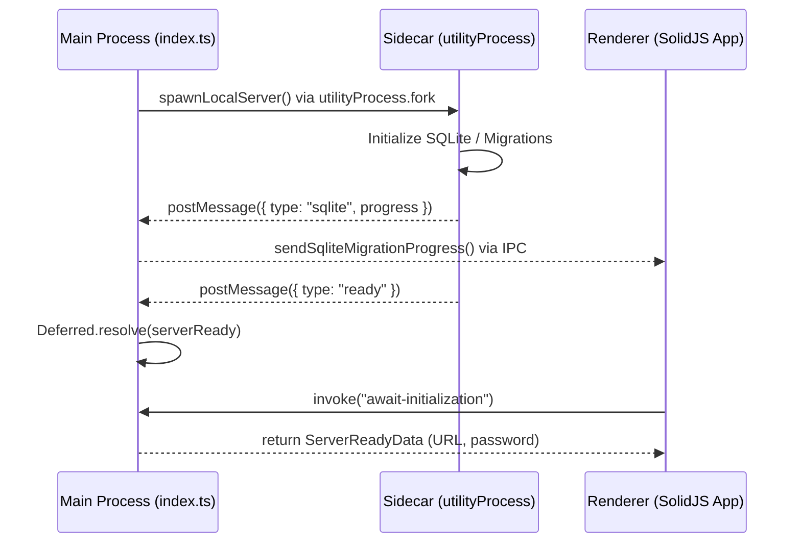
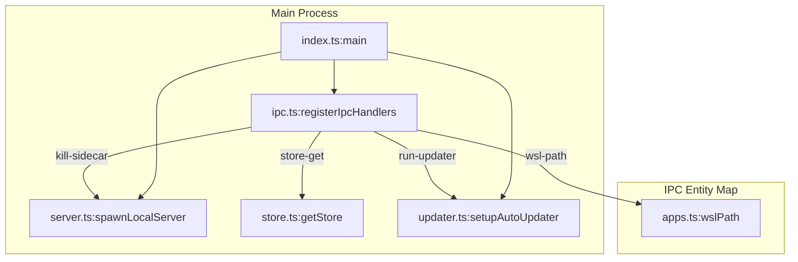

<!-- source: DeepWiki mcp.deepwiki.com · repo browser-use/browsercode · page 4.3 Desktop Application (Electron) · fetched 2026-10-30 -->

# Desktop Application (Electron)

Relevant source files

The following files were used as context for generating this wiki page:

- [packages/app/package.json](packages/app/package.json)
- [packages/desktop/electron-builder.config.ts](packages/desktop/electron-builder.config.ts)
- [packages/desktop/electron.vite.config.ts](packages/desktop/electron.vite.config.ts)
- [packages/desktop/src/main/apps.ts](packages/desktop/src/main/apps.ts)
- [packages/desktop/src/main/index.ts](packages/desktop/src/main/index.ts)
- [packages/desktop/src/main/ipc.ts](packages/desktop/src/main/ipc.ts)
- [packages/desktop/src/main/logging.ts](packages/desktop/src/main/logging.ts)
- [packages/desktop/src/main/server.ts](packages/desktop/src/main/server.ts)
- [packages/desktop/src/main/shell-env.test.ts](packages/desktop/src/main/shell-env.test.ts)
- [packages/desktop/src/main/shell-env.ts](packages/desktop/src/main/shell-env.ts)
- [packages/desktop/src/main/sidecar.ts](packages/desktop/src/main/sidecar.ts)
- [packages/desktop/src/main/store.ts](packages/desktop/src/main/store.ts)
- [packages/desktop/src/main/updater.ts](packages/desktop/src/main/updater.ts)

The Desktop Application provides a native wrapper for the OpenCode ecosystem, integrating the SolidJS-based web UI with local system capabilities. It manages a background "sidecar" server, handles native OS integrations like deep links and shell environments, and provides automated updates.

## Architecture Overview

The application follows a standard Electron multi-process architecture but introduces a third process type: the **Sidecar Utility Process**.

### Process Model
1.  **Main Process**: Orchestrates window management, IPC handlers, and sidecar lifecycle [packages/desktop/src/main/index.ts:10-40]().
2.  **Sidecar Process**: A `utilityProcess` that runs the actual OpenCode server logic (compiled from `packages/opencode`) [packages/desktop/src/main/server.ts:69-81]().
3.  **Renderer Process**: Displays the SolidJS UI (from `@opencode-ai/app`) within a `BrowserWindow` [packages/desktop/electron.vite.config.ts:81-97]().

### Sidecar Orchestration
The Main process uses `utilityProcess.fork` to spawn the sidecar [packages/desktop/src/main/server.ts:76](). This sidecar runs the OpenCode HTTP server and handles heavy lifting like SQLite migrations and agent execution.

**Sidecar Lifecycle Diagram**

Sources: [packages/desktop/src/main/server.ts:69-160](), [packages/desktop/src/main/index.ts:204-221]()

## Sidecar Server Management

The sidecar is managed via `spawnLocalServer`, which configures the execution environment and monitors health [packages/desktop/src/main/server.ts:69-202]().

*   **Communication**: Uses `child.postMessage` and `child.on('message')` for structured communication between Main and Sidecar [packages/desktop/src/main/server.ts:120-156]().
*   **Health Checks**: After the process reports "ready", the Main process performs HTTP GET requests to `/global/health` using Basic Auth to confirm the server is responsive [packages/desktop/src/main/server.ts:204-228]().
*   **Termination**: The sidecar is gracefully stopped during `before-quit` or `will-quit` events by sending a `stop` message, with a 6-second timeout before a hard `kill()` [packages/desktop/src/main/server.ts:187-201]().

Sources: [packages/desktop/src/main/server.ts:20-33](), [packages/desktop/src/main/server.ts:187-201]()

## Shell Environment and WSL Integration

To ensure tools (like `bash` or `git`) work exactly as they do in the user's terminal, the app probes the user's shell environment.

### Shell Probing
The `loadShellEnv` function attempts to spawn the user's login shell (e.g., `/bin/zsh -il`) to capture exported environment variables [packages/desktop/src/main/shell-env.ts:68-93]().
*   It supports `-il` (interactive login) and falls back to `-l` (login) [packages/desktop/src/main/shell-env.ts:75-89]().
*   It explicitly skips probing for `nushell` to avoid hangs [packages/desktop/src/main/shell-env.ts:70-73]().

### WSL Integration
On Windows, the app supports WSL (Windows Subsystem for Linux) integration:
*   **Path Translation**: Uses `wslpath` to convert paths between Windows and Linux formats [packages/desktop/src/main/apps.ts:24-41]().
*   **WSL Config**: Persistence of WSL status is handled via `getWslConfig` and `setWslConfig` using the electron-store [packages/desktop/src/main/server.ts:49-56]().

Sources: [packages/desktop/src/main/shell-env.ts:34-60](), [packages/desktop/src/main/apps.ts:24-41]()

## Deep Link Protocol (opencode:)

The application registers the `opencode://` protocol to handle external triggers (e.g., opening a specific session from a browser).

*   **Registration**: Defined in the `electron-builder.config.ts` [packages/desktop/electron-builder.config.ts:56-59]().
*   **Handling**:
    *   **macOS**: Handled via the `open-url` event [packages/desktop/src/main/index.ts:181-185]().
    *   **Windows/Linux**: Handled via `second-instance` event arguments [packages/desktop/src/main/index.ts:169-179]().
*   **Buffer**: Deep links received before the UI is ready are stored in `pendingDeepLinks` and consumed via the `consume-initial-deep-links` IPC handler [packages/desktop/src/main/index.ts:60-75]().

Sources: [packages/desktop/src/main/index.ts:169-185](), [packages/desktop/src/main/ipc.ts:50]()

## IPC Handlers and Persistence

The `registerIpcHandlers` function bridges the Renderer process to native capabilities [packages/desktop/src/main/ipc.ts:43-165]().

### Key IPC Groups
| Group | Functionality |
| :--- | :--- |
| **System** | `open-directory-picker`, `save-file-picker`, `read-clipboard-image` |
| **Lifecycle** | `await-initialization`, `kill-sidecar`, `loading-window-complete` |
| **WSL/Apps** | `wsl-path`, `resolve-app-path`, `check-app-exists` |
| **Storage** | `store-get`, `store-set`, `store-delete`, `store-clear` |

### Persistence (electron-store)
The app uses `electron-store` for persistent settings. To ensure the store is created in the correct `userData` directory (especially during dev/beta/prod channel switching), it is lazily instantiated via `getStore()` [packages/desktop/src/main/store.ts:12-23]().

Sources: [packages/desktop/src/main/ipc.ts:72-98](), [packages/desktop/src/main/store.ts:12-23]()

## Auto-Updater

The application uses `electron-updater` to manage releases across three channels: `dev`, `beta`, and `prod` [packages/desktop/src/main/updater.ts:11-25]().

1.  **Check**: `checkUpdate()` fetches metadata from GitHub releases [packages/desktop/src/main/updater.ts:27-66]().
2.  **Download**: Updates are downloaded in the background if available [packages/desktop/src/main/updater.ts:58]().
3.  **Install**: Before calling `autoUpdater.quitAndInstall()`, the app invokes `killSidecar()` to ensure the background server and database connections are closed [packages/desktop/src/main/updater.ts:68-80]().

Sources: [packages/desktop/src/main/updater.ts:11-80](), [packages/desktop/src/main/index.ts:41-50]()

## Code Entity Map

**System Entrypoint and IPC Mapping**

Sources: [packages/desktop/src/main/index.ts:110-204](), [packages/desktop/src/main/ipc.ts:43-165]()

---

