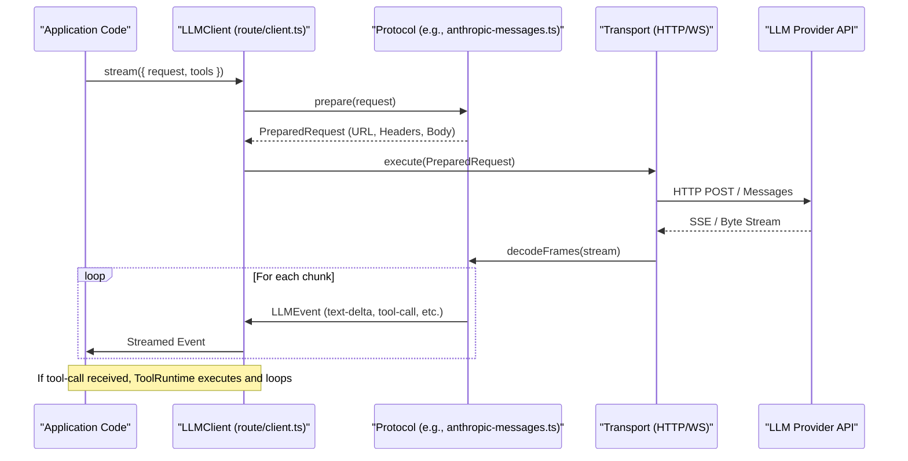
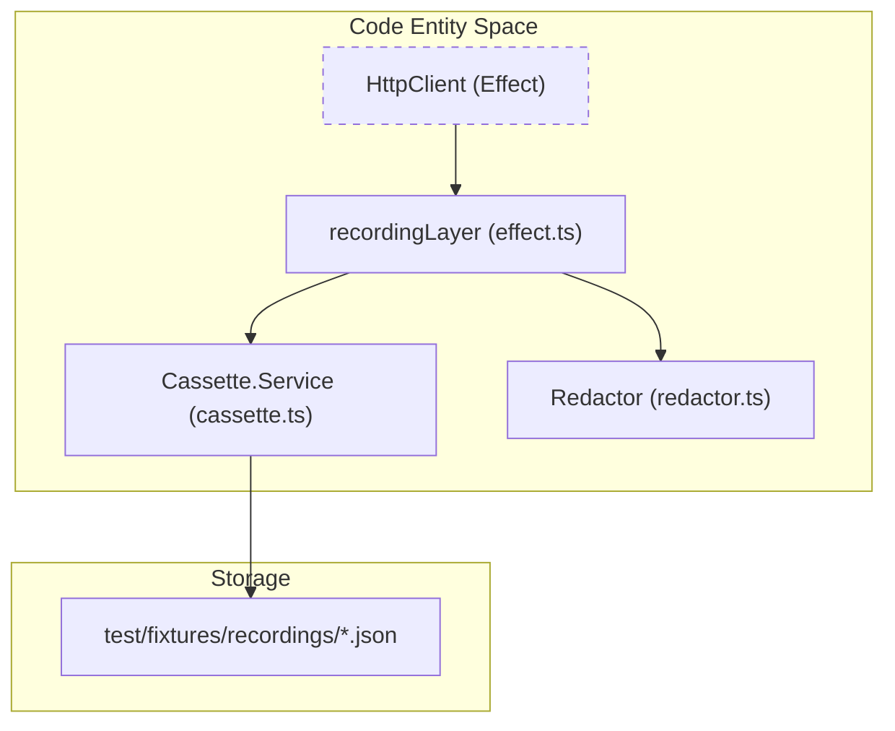

<!-- source: DeepWiki mcp.deepwiki.com · repo browser-use/browsercode · page 7.4 LLM Package (packages/llm) · fetched 2026-10-30 -->

# LLM Package (packages/llm)

Relevant source files

The following files were used as context for generating this wiki page:

- [packages/http-recorder/README.md](packages/http-recorder/README.md)
- [packages/http-recorder/src/cassette.ts](packages/http-recorder/src/cassette.ts)
- [packages/http-recorder/src/effect.ts](packages/http-recorder/src/effect.ts)
- [packages/http-recorder/src/index.ts](packages/http-recorder/src/index.ts)
- [packages/http-recorder/src/matching.ts](packages/http-recorder/src/matching.ts)
- [packages/http-recorder/src/recorder.ts](packages/http-recorder/src/recorder.ts)
- [packages/http-recorder/src/redaction.ts](packages/http-recorder/src/redaction.ts)
- [packages/http-recorder/src/schema.ts](packages/http-recorder/src/schema.ts)
- [packages/http-recorder/src/websocket.ts](packages/http-recorder/src/websocket.ts)
- [packages/http-recorder/test/record-replay.test.ts](packages/http-recorder/test/record-replay.test.ts)
- [packages/llm/example/tutorial.ts](packages/llm/example/tutorial.ts)
- [packages/llm/src/index.ts](packages/llm/src/index.ts)
- [packages/llm/src/protocols/anthropic-messages.ts](packages/llm/src/protocols/anthropic-messages.ts)
- [packages/llm/src/protocols/bedrock-converse.ts](packages/llm/src/protocols/bedrock-converse.ts)
- [packages/llm/src/protocols/gemini.ts](packages/llm/src/protocols/gemini.ts)
- [packages/llm/src/protocols/openai-chat.ts](packages/llm/src/protocols/openai-chat.ts)
- [packages/llm/src/protocols/openai-responses.ts](packages/llm/src/protocols/openai-responses.ts)
- [packages/llm/src/protocols/shared.ts](packages/llm/src/protocols/shared.ts)
- [packages/llm/src/protocols/utils/lifecycle.ts](packages/llm/src/protocols/utils/lifecycle.ts)
- [packages/llm/src/protocols/utils/tool-stream.ts](packages/llm/src/protocols/utils/tool-stream.ts)
- [packages/llm/src/schema/errors.ts](packages/llm/src/schema/errors.ts)
- [packages/llm/src/schema/events.ts](packages/llm/src/schema/events.ts)
- [packages/llm/src/tool-runtime.ts](packages/llm/src/tool-runtime.ts)
- [packages/llm/src/tool.ts](packages/llm/src/tool.ts)
- [packages/llm/test/adapter.test.ts](packages/llm/test/adapter.test.ts)
- [packages/llm/test/llm.test.ts](packages/llm/test/llm.test.ts)
- [packages/llm/test/provider/anthropic-messages.test.ts](packages/llm/test/provider/anthropic-messages.test.ts)
- [packages/llm/test/provider/bedrock-converse.test.ts](packages/llm/test/provider/bedrock-converse.test.ts)
- [packages/llm/test/provider/gemini.test.ts](packages/llm/test/provider/gemini.test.ts)
- [packages/llm/test/provider/openai-chat.test.ts](packages/llm/test/provider/openai-chat.test.ts)
- [packages/llm/test/provider/openai-compatible-chat.test.ts](packages/llm/test/provider/openai-compatible-chat.test.ts)
- [packages/llm/test/provider/openai-responses.test.ts](packages/llm/test/provider/openai-responses.test.ts)
- [packages/llm/test/recorded-scenarios.ts](packages/llm/test/recorded-scenarios.ts)
- [packages/llm/test/recorded-test.ts](packages/llm/test/recorded-test.ts)
- [packages/llm/test/recorded-websocket.ts](packages/llm/test/recorded-websocket.ts)
- [packages/llm/test/schema.test.ts](packages/llm/test/schema.test.ts)
- [packages/llm/test/tool-runtime.test.ts](packages/llm/test/tool-runtime.test.ts)

The `@opencode-ai/llm` package is a standalone, high-performance LLM abstraction layer built on the [Effect](https://effect.website) ecosystem. It provides a unified interface for interacting with diverse LLM providers while maintaining strict type safety, streaming support, and integrated tool execution.

## Overview and Purpose

The primary goal of this package is to decouple the core BrowserCode logic from the specific wire formats of various AI providers. It handles the "lowering" of high-level requests into provider-specific payloads and the "lifting" of raw streaming responses back into a common event stream.

Key capabilities include:
- **Protocol Implementations**: Native support for OpenAI (Chat and Responses), Anthropic Messages, AWS Bedrock Converse, and Google Gemini.
- **Unified Event Stream**: A shared `LLMEvent` schema for text, reasoning, tool calls, and usage tracking.
- **Tool Runtime**: Automatic dispatch and execution of tools defined via Zod or Effect schemas.
- **HTTP Recorder**: A specialized testing utility (`@opencode-ai/http-recorder`) for capturing and replaying LLM interactions as deterministic cassettes.

---

## Data Flow: Request to Response

The package follows a functional transformation pipeline. A request starts as a generic `LLMRequest` and is processed through a selected `Protocol` implementation.

### Interaction Lifecycle Diagram

Title: LLM Request/Response Lifecycle

**Sources:** [packages/llm/src/route/client.ts:1-10](), [packages/llm/src/protocols/anthropic-messages.ts:27-41]()

---

## Protocol Implementations

Each provider is implemented as a `Protocol` that defines how to map the common `LLMRequest` to the provider's specific API.

### Supported Protocols

| Provider | Implementation File | Key Features |
| :--- | :--- | :--- |
| **OpenAI Chat** | `openai-chat.ts` | Standard Chat Completions, O1/O3 reasoning support. |
| **OpenAI Responses** | `openai-responses.ts` | Realtime API support via HTTP and WebSockets. |
| **Anthropic** | `anthropic-messages.ts` | Native "thinking" blocks and prompt caching hints. |
| **Bedrock** | `bedrock-converse.ts` | SigV4 signing via `BedrockAuth` and binary event-stream decoding. |
| **Gemini** | `gemini.ts` | Content-part mapping and safety setting configuration. |

### Bedrock Converse Implementation
The Bedrock implementation is unique as it often handles binary event streams (`vnd.amazon.eventstream`). It uses `BedrockEventStream` to decode AWS-specific frames into JSON payloads before mapping them to `LLMEvent` [packages/llm/src/protocols/bedrock-converse.ts:168-205]().

**Sources:** [packages/llm/src/protocols/bedrock-converse.ts:23-42](), [packages/llm/src/protocols/openai-responses.ts:23-26]()

---

## Tool Runtime and Execution

The `ToolRuntime` bridges the gap between an LLM's request to use a tool and the actual TypeScript implementation of that tool.

### Tool Definition
Tools are defined using the `tool` factory, which requires a description, a parameter schema (Schema/Zod), and an execution function [packages/llm/src/tool.ts:30-40]().

### The Tool Loop
When `LLMClient.stream` is called with a `tools` record, it automatically monitors the event stream for `tool-call` events.
1. **Detection**: `LLMClient` identifies a `tool-call` in the stream [packages/llm/test/tool-runtime.test.ts:118-130]().
2. **Execution**: The `ToolRuntime` dispatches the call to the provided implementation [packages/llm/src/tool-runtime.ts:1-10]().
3. **Feedback**: The results are appended to the message history as `tool-result` parts, and a new request is automatically sent to the LLM to continue the turn [packages/llm/test/tool-runtime.test.ts:66-88]().

**Sources:** [packages/llm/src/tool.ts:30-40](), [packages/llm/test/tool-runtime.test.ts:82-115]()

---

## HTTP Recorder and Test Cassettes

The `@opencode-ai/http-recorder` package provides deterministic testing for LLM interactions. It records real HTTP/WebSocket traffic into JSON "cassettes" that can be checked into version control.

### Cassette Architecture

Title: HTTP Recorder Logic (packages/http-recorder)

### Key Components
- **`recordingLayer`**: An Effect Layer that intercepts `HttpClient` requests. It decides whether to `record`, `replay`, or `passthrough` based on the environment (e.g., `CI=true` forces replay) [packages/http-recorder/src/effect.ts:60-80]().
- **`Redactor`**: Automatically scrubs sensitive information. It replaces values in headers (Authorization, API Keys) and URL query parameters with `[REDACTED]` [packages/http-recorder/src/redaction.ts:3-28]().
- **`SecretFinding`**: Before writing a cassette to disk, the recorder scans the payload for patterns matching common secrets (e.g., `sk-ant-...`, `AIza...`). If a secret is found, it throws an `UnsafeCassetteError` and refuses to save [packages/http-recorder/src/cassette.ts:17-26](), [packages/http-recorder/src/redaction.ts:30-38]().

### Request Matching
Replay uses a sequential cursor. The Nth request in a test must match the Nth interaction in the cassette. Matching is performed on canonicalized URLs, headers, and sorted JSON bodies [packages/http-recorder/README.md:71-80]().

**Sources:** [packages/http-recorder/src/cassette.ts:61-132](), [packages/http-recorder/src/effect.ts:86-135](), [packages/http-recorder/src/redaction.ts:106-115]()

---

## Implementation Details: Response Parsing

Streaming responses are parsed incrementally to minimize latency.

### Stream State Management
Protocols use a `ParserState` to track partial text deltas and tool call arguments across multiple chunks.
- **Text**: Deltas are concatenated and emitted as `text-delta` events [packages/llm/src/protocols/openai-responses.ts:166-170]().
- **Reasoning**: Specific blocks (like Anthropic's `thinking` or OpenAI's `reasoning_content`) are captured separately to preserve the model's internal chain of thought [packages/llm/test/provider/anthropic-messages.test.ts:93-110]().
- **Usage**: Token counts are usually emitted in a final chunk (e.g., `message_stop` in Anthropic or `metadata` in Bedrock) and mapped to a unified `Usage` object [packages/llm/src/protocols/bedrock-converse.ts:198-205]().

**Sources:** [packages/llm/src/protocols/openai-responses.ts:148-164](), [packages/llm/src/protocols/bedrock-converse.ts:155-162](), [packages/llm/test/provider/anthropic-messages.test.ts:114-130]()

---

