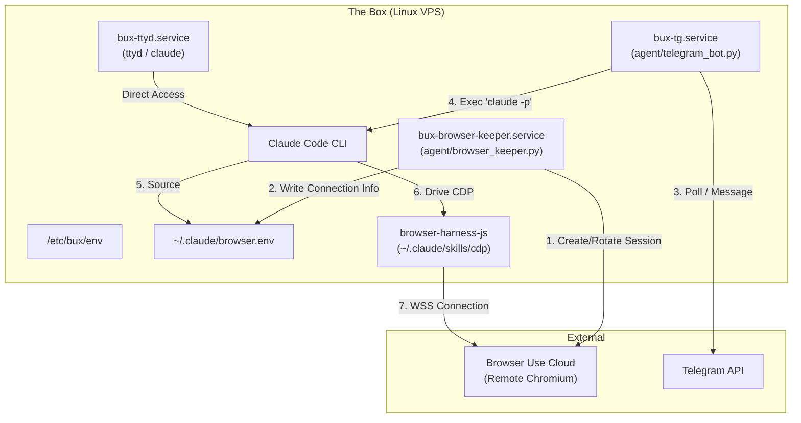
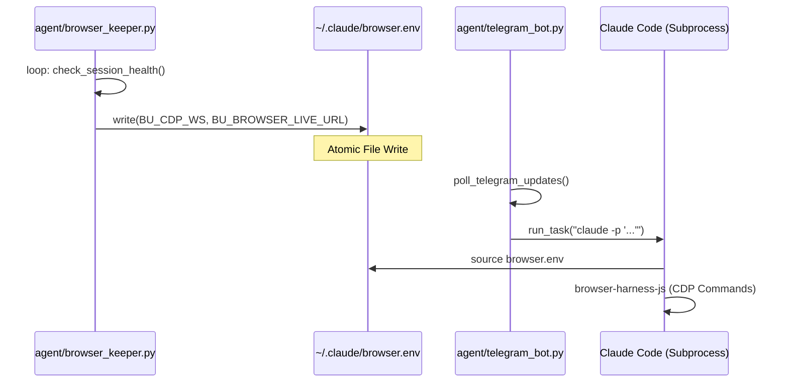

<!-- source: DeepWiki mcp.deepwiki.com · repo browser-use/bux · page 3 Core Architecture · fetched 2026-10-30 -->

# Core Architecture

Relevant source files

The following files were used as context for generating this wiki page:

- [README.md](README.md)
- [agent/CLAUDE.md](agent/CLAUDE.md)

The **bux** system is designed as a persistent, always-on agent environment that bridges the gap between natural language interfaces (Telegram) and programmatic browser automation. It follows a "local-agent, remote-browser" model where the logic and state reside on a box you control, while the heavy lifting of rendering and maintaining a Chromium profile is offloaded to **Browser Use Cloud**.

The architecture consists of three primary systemd services that coordinate data flow and session management.

### The Three-Service Runtime

Bux operates by orchestrating three distinct services that run under the `bux` user context or as root with privilege separation.

| Service | Code Entity | Role |
| :--- | :--- | :--- |
| **Browser Keeper** | `bux-browser-keeper.service` | Manages the lifecycle of the remote Chromium session. |
| **Telegram Bot** | `bux-tg.service` | Provides the primary human-in-the-loop interface. |
| **Web Terminal** | `bux-ttyd.service` | Exposes a local web-based terminal for direct interaction. |

#### System Component Map
This diagram illustrates how high-level system components map to specific code entities and how they interact with the external Browser Use Cloud.

Sources: [README.md:42-50](), [agent/CLAUDE.md:1-17](), [agent/CLAUDE.md:19-36]()

---

### Data Flow and Lifecycle

The core of the system's reliability is the decoupling of the **Agent Session** (Claude Code) from the **Browser Session** (Chromium).

1.  **Session Maintenance**: The `browser_keeper.py` script runs a continuous loop. It reads the `BUX_PROFILE_ID` from `/etc/bux/env`, ensures a remote browser is active in Browser Use Cloud, and writes the connection strings (WSS URL, Live View URL) to `~/.claude/browser.env`.
2.  **Task Execution**: When a message arrives via `telegram_bot.py`, it invokes `claude` using a subprocess call. The agent is instructed via `agent/CLAUDE.md` to always `source ~/.claude/browser.env` before attempting browser actions.
3.  **Automation**: Claude drives the browser by executing `browser-harness-js`. This tool consumes the environment variables to establish a CDP (Chrome DevTools Protocol) connection to the remote instance.

#### Service Interaction Diagram
This diagram shows the relationship between the Python service logic and the configuration files that synchronize them.

Sources: [agent/CLAUDE.md:7-17](), [agent/CLAUDE.md:46-51]()

---

### Major Subsystems

#### [Browser Keeper Service](#3.1)
The `bux-browser-keeper` service is the "heartbeat" of the box. It handles the rotation of Browser Use Cloud sessions, ensuring that Claude always has a valid `BU_CDP_WS` endpoint. It manages the `browser.env` file, which acts as the single source of truth for browser connectivity.
*   **Key Files**: `agent/browser_keeper.py`
*   **Key Concepts**: Session rotation, health checks, atomic environment updates.

#### [Telegram Bot Service](#3.2)
The `bux-tg` service provides the interface for the user. It manages a long-running polling loop and handles the security of "First-Message-Wins" owner binding. When a task is received, it handles the complexity of running the Claude CLI as the `bux` user while managing locks to prevent concurrent task interference.
*   **Key Files**: `agent/telegram_bot.py`
*   **Key Concepts**: Privilege separation (`sudo -u bux`), message chunking, session persistence via `--resume`.

#### [Web Terminal Service (ttyd)](#3.3)
The `bux-ttyd` service provides a fallback web-based terminal. It is restricted to `localhost:7681` by default for security, intended to be accessed via SSH tunnel. It allows users to interact with the same `bux` user environment that the Telegram bot uses, useful for initial OAuth logins (`claude /login`) or debugging.
*   **Key Files**: `bux-ttyd.service` (systemd unit)
*   **Key Concepts**: Loopback restriction, terminal sharing, OAuth handoff.

---
**Next Steps:**
- To understand how the browser session is maintained, see **[Browser Keeper Service](#3.1)**.
- To learn about the Telegram interface and task execution, see **[Telegram Bot Service](#3.2)**.
- For details on the web-based terminal, see **[Web Terminal Service (ttyd)](#3.3)**.

---

