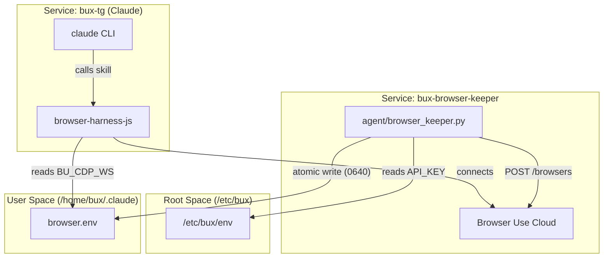
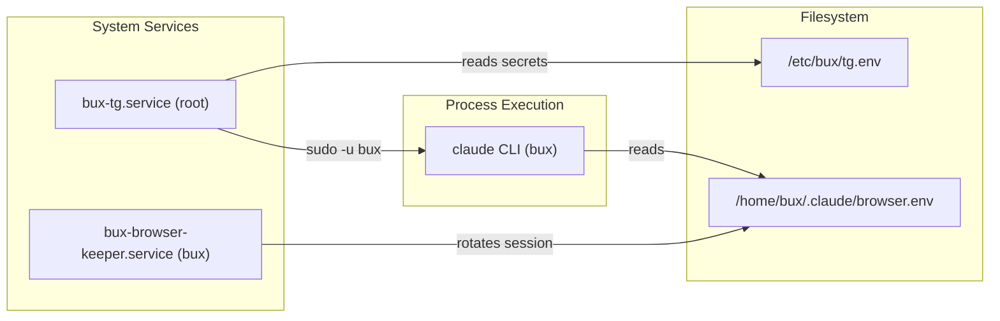

<!-- source: DeepWiki mcp.deepwiki.com · repo browser-use/bux · page 5.2 Filesystem Layout · fetched 2026-10-30 -->

# Filesystem Layout

Relevant source files

The following files were used as context for generating this wiki page:

- [agent/browser_keeper.py](agent/browser_keeper.py)
- [agent/telegram_bot.py](agent/telegram_bot.py)
- [install.sh](install.sh)

This page documents the filesystem structure of a deployed `bux` box. The layout is designed to support a multi-service architecture where the `bux-tg` service (running as `root`) orchestrates the `claude` CLI (running as the `bux` user), while maintaining strict privilege separation for sensitive credentials.

## Directory Overview

The system uses standard Linux paths to separate configuration, application code, and user data.

| Path | Owner:Group | Permissions | Purpose |
| :--- | :--- | :--- | :--- |
| `/etc/bux/` | `root:bux` | `2775` | System-wide configuration and state. |
| `/opt/bux/` | `bux:bux` | `0755` | Application source code and Python virtual environment. |
| `/home/bux/` | `bux:bux` | `0700` | User home for the agent, containing session data and skills. |
| `/var/log/bux/` | `bux:bux` | `0755` | Service logs for `bux-browser-keeper` and `bux-tg`. |

### System-wide Configuration (`/etc/bux/`)

This directory contains the primary identity and secrets for the box.

*   **`/etc/bux/env`**: Stores global environment variables like `BROWSER_USE_API_KEY` and `BUX_PROFILE_ID` [install.sh:220-225](). It is readable by the `bux` group so the `browser_keeper.py` script can access the API key [install.sh:226-227]().
*   **`/etc/bux/tg.env`**: Stores the `TG_BOT_TOKEN`. It is strictly `0600` and owned by `root` to prevent the `bux` user (the agent) from reading or leaking the Telegram bot token [agent/telegram_bot.py:12-13](), [install.sh:255-257]().
*   **`/etc/bux/tg-allowed.txt`**: A newline-separated list of Telegram `chat_id`s authorized to use the bot [agent/telegram_bot.py:13]().
*   **`/etc/bux/tg-state.json`**: Persists the Telegram `offset` to ensure messages are not processed twice across service restarts [agent/telegram_bot.py:14]().

**Sources:** [agent/telegram_bot.py:8-15](), [install.sh:148-151](), [install.sh:220-227]()

---

## The Agent Home Directory (`/home/bux/`)

The `bux` user's home directory is the primary workspace for Claude Code.

### Browser Environment (`/home/bux/.claude/browser.env`)
The `bux-browser-keeper` service writes this file every time it rotates a Chromium session [agent/browser_keeper.py:5-10](). It contains the active CDP (Chrome DevTools Protocol) websocket URL.

*   **Security**: Written with mode `0640` (owner `bux`, group `bux`) using `O_EXCL` and `O_CLOEXEC` to prevent race conditions and unauthorized reading [agent/browser_keeper.py:119-123]().
*   **Atomic Updates**: The keeper writes to a `.tmp` file and performs an atomic rename to ensure the agent never reads a partial file [agent/browser_keeper.py:128]().

### Persistent State
*   **`/home/bux/.bux/claude.lock`**: A `flock` file used by `telegram_bot.py` to ensure only one Claude process runs at a time [agent/telegram_bot.py:21]().
*   **`/home/bux/.bux/session`**: Stores the UUID of the active Claude session, allowing the bot to use the `--resume` flag for conversation continuity [agent/telegram_bot.py:224-229]().
*   **`/home/bux/notebook.md`**: A scratchpad file used by the agent to store long-term notes across tasks [agent/CLAUDE.md:28]().
*   **`/home/bux/CLAUDE.md`**: The system instructions that guide the agent on how to use the filesystem and browser [agent/CLAUDE.md:1-5]().

**Sources:** [agent/browser_keeper.py:102-128](), [agent/telegram_bot.py:224-229](), [agent/CLAUDE.md:1-30]()

---

## Data Flow: Browser Credentials

The following diagram illustrates how the `browser_keeper.py` service populates the filesystem to enable the agent to control the remote browser.

### Filesystem Bridge: Keeper to Agent

**Sources:** [agent/browser_keeper.py:30-35](), [agent/browser_keeper.py:102-128](), [agent/telegram_bot.py:43-47]()

---

## Systemd Unit Locations

The services are managed via systemd units located in `/etc/systemd/system/`.

| Service Unit | Script / Command | Description |
| :--- | :--- | :--- |
| `bux-browser-keeper.service` | `/opt/bux/venv/bin/python agent/browser_keeper.py` | Maintains the active browser session. |
| `bux-tg.service` | `/opt/bux/venv/bin/python agent/telegram_bot.py` | Runs the Telegram bot as root. |
| `bux-ttyd.service` | `ttyd -i lo ... claude` | Provides a web-based terminal for local debugging. |

### Service Dependency and Interaction
The `bux-tg` service runs as `root` to manage its own state files in `/etc/bux/`, but it executes the `claude` command as the `bux` user using `sudo -u bux`.

**Sources:** [agent/telegram_bot.py:231-235](), [agent/telegram_bot.py:246-250](), [install.sh:315-340]()

## Skill and Harness Layout

Claude Code uses "skills" located in the home directory to extend its functionality.

*   **`~/.claude/skills/cdp/`**: Contains the `browser-harness-js` tool.
*   **`~/.claude/skills/cdp/domain-skills/`**: A directory where the agent can persist specific automation scripts (e.g., `github.js`, `google-search.js`) to reuse across different sessions [agent/CLAUDE.md:20-23]().

**Sources:** [agent/CLAUDE.md:18-25](), [install.sh:148-149]()

---

