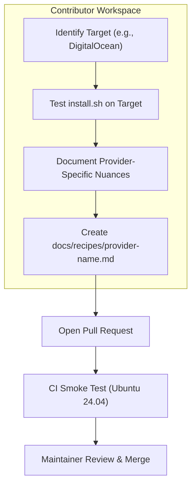
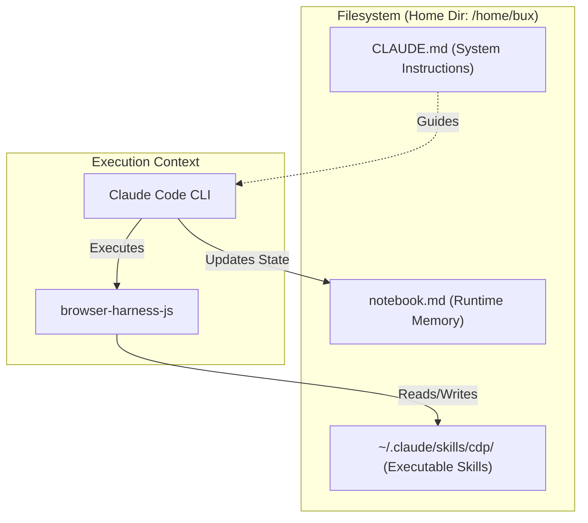

<!-- source: DeepWiki mcp.deepwiki.com · repo browser-use/bux · page 7.2 Contributing and Extending bux · fetched 2026-10-30 -->

# Contributing and Extending bux

Relevant source files

The following files were used as context for generating this wiki page:

- [.gitignore](.gitignore)
- [LICENSE](LICENSE)
- [docs/recipes/README.md](docs/recipes/README.md)

This page provides a technical guide for developers looking to extend the capabilities of **bux** or contribute to the project. It covers the mechanics of adding deployment recipes, modifying the agent's core instructions, teaching the agent new domain-specific skills via the browser-harness, and the legal framework for contributions.

## Extending Deployment Recipes

The `docs/recipes/` directory serves as a repository of target-specific guides designed to take a user from a "blank box" to a functional `bux` environment in under five minutes [docs/recipes/README.md:1-5]().

### Adding a New Recipe
A recipe is a self-contained Markdown file that documents the specific steps required for a particular provider or hardware configuration (e.g., Hetzner, OCI, Raspberry Pi, or WSL) [docs/recipes/README.md:7-10]().

When contributing a recipe, follow this implementation pattern:
1.  **Prerequisites**: List required provider-specific settings (e.g., Security Group rules for SSH).
2.  **Environment Setup**: Commands to provision the OS (Ubuntu 24.04 is the reference standard).
3.  **Installation**: Usage of the `install.sh` script with relevant environment variables.
4.  **Verification**: Steps to confirm the `bux` user can execute `claude`.

**Recipe Contribution Data Flow**

Sources: [docs/recipes/README.md:1-11]()

## Customizing Agent Behavior (CLAUDE.md)

The behavior, "personality," and operational protocols of the agent are governed by the `agent/CLAUDE.md` file. This file is deployed to `/home/bux/CLAUDE.md` and serves as the persistent system prompt for Claude Code.

### Modifying the Instruction Set
Developers can extend `CLAUDE.md` to change how the agent handles specific scenarios:
*   **Browser Interaction**: Refining the handoff protocol when the agent encounters a login wall.
*   **State Management**: Adjusting how the agent uses `notebook.md` for scratchpad persistence.
*   **Tool Usage**: Adding conventions for how the agent should invoke the `browser-harness-js` CLI.

### Teaching New Domain Skills
`bux` supports "Domain Skills"—specialized scripts or instructions located in `~/.claude/skills/cdp/domain-skills/`. To teach the agent a new skill:
1.  **Scripting**: Create a JavaScript/TypeScript utility using the `browser-harness-js` API.
2.  **Registration**: Place the script in the domain-skills directory.
3.  **Documentation**: Update `agent/CLAUDE.md` (or a specific `SKILL.md`) to inform the agent of the new tool's availability and syntax.

**Agent Extension Architecture**

Sources: [docs/recipes/README.md:1-5]()

## Development Workflow and CI

Contributions to the core agent logic (located in `agent/`) or the installation logic must pass the automated CI pipeline.

### Local Development Precautions
The project uses a `.gitignore` to prevent the accidental leakage of sensitive credentials. Developers must ensure that `.env` files, which contain `BROWSER_USE_API_KEY` or `TG_BOT_TOKEN`, are never committed [.gitignore:4-4]().

### Continuous Integration
The CI pipeline (typically `.github/workflows/ci.yml`) performs the following checks:
1.  **Linting**: `shellcheck` for `install.sh` and `ruff` for Python files in `agent/`.
2.  **Smoke Tests**: Validates the creation of the `bux` user and the registration of systemd units.
3.  **Idempotency**: Ensures that running `install.sh` multiple times does not corrupt the system configuration.

Sources: [.gitignore:1-6]()

## Licensing and Legal

All contributions to the `bux` repository are accepted under the terms of the **MIT License** [LICENSE:1-1]().

### Key Terms for Contributors
*   **Permission**: You grant users the right to use, copy, modify, and merge the software without restriction [LICENSE:5-10]().
*   **Attribution**: The original copyright notice and permission notice must be included in all copies or substantial portions of the software [LICENSE:12-13]().
*   **No Warranty**: The software is provided "as is," and authors are not liable for any claims or damages arising from the use of the software [LICENSE:15-21]().

| Aspect | Policy |
| :--- | :--- |
| **License Type** | MIT |
| **Copyright Holder** | Browser Use (2026) |
| **Contribution Model** | Fork and Pull Request |
| **Code Quality** | Must pass Ruff/Shellcheck CI |

Sources: [LICENSE:1-22]()

---

