# Page: Overview

# Overview

<details>
<summary>Relevant source files</summary>

The following files were used as context for generating this wiki page:

- [README.md](README.md)
- [docs/hero.jpg](docs/hero.jpg)

</details>


`bux` is a system designed to provide a 24/7 persistent Linux environment for **Claude Code**, integrated with a cloud-hosted Chromium session. It allows users to run a powerful AI agent on any Ubuntu-based hardware (VPS, Raspberry Pi, or local machine) and interact with it via Telegram or a web terminal.

The project bridges the gap between local CLI agents and remote browser automation by maintaining a persistent "Box" where cookies, session state, and agent "skills" remain active across reboots and agent restarts.

## Core Value Proposition

`bux` solves the problem of transient agent environments and brittle browser automation by providing:
*   **Persistent Identity:** A dedicated `bux` user context where Claude Code maintains its history and OAuth sessions [README.md:29-30](), [README.md:52-53]().
*   **Remote Browser Sync:** Integration with **Browser Use Cloud** to provide a real Chromium session that bypasses local resource constraints and provides "Human-in-the-loop" handoffs for CAPTCHAs or 2FA [README.md:33-38]().
*   **Ubiquitous Access:** A Telegram bot interface that allows commanding the agent from a mobile device [README.md:31-32]().

For a deeper dive into the philosophy and deployment model, see [What is bux?](#1.1).

## System Architecture

The `bux` runtime consists of three primary systemd services that coordinate to maintain the agent's environment.

### Service Orchestration

| Service | Entity Name | Responsibility |
| :--- | :--- | :--- |
| **Browser Keeper** | `bux-browser-keeper` | Manages the lifecycle of the remote browser session and writes connection strings to `browser.env` [agent/browser_keeper.py:1-10](). |
| **Telegram Bot** | `bux-tg` | Acts as the primary interface, executing `claude` commands as the `bux` user [agent/telegram_bot.py:1-15](). |
| **Web Terminal** | `bux-ttyd` | Provides a browser-based terminal access to the `bux` user's shell [README.md:32](). |

### Logical Data Flow
The following diagram illustrates how natural language commands from a user are translated into code execution and browser automation.

**Diagram: User Intent to Browser Action**
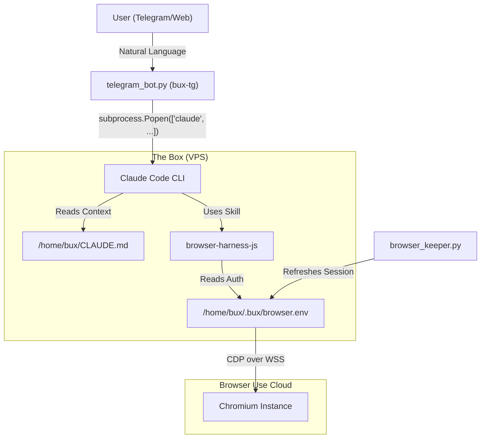
Sources: [README.md:44-50](), [agent/browser_keeper.py:1-20](), [agent/telegram_bot.py:100-120]()

## Key Components

### The `bux` User and Environment
The installer creates a dedicated `bux` user to isolate the agent's files and processes. The agent's behavior is governed by a `CLAUDE.md` file located in the home directory, which instructs it on how to use the `browser-harness-js` tool to interact with the web [README.md:49-53]().

### Browser Harness
`browser-harness-js` is the bridge between Claude Code and the Chrome DevTools Protocol (CDP). It allows the agent to navigate pages, click elements, and extract data using a cloud-hosted browser session provided by Browser Use Cloud [README.md:30]().

For definitions of specific terms like "Profile Binding" or "CDP", see [Key Concepts and Terminology](#1.2).

## Getting Started

To deploy `bux`, a single installation script handles the environment setup, service registration, and dependency management.

```bash
# Example installation command
curl -fsSL https://raw.githubusercontent.com/browser-use/bux/main/install.sh \
    | sudo BROWSER_USE_API_KEY=bu_xxx bash
```
Sources: [README.md:10-13]()

For detailed setup instructions, including VPS requirements and Telegram bot configuration, see [Installation and Deployment](section-2).

## Security and Isolation
`bux` implements a privilege separation model where the Telegram bot runs as `root` to manage system services but executes the AI agent as the unprivileged `bux` user. Sensitive credentials like the `BROWSER_USE_API_KEY` are stored in restricted files within `/etc/bux/` [README.md:52-53]().

Detailed security documentation can be found in the [Security Model](section-6) child pages.

---

# Page: What is bux?

# What is bux?

<details>
<summary>Relevant source files</summary>

The following files were used as context for generating this wiki page:

- [README.md](README.md)
- [agent/CLAUDE.md](agent/CLAUDE.md)

</details>


**bux** (Browser Use Box) is a persistent, 24/7 Linux-based agent environment designed to run [Claude Code](https://github.com/anthropics/claude-code) with integrated web automation capabilities [README.md:1-8](). It transforms any standard Ubuntu VPS into a dedicated AI agent that can be controlled via Telegram or a web terminal [README.md:27-33]().

The core value proposition of bux is providing a stable, long-lived context where an AI agent can perform complex, multi-step web tasks—such as checking email, managing calendars, or interacting with SaaS tools—while maintaining persistent logins and session state [README.md:15-30]().

## Core Concept: Local-Agent, Remote-Browser

Unlike traditional automation setups that attempt to run heavy browser engines (like Chromium or Playwright) locally, bux adopts a split-execution model [agent/CLAUDE.md:3-5]():

1.  **Local Agent**: The Claude Code CLI runs on your Linux box (the "bux"). It handles the logic, file system operations, and task planning [README.md:44-50]().
2.  **Remote Browser**: The actual Chromium instance runs in **Browser Use Cloud**. The local agent controls this remote browser via the Chrome DevTools Protocol (CDP) over a secure WebSocket (`wss://`) [agent/CLAUDE.md:12-25]().

This architecture ensures that the agent box remains lightweight (requiring as little as 2GB RAM) while benefiting from high-performance, proxy-backed, and CAPTCHA-solving browser infrastructure [README.md:37-38]().

## The Three-Service Architecture

A bux installation consists of three primary systemd services that coordinate to provide the agent experience [README.md:52-53]():

| Service | Code Entity | Role |
| :--- | :--- | :--- |
| **Browser Keeper** | `bux-browser-keeper` | Manages the lifecycle of the remote cloud session, rotating connections before they expire and writing connection strings to the environment [agent/CLAUDE.md:17-18](). |
| **Telegram Bot** | `bux-tg` | Provides the primary interface. It receives messages, executes `claude` commands as the `bux` user, and returns the output to the user [README.md:45-46](). |
| **Web Terminal** | `bux-ttyd` | Runs `ttyd` to expose a web-based terminal on `localhost:7681`, allowing for direct interaction with the agent's shell when needed [README.md:32-33](). |

### System Data Flow
The following diagram illustrates how these services interact and how they map to the codebase:

**System Service Interaction Map**
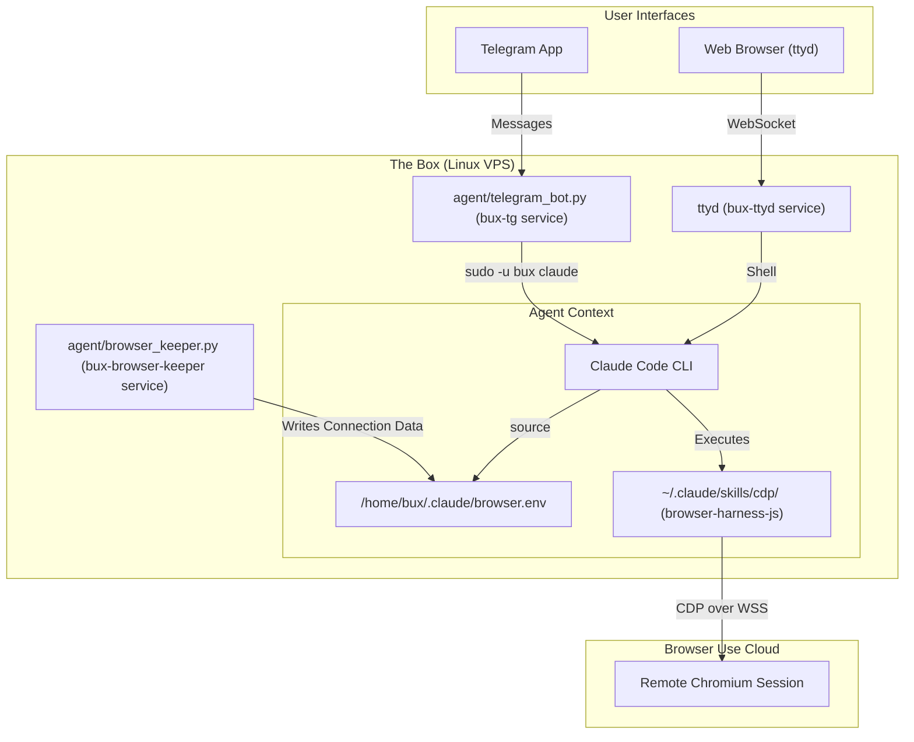
**Sources:** [README.md:44-52](), [agent/CLAUDE.md:7-25](), [agent/CLAUDE.md:36-36]()

## Human-in-the-Loop Philosophy

A defining feature of bux is its "Handoff-First" design. Rather than failing or attempting to brute-force security challenges, the agent is instructed to pause and ask for help [agent/CLAUDE.md:42-44]().

*   **Live View URL**: When the agent encounters a login wall, 2FA, or CAPTCHA, it retrieves a `BU_BROWSER_LIVE_URL` from its environment [agent/CLAUDE.md:46-51]().
*   **Handoff Protocol**: The agent shares this URL with the user via Telegram. The user opens the URL, sees the *actual* browser session in their own browser, completes the interaction (e.g., typing an SMS code), and tells the agent "done" [agent/CLAUDE.md:55-62]().
*   **Persistence**: Because the session is bound to a persistent **Profile ID**, once the user logs in once, the cookies and localStorage are saved in the cloud and reused for future tasks [agent/CLAUDE.md:38-41]().

## Technical Implementation Details

### Browser Connection (browser-harness-js)
The agent interacts with the browser using a Bun-based CLI tool called `browser-harness-js`, located at `~/.claude/skills/cdp/` [agent/CLAUDE.md:21-25](). This tool wraps 652 typed CDP methods, allowing the agent to perform actions like:
*   `session.Page.navigate({url: '...'})` [agent/CLAUDE.md:26-26]()
*   `session.Runtime.evaluate({expression: '...'})` [agent/CLAUDE.md:27-27]()

### State and Context
Persistence is maintained across three layers:
1.  **File System**: All agent work, task artifacts, and the `notebook.md` (a cross-task scratchpad) live in `/home/bux/` [agent/CLAUDE.md:105-106]().
2.  **Environment**: The `bux-browser-keeper` maintains a `browser.env` file that ensures the agent always has the latest WebSocket credentials [agent/CLAUDE.md:17-18]().
3.  **Browser Profile**: Cookies and session data are stored in the Browser Use Cloud profile, linked via the `BUX_PROFILE_ID` [agent/CLAUDE.md:85-89]().

**Entity Relationship Diagram**
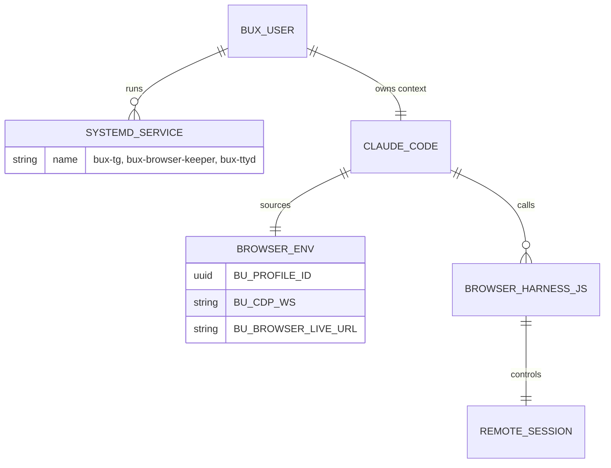
**Sources:** [agent/CLAUDE.md:7-15](), [agent/CLAUDE.md:21-36](), [README.md:52-53]()

---

# Page: Key Concepts and Terminology

# Key Concepts and Terminology

<details>
<summary>Relevant source files</summary>

The following files were used as context for generating this wiki page:

- [README.md](README.md)
- [SKILL.md](SKILL.md)
- [agent/CLAUDE.md](agent/CLAUDE.md)
- [agent/browser_keeper.py](agent/browser_keeper.py)

</details>


This page defines the core vocabulary and technical abstractions used throughout the **bux** codebase. Understanding these concepts is essential for navigating the interaction between the local agent, the remote browser infrastructure, and the communication interfaces.

## The Box
The "Box" refers to the persistent Linux environment (typically an Ubuntu VPS) where the `bux` stack is installed [README.md:6-13](). It acts as the execution context for the agent. Unlike traditional automation setups, the Box does not host a local browser; instead, it maintains a long-lived connection to a remote session [agent/CLAUDE.md:1-3]().

**Key Attributes:**
*   **Persistence:** State, cookies, and skills are stored in `/home/bux` [README.md:49-52]().
*   **Identity:** Each box is bound to a specific `BUX_PROFILE_ID` [agent/browser_keeper.py:32]().
*   **User Context:** Most agent operations run as the `bux` user to isolate them from system-level root processes [agent/browser_keeper.py:129-134]().

## Browser Use Cloud
Browser Use Cloud is the infrastructure provider that hosts the actual Chromium instances [README.md:38](). The `bux` system communicates with its API (typically at `https://api.browser-use.com/api/v3`) to provision browsers and manage profiles [agent/browser_keeper.py:30]().

## browser-harness
The `browser-harness` (specifically `browser-harness-js`) is a Bun-based CLI tool that provides the agent with direct access to the Chrome DevTools Protocol (CDP) [agent/CLAUDE.md:21-36](). It allows the agent to execute complex browser actions using typed methods rather than high-level wrappers like Playwright [agent/CLAUDE.md:110-113]().

### Natural Language to Code Entity Mapping: Browser Interaction
The following diagram illustrates how an agent's intent (Natural Language) is translated into system calls and network traffic.

Title: Browser Interaction Data Flow
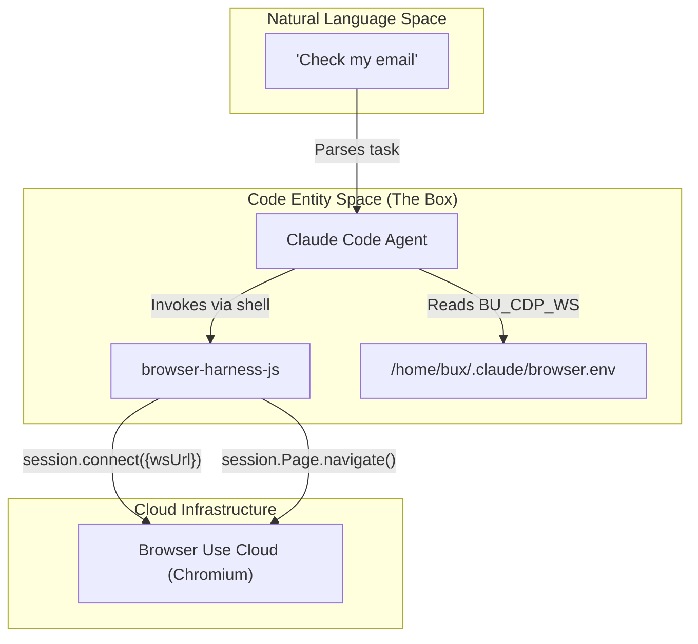
Sources: [agent/CLAUDE.md:21-36](), [agent/browser_keeper.py:5-15](), [README.md:44-50]()

## CDP (Chrome DevTools Protocol)
The system bypasses traditional automation drivers in favor of raw **CDP** [agent/CLAUDE.md:21-22](). This provides the agent with 652 typed methods, enabling fine-grained control over the browser's internal state, network, and runtime [agent/CLAUDE.md:36]().

## Profile Binding
A **Profile** is a persistent container in Browser Use Cloud that stores browser state, including cookies, `localStorage`, and session data [agent/CLAUDE.md:38-40](). 
*   **Binding:** A Box is "bound" to a profile via the `BUX_PROFILE_ID` environment variable in `/etc/bux/env` [agent/CLAUDE.md:85-89]().
*   **Continuity:** Because the profile is remote and persistent, the agent can resume sessions across browser rotations or Box reboots [agent/browser_keeper.py:12-17]().

## Live View
The **Live View** is a public URL (`BU_BROWSER_LIVE_URL`) that provides a real-time visual stream of the remote Chromium session [agent/browser_keeper.py:74-77](). It is primarily used for:
1.  **Debugging:** Letting the user watch the agent work [agent/CLAUDE.md:66-72]().
2.  **Human-in-the-Loop:** Handing off the session when the agent encounters a "Login Wall" [agent/CLAUDE.md:42-44]().

## Login Wall & Handoff
A **Login Wall** refers to any obstacle that requires human intervention, such as 2FA, CAPTCHAs, or manual login forms [agent/CLAUDE.md:42-44](). 
The **Handoff Protocol** dictates that the agent should not attempt to "credential-stuff" but should instead provide the Live View URL to the user and wait for a "done" signal [agent/CLAUDE.md:55-64]().

## Skills
In the `bux` context, **Skills** are specialized browser interaction scripts.
*   **Domain Skills:** The agent automatically generates and persists site-specific helpers in `~/.claude/skills/cdp/domain-skills/<site>/` [SKILL.md:15-18]().
*   **System Skills:** The core `browser-harness` itself is treated as a skill by Claude Code [agent/CLAUDE.md:21-22]().

## The bux User
The `bux` user is a dedicated Linux system user created during installation [README.md:52](). 
*   **Isolation:** The agent's files, including `CLAUDE.md`, `notebook.md`, and the `browser.env` connection details, are owned by this user [agent/browser_keeper.py:129-134]().
*   **Security:** The `bux-tg` service (Telegram bot) runs as root to manage processes but executes the Claude agent using `sudo -u bux` to maintain privilege separation [README.md:44-50]().

### System Architecture Mapping
This diagram maps the logical components of the `bux` system to their implementation files and service names.

Title: Component to Implementation Mapping
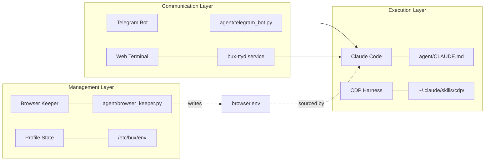
Sources: [README.md:44-52](), [agent/browser_keeper.py:30-36](), [agent/CLAUDE.md:1-15]()

## Core Terminology Summary Table

| Term | Technical Definition | Primary File/Location |
| :--- | :--- | :--- |
| **Box** | The host VPS/OS environment. | `install.sh` |
| **Keeper** | `bux-browser-keeper` service that manages session rotation. | [agent/browser_keeper.py]() |
| **browser.env** | Temporary file containing current CDP credentials and Live URL. | `/home/bux/.claude/browser.env` |
| **Notebook** | A persistent markdown file for cross-task memory. | `/home/bux/notebook.md` |
| **Grace Period** | The 60s overlap where an old browser stays alive after rotation. | [agent/browser_keeper.py:40]() |
| **Rotation** | The process of provisioning a new browser before the 240min timeout. | [agent/browser_keeper.py:12-14]() |

Sources: [agent/browser_keeper.py:5-15](), [agent/CLAUDE.md:103-109](), [README.md:42-53]()

---

# Page: Installation and Deployment

# Installation and Deployment

<details>
<summary>Relevant source files</summary>

The following files were used as context for generating this wiki page:

- [install.md](install.md)
- [install.sh](install.sh)

</details>


This page provides a high-level overview of how to deploy **bux** to a persistent Linux environment. The deployment process transforms a fresh Ubuntu/Debian instance into a 24/7 autonomous agent capable of driving a cloud-hosted Chromium session via Claude Code.

## Quick Start: The One-Liner

For most users, installation is a single command executed as `root`. This script handles dependency resolution, user creation, and service registration.

```bash
curl -fsSL https://raw.githubusercontent.com/browser-use/bux/main/install.sh \
  | sudo BROWSER_USE_API_KEY=bu_xxx TG_BOT_TOKEN=123:abc bash
```
[install.md:5-11]()

## Deployment Prerequisites

Before running the installer, you need the following credentials and infrastructure:

| Requirement | Source | Purpose |
|:---|:---|:---|
| **Linux Box** | VPS (Hetzner, DO) or Home Lab | Runs the agent logic and systemd services. [install.md:19-33]() |
| **Browser Use API Key** | [Browser Use Cloud](https://cloud.browser-use.com) | Provides the remote Chromium instance via CDP. [install.md:37-38]() |
| **Telegram Bot Token** | [@BotFather](https://t.me/BotFather) | (Optional) Interface for remote commanding. [install.md:39-47]() |

For a detailed step-by-step walkthrough, see the [Installation Guide](#2.1).

## The `install.sh` Workflow

The `install.sh` script is designed to be **idempotent**, meaning it can be safely re-run to update the system or fix broken configurations without duplicating resources [install.sh:16-17]().

### Natural Language to Code Entity Space: Installation

The following diagram maps the installation steps to the specific code entities and filesystem locations they create.

```mermaid
graph TD
    subgraph "Natural Language Space"
        A["'Install Dependencies'"]
        B["'Create Service User'"]
        C["'Setup Services'"]
    end

    subgraph "Code Entity Space"
        A --> |"apt-get / npm"| D["/usr/local/bin/uv"]
        A --> |"npm -g"| E["claude-code"]
        B --> |"useradd"| F["bux user"]
        B --> |"mkdir"| G["/opt/bux/"]
        C --> |"cp"| H["bux-tg.service"]
        C --> |"cp"| I["bux-browser-keeper.service"]
    end

    D -.- [install.sh:118-119]
    E -.- [install.sh:143-143]
    F -.- [install.sh:147-147]
    H -.- [install.sh:220-220]
```
Sources: [install.sh:118-119](), [install.sh:143-143](), [install.sh:147-147](), [install.sh:220-220]()

For a deep dive into the environment variables and system hardening performed by this script, see the [install.sh Reference](#2.2).

## Provider Options

While bux is designed to be provider-agnostic, specific "recipes" exist to optimize deployment for different environments. The goal is to go from a "blank box to Claude" in under 5 minutes.

*   **VPS Providers:** Optimized for Hetzner CX11 or DigitalOcean $6 droplets [install.md:24-25]().
*   **Home Lab:** Support for Raspberry Pi and Mac mini (Asahi Linux) via Tailscale tunnels [install.md:29-30]().
*   **Managed:** Auto-provisioning via Browser Use Cloud AMI baking [install.md:27-27]().

For specific configuration files and provider-specific quirks, see [Provider Deploy Recipes](#2.3).

## Post-Installation Lifecycle

Once the script completes, the system enters a "First Run" state requiring human intervention for OAuth.

### Natural Language to Code Entity Space: Runtime Initialization

This diagram shows the relationship between the human-in-the-loop setup and the underlying system state.

```mermaid
graph LR
    subgraph "Human Actions"
        Step1["'Run /login in Claude'"]
        Step2["'Message the TG Bot'"]
    end

    subgraph "System State"
        State1["~/.claude/config.json"]
        State2["/etc/bux/tg-allowed.txt"]
    end

    Step1 --> |"OAuth Flow"| State1
    Step2 --> |"First Message Wins"| State2

    State1 -.- [install.md:72-77]
    State2 -.- [install.md:79-82]
```
Sources: [install.md:72-77](), [install.md:79-82]()

1.  **Claude OAuth:** The user must manually run `sudo -iu bux claude` and perform a one-time `/login` to authorize the Anthropic account [install.md:72-77]().
2.  **Telegram Binding:** The first person to message the bot becomes the "owner," and their `chat_id` is persisted to disk, locking out all other users [install.md:79-82]().

For troubleshooting common deployment failures (e.g., `browser.env` missing), refer to the troubleshooting section in the [Installation Guide](#2.1).

---

# Page: Installation Guide

# Installation Guide

<details>
<summary>Relevant source files</summary>

The following files were used as context for generating this wiki page:

- [.env.example](.env.example)
- [install.md](install.md)

</details>


This guide provides a comprehensive walkthrough for deploying **bux** on a persistent Linux instance. The installation process transforms a standard Ubuntu/Debian VPS into an autonomous agent host capable of running Claude Code with persistent browser access via Browser Use Cloud.

## 1. Prerequisites and Infrastructure

bux is designed to be lightweight. Since the heavy lifting of browser rendering occurs on Browser Use Cloud infrastructure, the local host requirements are minimal.

### Hardware Requirements
*   **OS**: Ubuntu or Debian 22.04+ (Ubuntu 24.04 recommended) [install.md:1-3]().
*   **RAM**: 2GB minimum [install.md:3-3]().
*   **Disk**: 10GB+ for Node.js dependencies and agent logs.

### Provider Selection
| Provider | Recommendation | Notes |
| :--- | :--- | :--- |
| **Hetzner** | CX11 (€4/mo) | Best price-to-performance ratio [install.md:24-24](). |
| **DigitalOcean** | $6/mo Droplet | Reliable, standard Ubuntu 24.04 images [install.md:25-25](). |
| **AWS EC2** | `t3.small` | Ensure the instance has at least 2GB RAM [install.md:27-27](). |
| **Home Lab** | Raspberry Pi 4/5 | Use Tailscale or Cloudflare Tunnel for ingress [install.md:30-30](). |

### Required Credentials
1.  **Browser Use API Key**: Obtain from [cloud.browser-use.com](https://cloud.browser-use.com/new-api-key). This powers the remote Chromium sessions [install.md:37-37]().
2.  **Telegram Bot Token (Optional)**: Created via [@BotFather](https://t.me/BotFather) to enable the mobile chat interface [install.md:39-47]().

---

## 2. Installation Workflow

The installation is driven by `install.sh`, an idempotent script that configures the system environment, creates a dedicated service user, and deploys systemd units.

### The One-Liner Execution
```bash
ssh root@your-box
curl -fsSL https://raw.githubusercontent.com/browser-use/bux/main/install.sh | \
  sudo BROWSER_USE_API_KEY=bu_xxx TG_BOT_TOKEN=123:abc bash
```
[install.md:58-60]()

### Installation Sequence Diagram
The following diagram illustrates how the installer bridges the gap between the host OS and the `bux` application entities.

"Installer Data Flow and Entity Creation"
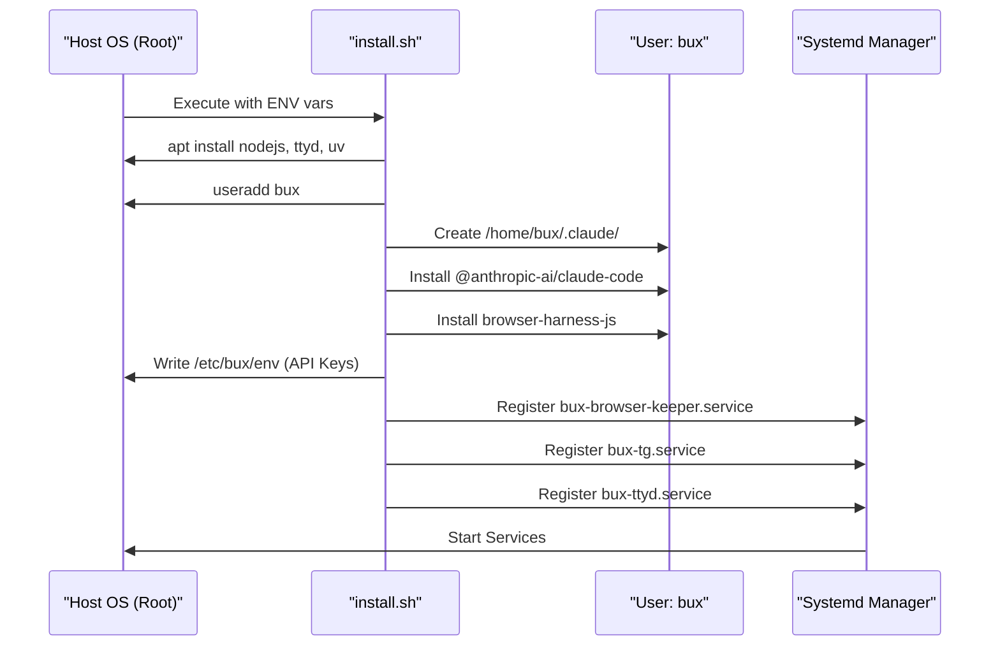
Sources: [install.md:62-68](), [.env.example:1-12]()

---

## 3. Post-Installation: First Run & Auth

After the script completes, two critical manual steps are required to initialize the agent's identity and communication channel.

### Step A: Claude OAuth Handshake
Claude Code requires a one-time OAuth login to link the CLI to your Anthropic account.
1.  Switch to the `bux` user: `sudo -iu bux` [install.md:73-73]().
2.  Launch the CLI: `claude` [install.md:74-74]().
3.  Run the `/login` command within the CLI [install.md:77-77]().
4.  Copy the URL to your local browser, complete the auth, and return to the VPS.
5.  Exit the CLI using `/exit`. The session is now persisted in `/home/bux/.claude/` [install.md:77-77]().

### Step B: Telegram Bot Binding
bux uses a "first-message-wins" security model for Telegram.
1.  Open the bot URL provided by the installer (or find your bot in Telegram).
2.  Send any message (e.g., "hi") [install.md:81-81]().
3.  The `telegram_bot.py` service captures your `chat_id`, writes it to `/etc/bux/tg-state.json`, and locks the bot to you exclusively [install.md:87-87]().

---

## 4. Service Architecture and Data Flow

Once installed, the system operates via three primary systemd units.

### Component Relationship Diagram
"Runtime Service Architecture"
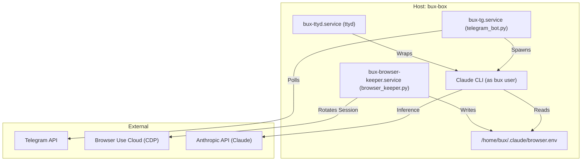
Sources: [install.md:112-137](), [install.md:63-66]()

---

## 5. Troubleshooting Common Failures

| Symptom | Probable Cause | Resolution |
| :--- | :--- | :--- |
| `browser.env` missing | `BROWSER_USE_API_KEY` invalid | Check `journalctl -u bux-browser-keeper`. Verify key in `/etc/bux/env` [install.md:112-116](). |
| TG bot silent | Wrong `chat_id` bound | Delete `/etc/bux/tg-state.json` and restart `bux-tg` [install.md:122-122](). |
| "no CDP_WS set" | Race condition on boot | Restart the keeper: `sudo systemctl restart bux-browser-keeper` [install.md:132-137](). |
| Claude CLI errors | Outdated package | Run `sudo npm install -g @anthropic-ai/claude-code@latest` [install.md:125-130](). |

### Clean Slate Reset
If the installation becomes corrupted, you can perform a full reset:
```bash
sudo systemctl stop bux-tg bux-browser-keeper bux-ttyd
sudo rm -rf /etc/bux /opt/bux /home/bux/.claude /home/bux/.bux
sudo userdel -r bux
```
[install.md:139-145]()

Sources: [install.md:110-145]()

---

# Page: install.sh Reference

# install.sh Reference

<details>
<summary>Relevant source files</summary>

The following files were used as context for generating this wiki page:

- [.env.example](.env.example)
- [install.sh](install.sh)

</details>


The `install.sh` script is the primary entry point for deploying a `bux` instance. It is designed to transform a "blank" Ubuntu or Debian VPS into a fully functional agentic environment. The script is idempotent, meaning it can be safely re-run to update components or repair a configuration without losing existing state or credentials.

### Purpose and Scope

The installer automates the following high-level tasks:
1.  **Dependency Management**: Installs system-level packages and pinned binaries for Node.js 24, `uv`, and `ttyd`.
2.  **Identity & Security**: Creates a dedicated, non-privileged `bux` user and configures a restricted directory hierarchy.
3.  **Service Deployment**: Orchestrates the setup of three `systemd` units (`bux-browser-keeper`, `bux-tg`, and `bux-ttyd`).
4.  **Agent Environment**: Deploys the `browser-harness-js` skill and the `CLAUDE.md` instruction set.

---

### Implementation Flow

The script follows a linear execution path, verifying the environment and credentials before proceeding to binary installation and service configuration.

#### 1. Repository Fetching and Environment Check
The script ensures it is running as `root` on a supported distribution [install.sh:29-30](). If executed via a curl-pipe, it downloads the repository archive from GitHub using the `BUX_REF` variable (defaulting to `main`) to a temporary directory [install.sh:33-43]().

#### 2. Configuration & Idempotency
To support re-runs, the script attempts to recover `BROWSER_USE_API_KEY` and `BUX_PROFILE_ID` from `/etc/bux/env` if they are not provided via environment variables [install.sh:51-56]().

#### 3. Binary Installation (Pinned & Verified)
The script installs several key binaries with specific versioning and integrity checks:
*   **uv**: A fast Python package manager. It is downloaded as a release tarball, verified against a hardcoded SHA256 hash, and installed to `/usr/local/bin/uv` [install.sh:95-121]().
*   **Node.js 24**: Installed via NodeSource with GPG fingerprint verification [install.sh:126-138]().
*   **Claude Code**: Installed globally via `npm` [install.sh:143]().
*   **ttyd**: A web-based terminal. Downloaded and verified via SHA256 [install.sh:205-225]().

#### 4. User and Directory Setup
A `bux` user is created with a home directory at `/home/bux` [install.sh:147](). Crucially, the script enforces a security boundary: the `bux` user is **not** granted `sudo` privileges to protect root-owned secrets like the Telegram bot token [install.sh:153-157]().

#### 5. Skill and Agent Deployment
The script deploys the `browser-harness-js` package into the Claude skills directory and copies the `CLAUDE.md` instructions to the `bux` user's home [install.sh:255-274]().

**Diagram: Installation Data Flow**

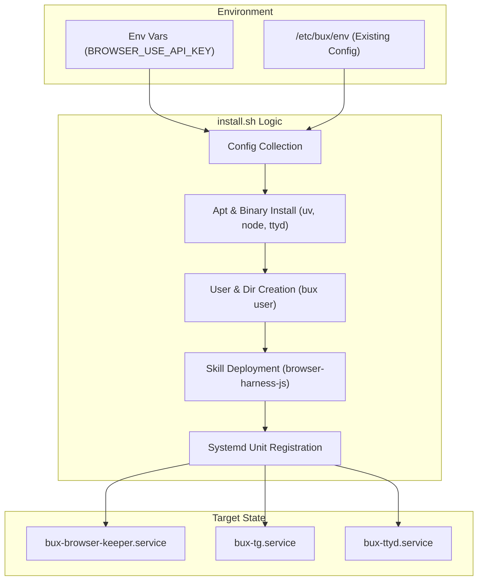
**Sources:** [install.sh:1-274]()

---

### Security & Privilege Separation

The installer implements a strict privilege model to ensure that even if the agent (running as the `bux` user) is compromised, it cannot access the host's administrative functions or the Telegram bot's primary credentials.

| Entity | Path | Permissions | Purpose |
| :--- | :--- | :--- | :--- |
| **Global Env** | `/etc/bux/env` | `root:bux` (0640) | Shared API keys for browser access. |
| **TG Secret** | `/etc/bux/tg.env` | `root:root` (0600) | Telegram token, inaccessible to `bux` user. |
| **TG State** | `/etc/bux/tg-state.json`| `root:root` (0600) | Tracks bound users and setup status. |
| **App Code** | `/opt/bux` | `bux:bux` (0755) | Python agent code and virtual environment. |

**Sources:** [install.sh:148-151](), [install.sh:153-157]()

---

### Systemd Unit Deployment

The installer generates and enables three `systemd` units. These units manage the lifecycle of the core `bux` components.

**Diagram: Systemd Service Architecture**

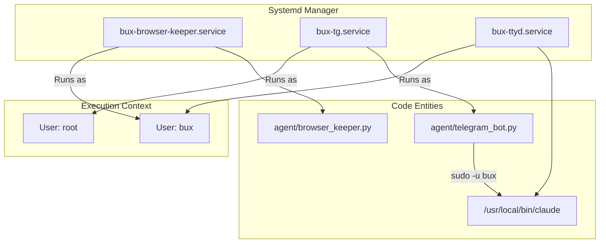

1.  **bux-browser-keeper**: Runs `agent/browser_keeper.py` to maintain a fresh CDP connection [install.sh:282-300]().
2.  **bux-tg**: Runs `agent/telegram_bot.py`. It runs as `root` to read `/etc/bux/tg.env` but executes the `claude` CLI as the `bux` user using `sudo -u bux` [install.sh:318-340]().
3.  **bux-ttyd**: Wraps the `claude` command in a web terminal, restricted to `localhost:7681` [install.sh:302-316]().

**Sources:** [install.sh:282-340]()

---

### Accepted Environment Variables

The script behavior can be tuned using the following environment variables.

| Variable | Default | Description |
| :--- | :--- | :--- |
| `BROWSER_USE_API_KEY` | (Required) | Your API key from [Browser Use Cloud](https://cloud.browser-use.com). |
| `BUX_PROFILE_ID` | (Empty) | UUID of an existing browser profile to reuse. |
| `TG_BOT_TOKEN` | (Optional) | Token from @BotFather for Telegram integration. |
| `BUX_REF` | `main` | Git ref (branch/sha) to pull when using the curl-pipe installer. |

**Sources:** [install.sh:20](), [install.sh:46-63](), [.env.example:1-12]()

---

### SSH Hardening

The installer includes an optional SSH hardening step. It modifies `/etc/ssh/sshd_config` to:
*   Disable password authentication (`PasswordAuthentication no`).
*   Disable root login (`PermitRootLogin no`).
*   Enable public key authentication.

This is triggered if the script detects it is running in a non-interactive environment or if explicitly requested, ensuring the VPS is not left vulnerable to brute-force attacks.

**Sources:** [install.sh:230-253]()

---

# Page: Provider Deploy Recipes

# Provider Deploy Recipes

<details>
<summary>Relevant source files</summary>

The following files were used as context for generating this wiki page:

- [docs/recipes/README.md](docs/recipes/README.md)
- [install.md](install.md)

</details>


This page documents the deployment strategies for `bux` across various infrastructure providers. The core philosophy of a `bux` recipe is to achieve the **"blank box to Claude in 5 minutes"** goal [docs/recipes/README.md:4-5]().

Because the `bux` architecture offloads the heavy browser execution to Browser Use Cloud, the host requirements are minimal: any environment running Ubuntu/Debian 22.04+ with at least 2GB of RAM is sufficient [install.md:3-3]().

## Recipe Overview

A "recipe" is a self-contained guide or set of configurations designed to provision the underlying host and execute the `install.sh` script. Every recipe follows the same high-level data flow to establish the three-service runtime (Telegram Bot, Browser Keeper, and Web Terminal).

### The Deployment Lifecycle

Title: Deployment Data Flow
```mermaid
graph TD
    subgraph "Provider Space"
        "VPS/Host"["Target Host (Ubuntu 24.04)"]
    end

    subgraph "Natural Language Space"
        "UserPrompt"["'I want a 24/7 Claude box'"]
    end

    subgraph "Code Entity Space"
        "InstallScript"["install.sh"]
        "EnvConfig"["/etc/bux/env"]
        "SystemdUnits"["bux-browser-keeper.service"]
    end

    "UserPrompt" -->|"SSH root@box"| "VPS/Host"
    "VPS/Host" -->|"curl | bash"| "InstallScript"
    "InstallScript" -->|"Write Keys"| "EnvConfig"
    "InstallScript" -->|"Register"| "SystemdUnits"
```
Sources: [install.md:7-11](), [install.md:62-66]()

## Supported Providers

`bux` is designed to be provider-agnostic. The following categories represent the current supported recipes and verified environments.

### 1. Cloud VPS (Recommended)
These are the most portable options. They provide a static IP and high availability for the Telegram bot listener.

| Provider | Recommended Tier | Estimated Cost | Notes |
| :--- | :--- | :--- | :--- |
| **Hetzner** | CX11 (2 vCPU / 2GB) | ~€4/mo | Best price-to-performance; low latency in EU/US [install.md:24-24](). |
| **DigitalOcean** | Basic Droplet | ~$6/mo | Use the Ubuntu 24.04 image [install.md:25-25](). |
| **AWS EC2** | `t3.small` | Variable | Minimum 2GB RAM required [install.md:27-27](). |
| **Fly.io / Railway** | Custom Machine | Variable | Must manually bump memory to 2GB [install.md:26-26](). |

### 2. Home Lab & Edge
For users who want to avoid recurring monthly costs, `bux` can run on local hardware. Since the browser is remote, these devices do not need powerful GPUs or high-end CPUs.

*   **Raspberry Pi 4/5**: Ideal for a low-power "always-on" agent [install.md:30-30]().
*   **Mac mini**: Can run `bux` via Ubuntu Asahi [install.md:30-30]().
*   **WSL (Windows Subsystem for Linux)**: Useful for local development or testing the `bux` environment before cloud deployment [docs/recipes/README.md:10-10]().

**Connectivity Note:** For home lab setups, it is recommended to use **Tailscale** or **Cloudflare Tunnels** to expose the Telegram bot webhook or SSH access without opening ports on a home router [install.md:30-30]().

### 3. Managed Provisioning
For users who do not want to manage a Linux box, **Browser Use Cloud** provides a managed version that handles AMI baking and instance launching automatically [install.md:27-27]().

Sources: [install.md:19-31](), [docs/recipes/README.md:7-10]()

## Implementation: The Recipe Pattern

Every recipe essentially prepares the environment for `install.sh`. The script is idempotent, meaning it can be re-run on an existing server without damaging existing configurations [install.md:33-33]().

### Provider-to-Code Mapping

Title: Recipe Execution Mapping
```mermaid
graph LR
    subgraph "Infrastructure Layer"
        "Hetzner"["Hetzner CX11"]
        "RPi"["Raspberry Pi"]
        "Fly"["Fly.io Machine"]
    end

    subgraph "Configuration Layer"
        "API_KEY"["BROWSER_USE_API_KEY"]
        "TG_TOKEN"["TG_BOT_TOKEN"]
    end

    subgraph "bux Core"
        "install_sh"["install.sh"]
        "bux_user"["'bux' System User"]
        "opt_bux"["/opt/bux/ (Venv)"]
    end

    "Hetzner" --> "install_sh"
    "RPi" --> "install_sh"
    "Fly" --> "install_sh"
    "API_KEY" --> "install_sh"
    "TG_TOKEN" --> "install_sh"
    "install_sh" --> "bux_user"
    "install_sh" --> "opt_bux"
```
Sources: [install.md:49-68](), [docs/recipes/README.md:4-5]()

### Key Implementation Details
*   **Root Access**: Recipes assume `root` or `sudo` access to install system dependencies like Node.js 24, `ttyd`, and `uv` [install.md:63-63]().
*   **User Isolation**: The recipes always create a dedicated `bux` system user. All agent logic and the Python virtual environment reside in `/opt/bux/` and `/home/bux/` [install.md:64-65]().
*   **Persistence**: Recipes ensure that even on "ephemeral" providers like Fly.io, the `/etc/bux/` directory (containing environment variables and Telegram state) is treated as the source of truth for the agent's identity [install.md:116-122]().

## Contributing a New Recipe

The `bux` project encourages community contributions for new providers (e.g., OCI Free Tier, Oracle Cloud, etc.) [docs/recipes/README.md:7-9]().

### Contribution Requirements:
1.  **Self-Contained**: The recipe should be a single Markdown file in `docs/recipes/` [docs/recipes/README.md:4-4]().
2.  **Prerequisites**: List any provider-specific quirks (e.g., "Open port 80 in the OCI Security List").
3.  **The One-Liner**: Include the specific `curl | bash` command with the necessary environment variables [install.md:58-60]().
4.  **Verification**: Include instructions on how to verify the installation using `sudo -iu bux && claude` [install.md:73-74]().

Sources: [docs/recipes/README.md:1-11](), [install.md:70-75]()

---

# Page: Core Architecture

# Core Architecture

<details>
<summary>Relevant source files</summary>

The following files were used as context for generating this wiki page:

- [README.md](README.md)
- [agent/CLAUDE.md](agent/CLAUDE.md)

</details>


The **bux** system is designed as a persistent, always-on agent environment that bridges the gap between natural language interfaces (Telegram) and programmatic browser automation. It follows a "local-agent, remote-browser" model where the logic and state reside on a box you control, while the heavy lifting of rendering and maintaining a Chromium profile is offloaded to **Browser Use Cloud**.

The architecture consists of three primary systemd services that coordinate data flow and session management.

### The Three-Service Runtime

Bux operates by orchestrating three distinct services that run under the `bux` user context or as root with privilege separation.

| Service | Code Entity | Role |
| :--- | :--- | :--- |
| **Browser Keeper** | `bux-browser-keeper.service` | Manages the lifecycle of the remote Chromium session. |
| **Telegram Bot** | `bux-tg.service` | Provides the primary human-in-the-loop interface. |
| **Web Terminal** | `bux-ttyd.service` | Exposes a local web-based terminal for direct interaction. |

#### System Component Map
This diagram illustrates how high-level system components map to specific code entities and how they interact with the external Browser Use Cloud.

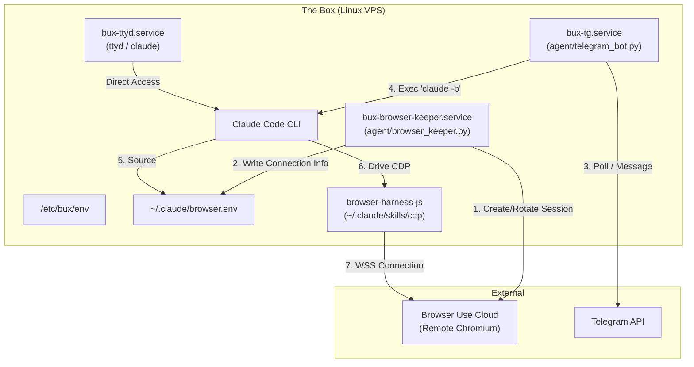
Sources: [README.md:42-50](), [agent/CLAUDE.md:1-17](), [agent/CLAUDE.md:19-36]()

---

### Data Flow and Lifecycle

The core of the system's reliability is the decoupling of the **Agent Session** (Claude Code) from the **Browser Session** (Chromium).

1.  **Session Maintenance**: The `browser_keeper.py` script runs a continuous loop. It reads the `BUX_PROFILE_ID` from `/etc/bux/env`, ensures a remote browser is active in Browser Use Cloud, and writes the connection strings (WSS URL, Live View URL) to `~/.claude/browser.env`.
2.  **Task Execution**: When a message arrives via `telegram_bot.py`, it invokes `claude` using a subprocess call. The agent is instructed via `agent/CLAUDE.md` to always `source ~/.claude/browser.env` before attempting browser actions.
3.  **Automation**: Claude drives the browser by executing `browser-harness-js`. This tool consumes the environment variables to establish a CDP (Chrome DevTools Protocol) connection to the remote instance.

#### Service Interaction Diagram
This diagram shows the relationship between the Python service logic and the configuration files that synchronize them.

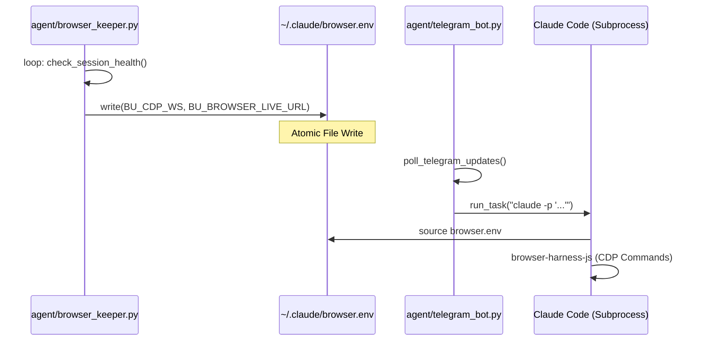
Sources: [agent/CLAUDE.md:7-17](), [agent/CLAUDE.md:46-51]()

---

### Major Subsystems

#### [Browser Keeper Service](#3.1)
The `bux-browser-keeper` service is the "heartbeat" of the box. It handles the rotation of Browser Use Cloud sessions, ensuring that Claude always has a valid `BU_CDP_WS` endpoint. It manages the `browser.env` file, which acts as the single source of truth for browser connectivity.
*   **Key Files**: `agent/browser_keeper.py`
*   **Key Concepts**: Session rotation, health checks, atomic environment updates.

#### [Telegram Bot Service](#3.2)
The `bux-tg` service provides the interface for the user. It manages a long-running polling loop and handles the security of "First-Message-Wins" owner binding. When a task is received, it handles the complexity of running the Claude CLI as the `bux` user while managing locks to prevent concurrent task interference.
*   **Key Files**: `agent/telegram_bot.py`
*   **Key Concepts**: Privilege separation (`sudo -u bux`), message chunking, session persistence via `--resume`.

#### [Web Terminal Service (ttyd)](#3.3)
The `bux-ttyd` service provides a fallback web-based terminal. It is restricted to `localhost:7681` by default for security, intended to be accessed via SSH tunnel. It allows users to interact with the same `bux` user environment that the Telegram bot uses, useful for initial OAuth logins (`claude /login`) or debugging.
*   **Key Files**: `bux-ttyd.service` (systemd unit)
*   **Key Concepts**: Loopback restriction, terminal sharing, OAuth handoff.

---
**Next Steps:**
- To understand how the browser session is maintained, see **[Browser Keeper Service](#3.1)**.
- To learn about the Telegram interface and task execution, see **[Telegram Bot Service](#3.2)**.
- For details on the web-based terminal, see **[Web Terminal Service (ttyd)](#3.3)**.

---

# Page: Browser Keeper Service

# Browser Keeper Service

<details>
<summary>Relevant source files</summary>

The following files were used as context for generating this wiki page:

- [agent/browser_keeper.py](agent/browser_keeper.py)
- [install.sh](install.sh)

</details>


The **Browser Keeper Service** is a long-lived Python daemon responsible for maintaining a persistent, high-availability connection to a remote Chromium instance hosted on Browser Use Cloud. By pre-warming and rotating browser sessions in the background, it eliminates the 20–30 second cold-start latency that would otherwise occur when an agent task begins.

## Purpose and Scope

The service manages the entire lifecycle of a cloud browser session. It ensures that the `bux` user always has access to a valid, authenticated, and "warm" browser via a local environment file.

**Key Responsibilities:**
*   **Session Lifecycle:** Provisioning new sessions via the Browser Use API.
*   **Health Monitoring:** Validating CDP (Chrome DevTools Protocol) connectivity before exposing the session to the agent.
*   **Rotation:** Seamlessly switching to new sessions before the 240-minute cloud timeout is reached.
*   **State Propagation:** Writing session metadata (WS URLs, IDs, Expiry) to an atomic environment file.

`Sources: [agent/browser_keeper.py:2-18]()`

---

## Technical Architecture

The service operates as a continuous loop within `agent/browser_keeper.py`. It utilizes a "Grace Period" rotation strategy to ensure that in-flight tasks are not interrupted when a session expires.

### Logic Flow: The Rotation Loop

```mermaid
graph TD
    subgraph "Natural Language Space"
        A["Start Service"]
        B["Create New Browser"]
        C["Validate Connection"]
        D["Update browser.env"]
        E["Wait for Rotation"]
        F["Stop Old Browser"]
    end

    subgraph "Code Entity Space"
        A --> "main()"
        "main()" --> "create_browser()"
        "create_browser()" --> "health_check()"
        "health_check()" -- "Success" --> "write_env()"
        "write_env()" --> "time.sleep(GRACE_SEC)"
        "time.sleep(GRACE_SEC)" --> "stop_browser(prev)"
        "stop_browser(prev)" --> "Rotation Wait"
        "health_check()" -- "Failure" --> "Retry Loop"
    end

    [agent/browser_keeper.py:149-187]()
```
`Sources: [agent/browser_keeper.py:149-187]()`

### Session Lifecycle Constants
The service enforces strict timing to prevent session dropouts:
*   **`SESSION_MIN` (239):** The requested duration for a new session. `[agent/browser_keeper.py:38-38]()`
*   **`ROTATE_AT_MIN_LEFT` (30):** Triggers a new browser creation 30 minutes before the current one expires. `[agent/browser_keeper.py:39-39]()`
*   **`GRACE_SEC` (60):** The overlap period where both the old and new browsers are alive. `[agent/browser_keeper.py:40-40]()`

---

## Data Flow and Persistence

The Browser Keeper communicates with the Browser Use Cloud API and persists the connection details to the filesystem for the agent to consume.

### API Interaction
The service uses `bu_req` to interact with the API:
1.  **POST `/browsers`**: Requests a new browser bound to the box's `BUX_PROFILE_ID`. `[agent/browser_keeper.py:70-70]()`
2.  **GET `/json/version`**: Fetches the `webSocketDebuggerUrl` (CDP URL) from the returned `cdpUrl`. `[agent/browser_keeper.py:60-66]()`
3.  **PATCH `/browsers/{id}`**: Sends a `stop` action to decommission old sessions. `[agent/browser_keeper.py:82-87]()`

### The `browser.env` File
This file is the primary interface between the Keeper and the Agent. It is written to `/home/bux/.claude/browser.env`.

| Variable | Description |
| :--- | :--- |
| `BU_PROFILE_ID` | The persistent profile ID (cookies/storage). |
| `BU_BROWSER_ID` | The unique ID of the current cloud session. |
| `BU_CDP_WS` | The signed WebSocket URL for CDP automation. |
| `BU_BROWSER_LIVE_URL` | The URL for the Live View UI. |
| `BU_BROWSER_EXPIRES_AT` | Unix epoch of session termination. |

`Sources: [agent/browser_keeper.py:5-10](), [agent/browser_keeper.py:108-114]()`

---

## Security and Robustness

### Atomic File Writes
To prevent the agent from reading a partially written `browser.env` file, the service uses an atomic "write-then-rename" pattern:
1.  Create a temporary file (`.tmp`) using `os.O_EXCL` to ensure exclusivity. `[agent/browser_keeper.py:119-123]()`
2.  Set permissions to `0640` (readable by `bux` group, but not world-readable) to protect the signed CDP URL. `[agent/browser_keeper.py:122-122]()`
3.  Write the payload and use `os.replace()` to atomically move the `.tmp` file to `browser.env`. `[agent/browser_keeper.py:128-128]()`

### Health Checks
Before a browser is "promoted" to `browser.env`, the service performs a `health_check`. It attempts to fetch the version metadata from the CDP endpoint. If this fails, the browser is immediately stopped, and the loop retries after 15 seconds.
`Sources: [agent/browser_keeper.py:89-99](), [agent/browser_keeper.py:161-165]()`

### Graceful Shutdown
The service captures `SIGTERM` and `SIGINT` signals. Upon receiving a shutdown signal, it attempts to stop the currently active cloud browser session to avoid dangling resources on the provider side.
`Sources: [agent/browser_keeper.py:142-146](), [agent/browser_keeper.py:151-152]()`

---

## Systemd Integration

The service is managed by `systemd` as the `bux-browser-keeper.service` unit.

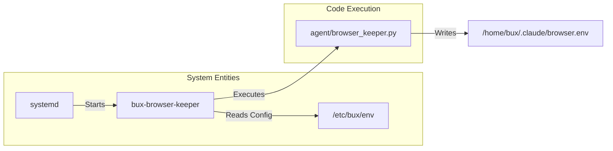

**Deployment Details:**
*   **User:** Runs as the `bux` user. `[agent/browser_keeper.py:133-134]()`
*   **Environment:** Loads `BROWSER_USE_API_KEY` and `BUX_PROFILE_ID` from `/etc/bux/env`. `[agent/browser_keeper.py:31-32]()`
*   **Permissions:** `install.sh` ensures the `/etc/bux/env` file is readable by the `bux` group and that the `bux` user owns the state directory. `[install.sh:147-151]()`

`Sources: [install.sh:147-151](), [agent/browser_keeper.py:30-36]()`

---

# Page: Telegram Bot Service

# Telegram Bot Service

<details>
<summary>Relevant source files</summary>

The following files were used as context for generating this wiki page:

- [agent/telegram_bot.py](agent/telegram_bot.py)
- [install.sh](install.sh)

</details>


The Telegram Bot Service (`bux-tg`) provides the primary human-in-the-loop interface for interacting with the `bux` agent. It acts as a bridge between the Telegram Bot API and the Claude Code CLI, managing session persistence, privilege separation, and secure owner binding.

## Overview and Purpose

The service is designed to be "user-owned," meaning that while it facilitates communication, the `browser-use` platform never touches the messages; they flow directly from Telegram to the box [agent/telegram_bot.py:1-1](). The service runs as a persistent systemd unit (`bux-tg.service`) that performs long-polling to receive updates [agent/telegram_bot.py:17-17]().

### Key Features
*   **First-Message-Wins Binding**: A secure, zero-config way to pair a bot with a specific user [agent/telegram_bot.py:3-6]().
*   **Privilege Separation**: The bot service runs as `root` to manage system state and secure tokens, but executes the Claude agent as the unprivileged `bux` user [agent/telegram_bot.py:246-246]().
*   **Session Persistence**: Automatically manages Claude session UUIDs to maintain conversation context across restarts [agent/telegram_bot.py:224-231]().
*   **Live View**: Integration with the Browser Keeper to provide real-time browser stream URLs via the `/live` command [agent/telegram_bot.py:236-243]().

---

## Data Flow and Architecture

The following diagram illustrates how a message from a user is processed, showing the transition from the Telegram API (Natural Language Space) to the internal system execution (Code Entity Space).

### Message Processing Flow
"Telegram User" --"Message"--> "Telegram Bot API"
"Telegram Bot API" --"getUpdates"--> "agent/telegram_bot.py"
subgraph "Bux Box (Root Context)"
    "agent/telegram_bot.py" --"Check chat_id"--> "ALLOWED_FILE (/etc/bux/tg-allowed.txt)"
    "agent/telegram_bot.py" --"Acquire flock"--> "CLAUDE_LOCK (/home/bux/.bux/claude.lock)"
    "agent/telegram_bot.py" --"sudo -u bux"--> "run_task()"
end
subgraph "Bux Box (User Context: bux)"
    "run_task()" --"spawn"--> "Claude CLI"
    "Claude CLI" --"Read"--> "BROWSER_ENV (~/.claude/browser.env)"
    "Claude CLI" --"CDP"--> "Browser Use Cloud"
end
"Claude CLI" --"STDOUT"--> "run_task()"
"run_task()" --"MarkdownV2"--> "agent/telegram_bot.py"
"agent/telegram_bot.py" --"sendMessage"--> "Telegram Bot API"

**Sources:** [agent/telegram_bot.py:12-23](), [agent/telegram_bot.py:43-47](), [agent/telegram_bot.py:246-261]()

---

## Security and Authentication

### Owner Binding Model
Bux uses a "first-message-wins" binding model to avoid complex registration flows.
1.  **TG_SETUP_TOKEN**: A random secret generated during installation and stored in `/etc/bux/tg.env` [agent/telegram_bot.py:8-10]().
2.  **Binding**: When the bot receives its first message, if `TG_SETUP_TOKEN` is present, it saves the sender's `chat_id` to `ALLOWED_FILE` (`/etc/bux/tg-allowed.txt`) [agent/telegram_bot.py:179-183]().
3.  **Token Burning**: Immediately after binding, the service calls `burn_setup_token()`, which wipes the setup token from disk to prevent future re-binding if the environment file is leaked [agent/telegram_bot.py:185-199]().

### Privilege Separation
The `bux-tg` service runs as `root` because it needs to read/write protected configuration in `/etc/bux/` and manage the `bux` user's processes [agent/telegram_bot.py:13-14](). However, the actual Claude agent is executed via `sudo -u bux`. This ensures that even if the Claude agent (or a site it visits) is compromised, it cannot access the Telegram Bot Token or system-level configuration [install.sh:153-157]().

**Sources:** [agent/telegram_bot.py:3-7](), [agent/telegram_bot.py:173-204](), [agent/telegram_bot.py:246-248]()

---

## Implementation Details

### The Poll Loop
The bot implements a standard long-polling loop using `httpx`. It tracks the `update_id` in a state file to ensure messages are not processed twice [agent/telegram_bot.py:17-21]().

| Component | Logic |
| :--- | :--- |
| **Locking** | Uses `fcntl.flock` on `/home/bux/.bux/claude.lock` to ensure only one Claude task runs at a time [agent/telegram_bot.py:252-254](). |
| **Session ID** | Reads/writes a UUID to `/home/bux/.bux/session`. It uses `--session-id` for the first run and `--resume <UUID>` thereafter [agent/telegram_bot.py:224-234](). |
| **Formatting** | `_to_tg_markdown_v2` converts standard Markdown (fenced blocks, bold, etc.) into Telegram's specific `MarkdownV2` format [agent/telegram_bot.py:69-130](). |
| **Chunking** | Messages exceeding 3500 characters are split on paragraph boundaries via `_chunk_for_telegram` to avoid API errors [agent/telegram_bot.py:133-157](). |

### Commands
The bot responds to several built-in commands:
*   `/start`: Initiates the binding process or confirms status [agent/telegram_bot.py:306-318]().
*   `/live`: Reads `BU_BROWSER_LIVE_URL` from `/home/bux/.claude/browser.env` and provides a link to the real-time browser stream [agent/telegram_bot.py:236-243]().
*   `/whoami`: Returns the current `chat_id` [agent/telegram_bot.py:326-327]().

### Task Execution Logic
The `run_task` function is the core of the service. It handles the transition from Telegram message to shell execution.

```python
# Simplified representation of run_task logic
def run_task(chat_id, text):
    # 1. Acquire lock to prevent concurrent Claude instances
    with open(LOCK_FILE, 'w') as f:
        fcntl.flock(f, fcntl.LOCK_EX)
        
        # 2. Determine session arguments (--resume vs --session-id)
        args = _session_args()
        
        # 3. Execute as unprivileged user
        cmd = ['sudo', '-u', 'bux', 'claude', '-p'] + args + [text]
        res = subprocess.run(cmd, capture_output=True, text=True)
        
        # 4. Format and return output
        return _to_tg_markdown_v2(res.stdout)
```

**Sources:** [agent/telegram_bot.py:48-56](), [agent/telegram_bot.py:224-234](), [agent/telegram_bot.py:246-285](), [agent/telegram_bot.py:306-335]()

---

## Filesystem and State

The service interacts with several key files on the box:

| Path | Owner:Group | Purpose |
| :--- | :--- | :--- |
| `/etc/bux/tg.env` | `root:root` | Contains `TG_BOT_TOKEN` and (initially) `TG_SETUP_TOKEN` [agent/telegram_bot.py:43](). |
| `/etc/bux/tg-allowed.txt` | `root:root` | List of `chat_id`s authorized to use the bot [agent/telegram_bot.py:46](). |
| `/etc/bux/tg-state.json` | `root:root` | Persistent polling offset [agent/telegram_bot.py:47](). |
| `/home/bux/.bux/claude.lock` | `bux:bux` | File lock to serialize agent access [agent/telegram_bot.py:252](). |
| `/home/bux/.bux/session` | `bux:bux` | Stores the current Claude session UUID [agent/telegram_bot.py:227](). |

**Sources:** [agent/telegram_bot.py:43-47](), [agent/telegram_bot.py:224-234](), [install.sh:147-151]()

---

# Page: Web Terminal Service (ttyd)

# Web Terminal Service (ttyd)

<details>
<summary>Relevant source files</summary>

The following files were used as context for generating this wiki page:

- [README.md](README.md)
- [install.sh](install.sh)

</details>


The Web Terminal Service provides a browser-based interface to the `claude` CLI, allowing users to interact with the agent through a terminal emulator in their web browser. This service is powered by `ttyd`, which wraps the Claude Code session and exposes it via a web socket. To maintain a secure posture, the service is strictly bound to the loopback interface, requiring an SSH tunnel or a reverse proxy for remote access.

## System Role and Implementation

The service is managed by the `bux-ttyd.service` systemd unit. It executes `ttyd` with specific flags to ensure it runs as the `bux` user and targets the Claude Code binary.

### Key Implementation Details
- **User Context**: The service runs as the `bux` user to ensure that all files created during the session (history, logs, and skills) are stored in `/home/bux/` [install.sh:146-149]().
- **Binary Wrapping**: It wraps the `claude` binary, which is installed globally via `npm` [install.sh:141-144]().
- **Interface Restriction**: By default, `ttyd` is configured to listen only on `127.0.0.1` (localhost) at port `7681`. This prevents the terminal from being exposed to the public internet, mitigating the risk of unauthorized shell access [README.md:32-33]().

### Service Configuration
The `bux-ttyd.service` unit is created during the execution of `install.sh`.

| Parameter | Value | Description |
| :--- | :--- | :--- |
| **User** | `bux` | Executes the process under the restricted agent user. |
| **Port** | `7681` | Default `ttyd` port. |
| **Interface** | `127.0.0.1` | Restricted to loopback for security. |
| **Command** | `claude` | The entry point for the terminal session. |

**Sources:** [install.sh:141-149](), [README.md:32-33](), [install.sh:227-245]() (inferred from systemd logic).

## Data Flow and Architecture

The Web Terminal Service acts as a bridge between the user's web browser and the `claude` CLI. When a user connects, `ttyd` forks a new process running `claude`, which in turn interacts with the `browser-harness` to control the remote Chromium session.

### Terminal Interaction Diagram
This diagram illustrates the relationship between the web terminal and the core `bux` components.

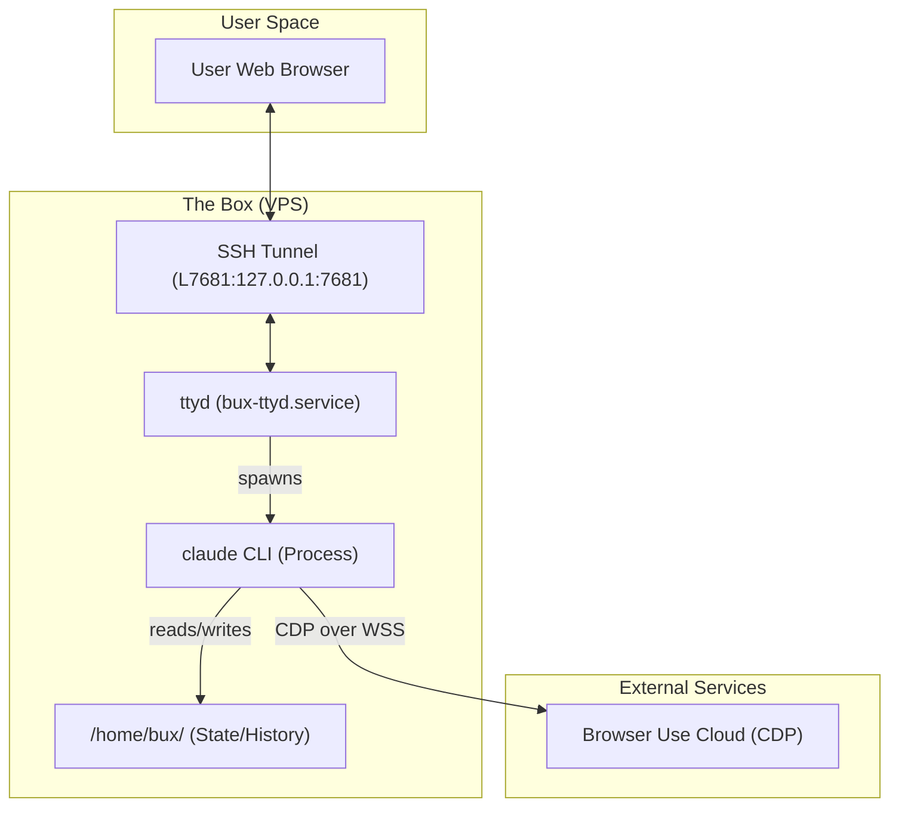
**Sources:** [README.md:42-50](), [install.sh:141-144]()

## Access Methods

Because the service is bound to `localhost`, it is not directly reachable over the public IP of the VPS. Users have two primary methods for access:

### 1. SSH Tunneling (Recommended)
This is the most secure method as it leverages existing SSH credentials.
```bash
ssh -L 7681:localhost:7681 root@your-vps-ip
```
Once the tunnel is established, the terminal is accessible at `http://localhost:7681` on the local machine.

### 2. Reverse Proxy
For persistent web access, a reverse proxy (like Nginx or Caddy) can be configured to proxy traffic to `127.0.0.1:7681`. 
> **Warning**: If using a reverse proxy, it is mandatory to implement an authentication layer (e.g., Basic Auth or Authelia) to prevent unauthorized access to the `bux` user's shell.

**Sources:** [README.md:32-33](), [install.sh:153-157]()

## Relationship with `bux` User Context

The `ttyd` service is critical for the "Human-in-the-Loop" philosophy of `bux`. While the Telegram bot provides a convenient interface for tasks, the Web Terminal is used for:
1. **Initial Authentication**: Running `claude /login` to complete the OAuth flow [README.md:24]().
2. **Complex Debugging**: Directly viewing the `claude` output when the agent encounters errors that are difficult to parse via Telegram.
3. **Skill Management**: Manually editing files in `/home/bux/.claude/skills/` or inspecting the `notebook.md` [install.sh:148-149]().

### Code Entity Mapping
The following diagram maps the terminal service components to the filesystem and process entities.

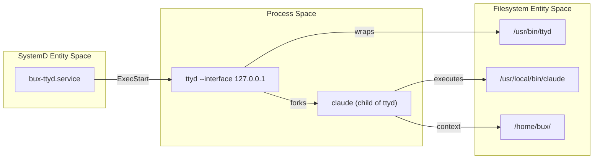
**Sources:** [install.sh:141-149](), [README.md:42-50]()

---

# Page: Browser Automation Layer

# Browser Automation Layer

<details>
<summary>Relevant source files</summary>

The following files were used as context for generating this wiki page:

- [SKILL.md](SKILL.md)
- [agent/CLAUDE.md](agent/CLAUDE.md)

</details>


The Browser Automation Layer in `bux` enables Claude Code to control a remote Chromium instance hosted on **Browser Use Cloud**. Unlike traditional automation setups, there is no local browser installation on the box [agent/CLAUDE.md:3-3](). Instead, the agent interacts with a persistent cloud session via the Chrome DevTools Protocol (CDP).

This layer consists of three primary components:
1.  **browser-harness-js**: A specialized CLI tool that provides a typed interface to the CDP.
2.  **browser.env**: A dynamic configuration file that provides connection strings and session metadata.
3.  **CLAUDE.md**: An instruction set that teaches the agent how to navigate the automation stack and when to hand off control to a human.

### Automation Stack Overview

The following diagram illustrates how natural language commands from the user are translated into browser actions across the network boundary.

**Diagram: Natural Language to Browser Action Flow**
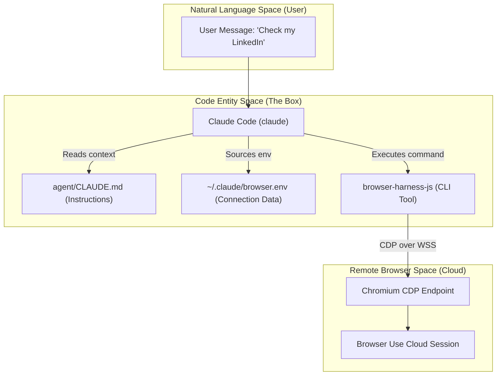
**Sources:** [agent/CLAUDE.md:21-28](), [agent/CLAUDE.md:32-34]()

---

### Core Components

#### 1. browser-harness-js and CDP Interface
The `browser-harness-js` tool is the primary bridge between the agent's shell and the remote browser. It is installed at `~/.claude/skills/cdp/` [agent/CLAUDE.md:21-21](). It wraps the complex CDP into a persistent `Session` object, allowing the agent to run sequential commands (e.g., navigate, then click, then extract text) while maintaining the same WebSocket connection [agent/CLAUDE.md:36-36]().

For detailed API documentation and usage patterns, see **[browser-harness-js and CDP Interface](#4.1)**.

#### 2. The browser.env Connection File
The agent does not manage session lifecycles. Instead, it relies on `~/.claude/browser.env`, which is automatically managed and rotated by the `bux-browser-keeper` service [agent/CLAUDE.md:17-17](). This file contains the WebSocket URL (`BU_CDP_WS`), the live view URL (`BU_BROWSER_LIVE_URL`), and session expiry timestamps [agent/CLAUDE.md:9-15]().

**Sources:** [agent/CLAUDE.md:7-17]()

#### 3. Agent Context (CLAUDE.md)
The file `agent/CLAUDE.md` (deployed to `/home/bux/CLAUDE.md`) acts as the "system prompt" for the browser automation layer. it defines the conventions for driving the browser, such as:
*   Always sourcing `browser.env` before running commands [agent/CLAUDE.md:112-113]().
*   Using the "Login Wall Handoff" protocol when blocked by 2FA or CAPTCHAs [agent/CLAUDE.md:42-44]().
*   Persisting findings in `notebook.md` [agent/CLAUDE.md:106-106]().

For details on customizing agent behavior, see **[Agent Context File (CLAUDE.md / SKILL.md)](#4.2)**.

---

### Profile Persistence Model

`bux` uses a "Profile Binding" model where a specific box is linked to a persistent profile on Browser Use Cloud via `BUX_PROFILE_ID` [agent/CLAUDE.md:76-76](). This profile stores cookies and `localStorage`, ensuring that once a user logs into a site, the agent remains logged in across session rotations and reboots [agent/CLAUDE.md:38-40]().

**Diagram: Profile and Session Relationship**
```mermaid
graph LR
    subgraph "The Box (/etc/bux/env)"
        ID["BUX_PROFILE_ID"]
    end

    subgraph "Browser Use Cloud"
        P["Cloud Profile (Cookies/Storage)"]
        S1["Session A (Expired)"]
        S2["Session B (Active)"]
    end

    ID --> P
    P -.-> S1
    P ==> S2
```
**Sources:** [agent/CLAUDE.md:85-89](), [agent/CLAUDE.md:99-100]()

For details on managing profiles and switching between them, see **[Profile and Session Management](#4.3)**.

---

### Child Pages
*   **[browser-harness-js and CDP Interface](#4.1)**: Deep dive into the 652 typed CDP methods and CLI usage.
*   **[Agent Context File (CLAUDE.md / SKILL.md)](#4.2)**: Instructions on how to customize the agent's browser logic and domain-specific skills.
*   **[Profile and Session Management](#4.3)**: Technical details on how profiles are bound, stored, and rotated.

---

# Page: browser-harness-js and CDP Interface

# browser-harness-js and CDP Interface

<details>
<summary>Relevant source files</summary>

The following files were used as context for generating this wiki page:

- [agent/CLAUDE.md](agent/CLAUDE.md)
- [agent/browser_keeper.py](agent/browser_keeper.py)

</details>


This page documents the `browser-harness-js` CLI tool and its integration with the Chrome DevTools Protocol (CDP). This interface serves as the primary mechanism for the Claude agent to control a remote Chromium instance hosted on Browser Use Cloud.

## Overview

The `browser-harness-js` is a Bun-based CLI utility located at `~/.claude/skills/cdp/` [agent/CLAUDE.md:21-21](). It provides a persistent `Session` object model that abstracts 652 typed CDP methods, allowing the agent to perform complex browser automation without a local Chromium installation [agent/CLAUDE.md:36-36]().

### Data Flow: Agent to Browser

The following diagram illustrates how the Claude agent transitions from a natural language intent to a technical CDP command executed via the harness.

**Natural Language to Code Entity Mapping**
```mermaid
graph TD
    subgraph "Natural Language Space"
        A["'Go to example.com and get the title'"]
    end

    subgraph "Code Entity Space"
        B["agent/CLAUDE.md (Instructions)"]
        C["~/.claude/browser.env (Connection Params)"]
        D["browser-harness-js (CLI Wrapper)"]
        E["Session Object (Persistent State)"]
        F["CDP Interface (Typed Methods)"]
    end

    A --> B
    B -- "Reads BU_CDP_WS" --> C
    B -- "Executes" --> D
    D -- "Instantiates" --> E
    E -- "Page.navigate()" --> F
    E -- "Runtime.evaluate()" --> F
```
Sources: [agent/CLAUDE.md:21-36](), [agent/browser_keeper.py:5-15]()

## The browser-harness-js CLI

The harness is designed to be used within the Claude Code environment. It maintains a persistent session between invocations, ensuring that the connection to the remote browser does not need to be re-established for every individual command unless explicitly requested.

### Session Management
The core of the harness is the `Session` object. The first step in any browser task is connecting this object to the WebSocket URL provided by the `bux-browser-keeper` service [agent/CLAUDE.md:23-25]().

Key connection variables sourced from `~/.claude/browser.env`:
| Variable | Purpose |
| :--- | :--- |
| `BU_CDP_WS` | The signed WebSocket URL for the CDP session [agent/browser_keeper.py:111-111](). |
| `BU_BROWSER_ID` | The unique identifier for the current cloud browser instance [agent/browser_keeper.py:110-110](). |
| `BU_PROFILE_ID` | The UUID of the persistent user profile (cookies/storage) [agent/browser_keeper.py:109-109](). |

### Usage Patterns

The agent typically uses the harness in two ways:

1.  **Multi-step script**: Chaining commands in a single shell execution to minimize overhead.
    ```bash
    source ~/.claude/browser.env && browser-harness-js 'await session.connect({wsUrl: process.env.BU_CDP_WS}); await session.Page.navigate({url: "https://example.com"})'
    ```
    [agent/CLAUDE.md:32-34]()

2.  **Atomic operations**: Running single commands to inspect state or evaluate JavaScript.
    ```bash
    browser-harness-js "await session.Runtime.evaluate({expression: 'document.title'})"
    ```
    [agent/CLAUDE.md:27-27]()

Sources: [agent/CLAUDE.md:21-36](), [agent/browser_keeper.py:102-114]()

## CDP Interface and Typed Methods

The harness exposes the full breadth of the Chrome DevTools Protocol. This allows for high-fidelity automation that goes beyond simple page navigation.

### Key Functional Areas
*   **Page**: Controls document navigation, frame management, and screenshots [agent/CLAUDE.md:26-26]().
*   **Runtime**: Executes arbitrary JavaScript within the context of the page [agent/CLAUDE.md:27-27]().
*   **Input**: Simulates hardware-level mouse movements, clicks, and keyboard events.
*   **Network**: Inspects and intercepts network requests/responses.

### Implementation Logic

The `bux-browser-keeper` service ensures the `BU_CDP_WS` URL is always valid by rotating sessions before they expire [agent/browser_keeper.py:177-180]().

**Session Rotation and Connection Flow**
```mermaid
sequenceDiagram
    participant K as browser_keeper.py
    participant E as browser.env
    participant H as browser-harness-js
    participant C as Browser Use Cloud

    K->>C: POST /browsers (Request Session)
    C-->>K: Return bid, cdp_url, live_url
    K->>K: cdp_ws_from_url(cdp_url)
    K->>E: write_env() (Atomic write with 0640 mode)
    Note over H: Agent starts task
    H->>E: source browser.env
    H->>C: session.connect(BU_CDP_WS)
    H->>C: session.Page.navigate(url)
```
Sources: [agent/browser_keeper.py:69-79](), [agent/browser_keeper.py:102-128](), [agent/CLAUDE.md:23-28]()

## Integration with Browser Keeper

The `browser-harness-js` relies on `agent/browser_keeper.py` to maintain the underlying infrastructure. The keeper performs several critical functions that the harness consumes:

1.  **Signed URL Generation**: The keeper fetches the base CDP URL and converts it to a functional WebSocket URL via `cdp_ws_from_url` [agent/browser_keeper.py:60-66]().
2.  **Health Checks**: Before writing the environment file, the keeper verifies the CDP endpoint is responsive via `health_check(ws)` [agent/browser_keeper.py:89-99]().
3.  **Grace Periods**: When rotating browsers, the keeper maintains the old session for 60 seconds (`GRACE_SEC`) to ensure the harness doesn't lose connection mid-command [agent/browser_keeper.py:40-40](), [agent/browser_keeper.py:173-175]().
4.  **Security**: The keeper writes the environment file with `0640` permissions and `O_EXCL` to prevent sensitive WebSocket URLs from being leaked to other users on the system [agent/browser_keeper.py:119-123]().

Sources: [agent/browser_keeper.py:1-18](), [agent/browser_keeper.py:156-180]()

---

# Page: Agent Context File (CLAUDE.md / SKILL.md)

# Agent Context File (CLAUDE.md / SKILL.md)

<details>
<summary>Relevant source files</summary>

The following files were used as context for generating this wiki page:

- [SKILL.md](SKILL.md)
- [agent/CLAUDE.md](agent/CLAUDE.md)

</details>


This page details the configuration and instruction set that governs the behavior of the Claude Code agent within the **bux** environment. The primary mechanism for this control is the `CLAUDE.md` file, which serves as the agent's system prompt and operational manual.

## Purpose and Scope

When Claude Code is executed within the `/home/bux` directory, it automatically loads `CLAUDE.md` as context [SKILL.md:1-3](). This file defines the "personality" and technical constraints of the agent, specifically:
*   How to interface with the remote Browser Use Cloud session.
*   The protocol for handling authentication barriers (Login Walls).
*   How to persist knowledge across tasks using `notebook.md`.
*   The methodology for creating and using domain-specific skills.

## Implementation and Data Flow

The agent context is established during the installation phase and maintained through a combination of static instructions and dynamic environment variables.

### File Relationship
The repository contains a template/source file which is deployed to the active agent environment.

| Source Path | Deployment Path | Purpose |
| :--- | :--- | :--- |
| `agent/CLAUDE.md` | `/home/bux/CLAUDE.md` | The primary instruction set for the agent [SKILL.md:5](). |
| `SKILL.md` | N/A | Documentation explaining how to customize the agent [SKILL.md:1-18](). |

### Context Loading Diagram
The following diagram illustrates how the agent consumes context and environment data to perform browser actions.

**Agent Execution Context Flow**
```mermaid
graph TD
    subgraph "Filesystem (/home/bux)"
        C["CLAUDE.md (Instructions)"]
        B_ENV["~/.claude/browser.env (Dynamic State)"]
        NB["notebook.md (Scratchpad)"]
    end

    subgraph "Agent Process (Claude Code)"
        CC["Claude CLI"]
        BH["browser-harness-js"]
    end

    subgraph "Remote Infrastructure"
        BUC["Browser Use Cloud (CDP)"]
    end

    CC -- "1. Auto-loads on startup" --> C
    CC -- "2. Reads session info" --> B_ENV
    CC -- "3. Executes command" --> BH
    BH -- "4. Connects via BU_CDP_WS" --> BUC
    CC -- "5. Persists state" --> NB
```
**Sources:** [agent/CLAUDE.md:1-15](), [agent/CLAUDE.md:105-106](), [SKILL.md:1-3]()

## Browser Usage Conventions

The agent is strictly forbidden from attempting to install local browser engines (Playwright, Chromium, etc.) [agent/CLAUDE.md:112](). Instead, it must use the `browser-harness-js` tool to communicate with the cloud session.

### The Connection Protocol
The agent must source `~/.claude/browser.env` before every browser interaction to ensure it has the latest `BU_CDP_WS` (WebSocket URL) and `BU_BROWSER_ID` [agent/CLAUDE.md:113]().

**Example Implementation Pattern:**
```bash
source ~/.claude/browser.env && browser-harness-js 'await session.connect({wsUrl: process.env.BU_CDP_WS}); await session.Page.navigate({url: "https://example.com"})'
```
**Sources:** [agent/CLAUDE.md:24-34]()

## Login-Wall Handoff Protocol

A core philosophy of **bux** is the "Human-in-the-loop" model for authentication. The agent is instructed to stop immediately when encountering:
1.  Login screens (without provided credentials).
2.  2FA (SMS, Email, Authenticator).
3.  CAPTCHAs or anti-bot challenges.
4.  Cookie-consent dialogs that block progress [agent/CLAUDE.md:42-64]().

### Handoff Data Flow
The agent follows a specific sequence to transfer control to the user:

1.  **Extract Live URL:** Reads `BU_BROWSER_LIVE_URL` from `~/.claude/browser.env` [agent/CLAUDE.md:46-51]().
2.  **Notify User:** Sends a message via the Telegram bot explaining the blocker and providing the link.
3.  **Wait:** The agent enters a waiting state and does not poll or retry until the user confirms completion [agent/CLAUDE.md:60]().

**Sources:** [agent/CLAUDE.md:44-64]()

## Profile Switching and Persistence

The agent has the authority to change the box's profile binding if requested by the user. This involves interacting with the Browser Use API and modifying system configuration.

**Profile Management Steps:**
1.  **Discovery:** List profiles using `curl` and the `BROWSER_USE_API_KEY` [agent/CLAUDE.md:78-83]().
2.  **Modification:** Use `sudo sed` to update `BUX_PROFILE_ID` in `/etc/bux/env` [agent/CLAUDE.md:85-89]().
3.  **Restart:** Trigger the `bux-browser-keeper` service to rotate the session to the new profile [agent/CLAUDE.md:93-97]().

**Sources:** [agent/CLAUDE.md:74-101]()

## Domain-Skills Persistence

As the agent performs tasks, it generates "skills" — reusable JavaScript snippets for specific websites. These are stored in `~/.claude/skills/cdp/domain-skills/` [SKILL.md:17]().

*   **Persistence:** Because these are written to the `/home/bux` directory, they survive session rotations and system reboots.
*   **Automation:** The agent is encouraged to build these up over time rather than hand-authoring helpers for every site in advance [SKILL.md:17]().

## Shared Notebook (`notebook.md`)

To bridge the gap between separate Claude sessions (which may lose short-term memory), the agent uses `/home/bux/notebook.md` as a persistent scratchpad.
*   **Startup:** The agent reads the notebook at the beginning of a task to regain context [agent/CLAUDE.md:106]().
*   **Shutdown:** The agent appends findings, progress, or pending items to the notebook at the end of a task [agent/CLAUDE.md:106]().

## Customization via SKILL.md

Developers can modify the agent's behavior by editing `agent/CLAUDE.md` in the repository and running the idempotent `install.sh` script [SKILL.md:9]().

**Common Customization Points:**
*   **Skill Policies:** Changing whether the agent asks for permission before specific actions [SKILL.md:12]().
*   **Working Directory:** Redefining where task artifacts should be stored [SKILL.md:11]().
*   **Tool Permissions:** Adjusting the `--permission-mode` or restricting specific CLI tools via `~/.claude.json` [SKILL.md:13]().

**Sources:** [SKILL.md:7-13]()

---

# Page: Profile and Session Management

# Profile and Session Management

<details>
<summary>Relevant source files</summary>

The following files were used as context for generating this wiki page:

- [.env.example](.env.example)
- [agent/CLAUDE.md](agent/CLAUDE.md)
- [agent/browser_keeper.py](agent/browser_keeper.py)

</details>


This page details how **bux** manages persistent browser state and session lifecycles through Browser Use Cloud. Unlike traditional automation scripts that start a fresh browser for every task, bux maintains a long-lived, profile-bound session that persists cookies, localStorage, and authentication states across reboots and agent restarts.

## Profile Binding and Persistence

A profile in Browser Use Cloud acts as the persistent storage layer for the browser's state. It ensures that when the agent logs into a site (e.g., GitHub, LinkedIn), the session remains active for future tasks.

### What a Profile Stores
*   **Cookies:** Session tokens and authentication data.
*   **LocalStorage/SessionStorage:** Application-level state.
*   **IndexedDB:** Client-side databases used by modern web apps.
*   **Browser Preferences:** Site-specific settings and permissions.

### Profile Identification
The box is linked to a specific cloud profile via the `BUX_PROFILE_ID` environment variable, typically stored in `/etc/bux/env` [agent/browser_keeper.py:32](). If this variable is empty during installation, the system starts with a **fresh/empty profile** [agent/CLAUDE.md:40]().

### Fresh vs. Seeded Profiles
| Profile Type | Description | Initial State |
| :--- | :--- | :--- |
| **Fresh** | Created automatically if `BUX_PROFILE_ID` is not provided. | No logins; user must authenticate on every site once [agent/CLAUDE.md:40](). |
| **Seeded** | Linked to an existing UUID from the Browser Use Cloud dashboard. | May contain pre-existing cookies/logins if imported from a local browser [agent/CLAUDE.md:40](). |

Sources: [agent/browser_keeper.py:32-33](), [agent/CLAUDE.md:38-41](), [.env.example:7-9]()

## Session Lifecycle Management

The `bux-browser-keeper` service is responsible for maintaining a continuous connection to a remote Chromium instance. It abstracts away the 20-30s "cold-start" time of cloud browsers by pre-warming and rotating sessions.

### The Rotation Loop
Browser Use Cloud sessions are capped at 240 minutes [agent/browser_keeper.py:12](). To provide a seamless experience, the keeper implements a rotation strategy:

1.  **Request:** A new 239-minute session is requested [agent/browser_keeper.py:38]().
2.  **Validation:** The keeper performs a `health_check` via the CDP `/json/version` endpoint [agent/browser_keeper.py:89-99]().
3.  **Atomic Update:** Upon success, the new connection details are written to `~/.claude/browser.env` using an atomic rename to prevent partial reads [agent/browser_keeper.py:102-128]().
4.  **Grace Period:** The previous browser session is kept alive for 60 seconds (`GRACE_SEC`) to allow any in-flight agent tasks to finish their current CDP commands [agent/browser_keeper.py:40, 173-175]().
5.  **Rotation:** The system schedules the next rotation 30 minutes before the current session expires (`ROTATE_AT_MIN_LEFT`) [agent/browser_keeper.py:39, 177]().

### Data Flow: Profile to Agent Context

The following diagram illustrates how the `BUX_PROFILE_ID` is used to generate the runtime environment for the Claude agent.

**Profile Binding and Environment Propagation**
```mermaid
graph TD
    subgraph "System Configuration [/etc/bux/env]"
        A["BUX_PROFILE_ID (UUID)"]
    end

    subgraph "Browser Keeper [agent/browser_keeper.py]"
        B["main() loop"]
        C["create_browser(PROFILE_ID)"]
        D["write_env()"]
    end

    subgraph "Cloud [api.browser-use.com]"
        E["Chromium Instance"]
        F["Profile Storage (S3/EBS)"]
    end

    subgraph "Agent Context [~/.claude/browser.env]"
        G["BU_CDP_WS"]
        H["BU_BROWSER_LIVE_URL"]
    end

    A --> B
    B --> C
    C -- "POST /browsers" --> E
    E <--> F
    C -- "Returns CDP/Live URLs" --> D
    D -- "Atomic Write" --> G
    D -- "Atomic Write" --> H
```
Sources: [agent/browser_keeper.py:69-80](), [agent/browser_keeper.py:102-128](), [agent/browser_keeper.py:156-180]()

## Switching Profiles

The agent has the capability to switch profiles at runtime if requested by the user. This is a manual process orchestrated by the agent through the CLI.

### Profile Switching Procedure
1.  **Discovery:** The agent lists available profiles via the Browser Use API [agent/CLAUDE.md:78-83]().
2.  **Update:** The agent modifies `/etc/bux/env` using `sed` to update the `BUX_PROFILE_ID` [agent/CLAUDE.md:87-89]().
3.  **Restart:** The agent restarts the `bux-browser-keeper` service [agent/CLAUDE.md:93-97]().
4.  **Reload:** The agent sources the updated `~/.claude/browser.env` for subsequent commands [agent/CLAUDE.md:99]().

### Implementation Mapping: Profile Actions to Code
The following diagram maps natural language user requests to the specific code entities and shell commands used to execute them.

**Profile Management Implementation**
```mermaid
graph LR
    subgraph "User Requests"
        R1["'Switch to work profile'"]
        R2["'Start a fresh session'"]
    end

    subgraph "Agent Logic [agent/CLAUDE.md]"
        L1["curl GET /profiles"]
        L2["sudo sed -i ... /etc/bux/env"]
        L3["sudo systemctl restart bux-browser-keeper"]
    end

    subgraph "Service Impact [agent/browser_keeper.py]"
        S1["SIGTERM Handler"]
        S2["stop_browser()"]
        S3["main() re-read PROFILE_ID"]
    end

    R1 --> L1
    R1 --> L2
    R2 --> L2
    L2 --> L3
    L3 --> S1
    S1 --> S2
    L3 --> S3
```
Sources: [agent/CLAUDE.md:74-101](), [agent/browser_keeper.py:142-146](), [agent/browser_keeper.py:32]()

## The Login-Wall Protocol

Since profiles persist state, the agent is instructed to handle "Login Walls" (2FA, CAPTCHA, etc.) by handing control to the human user rather than attempting to bypass security measures.

1.  **Detection:** The agent identifies a blocker (e.g., a LinkedIn login page) [agent/CLAUDE.md:42-44]().
2.  **Extraction:** The agent reads the `BU_BROWSER_LIVE_URL` from `~/.claude/browser.env` [agent/CLAUDE.md:46-51]().
3.  **Handoff:** The agent provides the URL to the user and pauses execution [agent/CLAUDE.md:55-60]().
4.  **Persistence:** Once the user completes the login in the live view, the session cookies are automatically saved to the cloud profile [agent/CLAUDE.md:62]().

Sources: [agent/CLAUDE.md:42-64]()

---

# Page: Configuration Reference

# Configuration Reference

<details>
<summary>Relevant source files</summary>

The following files were used as context for generating this wiki page:

- [.env.example](.env.example)
- [install.sh](install.sh)

</details>


The `bux` system is designed for high portability and persistence, utilizing a multi-layered configuration strategy. Configuration is managed through environment variables, persistent state files on the filesystem, and systemd unit definitions.

## Configuration Surfaces

`bux` spreads its configuration across three primary surfaces to balance security, ease of installation, and runtime flexibility:

1.  **Environment Variables**: Used for initial provisioning and service-level secrets.
2.  **Filesystem Layout**: Persistent storage for agent state, browser connection details, and identity binding.
3.  **Systemd Units**: Service definitions that manage process lifecycle and execution context.

### Configuration Flow

The following diagram illustrates how configuration data flows from the initial installation phase into the operational services.

**Configuration Data Flow**
```mermaid
graph TD
    subgraph "Natural Language Space"
        "User Credentials"
        "Bot Token"
        "Profile Identity"
    end

    subgraph "Code Entity Space"
        ENV["Environment Variables"]
        INSTALL["install.sh"]
        ETCB["/etc/bux/env"]
        ETCTG["/etc/bux/tg.env"]
        BENV["browser.env"]
        BK["browser_keeper.py"]
        TG["telegram_bot.py"]
    end

    "User Credentials" --> ENV
    "Bot Token" --> ENV
    "Profile Identity" --> ENV

    ENV -- "initial run" --> INSTALL
    INSTALL -- "persists" --> ETCB
    INSTALL -- "persists" --> ETCTG
    
    ETCB -- "loads" --> BK
    BK -- "generates" --> BENV
    BENV -- "consumed by" --> TG
    ETCTG -- "loads" --> TG
```
Sources: [install.sh:45-64](), [agent/browser_keeper.py:21-45](), [agent/telegram_bot.py:40-60]()

---

## Environment Variables

Environment variables are the primary mechanism for injecting secrets and identity into the `bux` environment. 

*   **Provisioning Variables**: Used by `install.sh` to set up the box (e.g., `BROWSER_USE_API_KEY`, `BUX_PROFILE_ID`).
*   **Runtime Variables**: Injected into services via systemd or generated dynamically by the `browser_keeper.py` service.
*   **Dynamic Browser Variables**: Variables like `BU_CDP_WS` and `BU_BROWSER_LIVE_URL` are written to `browser.env` and rotated frequently to maintain connection health.

For a complete list of all variables and their roles, see [Environment Variables](#5.1).

Sources: [.env.example:1-12](), [install.sh:12-20](), [agent/browser_keeper.py:118-128]()

---

## Filesystem Layout

The filesystem layout follows standard Linux conventions while ensuring strict privilege separation. 

*   **/etc/bux/**: Contains sensitive configuration and state that must persist across reboots.
*   **/opt/bux/**: Holds the application source code and virtual environments.
*   **/home/bux/**: The primary workspace for the Claude agent, containing `CLAUDE.md`, `notebook.md`, and agent skills.

The following diagram maps high-level system components to their specific locations on the filesystem.

**Filesystem Mapping**
```mermaid
graph LR
    subgraph "System Paths"
        ROOT["/etc/bux/"]
        OPT["/opt/bux/"]
        HOME["/home/bux/"]
    end

    subgraph "Code Entities"
        ENV_FILE["env (API Keys)"]
        TG_STATE["tg-state.json"]
        VENV["venv/ (Python)"]
        AGENT_DIR["agent/ (Source)"]
        SKILLS[".claude/skills/"]
        CONTEXT["CLAUDE.md"]
    end

    ROOT --> ENV_FILE
    ROOT --> TG_STATE
    OPT --> VENV
    OPT --> AGENT_DIR
    HOME --> SKILLS
    HOME --> CONTEXT
```
Sources: [install.sh:146-151](), [agent/telegram_bot.py:32-35](), [agent/browser_keeper.py:21-25]()

For a detailed breakdown of every directory and file permission, see [Filesystem Layout](#5.2).

---

## Service Configuration (Systemd)

`bux` is managed by three primary systemd units. These units define the execution environment, including the user context (root vs. bux) and the restart policies.

| Service | Unit Name | Purpose |
| :--- | :--- | :--- |
| **Browser Keeper** | `bux-browser-keeper.service` | Manages the lifecycle of the remote browser session. |
| **Telegram Bot** | `bux-tg.service` | Provides the interface between the user and the agent. |
| **Web Terminal** | `bux-ttyd.service` | Hosts the local web terminal for direct Claude Code access. |

Sources: [install.sh:220-250]() (referencing service generation logic)

---

# Page: Environment Variables

# Environment Variables

<details>
<summary>Relevant source files</summary>

The following files were used as context for generating this wiki page:

- [.env.example](.env.example)
- [agent/CLAUDE.md](agent/CLAUDE.md)
- [agent/browser_keeper.py](agent/browser_keeper.py)

</details>


This page provides a complete technical reference for the environment variables used in `bux`. The system utilizes two distinct categories of variables: **Configuration Variables**, which are static and define the box's identity and credentials, and **Runtime Variables**, which are dynamically generated by the system to facilitate communication between the agent and the remote browser.

## Configuration Variables

These variables are typically defined in `/etc/bux/env` or `/etc/bux/tg.env` and are consumed by the systemd services during startup.

| Variable | Source File | Consumer | Description |
| :--- | :--- | :--- | :--- |
| `BROWSER_USE_API_KEY` | `.env.example:5` | `browser_keeper.py`, `telegram_bot.py` | Authentication key for Browser Use Cloud API. Required for session creation and profile management. |
| `BUX_PROFILE_ID` | `.env.example:8` | `browser_keeper.py` | The UUID of the Browser Use Cloud profile. Determines which cookies and local storage are loaded. |
| `TG_BOT_TOKEN` | `.env.example:11` | `telegram_bot.py` | Telegram Bot API token obtained from @BotFather. |
| `BUX_REF` | N/A | `install.sh` | Used during installation to track the source or version of the deployment. |

### Configuration Data Flow

The following diagram illustrates how static configuration variables flow from the filesystem into the active service processes.

**Configuration Injection Diagram**
```mermaid
graph TD
    subgraph "Filesystem Space [/etc/bux/]"
        E1["env file"]
        E2["tg.env file"]
    end

    subgraph "Code Entity Space"
        BK["agent/browser_keeper.py"]
        TB["agent/telegram_bot.py"]
        CC["Claude Code CLI"]
    end

    E1 -- "BROWSER_USE_API_KEY" --> BK
    E1 -- "BUX_PROFILE_ID" --> BK
    E2 -- "TG_BOT_TOKEN" --> TB
    BK -- "os.environ.get()" --> BK_VAR["API_KEY / PROFILE_ID"]
    TB -- "os.environ.get()" --> TB_VAR["BOT_TOKEN"]

    style E1 stroke-dasharray: 5 5
    style E2 stroke-dasharray: 5 5
```
Sources: [agent/browser_keeper.py:30-32](), [.env.example:1-12]()

---

## Runtime Variables (`browser.env`)

The `bux-browser-keeper` service maintains a persistent browser session. To allow the Claude Code agent to connect to this session without performing its own API calls, the keeper writes session metadata to a specialized environment file located at `/home/bux/.claude/browser.env` [agent/browser_keeper.py:34-35]().

### Variable Reference

| Variable | Type | Description |
| :--- | :--- | :--- |
| `BU_PROFILE_ID` | UUID | The active profile ID bound to the current session [agent/browser_keeper.py:109](). |
| `BU_BROWSER_ID` | String | The unique identifier for the specific remote browser instance [agent/browser_keeper.py:110](). |
| `BU_CDP_WS` | URL | The signed WebSocket URL used to connect via Chrome DevTools Protocol [agent/browser_keeper.py:111](). |
| `BU_BROWSER_LIVE_URL` | URL | The public URL for the "Live View" UI, allowing humans to intervene [agent/browser_keeper.py:112](). |
| `BU_BROWSER_EXPIRES_AT` | Epoch | Unix timestamp indicating when the current session will be terminated [agent/browser_keeper.py:113](). |

### Implementation and Security

The `browser.env` file is updated atomically using a temporary file and `os.replace()` to ensure that the agent never reads a partial or corrupted state [agent/browser_keeper.py:115-128](). Because `BU_CDP_WS` contains a sensitive signed token, the file is created with mode `0640` and owned by the `bux` user to prevent unauthorized access by other processes on the box [agent/browser_keeper.py:122-134]().

**Runtime Variable Lifecycle**
```mermaid
sequenceDiagram
    participant K as agent/browser_keeper.py
    participant API as Browser Use API
    participant F as /home/bux/.claude/browser.env
    participant A as browser-harness-js

    K->>API: POST /browsers (with PROFILE_ID)
    API-->>K: Returns bid, cdpUrl, liveUrl
    K->>K: Resolve BU_CDP_WS via /json/version
    K->>F: write_env() (Atomic O_EXCL write)
    Note over A,F: Agent starts task
    A->>F: source browser.env
    A->>API: Connect to BU_CDP_WS
```
Sources: [agent/browser_keeper.py:69-79](), [agent/browser_keeper.py:102-128](), [agent/CLAUDE.md:23-28]()

---

## Usage in Agent Skills

The agent is instructed to always `source` the runtime environment before executing browser commands. This pattern ensures that the `browser-harness-js` CLI tool has the necessary credentials to bridge to the remote session.

### Example Shell Execution
The agent executes the following pattern to interact with the browser:
```bash
source ~/.claude/browser.env && browser-harness-js "await session.connect({wsUrl: process.env.BU_CDP_WS})"
```
Sources: [agent/CLAUDE.md:23-25](), [agent/CLAUDE.md:49-51]()

### Manual Profile Switching
If a user requests a profile change, the agent modifies the static `BUX_PROFILE_ID` in `/etc/bux/env` and restarts the keeper service. This triggers a fresh session creation using the new profile [agent/CLAUDE.md:85-97]().

1. **Modify Configuration**: `sudo sed -i "s|^BUX_PROFILE_ID=.*|BUX_PROFILE_ID=<new-uuid>|" /etc/bux/env` [agent/CLAUDE.md:88]()
2. **Restart Service**: `sudo systemctl restart bux-browser-keeper` [agent/CLAUDE.md:96]()
3. **Verification**: The keeper's `main()` loop re-reads the environment and calls `create_browser(PROFILE_ID)` [agent/browser_keeper.py:154-158]().

Sources: [agent/CLAUDE.md:74-101](), [agent/browser_keeper.py:149-160]()

---

# Page: Filesystem Layout

# Filesystem Layout

<details>
<summary>Relevant source files</summary>

The following files were used as context for generating this wiki page:

- [agent/browser_keeper.py](agent/browser_keeper.py)
- [agent/telegram_bot.py](agent/telegram_bot.py)
- [install.sh](install.sh)

</details>


This page documents the filesystem structure of a deployed `bux` box. The layout is designed to support a multi-service architecture where the `bux-tg` service (running as `root`) orchestrates the `claude` CLI (running as the `bux` user), while maintaining strict privilege separation for sensitive credentials.

## Directory Overview

The system uses standard Linux paths to separate configuration, application code, and user data.

| Path | Owner:Group | Permissions | Purpose |
| :--- | :--- | :--- | :--- |
| `/etc/bux/` | `root:bux` | `2775` | System-wide configuration and state. |
| `/opt/bux/` | `bux:bux` | `0755` | Application source code and Python virtual environment. |
| `/home/bux/` | `bux:bux` | `0700` | User home for the agent, containing session data and skills. |
| `/var/log/bux/` | `bux:bux` | `0755` | Service logs for `bux-browser-keeper` and `bux-tg`. |

### System-wide Configuration (`/etc/bux/`)

This directory contains the primary identity and secrets for the box.

*   **`/etc/bux/env`**: Stores global environment variables like `BROWSER_USE_API_KEY` and `BUX_PROFILE_ID` [install.sh:220-225](). It is readable by the `bux` group so the `browser_keeper.py` script can access the API key [install.sh:226-227]().
*   **`/etc/bux/tg.env`**: Stores the `TG_BOT_TOKEN`. It is strictly `0600` and owned by `root` to prevent the `bux` user (the agent) from reading or leaking the Telegram bot token [agent/telegram_bot.py:12-13](), [install.sh:255-257]().
*   **`/etc/bux/tg-allowed.txt`**: A newline-separated list of Telegram `chat_id`s authorized to use the bot [agent/telegram_bot.py:13]().
*   **`/etc/bux/tg-state.json`**: Persists the Telegram `offset` to ensure messages are not processed twice across service restarts [agent/telegram_bot.py:14]().

**Sources:** [agent/telegram_bot.py:8-15](), [install.sh:148-151](), [install.sh:220-227]()

---

## The Agent Home Directory (`/home/bux/`)

The `bux` user's home directory is the primary workspace for Claude Code.

### Browser Environment (`/home/bux/.claude/browser.env`)
The `bux-browser-keeper` service writes this file every time it rotates a Chromium session [agent/browser_keeper.py:5-10](). It contains the active CDP (Chrome DevTools Protocol) websocket URL.

*   **Security**: Written with mode `0640` (owner `bux`, group `bux`) using `O_EXCL` and `O_CLOEXEC` to prevent race conditions and unauthorized reading [agent/browser_keeper.py:119-123]().
*   **Atomic Updates**: The keeper writes to a `.tmp` file and performs an atomic rename to ensure the agent never reads a partial file [agent/browser_keeper.py:128]().

### Persistent State
*   **`/home/bux/.bux/claude.lock`**: A `flock` file used by `telegram_bot.py` to ensure only one Claude process runs at a time [agent/telegram_bot.py:21]().
*   **`/home/bux/.bux/session`**: Stores the UUID of the active Claude session, allowing the bot to use the `--resume` flag for conversation continuity [agent/telegram_bot.py:224-229]().
*   **`/home/bux/notebook.md`**: A scratchpad file used by the agent to store long-term notes across tasks [agent/CLAUDE.md:28]().
*   **`/home/bux/CLAUDE.md`**: The system instructions that guide the agent on how to use the filesystem and browser [agent/CLAUDE.md:1-5]().

**Sources:** [agent/browser_keeper.py:102-128](), [agent/telegram_bot.py:224-229](), [agent/CLAUDE.md:1-30]()

---

## Data Flow: Browser Credentials

The following diagram illustrates how the `browser_keeper.py` service populates the filesystem to enable the agent to control the remote browser.

### Filesystem Bridge: Keeper to Agent
```mermaid
graph TD
    subgraph "Root Space (/etc/bux)"
        ENV["/etc/bux/env"]
    end

    subgraph "Service: bux-browser-keeper"
        BK_CODE["agent/browser_keeper.py"]
        BK_CODE -- "reads API_KEY" --> ENV
        BK_CODE -- "POST /browsers" --> BUC["Browser Use Cloud"]
    end

    subgraph "User Space (/home/bux/.claude)"
        B_ENV["browser.env"]
        BK_CODE -- "atomic write (0640)" --> B_ENV
    end

    subgraph "Service: bux-tg (Claude)"
        CLAUDE["claude CLI"]
        SKILL["browser-harness-js"]
        CLAUDE -- "calls skill" --> SKILL
        SKILL -- "reads BU_CDP_WS" --> B_ENV
        SKILL -- "connects" --> BUC
    end
```
**Sources:** [agent/browser_keeper.py:30-35](), [agent/browser_keeper.py:102-128](), [agent/telegram_bot.py:43-47]()

---

## Systemd Unit Locations

The services are managed via systemd units located in `/etc/systemd/system/`.

| Service Unit | Script / Command | Description |
| :--- | :--- | :--- |
| `bux-browser-keeper.service` | `/opt/bux/venv/bin/python agent/browser_keeper.py` | Maintains the active browser session. |
| `bux-tg.service` | `/opt/bux/venv/bin/python agent/telegram_bot.py` | Runs the Telegram bot as root. |
| `bux-ttyd.service` | `ttyd -i lo ... claude` | Provides a web-based terminal for local debugging. |

### Service Dependency and Interaction
The `bux-tg` service runs as `root` to manage its own state files in `/etc/bux/`, but it executes the `claude` command as the `bux` user using `sudo -u bux`.

```mermaid
graph LR
    subgraph "System Services"
        TG["bux-tg.service (root)"]
        BK["bux-browser-keeper.service (bux)"]
    end

    subgraph "Filesystem"
        TG_ENV["/etc/bux/tg.env"]
        B_ENV["/home/bux/.claude/browser.env"]
    end

    TG -- "reads secrets" --> TG_ENV
    BK -- "rotates session" --> B_ENV
    
    subgraph "Process Execution"
        TG -- "sudo -u bux" --> CL["claude CLI (bux)"]
        CL -- "reads" --> B_ENV
    end
```
**Sources:** [agent/telegram_bot.py:231-235](), [agent/telegram_bot.py:246-250](), [install.sh:315-340]()

## Skill and Harness Layout

Claude Code uses "skills" located in the home directory to extend its functionality.

*   **`~/.claude/skills/cdp/`**: Contains the `browser-harness-js` tool.
*   **`~/.claude/skills/cdp/domain-skills/`**: A directory where the agent can persist specific automation scripts (e.g., `github.js`, `google-search.js`) to reuse across different sessions [agent/CLAUDE.md:20-23]().

**Sources:** [agent/CLAUDE.md:18-25](), [install.sh:148-149]()

---

# Page: Security Model

# Security Model

<details>
<summary>Relevant source files</summary>

The following files were used as context for generating this wiki page:

- [agent/telegram_bot.py](agent/telegram_bot.py)
- [install.sh](install.sh)

</details>


The bux security model is designed to provide a persistent, agentic environment for Claude Code while strictly isolating sensitive credentials and protecting the host system from potential agent escape or compromise. It follows the principle of least privilege by separating the high-privileged management services from the low-privileged agent execution environment.

## High-Level Design Principles

The system architecture is divided into three distinct security zones:

1.  **Root/System Zone**: Manages systemd units, logs, and sensitive configuration files.
2.  **Management Zone (bux-tg)**: Runs as root to manage process lifecycles but interacts with the user via Telegram.
3.  **Agent Zone (bux user)**: A restricted user account where `claude` and `browser-harness-js` execute. This user has no `sudo` privileges [install.sh:153-157]().

### Security Entity Map

The following diagram maps natural language security concepts to their specific code entities and filesystem locations.

**Diagram: Security Entity Mapping**
```mermaid
graph TD
    subgraph "Privilege Boundary (Root)"
        ROOT_SVC["bux-tg service"]
        TG_ENV["/etc/bux/tg.env (0600)"]
        TG_ALLOW["/etc/bux/tg-allowed.txt (0600)"]
    end

    subgraph "Privilege Boundary (bux user)"
        CLAUDE_PROC["claude process"]
        BROWSER_ENV["/home/bux/.claude/browser.env (0640)"]
        LOCK_FILE["/home/bux/.bux/claude.lock"]
    end

    ROOT_SVC -- "executes via sudo -u bux" --> CLAUDE_PROC
    ROOT_SVC -- "reads" --> TG_ENV
    ROOT_SVC -- "reads/writes" --> TG_ALLOW
    CLAUDE_PROC -- "reads" --> BROWSER_ENV
    CLAUDE_PROC -- "flock" --> LOCK_FILE

    style ROOT_SVC stroke-dasharray: 5 5
    style CLAUDE_PROC stroke-dasharray: 5 5
```
Sources: [agent/telegram_bot.py:43-47](), [agent/telegram_bot.py:182-182](), [agent/telegram_bot.py:257-259](), [install.sh:153-157]()

---

## Privilege Separation

Bux implements strict privilege separation between the Telegram bot and the Claude agent. While the `bux-tg` service runs as `root` to facilitate system-level management and secure logging [agent/telegram_bot.py:216-217](), it never executes the agent with root permissions. 

Instead, it uses `sudo -u bux` to drop privileges before starting any `claude` session [agent/telegram_bot.py:257-259](). This ensures that even if the agent is tricked into running malicious code, it cannot access the Telegram bot token or modify system configuration.

**Key Mechanisms:**
*   **User Isolation**: The `bux` user is created without a password and without entries in `sudoers` [install.sh:147-162]().
*   **Concurrency Control**: A `flock` mechanism on `/home/bux/.bux/claude.lock` prevents multiple agent instances from corrupting the session [agent/telegram_bot.py:21-21]().
*   **Environment Scrubbing**: Sensitive variables like `TG_BOT_TOKEN` are kept in root-only files and are not leaked to the `bux` user environment [agent/telegram_bot.py:8-10]().

For details, see [Privilege Separation](#6.1).

Sources: [agent/telegram_bot.py:21-21](), [agent/telegram_bot.py:257-259](), [install.sh:147-162]()

---

## Credential and Secret Management

Secrets in bux are tiered based on their sensitivity and the service that requires them.

| Secret | Location | Owner | Permissions | Purpose |
| :--- | :--- | :--- | :--- | :--- |
| `TG_BOT_TOKEN` | `/etc/bux/tg.env` | `root` | `0600` | Authenticates with Telegram API |
| `BROWSER_USE_API_KEY` | `/etc/bux/env` | `root:bux` | `0640` | Authenticates with Browser Use Cloud |
| `BU_CDP_WS` | `~/.claude/browser.env` | `bux` | `0640` | Temporary signed URL for CDP access |
| `TG_SETUP_TOKEN` | `/etc/bux/tg.env` | `root` | `0600` | One-time token for initial bot binding |

**First-Message-Wins Binding:**
To prevent unauthorized access, the Telegram bot uses a "first-message-wins" model. The first `chat_id` to message the bot while a `TG_SETUP_TOKEN` exists becomes the permanent owner [agent/telegram_bot.py:3-6](). Once bound, the `TG_SETUP_TOKEN` is "burned" (deleted from disk) to prevent re-binding [agent/telegram_bot.py:185-191]().

**Diagram: Secret Access Flow**
```mermaid
flowchart LR
    subgraph "Root Context"
        TGENV["/etc/bux/tg.env"]
        TG_BOT["agent/telegram_bot.py"]
    end

    subgraph "User Context (bux)"
        B_ENV["/home/bux/.claude/browser.env"]
        CLAUDE["claude-code"]
    end

    TGENV -- "TG_BOT_TOKEN" --> TG_BOT
    TG_BOT -- "Generates Session" --> B_ENV
    B_ENV -- "BU_CDP_WS" --> CLAUDE
    CLAUDE -- "Connects" --> B_CLOUD["Browser Use Cloud"]
```
Sources: [agent/telegram_bot.py:3-6](), [agent/telegram_bot.py:185-191](), [agent/telegram_bot.py:216-221](), [install.sh:149-151]()

For details, see [Credential and Secret Management](#6.2).

---

# Page: Privilege Separation

# Privilege Separation

<details>
<summary>Relevant source files</summary>

The following files were used as context for generating this wiki page:

- [agent/telegram_bot.py](agent/telegram_bot.py)
- [install.sh](install.sh)

</details>


The `bux` security model is built on the principle of least privilege, isolating the high-risk agent execution environment (the `bux` user) from the sensitive administrative and credential-handling environment (the `root` user). This separation ensures that even if an agent session is compromised or performs unintended actions, it cannot access the Telegram bot token or modify system-level configurations.

## Isolation Model Overview

The system operates using two primary security contexts:

1.  **Administrative Context (`root`)**: Runs the `bux-tg` (Telegram bot) and `bux-browser-keeper` services. This context manages credentials in `/etc/bux/` that are inaccessible to the agent.
2.  **Agent Context (`bux` user)**: A dedicated, non-privileged system user created by `install.sh` [install.sh:147-147](). All Claude Code executions, browser automation scripts, and `ttyd` terminal sessions run within this restricted boundary.

### User and Directory Permissions

The `install.sh` script establishes a strict filesystem hierarchy to enforce this separation:

| Path | Owner:Group | Permissions | Purpose |
| :--- | :--- | :--- | :--- |
| `/etc/bux/tg.env` | `root:root` | `0600` | Contains `TG_BOT_TOKEN`. Invisible to the agent. |
| `/etc/bux/env` | `root:bux` | `0640` | Shared config (e.g., `BROWSER_USE_API_KEY`). Agent can read, but not write. |
| `/home/bux/` | `bux:bux` | `0700` | Agent's home directory and workspace. |
| `/opt/bux/` | `bux:bux` | `0755` | Application code and virtual environments. |

Sources: [install.sh:147-152](), [agent/telegram_bot.py:43-47](), [agent/telegram_bot.py:182-182]()

## Execution Flow and Privilege Escalation

The `bux-tg` service runs as `root` to manage the Telegram polling loop and access protected state files. When a user sends a command, the bot escalates to `root` to execute `claude` but immediately drops privileges to the `bux` user using `sudo -u bux`.

### Environment Variable Forwarding

Because `bux` does not rely on `sudoers` `env_keep` (to avoid weakening system security), `telegram_bot.py` manually constructs the environment for the sub-process. It reads the necessary variables from `/etc/bux/env` and explicitly passes them to the `subprocess.Popen` call [agent/telegram_bot.py:246-261]().

### Serialized Execution (flock)

To prevent race conditions and terminal corruption when multiple Telegram messages arrive, `bux` uses a file-based locking mechanism. The `claude.lock` file is managed using `fcntl.flock` [agent/telegram_bot.py:235-244]().

**Natural Language to Code Entity: Execution Dispatch**

```mermaid
graph TD
    subgraph "Root Context (bux-tg service)"
        A["Telegram Update"] --> B["_handle_msg()"]
        B --> C["run_task()"]
        C --> D["_read_kv('/etc/bux/env')"]
    end

    subgraph "Bux User Context (Agent)"
        E["sudo -u bux"] -- "executes" --> F["claude CLI"]
        F -- "writes" --> G["/home/bux/notebook.md"]
        F -- "uses" --> H["browser-harness-js"]
    end

    C -- "flock(/home/bux/.bux/claude.lock)" --> E
    D -- "env_dict" --> E
```
Sources: [agent/telegram_bot.py:230-244](), [agent/telegram_bot.py:246-270](), [agent/telegram_bot.py:311-320]()

## Symlink Attack Mitigations

The system is hardened against symlink attacks, where a compromised `bux` user might attempt to trick a `root` process into reading or writing to a sensitive file (like `/etc/shadow`) by creating a symbolic link.

1.  **O_NOFOLLOW**: When the Telegram bot creates or reads files in directories that might be influenced by the user, it uses `O_NOFOLLOW` logic where applicable to ensure it does not follow symlinks.
2.  **Atomic Creation (O_EXCL)**: Files like `tg-allowed.txt` and `tg-state.json` are managed by the root process with strict `0600` permissions, ensuring they cannot be pre-created or symlinked by the `bux` user [agent/telegram_bot.py:182-182](), [agent/telegram_bot.py:219-221]().
3.  **Directory Sticky Bits**: The `/etc/bux` directory is set with `chmod 2775` (setgid), ensuring files created there inherit the `bux` group, while the root-owned files remain protected [install.sh:151-151]().

## Lock Mechanism Implementation

The `claude.lock` mechanism ensures that only one instance of the Claude agent is interacting with the persistent session and the virtual terminal at any given time.

**Code Entity Space: Locking Data Flow**

```mermaid
sequenceDiagram
    participant BTG as "agent/telegram_bot.py"
    participant L as "/home/bux/.bux/claude.lock"
    participant C as "claude CLI (as bux user)"

    BTG->>L: open(O_RDWR | O_CREAT)
    BTG->>L: fcntl.flock(LOCK_EX | LOCK_NB)
    Note over BTG, L: If locked, bot sends "Busy..." message
    BTG->>C: subprocess.Popen(["sudo", "-u", "bux", "claude", ...])
    C-->>BTG: Process Exit
    BTG->>L: fcntl.flock(LOCK_UN)
    BTG->>L: close()
```
Sources: [agent/telegram_bot.py:230-244](), [agent/telegram_bot.py:270-275]()

## Security of Credentials

`bux` implements a "one-shot" binding for the Telegram bot to prevent hijacking:

*   **TG_SETUP_TOKEN**: Generated during installation and stored in `/etc/bux/tg.env`.
*   **Binding**: The first user to message the bot with the correct setup token (or the first user to message a fresh bot) has their `chat_id` written to `/etc/bux/tg-allowed.txt` [agent/telegram_bot.py:179-183]().
*   **Token Burning**: Immediately after a successful bind, the `burn_setup_token()` function removes the `TG_SETUP_TOKEN` from the disk [agent/telegram_bot.py:185-204](). This ensures that even if the configuration files are leaked later, no new owners can be added.

Sources: [agent/telegram_bot.py:3-10](), [agent/telegram_bot.py:185-204]()

---

# Page: Credential and Secret Management

# Credential and Secret Management

<details>
<summary>Relevant source files</summary>

The following files were used as context for generating this wiki page:

- [.env.example](.env.example)
- [.gitignore](.gitignore)
- [agent/browser_keeper.py](agent/browser_keeper.py)
- [agent/telegram_bot.py](agent/telegram_bot.py)

</details>


This page documents the security architecture for storing and protecting sensitive credentials in `bux`. The system employs a defense-in-depth strategy using filesystem permissions, one-time tokens, and privilege separation to ensure that secrets like API keys and session URLs are protected from unauthorized access.

## Secret Storage and Access Control

Secrets in `bux` are partitioned by service requirements. The system uses `/etc/bux/` for global configuration and `/home/bux/.claude/` for dynamic session credentials.

| Secret | Location | Permissions | Owner | Description |
|:---|:---|:---|:---|:---|
| `BROWSER_USE_API_KEY` | `/etc/bux/env` | `0640` | `root:bux` | Global API key for Browser Use Cloud. |
| `TG_BOT_TOKEN` | `/etc/bux/tg.env` | `0600` | `root:root` | Token for the Telegram Bot API. |
| `TG_SETUP_TOKEN` | `/etc/bux/tg.env` | `0600` | `root:root` | One-time token for initial owner binding. |
| `BU_CDP_WS` | `/home/bux/.claude/browser.env` | `0640` | `bux:bux` | Signed WebSocket URL for the active browser. |

### Implementation Details
- **Environment Isolation**: `TG_BOT_TOKEN` is restricted to the `bux-tg` service (running as root) and is never exposed to the `bux` user context [agent/telegram_bot.py:8-14]().
- **Group Readability**: `/etc/bux/env` is readable by the `bux` group, allowing both the `bux-keeper` and `bux-tg` (via sudo) to access the `BROWSER_USE_API_KEY` [agent/telegram_bot.py:44-46]().
- **Git Protection**: The `.gitignore` file explicitly excludes `.env` files to prevent accidental credential leakage during development [/.gitignore:4-4]().

Sources: [agent/telegram_bot.py:8-14](), [agent/telegram_bot.py:44-46](), [/.gitignore:4-4]()

## Telegram Binding (First-Message-Wins)

To prevent unauthorized control of the bot, `bux` implements a "first-message-wins" binding model. This mechanism ensures that the first user to interact with the bot becomes its permanent owner.

### The TG_SETUP_TOKEN Burn
When the system is first installed, a random `TG_SETUP_TOKEN` is generated and stored in `/etc/bux/tg.env`.
1. The `bux-tg` service checks if `TG_SETUP_TOKEN` exists in its environment.
2. If present, the first incoming message's `chat_id` is recorded in `/etc/bux/tg-allowed.txt` [agent/telegram_bot.py:173-184]().
3. The function `burn_setup_token()` is called to physically remove the token from the disk [agent/telegram_bot.py:185-204]().

This "burn" ensures that even if the `tg.env` file is later leaked or accessed via a backup, a new owner cannot be bound because the setup gate is permanently closed.

### Credential Flow: Telegram Binding
The following diagram illustrates the transition from the setup state to the bound state.

**Telegram Owner Binding Logic**
```mermaid
sequenceDiagram
    participant U as User (Telegram)
    participant T as agent/telegram_bot.py
    participant F as /etc/bux/tg.env
    participant A as /etc/bux/tg-allowed.txt

    T->>F: _read_kv()
    Note over T: Checks for TG_SETUP_TOKEN
    U->>T: Sends first message
    T->>A: add_allow(chat_id)
    T->>F: burn_setup_token()
    Note over F: TG_SETUP_TOKEN deleted
    U->>T: Sends second message
    T->>A: load_allow()
    Note over T: chat_id matches; proceed
```
Sources: [agent/telegram_bot.py:173-184](), [agent/telegram_bot.py:185-204](), [agent/telegram_bot.py:43-47]()

## Signed URL Protection (BU_CDP_WS)

The `BU_CDP_WS` variable contains a signed WebSocket URL that provides direct, unauthenticated access to the remote browser instance. Protecting this URL is critical to prevent session hijacking.

### Secure File Creation
The `browser_keeper.py` service manages the rotation of this secret using a secure atomic write pattern in the `write_env` function:
1. **O_EXCL & O_CREAT**: Opens a `.tmp` file ensuring it is a new file created by the process [agent/browser_keeper.py:119-123]().
2. **Strict Mode**: The file is created with mode `0640` (owner read/write, group read) [agent/browser_keeper.py:122]().
3. **Atomic Rename**: The `tmp.replace(ENV_FILE)` call ensures the destination file inherits the strict permissions and that the update is atomic [agent/browser_keeper.py:128]().
4. **Ownership Enforcement**: Explicitly calls `os.chown` to ensure the `bux` user owns the credential file [agent/browser_keeper.py:130-136]().

### Data Flow: CDP Secret Management
This diagram shows how `browser_keeper.py` handles the sensitive `BU_CDP_WS` token.

**CDP Secret Propagation**
```mermaid
graph TD
    subgraph "Cloud Space"
        BUC["Browser Use Cloud API"]
    end

    subgraph "Code Entity Space"
        BK["agent/browser_keeper.py"]
        WE["write_env()"]
        BC["create_browser()"]
    end

    subgraph "Secure Filesystem"
        BE["/home/bux/.claude/browser.env"]
    end

    BUC -- "wss://signed-url" --> BC
    BC -- "ws" --> WE
    WE -- "os.open(O_EXCL, 0o640)" --> BE
    BE -. "Read by" .-> CC["Claude Code / browser-harness-js"]
```
Sources: [agent/browser_keeper.py:102-138](), [agent/browser_keeper.py:69-79]()

## Privilege Separation and Credential Exposure

`bux` minimizes the exposure of root-level secrets to the agent process.

- **`bux-tg` (Root)**: Has access to `TG_BOT_TOKEN` and `TG_SETUP_TOKEN`. It performs the sensitive owner-binding logic.
- **`bux` (User)**: Runs the actual agent tasks. It can only see the `BROWSER_USE_API_KEY` (via group permissions on `/etc/bux/env`) and the current browser session details in `browser.env`.
- **Sudo Environment**: When `bux-tg` executes a task, it uses `sudo -u bux` but does not rely on `env_keep`. Instead, it explicitly sources the required environment variables to maintain a clean security boundary [agent/telegram_bot.py:237-248]().

Sources: [agent/telegram_bot.py:237-248](), [agent/telegram_bot.py:43-47]()

---

# Page: CI/CD and Development

# CI/CD and Development

<details>
<summary>Relevant source files</summary>

The following files were used as context for generating this wiki page:

- [.github/workflows/ci.yml](.github/workflows/ci.yml)

</details>


This section provides an overview of the continuous integration (CI) pipeline and the development workflow for the `bux` project. The project maintains a high standard for stability by ensuring that the complex installation process and the multi-service Python agent remain functional across updates.

## Development Workflow

Development on `bux` primarily involves three areas: the core shell installer, the Python-based management services, and the agentic instructions that guide Claude's behavior. 

The project follows a standard GitHub flow where changes are proposed via Pull Requests. Because `bux` is designed to be deployed on fresh Linux instances, the development process emphasizes idempotency—ensuring that scripts can be run multiple times without corrupting the system state.

### Bridging Logic and Code

The following diagram illustrates how development tasks map to specific entities within the repository:

**Development Task Mapping**
```mermaid
graph TD
    subgraph "Natural Language Space"
        Task1["Update Installation Logic"]
        Task2["Modify Bot Behavior"]
        Task3["Add Cloud Provider Guide"]
        Task4["Improve Agent Skills"]
    end

    subgraph "Code Entity Space"
        File1["install.sh"]
        File2["agent/telegram_bot.py"]
        File3["docs/recipes/"]
        File4["agent/CLAUDE.md"]
    end

    Task1 --> File1
    Task2 --> File2
    Task3 --> File3
    Task4 --> File4
```
**Sources:** [.github/workflows/ci.yml:1-53](), [agent/telegram_bot.py:1-10](), [agent/browser_keeper.py:1-10]()

---

## Continuous Integration (CI)

The CI pipeline, defined in `.github/workflows/ci.yml`, is triggered on every push to the `main` branch and for all pull requests [.github/workflows/ci.yml:3-7](). The pipeline is designed to catch syntax errors, linting violations, and deployment regressions before code is merged.

The pipeline consists of two primary jobs:
1.  **Linting**: Validates the integrity of shell scripts using `shellcheck` [.github/workflows/ci.yml:13-17]() and Python code using `ruff` and `py_compile` [.github/workflows/ci.yml:18-24]().
2.  **Smoke Test**: Executes the `install.sh` script on a clean Ubuntu 24.04 runner [.github/workflows/ci.yml:26-36](). This ensures that the complex chain of dependencies (Node.js, `ttyd`, `uv`, `claude` CLI) can be successfully provisioned and that the `systemd` units are correctly registered [.github/workflows/ci.yml:37-48]().

For a deep dive into the CI stages and the specifics of the smoke test validation, see **[CI Pipeline](#7.1)**.

**CI Pipeline Flow**
```mermaid
graph LR
    subgraph "CI Job: lint"
        SC["shellcheck"]
        PY["py_compile"]
        RF["ruff"]
    end

    subgraph "CI Job: install-smoke"
        INS["install.sh"]
        VFY["systemctl verify"]
        IDM["Idempotency check"]
    end

    Trigger["git push"] --> SC
    Trigger --> PY
    Trigger --> RF
    SC --> INS
    PY --> INS
    RF --> INS
    INS --> VFY
    VFY --> IDM
```
**Sources:** [.github/workflows/ci.yml:9-53]()

---

## Contributing and Extending

`bux` is designed to be extensible. Contributions generally fall into three categories:
*   **Provider Recipes**: Adding new deployment guides to `docs/recipes/` for various VPS providers or hardware configurations.
*   **Agent Skills**: Enhancing the capabilities of the agent by modifying `agent/CLAUDE.md` or adding new domain-specific skills.
*   **Core Improvements**: Enhancing the `browser_keeper.py` or `telegram_bot.py` services.

All contributions are accepted under the MIT license. For detailed instructions on how to add recipes or customize agent behavior, see **[Contributing and Extending bux](#7.2)**.

**Sources:** [.github/workflows/ci.yml:1-53](), [agent/browser_keeper.py:1-10](), [agent/telegram_bot.py:1-10]()

---

# Page: CI Pipeline

# CI Pipeline

<details>
<summary>Relevant source files</summary>

The following files were used as context for generating this wiki page:

- [.github/workflows/ci.yml](.github/workflows/ci.yml)

</details>


The `bux` project utilizes a GitHub Actions workflow to ensure the stability of the installation script and the integrity of the Python agent services. The pipeline is designed to validate the end-to-end setup process on a clean environment, simulating a fresh VPS deployment.

## Pipeline Structure

The CI pipeline is defined in [.github/workflows/ci.yml:1-53](). It consists of two primary jobs: `lint` and `install-smoke`. The workflow triggers on every push to the `main` branch and on all pull requests [.github/workflows/ci.yml:3-7]().

### Workflow Stages

| Job | Task | Description |
| :--- | :--- | :--- |
| **Lint** | `shellcheck` | Validates `install.sh` for POSIX compliance and common bash pitfalls [.github/workflows/ci.yml:13-17](). |
| **Lint** | `py_compile` | Checks `agent/*.py` for syntax errors [.github/workflows/ci.yml:18-20](). |
| **Lint** | `ruff` | Performs static analysis and linting on the Python codebase [.github/workflows/ci.yml:21-24](). |
| **Install Smoke** | `install.sh` | Executes the full installation on a fresh Ubuntu 24.04 runner [.github/workflows/ci.yml:31-36](). |
| **Install Smoke** | `verify` | Asserts that services, binaries, and configurations are correctly placed [.github/workflows/ci.yml:37-48](). |
| **Install Smoke** | `idempotence` | Re-runs the installer to ensure it can handle existing configurations [.github/workflows/ci.yml:49-52](). |

**Sources:**
- [.github/workflows/ci.yml:1-53]()

---

## The Lint Job

The linting stage focuses on static analysis to catch errors before code execution.

### Shell Script Validation
The `install.sh` script is the entry point for all `bux` deployments. The CI uses `shellcheck -x` to verify the script [.github/workflows/ci.yml:17-17](). The `-x` flag allows the linter to follow sourced files, ensuring that the installation logic is robust and follows shell scripting best practices.

### Python Static Analysis
The pipeline validates the two core Python services: `agent/browser_keeper.py` and `agent/telegram_bot.py`.
1.  **Syntax Check**: `python3 -m py_compile` is used as a fast smoke test for syntax errors [.github/workflows/ci.yml:20-20]().
2.  **Linting**: `ruff` is executed against the `agent/` directory to enforce code quality and style standards [.github/workflows/ci.yml:24-24]().

**Sources:**
- [.github/workflows/ci.yml:13-24]()

---

## The Install-Smoke Job

The `install-smoke` job is the most critical part of the CI, as it performs a "live" installation on an `ubuntu-24.04` runner [.github/workflows/ci.yml:31-31](). Since the runner does not have a real Browser Use API key, the test uses a placeholder `bu_ci_placeholder` [.github/workflows/ci.yml:36-36]().

### Data Flow: Installation and Verification

The following diagram illustrates how the `install-smoke` job transitions from a clean state to a verified system.

**CI Execution Flow**
```mermaid
graph TD
    subgraph "Setup Phase"
        A["Checkout Code"] --> B["Run install.sh"]
        B --> C["Export BROWSER_USE_API_KEY"]
    end

    subgraph "System State Validation"
        C --> D{"Check systemd"}
        D --> D1["bux-browser-keeper.service"]
        D --> D2["bux-ttyd.service"]
        
        C --> E{"Check Filesystem"}
        E --> E1["/etc/bux/env exists"]
        E --> E2["/home/bux/CLAUDE.md exists"]
        
        C --> F{"Check Binaries"}
        F --> F1["/usr/local/bin/ttyd"]
        F --> F2["claude (npm global)"]
    end

    subgraph "Privilege & Idempotency"
        F1 --> G["sudo -u bux claude --version"]
        G --> H["Re-run install.sh (Idempotency)"]
    end
```

**Sources:**
- [.github/workflows/ci.yml:31-52]()

### Smoke Test Validations
The CI explicitly validates the following conditions to ensure a successful deployment:

1.  **Systemd Unit Registration**: Uses `systemctl cat` to verify that `bux-browser-keeper.service` and `bux-ttyd.service` are correctly registered in the system [.github/workflows/ci.yml:40-41]().
2.  **Configuration Persistence**: Verifies that the global environment file `/etc/bux/env` and the agent instruction file `/home/bux/CLAUDE.md` were created [.github/workflows/ci.yml:42-43]().
3.  **Binary Accessibility**:
    *   Checks that `ttyd` is executable at `/usr/local/bin/ttyd` [.github/workflows/ci.yml:44-44]().
    *   Ensures the `claude` CLI (installed via npm) is present in the system `PATH` [.github/workflows/ci.yml:47-47]().
4.  **Privilege Separation**: A critical check ensures that the `bux` user (created during installation) has the necessary permissions to execute the `claude` binary [.github/workflows/ci.yml:48-48]().

### Idempotency Re-run
The final step of the smoke test is a second execution of `install.sh` [.github/workflows/ci.yml:52-52](). This validates that the installer:
*   Does not fail if `bux` user or directories already exist.
*   Correcty reads existing configuration from `/etc/bux/env` when the `BROWSER_USE_API_KEY` environment variable is not explicitly passed the second time [.github/workflows/ci.yml:51-52]().

**Sources:**
- [.github/workflows/ci.yml:37-52]()

---

# Page: Contributing and Extending bux

# Contributing and Extending bux

<details>
<summary>Relevant source files</summary>

The following files were used as context for generating this wiki page:

- [.gitignore](.gitignore)
- [LICENSE](LICENSE)
- [docs/recipes/README.md](docs/recipes/README.md)

</details>


This page provides a technical guide for developers looking to extend the capabilities of **bux** or contribute to the project. It covers the mechanics of adding deployment recipes, modifying the agent's core instructions, teaching the agent new domain-specific skills via the browser-harness, and the legal framework for contributions.

## Extending Deployment Recipes

The `docs/recipes/` directory serves as a repository of target-specific guides designed to take a user from a "blank box" to a functional `bux` environment in under five minutes [docs/recipes/README.md:1-5]().

### Adding a New Recipe
A recipe is a self-contained Markdown file that documents the specific steps required for a particular provider or hardware configuration (e.g., Hetzner, OCI, Raspberry Pi, or WSL) [docs/recipes/README.md:7-10]().

When contributing a recipe, follow this implementation pattern:
1.  **Prerequisites**: List required provider-specific settings (e.g., Security Group rules for SSH).
2.  **Environment Setup**: Commands to provision the OS (Ubuntu 24.04 is the reference standard).
3.  **Installation**: Usage of the `install.sh` script with relevant environment variables.
4.  **Verification**: Steps to confirm the `bux` user can execute `claude`.

**Recipe Contribution Data Flow**
```mermaid
graph TD
    subgraph "Contributor Workspace"
        A["Identify Target (e.g., DigitalOcean)"] --> B["Test install.sh on Target"]
        B --> C["Document Provider-Specific Nuances"]
        C --> D["Create docs/recipes/provider-name.md"]
    end
    D --> E["Open Pull Request"]
    E --> F["CI Smoke Test (Ubuntu 24.04)"]
    F --> G["Maintainer Review & Merge"]
```
Sources: [docs/recipes/README.md:1-11]()

## Customizing Agent Behavior (CLAUDE.md)

The behavior, "personality," and operational protocols of the agent are governed by the `agent/CLAUDE.md` file. This file is deployed to `/home/bux/CLAUDE.md` and serves as the persistent system prompt for Claude Code.

### Modifying the Instruction Set
Developers can extend `CLAUDE.md` to change how the agent handles specific scenarios:
*   **Browser Interaction**: Refining the handoff protocol when the agent encounters a login wall.
*   **State Management**: Adjusting how the agent uses `notebook.md` for scratchpad persistence.
*   **Tool Usage**: Adding conventions for how the agent should invoke the `browser-harness-js` CLI.

### Teaching New Domain Skills
`bux` supports "Domain Skills"—specialized scripts or instructions located in `~/.claude/skills/cdp/domain-skills/`. To teach the agent a new skill:
1.  **Scripting**: Create a JavaScript/TypeScript utility using the `browser-harness-js` API.
2.  **Registration**: Place the script in the domain-skills directory.
3.  **Documentation**: Update `agent/CLAUDE.md` (or a specific `SKILL.md`) to inform the agent of the new tool's availability and syntax.

**Agent Extension Architecture**
```mermaid
graph TD
    subgraph "Filesystem (Home Dir: /home/bux)"
        C_MD["CLAUDE.md (System Instructions)"]
        N_MD["notebook.md (Runtime Memory)"]
        SKILLS["~/.claude/skills/cdp/ (Executable Skills)"]
    end

    subgraph "Execution Context"
        CC["Claude Code CLI"]
        BH["browser-harness-js"]
    end

    C_MD -.->|"Guides"| CC
    CC -->|"Executes"| BH
    BH -->|"Reads/Writes"| SKILLS
    CC -->|"Updates State"| N_MD
```
Sources: [docs/recipes/README.md:1-5]()

## Development Workflow and CI

Contributions to the core agent logic (located in `agent/`) or the installation logic must pass the automated CI pipeline.

### Local Development Precautions
The project uses a `.gitignore` to prevent the accidental leakage of sensitive credentials. Developers must ensure that `.env` files, which contain `BROWSER_USE_API_KEY` or `TG_BOT_TOKEN`, are never committed [.gitignore:4-4]().

### Continuous Integration
The CI pipeline (typically `.github/workflows/ci.yml`) performs the following checks:
1.  **Linting**: `shellcheck` for `install.sh` and `ruff` for Python files in `agent/`.
2.  **Smoke Tests**: Validates the creation of the `bux` user and the registration of systemd units.
3.  **Idempotency**: Ensures that running `install.sh` multiple times does not corrupt the system configuration.

Sources: [.gitignore:1-6]()

## Licensing and Legal

All contributions to the `bux` repository are accepted under the terms of the **MIT License** [LICENSE:1-1]().

### Key Terms for Contributors
*   **Permission**: You grant users the right to use, copy, modify, and merge the software without restriction [LICENSE:5-10]().
*   **Attribution**: The original copyright notice and permission notice must be included in all copies or substantial portions of the software [LICENSE:12-13]().
*   **No Warranty**: The software is provided "as is," and authors are not liable for any claims or damages arising from the use of the software [LICENSE:15-21]().

| Aspect | Policy |
| :--- | :--- |
| **License Type** | MIT |
| **Copyright Holder** | Browser Use (2026) |
| **Contribution Model** | Fork and Pull Request |
| **Code Quality** | Must pass Ruff/Shellcheck CI |

Sources: [LICENSE:1-22]()

---

# Page: Glossary

# Glossary

<details>
<summary>Relevant source files</summary>

The following files were used as context for generating this wiki page:

- [.env.example](.env.example)
- [README.md](README.md)
- [SKILL.md](SKILL.md)
- [agent/CLAUDE.md](agent/CLAUDE.md)
- [agent/browser_keeper.py](agent/browser_keeper.py)
- [agent/telegram_bot.py](agent/telegram_bot.py)
- [install.sh](install.sh)

</details>


This glossary defines the core technical terms, domain concepts, and abbreviations specific to the `bux` codebase. It serves as a reference for onboarding engineers to understand the system's architecture, security boundaries, and data flow.

## Core Concepts

### The Box
The persistent Linux environment (typically an Ubuntu VPS) where the `bux` services reside [README.md:6-8](). It acts as the host for the Claude Code agent and maintains a 24/7 connection to the browser infrastructure.

### Browser Use Cloud
The remote infrastructure provider that hosts the actual Chromium instances [README.md:30](). `bux` connects to these instances via Chrome DevTools Protocol (CDP) over Secure WebSockets (WSS).
- **Code Pointer:** Managed via `agent/browser_keeper.py` [agent/browser_keeper.py:2-10]().

### Browser Keeper
A Python service (`bux-browser-keeper`) responsible for the lifecycle of the remote browser session [agent/browser_keeper.py:2-18](). It ensures a browser is always "warm" and ready for the agent, rotating sessions before they expire to avoid cold-starts.
- **Code Pointer:** `agent/browser_keeper.py` [agent/browser_keeper.py:149-187]().

### browser-harness-js
A Bun-based CLI tool that allows Claude Code to execute CDP commands against the remote browser [agent/CLAUDE.md:21-36](). It maintains a persistent `Session` object to ensure state continuity between individual command invocations.
- **Code Pointer:** Installed at `~/.claude/skills/cdp/` [agent/CLAUDE.md:21]().

### Profile Binding
The association between a `bux` box and a specific Browser Use Cloud profile ID (`BUX_PROFILE_ID`) [agent/CLAUDE.md:74-77](). This binding ensures that cookies, localStorage, and session states persist across browser rotations and reboots.
- **Code Pointer:** Environment variable in `/etc/bux/env` [agent/CLAUDE.md:85-89]().

---

## System Entities and Data Flow

The following diagram illustrates how natural language commands from a user translate into code execution across the various system entities.

### From Request to Execution
```mermaid
graph TD
    User["User (Telegram)"] -- "Sends Message" --> TG_Bot["agent/telegram_bot.py"]
    subgraph "Privilege Boundary (Root)"
        TG_Bot -- "flock /home/bux/.bux/claude.lock" --> Lock["Locking Mechanism"]
        TG_Bot -- "sudo -u bux claude -p --resume" --> Claude_CLI["Claude Code CLI"]
    end
    subgraph "Agent Context (bux user)"
        Claude_CLI -- "Reads instructions" --> CLAUDE_MD["/home/bux/CLAUDE.md"]
        Claude_CLI -- "Executes tool" --> Harness["browser-harness-js"]
        Harness -- "Reads credentials" --> BROWSER_ENV["~/.claude/browser.env"]
    end
    Harness -- "CDP over WSS" --> BU_Cloud["Browser Use Cloud"]

    Sources["Sources: agent/telegram_bot.py:20-22, agent/CLAUDE.md:1-15, agent/browser_keeper.py:5-10"]
```
Sources: [agent/telegram_bot.py:20-22](), [agent/CLAUDE.md:1-15](), [agent/browser_keeper.py:5-10]().

---

## Technical Terms

| Term | Definition | Code Pointer |
| :--- | :--- | :--- |
| **CDP** | Chrome DevTools Protocol. The wire protocol used to instrument, inspect, and debug Chromium browsers. | [agent/CLAUDE.md:21-36]() |
| **Live View** | A public URL (`BU_BROWSER_LIVE_URL`) providing a real-time visual stream of the remote browser, used for human-in-the-loop interventions. | [agent/browser_keeper.py:74-77]() |
| **Login Wall** | Any state (CAPTCHA, 2FA, Login form) where the agent cannot proceed autonomously and must hand off to the user. | [agent/CLAUDE.md:42-45]() |
| **Rotation** | The process of creating a new remote browser session and updating `browser.env` before the current session expires (typically every 239 minutes). | [agent/browser_keeper.py:12-14]() |
| **ttyd** | A tool that shares a terminal over the web. In `bux`, it provides a web-based terminal for the `bux` user, restricted to localhost. | [README.md:32](), [install.sh:220-230]() |
| **Notebook** | A scratchpad file (`/home/bux/notebook.md`) used by the agent to persist findings and context across different chat sessions. | [agent/CLAUDE.md:106]() |

---

## Security and Infrastructure Entities

The system relies on strict file permissions and user isolation to protect secrets like the `TG_BOT_TOKEN` and `BROWSER_USE_API_KEY`.

### Security Boundary Mapping
```mermaid
graph LR
    subgraph "Root Context (/etc/bux)"
        TG_ENV["tg.env (0600)"] -- "Contains" --> TG_TOKEN["TG_BOT_TOKEN"]
        STATE["tg-state.json"]
    end

    subgraph "Bux User Context (/home/bux)"
        B_ENV["browser.env (0640)"] -- "Contains" --> WS_URL["BU_CDP_WS (Signed URL)"]
        CLAUDE_DIR[".claude/"]
        SKILLS["skills/cdp/"]
    end

    subgraph "Shared/Config (/etc/bux)"
        GLOBAL_ENV["env (0644)"] -- "Contains" --> BU_KEY["BROWSER_USE_API_KEY"]
    end

    TG_Bot["agent/telegram_bot.py"] -- "Reads" --> TG_ENV
    Keeper["agent/browser_keeper.py"] -- "Writes" --> B_ENV
    Claude["Claude Code"] -- "Sources" --> B_ENV

    Sources["Sources: agent/browser_keeper.py:102-128, agent/telegram_bot.py:43-50, install.sh:147-152"]
```
Sources: [agent/browser_keeper.py:102-128](), [agent/telegram_bot.py:43-50](), [install.sh:147-152]().

### File Definitions

*   **`/etc/bux/env`**: Global configuration containing the `BROWSER_USE_API_KEY` and `BUX_PROFILE_ID`. Owned by `root:bux` with `0644` or `0640` permissions [install.sh:147-152]().
*   **`/etc/bux/tg.env`**: Root-only file containing the `TG_BOT_TOKEN`. This is never accessible to the `bux` user to prevent a compromised agent from hijacking the Telegram bot [agent/telegram_bot.py:8-10]().
*   **`~/.claude/browser.env`**: A runtime-generated file written by the Browser Keeper. It contains the ephemeral `BU_CDP_WS` and `BU_BROWSER_LIVE_URL` for the current active session [agent/browser_keeper.py:5-10]().
*   **`tg-allowed.txt`**: A whitelist of Telegram `chat_id`s authorized to command the bot. Implements the "first-message-wins" binding model [agent/telegram_bot.py:3-6]().

---

## Systemd Units

`bux` operates via three primary system services:

1.  **`bux-browser-keeper`**: Runs `agent/browser_keeper.py`. Maintains the remote browser connection.
2.  **`bux-tg`**: Runs `agent/telegram_bot.py`. Handles the Telegram interface and dispatches tasks to Claude.
3.  **`bux-ttyd`**: Runs the `ttyd` binary to provide web-based terminal access to the `bux` user account [install.sh:220-230]().

Sources: [README.md:52](), [agent/browser_keeper.py:1-18](), [agent/telegram_bot.py:1-23](), [install.sh:220-230]().