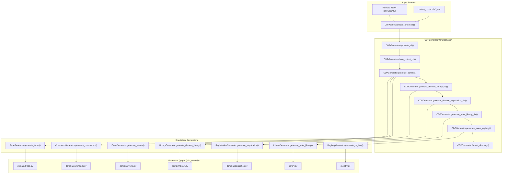
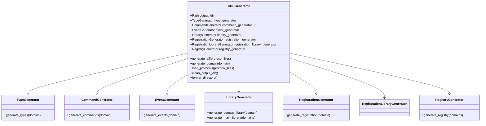
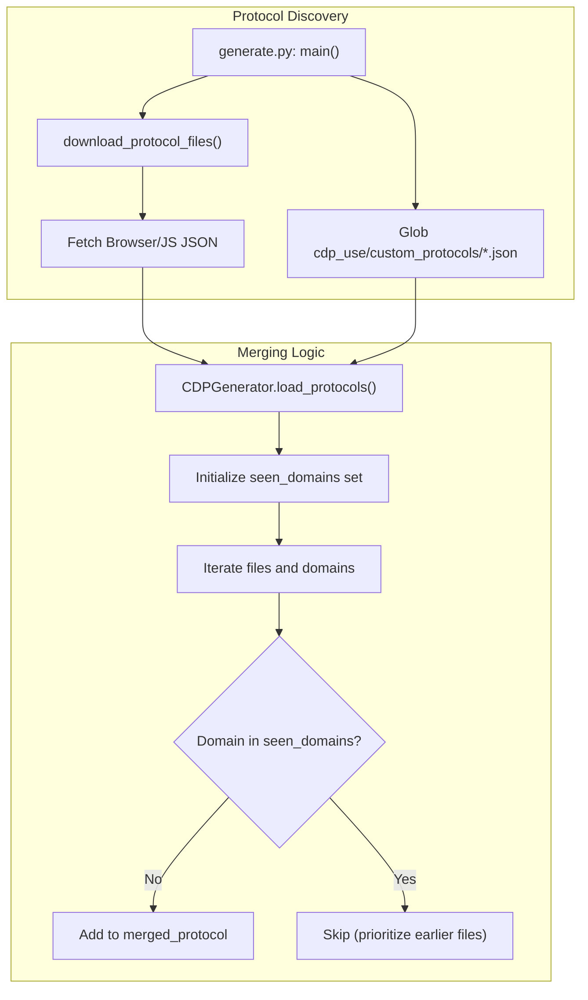

<!-- source: DeepWiki mcp.deepwiki.com · repo browser-use/cdp-use · page 5 Code Generation System · fetched 2026-10-30 -->

# Code Generation System

<details>
<summary>Relevant source files</summary>

The following files were used as context for generating this wiki page:

- [README.md](README.md)
- [Taskfile.yml](Taskfile.yml)
- [cdp_use/custom_protocols/browseruse.json](cdp_use/custom_protocols/browseruse.json)
- [cdp_use/generator/constants.py](cdp_use/generator/constants.py)
- [cdp_use/generator/generate.py](cdp_use/generator/generate.py)
- [cdp_use/generator/generator.py](cdp_use/generator/generator.py)
- [cdp_use/generator/library_generator.py](cdp_use/generator/library_generator.py)

</details>


This document covers the automated code generation system that transforms Chrome DevTools Protocol (CDP) specifications into type-safe Python bindings. The system downloads CDP JSON specifications and generates comprehensive Python libraries with `TypedDict` classes, command interfaces, and event handlers.

For information about the generated library structure and usage, see [Generated Library Architecture](#2.4). For details about how type safety is implemented in the generated code, see [Type Safety System](#2.3).

## Purpose and Architecture

The code generation system serves as the foundation of the `cdp-use` library by automatically creating Python bindings that provide compile-time type safety for CDP interactions. The system processes official CDP protocol specifications from Google Chrome and generates complete Python packages for each CDP domain.

### Generation Pipeline Overview



Sources: [cdp_use/generator/generator.py:100-139](), [cdp_use/generator/generate.py:45-58]()

### Generator Class Hierarchy

The `CDPGenerator` class orchestrates multiple specialized generator classes that handle different aspects of code generation:



Sources: [cdp_use/generator/generator.py:22-31]()

## Generation Stages

The generation process is divided into several specialized stages, each handled by a dedicated module.

### 5.1 Generation Overview
The entry point for the system is `cdp_use.generator.generate.py`. It manages the lifecycle of fetching remote protocol files (Browser and JS protocols) based on the `CDP_VERSION` and `DEVTOOLS_PROTOCOL_TAG` constants, discovering local JSON files in `cdp_use/custom_protocols/`, and invoking the `CDPGenerator`.

For details, see [Generation Overview](#5.1).
Sources: [cdp_use/generator/generate.py:39-72](), [cdp_use/generator/constants.py:21-39]()

### 5.2 Type Generation
Handled by `TypeGenerator`, this stage transforms CDP type definitions into Python-compatible structures. It maps CDP primitive types to Python types, generates `TypedDict` subclasses for objects, and handles optional fields.

For details, see [Type Generation](#5.2).
Sources: [cdp_use/generator/generator.py:149-151](), [cdp_use/generator/generator.py:25]()

### 5.3 Command Generation
Handled by `CommandGenerator`, this stage processes CDP command specifications. It generates `Params` and `Returns` `TypedDict` classes for every command in a domain, which are later used to provide type hints for the client methods.

For details, see [Event Generation](#5.4).
Sources: [cdp_use/generator/generator.py:153-155](), [cdp_use/generator/library_generator.py:31-38]()

### 5.4 Event Generation
Handled by `EventGenerator`, this stage creates type definitions for CDP event payloads. These definitions ensure that when a user registers a callback for an event, the `event_data` parameter is correctly typed.

For details, see [Event Generation](#5.4).
Sources: [cdp_use/generator/generator.py:157-159](), [cdp_use/generator/generator.py:27]()

### 5.5 Library Generation
Handled by `LibraryGenerator` and `RegistrationGenerator`, this stage produces the high-level API. It generates `DomainClient` classes where each CDP command becomes an `async` method that wraps `send_raw`, and registration classes that wrap `EventRegistry.register`.

For details, see [Library Generation](#5.5).
Sources: [cdp_use/generator/library_generator.py:79-138](), [cdp_use/generator/generator.py:165-178]()

## Protocol Merging and Custom Protocols

The generator handles multiple CDP protocol specification files by merging them into a unified protocol definition. This allows the inclusion of custom domains, such as `BrowserUse`, which defines automation-specific events like `captchaSolverStarted`.



Sources: [cdp_use/generator/generate.py:42-58](), [cdp_use/generator/generator.py:41-68](), [cdp_use/custom_protocols/browseruse.json:4-8]()

## Output Directory Management

The system manages the generated code directory through several key methods. After generation, it uses `ruff` to ensure the generated code follows project style guidelines.

| Action | Code Entity | File Path |
|---|---|---|
| **Cleanup** | `clean_output_dir()` | [cdp_use/generator/generator.py:70-77]() |
| **Writing** | `write_file()` | [cdp_use/generator/generator.py:195-199]() |
| **Formatting** | `format_directory()` | [cdp_use/generator/generator.py:78-98]() |

Sources: [cdp_use/generator/generator.py:70-98]()

## Auto-Generated Code Headers

All generated files include a standard header generated by `get_auto_generated_header()` to indicate they should not be manually edited:

```python
# This file is auto-generated by the CDP protocol generator.
# Do not edit this file manually as your changes will be overwritten.
# Generated from Chrome DevTools Protocol specifications.
```

Sources: [cdp_use/generator/generator.py:33-39]()

---

