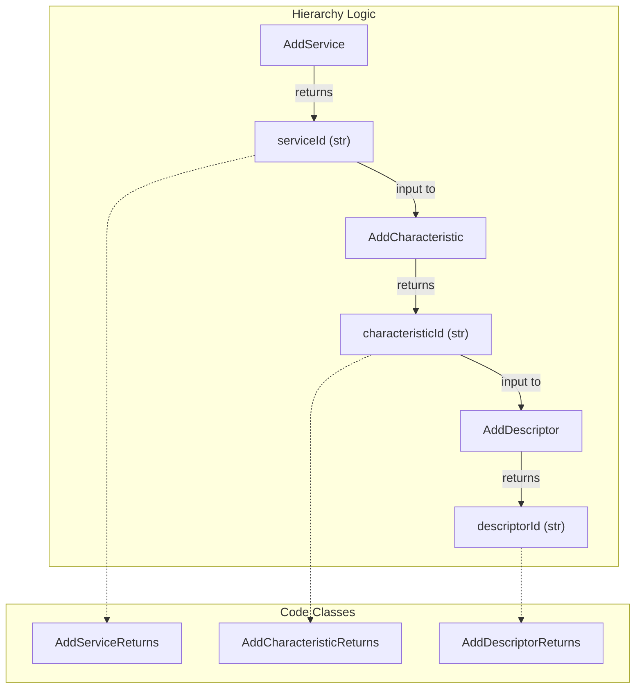
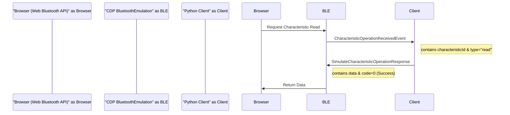

<!-- source: DeepWiki mcp.deepwiki.com · repo browser-use/cdp-use · page 6.5 Bluetooth Emulation Domain · fetched 2026-10-30 -->

# Bluetooth Emulation Domain

Relevant source files

The following files were used as context for generating this wiki page:

- [cdp_use/cdp/accessibility/commands.py](cdp_use/cdp/accessibility/commands.py)
- [cdp_use/cdp/audits/commands.py](cdp_use/cdp/audits/commands.py)
- [cdp_use/cdp/autofill/commands.py](cdp_use/cdp/autofill/commands.py)
- [cdp_use/cdp/autofill/types.py](cdp_use/cdp/autofill/types.py)
- [cdp_use/cdp/backgroundservice/types.py](cdp_use/cdp/backgroundservice/types.py)
- [cdp_use/cdp/bluetoothemulation/commands.py](cdp_use/cdp/bluetoothemulation/commands.py)
- [cdp_use/cdp/bluetoothemulation/events.py](cdp_use/cdp/bluetoothemulation/events.py)
- [cdp_use/cdp/bluetoothemulation/types.py](cdp_use/cdp/bluetoothemulation/types.py)
- [cdp_use/cdp/browser/events.py](cdp_use/cdp/browser/events.py)
- [cdp_use/cdp/deviceaccess/types.py](cdp_use/cdp/deviceaccess/types.py)

The Bluetooth Emulation Domain provides type-safe bindings for the Chrome DevTools Protocol's `BluetoothEmulation` domain, enabling automated testing of Bluetooth Low Energy (BLE) functionality in web applications. This domain allows developers to simulate Bluetooth Central and Peripheral devices, GATT services, characteristics, descriptors, and their associated operations without requiring physical Bluetooth hardware.

For information about other CDP domains, see the Domain Reference ([#6]()). For details about how these bindings are generated, see Code Generation System ([#5]()).

## Domain Overview

The BluetoothEmulation domain enables comprehensive simulation of Bluetooth Low Energy ecosystems for web testing. It provides control over both sides of BLE communication:

- **Central Device Simulation**: Simulating the device that scans for and connects to peripherals.
- **Peripheral Device Simulation**: Simulating devices that advertise services and accept connections.
- **GATT Protocol Simulation**: Managing Generic Attribute Profile (GATT) services, characteristics, and descriptors.
- **Operation Response Simulation**: Controlling specific error codes and data returned to the browser during BLE operations.

### Architecture Entity Map

The following diagram maps the Natural Language concepts of Bluetooth Emulation to the specific Code Entities found in the generated library.

```mermaid
graph TD
    subgraph "Code Entity Space (cdp_use/cdp/bluetoothemulation)"
        direction TB
        T["types.py"]
        C["commands.py"]
        E["events.py"]
        
        subgraph "Types & Enums"
            CS["CentralState"]
            GOT["GATTOperationType"]
            COT["CharacteristicOperationType"]
            CP["CharacteristicProperties"]
        end
        
        subgraph "Command Parameters"
            EP["EnableParameters"]
            ASP["AddServiceParameters"]
            ACP["AddCharacteristicParameters"]
            SGO["SimulateGATTOperationResponseParameters"]
        end
        
        subgraph "Event Payloads"
            GOE["GattOperationReceivedEvent"]
            COE["CharacteristicOperationReceivedEvent"]
        end
    end

    subgraph "Natural Language Space"
        direction TB
        N1["Central Controller"] -- "uses" --> CS
        N2["GATT Service"] -- "defined by" --> ASP
        N3["Characteristic"] -- "configured with" --> CP
        N4["Browser Request"] -- "triggers" --> GOE
        N5["Mock Response"] -- "sent via" --> SGO
    end

    T --- CS
    T --- GOT
    T --- COT
    T --- CP
    C --- EP
    C --- ASP
    C --- ACP
    C --- SGO
    E --- GOE
    E --- COE
```

Sources: [cdp_use/cdp/bluetoothemulation/types.py:1-80](), [cdp_use/cdp/bluetoothemulation/commands.py:1-110](), [cdp_use/cdp/bluetoothemulation/events.py:1-47]()

## Command Structure

The domain's commands are organized into several functional categories, each serving different aspects of Bluetooth emulation.

### Central State Management

Controls the simulated Bluetooth central device that initiates connections. The state is represented by the `CentralState` literal which can be `absent`, `powered-off`, or `powered-on` [cdp_use/cdp/bluetoothemulation/types.py:11-12]().

| Command | Parameters | Purpose |
|---------|------------|---------|
| `Enable` | `EnableParameters` | Initialize emulation and set initial state/LE support [cdp_use/cdp/bluetoothemulation/commands.py:22-27]() |
| `SetSimulatedCentralState` | `SetSimulatedCentralStateParameters` | Dynamically update the central device state [cdp_use/cdp/bluetoothemulation/commands.py:29-32]() |

### Peripheral and Advertisement Simulation

Simulates peripheral devices and their advertisement packets. This includes `ManufacturerData` [cdp_use/cdp/bluetoothemulation/types.py:35-44]() and `ScanRecord` structures [cdp_use/cdp/bluetoothemulation/types.py:46-58]().

| Command | Parameters | Purpose |
|---------|------------|---------|
| `SimulatePreconnectedPeripheral` | `SimulatePreconnectedPeripheralParameters` | Create a peripheral that is already "known" to the system [cdp_use/cdp/bluetoothemulation/commands.py:34-39]() |
| `SimulateAdvertisement` | `SimulateAdvertisementParameters` | Broadcast a `ScanEntry` to trigger browser discovery [cdp_use/cdp/bluetoothemulation/commands.py:41-43]() |

### GATT Structure Management

Manages the hierarchical structure of GATT services, characteristics, and descriptors. Adding these components returns unique identifiers used for subsequent operations.

- **Services**: Defined by a UUID and associated with a device address [cdp_use/cdp/bluetoothemulation/commands.py:65-73]().
- **Characteristics**: Configured with `CharacteristicProperties` (read, write, notify, etc.) [cdp_use/cdp/bluetoothemulation/types.py:68-80]() and linked to a `serviceId` [cdp_use/cdp/bluetoothemulation/commands.py:79-88]().
- **Descriptors**: Linked to a `characteristicId` [cdp_use/cdp/bluetoothemulation/commands.py:94-102]().

Sources: [cdp_use/cdp/bluetoothemulation/commands.py:65-106]()

### Operation Response Simulation

Controls how the simulated peripherals respond to GATT operations initiated by the browser. This allows testing of both success and error paths (e.g., security errors, timeouts).

| Command | Target | Key Parameters |
|---------|--------|----------------|
| `SimulateGATTOperationResponse` | Connection | `address`, `GATTOperationType`, `code` [cdp_use/cdp/bluetoothemulation/commands.py:45-49]() |
| `SimulateCharacteristicOperationResponse` | Characteristic | `characteristicId`, `CharacteristicOperationType`, `code`, `data` [cdp_use/cdp/bluetoothemulation/commands.py:51-56]() |
| `SimulateDescriptorOperationResponse` | Descriptor | `descriptorId`, `DescriptorOperationType`, `code`, `data` [cdp_use/cdp/bluetoothemulation/commands.py:58-63]() |

## Event Structure

The domain generates events when the browser attempts BLE operations, allowing test scripts to monitor and respond to simulated activity.

### Event Types

- **`GattOperationReceivedEvent`**: Fired for GATT-level operations like connection or discovery [cdp_use/cdp/bluetoothemulation/events.py:21-24]().
- **`CharacteristicOperationReceivedEvent`**: Fired for characteristic operations (read, write, subscribe). Includes `data` and `writeType` if the operation is a write [cdp_use/cdp/bluetoothemulation/events.py:31-36]().
- **`DescriptorOperationReceivedEvent`**: Fired for descriptor operations [cdp_use/cdp/bluetoothemulation/events.py:43-47]().

Sources: [cdp_use/cdp/bluetoothemulation/events.py:17-47]()

## Type Safety Integration

The Bluetooth Emulation domain leverages `TypedDict` for strict parameter and return validation.

### Type Definitions
- **Enums as Literals**: `CentralState`, `GATTOperationType`, `CharacteristicWriteType`, `CharacteristicOperationType`, and `DescriptorOperationType` are all implemented as `Literal` types [cdp_use/cdp/bluetoothemulation/types.py:11-33]().
- **Complex Structures**: `ScanRecord` and `CharacteristicProperties` use `total=False` to allow optional fields while maintaining type checking for the fields that are present [cdp_use/cdp/bluetoothemulation/types.py:46-80]().

### Cross-Domain References
The domain maintains clean boundaries by using `TYPE_CHECKING` blocks for imports from other domains if necessary, though this specific domain is largely self-contained in its command and event definitions [cdp_use/cdp/bluetoothemulation/commands.py:12-20]().

Sources: [cdp_use/cdp/bluetoothemulation/types.py:7-10](), [cdp_use/cdp/bluetoothemulation/commands.py:7-20]()

---

