# Page: Overview

# Overview

<details>
<summary>Relevant source files</summary>

The following files were used as context for generating this wiki page:

- [.python-version](.python-version)
- [README.md](README.md)
- [Taskfile.yml](Taskfile.yml)
- [cdp_use/__init__.py](cdp_use/__init__.py)
- [cdp_use/custom_protocols/browseruse.json](cdp_use/custom_protocols/browseruse.json)
- [cdp_use/py.typed](cdp_use/py.typed)
- [pyproject.toml](pyproject.toml)

</details>


This document provides a comprehensive overview of the `cdp-use` library, a type-safe Python client generator for the Chrome DevTools Protocol (CDP). The library automatically generates Python bindings with full type safety from official CDP protocol specifications, enabling developers to interact with Chrome browsers programmatically with compile-time guarantees and IDE support.

For details on how the codebase is organized, see [Project Structure](#1.1). For information on runtime requirements and setup, see [Dependencies and Environment](#1.2).

## System Architecture

The `cdp-use` library consists of two main subsystems: a WebSocket-based CDP client and an automated code generation pipeline that creates type-safe Python bindings.

Title: System Component Interaction
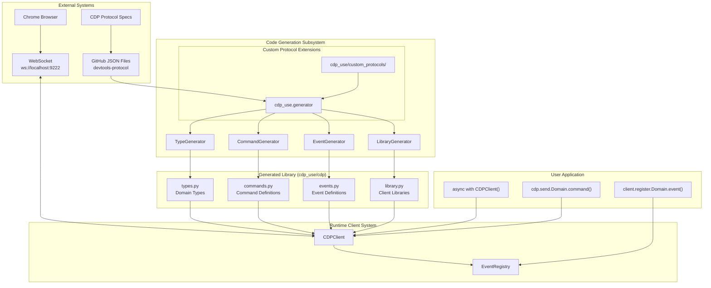
Sources: [README.md:1-13](), [README.md:177-201](), [cdp_use/custom_protocols/browseruse.json:1-5]()

## Core Components

The system is organized around several key components that work together to provide type-safe CDP interactions:

| Component | Purpose | Key Classes |
|-----------|---------|-------------|
| **CDPClient** | WebSocket communication and session management | `CDPClient` [cdp_use/client.py:1]() |
| **Event Registry** | Async event handling and callback dispatch | `EventRegistry` [README.md:197]() |  
| **Code Generator** | Orchestrates the generation of Python bindings | `cdp_use.generator` [README.md:27]() |
| **CDP Library** | Proxy for sending typed commands to domains | `CDPLibrary` [README.md:188]() |
| **Registration Library** | Proxy for registering typed event handlers | `CDPRegistrationLibrary` [README.md:196]() |

The `CDPClient` class serves as the main entry point, providing two primary interfaces:
- `client.send`: Access to type-safe CDP command execution via `CDPLibrary`.
- `client.register`: Access to type-safe event registration via `CDPRegistrationLibrary`.

Sources: [README.md:181-201](), [cdp_use/__init__.py:1-3]()

## Code Generation Pipeline

The library uses an automated pipeline to transform CDP protocol specifications into type-safe Python code. This includes official protocols and custom extensions like `browseruse.json` [cdp_use/custom_protocols/browseruse.json:1-4]().

Title: Data Flow from Protocol to Code
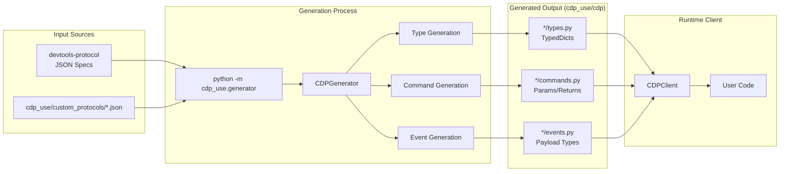

The generation process downloads the latest CDP specifications and creates:
- **Types**: `TypedDict` classes for complex CDP data structures.
- **Commands**: Parameter and return type definitions for CDP commands.
- **Events**: Payload type definitions for CDP events.
- **Libraries**: Domain-specific client classes with type-safe method signatures.

Sources: [README.md:24-30](), [README.md:159-175](), [Taskfile.yml:4-7]()

## Package Structure

The library is organized into distinct modules with clear separation between core functionality and generated code. The generator logic is specifically excluded from the final build to keep the runtime lightweight [pyproject.toml:32-32]().

Title: Repository Layout
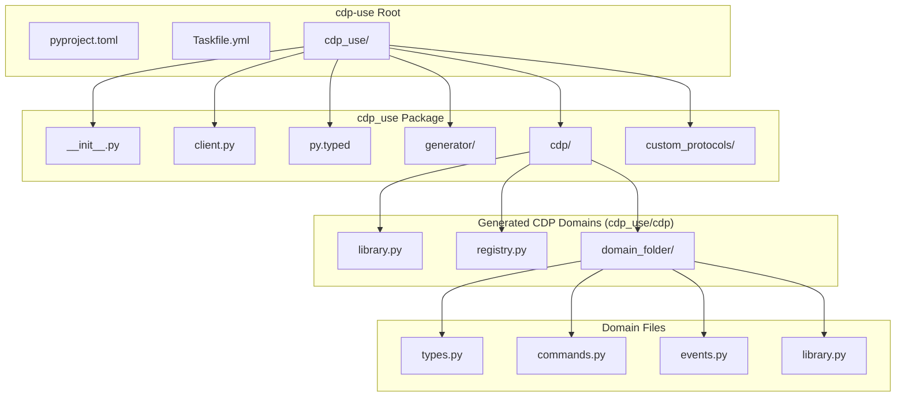

The library includes a `py.typed` marker file [cdp_use/py.typed:1]() to signal to type checkers that it provides inline type hints (PEP 561).

Sources: [pyproject.toml:30-32](), [README.md:161-175](), [cdp_use/py.typed:1]()

## Type Safety System

The library achieves compile-time type safety through automatically generated `TypedDict` classes and type hints. This ensures that parameters like `expression` in `Runtime.evaluate` are correctly typed as strings [README.md:57-60]().

| Type Category | Implementation | Example Usage |
|---------------|----------------|---------------|
| **Command Parameters** | `TypedDict` classes | `await cdp.send.Page.navigate({"url": "..."})` |
| **Return Types** | `TypedDict` classes | `result = await cdp.send.DOM.getDocument(...)` |  
| **Event Payloads** | `TypedDict` classes | `def on_event(event: ConsoleAPICalledEvent, ...)` |
| **Method Signatures** | Type-hinted methods | `client.register.Page.frameAttached(callback)` |

This enables full IDE support with autocompletion, parameter validation, and compile-time error detection for all CDP interactions.

Sources: [README.md:7-10](), [README.md:53-68](), [README.md:108-114]()

---

# Page: Project Structure

# Project Structure

<details>
<summary>Relevant source files</summary>

The following files were used as context for generating this wiki page:

- [README.md](README.md)
- [Taskfile.yml](Taskfile.yml)
- [cdp_use/cdp/__init__.py](cdp_use/cdp/__init__.py)
- [cdp_use/custom_protocols/browseruse.json](cdp_use/custom_protocols/browseruse.json)
- [cdp_use/generator/__init__.py](cdp_use/generator/__init__.py)
- [pyproject.toml](pyproject.toml)

</details>


This document explains the organization and layout of the `cdp-use` repository, detailing the relationship between handwritten core logic, the code generation system, and the resulting type-safe CDP bindings. The project is designed as a two-layer architecture: a runtime client that manages WebSocket communication and an auto-generated library that provides domain-specific type hints.

## Repository Layout

The repository is organized to separate the generation logic from the runtime library. This allows developers to regenerate the protocol bindings whenever the Chrome DevTools Protocol updates without modifying the core client logic.

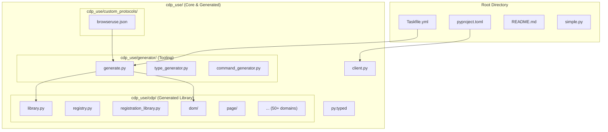

**Sources**: [pyproject.toml:30-32](), [cdp_use/cdp/__init__.py:7-64](), [README.md:161-175](), [Taskfile.yml:4-7]()

## Package Organization

The codebase is split into three functional areas:

### 1. Core Runtime (`cdp_use/`)
Contains the handwritten logic for managing connections.
- `client.py`: Implements `CDPClient`, the primary entry point for users. It manages the `websockets` connection and coordinates between the command-sending `CDPLibrary` and the event-handling `CDPRegistrationLibrary` [README.md:182-201]().
- `py.typed`: A marker file indicating the package provides inline type hints for PEP 561 compliance [pyproject.toml:31]().

### 2. Code Generation System (`cdp_use/generator/`)
This sub-package is responsible for transforming JSON protocol definitions into Python code.
- **Input**: It fetches official specifications and reads local extensions from `cdp_use/custom_protocols/` (e.g., `browseruse.json` for custom automation events) [cdp_use/custom_protocols/browseruse.json:1-92]().
- **Logic**: Individual modules like `type_generator.py` and `command_generator.py` handle the mapping of CDP primitives to Python `TypedDict` and `async` methods [README.md:205-215]().
- **Exclusion**: The generator is excluded from the final distribution build to keep the runtime package lightweight [pyproject.toml:32]().

### 3. Generated CDP Library (`cdp_use/cdp/`)
The output of the generator. It contains a directory for every CDP domain (e.g., `dom`, `page`, `network`).
- Each domain directory typically contains:
    - `types.py`: `TypedDict` definitions for domain objects [README.md:167]().
    - `commands.py`: Parameter and return types for domain methods [README.md:168]().
    - `events.py`: Payload types for domain-specific events [README.md:169]().
    - `library.py`: The `DomainClient` class providing the typed command interface [README.md:170]().
    - `registration.py`: The interface for registering typed event callbacks [README.md:171]().

**Sources**: [pyproject.toml:30-32](), [README.md:161-175](), [cdp_use/cdp/__init__.py:7-60]()

## Data Flow and Component Interaction

The following diagram illustrates how the handwritten `CDPClient` interacts with the generated `CDPLibrary` and `CDPRegistrationLibrary` to provide a type-safe user experience.

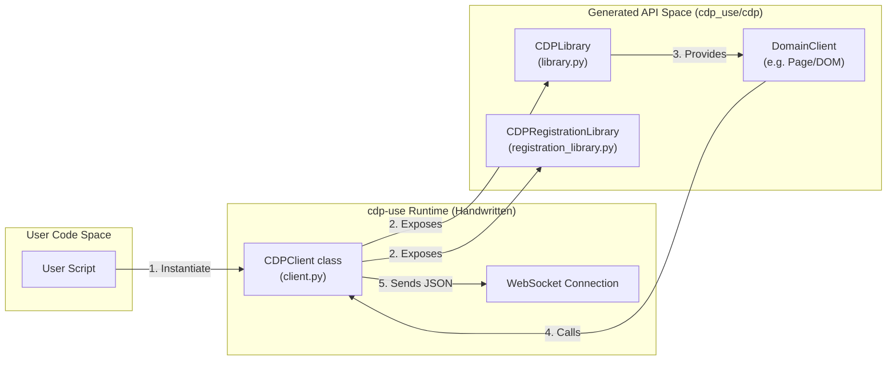

**Sources**: [README.md:37-50](), [README.md:182-201](), [cdp_use/cdp/__init__.py:62-64]()

## Configuration and Build System

The project uses `hatchling` as the build backend and `uv` for dependency management.

| Configuration File | Role | Key Entities |
|:---|:---|:---|
| `pyproject.toml` | Metadata & Build Rules | `[project]`, `[tool.hatch.build]`, `[tool.ruff.lint.per-file-ignores]` [pyproject.toml:1-44]() |
| `Taskfile.yml` | Automation | `generate`, `build`, `lint`, `format-json` [Taskfile.yml:1-48]() |
| `custom_protocols/` | Protocol Extensions | `BrowserUse` domain, `captchaSolverStarted` event [cdp_use/custom_protocols/browseruse.json:4-10]() |

### Linting and Quality Control
The project uses `ruff` for linting. Because the generated code in `cdp_use/cdp/` uses wildcard imports and redefinitions to maintain the protocol's structure, specific linting rules (`F403`, `F811`) are ignored for that directory [pyproject.toml:41-43]().

**Sources**: [pyproject.toml:23-44](), [Taskfile.yml:1-48]()

---

# Page: Dependencies and Environment

# Dependencies and Environment

<details>
<summary>Relevant source files</summary>

The following files were used as context for generating this wiki page:

- [.github/workflows/lint.yml](.github/workflows/lint.yml)
- [LICENSE](LICENSE)
- [cdp_use/py.typed](cdp_use/py.typed)
- [pyproject.toml](pyproject.toml)
- [uv.lock](uv.lock)

</details>


This document details the runtime and development dependencies, Python version requirements, and environment setup for the `cdp-use` library. It covers package management configuration via `uv`, the build system, and the significance of type safety markers for PEP 561 compliance.

## Python Version Requirements

The `cdp-use` library requires Python 3.11 or higher. This requirement is enforced at multiple levels in the project configuration to ensure compatibility with modern typing features and async performance.

| Configuration Level | Requirement | Source |
|-------------------|-------------|---------|
| Project Metadata | `requires-python = ">=3.11"` | [pyproject.toml:7-7]() |
| Dependency Lock | `requires-python = ">=3.11"` | [uv.lock:3-3]() |

The Python 3.11+ requirement enables:
- **Advanced Typing**: Extensive use of `TypedDict` and `NotRequired` for CDP command parameters and event payloads.
- **Async Improvements**: Optimized `asyncio` task groups and improved WebSocket handling.
- **Performance**: Faster startup and execution times for the code generator.

Sources: [pyproject.toml:7-7](), [uv.lock:3-3]()

## Runtime Dependencies

The library maintains a lean set of runtime dependencies to minimize the footprint of browser automation tasks.

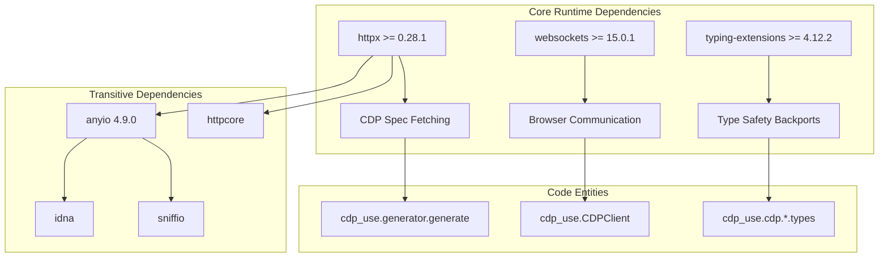

### websockets
The `websockets` library is the primary communication channel for the `CDPClient`. It handles the low-level frame management and connection lifecycle with the Chrome DevTools Protocol server.
- **Version**: `>=15.0.1` [pyproject.toml:17-17]()
- **Implementation**: Used in `CDPClient` to establish connections to the browser's debugger URL.

### httpx
Used primarily by the generator and for initial browser discovery (fetching `/json/version`).
- **Version**: `>=0.28.1` [pyproject.toml:15-15]()
- **Implementation**: Provides async HTTP capabilities for retrieving the protocol JSON from the `ChromeDevTools/devtools-protocol` repository.

### typing-extensions
Provides backports for modern typing features (like `TypedDict`, `Annotated`, and `Literal`) to ensure the generated CDP bindings remain type-safe across all supported Python 3.11+ versions.
- **Version**: `>=4.12.2` [pyproject.toml:16-16]()

Sources: [pyproject.toml:14-18](), [uv.lock:34-41](), [uv.lock:103-115]()

## Development Dependencies

Development tools are managed via `dependency-groups` in `pyproject.toml`.

| Tool | Version | Purpose |
|------|---------|---------|
| `ruff` | `>=0.12.2` | Linting and formatting of handwritten and generated code. |
| `build` | `>=1.2.2.post1` | PEP 517 package building. |
| `anyio` | `4.9.0` | Asynchronous compatibility layer used by `httpx`. |

### Ruff Configuration
The project uses `ruff` for strict linting. Specific rules are ignored for the `cdp_use/cdp/` directory because the auto-generated code intentionally uses wildcard imports to simplify the domain-based API.
- **Wildcard Import Ignore**: `F403` [pyproject.toml:43-43]()
- **Redefinition Ignore**: `F811` [pyproject.toml:43-43]()

Sources: [pyproject.toml:27-29](), [pyproject.toml:34-44](), [uv.lock:5-17]()

## Build System and PEP 561 Compliance

The project utilizes `hatchling` as the build backend and follows PEP 561 for distributing type information.

### py.typed Marker
The file `cdp_use/py.typed` is an empty marker file that signals to static type checkers (like Mypy or Pyright) that the package provides inline type hints.
- **Location**: `cdp_use/py.typed` [cdp_use/py.typed:1-1]()
- **Inclusion**: Explicitly included in the build distribution [pyproject.toml:31-31]().

### Hatchling Build Configuration
The build process separates the runtime library from the code generation tools.

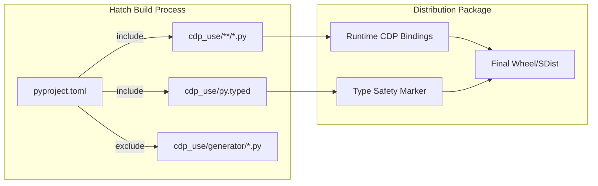

- **Build Backend**: `hatchling.build` [pyproject.toml:25-25]()
- **Exclusion Logic**: The generator scripts are excluded from the final package to keep the installation lightweight for end-users [pyproject.toml:32-32]().

Sources: [pyproject.toml:23-25](), [pyproject.toml:30-32](), [cdp_use/py.typed:1-1]()

## Dependency Management with uv

The project uses `uv` for reproducible environments. The `uv.lock` file ensures that all developers and CI pipelines use the exact same versions of dependencies, including transitive ones like `anyio` and `idna`.

### CI Workflow
The GitHub Actions pipeline utilizes `astral-sh/setup-uv` to verify the environment:
1. **lint-syntax**: Runs `ruff check` to catch Python syntax errors [lint.yml:15-23]().
2. **lint-style**: Runs full `ruff` linting [lint.yml:25-33]().
3. **import-check**: Verifies the environment by attempting to import `CDPClient` [lint.yml:35-43]().

Sources: [uv.lock:1-17](), [.github/workflows/lint.yml:1-44]()

---

# Page: Architecture

# Architecture

<details>
<summary>Relevant source files</summary>

The following files were used as context for generating this wiki page:

- [README.md](README.md)
- [Taskfile.yml](Taskfile.yml)
- [cdp_use/cdp/registry.py](cdp_use/cdp/registry.py)
- [cdp_use/client.py](cdp_use/client.py)
- [cdp_use/custom_protocols/browseruse.json](cdp_use/custom_protocols/browseruse.json)
- [cdp_use/generator/registry_generator.py](cdp_use/generator/registry_generator.py)

</details>


This document describes the high-level technical architecture of the `cdp-use` library, including the WebSocket-based CDP client system and the automated code generation pipeline that creates type-safe Python bindings from Chrome DevTools Protocol specifications.

For specific implementation details of individual components, see [CDPClient System](#2.1), [Code Generation Pipeline](#2.2), [Type Safety System](#2.3), and [Generated Library Architecture](#2.4).

## System Overview

`cdp-use` implements a two-phase architecture: a build-time code generation phase that produces type-safe Python bindings from CDP specifications, and a runtime client system that uses these bindings to communicate with Chrome via WebSocket.

### Three-Layer Model

The system is organized into three distinct layers:
1.  **The Generator**: A set of modules that ingest CDP JSON protocols (both official and custom) to produce Python source code.
2.  **The Runtime Client**: A handwritten `CDPClient` that manages the low-level `websockets` connection, message IDs, and asynchronous event loops.
3.  **The Generated Library**: A massive collection of over 50 domain-specific modules (e.g., `Page`, `DOM`, `Network`) that provide the type-safe API for commands and events.

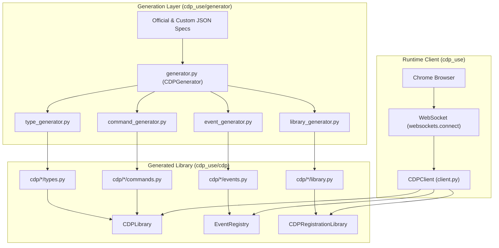

Sources: [cdp_use/generator/generator.py:10-35](), [cdp_use/client.py:217-236](), [cdp_use/cdp/registry.py:14-18]()

## Core Components

The architecture consists of four primary components that work together to provide type-safe CDP communication:

| Component | Purpose | Key Classes |
|-----------|---------|-------------|
| **CDPClient** | WebSocket communication and session management | `CDPClient`, `WebSocketLogFilter` |
| **EventRegistry** | Centralized asynchronous CDP event dispatching | `EventRegistry` |
| **Code Generation** | Automated binding generation from JSON protocols | `CDPGenerator`, `TypeGenerator`, `LibraryGenerator` |
| **Generated Library** | Domain-specific proxies for commands and events | `CDPLibrary`, `CDPRegistrationLibrary` |

### CDPClient Communication Architecture

The `CDPClient` manages the lifecycle of the connection and correlates requests to responses using a `pending_requests` map. It uses an internal `_handle_messages` loop to process incoming data from the WebSocket.

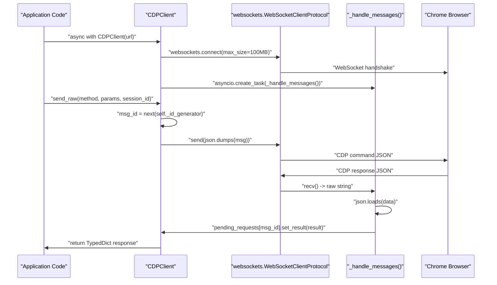

Sources: [cdp_use/client.py:287-347](), [cdp_use/client.py:349-378](), [cdp_use/client.py:408-435]()

### Event System Architecture

The event handling system uses a registry pattern to dispatch CDP events. When `_handle_messages` detects a message with a `method` but no `id`, it is treated as an event and routed to the `EventRegistry`.

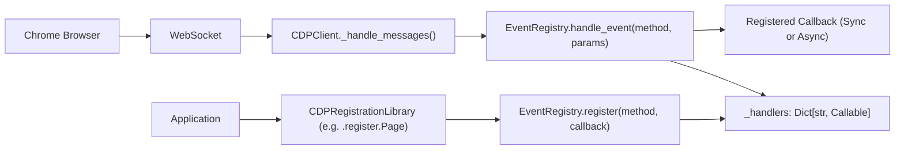

The `EventRegistry` supports both synchronous and asynchronous callback functions, detecting the function type using `inspect.isawaitable()` to ensure proper execution within the `asyncio` loop.

Sources: [cdp_use/cdp/registry.py:18-34](), [cdp_use/cdp/registry.py:46-73](), [cdp_use/client.py:314-328]()

## Code Generation Pipeline

The generation system transforms CDP JSON specifications into type-safe Python code. It supports both the official DevTools protocol and custom additions, such as the `BrowserUse` domain.

- **Input**: Remote JSON from `ChromeDevTools/devtools-protocol` and local files in `cdp_use/custom_protocols/`.
- **Process**: The `CDPGenerator` iterates through every domain, invoking specialized generators for types, commands, and events.
- **Output**: A structured directory in `cdp_use/cdp/` where each domain has its own package containing `types.py`, `commands.py`, `events.py`, and `library.py`.

For details on the generation stages, see [Code Generation Pipeline](#2.2).

Sources: [cdp_use/generator/generator.py:100-139](), [cdp_use/custom_protocols/browseruse.json:1-5]()

## Type Safety Strategy

The library achieves compile-time type safety by mapping CDP's JSON schema directly to Python `TypedDict` classes. This provides:
- **IntelliSense**: Autocompletion for command parameters and event payloads.
- **Static Analysis**: `mypy` or `pyright` can validate that required fields are present and types match (e.g., `targetId` must be a string).
- **Documentation**: The generated types serve as inline documentation for the protocol.

For details on how types are mapped, see [Type Safety System](#2.3).

Sources: [cdp_use/generator/type_generator.py:12-45](), [README.md:53-68]()

## Debugging and Logging

A unique aspect of the architecture is the `WebSocketLogFilter`. It intercepts raw `websockets.client` logs and uses regex to transform them into human-readable CDP summaries, including PING/PONG latency monitoring and automatic truncation of large payloads.

Sources: [cdp_use/client.py:20-110](), [cdp_use/client.py:114-185]()

---

# Page: CDPClient System

# CDPClient System

<details>
<summary>Relevant source files</summary>

The following files were used as context for generating this wiki page:

- [.github/workflows/lint.yml](.github/workflows/lint.yml)
- [.python-version](.python-version)
- [LICENSE](LICENSE)
- [cdp_use/__init__.py](cdp_use/__init__.py)
- [cdp_use/client.py](cdp_use/client.py)

</details>


This document covers the core WebSocket-based CDP client architecture, including the main `CDPClient` class, event handling through `EventRegistry`, and the communication infrastructure that enables type-safe Chrome DevTools Protocol interactions. 

## Core Components Overview

The CDPClient system consists of three main components that work together to provide a robust WebSocket-based CDP client:

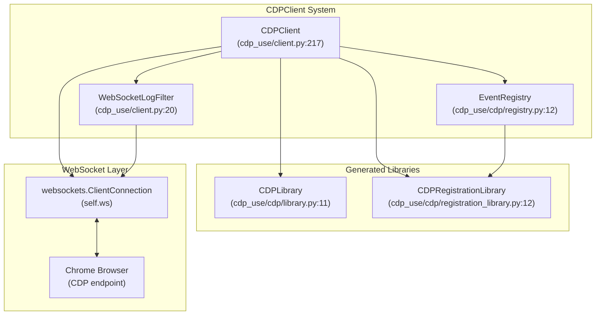

Sources: [cdp_use/client.py:217-237](), [cdp_use/cdp/registry.py:12-16]()

## CDPClient Class Architecture

The `CDPClient` class serves as the main entry point and orchestrates all WebSocket communication with Chrome. It implements the async context manager pattern and manages the lifecycle of connections and message handling.

### Core Attributes and Initialization

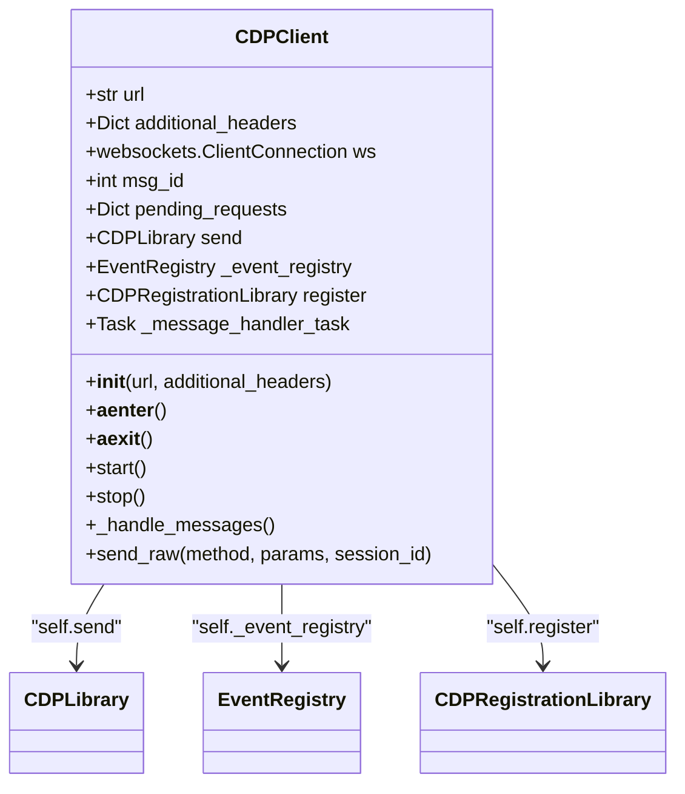

The client initializes three key components during construction [cdp_use/client.py:227-236]():
- `self.send`: A `CDPLibrary` instance providing type-safe command methods.
- `self._event_registry`: An `EventRegistry` for handling incoming CDP events.
- `self.register`: A `CDPRegistrationLibrary` for registering event callbacks.

Sources: [cdp_use/client.py:217-236]()

### Connection Lifecycle Management

The client supports both explicit lifecycle management and async context manager usage:

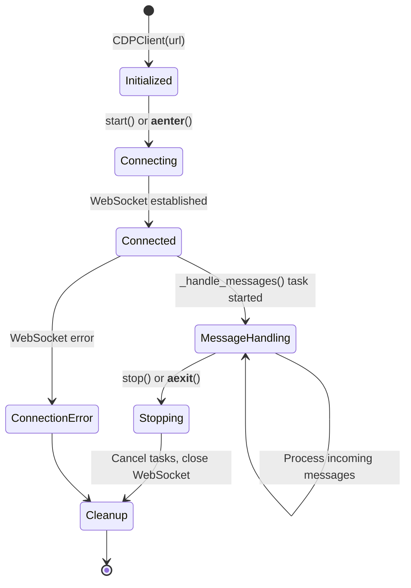

The `start()` method [cdp_use/client.py:251-263]() establishes the WebSocket connection with a 100MB message size limit (`max_size=100 * 1024 * 1024`) and starts the message handling task. The `stop()` method [cdp_use/client.py:265-285]() gracefully shuts down by canceling the background task and closing the connection.

Sources: [cdp_use/client.py:238-285]()

## Event Handling Architecture

The event handling system is built around the `EventRegistry` class, which manages callbacks for CDP events and supports both synchronous and asynchronous handlers.

### EventRegistry Implementation

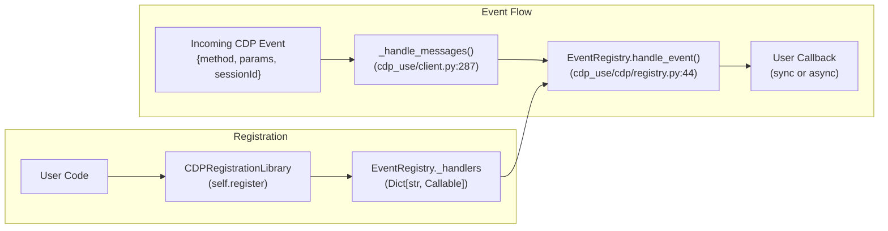

The `EventRegistry` class [cdp_use/cdp/registry.py:12-88]() provides:
- `register(method, callback)`: Register event handlers [cdp_use/cdp/registry.py:18-25]().
- `handle_event(method, params, session_id)`: Dispatch events to registered handlers [cdp_use/cdp/registry.py:44-78]().
- Support for both sync and async callbacks via `inspect.isawaitable` introspection [cdp_use/cdp/registry.py:67-73]().

Sources: [cdp_use/client.py:314-328](), [cdp_use/cdp/registry.py:44-78]()

### Message Processing Flow

The client processes three types of incoming messages in the `_handle_messages` loop [cdp_use/client.py:287-347]():

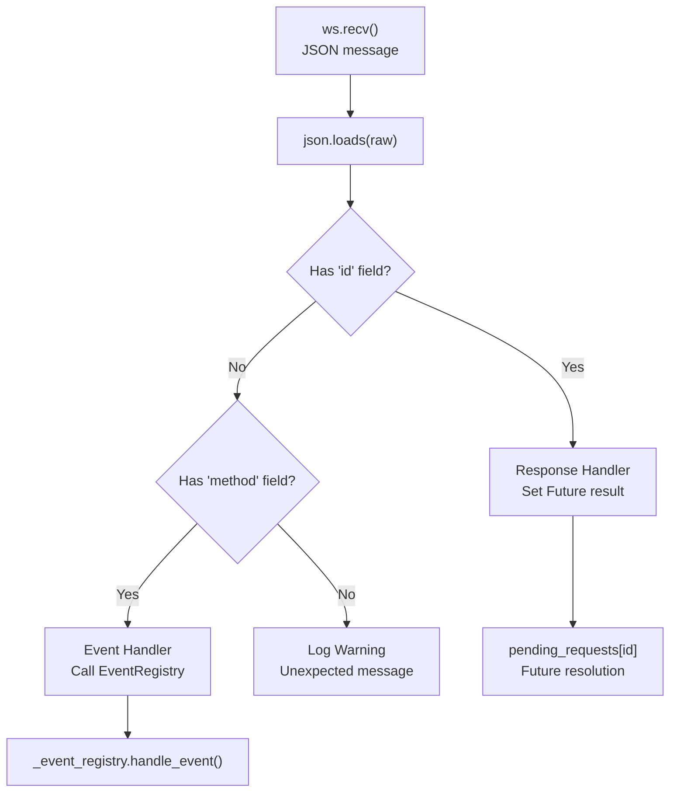

Sources: [cdp_use/client.py:287-347]()

## WebSocket Communication Flow

The following sequence diagram shows a typical CDP interaction cycle:

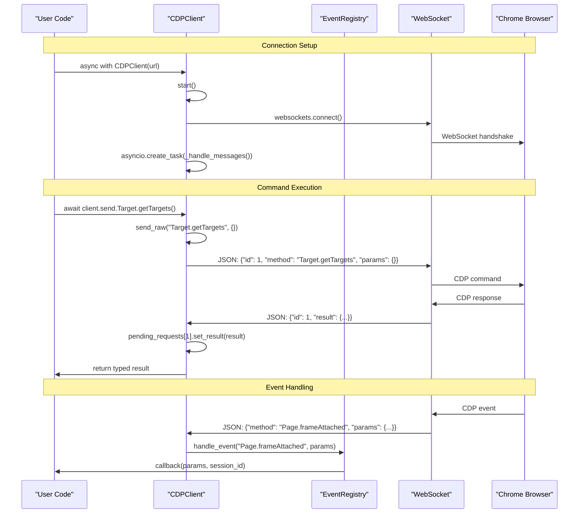

The client maintains request/response correlation through the `pending_requests` dictionary [cdp_use/client.py:223](), which maps message IDs to `asyncio.Future` objects that resolve when responses arrive [cdp_use/client.py:297-312]().

Sources: [cdp_use/client.py:349-378](), [cdp_use/client.py:297-312]()

## Logging and Monitoring

The `WebSocketLogFilter` class [cdp_use/client.py:20-211]() provides sophisticated logging for WebSocket communication, transforming raw `websockets` library logs into readable CDP message traces.

### WebSocket Log Processing

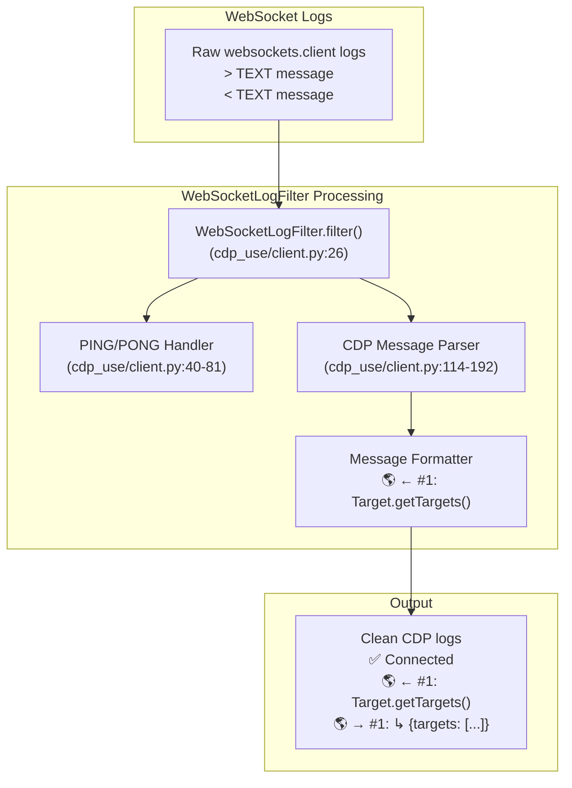

Key features of the logging system:
- **PING/PONG tracking**: Measures WebSocket ping latency and detects timeouts (>3s) [cdp_use/client.py:40-81]().
- **CDP message parsing**: Extracts method names, IDs, and parameters from JSON messages using regex [cdp_use/client.py:131-154]().
- **Direction indicators**: Uses emoji (🌎 ← for outgoing, 🌎 → for incoming) [cdp_use/client.py:150-152]().
- **Size filtering**: Shows message sizes only for large payloads (>5KB) [cdp_use/client.py:122-123]().
- **Result truncation**: Truncates long responses (>200 chars) to prevent log spam [cdp_use/client.py:172-173]().

Sources: [cdp_use/client.py:19-214]()

## Error Handling and Resilience

The client implements comprehensive error handling across multiple layers:

### Connection Error Handling

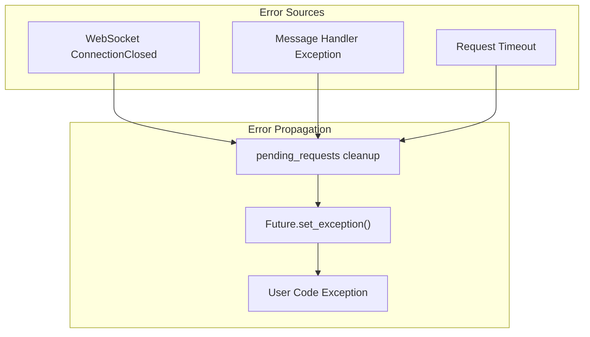

The message handler [cdp_use/client.py:334-347]() catches WebSocket connection errors and ensures all `pending_requests` are resolved with appropriate exceptions, preventing resource leaks and hanging awaits. If the browser returns an error field in the CDP response, the client raises a `RuntimeError` with the error details [cdp_use/client.py:309-311]().

Sources: [cdp_use/client.py:334-347](), [cdp_use/client.py:309-311](), [cdp_use/client.py:276-280]()

---

# Page: Code Generation Pipeline

# Code Generation Pipeline

<details>
<summary>Relevant source files</summary>

The following files were used as context for generating this wiki page:

- [README.md](README.md)
- [Taskfile.yml](Taskfile.yml)
- [cdp_use/custom_protocols/browseruse.json](cdp_use/custom_protocols/browseruse.json)
- [cdp_use/generator/__init__.py](cdp_use/generator/__init__.py)
- [cdp_use/generator/__main__.py](cdp_use/generator/__main__.py)
- [cdp_use/generator/constants.py](cdp_use/generator/constants.py)
- [cdp_use/generator/generate.py](cdp_use/generator/generate.py)
- [cdp_use/generator/generator.py](cdp_use/generator/generator.py)
- [cdp_use/generator/library_generator.py](cdp_use/generator/library_generator.py)

</details>


The Code Generation Pipeline is the core mechanism that transforms Chrome DevTools Protocol (CDP) specifications into type-safe Python bindings. This system automatically downloads official CDP protocol definitions, merges them with custom protocol extensions, and generates complete Python client libraries with full type safety, IntelliSense support, and domain-specific organization.

## Generation Process Overview

The generation pipeline follows a structured workflow that ensures consistency and type safety across all generated CDP domains. It is designed to be idempotent and easily reproducible.

### Pipeline Entry Point

The generation process is initiated through the main generator module. It can be invoked via the `Taskfile.yml` or directly using the Python module syntax:

```bash
# Using Taskfile (recommended)
task generate

# Or directly via python
python -m cdp_use.generator
```

Sources: [Taskfile.yml:4-7](), [README.md:24-28](), [cdp_use/generator/__main__.py:1-6]()

### Generation Workflow

The `CDPGenerator` class orchestrates the data flow from raw JSON specifications to formatted Python source files.

```mermaid
graph TB
    subgraph "Input Phase"
        A["`cdp_use.generator.generate.main`"] --> B["`download_protocol_files()`"]
        B --> C["`js_protocol.json` & `browser_protocol.json`"]
        A --> D["Scan `cdp_use/custom_protocols/*.json`"]
    end
    
    subgraph "Processing Phase"
        C & D --> E["`CDPGenerator.load_protocols()`"]
        E --> F["Merged Protocol Dictionary"]
        F --> G["`CDPGenerator.generate_all()`"]
    end
    
    subgraph "Generation Phase"
        G --> H["`TypeGenerator`"]
        G --> I["`CommandGenerator`"]
        G --> J["`EventGenerator`"]
        G --> K["`LibraryGenerator`"]
        G --> L["`RegistrationGenerator`"]
    end
    
    subgraph "Output Phase"
        H & I & J & K & L --> M["Write to `cdp_use/cdp/`"]
        M --> N["`ruff` format & fix"]
    end
```

Sources: [cdp_use/generator/generate.py:39-58](), [cdp_use/generator/generator.py:100-138](), [cdp_use/generator/generator.py:41-68]()

## Input Sources

The generator pulls from three primary sources to create the final unified API:

1.  **Remote JS Protocol**: Fetched from `ChromeDevTools/devtools-protocol` repository, covering V8-specific domains. [cdp_use/generator/constants.py:33-36]()
2.  **Remote Browser Protocol**: Fetched from the same repository, covering browser-level domains like `Page`, `Network`, and `DOM`. [cdp_use/generator/constants.py:28-31]()
3.  **Local Custom Protocols**: Any JSON files found in `cdp_use/custom_protocols/` are merged. This allows adding non-standard events like `BrowserUse.captchaSolverStarted`. [cdp_use/generator/generate.py:45-52](), [cdp_use/custom_protocols/browseruse.json:1-92]()

The protocol is pinned to a specific Chromium revision (e.g., `144.0.7559.109`) to ensure the generated types match the expected browser environment. [cdp_use/generator/constants.py:21-25]()

## Generator Components

The system uses a modular architecture where specific classes handle different parts of the Python code generation.

### Component Mapping

| Component | Class Name | Responsibility |
|-----------|------------|----------------|
| **Core Orchestrator** | `CDPGenerator` | Manages directory lifecycle, merging, and component invocation. [cdp_use/generator/generator.py:22-32]() |
| **Type Engine** | `TypeGenerator` | Maps CDP primitives to Python types and creates `TypedDict` for domain objects. [cdp_use/generator/generator.py:149-151]() |
| **Command Engine** | `CommandGenerator` | Generates `Parameters` and `Returns` `TypedDict` classes for each method. [cdp_use/generator/generator.py:153-155]() |
| **Event Engine** | `EventGenerator` | Generates event payload types used in callbacks. [cdp_use/generator/generator.py:157-159]() |
| **Library Engine** | `LibraryGenerator` | Generates the `DomainClient` classes and the top-level `CDPLibrary`. [cdp_use/generator/library_generator.py:10-15]() |
| **Registration Engine** | `RegistrationGenerator` | Generates type-safe event registration interfaces. [cdp_use/generator/generator.py:172-177]() |

### Code Entity Relationship

This diagram illustrates how the generator classes relate to the final code entities found in the `cdp_use` package.

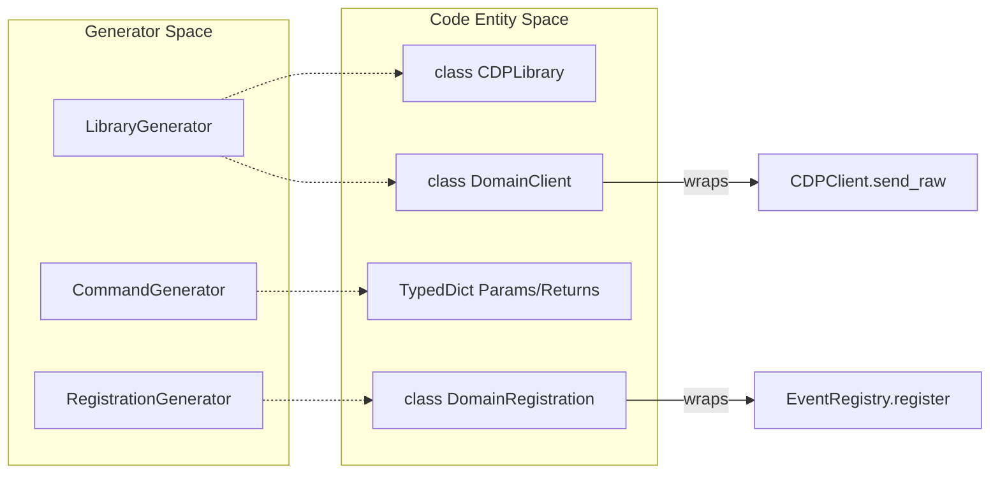

Sources: [cdp_use/generator/library_generator.py:119-136](), [cdp_use/generator/generator.py:165-182](), [README.md:182-201]()

## Output Structure

The pipeline produces a consistent directory structure under `cdp_use/cdp/`. For every domain (e.g., `Page`, `DOM`), a sub-package is created containing:

*   `types.py`: Domain-specific shared type definitions. [cdp_use/generator/generator.py:150-151]()
*   `commands.py`: `TypedDict` definitions for every command's parameters and return values. [cdp_use/generator/generator.py:154-155]()
*   `events.py`: `TypedDict` definitions for event payloads. [cdp_use/generator/generator.py:158-159]()
*   `library.py`: The `DomainClient` class containing async methods for that domain. [cdp_use/generator/generator.py:169-170]()
*   `registration.py`: The `DomainRegistration` class for attaching event handlers. [cdp_use/generator/generator.py:176-177]()
*   `__init__.py`: Exports the domain's primary interfaces. [cdp_use/generator/generator.py:162-163]()

At the root of the `cdp/` directory, the generator creates the aggregator files:
*   `library.py`: Contains the `CDPLibrary` class which holds instances of all domain clients. [cdp_use/generator/generator.py:181-182]()
*   `registration_library.py`: Contains the `CDPRegistrationLibrary` for all domain events. [cdp_use/generator/generator.py:188-189]()
*   `registry.py`: The central `EventRegistry` implementation. [cdp_use/generator/generator.py:184-186]()

Sources: [README.md:161-175](), [cdp_use/generator/generator.py:140-192]()

## Post-Generation Quality Assurance

After the files are written, the pipeline performs automated cleanup:

1.  **Header Injection**: Every file receives a standard warning header: `# This file is auto-generated...`. [cdp_use/generator/generator.py:33-39]()
2.  **Code Formatting**: The generator invokes `ruff check --fix` and `ruff format` on the output directory to ensure PEP 8 compliance and import sorting. [cdp_use/generator/generator.py:78-98]()
3.  **Type Quote Wrapping**: To prevent circular dependencies and support forward references, types are often wrapped in quotes (e.g., `params: "GetTargetsParameters"`). [cdp_use/generator/library_generator.py:101-116]()

Sources: [cdp_use/generator/generator.py:136-138](), [cdp_use/generator/library_generator.py:145-161]()

---

# Page: Type Safety System

# Type Safety System

<details>
<summary>Relevant source files</summary>

The following files were used as context for generating this wiki page:

- [cdp_use/cdp/dom/types.py](cdp_use/cdp/dom/types.py)
- [cdp_use/cdp/network/types.py](cdp_use/cdp/network/types.py)
- [cdp_use/generator/command_generator.py](cdp_use/generator/command_generator.py)
- [cdp_use/generator/event_generator.py](cdp_use/generator/event_generator.py)
- [cdp_use/generator/type_generator.py](cdp_use/generator/type_generator.py)
- [cdp_use/py.typed](cdp_use/py.typed)
- [pyproject.toml](pyproject.toml)

</details>


This document explains how the `cdp-use` library provides compile-time type safety for Chrome DevTools Protocol interactions through automatically generated `TypedDict` classes and comprehensive type annotations. The type safety system ensures that CDP commands, events, and data structures are properly typed, enabling static analysis tools and IDEs to catch errors before runtime.

The library is PEP 561 compliant, including a `py.typed` marker file to signal to type checkers that it provides inline type hints [cdp_use/py.typed:1-1]().

## TypedDict Foundation

The `cdp-use` library uses Python's `TypedDict` as the foundation for all CDP data structures. The `TypeGenerator` class converts CDP protocol JSON specifications into strongly-typed Python classes that provide both runtime structure validation and static type checking support.

```mermaid
graph TB
    subgraph "CDP Protocol JSON"
        A["CDP_Spec"] --> B["Type Definition"]
        B --> C["Properties"]
        B --> D["Required Fields"]
        B --> E["Optional Fields"]
    end
    
    subgraph "Type Generation"
        F["TypeGenerator"] --> G["generate_object_type()"]
        G --> H["resolve_property_type()"]
        H --> I["map_primitive_type()"]
    end
    
    subgraph "Generated TypedDict"
        J["class Node(TypedDict)"]
        J --> K["nodeId: NodeId"]
        J --> L["nodeType: int"]
        J --> M["NotRequired[List[Node]]"]
    end
    
    B --> F
    C --> H
    D --> K
    D --> L
    E --> M
```

Sources: [cdp_use/generator/type_generator.py:11-12](), [cdp_use/generator/type_generator.py:147-172](), [cdp_use/cdp/dom/types.py:105-128]()

## Type Generation Process

The `TypeGenerator.generate_type_definition()` method transforms CDP definitions into Python structures based on their underlying protocol type [cdp_use/generator/type_generator.py:77-103](). The generator handles different categories of types through specialized methods:

| Type Category | Method | Generated Output |
|---------------|--------|------------------|
| Enum Types | `generate_literal_type()` | `Literal["value1", "value2"]` |
| Primitive Types | `generate_primitive_type()` | Type aliases (`NodeId = int`) |
| Object Types | `generate_object_type()` | `TypedDict` classes |
| Array Types | `generate_array_type()` | `List[ItemType]` aliases |

```mermaid
flowchart TD
    A["CDP_Type_Definition"] --> B{"Type Category"}
    
    B -->|"enum"| C["generate_literal_type()"]
    B -->|"string/int/bool"| D["generate_primitive_type()"]
    B -->|"object"| E["generate_object_type()"]
    B -->|"array"| F["generate_array_type()"]
    
    C --> G["ShadowRootType = Literal[...]"]
    D --> H["NodeId = int"]
    E --> I["class Node(TypedDict)"]
    F --> J["Quad = List[float]"]
    
    E --> K["Check Optional Fields"]
    K --> L["Add NotRequired[]"]
    K --> M["Set total=False"]
```

Sources: [cdp_use/generator/type_generator.py:105-127](), [cdp_use/generator/type_generator.py:129-145](), [cdp_use/generator/type_generator.py:147-204](), [cdp_use/cdp/dom/types.py:16-20](), [cdp_use/cdp/dom/types.py:85-85]()

## Cross-Domain Type References

The type safety system handles references between different CDP domains (e.g., a `DOM.Node` referencing a `Page.FrameId`). The generator creates forward references using `TYPE_CHECKING` imports to avoid circular dependencies at runtime [cdp_use/generator/type_generator.py:61-68]().

```mermaid
graph LR
    subgraph "dom/types.py"
        A["Node"] --> B["nodeId: NodeId"]
        A --> C["frameId: FrameId"]
    end
    
    subgraph "TYPE_CHECKING Block"
        D["from ..page.types import FrameId"]
    end
    
    subgraph "Domain Resolution"
        F["resolve_type_reference()"] --> G["Parse Domain.Type"]
        G --> H["Add to type_checking_imports"]
        H --> I["Return type name string"]
    end
    
    C --> D
    F --> D
```

The generator distinguishes between same-domain and cross-domain references in `resolve_type_reference`:
- **Same domain**: References the type directly; often requires quoted strings in the generated code to handle forward references within the same file [cdp_use/generator/type_generator.py:197-197]().
- **Cross domain**: Splits the reference (e.g., `Page.FrameId`), lowercases the domain for the module path, and adds it to `type_checking_imports` [cdp_use/generator/type_generator.py:162-171]().

Sources: [cdp_use/generator/type_generator.py:154-175](), [cdp_use/cdp/dom/types.py:11-15]()

## Optional vs Required Fields

The system uses `NotRequired` from `typing-extensions` to distinguish between optional and required fields in `TypedDict` classes [cdp_use/generator/type_generator.py:30-30](). 

1. **Required Fields**: Defined normally within the `TypedDict`.
2. **Optional Fields**: Wrapped in `NotRequired[...]` [cdp_use/generator/type_generator.py:195-195]().
3. **Total=False**: If *all* properties in a definition are optional, the generator uses `total=False` on the class definition instead of individual `NotRequired` wrappers [cdp_use/generator/type_generator.py:169-170]().

This logic is mirrored in `EventGenerator` and `CommandGenerator` for event payloads and command parameters [cdp_use/generator/event_generator.py:108-109](), [cdp_use/generator/command_generator.py:118-119]().

Sources: [cdp_use/generator/type_generator.py:155-172](), [cdp_use/cdp/network/types.py:171-171](), [cdp_use/cdp/dom/types.py:113-113]()

## Primitive Type Mapping

The `map_primitive_type()` method ensures CDP's JSON-based types are correctly represented in Python [cdp_use/generator/type_generator.py:289-299]():

| CDP Type | Python Type | Usage in Codebase |
|----------|-------------|-------------------|
| `string` | `str` | `LoaderId`, `RequestId` |
| `integer` | `int` | `NodeId`, `BackendNodeId` |
| `number` | `float` | `MonotonicTime`, `TimeSinceEpoch` |
| `boolean` | `bool` | `isSVG`, `hasPostData` |
| `any` | `Any` | Generic payloads |
| `object` | `Dict[str, Any]` | `Headers` |

Sources: [cdp_use/generator/type_generator.py:289-299](), [cdp_use/cdp/network/types.py:44-82](), [cdp_use/cdp/dom/types.py:16-20]()

## Static Analysis and IDE Benefits

By using `typing-extensions` and standard library `typing` constructs, the library provides several benefits to developers:

- **Autocompletion**: IDEs like VS Code or PyCharm can suggest keys for `TypedDict` objects when constructing command parameters.
- **Static Validation**: Tools like `mypy` or `pyright` can verify that the response from a CDP command matches the expected `Returns` `TypedDict`.
- **Documentation**: Docstrings from the CDP protocol are preserved and attached to the generated classes and fields [cdp_use/generator/type_generator.py:175-178]().

The `pyproject.toml` ensures these types are packaged correctly by including the `py.typed` marker and the generated `cdp` directory in the build [pyproject.toml:30-31]().

Sources: [pyproject.toml:14-18](), [cdp_use/generator/type_generator.py:37-42](), [cdp_use/cdp/dom/types.py:1-5]()

---

# Page: Generated Library Architecture

# Generated Library Architecture

<details>
<summary>Relevant source files</summary>

The following files were used as context for generating this wiki page:

- [cdp_use/cdp/dom/library.py](cdp_use/cdp/dom/library.py)
- [cdp_use/cdp/library.py](cdp_use/cdp/library.py)
- [cdp_use/cdp/network/library.py](cdp_use/cdp/network/library.py)
- [cdp_use/cdp/page/registration.py](cdp_use/cdp/page/registration.py)
- [cdp_use/cdp/registration_library.py](cdp_use/cdp/registration_library.py)

</details>


This document covers the structure and organization of the auto-generated CDP domain libraries that provide type-safe interfaces to Chrome DevTools Protocol commands and events. The generated library transforms CDP's JSON specifications into a hierarchical Python package with domain-specific clients, event registration interfaces, and type definitions.

For information about how these libraries are generated, see [Code Generation Pipeline](#2.2) and [Library Generation](#5.5). For details about the type safety mechanisms used, see [Type Safety System](#2.3).

## Overall Architecture

The generated CDP library follows a hierarchical domain-based structure where each CDP domain becomes a Python subpackage. The system provides two main aggregator classes: `CDPLibrary` for executing commands and `CDPRegistrationLibrary` for subscribing to events.

### Command and Event Flow Architecture

The following diagram bridges the "Natural Language Space" (CDP Concepts) to the "Code Entity Space" (Class and File names).

```mermaid
graph TD
    subgraph "Natural Language Space (CDP Concepts)"
        Command["CDP Command<br/>(e.g. DOM.getDocument)"]
        Event["CDP Event<br/>(e.g. Page.loadEventFired)"]
        Domain["Protocol Domain<br/>(e.g. Network, Page)"]
    end

    subgraph "Code Entity Space (cdp-use implementation)"
        CDPLib["CDPLibrary class<br/>(cdp/library.py)"]
        CDPReg["CDPRegistrationLibrary class<br/>(cdp/registration_library.py)"]
        
        DomainClient["{Domain}Client class<br/>(cdp/{domain}/library.py)"]
        DomainReg["{Domain}Registration class<br/>(cdp/{domain}/registration.py)"]
        
        CmdMethod["async def {commandName}()"]
        EvMethod["def {eventName}()"]
    end

    Command --> CDPLib
    Event --> CDPReg
    Domain --> DomainClient
    Domain --> DomainReg
    
    CDPLib --> DomainClient
    CDPReg --> DomainReg
    
    DomainClient --> CmdMethod
    DomainReg --> EvMethod
```

Sources: [cdp_use/cdp/library.py:13-102](), [cdp_use/cdp/registration_library.py:13-215]()

## Per-Domain File Layout

Each of the 54+ CDP domains is organized into a consistent set of files within its own subpackage (e.g., `cdp_use/cdp/dom/`).

| File | Role | Content Description |
| :--- | :--- | :--- |
| `types.py` | Data Models | `TypedDict` classes for domain-specific objects. |
| `commands.py` | Command I/O | `TypedDict` classes for every command's `Parameters` and `Returns`. |
| `events.py` | Event Data | `TypedDict` classes representing the payload of every domain event. |
| `library.py` | Command Proxy | The `{Domain}Client` class containing async methods for every command. |
| `registration.py`| Event Proxy | The `{Domain}Registration` class for attaching callbacks to domain events. |
| `__init__.py` | Package Init | Exports for the domain subpackage. |

### Domain Client Implementation (`library.py`)

The domain client (e.g., `DOMClient` or `NetworkClient`) acts as a type-safe proxy. It wraps the low-level `CDPClient.send_raw` method, providing IDE autocompletion and static type checking for parameters and return values.

```python
# Example from cdp_use/cdp/dom/library.py:91-110
class DOMClient:
    def __init__(self, client: "CDPClient"):
        self._client = client

    async def collectClassNamesFromSubtree(
        self,
        params: "CollectClassNamesFromSubtreeParameters",
        session_id: Optional[str] = None,
    ) -> "CollectClassNamesFromSubtreeReturns":
        return cast(
            "CollectClassNamesFromSubtreeReturns",
            await self._client.send_raw(
                method="DOM.collectClassNamesFromSubtree",
                params=params,
                session_id=session_id,
            ),
        )
```

Sources: [cdp_use/cdp/dom/library.py:91-110](), [cdp_use/cdp/network/library.py:60-79]()

### Event Registration Implementation (`registration.py`)

The registration class (e.g., `PageRegistration`) provides a named method for every event in the domain. These methods wrap calls to the central `EventRegistry.register` function.

```python
# Example from cdp_use/cdp/page/registration.py:45-63
class PageRegistration:
    def __init__(self, registry: "EventRegistry"):
        self._registry = registry

    def domContentEventFired(
        self,
        callback: Callable[["DomContentEventFiredEvent", Optional[str]], None],
    ) -> None:
        self._registry.register("Page.domContentEventFired", callback)
```

Sources: [cdp_use/cdp/page/registration.py:45-63]()

## Aggregator Classes

To provide a unified developer experience, the library aggregates all domain clients and registration interfaces into two primary classes.

### CDPLibrary

The `CDPLibrary` class is initialized with a `CDPClient`. It uses lazy imports within its `__init__` method to instantiate every domain client (e.g., `self.Console`, `self.DOM`, `self.Network`). This avoids massive startup overhead and circular import issues.

```mermaid
graph LR
    subgraph "CDPLibrary (cdp/library.py)"
        DOM["self.DOM = DOMClient(client)"]
        Net["self.Network = NetworkClient(client)"]
        Page["self.Page = PageClient(client)"]
        Others["... 50+ other domains"]
    end
    
    CDPClient["CDPClient Instance"] --> CDPLibrary
```

Sources: [cdp_use/cdp/library.py:13-252]()

### CDPRegistrationLibrary

Similarly, the `CDPRegistrationLibrary` aggregates the event registration interfaces. It is initialized with an `EventRegistry` and provides access to domain-specific registration objects.

```python
# Example from cdp_use/cdp/registration_library.py:13-22
class CDPRegistrationLibrary:
    def __init__(self, registry: "EventRegistry"):
        self._registry = registry
        
        from .console.registration import ConsoleRegistration
        self.Console = ConsoleRegistration(registry)
        # ...
```

Sources: [cdp_use/cdp/registration_library.py:13-215]()

## Type Safety and Import Patterns

The generated library uses several patterns to maintain type safety while avoiding circular import issues common in large generated codebases:

### Forward Reference Pattern

The generated code extensively uses string-literal type hints (forward references) and `TYPE_CHECKING` blocks. This allows the Python interpreter to load the modules without immediately resolving all types, which is critical given the deep cross-domain dependencies in the CDP protocol.

```mermaid
graph LR
    subgraph "cdp/dom/library.py"
        TypeCheck["if TYPE_CHECKING:"]
        Import["from .commands import GetDocumentParameters"]
        Method["def getDocument(params: 'GetDocumentParameters')"]
    end
    
    TypeCheck --> Import
    Import -.-> Method
```

### Type Casting

Because the underlying transport (`CDPClient.send_raw`) returns generic `Dict[str, Any]` objects from the WebSocket, the generated methods use `typing.cast` to assert the specific `Returns` TypedDict expected for that command.

Sources: [cdp_use/cdp/dom/library.py:7-12](), [cdp_use/cdp/dom/library.py:103-110](), [cdp_use/cdp/network/library.py:7-12]()

---

# Page: Getting Started

# Getting Started

<details>
<summary>Relevant source files</summary>

The following files were used as context for generating this wiki page:

- [README.md](README.md)
- [Taskfile.yml](Taskfile.yml)
- [cdp_use/custom_protocols/browseruse.json](cdp_use/custom_protocols/browseruse.json)
- [simple.py](simple.py)

</details>


This document provides a practical guide to installing and using the `cdp-use` library. It covers the user journey from installation through the first type-safe CDP command, linking to child pages for deep dives into setup, basic examples, and advanced patterns.

## Installation and Setup

The `cdp-use` library requires Python 3.11 or higher. It is designed to work seamlessly with modern Python tooling like `uv` or standard `pip`.

### Quick Install
```bash
# Clone the repository
git clone https://github.com/browser-use/cdp-use
cd cdp-use

# Install dependencies using uv (recommended)
uv sync

# Or using pip
pip install -r requirements.txt
```

### Initial Code Generation
Before first use, you must generate the type-safe bindings from the protocol specifications:
```bash
python -m cdp_use.generator
```
This command downloads the latest protocol JSON and populates the `cdp_use/cdp/` directory with domain-specific modules.

For detailed environment requirements and connection verification (such as checking the `/json/version` endpoint), see **[Installation and Setup](#3.1)**.

**Installation & Generation Flow**
```mermaid
graph TD
    subgraph "Environment Space"
        PY["Python >= 3.11"]
        UV["uv / pip"]
    end

    subgraph "Code Entity Space"
        GEN["cdp_use.generator"]
        SPEC["CDP JSON Specs"]
        LIB["cdp_use/cdp/"]
    end

    PY --> UV
    UV -->|"install"| GEN
    SPEC -->|"input"| GEN
    GEN -->|"outputs"| LIB
```
Sources: [README.md:14-30](), [pyproject.toml:6-10](), [Taskfile.yml:4-7]()

## Basic Usage

The library provides a high-level `CDPClient` that manages the WebSocket connection and provides access to the generated `CDPLibrary`.

### Discovery and Connection
A common pattern involves discovering the browser's WebSocket URL via an HTTP request before initializing the client.

```python
async with httpx.AsyncClient() as client:
    version_info = await client.get("http://localhost:9222/json/version")
    browser_ws_url = version_info.json()["webSocketDebuggerUrl"]

async with CDPClient(browser_ws_url) as cdp:
    # Use cdp.send to call commands
    targets = await cdp.send.Target.getTargets()
```

### Core Workflow
1.  **Connect**: Establish a session via `CDPClient` context manager.
2.  **Discover**: Use `Target.getTargets` to find available pages.
3.  **Attach**: Create a session for a specific page using `Target.attachToTarget`.
4.  **Execute**: Enable domains (e.g., `DOM.enable`) and run commands (e.g., `Page.navigate`).

For a walkthrough of `simple.py` and `examples/basic.py`, see **[Basic Usage Examples](#3.2)**.

**Command Execution Bridge**
```mermaid
flowchart LR
    subgraph "Natural Language"
        REQ["'Navigate to Google'"]
        RESP["'Get the DOM tree'"]
    end

    subgraph "Code Entity Space"
        CLIENT["CDPClient"]
        SEND["CDPLibrary (cdp.send)"]
        PAGE["PageClient"]
        DOM["DOMClient"]
        NAV["PageClient.navigate()"]
        DOC["DOMClient.getDocument()"]
    end

    REQ --> CLIENT
    CLIENT --> SEND
    SEND --> PAGE
    PAGE --> NAV
    
    RESP --> CLIENT
    SEND --> DOM
    DOM --> DOC
```
Sources: [simple.py:15-51](), [README.md:34-51]()

## Advanced Patterns

Once basic connectivity is established, `cdp-use` supports complex automation scenarios.

### Event Handling
Events are handled through the `cdp.register` interface. You can define typed callbacks for events like `ConsoleAPICalledEvent` or `FrameAttachedEvent`.

```python
def on_console(event: ConsoleAPICalledEvent, session_id: Optional[str]):
    print(f"Browser console: {event['args']}")

client.register.Runtime.consoleAPICalled(on_console)
```

### Concurrency and Sessions
The client supports `asyncio.gather` for firing multiple CDP commands simultaneously. It also manages `session_id` routing, allowing a single WebSocket connection to control multiple browser tabs or frames independently.

For details on event registration, synthetic event injection (`emit_event`), and multi-session management, see **[Advanced Usage Patterns](#3.3)**.

**Event & Session Interaction**
```mermaid
sequenceDiagram
    participant User as "User Code"
    participant Reg as "EventRegistry"
    participant WS as "CDPClient (_handle_messages)"
    participant Chrome as "Chrome"

    User->>Reg: "register.Runtime.consoleAPICalled(callback)"
    Chrome-->>WS: "JSON Event {method: 'Runtime.consoleAPICalled', ...}"
    WS->>Reg: "handle_event(data)"
    Reg->>User: "callback(event_data, session_id)"
```
Sources: [README.md:70-106](), [simple.py:60-68](), [cdp_use/custom_protocols/browseruse.json:1-92]()

## Summary of Capabilities

| Feature | Code Entity | Description |
| :--- | :--- | :--- |
| **Command Execution** | `cdp.send` | Entry point for all 50+ CDP domains. |
| **Event Registration** | `cdp.register` | Type-safe subscription to browser events. |
| **Session Routing** | `session_id` | Param in commands to target specific tabs/frames. |
| **Custom Protocols** | `cdp_use/custom_protocols/` | Support for non-standard automation events. |

Sources: [README.md:159-201](), [simple.py:36-55]()

---

# Page: Installation and Setup

# Installation and Setup

<details>
<summary>Relevant source files</summary>

The following files were used as context for generating this wiki page:

- [.github/workflows/lint.yml](.github/workflows/lint.yml)
- [LICENSE](LICENSE)
- [README.md](README.md)
- [Taskfile.yml](Taskfile.yml)
- [cdp_use/custom_protocols/browseruse.json](cdp_use/custom_protocols/browseruse.json)
- [pyproject.toml](pyproject.toml)
- [uv.lock](uv.lock)

</details>


This document provides a technical guide for installing the `cdp-use` library and configuring a development environment. It covers Python requirements, dependency management using `uv` or `pip`, starting Chrome with remote debugging, and verifying connectivity.

## Prerequisites

The `cdp-use` library targets modern Python environments to leverage advanced type hinting and asynchronous features.

| Requirement | Specification | Purpose |
|:---|:---|:---|
| **Python** | `>=3.11` | Required for `TypedDict` enhancements and modern `asyncio` [pyproject.toml:7-7](). |
| **Browser** | Chrome / Chromium | Target for the Chrome DevTools Protocol (CDP) [README.md:3-3](). |
| **Package Manager** | `uv` (recommended) or `pip` | For dependency resolution and environment sync [README.md:21-21](). |

Sources: [pyproject.toml:7-7](), [uv.lock:3-3](), [README.md:3-3]()

## Installation

### Using uv (Recommended)
`uv` is the preferred tool for managing `cdp-use` as it respects the `uv.lock` file for reproducible builds [uv.lock:1-2]().

```bash
git clone https://github.com/browser-use/cdp-use
cd cdp-use
uv sync
```

### Using pip
For standard environments, install the library and its core dependencies:

```bash
pip install .
```

### Runtime Dependencies
The following core libraries are required for the client to function:
*   `websockets>=15.0.1`: Handles the low-level bi-directional communication with the browser [pyproject.toml:17-17]().
*   `httpx>=0.28.1`: Used for browser discovery and fetching protocol definitions [pyproject.toml:15-15]().
*   `typing-extensions>=4.12.2`: Provides backports for advanced type safety features [pyproject.toml:16-16]().

Sources: [pyproject.toml:14-18](), [uv.lock:34-41](), [README.md:21-21]()

## Browser Configuration

To use `cdp-use`, you must launch Chrome with the Remote Debugging Port enabled. This opens a WebSocket server that the `CDPClient` connects to.

### Starting Chrome
Launch Chrome from the command line with the `--remote-debugging-port` flag:

```bash
# macOS
/Applications/Google\ Chrome.app/Contents/MacOS/Google\ Chrome --remote-debugging-port=9222

# Linux
google-chrome --remote-debugging-port=9222

# Windows
start chrome.exe --remote-debugging-port=9222
```

### Verifying Connectivity
Once Chrome is running, verify the CDP endpoint is active by visiting `http://localhost:9222/json/version` in your browser or using `curl`:

```bash
curl http://localhost:9222/json/version
```

Look for the `webSocketDebuggerUrl` field in the JSON response. This URL is required to initialize the `CDPClient` [README.md:42-42]().

Sources: [README.md:40-42]()

## Code Generation Setup

Because `cdp-use` provides type-safe bindings generated from the protocol, you must run the generator after installation to create the domain-specific modules (e.g., `Page`, `DOM`, `Runtime`).

### Running the Generator
The generator fetches the latest CDP specifications and builds the Python package structure in `cdp_use/cdp/` [README.md:162-175]().

```bash
# Using the Taskfile
task generate

# Or via python module
python -m cdp_use.generator
```

### Generator Logic Flow
The following diagram illustrates how the generator transforms protocol definitions into the code entity space.

Title: Code Generation Data Flow
```mermaid
graph TD
    subgraph "External Specs"
        JSON["Remote CDP JSON"]
        Custom["cdp_use/custom_protocols/*.json"]
    end

    subgraph "Generator Entities"
        Gen["cdp_use.generator.__main__"]
        TG["Type Generator"]
        CG["Command Generator"]
        EG["Event Generator"]
    end

    subgraph "Generated Code Space"
        DT["cdp_use/cdp/domain/types.py"]
        DC["cdp_use/cdp/domain/commands.py"]
        DE["cdp_use/cdp/domain/events.py"]
        DL["cdp_use/cdp/library.py"]
    end

    JSON --> Gen
    Custom --> Gen
    Gen --> TG
    Gen --> CG
    Gen --> EG

    TG --> DT
    CG --> DC
    EG --> DE
    DC & DE --> DL
```

Sources: [README.md:24-30](), [Taskfile.yml:4-7](), [cdp_use/custom_protocols/browseruse.json:1-4](), [README.md:162-175]()

## Development Environment

For contributors, the environment includes linting and formatting tools to maintain code quality.

### Development Dependencies
Install the `dev` group defined in `pyproject.toml`:
*   `ruff>=0.12.2`: Used for both linting and formatting [pyproject.toml:28-28]().
*   `build>=1.2.2.post1`: For creating distribution packages [pyproject.toml:28-28]().

### CI and Linting
The project uses `ruff` to enforce code style. Specific rules are applied to ignore wildcard imports in generated code [pyproject.toml:41-43]().

```bash
# Run linter
task lint

# Format code
task format
```

Title: Development Workflow and Code Entities
```mermaid
graph LR
    subgraph "Developer Tools"
        UV["uv"]
        Ruff["ruff"]
        Task["Taskfile.yml"]
    end

    subgraph "Project Config"
        PYP["pyproject.toml"]
        UVL["uv.lock"]
    end

    subgraph "Code Quality Checks"
        LS["lint-syntax"]
        LST["lint-style"]
        IC["import-check"]
    end

    Task -- "calls" --> Ruff
    Task -- "calls" --> UV
    UV -- "reads" --> PYP
    UV -- "enforces" --> UVL
    
    LS -- "uses" --> Ruff
    LST -- "uses" --> Ruff
    IC -- "verifies" --> CDPClient["cdp_use.CDPClient"]
```

Sources: [pyproject.toml:27-32](), [Taskfile.yml:19-28](), [.github/workflows/lint.yml:15-43](), [uv.lock:43-60]()

---

# Page: Basic Usage Examples

# Basic Usage Examples

<details>
<summary>Relevant source files</summary>

The following files were used as context for generating this wiki page:

- [README.md](README.md)
- [Taskfile.yml](Taskfile.yml)
- [cdp_use/client.py](cdp_use/client.py)
- [cdp_use/custom_protocols/browseruse.json](cdp_use/custom_protocols/browseruse.json)
- [simple.py](simple.py)

</details>


This document demonstrates fundamental usage patterns for the `cdp-use` library, showing how to establish WebSocket connections to Chrome DevTools and execute basic CDP commands with full type safety. These examples walk through the implementation details found in `simple.py` and the core `CDPClient` runtime.

For installation and environment setup, see [Installation and Setup](#3.1). For more complex patterns including advanced event handling and concurrent operations, see [Advanced Usage Patterns](#3.3).

## Connection and Basic Commands

The most basic usage pattern involves creating a `CDPClient` instance and using it as an async context manager to ensure proper connection lifecycle management.

### WebSocket Connection Flow

The following diagram illustrates the handshake and command flow between the user code, the `CDPClient`, and the browser.

```mermaid
sequenceDiagram
    participant "User Code" as user
    participant "CDPClient" as client
    participant "Chrome Debug" as chrome_debug
    participant "Chrome Browser" as browser
    
    user->>chrome_debug: "GET /json/version"
    chrome_debug->>user: "webSocketDebuggerUrl"
    
    user->>client: "CDPClient(websocket_url)"
    user->>client: "async with client"
    
    client->>browser: "websockets.connect()"
    browser->>client: "WebSocket established"
    
    client->>user: "client ready"
    
    user->>client: "cdp.send.Target.getTargets()"
    client->>browser: "CDP command"
    browser->>client: "CDP response"
    client->>user: "typed response"
    
    user->>client: "__aexit__()"
    client->>browser: "close connection"
```

Sources: [simple.py:15-23](), [cdp_use/client.py:238-245]()

### Basic Connection Example

The fundamental pattern starts with obtaining Chrome's WebSocket endpoint (typically via the `/json/version` HTTP endpoint) and establishing a connection:

```python
# Get Chrome's WebSocket debugging URL
async with httpx.AsyncClient() as client:
    version_info = await client.get("http://localhost:9222/json/version")
    browser_ws_url = version_info.json()["webSocketDebuggerUrl"]

# Connect and execute commands
async with CDPClient(browser_ws_url) as cdp:
    # Type-safe command execution
    targets_result = await cdp.send.Target.getTargets()
    print("Available targets:", targets_result["targetInfos"])
```

The `CDPClient` constructor accepts the WebSocket URL and optional additional headers [cdp_use/client.py:218-221](). The async context manager pattern ensures proper connection setup in `__aenter__` [cdp_use/client.py:238-241]() and cleanup in `__aexit__` [cdp_use/client.py:243-245]().

Sources: [simple.py:16-25](), [cdp_use/client.py:218-245]()

## Type-Safe Command Interface

The library provides a fully type-safe interface through the `send` property, which is an instance of `CDPLibrary` containing generated method signatures for all CDP domains.

### Command Execution Architecture

This diagram bridges the Natural Language "Command" to the specific Code Entities responsible for dispatching them.

```mermaid
graph TB
    subgraph "Natural Language Space"
        NL1["Fetch Page Targets"]
        NL2["Get DOM Document"]
        NL3["Navigate to URL"]
    end

    subgraph "Code Entity Space"
        A["CDPLibrary.Target.getTargets()"]
        B["CDPLibrary.DOM.getDocument()"]
        C["CDPLibrary.Page.navigate()"]
        
        D["CDPClient.send: CDPLibrary"]
        E["CDPClient.send_raw()"]
        F["websockets.WebSocketClientProtocol"]
    end
    
    NL1 -.-> A
    NL2 -.-> B
    NL3 -.-> C

    A --> D
    B --> D
    C --> D
    
    D --> E
    E --> F
```

Sources: [cdp_use/client.py:228-236](), [simple.py:24-25](), [cdp_use/client.py:349-378]()

### Working with Parameters and Sessions

Many CDP commands require parameters and operate within specific browser sessions. The `send_raw` method handles the internal `msg_id` incrementing and mapping [cdp_use/client.py:360-365]().

```python
async with CDPClient(browser_ws_url) as cdp:
    # Commands with parameters (TypedDict validation)
    attach_result = await cdp.send.Target.attachToTarget(
        params={"targetId": target_id, "flatten": True}
    )
    session_id = attach_result["sessionId"]
    
    # Domain-specific commands with session context
    await cdp.send.DOM.enable(session_id=session_id)
    
    # Navigation with parameters and session
    await cdp.send.Page.navigate(
        params={"url": "https://www.google.com"}, 
        session_id=session_id
    )
```

The `params` parameter accepts a dictionary that matches the generated `TypedDict` for each command. The `session_id` parameter routes commands to specific browser contexts (tabs, iframes, etc.) [cdp_use/client.py:366-370]().

Sources: [simple.py:36-46](), [cdp_use/client.py:349-378]()

## Target and Session Management

Chrome DevTools operates on targets (tabs, extensions, workers) through sessions. The following example shows the typical workflow for discovering and connecting to a specific page:

```python
async with CDPClient(browser_ws_url) as cdp:
    # Get all available targets
    targets_result = await cdp.send.Target.getTargets()
    page_targets = [t for t in targets_result["targetInfos"] if t["type"] == "page"]
    
    if not page_targets:
        raise RuntimeError("No page targets found.")
    
    # Attach to the first page target
    target_id = page_targets[0]["targetId"]
    attach_result = await cdp.send.Target.attachToTarget(
        params={"targetId": target_id, "flatten": True}
    )
    session_id = attach_result["sessionId"]
```

This pattern filters available targets by type and establishes a session for subsequent domain-specific operations [simple.py:24-42]().

Sources: [simple.py:24-42]()

## Domain Operations

Once connected to a target, you must enable specific CDP domains to receive events or use certain stateful commands.

### Domain Interaction Flow

```mermaid
flowchart TD
    A["Target Attached"] --> B["Enable Required Domains"]
    B --> C["DOM.enable()"]
    B --> D["Page.enable()"] 
    B --> E["Accessibility.enable()"]
    
    C --> F["DOM Commands Available"]
    D --> G["Page Commands Available"]
    E --> H["Accessibility Commands Available"]
    
    F --> I["DOM.getDocument()"]
    G --> J["Page.navigate()"]
    H --> K["Accessibility.getFullAXTree()"]
    
    I --> L["Typed DOM Response"]
    J --> M["Navigation Result"]
    K --> N["Accessibility Tree"]
```

Sources: [simple.py:42-56]()

### Domain Command Examples

```python
# Enable domains before using their commands
await cdp.send.DOM.enable(session_id=session_id)

# Get complete DOM tree
dom_result = await cdp.send.DOM.getDocument(
    params={"depth": -1, "pierce": True}, 
    session_id=session_id
)

# Get accessibility tree (using the Accessibility domain)
ax_tree = await cdp.send.Accessibility.getFullAXTree(
    params={}, 
    session_id=session_id
)
```

The library provides type-safe interfaces for all parameters and return values, allowing for IntelliSense completion on objects like `dom_result["root"]["nodeId"]` [simple.py:58]().

Sources: [simple.py:42-58]()

## Concurrent Command Execution

The async nature of `CDPClient` allows for efficient concurrent operations. The client maintains a `pending_requests` map to correlate responses with their original futures [cdp_use/client.py:224]().

```python
# Execute 10 concurrent CDP requests
tasks = [
    cdp.send.DOM.getDocument(
        params={"depth": -1, "pierce": True}, 
        session_id=session_id
    )
    for _ in range(10)
]

# Gather all results concurrently
results = await asyncio.gather(*tasks)
```

This leverages the WebSocket's ability to handle multiple in-flight requests, with each request identified by a unique `msg_id` managed by `CDPClient.send_raw` [cdp_use/client.py:360-378]().

Sources: [simple.py:60-68](), [cdp_use/client.py:224](), [cdp_use/client.py:360-378]()

## Connection Lifecycle and Error Handling

The client manages its lifecycle through the `start()` and `stop()` methods, which are typically wrapped by the context manager.

### Lifecycle State Machine

```mermaid
stateDiagram-v2
    [*] --> Created: "CDPClient(url)"
    Created --> Connecting: "__aenter__() calls start()"
    Connecting --> Connected: "WebSocket established"
    Connected --> Disconnecting: "__aexit__() calls stop()"
    Connected --> Error: "Connection lost"
    Error --> Disconnecting: "Cleanup"
    Disconnecting --> Closed: "Resources cleaned up"
    Closed --> [*]
```

Sources: [cdp_use/client.py:238-245](), [cdp_use/client.py:251-285](), [cdp_use/client.py:334-348]()

The `CDPClient` includes a `WebSocketLogFilter` that intercepts and cleans up the verbose `websockets` logs, providing clearer debugging information for CDP messages, PING/PONG sequences, and connection states [cdp_use/client.py:20-110]().

Sources: [cdp_use/client.py:20-110](), [cdp_use/client.py:265-285](), [cdp_use/client.py:334-348]()

---

# Page: Advanced Usage Patterns

# Advanced Usage Patterns

<details>
<summary>Relevant source files</summary>

The following files were used as context for generating this wiki page:

- [cdp_use/cdp/page/events.py](cdp_use/cdp/page/events.py)
- [cdp_use/cdp/registry.py](cdp_use/cdp/registry.py)
- [cdp_use/cdp/target/commands.py](cdp_use/cdp/target/commands.py)
- [cdp_use/client.py](cdp_use/client.py)
- [cdp_use/generator/registry_generator.py](cdp_use/generator/registry_generator.py)

</details>


This document covers advanced usage patterns for the `cdp-use` library, focusing on event handling, multi-target session management, concurrent operations, and synthetic event injection. These patterns enable sophisticated browser automation workflows beyond basic command execution.

## Event-Driven Architecture

The `cdp-use` library provides a type-safe event registry system for monitoring browser state changes, DOM modifications, and network activity in real-time.

### Event Handling Architecture

The `EventRegistry` acts as a central dispatcher for all incoming CDP events. It maintains a mapping of CDP method names to user-defined callbacks.

```mermaid
graph TB
    subgraph "Natural Language Space"
        "Listen for Page Load" --> "Handle Navigation"
        "Monitor Network" --> "Log Requests"
    end

    subgraph "Code Entity Space"
        "CDPClient._handle_messages()" -- "1. Receive JSON" --> "EventRegistry.handle_event()"
        "EventRegistry.handle_event()" -- "2. Dispatch" --> "User Callback"
        "CDPRegistrationLibrary" -- "Setup" --> "EventRegistry.register()"
        "EventRegistry._handlers" -- "Store" --> "Dict[str, Callable]"
    end
    
    "Handle Navigation" -.-> "CDPRegistrationLibrary"
    "Log Requests" -.-> "CDPRegistrationLibrary"
```

Sources: [cdp_use/cdp/registry.py:14-18](), [cdp_use/client.py:314-328](), [cdp_use/cdp/registry.py:46-51]()

### Event Handler Registration

Users register callbacks via the `client.register` property, which exposes the `CDPRegistrationLibrary`. This library provides a domain-grouped, type-safe interface for event registration.

| Feature | Description | Implementation |
| :--- | :--- | :--- |
| **Type Safety** | Callbacks receive typed `TypedDict` objects matching the CDP event payload. | [cdp_use/cdp/page/events.py:47-53]() |
| **Async Support** | Handlers can be sync or `async` functions; the registry handles `await` automatically. | [cdp_use/cdp/registry.py:66-68]() |
| **Session Isolation** | Handlers receive the `session_id` to identify which target triggered the event. | [cdp_use/cdp/registry.py:50-58]() |

Sources: [cdp_use/cdp/registry.py:20-34](), [cdp_use/cdp/registry.py:63-73]()

## Session Management for Multi-Target Scenarios

Advanced automation often requires interacting with multiple targets (tabs, iframes, or workers) over a single WebSocket connection. This is achieved using the `session_id`.

### Multi-Target Flow

```mermaid
sequenceDiagram
    participant User as User Code
    participant Client as CDPClient
    participant Browser as Chrome Browser
    
    User->>Client: Target.attachToTarget(targetId="...")
    Client->>Browser: {"method": "Target.attachToTarget", ...}
    Browser-->>Client: {"result": {"sessionId": "12345"}}
    Client-->>User: returns SessionID("12345")
    
    Note over User, Browser: Subsequent commands use sessionId
    
    User->>Client: Page.navigate(url="...", session_id="12345")
    Client->>Browser: {"method": "Page.navigate", "sessionId": "12345", ...}
```

Sources: [cdp_use/cdp/target/commands.py:26-37](), [cdp_use/client.py:353-378]()

### Using session_id in Commands

Every generated command method in the `CDPLibrary` accepts an optional `session_id` keyword argument. If provided, the `CDPClient` includes this ID in the outgoing JSON payload, routing the command to the specific target.

Sources: [cdp_use/client.py:353-356](), [cdp_use/cdp/target/commands.py:151-157]()

## Concurrent Operations

The `CDPClient` is designed for high-performance concurrent operations using `asyncio`. Since each request is assigned a unique `msg_id`, multiple commands can be "in flight" simultaneously.

### Concurrent Execution Pattern

Using `asyncio.gather`, users can trigger multiple CDP commands in parallel, significantly reducing latency for independent operations like capturing multiple element screenshots or evaluating scripts across frames.

```python
# Example Pattern
results = await asyncio.gather(
    client.send.Runtime.evaluate(expression="1+1"),
    client.send.Page.getLayoutMetrics(),
    client.send.DOM.getDocument()
)
```

The `CDPClient.send_raw` method creates a `Future` for every request and stores it in `self.pending_requests`. The background `_handle_messages` loop resolves these futures as responses arrive from the browser.

Sources: [cdp_use/client.py:360-378](), [cdp_use/client.py:298-312]()

## Synthetic Event Injection

The `emit_event` method allows users to manually inject events into the `EventRegistry`. This is useful for testing event handlers or creating synthetic signals within an automation script.

### emit_event Data Flow

```mermaid
graph LR
    subgraph "Injection"
        A["User Code"] -- "emit_event(method, params)" --> B["CDPClient.emit_event()"]
    end
    
    subgraph "Processing"
        B --> C["EventRegistry.handle_event()"]
        C --> D["Registered Callbacks"]
    end
```

Sources: [cdp_use/client.py:380-391](), [cdp_use/cdp/registry.py:46-51]()

## Advanced WebSocket Logging

The `WebSocketLogFilter` provides sophisticated monitoring of the underlying protocol traffic. It automatically suppresses high-volume "noise" like PING/PONG frames while calculating latency.

| Log Indicator | Meaning | Logic Site |
| :--- | :--- | :--- |
| `✔ PING (X.Xms)` | Successful keep-alive with round-trip time. | [cdp_use/client.py:66-81]() |
| `⚠️ PING not answered` | Browser unresponsive for >3 seconds. | [cdp_use/client.py:47-54]() |
| `🌎 ← #ID: Method()` | Outgoing type-safe command. | [cdp_use/client.py:144-154]() |
| `🌎 → #ID: ↳ Result` | Incoming command response. | [cdp_use/client.py:156-177]() |
| `🌎 → Event: Method()` | Incoming CDP event notification. | [cdp_use/client.py:186-200]() |

Sources: [cdp_use/client.py:20-35](), [cdp_use/client.py:114-142]()

---

# Page: Core Components

# Core Components

<details>
<summary>Relevant source files</summary>

The following files were used as context for generating this wiki page:

- [cdp_use/cdp/registry.py](cdp_use/cdp/registry.py)
- [cdp_use/client.py](cdp_use/client.py)
- [cdp_use/generator/registry_generator.py](cdp_use/generator/registry_generator.py)

</details>


This page provides a high-level overview of the main system components that enable communication with the Chrome DevTools Protocol (CDP). The architecture is built around three pillars: the WebSocket communication layer, the asynchronous event registry, and the command execution pipeline.

## WebSocket Communication

The `CDPClient` class in `cdp_use/client.py` manages the lifecycle of the WebSocket connection to Chrome. It utilizes the `websockets` library to establish a persistent connection, configuring a high `max_ws_frame_size` (defaulting to 100MB) to handle large CDP payloads like screencast frames or full DOM trees.

The connection is managed through an asynchronous background task loop, `_handle_messages`, which continuously listens for incoming data. The client also includes a `WebSocketLogFilter` to monitor connection health via PING/PONG frames and provide human-readable logs for protocol traffic.

For details, see [WebSocket Communication](#4.1).

**Sources:** [cdp_use/client.py:20-110](), [cdp_use/client.py:217-285](), [cdp_use/client.py:349-378]()

## Event Registry System

The `EventRegistry` is a central dispatcher for CDP events. When the browser sends an event (a message with a `method` but no `id`), the `CDPClient` passes it to this registry. 

The registry maintains a mapping of CDP method names (e.g., `"Page.loadEventFired"`) to callback functions. It supports both synchronous and asynchronous callbacks by using `inspect.isawaitable` to determine how to execute the handler. This system ensures that event processing is isolated; an error in one handler does not crash the main message loop.

For details, see [Event Registry System](#4.2).

**Sources:** [cdp_use/cdp/registry.py:14-83](), [cdp_use/generator/registry_generator.py:29-103]()

## Command Execution

Command execution follows a request-response pattern coordinated by the `CDPClient.send_raw` method. Each command is assigned an incrementing `msg_id` and stored in a `pending_requests` dictionary as an `asyncio.Future`.

When a response arrives from the browser, the `_handle_messages` loop correlates the response `id` with the pending future to resolve the call. The system provides type safety by wrapping these raw calls in a `CDPLibrary` proxy hierarchy, where generated methods enforce the correct `TypedDict` structures for parameters and return values.

For details, see [Command Execution](#4.3).

**Sources:** [cdp_use/client.py:227-236](), [cdp_use/client.py:287-347]()

## Component Relationship

The following diagram illustrates how these components bridge the gap between high-level Python code and the low-level CDP WebSocket protocol.

### From Natural Language to Code Entities

```mermaid
graph TD
    subgraph "Python Space (Code Entities)"
        A["CDPLibrary (generated)"]
        B["CDPClient.send_raw()"]
        C["EventRegistry._handlers"]
        D["_handle_messages (Task)"]
    end

    subgraph "CDP Protocol Space (Wire Format)"
        E["JSON Command {'id': 1, 'method': ...}"]
        F["JSON Response {'id': 1, 'result': ...}"]
        G["JSON Event {'method': '...', 'params': ...}"]
    end

    A -- "Calls" --> B
    B -- "Serializes to" --> E
    D -- "Parses" --> F
    D -- "Parses" --> G
    F -- "Resolves Future in" --> B
    G -- "Dispatches to" --> C
```

**Sources:** [cdp_use/client.py:287-378](), [cdp_use/cdp/registry.py:46-73]()

### System Interaction Map

This diagram shows the internal ownership and communication flow between the core classes.

```mermaid
classDiagram
    class CDPClient {
        +msg_id: int
        +pending_requests: Dict[int, Future]
        +_event_registry: EventRegistry
        +send_raw(method, params)
        -_handle_messages()
    }
    class EventRegistry {
        -_handlers: Dict[str, Callable]
        +register(method, callback)
        +handle_event(method, params)
    }
    class WebSocketLogFilter {
        +filter(record)
        -ping_times: Dict
    }

    CDPClient "1" *-- "1" EventRegistry : "owns"
    CDPClient ..> WebSocketLogFilter : "logs via"
    CDPClient --|> "websockets.connect" : "manages"
```

**Sources:** [cdp_use/client.py:20-25](), [cdp_use/client.py:217-236](), [cdp_use/cdp/registry.py:14-18]()

---

# Page: WebSocket Communication

# WebSocket Communication

<details>
<summary>Relevant source files</summary>

The following files were used as context for generating this wiki page:

- [cdp_use/client.py](cdp_use/client.py)
- [uv.lock](uv.lock)

</details>


This document covers how the `CDPClient` establishes and manages WebSocket connections with Chrome DevTools Protocol endpoints. It explains the low-level communication mechanics, message handling, and connection lifecycle management.

For information about how CDP events are registered and dispatched after being received through the WebSocket, see [Event Registry System](4.2.md). For details about command construction and execution, see [Command Execution](4.3.md).

## Connection Management

The `CDPClient` class manages WebSocket connections using the `websockets` library. The connection is established through the async context manager pattern or explicit `start()` and `stop()` methods.

### Connection Establishment

The `CDPClient.start()` method initiates the connection to the browser.

```mermaid
sequenceDiagram
    participant App as "Application Code"
    participant Client as "cdp_use.client.CDPClient"
    participant WS as "websockets.connect()"
    participant Browser as "Chrome Browser"
    
    App->>Client: "CDPClient(url='ws://localhost:9222/...')"
    Note over Client: "Initialize msg_id=0, pending_requests={}"
    
    App->>Client: "async with client / client.start()"
    Client->>WS: "websockets.connect(url, max_size=100MB)"
    WS->>Browser: "WebSocket handshake"
    Browser-->>WS: "Connection established"
    WS-->>Client: "ClientConnection object"
    
    Note over Client: "Store connection in self.ws"
    Client->>Client: "asyncio.create_task(_handle_messages())"
    Note over Client: "Start message handler task"
    
    Client-->>App: "Connection ready"
```

The connection process involves several key configurations:
- Maximum message size is set to 100MB (`100 * 1024 * 1024`) instead of the default 1MB to handle large DOM trees or screenshots [[cdp_use/client.py:258]]().
- Additional headers can be provided for authentication or custom browser configurations [[cdp_use/client.py:260-261]]().
- A background message handler task `_handle_messages` is started to process incoming messages asynchronously [[cdp_use/client.py:263]]().

**Sources:** [[cdp_use/client.py:251-263]]()

### Connection State Management

The `CDPClient` maintains connection state through several instance variables:

| Variable | Type | Purpose |
|----------|------|---------|
| `ws` | `Optional[websockets.ClientConnection]` | Active WebSocket connection [[cdp_use/client.py:221]]() |
| `msg_id` | `int` | Incrementing message ID counter [[cdp_use/client.py:222]]() |
| `pending_requests` | `Dict[int, asyncio.Future]` | Outstanding request futures for response correlation [[cdp_use/client.py:223]]() |
| `_message_handler_task` | `Optional[asyncio.Task]` | Background message processing task [[cdp_use/client.py:224]]() |

**Sources:** [[cdp_use/client.py:221-224]]()

## Message Protocol

The WebSocket communication follows the Chrome DevTools Protocol JSON-RPC format. Messages are exchanged as JSON objects with specific structures for commands, responses, and events.

### Outgoing Messages (Commands)

The `send_raw()` method is the primary interface for sending commands to the browser.

```mermaid
flowchart TD
    App["Application Code"] --> SendRaw["cdp_use.client.CDPClient.send_raw(method, params, session_id)"]
    SendRaw --> MsgID["Increment self.msg_id"]
    MsgID --> BuildMsg["Build JSON message"]
    BuildMsg --> Future["Create asyncio.Future"]
    Future --> Store["Store in pending_requests[msg_id]"]
    Store --> Send["ws.send(json.dumps(msg))"]
    Send --> Wait["await future (wait for response)"]
    
    BuildMsg --> MsgFormat{{"{\n  'id': msg_id,\n  'method': method,\n  'params': params,\n  'sessionId': session_id\n}"}}
```

The `send_raw()` method handles the complete request lifecycle:
1. Increments the message ID counter [[cdp_use/client.py:360]]().
2. Constructs a JSON-RPC message with required fields [[cdp_use/client.py:361-365]]().
3. Adds optional `sessionId` for target-specific commands (e.g., when attached to a specific tab) [[cdp_use/client.py:367-368]]().
4. Creates an `asyncio.Future` to await the response [[cdp_use/client.py:371-372]]().
5. Sends the message over WebSocket [[cdp_use/client.py:375]]().
6. Returns the awaited response once the background loop fulfills the future [[cdp_use/client.py:378]]().

**Sources:** [[cdp_use/client.py:349-378]]()

### Incoming Messages (Responses and Events)

The `_handle_messages()` method continuously processes incoming WebSocket messages:

```mermaid
flowchart TD
    Receive["ws.recv()"] --> Parse["json.loads(raw)"]
    Parse --> HasID{"Has 'id' field?"}
    
    HasID -->|Yes| Response["Response to command"]
    HasID -->|No| HasMethod{"Has 'method' field?"}
    
    Response --> PendingCheck{"ID in pending_requests?"}
    PendingCheck -->|Yes| HasError{"Has 'error' field?"}
    PendingCheck -->|No| Warn["Log warning: duplicate response"]
    
    HasError -->|Yes| SetException["future.set_exception(RuntimeError)"]
    HasError -->|No| SetResult["future.set_result(data['result'])"]
    
    SetException --> RemovePending["Remove from pending_requests"]
    SetResult --> RemovePending
    
    HasMethod -->|Yes| Event["CDP Event"]
    HasMethod -->|No| Unexpected["Log warning: unexpected message"]
    
    Event --> ExtractEvent["Extract method, params, sessionId"]
    ExtractEvent --> Registry["event_registry.handle_event()"]
```

**Sources:** [[cdp_use/client.py:287-347]]()

## Event Handling Integration

When CDP events are received (messages with `method` but no `id`), they are forwarded to the internal `EventRegistry` system:

```mermaid
sequenceDiagram
    participant Browser as "Chrome Browser"
    participant Handler as "cdp_use.client.CDPClient._handle_messages()"
    participant Registry as "cdp_use.cdp.registry.EventRegistry"
    participant Callback as "User Callback"
    
    Browser->>Handler: "Event message: {'method': 'Page.loadEventFired', 'params': {...}}"
    Handler->>Handler: "Extract method, params, sessionId"
    Handler->>Registry: "handle_event(method, params, session_id)"
    Registry->>Registry: "Look up registered handler"
    Registry->>Callback: "await callback(params, session_id)"
    Callback-->>Registry: "Event processed"
    Registry-->>Handler: "True (handled)"
```

The integration points are:
- Event detection in message handler [[cdp_use/client.py:314-328]]().
- Event registry initialization in constructor [[cdp_use/client.py:233]]().
- Event forwarding to registry via `self.event_registry.handle_event()` [[cdp_use/client.py:323-325]]().

**Sources:** [[cdp_use/client.py:233]](), [[cdp_use/client.py:314-328]]()

## Logging and Debugging

The `WebSocketLogFilter` class provides sophisticated logging for WebSocket communication, transforming raw `websockets` library logs into human-readable CDP message traces.

### Log Message Transformation

```mermaid
flowchart TD
    WSLog["websockets.client log"] --> Filter["cdp_use.client.WebSocketLogFilter.filter()"]
    Filter --> PingPong{"PING/PONG?"}
    Filter --> Connection{"Connection state?"}
    Filter --> CDP{"CDP message?"}
    Filter --> Generic{"Generic message?"}
    
    PingPong -->|PING| Suppress["Suppress, track timing"]
    PingPong -->|PONG| Timing["Show timing: ✔ PING (42.1ms)"]
    
    Connection -->|CONNECTING| Icon1["🔗 Connecting..."]
    Connection -->|OPEN| Icon2["✅ Connected"]
    Connection -->|CLOSING/CLOSED| Icon3["🔌 Disconnected"]
    
    CDP -->|Outgoing command| Command["🌎 ← #123: Page.navigate({url: https://...})"]
    CDP -->|Incoming response| Response["🌎 → #123: ↳ {frameId: 456...}"]
    CDP -->|Incoming event| Event["🌎 → Event: Page.loadEventFired()"]
    
    Generic --> Arrow["Replace > with ←, < with →"]
```

Key filtering behaviors:
- Tracks PING/PONG timing and shows round-trip time, issuing a warning if a PONG is not received within 3 seconds [[cdp_use/client.py:39-76]]().
- Suppresses keepalive and EOF messages to reduce noise [[cdp_use/client.py:84-90]]().
- Formats CDP messages with emojis and structured display by parsing the JSON content [[cdp_use/client.py:114-192]]().
- Truncates large response payloads (>200 chars) and removes redundant `sessionId` fields for cleaner logs [[cdp_use/client.py:165-173]]().

**Sources:** [[cdp_use/client.py:20-192]](), [[cdp_use/client.py:212-214]]()

### Message Format Examples

| Message Type | Raw Format | Filtered Display |
|--------------|------------|------------------|
| Outgoing Command | `> TEXT {"id":1,"method":"Page.navigate","params":{"url":"https://example.com"}}` | `🌎 ← #1: Page.navigate({url: https://example.com})` |
| Incoming Response | `< TEXT {"id":1,"result":{"frameId":"ABC123"}}` | `🌎 → #1: ↳ {frameId: ABC123}` |
| Incoming Event | `< TEXT {"method":"Page.loadEventFired","params":{"timestamp":123}}` | `🌎 → Event: Page.loadEventFired({timestamp: 123})` |
| PING/PONG | `> PING ab cd ef [binary]` | `✔ PING (15.2ms)` |

**Sources:** [[cdp_use/client.py:133-192]]()

## Connection Lifecycle

The connection lifecycle is managed through async context managers (`__aenter__`/`__aexit__`) or explicit `start()`/`stop()` methods.

```mermaid
stateDiagram-v2
    [*] --> Initialized: "CDPClient(url)"
    
    Initialized --> Connecting: "start() / __aenter__()"
    Connecting --> Connected: "websockets.connect() success"
    Connecting --> Error: "Connection failed"
    
    Connected --> Processing: "Start _handle_messages() task"
    Processing --> Processing: "Handle commands/responses/events"
    
    Processing --> Stopping: "stop() / __aexit__()"
    Error --> Stopping: "Cleanup on error"
    
    Stopping --> Cleanup1: "Cancel message handler task"
    Cleanup1 --> Cleanup2: "Cancel pending requests"
    Cleanup2 --> Cleanup3: "Close WebSocket connection"
    Cleanup3 --> [*]: "Connection closed"
```

### Cleanup Process

When `stop()` is called, the client performs thorough cleanup:

1. **Cancel message handler task**: Stops the background loop and waits for it to finish [[cdp_use/client.py:268-274]]().
2. **Resolve pending requests**: Any outstanding futures in `pending_requests` are cancelled with a `RuntimeError` to prevent application hangs [[cdp_use/client.py:276-280]]().
3. **Close WebSocket connection**: Explicitly closes the `websockets` connection [[cdp_use/client.py:283-285]]().

Error conditions in the message loop also trigger cleanup, such as when the browser closes the connection unexpectedly [[cdp_use/client.py:334-347]]().

**Sources:** [[cdp_use/client.py:265-285]](), [[cdp_use/client.py:334-347]]()

### Context Manager Integration

The `CDPClient` supports the `async with` syntax for automatic lifecycle management.

```mermaid
sequenceDiagram
    participant App as "Application Code"
    participant Client as "cdp_use.client.CDPClient"
    
    App->>Client: "async with CDPClient(url) as client:"
    Client->>Client: "__aenter__()"
    Client->>Client: "await start()"
    Client-->>App: "Returns self"
    
    Note over App: "Use client for CDP operations"
    
    App->>Client: "Exit context (end of with block)"
    Client->>Client: "__aexit__(exc_type, exc_val, exc_tb)"
    Client->>Client: "await stop()"
    Client-->>App: "Context exited"
```

**Sources:** [[cdp_use/client.py:238-245]]()

---

# Page: Event Registry System

# Event Registry System

<details>
<summary>Relevant source files</summary>

The following files were used as context for generating this wiki page:

- [cdp_use/cdp/browseruse/registration.py](cdp_use/cdp/browseruse/registration.py)
- [cdp_use/cdp/media/registration.py](cdp_use/cdp/media/registration.py)
- [cdp_use/cdp/page/registration.py](cdp_use/cdp/page/registration.py)
- [cdp_use/cdp/registry.py](cdp_use/cdp/registry.py)
- [cdp_use/generator/registry_generator.py](cdp_use/generator/registry_generator.py)

</details>


The Event Registry System manages asynchronous event callbacks for Chrome DevTools Protocol (CDP) events within the `cdp-use` library. It provides a centralized registry for registering, unregistering, and dispatching CDP events to user-defined callback functions. This system handles both synchronous and asynchronous event handlers and integrates tightly with the WebSocket communication layer.

The registry is auto-generated by the `RegistryGenerator` [cdp_use/generator/registry_generator.py:10-13]() to ensure it remains synchronized with the CDP specification.

## Architecture Overview

The Event Registry System centers around the `EventRegistry` class, which maintains a mapping of CDP event method names to callback functions. The system supports both synchronous and asynchronous callbacks and integrates with the `CDPClient` through domain-specific registration classes.

### Event Registry Architecture

```mermaid
graph TB
    subgraph "CDPClient System"
        CDPClient["CDPClient"]
        MessageHandler["_handle_messages()"]
        EventRegistry["EventRegistry"]
        RegistrationLibrary["CDPRegistrationLibrary"]
    end
    
    subgraph "User Code"
        UserCallback1["User Async Callback"]
        UserCallback2["User Sync Callback"]
    end
    
    subgraph "WebSocket Layer"
        WebSocket["websockets.ClientConnection"]
        CDPEvent["CDP Event Message"]
    end
    
    WebSocket --> MessageHandler
    CDPEvent --> MessageHandler
    CDPClient --> EventRegistry
    CDPClient --> RegistrationLibrary
    RegistrationLibrary --> EventRegistry
    
    MessageHandler --> EventRegistry
    EventRegistry --> UserCallback1
    EventRegistry --> UserCallback2
    
    EventRegistry --> Logger["logging.getLogger(__name__)"]
```

Sources: [cdp_use/cdp/registry.py:14-18](), [cdp_use/generator/registry_generator.py:29-32]()

### Core Components

| Component | File Location | Purpose |
|-----------|---------------|---------|
| `EventRegistry` | [cdp_use/cdp/registry.py:14-83]() | Central registry for event callbacks. |
| `_handlers` | [cdp_use/cdp/registry.py:18]() | Private dictionary mapping method strings to callables. |
| `RegistryGenerator` | [cdp_use/generator/registry_generator.py:10-105]() | Logic for generating the registry source code. |
| Domain Registration | [cdp_use/cdp/page/registration.py:45-51]() | Type-safe wrappers for specific CDP domains (e.g., `PageRegistration`). |

Sources: [cdp_use/cdp/registry.py:14-18](), [cdp_use/cdp/page/registration.py:45-51]()

## Event Registration API

The `EventRegistry` provides a standard API for managing the lifecycle of event subscriptions. While users can call these directly, they are typically accessed via generated domain registration classes.

### Registration Methods

```mermaid
sequenceDiagram
    participant User as "User Code"
    participant PageReg as "PageRegistration"
    participant Registry as "EventRegistry"
    participant Logger as "logging.Logger"
    
    User->>PageReg: frameAttached(callback)
    PageReg->>Registry: register("Page.frameAttached", callback)
    Registry->>Logger: debug("Registering handler for Page.frameAttached")
    Registry->>Registry: self._handlers["Page.frameAttached"] = callback
    
    Note over User,Logger: Unregistration Process
    User->>Registry: unregister("Page.frameAttached")
    Registry->>Logger: debug("Unregistering handler for Page.frameAttached")
    Registry->>Registry: self._handlers.pop("Page.frameAttached", None)
```

- **`register(method, callback)`**: Maps a CDP method string (e.g., `"Page.loadEventFired"`) to a callable. The callback receives `(event_data, session_id)` [cdp_use/cdp/registry.py:20-34]().
- **`unregister(method)`**: Removes the handler for the specified method using `pop(method, None)` to avoid `KeyError` if the handler does not exist [cdp_use/cdp/registry.py:36-44]().
- **`clear()`**: Flushes all registered handlers from the `_handlers` dictionary [cdp_use/cdp/registry.py:75-78]().
- **`get_registered_methods()`**: Returns a list of strings representing all currently subscribed CDP events [cdp_use/cdp/registry.py:80-82]().

Sources: [cdp_use/cdp/registry.py:20-44](), [cdp_use/cdp/registry.py:75-82]()

## Event Dispatching Logic

The `handle_event` method is the primary entry point for incoming CDP messages identified as events. It implements logic to bridge synchronous and asynchronous execution.

### handle_event Dispatch Flow

```mermaid
flowchart TD
    Incoming["handle_event(method, params, session_id)"] --> CheckMap{"method in _handlers?"}
    CheckMap -- "No" --> ReturnFalse["Return False"]
    CheckMap -- "Yes" --> Exec["handler(params, session_id)"]
    
    subgraph "Execution & Async Support"
    Exec --> GetResult["result = handler(...)"]
    GetResult --> IsAwaitable{"inspect.isawaitable(result)?"}
    IsAwaitable -- "Yes" --> AwaitRes["await result"]
    IsAwaitable -- "No" --> Finish["Return True"]
    AwaitRes --> Finish
    end
    
    Exec -. "Exception" .-> LogErr["logger.error(...)"]
    LogErr --> ReturnFalse
```

### Implementation Details

1. **Async Detection**: The registry uses `inspect.isawaitable()` on the result of the callback execution. If the callback is a coroutine or returns an awaitable, the registry `awaits` it [cdp_use/cdp/registry.py:66-68]().
2. **Error Isolation**: The execution is wrapped in a `try...except` block. If a user-provided callback raises an exception, it is caught and logged at the `ERROR` level, preventing the library's internal message loop from crashing [cdp_use/cdp/registry.py:70-72]().
3. **Dispatch Status**: The method returns `True` if a handler was found and executed (regardless of the handler's internal success), and `False` if no handler was registered for that method [cdp_use/cdp/registry.py:69-73]().

Sources: [cdp_use/cdp/registry.py:46-73]()

## Domain-Specific Registration

To provide IDE autocompletion and type safety, the generator creates "Registration" classes for every CDP domain. These classes act as proxies to the central `EventRegistry`.

### Example: PageRegistration

The `PageRegistration` class provides named methods for every event in the `Page` domain.

```python
class PageRegistration:
    def __init__(self, registry: "EventRegistry"):
        self._registry = registry

    def frameAttached(self, callback: Callable[["FrameAttachedEvent", Optional[str]], None]) -> None:
        # Maps the Python method to the CDP string "Page.frameAttached"
        self._registry.register("Page.frameAttached", callback)
```

This pattern is repeated across all domains, such as `BrowserUse` [cdp_use/cdp/browseruse/registration.py:20-40](), `Media` [cdp_use/cdp/media/registration.py:22-43](), and `Page` [cdp_use/cdp/page/registration.py:45-63]().

### Introspection

The system supports introspection via `get_registered_methods()`. This is useful for debugging or for the `CDPClient` to verify which events should be processed [cdp_use/cdp/registry.py:80-82]().

Sources: [cdp_use/cdp/page/registration.py:45-63](), [cdp_use/cdp/registry.py:80-82]()

---

# Page: Command Execution

# Command Execution

<details>
<summary>Relevant source files</summary>

The following files were used as context for generating this wiki page:

- [cdp_use/cdp/css/commands.py](cdp_use/cdp/css/commands.py)
- [cdp_use/cdp/dom/commands.py](cdp_use/cdp/dom/commands.py)
- [cdp_use/cdp/emulation/commands.py](cdp_use/cdp/emulation/commands.py)
- [cdp_use/cdp/emulation/library.py](cdp_use/cdp/emulation/library.py)
- [cdp_use/cdp/library.py](cdp_use/cdp/library.py)
- [cdp_use/cdp/network/commands.py](cdp_use/cdp/network/commands.py)
- [cdp_use/cdp/page/commands.py](cdp_use/cdp/page/commands.py)
- [cdp_use/cdp/target/library.py](cdp_use/cdp/target/library.py)
- [cdp_use/client.py](cdp_use/client.py)

</details>


This document covers how CDP (Chrome DevTools Protocol) commands are constructed, sent to the browser, and how their responses are processed within the `cdp-use` library. It focuses on the command execution pipeline from the type-safe API through to the raw WebSocket messaging layer.

For information about WebSocket connection management, see [WebSocket Communication](#4.1). For CDP event handling, see [Event Registry System](#4.2). For details on how command bindings are generated, see [Code Generation System](#5).

## Command Execution Flow

The command execution system operates through a layered architecture where type-safe command interfaces are translated into raw CDP messages sent over WebSocket connections.

```mermaid
flowchart TD
    subgraph "User Code"
        A["user_app"] --> B["cdp.Page.captureScreenshot()"]
    end
    
    subgraph "Type-Safe Layer [Generated]"
        B --> C["CDPLibrary [cdp_use/cdp/library.py]"]
        C --> D["PageClient.captureScreenshot() [cdp_use/cdp/page/library.py]"]
    end
    
    subgraph "Command Construction"
        D --> E["CaptureScreenshotParameters [cdp_use/cdp/page/commands.py]"]
        E --> F["method='Page.captureScreenshot'"]
    end
    
    subgraph "Raw Execution Layer [Runtime]"
        F --> G["CDPClient.send_raw() [cdp_use/client.py]"]
        G --> H["msg_id += 1"]
        H --> I["pending_requests[msg_id] = Future"]
        I --> J["websockets.send(json.dumps(msg))"]
    end
    
    subgraph "Response Processing"
        J --> K["Chrome Browser"]
        K --> L["websockets.recv()"]
        L --> M["_handle_messages() loop"]
        M --> N["future.set_result(data['result'])"]
        N --> O["CaptureScreenshotReturns"]
    end
    
    O --> A
```

**Command Execution Pipeline**

Sources: [cdp_use/client.py:228-378](), [cdp_use/cdp/library.py:13-222](), [cdp_use/cdp/page/library.py:241-255]()

## Type-Safe Command Interface

The `CDPClient` exposes commands through the `send` attribute, which is an instance of the generated `CDPLibrary`. This library acts as a proxy hierarchy, providing access to domain-specific clients (e.g., `PageClient`, `DOMClient`).

```mermaid
classDiagram
    class CDPClient {
        +send: CDPLibrary
        +msg_id: int
        +pending_requests: Dict[int, Future]
        +send_raw(method, params, session_id)
    }
    
    class CDPLibrary {
        +Page: PageClient
        +DOM: DOMClient
        +Network: NetworkClient
        +Emulation: EmulationClient
    }
    
    class PageClient {
        +captureScreenshot(params) CaptureScreenshotReturns
        +navigate(params) NavigateReturns
    }
    
    class CaptureScreenshotParameters {
        <<TypedDict>>
        +format: str
        +quality: int
        +clip: Viewport
    }
    
    CDPClient --> CDPLibrary : "holds"
    CDPLibrary --> PageClient : "instantiates"
    PageClient ..> CaptureScreenshotParameters : "uses"
```

**Type-Safe Command Architecture**

The type-safe interface is initialized during `CDPClient` instantiation. The `CDPLibrary` maps protocol domains to specific client classes that wrap the `send_raw` method.

```python
# From cdp_use/client.py:228-236
from cdp_use.cdp.library import CDPLibrary
# ...
self.send: "CDPLibrary" = CDPLibrary(self)
```

Each domain client method (like `EmulationClient.canEmulate`) performs a `cast` to the expected return type after calling `send_raw`.

```python
# From cdp_use/cdp/emulation/library.py:64-77
async def canEmulate(
    self,
    params: None = None,
    session_id: Optional[str] = None,
) -> "CanEmulateReturns":
    """Tells whether emulation is supported."""
    return cast(
        "CanEmulateReturns",
        await self._client.send_raw(
            method="Emulation.canEmulate",
            params=params,
            session_id=session_id,
        ),
    )
```

Sources: [cdp_use/client.py:228-236](), [cdp_use/cdp/library.py:13-222](), [cdp_use/cdp/emulation/library.py:58-77]()

## Raw Command Execution Internals

The `send_raw` method is the entry point for all outgoing CDP messages. It handles the low-level protocol requirements:

1.  **Message ID Management**: Increments `self.msg_id` for every call to ensure request-response correlation. [cdp_use/client.py:360-360]()
2.  **Request Tracking**: Creates an `asyncio.Future` and stores it in the `self.pending_requests` dictionary, keyed by the message ID. [cdp_use/client.py:371-372]()
3.  **JSON Serialization**: Constructs the payload (including `method`, `params`, and optional `sessionId`) and serializes it using `json.dumps`. [cdp_use/client.py:361-369]()
4.  **WebSocket Dispatch**: Sends the raw string over the established WebSocket connection. [cdp_use/client.py:374-374]()

```python
# From cdp_use/client.py:349-378
async def send_raw(
    self,
    method: str,
    params: Optional[Any] = None,
    session_id: Optional[str] = None,
) -> dict[str, Any]:
    if not self.ws:
        raise RuntimeError("Client is not started. Call start() first.")

    self.msg_id += 1
    msg = {
        "id": int(self.msg_id),
        "method": method,
        "params": params or {},
    }

    if session_id:
        msg["sessionId"] = session_id

    future = asyncio.Future()
    self.pending_requests[self.msg_id] = future

    await self.ws.send(json.dumps(msg))
    return await future
```

Sources: [cdp_use/client.py:349-378]()

## Response Correlation and Processing

The `_handle_messages` background task acts as the central dispatcher for all incoming WebSocket data. It distinguishes between command responses and asynchronous events.

```mermaid
sequenceDiagram
    participant WS as "websockets.WebSocketClientProtocol"
    participant Loop as "_handle_messages()"
    participant Pending as "pending_requests: Dict"
    participant Fut as "asyncio.Future"

    WS->>Loop: "recv() raw JSON"
    Loop->>Loop: "data = json.loads(msg)"
    
    alt is Response (contains 'id')
        Loop->>Pending: "pop(data['id'])"
        Pending-->>Loop: "future"
        alt has 'error'
            Loop->>Fut: "set_exception(RuntimeError)"
        else has 'result'
            Loop->>Fut: "set_result(data['result'])"
        end
    else is Event (contains 'method')
        Loop->>Loop: "dispatch to EventRegistry"
    end
```

**Response Processing Logic**

The library correlates responses using the `id` field. If the browser returns an `error` object, the library raises a `RuntimeError` containing the CDP error message.

```python
# From cdp_use/client.py:302-312
if "id" in data and data["id"] in self.pending_requests:
    future = self.pending_requests.pop(data["id"])
    if not future.done():
        if "error" in data:
            logger.error(f"CDP Error for request {data['id']}: {data['error']}")
            # Extract message from error object if possible
            error_msg = str(data["error"])
            future.set_exception(RuntimeError(error_msg))
        else:
            future.set_result(data["result"])
```

Sources: [cdp_use/client.py:287-332]()

## Generated Parameter and Return Types

To ensure type safety, the generator produces `TypedDict` classes for every command. These mirror the CDP specification exactly.

| Domain | Command | Parameter Class | Return Class |
| :--- | :--- | :--- | :--- |
| `Page` | `captureScreenshot` | `CaptureScreenshotParameters` | `CaptureScreenshotReturns` |
| `DOM` | `getDocument` | `GetDocumentParameters` | `GetDocumentReturns` |
| `Network` | `setExtraHTTPHeaders` | `SetExtraHTTPHeadersParameters` | `Dict[str, Any]` (if empty) |

Example of generated parameters with `NotRequired` for optional CDP fields:

```python
# From cdp_use/cdp/page/commands.py:70-82
class CaptureScreenshotParameters(TypedDict, total=False):
    format: "str"
    """Image compression format (defaults to png)."""
    quality: "int"
    """Compression quality from range [0..100] (jpeg only)."""
    clip: "Viewport"
    """Capture the screenshot of a given region only."""
    # ...
```

Sources: [cdp_use/cdp/page/commands.py:70-88](), [cdp_use/cdp/dom/commands.py:145-157]()

## Error Handling Scenarios

The execution engine is designed to handle failures gracefully:

1.  **Connection Loss**: If the WebSocket closes while requests are pending, `_handle_messages` iterates through `self.pending_requests` and sets a `ConnectionError` on every `Future`. [cdp_use/client.py:334-343]()
2.  **Invalid State**: Calling `send_raw` before `start()` results in an immediate `RuntimeError`. [cdp_use/client.py:355-358]()
3.  **CDP Errors**: Protocol-level errors (e.g., "Node not found") are caught in the response handler and propagated as `RuntimeError` to the awaiting caller. [cdp_use/client.py:305-309]()

Sources: [cdp_use/client.py:305-309](), [cdp_use/client.py:334-343](), [cdp_use/client.py:355-358]()

---

# Page: Code Generation System

# Code Generation System

<details>
<summary>Relevant source files</summary>

The following files were used as context for generating this wiki page:

- [README.md](README.md)
- [Taskfile.yml](Taskfile.yml)
- [cdp_use/custom_protocols/browseruse.json](cdp_use/custom_protocols/browseruse.json)
- [cdp_use/generator/constants.py](cdp_use/generator/constants.py)
- [cdp_use/generator/generate.py](cdp_use/generator/generate.py)
- [cdp_use/generator/generator.py](cdp_use/generator/generator.py)
- [cdp_use/generator/library_generator.py](cdp_use/generator/library_generator.py)

</details>


This document covers the automated code generation system that transforms Chrome DevTools Protocol (CDP) specifications into type-safe Python bindings. The system downloads CDP JSON specifications and generates comprehensive Python libraries with `TypedDict` classes, command interfaces, and event handlers.

For information about the generated library structure and usage, see [Generated Library Architecture](#2.4). For details about how type safety is implemented in the generated code, see [Type Safety System](#2.3).

## Purpose and Architecture

The code generation system serves as the foundation of the `cdp-use` library by automatically creating Python bindings that provide compile-time type safety for CDP interactions. The system processes official CDP protocol specifications from Google Chrome and generates complete Python packages for each CDP domain.

### Generation Pipeline Overview

```mermaid
flowchart TB
    subgraph "Input Sources"
        A["Remote JSON (Browser/JS)"] --> B["CDPGenerator.load_protocols()"]
        C["custom_protocols/*.json"] --> B
    end
    
    subgraph "CDPGenerator Orchestration"
        B --> D["CDPGenerator.generate_all()"]
        D --> E["CDPGenerator.clean_output_dir()"]
        E --> F["CDPGenerator.generate_domain()"]
        F --> G["CDPGenerator.generate_domain_library_file()"]
        G --> H["CDPGenerator.generate_domain_registration_file()"]
        H --> I["CDPGenerator.generate_main_library_file()"]
        I --> J["CDPGenerator.generate_event_registry()"]
        J --> K["CDPGenerator.format_directory()"]
    end
    
    subgraph "Specialized Generators"
        F --> L["TypeGenerator.generate_types()"]
        F --> M["CommandGenerator.generate_commands()"]  
        F --> N["EventGenerator.generate_events()"]
        G --> O["LibraryGenerator.generate_domain_library()"]
        H --> P["RegistrationGenerator.generate_registration()"]
        I --> Q["LibraryGenerator.generate_main_library()"]
        J --> R["RegistryGenerator.generate_registry()"]
    end
    
    subgraph "Generated Output (cdp_use/cdp)"
        L --> S["domain/types.py"]
        M --> T["domain/commands.py"]
        N --> U["domain/events.py"]
        O --> V["domain/library.py"]
        P --> W["domain/registration.py"]
        Q --> X["library.py"]
        R --> Y["registry.py"]
    end
```

Sources: [cdp_use/generator/generator.py:100-139](), [cdp_use/generator/generate.py:45-58]()

### Generator Class Hierarchy

The `CDPGenerator` class orchestrates multiple specialized generator classes that handle different aspects of code generation:

```mermaid
classDiagram
    class CDPGenerator {
        +Path output_dir
        +TypeGenerator type_generator
        +CommandGenerator command_generator
        +EventGenerator event_generator
        +LibraryGenerator library_generator
        +RegistrationGenerator registration_generator
        +RegistrationLibraryGenerator registration_library_generator
        +RegistryGenerator registry_generator
        +generate_all(protocol_files)
        +generate_domain(domain)
        +load_protocols(protocol_files)
        +clean_output_dir()
        +format_directory()
    }
    
    class TypeGenerator {
        +generate_types(domain)
    }
    
    class CommandGenerator {
        +generate_commands(domain)
    }
    
    class EventGenerator {
        +generate_events(domain)
    }
    
    class LibraryGenerator {
        +generate_domain_library(domain)
        +generate_main_library(domains)
    }
    
    class RegistrationGenerator {
        +generate_registration(domain)
    }
    
    class RegistryGenerator {
        +generate_registry(domains)
    }
    
    CDPGenerator --> TypeGenerator
    CDPGenerator --> CommandGenerator
    CDPGenerator --> EventGenerator
    CDPGenerator --> LibraryGenerator
    CDPGenerator --> RegistrationGenerator
    CDPGenerator --> RegistrationLibraryGenerator
    CDPGenerator --> RegistryGenerator
```

Sources: [cdp_use/generator/generator.py:22-31]()

## Generation Stages

The generation process is divided into several specialized stages, each handled by a dedicated module.

### 5.1 Generation Overview
The entry point for the system is `cdp_use.generator.generate.py`. It manages the lifecycle of fetching remote protocol files (Browser and JS protocols) based on the `CDP_VERSION` and `DEVTOOLS_PROTOCOL_TAG` constants, discovering local JSON files in `cdp_use/custom_protocols/`, and invoking the `CDPGenerator`.

For details, see [Generation Overview](#5.1).
Sources: [cdp_use/generator/generate.py:39-72](), [cdp_use/generator/constants.py:21-39]()

### 5.2 Type Generation
Handled by `TypeGenerator`, this stage transforms CDP type definitions into Python-compatible structures. It maps CDP primitive types to Python types, generates `TypedDict` subclasses for objects, and handles optional fields.

For details, see [Type Generation](#5.2).
Sources: [cdp_use/generator/generator.py:149-151](), [cdp_use/generator/generator.py:25]()

### 5.3 Command Generation
Handled by `CommandGenerator`, this stage processes CDP command specifications. It generates `Params` and `Returns` `TypedDict` classes for every command in a domain, which are later used to provide type hints for the client methods.

For details, see [Event Generation](#5.4).
Sources: [cdp_use/generator/generator.py:153-155](), [cdp_use/generator/library_generator.py:31-38]()

### 5.4 Event Generation
Handled by `EventGenerator`, this stage creates type definitions for CDP event payloads. These definitions ensure that when a user registers a callback for an event, the `event_data` parameter is correctly typed.

For details, see [Event Generation](#5.4).
Sources: [cdp_use/generator/generator.py:157-159](), [cdp_use/generator/generator.py:27]()

### 5.5 Library Generation
Handled by `LibraryGenerator` and `RegistrationGenerator`, this stage produces the high-level API. It generates `DomainClient` classes where each CDP command becomes an `async` method that wraps `send_raw`, and registration classes that wrap `EventRegistry.register`.

For details, see [Library Generation](#5.5).
Sources: [cdp_use/generator/library_generator.py:79-138](), [cdp_use/generator/generator.py:165-178]()

## Protocol Merging and Custom Protocols

The generator handles multiple CDP protocol specification files by merging them into a unified protocol definition. This allows the inclusion of custom domains, such as `BrowserUse`, which defines automation-specific events like `captchaSolverStarted`.

```mermaid
flowchart TD
    subgraph "Protocol Discovery"
        A["generate.py: main()"] --> B["download_protocol_files()"]
        B --> C["Fetch Browser/JS JSON"]
        A --> D["Glob cdp_use/custom_protocols/*.json"]
    end
    
    subgraph "Merging Logic"
        C & D --> E["CDPGenerator.load_protocols()"]
        E --> F["Initialize seen_domains set"]
        F --> G["Iterate files and domains"]
        G --> H{"Domain in seen_domains?"}
        H -- No --> I["Add to merged_protocol"]
        H -- Yes --> J["Skip (prioritize earlier files)"]
    end
```

Sources: [cdp_use/generator/generate.py:42-58](), [cdp_use/generator/generator.py:41-68](), [cdp_use/custom_protocols/browseruse.json:4-8]()

## Output Directory Management

The system manages the generated code directory through several key methods. After generation, it uses `ruff` to ensure the generated code follows project style guidelines.

| Action | Code Entity | File Path |
|---|---|---|
| **Cleanup** | `clean_output_dir()` | [cdp_use/generator/generator.py:70-77]() |
| **Writing** | `write_file()` | [cdp_use/generator/generator.py:195-199]() |
| **Formatting** | `format_directory()` | [cdp_use/generator/generator.py:78-98]() |

Sources: [cdp_use/generator/generator.py:70-98]()

## Auto-Generated Code Headers

All generated files include a standard header generated by `get_auto_generated_header()` to indicate they should not be manually edited:

```python
# This file is auto-generated by the CDP protocol generator.
# Do not edit this file manually as your changes will be overwritten.
# Generated from Chrome DevTools Protocol specifications.
```

Sources: [cdp_use/generator/generator.py:33-39]()

---

# Page: Generation Overview

# Generation Overview

<details>
<summary>Relevant source files</summary>

The following files were used as context for generating this wiki page:

- [README.md](README.md)
- [Taskfile.yml](Taskfile.yml)
- [cdp_use/custom_protocols/browseruse.json](cdp_use/custom_protocols/browseruse.json)
- [cdp_use/generator/__init__.py](cdp_use/generator/__init__.py)
- [cdp_use/generator/__main__.py](cdp_use/generator/__main__.py)
- [cdp_use/generator/constants.py](cdp_use/generator/constants.py)
- [cdp_use/generator/generate.py](cdp_use/generator/generate.py)

</details>


This document provides a high-level overview of the code generation system that transforms Chrome DevTools Protocol (CDP) specifications into type-safe Python bindings. The generation process is orchestrated by the `CDPGenerator` class and produces a complete library of domain-specific modules with `TypedDict` classes, command definitions, event handlers, and client libraries.

For detailed information about specific generation phases, see [Type Generation](5.2), [Command Generation](5.3), [Event Generation](5.4), and [Library Generation](5.5).

## Purpose and Scope

The code generation system automates the creation of Python bindings from CDP protocol JSON specifications. It fetches remote protocol files from the official Chrome DevTools repository and merges them with local custom protocols. The system handles over 50 CDP domains, creating thousands of type definitions, command parameters, event payloads, and client interface methods under the `cdp_use/cdp/` directory.

**Sources:** [cdp_use/generator/generate.py:5-8](), [README.md:159-175]()

## Entry Points and Orchestration

The generation process can be triggered through several entry points, all leading to the `main()` function in `cdp_use/generator/generate.py`.

*   **Module Execution**: `python -m cdp_use.generator` calls the `main()` function via the `__main__.py` wrapper [cdp_use/generator/__main__.py:1-7]().
*   **Task Automation**: `task generate` executes the module using `uv run` [Taskfile.yml:4-7]().
*   **Direct Script**: Running `cdp_use/generator/generate.py` directly [cdp_use/generator/generate.py:39-72]().

### Protocol Versioning
The generator uses constants defined in `cdp_use/generator/constants.py` to pin the protocol to a specific Chromium revision. This ensures that the generated types exactly match the browser version being targeted.

| Constant | Value | Purpose |
| :--- | :--- | :--- |
| `CHROMIUM_TAG` | `144.0.7559.109` | The specific Chromium version reference [cdp_use/generator/constants.py:24]() |
| `DEVTOOLS_PROTOCOL_TAG` | `v0.0.1551306` | The corresponding GitHub tag for protocol JSONs [cdp_use/generator/constants.py:25]() |
| `CDP_VERSION` | `chromium-144...` | String used for logging during generation [cdp_use/generator/constants.py:39]() |

**Sources:** [cdp_use/generator/constants.py:1-40](), [cdp_use/generator/generate.py:22]()

## Data Flow: Specification to Code

The generation pipeline follows a strict flow: fetching remote data, discovering local overrides, and executing the generation logic.

```mermaid
graph TD
    subgraph "External Sources (GitHub)"
        RemoteJS["js_protocol.json"]
        RemoteBrowser["browser_protocol.json"]
    end
    
    subgraph "Local Sources"
        CustomJSON["cdp_use/custom_protocols/*.json"]
    end

    subgraph "generate.py: main()"
        Download["download_protocol_files()"]
        Discover["Discover Custom Protocols"]
        Invoke["CDPGenerator.generate_all()"]
    end

    subgraph "Output: cdp_use/cdp/"
        DomainDirs["Domain Subdirectories<br/>(page/, dom/, etc.)"]
        Aggregators["library.py, registry.py"]
    end

    RemoteJS --> Download
    RemoteBrowser --> Download
    Download --> Invoke
    CustomJSON --> Discover
    Discover --> Invoke
    Invoke --> DomainDirs
    Invoke --> Aggregators
```

**Sources:** [cdp_use/generator/generate.py:18-58](), [cdp_use/generator/constants.py:27-36]()

### 1. Fetching Remote Protocols
The `download_protocol_files()` function creates a temporary directory and uses `urllib.request.urlretrieve` to download the `js_protocol.json` and `browser_protocol.json` files from the `ChromeDevTools/devtools-protocol` repository [cdp_use/generator/generate.py:18-36]().

### 2. Processing Custom Protocols
The generator looks for additional JSON files in `cdp_use/custom_protocols/` [cdp_use/generator/generate.py:45-52](). This allows the library to support non-standard or experimental extensions, such as the `BrowserUse` custom domain which defines events like `captchaSolverStarted` [cdp_use/custom_protocols/browseruse.json:1-92]().

### 3. Execution (CDPGenerator)
The `CDPGenerator` class (imported from `.generator`) is initialized and its `generate_all()` method is called with a combined list of paths to the downloaded and custom protocol files [cdp_use/generator/generate.py:55-58]().

## Output Directory Structure

The generator produces a standardized file layout for every CDP domain. This structure facilitates clean imports and full IntelliSense support.

| Path | Description |
| :--- | :--- |
| `cdp_use/cdp/<domain>/types.py` | `TypedDict` classes for domain-specific objects [README.md:167]() |
| `cdp_use/cdp/<domain>/commands.py` | Parameter and Return types for domain commands [README.md:168]() |
| `cdp_use/cdp/<domain>/events.py` | Type definitions for domain events [README.md:169]() |
| `cdp_use/cdp/<domain>/library.py` | The `DomainClient` class containing command methods [README.md:170]() |
| `cdp_use/cdp/<domain>/registration.py` | Registration interface for the domain's events [README.md:171]() |
| `cdp_use/cdp/library.py` | The main `CDPLibrary` aggregator [README.md:163]() |
| `cdp_use/cdp/registry.py` | The core `EventRegistry` system [README.md:164]() |

**Sources:** [README.md:159-175](), [cdp_use/generator/generate.py:63-64]()

## Code Entity Mapping

This diagram maps the conceptual generation stages to the specific files and classes responsible for them.

```mermaid
graph LR
    subgraph "Generator Logic"
        G_Main["generate.py: main()"]
        G_Class["CDPGenerator"]
    end

    subgraph "Generated Entities"
        E_Client["CDPLibrary<br/>(cdp/library.py)"]
        E_Reg["CDPRegistrationLibrary<br/>(cdp/registration_library.py)"]
        E_Domain["DomainClient<br/>(cdp/domain/library.py)"]
    end

    subgraph "Usage Space"
        U_Client["CDPClient.send"]
        U_Reg["CDPClient.register"]
    end

    G_Main --> G_Class
    G_Class -- "generates" --> E_Client
    G_Class -- "generates" --> E_Reg
    E_Client -- "composed of" --> E_Domain
    
    U_Client -- "instance of" --> E_Client
    U_Reg -- "instance of" --> E_Reg
```

**Sources:** [README.md:177-201](), [cdp_use/generator/generate.py:39-72]()

---

# Page: Type Generation

# Type Generation

<details>
<summary>Relevant source files</summary>

The following files were used as context for generating this wiki page:

- [cdp_use/cdp/dom/types.py](cdp_use/cdp/dom/types.py)
- [cdp_use/cdp/network/types.py](cdp_use/cdp/network/types.py)
- [cdp_use/cdp/page/types.py](cdp_use/cdp/page/types.py)
- [cdp_use/cdp/runtime/types.py](cdp_use/cdp/runtime/types.py)
- [cdp_use/generator/command_generator.py](cdp_use/generator/command_generator.py)
- [cdp_use/generator/event_generator.py](cdp_use/generator/event_generator.py)
- [cdp_use/generator/type_generator.py](cdp_use/generator/type_generator.py)

</details>


The Type Generation system transforms Chrome DevTools Protocol (CDP) type definitions from JSON specifications into type-safe Python `TypedDict` classes and type aliases. This system ensures compile-time type safety by generating precise Python type annotations that match the CDP specification requirements.

For overall code generation workflow, see [Generation Overview](#5.1). For command parameter type generation, see [Command Generation](#5.3). For event payload types, see [Event Generation](#5.4).

## Purpose and Functionality

The `TypeGenerator` class converts CDP protocol JSON type definitions into Python type annotations, handling the mapping between CDP's type system and Python's typing system. It generates `TypedDict` classes for complex objects, `Literal` types for enumerations, and type aliases for primitive and array types.

Sources: [cdp_use/generator/type_generator.py:1-23]()

## Type Generation Architecture

```mermaid
graph TB
    A["CDP JSON Specification"] --> B["TypeGenerator.generate_types()"]
    B --> C["TypeGenerator.generate_type_definition()"]
    C --> D{CDP Type}
    
    D --> E["generate_literal_type()"]
    D --> F["generate_primitive_type()"]
    D --> G["generate_object_type()"] 
    D --> H["generate_array_type()"]
    
    E --> I["Literal[enum_values]"]
    F --> J["Type Alias"]
    G --> K["TypedDict Class"]
    H --> L["List[item_type]"]
    
    M["resolve_type_reference()"] --> C
    N["resolve_property_type()"] --> G
    O["map_primitive_type()"] --> F
    O --> N
    
    I --> P["Generated types.py"]
    J --> P
    K --> P
    L --> P
```

**Type Generation Flow**
This diagram shows how CDP type definitions are processed through the `TypeGenerator` class methods to produce Python type annotations.

Sources: [cdp_use/generator/type_generator.py:19-103]()

## CDP to Python Type Mapping

The generator maps CDP primitive types to Python built-in types using a static mapping dictionary in `map_primitive_type`.

| CDP Type | Python Type | Generation Method | Example |
|----------|-------------|-------------------|---------|
| `string` with `enum` | `Literal[values]` | `generate_literal_type()` | `Literal["mouse", "touch"]` |
| `string` | `str` | `generate_primitive_type()` | `NodeId = str` |
| `integer` | `int` | `generate_primitive_type()` | `BackendNodeId = int` |
| `number` | `float` | `generate_primitive_type()` | `Timestamp = float` |
| `boolean` | `bool` | `generate_primitive_type()` | `Enabled = bool` |
| `object` | `TypedDict` | `generate_object_type()` | `class Node(TypedDict):` |
| `array` | `List[T]` | `generate_array_type()` | `NodeList = List[Node]` |
| `any` | `Any` | `map_primitive_type()` | `Value = Any` |

Sources: [cdp_use/generator/type_generator.py:289-299](), [cdp_use/generator/type_generator.py:86-103]()

## TypedDict Generation Process

The `generate_object_type` method is responsible for creating `TypedDict` classes. It inspects the `properties` list of a CDP type definition to determine field names, types, and optionality.

```mermaid
flowchart TD
    A["CDP Object Definition"] --> B["TypeGenerator.generate_object_type()"]
    B --> C["Extract Properties"]
    C --> D["Analyze Required/Optional"]
    
    D --> E{All Optional?}
    E -->|Yes| F["TypedDict, total=False"]
    E -->|No| G["TypedDict with NotRequired"]
    
    F --> H["Generate Class Declaration"]
    G --> H
    H --> I["Add Docstring"]
    I --> J["Process Each Property"]
    
    J --> K["TypeGenerator.resolve_property_type()"]
    K --> L{Property Type}
    L --> M["Cross-domain Reference"]
    L --> N["Same-domain Reference"]
    L --> O["Inline Type"]
    
    M --> P["TYPE_CHECKING Import"]
    N --> Q["Local Reference"]
    O --> R["TypeGenerator.map_primitive_type()"]
    
    P --> S["Property Declaration"]
    Q --> S
    R --> S
    S --> T["Complete TypedDict"]
```

**TypedDict Class Generation**
This diagram illustrates how CDP object definitions are transformed into Python `TypedDict` classes with proper type annotations and optional field handling.

Sources: [cdp_use/generator/type_generator.py:147-204](), [cdp_use/generator/type_generator.py:228-246]()

## Import Management System

The `TypeGenerator` maintains three sets of imports to handle different type reference scenarios:

- **`self.imports`**: Standard runtime imports like `typing` and `typing_extensions` [cdp_use/generator/type_generator.py:29-30]().
- **`self.type_checking_imports`**: Forward references wrapped in `TYPE_CHECKING` blocks to avoid circular dependencies [cdp_use/generator/type_generator.py:62-67]().
- **`self.generated_types`**: Set of types defined within the current domain to track local vs external references [cdp_use/generator/type_generator.py:33-34]().

```mermaid
graph LR
    A["Type Reference"] --> B{Reference Type}
    
    B --> C["Cross-domain"]
    B --> D["Same-domain, not generated"]  
    B --> E["Same-domain, generated"]
    B --> F["Primitive type"]
    
    C --> G["TYPE_CHECKING import"]
    D --> H["TYPE_CHECKING import"]
    E --> I["Direct reference"]
    F --> J["Standard import"]
    
    G --> K["if TYPE_CHECKING: block"]
    H --> K
    I --> L["No import needed"]
    J --> M["Top-level imports"]
```

**Import Resolution Strategy**
This diagram shows how the type generator decides whether to add imports based on the type of reference encountered.

Sources: [cdp_use/generator/type_generator.py:247-287](), [cdp_use/generator/type_generator.py:62-67]()

## Optional Property Handling

The generator implements sophisticated optional property handling using `NotRequired` and `total=False`. In `generate_object_type`, it calculates `required_props` and `optional_props` [cdp_use/generator/type_generator.py:156-166]().

- **`total=False`**: Used when **all** properties in an object are marked as optional in the CDP spec [cdp_use/generator/type_generator.py:169-170]().
- **`NotRequired[T]`**: Used for individual optional fields when the object also contains required fields [cdp_use/generator/type_generator.py:194-195]().

Example output:
```python
# cdp_use/cdp/runtime/types.py:174-180
class CallArgument(TypedDict, total=False):
    value: "Any"
    unserializableValue: "UnserializableValue"
```

Sources: [cdp_use/generator/type_generator.py:156-196](), [cdp_use/cdp/runtime/types.py:174-180]()

## Generated Output Structure

The type generator produces output files with this structure:

1. **Auto-generated header** - Warning about automatic generation [cdp_use/generator/type_generator.py:37-39]().
2. **Domain docstring** - Documentation for the CDP domain [cdp_use/generator/type_generator.py:42]().
3. **Standard imports** - `typing`, `typing_extensions` imports [cdp_use/generator/type_generator.py:52-59]().
4. **TYPE_CHECKING block** - Forward references for cross-domain types [cdp_use/generator/type_generator.py:62-67]().
5. **Type definitions** - Generated `TypedDict` classes and type aliases [cdp_use/generator/type_generator.py:70-71]().

Each generated `types.py` file follows this consistent pattern, ensuring predictable imports and type availability across all CDP domains.

Sources: [cdp_use/generator/type_generator.py:36-75]()

## Type Name Sanitization

The generator includes methods for ensuring generated type names are valid Python identifiers:

- `sanitize_name()`: Replaces invalid characters with underscores [cdp_use/generator/type_generator.py:301-304]().
- `to_python_identifier()`: Converts string values to valid uppercase identifiers, handling leading digits by prefixing with an underscore [cdp_use/generator/type_generator.py:306-322]().

These methods handle edge cases like names starting with digits or containing special characters, ensuring all generated types have valid Python names.

Sources: [cdp_use/generator/type_generator.py:301-322]()

---

# Page: Command Generation

# Command Generation

<details>
<summary>Relevant source files</summary>

The following files were used as context for generating this wiki page:

- [cdp_use/cdp/css/commands.py](cdp_use/cdp/css/commands.py)
- [cdp_use/cdp/dom/commands.py](cdp_use/cdp/dom/commands.py)
- [cdp_use/cdp/emulation/commands.py](cdp_use/cdp/emulation/commands.py)
- [cdp_use/cdp/emulation/library.py](cdp_use/cdp/emulation/library.py)
- [cdp_use/cdp/network/commands.py](cdp_use/cdp/network/commands.py)
- [cdp_use/cdp/page/commands.py](cdp_use/cdp/page/commands.py)
- [cdp_use/cdp/target/commands.py](cdp_use/cdp/target/commands.py)
- [cdp_use/generator/command_generator.py](cdp_use/generator/command_generator.py)
- [cdp_use/generator/event_generator.py](cdp_use/generator/event_generator.py)
- [cdp_use/generator/type_generator.py](cdp_use/generator/type_generator.py)

</details>


This document covers the automated generation of type-safe Python command definitions from Chrome DevTools Protocol (CDP) command specifications. The command generation system creates `TypedDict` classes for command parameters and return types, enabling compile-time type checking for CDP interactions.

For information about generating `TypedDict` classes for basic CDP types, see [Type Generation](5.2). For generating event payload types, see [Event Generation](5.4). For generating domain-specific client libraries that use these commands, see [Library Generation](5.5).

## Purpose and Scope

The `CommandGenerator` class transforms CDP command specifications into Python `TypedDict` classes that define:

- Command parameter types (`{CommandName}Parameters`) [cdp_use/generator/command_generator.py:103-103]()
- Command return types (`{CommandName}Returns`) [cdp_use/generator/command_generator.py:152-152]()
- Type-safe imports and cross-domain references [cdp_use/generator/command_generator.py:194-221]()
- Proper handling of optional vs required parameters [cdp_use/generator/command_generator.py:107-135]()

The generated command definitions are consumed by the CDP client system and domain-specific libraries to provide compile-time type safety for browser automation.

Sources: [cdp_use/generator/command_generator.py:1-252]()

## Command Generation Architecture

```mermaid
graph TD
    subgraph "Input Sources"
        A["cdp_protocol_json"] --> |"commands array"| B["CommandGenerator"]
    end
    
    subgraph "CommandGenerator Process"
        B --> C["generate_commands"]
        C --> D["generate_command_definition"]
        D --> E["generate_parameter_type"]
        D --> F["generate_return_type"]
        E --> G["resolve_parameter_type"]
        F --> G
        G --> H["resolve_type_reference"]
        G --> I["map_primitive_type"]
    end
    
    subgraph "Generated Outputs"
        E --> J["CommandNameParameters(TypedDict)"]
        F --> K["CommandNameReturns(TypedDict)"]
        C --> L["commands.py file"]
    end
    
    subgraph "Type Resolution"
        H --> M["Cross-domain imports"]
        H --> N["Same-domain imports"]  
        I --> O["Python primitive types"]
    end
    
    J --> L
    K --> L
    M --> L
    N --> L
    O --> L
```

The `CommandGenerator` processes CDP command specifications by iterating through each command in a domain and generating corresponding Python `TypedDict` classes for parameters and return values.

Sources: [cdp_use/generator/command_generator.py:19-66]()

## Generated Command Structure

```mermaid
graph LR
    subgraph "CDP Command Spec"
        A["Command JSON"] --> |"name: 'getTargets'"| B["command_name"]
        A --> |"parameters: [...]"| C["parameters_array"]  
        A --> |"returns: [...]"| D["returns_array"]
    end
    
    subgraph "Generated TypedDict Classes"
        B --> E["GetTargetsParameters(TypedDict)"]
        C --> E
        B --> F["GetTargetsReturns(TypedDict)"]
        D --> F
    end
    
    subgraph "Type Annotations"
        E --> G["param_name: 'param_type'"]
        G --> H["NotRequired[T] for optional"]
        F --> I["return_name: 'return_type'"]
    end
    
    subgraph "Import Management"
        J["self.imports"] --> K["typing imports"]
        L["self.type_checking_imports"] --> M["TYPE_CHECKING imports"]
        K --> N["Final commands.py"]
        M --> N
        E --> N
        F --> N
    end
```

Each CDP command generates two `TypedDict` classes: one for parameters and one for return values. The generator handles optional parameters using `NotRequired` and manages imports through dedicated sets.

Sources: [cdp_use/generator/command_generator.py:68-94](), [cdp_use/generator/command_generator.py:96-143](), [cdp_use/generator/command_generator.py:145-173]()

## Parameter Type Generation Process

The `generate_parameter_type` method creates `TypedDict` classes for command input parameters:

| Component | Purpose | Implementation |
|-----------|---------|----------------|
| Class naming | Convert command name to PascalCase | `to_class_name()` adds `Parameters` suffix [cdp_use/generator/command_generator.py:103-103]() |
| Optional handling | Use `NotRequired` for optional params | Check `param.get("optional", False)` [cdp_use/generator/command_generator.py:112-115]() |
| TypedDict configuration | Set `total=False` when all optional | Conditional `TypedDict` inheritance [cdp_use/generator/command_generator.py:118-119]() |
| Type resolution | Convert CDP types to Python types | `resolve_parameter_type()` delegation [cdp_use/generator/command_generator.py:128-128]() |
| Documentation | Embed parameter descriptions | Escaped docstrings in `TypedDict` [cdp_use/generator/command_generator.py:137-140]() |

```mermaid
sequenceDiagram
    participant G as "generate_parameter_type"
    participant R as "resolve_parameter_type"
    participant T as "resolve_type_reference"
    participant M as "map_primitive_type"
    
    G->>G: "Check if parameters exist"
    G->>G: "Create class name with Parameters suffix"
    G->>G: "Separate required vs optional params"
    G->>G: "Set total=False if all optional"
    
    loop "For each parameter"
        G->>R: "resolve_parameter_type(param, domain)"
        alt "Has $ref"
            R->>T: "resolve_type_reference(param, domain)"
            T->>T: "Handle cross-domain or same-domain ref"
        else "Has inline type"
            R->>M: "map_primitive_type(param.type)"
        end
        R-->>G: "Python type string"
        G->>G: "Add NotRequired if optional and mixed"
    end
    
    G->>G: "Generate TypedDict class definition"
```

The generator distinguishes between required and optional parameters, applying `NotRequired` wrapper types appropriately and setting `total=False` on the `TypedDict` when all parameters are optional.

Sources: [cdp_use/generator/command_generator.py:96-143]()

## Type Reference Resolution

The type resolution system handles three categories of type references:

```mermaid
flowchart TD
    subgraph "Type Reference Input"
        A["Parameter with type info"] --> B{"Contains $ref?"}
    end
    
    subgraph "Reference Resolution"
        B -->|Yes| C["resolve_type_reference"]
        B -->|No| D["Check inline type"]
        
        C --> E{"Cross-domain ref?"}
        E -->|"Contains dot"| F["Add TYPE_CHECKING import"]
        E -->|"No dot"| G["Add same-domain import"]
        
        D --> H["map_primitive_type"]
    end
    
    subgraph "Type Outputs"
        F --> I["TypeName"]
        G --> J["TypeName"]  
        H --> K["Python primitive"]
    end
    
    subgraph "Import Management"
        F --> L["from ..domain.types import Type"]
        G --> M["from .types import Type"]
        L --> N["self.type_checking_imports"]
        M --> N
    end
```

Cross-domain references (containing dots) generate `TYPE_CHECKING` imports to avoid circular dependencies, while same-domain references import directly from the local `types` module.

Sources: [cdp_use/generator/command_generator.py:175-221](), [cdp_use/generator/command_generator.py:194-221]()

## Primitive Type Mapping

The `map_primitive_type` method converts CDP primitive types to their Python equivalents:

| CDP Type | Python Type | Usage Context |
|----------|-------------|---------------|
| `string` | `str` | Text parameters and returns |
| `integer` | `int` | Numeric IDs and counts |
| `number` | `float` | Decimal values and measurements |
| `boolean` | `bool` | Feature flags and state |
| `any` | `Any` | Untyped or dynamic content |
| `object` | `Dict[str, Any]` | JSON objects and maps |

Array types are handled separately by wrapping the item type in `List[...]` [cdp_use/generator/command_generator.py:184-187](), while object types without specific structure default to `Dict[str, Any]` [cdp_use/generator/command_generator.py:189-190]().

Sources: [cdp_use/generator/command_generator.py:223-233]()

## Generated File Structure

The complete command generation process produces a `commands.py` file with this structure:

```mermaid
graph TD
    subgraph "File Header"
        A["Auto-generation warning"] --> B["Module docstring"]
    end
    
    subgraph "Import Section"
        C["Basic typing imports"] --> D["TYPE_CHECKING block"]
        D --> E["Cross-domain imports"]
        D --> F["Same-domain imports"]
    end
    
    subgraph "Command Definitions"
        G["CommandParameters classes"] --> H["CommandReturns classes"]
    end
    
    B --> C
    F --> G
    
    subgraph "Import Sets Management"
        I["self.imports"] --> C
        J["self.type_checking_imports"] --> D
        K["self.generated_commands"] --> G
        K --> H
    end
```

The generator maintains separate sets for regular imports, `TYPE_CHECKING` imports, and generated command class names to avoid duplicates and organize the output properly.

Sources: [cdp_use/generator/command_generator.py:28-66](), [cdp_use/generator/command_generator.py:14-17]()

## Class Name and Identifier Handling

The generator includes utilities for converting CDP identifiers to valid Python class names:

- `to_class_name()` converts camelCase command names to PascalCase class names [cdp_use/generator/command_generator.py:235-240]()
- `sanitize_name()` ensures identifiers are valid Python identifiers by replacing invalid characters [cdp_use/generator/command_generator.py:242-251]()
- Parameter and return class names follow the pattern `{CommandName}Parameters` and `{CommandName}Returns` [cdp_use/generator/command_generator.py:103-103](), [cdp_use/generator/command_generator.py:152-152]()

Both methods handle edge cases like names starting with digits and containing special characters that are invalid in Python identifiers.

Sources: [cdp_use/generator/command_generator.py:235-251]()

---

# Page: Event Generation

# Event Generation

<details>
<summary>Relevant source files</summary>

The following files were used as context for generating this wiki page:

- [cdp_use/cdp/debugger/events.py](cdp_use/cdp/debugger/events.py)
- [cdp_use/cdp/fetch/events.py](cdp_use/cdp/fetch/events.py)
- [cdp_use/cdp/page/events.py](cdp_use/cdp/page/events.py)
- [cdp_use/generator/command_generator.py](cdp_use/generator/command_generator.py)
- [cdp_use/generator/event_generator.py](cdp_use/generator/event_generator.py)
- [cdp_use/generator/type_generator.py](cdp_use/generator/type_generator.py)

</details>


## Purpose and Scope

The Event Generation system is responsible for automatically creating type-safe Python `TypedDict` classes from Chrome DevTools Protocol (CDP) event specifications. This system transforms CDP event definitions into strongly-typed Python event classes that provide compile-time type safety and IDE support for handling browser events. 

This system ensures that when a developer registers a listener for a CDP event, the payload received by the callback matches the structure defined in the protocol. For information about generating command parameter types, see [5.3 Command Generation](). For generating basic type definitions, see [5.2 Type Generation]().

## Event Generation Process

The event generation process transforms CDP event specifications into Python `TypedDict` classes through a systematic pipeline managed by the `EventGenerator` class.

### Event Generation Flow

```mermaid
flowchart TD
    A["CDP Event Specification\n(JSON)"] --> B["EventGenerator.generate_events()"]
    B --> C["Parse Domain Events"]
    C --> D["Generate Event Definition"]
    D --> E["EventGenerator.generate_event_type()"]
    E --> F["Resolve Parameter Types"]
    F --> G["Handle Type References"]
    G --> H["Generate TypedDict Class"]
    H --> I["Add Imports & Type Checking"]
    I --> J["Generated events.py File"]
    
    K["Cross-Domain References"] --> G
    L["Primitive Type Mapping"] --> F
    M["Optional Parameter Handling"] --> E
```

Sources: [cdp_use/generator/event_generator.py:19-66]()

### EventGenerator Class Architecture

The `EventGenerator` class [cdp_use/generator/event_generator.py:11-18]() provides the core functionality for transforming CDP event specifications into Python code. It maintains state for imports and generated event names to ensure consistency within a domain's `events.py` file.

```mermaid
classDiagram
    class EventGenerator {
        +set imports
        +set generated_events
        +set type_checking_imports
        +generate_events(domain: Dict) str
        +generate_event_definition(event: Dict, domain_name: str) str
        +generate_event_type(event_name, parameters, domain_name, description) str
        +resolve_parameter_type(param, domain_name) str
        +resolve_type_reference(type_ref, current_domain) str
        +map_primitive_type(cdp_type: str) str
        +to_class_name(name: str) str
    }
    
    class "CDP_JSON_Domain" {
        +domain: str
        +events: List[Dict]
    }
    
    class "Generated_TypedDict" {
        +EventNameEvent: TypedDict
        +fields: annotations
    }
    
    EventGenerator ..> "CDP_JSON_Domain" : parses
    EventGenerator ..> "Generated_TypedDict" : outputs
```

Sources: [cdp_use/generator/event_generator.py:11-26](), [cdp_use/generator/event_generator.py:68-77]()

## Event Type Generation

### TypedDict Class Generation

The system generates `TypedDict` classes for each CDP event. The class name is derived by appending "Event" to the PascalCase version of the CDP event name [cdp_use/generator/event_generator.py:87-87]().

```mermaid
flowchart LR
    A["Event: 'requestPaused'\nParameters: [requestId, request, ...]"] --> B["EventGenerator.generate_event_type()"]
    
    B --> C["Create Class Name:\n'RequestPausedEvent'"]
    C --> D["Analyze Parameters:\nRequired vs Optional"]
    D --> E["Generate TypedDict:\ntotal=False if all optional"]
    E --> F["Add Parameter Fields:\nwith type annotations"]
    F --> G["class RequestPausedEvent(TypedDict):\n    requestId: 'RequestId'\n    request: 'Request'"]
```

Sources: [cdp_use/generator/event_generator.py:79-133](), [cdp_use/cdp/fetch/events.py:35-58]()

### Type Resolution System

The event generator handles various type resolution scenarios, including mapping CDP primitives to Python types and resolving references to other types defined in the protocol.

| Type Category | Example Input | Generated Output | Handling Method |
|---------------|---------------|------------------|-----------------|
| Primitive Type | `{"type": "string"}` | `str` | `map_primitive_type()` |
| Same-Domain Reference | `{"$ref": "FrameId"}` | `FrameId` | `resolve_type_reference()` |
| Cross-Domain Reference | `{"$ref": "Network.LoaderId"}` | `LoaderId` | Cross-domain import |
| Array Type | `{"type": "array", "items": {...}}` | `List[...]` | `resolve_parameter_type()` |

Sources: [cdp_use/generator/event_generator.py:135-152](), [cdp_use/generator/event_generator.py:183-193]()

## Import and Reference Management

### Cross-Domain Type References

When an event parameter refers to a type in another domain (e.g., `Page.frameNavigated` using `Network.LoaderId`), the generator adds the necessary import to a `TYPE_CHECKING` block to avoid circular dependencies while maintaining type safety [cdp_use/generator/event_generator.py:161-171]().

```mermaid
sequenceDiagram
    participant EG as EventGenerator
    participant TR as resolve_type_reference
    participant TC as type_checking_imports
    
    EG->>TR: "$ref": "Network.LoaderId"
    TR->>TR: Split "Network.LoaderId"
    TR->>TC: add "from ..network.types import LoaderId"
    TR-->>EG: return "LoaderId"
```

Sources: [cdp_use/generator/event_generator.py:154-181](), [cdp_use/cdp/page/events.py:10-25]()

## Optional Parameter Handling

The generator implements logic to handle optional CDP parameters using `NotRequired` or the `total=False` attribute of `TypedDict`.

1.  **Global Optionality**: If *all* parameters in an event are optional, the class is defined with `total=False` [cdp_use/generator/event_generator.py:108-109]().
2.  **Specific Optionality**: If only some parameters are optional, those specific fields are wrapped in `NotRequired[...]` [cdp_use/generator/event_generator.py:122-123]().

```mermaid
flowchart TD
    A["Event Parameters"] --> B{"All optional?"}
    B -->|Yes| C["class Event(TypedDict, total=False)"]
    B -->|No| D["class Event(TypedDict)"]
    D --> E["Check individual params"]
    E --> F{"Param optional?"}
    F -->|Yes| G["field: NotRequired[Type]"]
    F -->|No| H["field: Type"]
```

Sources: [cdp_use/generator/event_generator.py:97-124](), [cdp_use/cdp/page/events.py:40-41]()

## Event Mapping to Registry

While `EventGenerator` creates the data structures, these types are used by the `RegistrationGenerator` to create the `CDPRegistrationLibrary`. 

The mapping follows a strict pattern:
- **CDP Event Name**: `Domain.eventName` (e.g., `Page.domContentEventFired`)
- **Generated TypedDict**: `DomContentEventFiredEvent` in `cdp_use/cdp/page/events.py` [cdp_use/cdp/page/events.py:28-29]()
- **Registration Method**: Users register these via `client.register.page.dom_content_event_fired(callback)`.

## Name Conversion

The system converts CDP event names (camelCase) to Python class names (PascalCase) and internal identifiers.

| CDP Event Name | Generated Class Name | File Location |
|----------------|---------------------|---------------|
| `paused` | `PausedEvent` | `cdp_use/cdp/debugger/events.py` |
| `scriptParsed` | `ScriptParsedEvent` | `cdp_use/cdp/debugger/events.py` |
| `requestPaused` | `RequestPausedEvent` | `cdp_use/cdp/fetch/events.py` |

Sources: [cdp_use/generator/event_generator.py:195-200](), [cdp_use/cdp/debugger/events.py:38-108](), [cdp_use/cdp/fetch/events.py:35-35]()

---

# Page: Library Generation

# Library Generation

<details>
<summary>Relevant source files</summary>

The following files were used as context for generating this wiki page:

- [cdp_use/cdp/browser/library.py](cdp_use/cdp/browser/library.py)
- [cdp_use/cdp/dom/library.py](cdp_use/cdp/dom/library.py)
- [cdp_use/cdp/network/library.py](cdp_use/cdp/network/library.py)
- [cdp_use/cdp/registration_library.py](cdp_use/cdp/registration_library.py)
- [cdp_use/generator/generator.py](cdp_use/generator/generator.py)
- [cdp_use/generator/library_generator.py](cdp_use/generator/library_generator.py)

</details>


The library generation system creates domain-specific client libraries with type-safe method signatures for CDP commands and events. This system transforms CDP protocol specifications into Python client classes that provide a convenient, strongly-typed interface for browser automation tasks.

This document covers the generation of client libraries via `library_generator.py` and event registration libraries via `registration_generator.py`.

## Library Generation Overview

The `LibraryGenerator` class in `cdp_use/generator/library_generator.py` orchestrates the creation of two types of library files:

1.  **Domain-specific libraries**: Individual client classes for each CDP domain (e.g., `PageClient`, `DOMClient`) located in `cdp/{domain}/library.py`.
2.  **Main library**: A combined library class (`CDPLibrary`) in `cdp/library.py` that provides access to all domain clients.

```mermaid
flowchart TD
    Input["CDP Domain Specifications"] --> LibGen["LibraryGenerator"]
    LibGen --> DomainLib["generate_domain_library()"]
    LibGen --> MainLib["generate_main_library()"]
    
    DomainLib --> DomainClient["Domain Client Classes<br/>PageClient, DOMClient, etc."]
    DomainLib --> DomainMethods["Type-safe Methods<br/>navigate(), describeNode(), etc."]
    
    MainLib --> CDPLibrary["CDPLibrary Class"]
    CDPLibrary --> DomainProps["Domain Properties<br/>client.send.Page, client.send.DOM"]
    
    DomainClient --> GeneratedFiles["Generated Library Files<br/>page/library.py<br/>dom/library.py"]
    CDPLibrary --> MainFile["cdp/library.py"]
    
    GeneratedFiles --> TypedMethods["async def navigate(params: NavigateParameters)"]
    MainFile --> ClientAccess["client.send.Page.navigate()"]
```

Sources: [cdp_use/generator/library_generator.py:10-47](), [cdp_use/generator/library_generator.py:49-70](), [cdp_use/generator/generator.py:165-171]()

## Domain Client Generation Process

Each CDP domain gets its own client class with methods corresponding to the domain's commands. The `CDPGenerator` iterates through domains and calls `generate_domain_library_file` [cdp_use/generator/generator.py:165-171]().

### Method Signature Construction
The `generate_command_method` function [cdp_use/generator/library_generator.py:91-138]() constructs the Python method for each CDP command:

*   **Method Name**: Converted from camelCase to snake_case (e.g., `describeNode` becomes `describeNode` in the generated file but follows protocol naming) [cdp_use/cdp/dom/library.py:128]().
*   **Parameters**: Wraps command parameters into a single `params` argument using the generated `Parameters` TypedDict [cdp_use/generator/library_generator.py:101-111]().
*   **Return Type**: Uses the generated `Returns` TypedDict for the specific command [cdp_use/generator/library_generator.py:113-116]().
*   **Implementation**: Calls `self._client.send_raw` and uses `typing.cast` to ensure the return value matches the expected type-safe signature [cdp_use/generator/library_generator.py:132-136]().

```mermaid
flowchart LR
    subgraph "Method Generation [library_generator.py]"
        Methods["generate_command_method()"] --> ParamType["Determine Parameter Types<br/>DescribeNodeParameters"]
        ParamType --> ReturnType["Determine Return Types<br/>DescribeNodeReturns"]
        ReturnType --> Signature["Build Method Signature<br/>async def describeNode()"]
        Signature --> Body["Generate Method Body<br/>self._client.send_raw()"]
    end
    
    subgraph "Output Example [cdp/dom/library.py]"
        Body --> Code["async def describeNode(params: DescribeNodeParameters) -> DescribeNodeReturns:<br/>return cast(DescribeNodeReturns, await self._client.send_raw(...))"]
    end
```

Sources: [cdp_use/generator/library_generator.py:91-138](), [cdp_use/cdp/dom/library.py:128-142]()

## Event Registration Generation

While `LibraryGenerator` handles commands (sending), `RegistrationGenerator` [cdp_use/generator/registration_generator.py]() handles events (receiving). It generates classes that wrap the `EventRegistry.register` calls.

### Domain Registration Classes
Each domain has a `Registration` class (e.g., `DOMRegistration`) that provides methods for every event in that domain. These methods accept a callback and an optional `session_id` [cdp_use/generator/registration_generator.py:70-85]().

### Main Registration Library
The `CDPRegistrationLibrary` [cdp_use/cdp/registration_library.py:13-215]() aggregates all domain-specific registration classes. It is initialized with an `EventRegistry` instance [cdp_use/cdp/registration_library.py:16-17]().

```mermaid
classDiagram
    class CDPRegistrationLibrary {
        +DOMRegistration DOM
        +NetworkRegistration Network
        +PageRegistration Page
        -EventRegistry _registry
    }
    class DOMRegistration {
        +documentUpdated(callback, session_id)
        +setChildNodes(callback, session_id)
        -EventRegistry _registry
    }
    CDPRegistrationLibrary --> DOMRegistration : instantiates
    DOMRegistration --> EventRegistry : calls register()
```

Sources: [cdp_use/cdp/registration_library.py:13-215](), [cdp_use/generator/registration_generator.py:1-90]()

## Data Flow: From Generator to Type-Safe Call

The following diagram bridges the "Natural Language/Protocol Space" to the "Code Entity Space" for a typical command execution.

| Protocol Entity | Generated Code Entity | File Location |
| :--- | :--- | :--- |
| `DOM.describeNode` | `DOMClient.describeNode` | `cdp_use/cdp/dom/library.py` |
| `DescribeNode` Params | `DescribeNodeParameters` | `cdp_use/cdp/dom/commands.py` |
| `DescribeNode` Returns | `DescribeNodeReturns` | `cdp_use/cdp/dom/commands.py` |
| `CDPClient` | `CDPClient.send_raw` | `cdp_use/client.py` |

```mermaid
sequenceDiagram
    participant User as "User Code"
    participant DOM as "DOMClient [cdp/dom/library.py]"
    participant Client as "CDPClient [client.py]"
    
    User->>DOM: await describeNode(params=...)
    Note right of DOM: params: DescribeNodeParameters
    DOM->>Client: await send_raw(method="DOM.describeNode", params=...)
    Client-->>DOM: Dict[str, Any] (JSON Response)
    DOM-->>User: cast("DescribeNodeReturns", response)
```

Sources: [cdp_use/cdp/dom/library.py:128-142](), [cdp_use/generator/library_generator.py:132-136]()

## Import Management and Type Safety

To prevent circular dependencies and maintain performance, the generators use a `TYPE_CHECKING` block for all heavy type imports [cdp_use/generator/library_generator.py:155-161]().

*   **Forward References**: Type hints in method signatures are often quoted (e.g., `-> "DescribeNodeReturns"`) to handle cases where the type is defined later or imported within a `TYPE_CHECKING` block [cdp_use/cdp/dom/library.py:132]().
*   **Lazy Instantiation**: The `CDPLibrary` and `CDPRegistrationLibrary` instantiate domain clients using the shared `CDPClient` or `EventRegistry` instance [cdp_use/cdp/registration_library.py:16-215]().

| File | Class | Responsibility |
| :--- | :--- | :--- |
| `cdp/library.py` | `CDPLibrary` | Entry point for all commands (`client.send.Domain.method`) |
| `cdp/registration_library.py` | `CDPRegistrationLibrary` | Entry point for all events (`client.register.Domain.event`) |
| `cdp/{domain}/library.py` | `{Domain}Client` | Wraps `send_raw` with domain-specific types |
| `cdp/{domain}/registration.py` | `{Domain}Registration` | Wraps `EventRegistry.register` with domain-specific types |

Sources: [cdp_use/cdp/registration_library.py:13-215](), [cdp_use/generator/library_generator.py:168-210](), [cdp_use/cdp/dom/library.py:91-160]()

---

# Page: Domain Reference

# Domain Reference

<details>
<summary>Relevant source files</summary>

The following files were used as context for generating this wiki page:

- [cdp_use/cdp/__init__.py](cdp_use/cdp/__init__.py)
- [cdp_use/cdp/library.py](cdp_use/cdp/library.py)
- [cdp_use/cdp/registration_library.py](cdp_use/cdp/registration_library.py)

</details>


This document provides a high-level reference for the Chrome DevTools Protocol (CDP) domains implemented in the `cdp-use` library. It covers the structure of the 54 generated domains, the standard file layout for each, and links to detailed child pages for commonly used domains.

The library provides complete, type-safe Python bindings for the entire CDP specification, including internal extensions like `browseruse`.

## Domain Overview

CDP domains represent functional areas of the browser (e.g., `DOM`, `Network`, `Page`). The `cdp-use` library organizes these into a consistent modular structure under the `cdp_use.cdp` package.

### Standard Domain Layout

Each of the 54 domains follows a strict five-file pattern generated by the [Code Generation Pipeline](#2.2). This ensures that whether you are working with `Accessibility` or `Network`, the API surface is predictable.

| File | Purpose | Key Entities |
|:---|:---|:---|
| `types.py` | Data structures | `TypedDict` definitions, Enums, Type Aliases |
| `commands.py` | Command schemas | `Params` and `Returns` TypedDicts for every method |
| `events.py` | Event schemas | Payload definitions for domain-specific events |
| `library.py` | Command Proxy | The `DomainClient` class (e.g., `PageClient`) |
| `registration.py` | Event Proxy | The `DomainRegistration` class (e.g., `PageRegistration`) |

Sources: [cdp_use/cdp/__init__.py:7-60](), [cdp_use/cdp/library.py:19-254](), [cdp_use/cdp/registration_library.py:19-215]()

### Library Aggregation

The library uses two main "Aggregator" classes to expose these domains to the `CDPClient`.

1.  **`CDPLibrary`**: Holds instances of every `DomainClient`. It is the entry point for sending commands (e.g., `client.cdp.Page.navigate(...)`).
2.  **`CDPRegistrationLibrary`**: Holds instances of every `DomainRegistration`. It is the entry point for subscribing to events (e.g., `client.cdp_event.Page.loadEventFired(...)`).

```mermaid
graph TD
    subgraph "Natural Language Space"
        NL_Cmd["'I want to click a button'"]
        NL_Evt["'Tell me when the page loads'"]
    end

    subgraph "Code Entity Space"
        Client["CDPClient"]
        Lib["CDPLibrary"]
        RegLib["CDPRegistrationLibrary"]
        
        DomLib["DOMClient"]
        PageReg["PageRegistration"]
        
        Client -->|"property: cdp"| Lib
        Client -->|"property: cdp_event"| RegLib
        
        Lib -->|"attr: DOM"| DomLib
        RegLib -->|"attr: Page"| PageReg
        
        DomLib -->|"method: click"| SendRaw["CDPClient.send_raw()"]
        PageReg -->|"method: loadEventFired"| RegHandler["EventRegistry.register()"]
    end

    NL_Cmd -.-> DomLib
    NL_Evt -.-> PageReg
```

Sources: [cdp_use/cdp/library.py:13-254](), [cdp_use/cdp/registration_library.py:13-215]()

## Domain Catalog

The library generates bindings for 54 domains. While all are available, several are central to browser automation and are documented in detail in child pages.

### Primary Automation Domains

*   **Accessibility**: Provides access to the browser's accessibility tree, crucial for finding elements by their semantic roles. For details, see [Accessibility Domain](#6.1).
*   **Animation**: Allows for inspection and control of CSS animations and transitions. For details, see [Animation Domain](#6.2).
*   **Audits**: Exposes browser-level checks for performance, security, and accessibility issues. For details, see [Audits Domain](#6.3).
*   **Browser**: Manages browser-level state, such as window bounds, permissions, and download behavior. For details, see [Browser Domain](#6.4).
*   **Console**: Captures `console.log` and other message types emitted by the page. For details, see [Console Domain](#6.6).

### Specialized & Emulation Domains

*   **Bluetooth Emulation**: Simulates Bluetooth devices and interactions for testing Web Bluetooth APIs. For details, see [Bluetooth Emulation Domain](#6.5).
*   **Background Service**: Records and monitors background tasks like Push Messaging and Background Fetch. For details, see [Background Service Domain](#6.7).

### Infrastructure Domains (Summary)

The following domains provide the backbone for most interactions:
*   **DOM / DOMDebugger**: Traversing the node tree and setting breakpoints on DOM modifications.
*   **Network**: Intercepting requests, simulating offline modes, and inspecting headers.
*   **Page**: Navigation, frame management, and lifecycle events (e.g., `DOMContentLoaded`).
*   **Runtime**: Evaluation of arbitrary JavaScript in the context of the page.
*   **Target**: Management of multiple tabs, windows, and service worker targets.

```mermaid
graph LR
    subgraph "CDP_Domain_Hierarchy"
        Root["cdp_use.cdp"]
        
        subgraph "Commonly_Used"
            Dom_Acc["Accessibility"]
            Dom_Pag["Page"]
            Dom_Net["Network"]
            Dom_Run["Runtime"]
        end
        
        subgraph "Emulation_Control"
            Dom_Emu["Emulation"]
            Dom_Blu["BluetoothEmulation"]
            Dom_Dev["DeviceAccess"]
        end
        
        Root --> Dom_Acc
        Root --> Dom_Pag
        Root --> Dom_Net
        Root --> Dom_Run
        Root --> Dom_Emu
        Root --> Dom_Blu
        Root --> Dom_Dev
    end
```

Sources: [cdp_use/cdp/__init__.py:7-60](), [cdp_use/cdp/library.py:49-158]()

## Cross-Domain Type Safety

A key feature of the generated library is how types are shared across domains. For example, a `BackendNodeId` defined in the `DOM` domain is correctly imported and used by the `Accessibility` and `Input` domains.

*   **`types.py`**: Contains the `TypedDict` definitions that mirror CDP objects.
*   **`registration.py`**: Uses these types to provide signature-accurate callbacks for the `EventRegistry`.

For a deep dive into how these types are constructed from the protocol JSON, see [Type Generation](#5.2).

Sources: [cdp_use/cdp/registration_library.py:13-215](), [cdp_use/cdp/library.py:13-254]()

---

# Page: Accessibility Domain

# Accessibility Domain

<details>
<summary>Relevant source files</summary>

The following files were used as context for generating this wiki page:

- [cdp_use/cdp/accessibility/commands.py](cdp_use/cdp/accessibility/commands.py)
- [cdp_use/cdp/accessibility/types.py](cdp_use/cdp/accessibility/types.py)
- [cdp_use/cdp/audits/commands.py](cdp_use/cdp/audits/commands.py)
- [cdp_use/cdp/autofill/commands.py](cdp_use/cdp/autofill/commands.py)
- [cdp_use/cdp/bluetoothemulation/commands.py](cdp_use/cdp/bluetoothemulation/commands.py)
- [cdp_use/cdp/bluetoothemulation/events.py](cdp_use/cdp/bluetoothemulation/events.py)
- [cdp_use/cdp/browser/events.py](cdp_use/cdp/browser/events.py)

</details>


This page documents the generated Python bindings for the Chrome DevTools Protocol (CDP) Accessibility domain. The Accessibility domain provides access to the browser's accessibility tree, enabling programmatic inspection of accessibility properties, roles, and relationships for web page elements.

## Overview

The CDP Accessibility domain exposes the browser's internal accessibility tree, which is used by assistive technologies like screen readers. The domain provides types and commands for querying accessibility node properties, relationships, and computed values.

The generated bindings in `cdp_use/cdp/accessibility/types.py` [cdp_use/cdp/accessibility/types.py:1-214]() define `TypedDict` classes that represent accessibility tree nodes, properties, and values with full type safety. Commands for interacting with this domain are defined in `cdp_use/cdp/accessibility/commands.py` [cdp_use/cdp/accessibility/commands.py:1-102]().

Sources: [cdp_use/cdp/accessibility/types.py:1-5](), [cdp_use/cdp/accessibility/commands.py:1-5]()

## Core Type System

The Accessibility domain defines several key type categories that work together to represent the accessibility tree structure:

**Natural Language to Code Entity Mapping: Node Structure**
```mermaid
graph TB
    subgraph "Node Identification"
        A["AXNodeId"]
        A1["str alias"]
        A --> A1
    end
    
    subgraph "Value System" 
        B["AXValue"]
        B1["type: AXValueType"]
        B2["value: NotRequired[Any]"]
        B3["relatedNodes: NotRequired[List[AXRelatedNode]]"]
        B4["sources: NotRequired[List[AXValueSource]]"]
        B --> B1
        B --> B2
        B --> B3
        B --> B4
    end
    
    subgraph "Property System"
        C["AXProperty"]
        C1["name: AXPropertyName"]  
        C2["value: AXValue"]
        C --> C1
        C --> C2
        C2 --> B
    end
    
    subgraph "Node Structure"
        D["AXNode"]
        D1["nodeId: AXNodeId"]
        D2["ignored: bool"]
        D3["role: NotRequired[AXValue]"]
        D4["name: NotRequired[AXValue]"]
        D5["properties: NotRequired[List[AXProperty]]"]
        D6["parentId: NotRequired[AXNodeId]"]
        D7["childIds: NotRequired[List[AXNodeId]"]
        D --> D1
        D --> D2
        D --> D3
        D --> D4
        D --> D5
        D --> D6
        D --> D7
        D1 --> A
        D3 --> B
        D4 --> B
        D5 --> C
        D6 --> A
        D7 --> A
    end
```

**Core Type Definitions:**

| Type | Purpose | Definition |
|------|---------|------------|
| `AXNodeId` | Node identification | String alias for unique node identifiers [cdp_use/cdp/accessibility/types.py:17-18]() |
| `AXNode` | Tree structure | Complete accessibility node with properties and relationships [cdp_use/cdp/accessibility/types.py:185-214]() |
| `AXValue` | Property values | Computed accessibility property with sources and related nodes [cdp_use/cdp/accessibility/types.py:103-114]() |
| `AXProperty` | Node attributes | Name-value pairs representing accessibility properties [cdp_use/cdp/accessibility/types.py:96-100]() |

Sources: [cdp_use/cdp/accessibility/types.py:17-214]()

## Value Type System

The accessibility domain uses a sophisticated type system to represent different kinds of accessibility values and their sources:

```mermaid
graph LR
    subgraph "Value Types"
        VT["AXValueType"]
        VT1["boolean"]
        VT2["tristate"] 
        VT3["idref"]
        VT4["node"]
        VT5["string"]
        VT6["role"]
        VT --> VT1
        VT --> VT2
        VT --> VT3
        VT --> VT4
        VT --> VT5
        VT --> VT6
    end
    
    subgraph "Source Types"  
        ST["AXValueSourceType"]
        ST1["attribute"]
        ST2["implicit"]
        ST3["style"]
        ST4["contents"]
        ST --> ST1
        ST --> ST2
        ST --> ST3
        ST --> ST4
    end
    
    subgraph "Native Sources"
        NS["AXValueNativeSourceType"]
        NS1["label"]
        NS2["title"]
        NS3["description"]
        NS4["figcaption"]
        NS --> NS1
        NS --> NS2
        NS --> NS3
        NS --> NS4
    end
    
    subgraph "Value Source Structure"
        VS["AXValueSource"]
        VS1["type: AXValueSourceType"]
        VS2["value: NotRequired[AXValue]"]
        VS3["nativeSource: NotRequired[AXValueNativeSourceType]"]
        VS4["superseded: NotRequired[bool]"]
        VS --> VS1
        VS --> VS2
        VS --> VS3
        VS --> VS4
        VS1 --> ST
        VS3 --> NS
    end
```

**Value Type Categories:**

- **Primitive Types**: `boolean`, `string`, `number`, `integer` [cdp_use/cdp/accessibility/types.py:22-31]()
- **Reference Types**: `idref`, `idrefList`, `node`, `nodeList` [cdp_use/cdp/accessibility/types.py:25-30]()
- **Semantic Types**: `role`, `internalRole`, `computedString` [cdp_use/cdp/accessibility/types.py:32-37]()
- **State Types**: `tristate`, `booleanOrUndefined`, `valueUndefined` [cdp_use/cdp/accessibility/types.py:23-38]()

Sources: [cdp_use/cdp/accessibility/types.py:21-84]()

## Commands and Tree Retrieval

The domain provides several commands to fetch parts of or the entire accessibility tree. These commands return lists of `AXNode` objects.

**Natural Language to Code Entity Mapping: Tree Commands**
```mermaid
sequenceDiagram
    participant User as "User Script"
    participant Client as "CDPClient"
    participant AccCmd as "Accessibility Commands"
    participant Browser as "Chrome DevTools"

    User->>Client: "execute getFullAXTree(depth=5)"
    Client->>AccCmd: "GetFullAXTreeParameters"
    AccCmd->>Browser: "Accessibility.getFullAXTree"
    Browser-->>AccCmd: "GetFullAXTreeReturns"
    AccCmd-->>User: "List[AXNode]"
```

| Command | Parameters | Returns | Description |
|---------|------------|---------|-------------|
| `getFullAXTree` | `depth`, `frameId` | `nodes: List[AXNode]` | Retrieves the full accessibility tree for a frame [cdp_use/cdp/accessibility/commands.py:38-49](). |
| `getPartialAXTree` | `nodeId`, `backendNodeId`, `objectId`, `fetchRelatives` | `nodes: List[AXNode]` | Fetches a subset of the tree centered around a specific node [cdp_use/cdp/accessibility/commands.py:21-36](). |
| `getRootAXNode` | `frameId` | `node: AXNode` | Returns the root accessibility node for a document [cdp_use/cdp/accessibility/commands.py:51-59](). |
| `queryAXTree` | `nodeId`, `accessibleName`, `role` | `nodes: List[AXNode]` | Queries the tree for nodes matching specific attributes [cdp_use/cdp/accessibility/commands.py:85-101](). |

Sources: [cdp_use/cdp/accessibility/commands.py:21-102]()

## Property Name System

The domain defines a comprehensive set of standard accessibility property names through the `AXPropertyName` literal type [cdp_use/cdp/accessibility/types.py:116-175]():

| Category | Properties | Purpose |
|----------|------------|---------|
| **States** | `busy`, `disabled`, `focusable`, `focused`, `hidden`, `invalid` | Basic element states [cdp_use/cdp/accessibility/types.py:118-125]() |
| **Live Regions** | `live`, `atomic`, `relevant`, `root` | Dynamic content attributes [cdp_use/cdp/accessibility/types.py:129-132]() |
| **Widgets** | `autocomplete`, `hasPopup`, `level`, `multiselectable`, `readonly`, `required` | Interactive element properties [cdp_use/cdp/accessibility/types.py:133-140]() |
| **Widget States** | `checked`, `expanded`, `modal`, `pressed`, `selected` | Widget-specific states [cdp_use/cdp/accessibility/types.py:144-148]() |
| **Relationships** | `activedescendant`, `controls`, `describedby`, `labelledby`, `owns` | Element relationships [cdp_use/cdp/accessibility/types.py:149-156]() |

Sources: [cdp_use/cdp/accessibility/types.py:116-182]()

## Node Relationships and Tree Structure

Accessibility nodes form a tree structure with parent-child relationships and cross-references:

```mermaid
graph TB
    subgraph "Tree Structure"
        N1["AXNode_1"]
        N2["AXNode_2"] 
        N3["AXNode_3"]
        N4["AXNode_4"]
        
        N1 --> N2
        N1 --> N3
        N2 --> N4
    end
    
    subgraph "Node Content"
        NC["AXNode fields"]
        NC1["nodeId: AXNodeId"]
        NC2["parentId: NotRequired[AXNodeId]"]
        NC3["childIds: NotRequired[List[AXNodeId]]"]
        NC4["backendDOMNodeId: NotRequired[BackendNodeId]"]
        NC5["frameId: NotRequired[FrameId]"]
        NC --> NC1
        NC --> NC2
        NC --> NC3
        NC --> NC4
        NC --> NC5
    end
    
    subgraph "Related Nodes"
        RN["AXRelatedNode"]
        RN1["backendDOMNodeId: BackendNodeId"]
        RN2["idref: NotRequired[str]"]
        RN3["text: NotRequired[str]"]
        RN --> RN1
        RN --> RN2
        RN --> RN3
    end
    
    NC4 --> RN1
    N1 -.->|"references"| RN
    N2 -.->|"references"| RN
```

**Key Relationships:**
- **Tree Structure**: `parentId` and `childIds` establish the accessibility tree hierarchy [cdp_use/cdp/accessibility/types.py:206-209]().
- **DOM Mapping**: `backendDOMNodeId` links accessibility nodes to DOM elements [cdp_use/cdp/accessibility/types.py:210-211]().
- **Cross-References**: `AXRelatedNode` objects reference related elements via `idref` or DOM node ID [cdp_use/cdp/accessibility/types.py:87-93]().
- **Frame Context**: `frameId` identifies the document frame containing the node [cdp_use/cdp/accessibility/types.py:212-213]().

Sources: [cdp_use/cdp/accessibility/types.py:87-93](), [cdp_use/cdp/accessibility/types.py:185-214]()

## Type Import Dependencies

The accessibility types depend on types from other CDP domains to facilitate cross-domain navigation:

```python
if TYPE_CHECKING:
    from ..dom.types import BackendNodeId
    from ..page.types import FrameId
```

This creates integration points with:
- **DOM Domain**: Links accessibility nodes to DOM elements via `BackendNodeId` [cdp_use/cdp/accessibility/types.py:14]().
- **Page Domain**: Associates nodes with document frames via `FrameId` [cdp_use/cdp/accessibility/types.py:15]().

Sources: [cdp_use/cdp/accessibility/types.py:13-15]()

---

# Page: Animation Domain

# Animation Domain

<details>
<summary>Relevant source files</summary>

The following files were used as context for generating this wiki page:

- [cdp_use/cdp/animation/types.py](cdp_use/cdp/animation/types.py)
- [cdp_use/cdp/browser/commands.py](cdp_use/cdp/browser/commands.py)
- [cdp_use/cdp/console/types.py](cdp_use/cdp/console/types.py)

</details>


The Animation Domain provides comprehensive control over web page animations, including CSS animations, transitions, and the Web Animations API. This domain enables developers to inspect, control, and manipulate animations running in Chrome DevTools Protocol sessions.

This domain covers animation lifecycle management, timing control, keyframe manipulation, and scroll-driven animations.

## Domain Architecture

The Animation Domain follows the standard CDP domain structure with four main components: types, commands, events, and a client library.

### Animation Domain Structure

```mermaid
graph TB
    subgraph "Animation Domain Components"
        A["cdp_use/cdp/animation/__init__.py"] --> B["cdp_use/cdp/animation/types.py"]
        A --> C["cdp_use/cdp/animation/commands.py"] 
        A --> D["cdp_use/cdp/animation/events.py"]
        A --> E["cdp_use/cdp/animation/library.py"]
        
        B --> F["Animation"]
        B --> G["AnimationEffect"]
        B --> H["KeyframesRule"]
        B --> I["ViewOrScrollTimeline"]
        
        C --> J["GetCurrentTimeParameters"]
        C --> K["SetPlaybackRateParameters"]
        C --> L["SeekAnimationsParameters"]
        
        D --> M["AnimationStarted"]
        D --> N["AnimationCanceled"]
        D --> O["AnimationUpdated"]
        
        E --> P["AnimationClient"]
        P --> Q["get_current_time()"]
        P --> R["set_playback_rate()"]
        P --> S["seek_animations()"]
    end
```

Sources: [cdp_use/cdp/animation/types.py:1-111](), [cdp_use/cdp/animation/commands.py:1-110](), [cdp_use/cdp/animation/events.py:1-50](), [cdp_use/cdp/animation/library.py:1-150]()

## Core Animation Types

### Animation Instance Structure

The `Animation` type represents a complete animation instance with comprehensive timing and state information. It supports both traditional time-based animations and modern scroll-driven animations.

```mermaid
graph TB
    subgraph "Animation Type Structure"
        A["Animation (TypedDict)"] --> B["id: str"]
        A --> C["name: str"]
        A --> D["pausedState: bool"]
        A --> E["playState: str"]
        A --> F["playbackRate: float"]
        A --> G["startTime: float"]
        A --> H["currentTime: float"]
        A --> I["type: str"]
        A --> J["source: NotRequired[AnimationEffect]"]
        A --> K["cssId: NotRequired[str]"]
        A --> L["viewOrScrollTimeline: NotRequired[ViewOrScrollTimeline]"]
        
        J --> M["AnimationEffect (TypedDict)"]
        L --> N["ViewOrScrollTimeline (TypedDict)"]
        
        M --> O["delay: float"]
        M --> P["duration: float"]
        M --> Q["keyframesRule: NotRequired[KeyframesRule]"]
        M --> R["backendNodeId: NotRequired[BackendNodeId]"]
        
        N --> S["sourceNodeId: NotRequired[BackendNodeId]"]
        N --> T["startOffset: NotRequired[float]"]
        N --> U["endOffset: NotRequired[float]"]
        N --> V["axis: ScrollOrientation"]
    end
```

Sources: [cdp_use/cdp/animation/types.py:17-46](), [cdp_use/cdp/animation/types.py:48-65](), [cdp_use/cdp/animation/types.py:67-93]()

### Animation Timing and Keyframes

| Type | Purpose | Key Properties |
|------|---------|----------------|
| `Animation` | Main animation instance | `id`, `playState`, `currentTime`, `playbackRate` |
| `AnimationEffect` | Animation timing and target | `delay`, `duration`, `iterations`, `backendNodeId` |
| `KeyframesRule` | CSS keyframes definition | `name`, `keyframes` |
| `KeyframeStyle` | Individual keyframe | `offset`, `easing` |
| `ViewOrScrollTimeline` | Scroll-driven animations | `sourceNodeId`, `startOffset`, `endOffset`, `axis` |

Sources: [cdp_use/cdp/animation/types.py:17-111]()

## Animation Commands

### Command Categories

The Animation Domain provides commands for lifecycle management, timing control, and inspection. These are implemented as methods on the `AnimationClient`.

```mermaid
graph TB
    subgraph "Animation Command Categories"
        A["Animation Commands"] --> B["Lifecycle Control"]
        A --> C["Timing Control"]
        A --> D["Inspection"]
        A --> E["Playback Control"]
        
        B --> F["enable()"]
        B --> G["disable()"]
        B --> H["release_animations()"]
        
        C --> I["get_current_time()"]
        C --> J["seek_animations()"]
        C --> K["set_timing()"]
        
        D --> L["resolve_animation()"]
        D --> M["get_playback_rate()"]
        
        E --> N["set_paused()"]
        E --> O["set_playback_rate()"]
        
        F --> P["AnimationClient.enable"]
        G --> Q["AnimationClient.disable"]
        I --> R["AnimationClient.get_current_time"]
        N --> S["AnimationClient.set_paused"]
    end
```

Sources: [cdp_use/cdp/animation/library.py:30-150]()

### Primary Animation Commands

| Command | Parameters | Returns | Purpose |
|---------|------------|---------|---------|
| `get_current_time` | `GetCurrentTimeParameters` | `GetCurrentTimeReturns` | Get current time of animation |
| `get_playback_rate` | None | `GetPlaybackRateReturns` | Get document timeline playback rate |
| `seek_animations` | `SeekAnimationsParameters` | None | Seek animations to specific time |
| `set_paused` | `SetPausedParameters` | None | Set paused state of animations |
| `set_playback_rate` | `SetPlaybackRateParameters` | None | Set document timeline playback rate |
| `set_timing` | `SetTimingParameters` | None | Set animation timing properties |
| `resolve_animation` | `ResolveAnimationParameters` | `ResolveAnimationReturns` | Get remote object for animation |

Sources: [cdp_use/cdp/animation/commands.py:15-110](), [cdp_use/cdp/animation/library.py:54-150]()

## Animation Events

### Event Types and Triggers

The Animation Domain emits events during animation lifecycle changes. These are defined as TypedDicts in `events.py`.

| Event | Properties | Trigger |
|-------|------------|---------|
| `AnimationCreated` | `id: str` | New animation created |
| `AnimationStarted` | `animation: Animation` | Animation begins playing |
| `AnimationUpdated` | `animation: Animation` | Animation properties change |
| `AnimationCanceled` | `id: str` | Animation cancelled or completed |

Sources: [cdp_use/cdp/animation/events.py:14-50]()

### Event Data Flow

```mermaid
graph TB
    subgraph "Animation Event System"
        A["Animation Domain Events"] --> B["AnimationCreated"]
        A --> C["AnimationStarted"]
        A --> D["AnimationUpdated"]
        A --> E["AnimationCanceled"]
        
        B --> F["id: str"]
        C --> G["animation: Animation"]
        D --> G
        E --> F
        
        G --> H["Animation Data"]
        H --> I["playState: str"]
        H --> J["currentTime: float"]
        H --> K["playbackRate: float"]
        H --> L["source: NotRequired[AnimationEffect]"]
        
        L --> M["Timing Properties"]
        M --> N["delay: float"]
        M --> O["duration: float"]
        M --> P["keyframesRule: NotRequired[KeyframesRule]"]
    end
```

Sources: [cdp_use/cdp/animation/events.py:14-50](), [cdp_use/cdp/animation/types.py:17-46]()

## AnimationClient Usage

### Client Interface

The `AnimationClient` provides async methods for all animation commands through the CDP WebSocket connection, utilizing `send_raw` for communication.

```mermaid
graph TB
    subgraph "AnimationClient Interface"
        A["AnimationClient"] --> B["CDPClient"]
        A --> C["Animation Methods"]
        
        C --> D["enable()"]
        C --> E["disable()"]
        C --> F["get_current_time()"]
        C --> G["get_playback_rate()"]
        C --> H["seek_animations()"]
        C --> I["set_paused()"]
        C --> J["set_playback_rate()"]
        C --> K["set_timing()"]
        C --> L["resolve_animation()"]
        C --> M["release_animations()"]
        
        D --> N["Animation.enable"]
        F --> O["Animation.getCurrentTime"]
        I --> P["Animation.setPaused"]
        
        B --> Q["send_raw()"]
        N --> Q
        O --> Q
        P --> Q
    end
```

Sources: [cdp_use/cdp/animation/library.py:24-150]()

### Command Parameter Types

Animation commands use TypedDict classes for type-safe parameter passing. These are generated in `commands.py`.

| Command Method | Parameter Type | Required Fields |
|----------------|----------------|-----------------|
| `get_current_time` | `GetCurrentTimeParameters` | `id: str` |
| `seek_animations` | `SeekAnimationsParameters` | `animations: List[str]`, `currentTime: float` |
| `set_paused` | `SetPausedParameters` | `animations: List[str]`, `paused: bool` |
| `set_playback_rate` | `SetPlaybackRateParameters` | `playbackRate: float` |
| `set_timing` | `SetTimingParameters` | `animationId: str`, `duration: float`, `delay: float` |
| `resolve_animation` | `ResolveAnimationParameters` | `animationId: str` |

Sources: [cdp_use/cdp/animation/commands.py:15-110]()

## Cross-Domain Integration

### DOM and Runtime References

Animations reference DOM nodes through the `BackendNodeId` type and interact with the Runtime domain for object resolution.

```mermaid
graph TB
    subgraph "Cross-Domain Type References"
        A["Animation Domain"] --> B["DOM Domain"]
        A --> C["Runtime Domain"]
        
        B --> D["BackendNodeId"]
        B --> E["ScrollOrientation"]
        C --> F["RemoteObject"]
        
        G["AnimationEffect"] --> H["backendNodeId: NotRequired[BackendNodeId]"]
        I["ViewOrScrollTimeline"] --> J["sourceNodeId: NotRequired[BackendNodeId]"]
        I --> K["subjectNodeId: NotRequired[BackendNodeId]"]
        I --> L["axis: ScrollOrientation"]
        
        M["ResolveAnimationReturns"] --> N["remoteObject: RemoteObject"]
        
        H --> D
        J --> D
        K --> D
        L --> E
        N --> F
    end
```

Sources: [cdp_use/cdp/animation/types.py:13-14](), [cdp_use/cdp/animation/types.py:87-88](), [cdp_use/cdp/animation/types.py:51-63](), [cdp_use/cdp/animation/commands.py:107-110]()

---

# Page: Audits Domain

# Audits Domain

<details>
<summary>Relevant source files</summary>

The following files were used as context for generating this wiki page:

- [cdp_use/cdp/accessibility/commands.py](cdp_use/cdp/accessibility/commands.py)
- [cdp_use/cdp/audits/commands.py](cdp_use/cdp/audits/commands.py)
- [cdp_use/cdp/audits/types.py](cdp_use/cdp/audits/types.py)
- [cdp_use/cdp/autofill/commands.py](cdp_use/cdp/autofill/commands.py)
- [cdp_use/cdp/bluetoothemulation/commands.py](cdp_use/cdp/bluetoothemulation/commands.py)
- [cdp_use/cdp/bluetoothemulation/events.py](cdp_use/cdp/bluetoothemulation/events.py)
- [cdp_use/cdp/browser/events.py](cdp_use/cdp/browser/events.py)

</details>


The Audits Domain provides type-safe Python bindings for the Chrome DevTools Protocol's Audits domain, which enables detection and reporting of various web page issues including security violations, accessibility problems, performance concerns, and policy violations. This domain is primarily used for automated web page analysis and debugging.

For information about other CDP domains, see the main Domain Reference section [6](). For details on how these types are generated from CDP specifications, see Code Generation System [5]().

## Domain Overview

The Audits Domain centralizes issue detection and reporting across multiple web standards and browser policies. It provides a unified interface for accessing audit results from Chrome's built-in analysis tools, covering everything from CORS violations to accessibility issues.

```mermaid
graph TB
    subgraph "CDP Audits Domain Architecture"
        A["InspectorIssue"] --> B["InspectorIssueCode"]
        A --> C["InspectorIssueDetails"]
        A --> D["IssueId"]
        
        C --> E["CookieIssueDetails"]
        C --> F["MixedContentIssueDetails"] 
        C --> G["BlockedByResponseIssueDetails"]
        C --> H["ContentSecurityPolicyIssueDetails"]
        C --> I["CorsIssueDetails"]
        C --> J["... 20+ other issue types"]
        
        E --> K["AffectedCookie"]
        E --> L["CookieExclusionReason"]
        E --> M["CookieWarningReason"]
        
        F --> N["MixedContentResourceType"]
        F --> O["MixedContentResolutionStatus"]
        
        G --> P["BlockedByResponseReason"]
        
        subgraph "Supporting Types"
            Q["AffectedRequest"]
            R["AffectedFrame"] 
            S["SourceCodeLocation"]
            T["FailedRequestInfo"]
        end
        
        E --> Q
        F --> Q
        G --> R
        H --> S
    end
```

*Diagram: Core structure of the Audits Domain type system*

Sources: [cdp_use/cdp/audits/types.py:24-509]()

## Issue Classification System

The domain organizes issues into a hierarchical classification system with over 25 distinct issue types, each with specialized detail structures.

### Primary Issue Categories

| Issue Category | Code | Purpose |
|---------------|------|---------|
| Security | `CookieIssue`, `CorsIssue`, `ContentSecurityPolicyIssue` | Web security policy violations |
| Content Policy | `MixedContentIssue`, `BlockedByResponseIssue` | Content loading and security issues |
| Performance | `HeavyAdIssue` | Resource usage and performance problems |
| Accessibility | `LowTextContrastIssue`, `ElementAccessibilityIssue` | Accessibility standard violations |
| Standards Compliance | `QuirksModeIssue`, `DeprecationIssue` | Web standards and best practices |
| Privacy | `BounceTrackingIssue`, `UserReidentificationIssue` | Privacy-related concerns |

```mermaid
graph LR
    subgraph "Issue Type Hierarchy"
        A["InspectorIssueCode"] --> B["Security Issues"]
        A --> C["Content Issues"] 
        A --> D["Performance Issues"]
        A --> E["Accessibility Issues"]
        A --> F["Privacy Issues"]
        A --> G["Standards Issues"]
        
        B --> B1["CookieIssue"]
        B --> B2["CorsIssue"] 
        B --> B3["ContentSecurityPolicyIssue"]
        B --> B4["SharedArrayBufferIssue"]
        
        C --> C1["MixedContentIssue"]
        C --> C2["BlockedByResponseIssue"]
        C --> C3["StylesheetLoadingIssue"]
        
        D --> D1["HeavyAdIssue"]
        
        E --> E1["LowTextContrastIssue"]
        E --> E2["ElementAccessibilityIssue"]
        
        F --> F1["BounceTrackingIssue"] 
        F --> F2["UserReidentificationIssue"]
        F --> F3["CookieDeprecationMetadataIssue"]
        
        G --> G1["QuirksModeIssue"]
        G --> G2["DeprecationIssue"]
        G --> G3["NavigatorUserAgentIssue"]
    end
```

*Diagram: Hierarchical organization of inspector issue types*

Sources: [cdp_use/cdp/audits/types.py:455-458]()

## Core Type Architecture

### Inspector Issue Structure

The `InspectorIssue` class serves as the root container for all audit findings:

```mermaid
classDiagram
    class InspectorIssue {
        +InspectorIssueCode code
        +InspectorIssueDetails details  
        +IssueId issueId
    }
    
    class InspectorIssueDetails {
        <<union type>>
        +CookieIssueDetails cookieIssueDetails
        +MixedContentIssueDetails mixedContentIssueDetails
        +BlockedByResponseIssueDetails blockedByResponseIssueDetails
        +ContentSecurityPolicyIssueDetails contentSecurityPolicyIssueDetails
        +CorsIssueDetails corsIssueDetails
        +AttributionReportingIssueDetails attributionReportingIssueDetails
        +HeavyAdIssueDetails heavyAdIssueDetails
        +LowTextContrastIssueDetails lowTextContrastIssueDetails
        +SharedArrayBufferIssueDetails sharedArrayBufferIssueDetails
        +QuirksModeIssueDetails quirksModeIssueDetails
        +NavigatorUserAgentIssueDetails navigatorUserAgentIssueDetails
        +DeprecationIssueDetails deprecationIssueDetails
        +ClientHintIssueDetails clientHintIssueDetails
        +FederatedAuthRequestIssueDetails federatedAuthRequestIssueDetails
        +BounceTrackingIssueDetails bounceTrackingIssueDetails
        +CookieDeprecationMetadataIssueDetails cookieDeprecationMetadataIssueDetails
        +GenericIssueDetails genericIssueDetails
        +StylesheetLoadingIssueDetails stylesheetLoadingIssueDetails
        +PropertyRuleIssueDetails propertyRuleIssueDetails
        +FederatedAuthUserInfoRequestIssueDetails federatedAuthUserInfoRequestIssueDetails
        +PartitioningBlobURLIssueDetails partitioningBlobURLIssueDetails
        +SharedDictionaryIssueDetails sharedDictionaryIssueDetails
        +ElementAccessibilityIssueDetails elementAccessibilityIssueDetails
        +SRIMessageSignatureIssueDetails sriMessageSignatureIssueDetails
        +UserReidentificationIssueDetails userReidentificationIssueDetails
    }
    
    InspectorIssue --> InspectorIssueDetails
```

*Diagram: Core inspector issue class structure with union type details*

Sources: [cdp_use/cdp/audits/types.py:501-509](), [cdp_use/cdp/audits/types.py:462-492]()

### Affected Resource Types

The domain defines several helper types to identify resources affected by issues:

```mermaid
graph TB
    subgraph "Affected Resource Types"
        A["AffectedCookie"] --> A1["name: str"]
        A --> A2["path: str"] 
        A --> A3["domain: str"]
        
        B["AffectedRequest"] --> B1["requestId: RequestId"]
        B --> B2["url: str"]
        
        C["AffectedFrame"] --> C1["frameId: FrameId"]
        
        D["SourceCodeLocation"] --> D1["scriptId: ScriptId"]
        D --> D2["url: str"]
        D --> D3["lineNumber: int"]
        D --> D4["columnNumber: int"]
        
        E["FailedRequestInfo"] --> E1["url: str"]
        E --> E2["failureMessage: str"]
        E --> E3["requestId: RequestId"]
    end
```

*Diagram: Supporting types for identifying affected web resources*

Sources: [cdp_use/cdp/audits/types.py:24-30](), [cdp_use/cdp/audits/types.py:33-39](), [cdp_use/cdp/audits/types.py:41-45](), [cdp_use/cdp/audits/types.py:164-167](), [cdp_use/cdp/audits/types.py:374-380]()

## Commands and Quality Checks

The Audits domain provides commands to actively trigger quality checks or retrieve encoded response data.

### Encoded Response Retrieval
The `getEncodedResponse` command allows developers to retrieve a re-encoded version of a network resource, often used for performance auditing and size comparison.

```mermaid
sequenceDiagram
    participant User
    participant Audits
    participant Network
    User->>Audits: getEncodedResponse(requestId, encoding, quality)
    Audits->>Network: Fetch original body for requestId
    Audits->>Audits: Re-encode (e.g. webp, jpeg)
    Audits-->>User: GetEncodedResponseReturns (body, originalSize, encodedSize)
```

*Diagram: Data flow for the getEncodedResponse command*

Sources: [cdp_use/cdp/audits/commands.py:17-34]()

### Active Audits
Commands like `checkContrast` and `checkFormsIssues` allow for manual triggering of browser quality checks.

- **`checkContrast`**: Scans the page for WCAG accessibility violations regarding color contrast [cdp_use/cdp/audits/commands.py:37-40]().
- **`checkFormsIssues`**: Analyzes forms on the page for best practices and potential issues [cdp_use/cdp/audits/commands.py:42-44]().

## Cookie Issue Analysis

Cookie-related issues represent one of the most complex audit categories, with detailed classification of exclusion and warning reasons.

```mermaid
graph TB
    subgraph "Cookie Issue Structure"
        A["CookieIssueDetails"] --> B["AffectedCookie"]
        A --> C["CookieWarningReason"]
        A --> D["CookieExclusionReason"]  
        A --> E["CookieOperation"]
        A --> F["CookieIssueInsight"]
        A --> G["AffectedRequest"]
        
        C --> C1["WarnSameSiteUnspecifiedCrossSiteContext"]
        C --> C2["WarnSameSiteNoneInsecure"]
        C --> C3["WarnThirdPartyPhaseout"]
        C --> C4["... 11 other warnings"]
        
        D --> D1["ExcludeSameSiteUnspecifiedTreatedAsLax"]  
        D --> D2["ExcludeSameSiteNoneInsecure"]
        D --> D3["ExcludeThirdPartyCookieBlockedInFirstPartySet"]
        D --> D4["... 8 other exclusions"]
        
        E --> E1["SetCookie | ReadCookie"]
        
        F --> F1["InsightType"]
        F --> F2["tableEntryUrl: str"]
        
        F1 --> F1A["GitHubResource"]
        F1 --> F1B["GracePeriod"] 
        F1 --> F1C["Heuristics"]
    end
```

*Diagram: Detailed cookie issue classification system*

Sources: [cdp_use/cdp/audits/types.py:47-116](), [cdp_use/cdp/audits/types.py:80-80](), [cdp_use/cdp/audits/types.py:83-84](), [cdp_use/cdp/audits/types.py:87-93]()

## Cross-Domain Type Dependencies

The Audits Domain extensively references types from other CDP domains, creating a rich interconnected type system:

| Referenced Domain | Import Count | Purpose |
|------------------|--------------|---------|
| Network | 6 types | Request identification, CORS details, security state |
| DOM | 1 type | Node identification for accessibility issues |
| Page | 1 type | Frame identification |
| Runtime | 1 type | Script identification for CSP violations |

```mermaid
graph LR
    subgraph "Cross-Domain Dependencies"
        A["Audits Domain"] --> B["Network Domain"]
        A --> C["DOM Domain"]
        A --> D["Page Domain"]
        A --> E["Runtime Domain"]
        
        B --> B1["RequestId"]
        B --> B2["LoaderId"]
        B --> B3["CorsErrorStatus"]
        B --> B4["IPAddressSpace"]
        B --> B5["ClientSecurityState"]
        
        C --> C1["BackendNodeId"]
        
        D --> D1["FrameId"]
        
        E --> E1["ScriptId"]
        
        subgraph "Usage in Audits"
            F["AffectedRequest"] --> B1
            G["CorsIssueDetails"] --> B3
            G --> B4
            G --> B5
            H["QuirksModeIssueDetails"] --> B2
            H --> D1
            I["LowTextContrastIssueDetails"] --> C1
            J["SourceCodeLocation"] --> E1
        end
    end
```

*Diagram: Cross-domain type relationships in the Audits system*

Sources: [cdp_use/cdp/audits/types.py:11-21](), [cdp_use/cdp/audits/types.py:213-224](), [cdp_use/cdp/audits/types.py:250-261]()

## Security Issue Categories

The domain provides comprehensive coverage of web security issues with specialized detail types:

### Content Security Policy Issues

```mermaid
graph TB
    subgraph "CSP Issue Analysis"
        A["ContentSecurityPolicyIssueDetails"] --> B["blockedURL: str"]
        A --> C["violatedDirective: str"]
        A --> D["isReportOnly: bool"]
        A --> E["ContentSecurityPolicyViolationType"]
        A --> F["AffectedFrame"]
        A --> G["SourceCodeLocation"]
        A --> H["violatingNodeId: BackendNodeId"]
        
        E --> E1["kInlineViolation"]
        E --> E2["kEvalViolation"] 
        E --> E3["kURLViolation"]
        E --> E4["kSRIViolation"]
        E --> E5["kTrustedTypesSinkViolation"]
        E --> E6["kTrustedTypesPolicyViolation"]
        E --> E7["kWasmEvalViolation"]
    end
```

*Diagram: Content Security Policy violation analysis structure*

Sources: [cdp_use/cdp/audits/types.py:215-242](), [cdp_use/cdp/audits/types.py:245-248]()

### Mixed Content Issues

Mixed content issues track resources loaded over insecure connections from secure pages:

```mermaid
graph TB
    subgraph "Mixed Content Issue Classification"
        A["MixedContentIssueDetails"] --> B["MixedContentResourceType"]
        A --> C["MixedContentResolutionStatus"]
        A --> D["insecureURL: str"]
        A --> E["mainResourceURL: str"]
        A --> F["AffectedRequest"]
        A --> G["AffectedFrame"]
        
        B --> B1["Script | Stylesheet | Image"]
        B --> B2["Font | Audio | Video"]
        B --> B3["Form | Frame | XMLHttpRequest"]
        B --> B4["... 19 other resource types"]
        
        C --> C1["MixedContentBlocked"]
        C --> C2["MixedContentAutomaticallyUpgraded"] 
        C --> C3["MixedContentWarning"]
    end
```

*Diagram: Mixed content issue classification and resolution tracking*

Sources: [cdp_use/cdp/audits/types.py:118-120](), [cdp_use/cdp/audits/types.py:123-153](), [cdp_use/cdp/audits/types.py:156-173]()

## Type Safety and Generation

All types in the Audits Domain are automatically generated from the official Chrome DevTools Protocol specifications, ensuring type safety and compatibility:

- **TypedDict Classes**: All issue details use `TypedDict` for structured data with optional fields marked using `NotRequired` [cdp_use/cdp/audits/types.py:9]().
- **Literal Types**: Enumeration values are represented as `Literal` types for compile-time validation [cdp_use/cdp/audits/types.py:8]().
- **Cross-Domain References**: Forward references and conditional imports handle circular dependencies [cdp_use/cdp/audits/types.py:13-21]().
- **Auto-Generation**: The entire module is regenerated when CDP specifications update [cdp_use/cdp/audits/types.py:1-4]().

Sources: [cdp_use/cdp/audits/types.py:1-21]()

---

# Page: Browser Domain

# Browser Domain

<details>
<summary>Relevant source files</summary>

The following files were used as context for generating this wiki page:

- [cdp_use/cdp/animation/types.py](cdp_use/cdp/animation/types.py)
- [cdp_use/cdp/browser/commands.py](cdp_use/cdp/browser/commands.py)
- [cdp_use/cdp/browser/library.py](cdp_use/cdp/browser/library.py)
- [cdp_use/cdp/browser/types.py](cdp_use/cdp/browser/types.py)
- [cdp_use/cdp/console/types.py](cdp_use/cdp/console/types.py)

</details>


The Browser domain provides type-safe Python bindings for Chrome DevTools Protocol browser-level operations. This includes window management, browser context handling, permission control, download behavior configuration, and access to Chrome internal histograms. These bindings are implemented via auto-generated `TypedDict` classes and the `BrowserClient` proxy.

## Browser Domain Architecture

The Browser domain is structured into three primary generated files that separate type definitions, command structures, and the high-level client implementation.

```mermaid
graph TD
    subgraph "Code Entity Space: Browser Domain"
        A["cdp_use/cdp/browser/types.py"]
        B["cdp_use/cdp/browser/commands.py"]
        C["cdp_use/cdp/browser/library.py"]
    end

    subgraph "Natural Language Space: Functionality"
        D["Window & Bounds Management"]
        E["Permission Overrides"]
        F["Download Control"]
        G["Version & Command Line Info"]
    end

    A -- "Defines" --> D
    A -- "Defines" --> E
    B -- "Structures" --> F
    C -- "Implements" --> G
    
    C -- "Uses types from" --> A
    C -- "Uses params from" --> B
```

**Sources:** [cdp_use/cdp/browser/types.py:1-5](), [cdp_use/cdp/browser/commands.py:1-5](), [cdp_use/cdp/browser/library.py:1-5]()

## Browser Commands and Execution

The `BrowserClient` class in `cdp_use/cdp/browser/library.py` provides the primary interface for executing browser-scoped commands. Each method wraps a call to `self._client.send_raw`, mapping high-level Python calls to CDP JSON-RPC messages.

### Key Browser Commands

| Command | Method in `BrowserClient` | Purpose |
|:---|:---|:---|
| `Browser.getVersion` | `getVersion()` | Returns protocol version, product name, and User-Agent. |
| `Browser.getBrowserCommandLine` | `getBrowserCommandLine()` | Retrieves switches used to launch the browser (requires `--enable-automation`). |
| `Browser.setDownloadBehavior` | `setDownloadBehavior(params)` | Configures if downloads are allowed and sets the `downloadPath`. |
| `Browser.setPermission` | `setPermission(params)` | Overrides browser permissions (e.g., geolocation, notifications) for specific origins. |
| `Browser.getWindowForTarget` | `getWindowForTarget(params)` | Retrieves the `WindowID` and `Bounds` for a specific target. |

**Sources:** [cdp_use/cdp/browser/library.py:36-192](), [cdp_use/cdp/browser/commands.py:53-90]()

### Command Data Flow

The following diagram illustrates how a command like `getVersion` flows from the natural language intent to the low-level `CDPClient`.

```mermaid
sequenceDiagram
    participant User as "User Code"
    participant BC as "BrowserClient (library.py)"
    participant CC as "CDPClient (client.py)"
    participant WS as "WebSocket Connection"

    User->>BC: await getVersion()
    BC->>CC: send_raw(method="Browser.getVersion", params=None)
    CC->>WS: JSON-RPC {"method": "Browser.getVersion", "id": 1}
    WS-->>CC: {"id": 1, "result": {...}}
    CC-->>BC: GetVersionReturns (TypedDict)
    BC-->>User: version_info
```

**Sources:** [cdp_use/cdp/browser/library.py:163-176](), [cdp_use/cdp/browser/commands.py:74-85]()

## Type System and Definitions

The domain utilizes `TypedDict` for complex objects and `Literal` for fixed sets of strings, ensuring strict type checking for parameters and return values.

### Window and Bounds Management
The `Bounds` type defines the geometry and state of a browser window.

```python
class Bounds(TypedDict, total=False):
    left: "int"
    top: "int"
    width: "int"
    height: "int"
    windowState: "WindowState"
```

Valid `WindowState` values include `"normal"`, `"minimized"`, `"maximized"`, and `"fullscreen"`.

**Sources:** [cdp_use/cdp/browser/types.py:17-34]()

### Permission System
The permission system allows fine-grained control over browser capabilities. The `PermissionType` literal includes over 30 distinct permissions such as `geolocation`, `notifications`, `audioCapture`, and `clipboardReadWrite`.

The `PermissionDescriptor` is used to provide context-specific settings for these permissions, such as `sysex` for MIDI or `panTiltZoom` for cameras.

**Sources:** [cdp_use/cdp/browser/types.py:36-98]()

### Download Behavior
Using `setDownloadBehavior`, developers can automate file downloads by specifying a `behavior` (e.g., `"allow"`) and a `downloadPath`.

```python
class SetDownloadBehaviorParameters(TypedDict):
    behavior: "str"
    browserContextId: "NotRequired[BrowserContextID]"
    downloadPath: "NotRequired[str]"
    eventsEnabled: "NotRequired[bool]"
```

**Sources:** [cdp_use/cdp/browser/commands.py:53-65]()

## Metrics and Histograms

The Browser domain provides access to internal Chrome `Histogram` data, which consists of `Bucket` objects representing sample distributions.

| Class | Fields |
|:---|:---|
| `Histogram` | `name`, `sum`, `count`, `buckets` |
| `Bucket` | `low` (inclusive), `high` (exclusive), `count` |

**Sources:** [cdp_use/cdp/browser/types.py:104-125](), [cdp_use/cdp/browser/commands.py:92-116]()

## Implementation Details

The domain implementation relies on the `CDPClient` to handle the underlying WebSocket communication. When a command is called on `BrowserClient`, it is cast to the appropriate return type defined in `commands.py`.

```python
async def getVersion(
    self,
    params: None = None,
    session_id: Optional[str] = None,
) -> "GetVersionReturns":
    return cast(
        "GetVersionReturns",
        await self._client.send_raw(
            method="Browser.getVersion",
            params=params,
            session_id=session_id,
        ),
    )
```

**Sources:** [cdp_use/cdp/browser/library.py:163-176]()

---

# Page: Bluetooth Emulation Domain

# Bluetooth Emulation Domain

<details>
<summary>Relevant source files</summary>

The following files were used as context for generating this wiki page:

- [cdp_use/cdp/accessibility/commands.py](cdp_use/cdp/accessibility/commands.py)
- [cdp_use/cdp/audits/commands.py](cdp_use/cdp/audits/commands.py)
- [cdp_use/cdp/autofill/commands.py](cdp_use/cdp/autofill/commands.py)
- [cdp_use/cdp/autofill/types.py](cdp_use/cdp/autofill/types.py)
- [cdp_use/cdp/backgroundservice/types.py](cdp_use/cdp/backgroundservice/types.py)
- [cdp_use/cdp/bluetoothemulation/commands.py](cdp_use/cdp/bluetoothemulation/commands.py)
- [cdp_use/cdp/bluetoothemulation/events.py](cdp_use/cdp/bluetoothemulation/events.py)
- [cdp_use/cdp/bluetoothemulation/types.py](cdp_use/cdp/bluetoothemulation/types.py)
- [cdp_use/cdp/browser/events.py](cdp_use/cdp/browser/events.py)
- [cdp_use/cdp/deviceaccess/types.py](cdp_use/cdp/deviceaccess/types.py)

</details>


The Bluetooth Emulation Domain provides type-safe bindings for the Chrome DevTools Protocol's `BluetoothEmulation` domain, enabling automated testing of Bluetooth Low Energy (BLE) functionality in web applications. This domain allows developers to simulate Bluetooth Central and Peripheral devices, GATT services, characteristics, descriptors, and their associated operations without requiring physical Bluetooth hardware.

For information about other CDP domains, see the Domain Reference ([#6]()). For details about how these bindings are generated, see Code Generation System ([#5]()).

## Domain Overview

The BluetoothEmulation domain enables comprehensive simulation of Bluetooth Low Energy ecosystems for web testing. It provides control over both sides of BLE communication:

- **Central Device Simulation**: Simulating the device that scans for and connects to peripherals.
- **Peripheral Device Simulation**: Simulating devices that advertise services and accept connections.
- **GATT Protocol Simulation**: Managing Generic Attribute Profile (GATT) services, characteristics, and descriptors.
- **Operation Response Simulation**: Controlling specific error codes and data returned to the browser during BLE operations.

### Architecture Entity Map

The following diagram maps the Natural Language concepts of Bluetooth Emulation to the specific Code Entities found in the generated library.

```mermaid
graph TD
    subgraph "Code Entity Space (cdp_use/cdp/bluetoothemulation)"
        direction TB
        T["types.py"]
        C["commands.py"]
        E["events.py"]
        
        subgraph "Types & Enums"
            CS["CentralState"]
            GOT["GATTOperationType"]
            COT["CharacteristicOperationType"]
            CP["CharacteristicProperties"]
        end
        
        subgraph "Command Parameters"
            EP["EnableParameters"]
            ASP["AddServiceParameters"]
            ACP["AddCharacteristicParameters"]
            SGO["SimulateGATTOperationResponseParameters"]
        end
        
        subgraph "Event Payloads"
            GOE["GattOperationReceivedEvent"]
            COE["CharacteristicOperationReceivedEvent"]
        end
    end

    subgraph "Natural Language Space"
        direction TB
        N1["Central Controller"] -- "uses" --> CS
        N2["GATT Service"] -- "defined by" --> ASP
        N3["Characteristic"] -- "configured with" --> CP
        N4["Browser Request"] -- "triggers" --> GOE
        N5["Mock Response"] -- "sent via" --> SGO
    end

    T --- CS
    T --- GOT
    T --- COT
    T --- CP
    C --- EP
    C --- ASP
    C --- ACP
    C --- SGO
    E --- GOE
    E --- COE
```

Sources: [cdp_use/cdp/bluetoothemulation/types.py:1-80](), [cdp_use/cdp/bluetoothemulation/commands.py:1-110](), [cdp_use/cdp/bluetoothemulation/events.py:1-47]()

## Command Structure

The domain's commands are organized into several functional categories, each serving different aspects of Bluetooth emulation.

### Central State Management

Controls the simulated Bluetooth central device that initiates connections. The state is represented by the `CentralState` literal which can be `absent`, `powered-off`, or `powered-on` [cdp_use/cdp/bluetoothemulation/types.py:11-12]().

| Command | Parameters | Purpose |
|---------|------------|---------|
| `Enable` | `EnableParameters` | Initialize emulation and set initial state/LE support [cdp_use/cdp/bluetoothemulation/commands.py:22-27]() |
| `SetSimulatedCentralState` | `SetSimulatedCentralStateParameters` | Dynamically update the central device state [cdp_use/cdp/bluetoothemulation/commands.py:29-32]() |

### Peripheral and Advertisement Simulation

Simulates peripheral devices and their advertisement packets. This includes `ManufacturerData` [cdp_use/cdp/bluetoothemulation/types.py:35-44]() and `ScanRecord` structures [cdp_use/cdp/bluetoothemulation/types.py:46-58]().

| Command | Parameters | Purpose |
|---------|------------|---------|
| `SimulatePreconnectedPeripheral` | `SimulatePreconnectedPeripheralParameters` | Create a peripheral that is already "known" to the system [cdp_use/cdp/bluetoothemulation/commands.py:34-39]() |
| `SimulateAdvertisement` | `SimulateAdvertisementParameters` | Broadcast a `ScanEntry` to trigger browser discovery [cdp_use/cdp/bluetoothemulation/commands.py:41-43]() |

### GATT Structure Management

Manages the hierarchical structure of GATT services, characteristics, and descriptors. Adding these components returns unique identifiers used for subsequent operations.

```mermaid
graph TD
    subgraph "Hierarchy Logic"
        A["AddService"] -- "returns" --> SID["serviceId (str)"]
        SID -- "input to" --> B["AddCharacteristic"]
        B -- "returns" --> CID["characteristicId (str)"]
        CID -- "input to" --> C["AddDescriptor"]
        C -- "returns" --> DID["descriptorId (str)"]
    end
    
    subgraph "Code Classes"
        A1["AddServiceReturns"]
        B1["AddCharacteristicReturns"]
        C1["AddDescriptorReturns"]
    end

    SID -.-> A1
    CID -.-> B1
    DID -.-> C1
```

- **Services**: Defined by a UUID and associated with a device address [cdp_use/cdp/bluetoothemulation/commands.py:65-73]().
- **Characteristics**: Configured with `CharacteristicProperties` (read, write, notify, etc.) [cdp_use/cdp/bluetoothemulation/types.py:68-80]() and linked to a `serviceId` [cdp_use/cdp/bluetoothemulation/commands.py:79-88]().
- **Descriptors**: Linked to a `characteristicId` [cdp_use/cdp/bluetoothemulation/commands.py:94-102]().

Sources: [cdp_use/cdp/bluetoothemulation/commands.py:65-106]()

### Operation Response Simulation

Controls how the simulated peripherals respond to GATT operations initiated by the browser. This allows testing of both success and error paths (e.g., security errors, timeouts).

| Command | Target | Key Parameters |
|---------|--------|----------------|
| `SimulateGATTOperationResponse` | Connection | `address`, `GATTOperationType`, `code` [cdp_use/cdp/bluetoothemulation/commands.py:45-49]() |
| `SimulateCharacteristicOperationResponse` | Characteristic | `characteristicId`, `CharacteristicOperationType`, `code`, `data` [cdp_use/cdp/bluetoothemulation/commands.py:51-56]() |
| `SimulateDescriptorOperationResponse` | Descriptor | `descriptorId`, `DescriptorOperationType`, `code`, `data` [cdp_use/cdp/bluetoothemulation/commands.py:58-63]() |

## Event Structure

The domain generates events when the browser attempts BLE operations, allowing test scripts to monitor and respond to simulated activity.

```mermaid
sequenceDiagram
    participant "Browser (Web Bluetooth API)" as Browser
    participant "CDP BluetoothEmulation" as BLE
    participant "Python Client" as Client
    
    Browser->>BLE: Request Characteristic Read
    BLE->>Client: CharacteristicOperationReceivedEvent
    Note right of Client: contains characteristicId & type="read"
    Client->>BLE: SimulateCharacteristicOperationResponse
    Note right of BLE: contains data & code=0 (Success)
    BLE->>Browser: Return Data
```

### Event Types

- **`GattOperationReceivedEvent`**: Fired for GATT-level operations like connection or discovery [cdp_use/cdp/bluetoothemulation/events.py:21-24]().
- **`CharacteristicOperationReceivedEvent`**: Fired for characteristic operations (read, write, subscribe). Includes `data` and `writeType` if the operation is a write [cdp_use/cdp/bluetoothemulation/events.py:31-36]().
- **`DescriptorOperationReceivedEvent`**: Fired for descriptor operations [cdp_use/cdp/bluetoothemulation/events.py:43-47]().

Sources: [cdp_use/cdp/bluetoothemulation/events.py:17-47]()

## Type Safety Integration

The Bluetooth Emulation domain leverages `TypedDict` for strict parameter and return validation.

### Type Definitions
- **Enums as Literals**: `CentralState`, `GATTOperationType`, `CharacteristicWriteType`, `CharacteristicOperationType`, and `DescriptorOperationType` are all implemented as `Literal` types [cdp_use/cdp/bluetoothemulation/types.py:11-33]().
- **Complex Structures**: `ScanRecord` and `CharacteristicProperties` use `total=False` to allow optional fields while maintaining type checking for the fields that are present [cdp_use/cdp/bluetoothemulation/types.py:46-80]().

### Cross-Domain References
The domain maintains clean boundaries by using `TYPE_CHECKING` blocks for imports from other domains if necessary, though this specific domain is largely self-contained in its command and event definitions [cdp_use/cdp/bluetoothemulation/commands.py:12-20]().

Sources: [cdp_use/cdp/bluetoothemulation/types.py:7-10](), [cdp_use/cdp/bluetoothemulation/commands.py:7-20]()

---

# Page: Console Domain

# Console Domain

<details>
<summary>Relevant source files</summary>

The following files were used as context for generating this wiki page:

- [cdp_use/cdp/animation/types.py](cdp_use/cdp/animation/types.py)
- [cdp_use/cdp/browser/commands.py](cdp_use/cdp/browser/commands.py)
- [cdp_use/cdp/console/types.py](cdp_use/cdp/console/types.py)

</details>


The Console Domain provides types, commands, and events for interacting with the browser's console functionality through the Chrome DevTools Protocol. This domain enables programmatic access to console messages, including their source, severity level, and location information.

For information about other CDP domains, see the [Domain Reference](#6) section. For details on how domains are generated from CDP specifications, see [Code Generation System](#5).

## Overview

The Console Domain is part of the auto-generated CDP library that provides type-safe access to Chrome's console functionality. It handles console messages from various sources including JavaScript execution, network errors, and security violations.

```mermaid
graph TB
    subgraph "Console Domain Structure"
        ["cdp_use/cdp/console/"] --> ["types.py"]
        ["cdp_use/cdp/console/"] --> ["commands.py"]
        ["cdp_use/cdp/console/"] --> ["events.py"]
        ["cdp_use/cdp/console/"] --> ["library.py"]
    end
    
    subgraph "Integration Layer"
        ["CDPClient"] --> ["ConsoleClient"]
        ["ConsoleClient"] --> ["ConsoleMessage"]
        ["ConsoleClient"] --> ["messageAdded"]
    end
    
    subgraph "Chrome DevTools Protocol"
        ["CDP Specification"] --> ["Console Messages"]
        ["CDP Specification"] --> ["Console Commands"]
        ["CDP Specification"] --> ["Console Events"]
    end
    
    ["types.py"] --> ["ConsoleMessage"]
    
    ["Console Messages"] --> ["types.py"]
```

**Console Domain Integration with CDP Client**  
Sources: [cdp_use/cdp/console/types.py:1-24]()

## Types

### ConsoleMessage

The `ConsoleMessage` type represents a message from the browser console, capturing both the message content and its source location information. It is implemented as a `TypedDict` to ensure type safety when processing console output.

```mermaid
classDiagram
    class ConsoleMessage {
        +str source
        +str level
        +str text
        +str url
        +int line
        +int column
    }
    note for ConsoleMessage "Defined in cdp_use/cdp/console/types.py"
```

**ConsoleMessage Type Structure**

The `ConsoleMessage` TypedDict contains the following fields:

| Field | Type | Required | Description |
|-------|------|----------|-------------|
| `source` | `str` | Yes | Message source (e.g., "javascript", "network", "console-api"). [cdp_use/cdp/console/types.py:13-14]() |
| `level` | `str` | Yes | Message severity ("log", "warning", "error", "debug", "info"). [cdp_use/cdp/console/types.py:15-16]() |
| `text` | `str` | Yes | The actual message text content. [cdp_use/cdp/console/types.py:17-18]() |
| `url` | `NotRequired[str]` | No | URL of the message origin. [cdp_use/cdp/console/types.py:19-20]() |
| `line` | `NotRequired[int]` | No | Line number in the resource (1-based). [cdp_use/cdp/console/types.py:21-22]() |
| `column` | `NotRequired[int]` | No | Column number in the resource (1-based). [cdp_use/cdp/console/types.py:23-24]() |

The optional location fields (`url`, `line`, `column`) provide precise source mapping for debugging purposes, particularly useful for JavaScript errors and warnings.

Sources: [cdp_use/cdp/console/types.py:10-24]()

## Events and Commands

While the Console domain is primarily used for observing output, it operates through the standard CDP event system.

### messageAdded Event

The `messageAdded` event is emitted by the browser whenever a new message is logged to the console. This event carries a `ConsoleMessage` object as its payload.

```mermaid
sequenceDiagram
    participant B as Browser (Chrome)
    participant C as CDPClient
    participant R as EventRegistry
    participant H as User Handler

    B->>C: WebSocket Message (method: "Console.messageAdded")
    C->>R: handle_event("Console.messageAdded", params)
    R->>H: callback(ConsoleMessage)
```

**Data Flow for Console Events**  
Sources: [cdp_use/cdp/console/types.py:10-24]()

## Type Safety Features

The Console Domain leverages Python's `typing_extensions` module to provide compile-time type safety:

```mermaid
graph LR
    ["typing_extensions.TypedDict"] --> ["ConsoleMessage"]
    ["typing_extensions.NotRequired"] --> ["Optional Fields"]
    
    ["ConsoleMessage"] --> ["Required: source, level, text"]
    ["ConsoleMessage"] --> ["Optional Fields"]
    ["Optional Fields"] --> ["url: NotRequired[str]"]
    ["Optional Fields"] --> ["line: NotRequired[int]"]  
    ["Optional Fields"] --> ["column: NotRequired[int]"]
```

**Type Safety Implementation in Console Domain**

The `NotRequired` annotation ensures that optional fields can be omitted without type checking errors, while still maintaining strict typing for required fields. This approach provides:

- **Compile-time validation** of message structure. [cdp_use/cdp/console/types.py:10-24]()
- **IDE autocompletion** for all message fields.
- **Runtime type hints** for debugging and documentation.
- **Backward compatibility** with CDP specification changes. [cdp_use/cdp/console/types.py:1-3]()

Sources: [cdp_use/cdp/console/types.py:1-7](), [cdp_use/cdp/console/types.py:19-24]()

## Auto-Generation Context

The Console Domain types are automatically generated from the Chrome DevTools Protocol specifications. This ensures that the Python bindings remain synchronized with the underlying browser capabilities.

- **Specification compliance**: Directly mirrors the CDP `Console` domain. [cdp_use/cdp/console/types.py:1-3]()
- **Consistency**: Uses the same `TypedDict` patterns found in other domains like `Browser` [cdp_use/cdp/browser/commands.py:25-38]() or `Animation` [cdp_use/cdp/animation/types.py:17-46]().
- **Documentation**: Docstrings are extracted from the CDP protocol JSON and embedded directly into the Python classes. [cdp_use/cdp/console/types.py:11-24]()

Sources: [cdp_use/cdp/console/types.py:1-5](), [cdp_use/cdp/browser/commands.py:1-5](), [cdp_use/cdp/animation/types.py:1-5]()

---

# Page: Background Service Domain

# Background Service Domain

<details>
<summary>Relevant source files</summary>

The following files were used as context for generating this wiki page:

- [cdp_use/cdp/autofill/types.py](cdp_use/cdp/autofill/types.py)
- [cdp_use/cdp/backgroundservice/types.py](cdp_use/cdp/backgroundservice/types.py)
- [cdp_use/cdp/bluetoothemulation/types.py](cdp_use/cdp/bluetoothemulation/types.py)
- [cdp_use/cdp/deviceaccess/types.py](cdp_use/cdp/deviceaccess/types.py)

</details>


The `BackgroundService` domain provides monitoring and recording capabilities for asynchronous browser services, including background fetch, background sync, push messaging, notifications, payment handlers, and periodic background sync. This domain enables developers to observe, record, and manage background service events for debugging and analysis purposes.

This documentation covers the auto-generated `BackgroundService` domain implementation within the `cdp-use` library.

## Domain Structure

The `BackgroundService` domain follows the standard CDP domain architecture, utilizing `TypedDict` for type safety and `Literal` for enumerated service names.

```mermaid
graph TB
    subgraph "BackgroundService Domain Structure [cdp_use/cdp/backgroundservice/types.py]"
        A["ServiceName (Literal)"] --> B["backgroundFetch"]
        A --> C["backgroundSync"] 
        A --> D["pushMessaging"]
        A --> E["notifications"]
        A --> F["paymentHandler"]
        A --> G["periodicBackgroundSync"]
        
        H["BackgroundServiceEvent (TypedDict)"] -- "contains" --> I["eventMetadata: List[EventMetadata]"]
        I -- "defines" --> J["EventMetadata (TypedDict)"]
    end
    
    subgraph "Code Entities"
        K["ServiceName"] 
        L["BackgroundServiceEvent"]
        M["EventMetadata"]
    end

    A -.-> K
    H -.-> L
    J -.-> M
```

Sources: [cdp_use/cdp/backgroundservice/types.py:17-54]()

## Service Types

### ServiceName Literal

The `ServiceName` is a `Literal` type that defines the specific background services that can be associated with commands and events. Every background service operates independently but shares the same API structure.

| Service | Value | Description |
|---------|-------|-------------|
| Background Fetch | `"backgroundFetch"` | High-reliability downloads/uploads |
| Background Sync | `"backgroundSync"` | Retrying network requests when online |
| Push Messaging | `"pushMessaging"` | Receiving push notifications from a server |
| Notifications | `"notifications"` | Displaying system notifications |
| Payment Handler | `"paymentHandler"` | Web-based payment request handling |
| Periodic Sync | `"periodicBackgroundSync"` | Scheduled background synchronization |

Sources: [cdp_use/cdp/backgroundservice/types.py:17-27]()

### BackgroundServiceEvent Structure

The `BackgroundServiceEvent` `TypedDict` represents the payload for events received when a background service performs an action.

```mermaid
graph LR
    subgraph "Data Flow: BackgroundServiceEvent [cdp_use/cdp/backgroundservice/types.py]"
        direction LR
        Event["BackgroundServiceEvent"] --> TS["timestamp: TimeSinceEpoch"]
        Event --> ORG["origin: str"]
        Event --> SWID["serviceWorkerRegistrationId: RegistrationID"]
        Event --> SVC["service: ServiceName"]
        Event --> EN["eventName: str"]
        Event --> IID["instanceId: str"]
        Event --> META["eventMetadata: List[EventMetadata]"]
        Event --> SK["storageKey: str"]
    end
```

| Field | Type | Description |
|-------|------|-------------|
| `timestamp` | `TimeSinceEpoch` | Timestamp of the event in seconds. |
| `origin` | `str` | The origin (URL) this event belongs to. |
| `serviceWorkerRegistrationId` | `RegistrationID` | The Service Worker ID that initiated the event. |
| `service` | `ServiceName` | The specific background service (e.g., `pushMessaging`). |
| `eventName` | `str` | A human-readable description of the event. |
| `instanceId` | `str` | An identifier that groups related events together. |
| `eventMetadata` | `List[EventMetadata]` | A list of key-value pairs for additional information. |
| `storageKey` | `str` | The storage key associated with this event. |

Sources: [cdp_use/cdp/backgroundservice/types.py:37-54]()

## Cross-Domain Type Dependencies

The `BackgroundService` domain relies on types defined in other CDP domains to ensure consistency across the protocol. These are imported using `TYPE_CHECKING` to avoid circular dependencies while maintaining static type safety.

```mermaid
graph TD
    subgraph "External Type Imports [cdp_use/cdp/backgroundservice/types.py]"
        BS["BackgroundService Domain"]
        NET["Network Domain"] -- "TimeSinceEpoch" --> BS
        SW["ServiceWorker Domain"] -- "RegistrationID" --> BS
    end

    subgraph "Implementation Detail"
        ID1["[cdp_use/cdp/network/types.py]"]
        ID2["[cdp_use/cdp/serviceworker/types.py]"]
    end

    NET --- ID1
    SW --- ID2
```

- **Network Domain**: Provides `TimeSinceEpoch` (typically a `float`) used for precise event timing.
- **ServiceWorker Domain**: Provides `RegistrationID` (typically a `str`) used to link background events to the responsible Service Worker.

Sources: [cdp_use/cdp/backgroundservice/types.py:11-16](), [cdp_use/cdp/backgroundservice/types.py:38-43]()

## Event Metadata

The `EventMetadata` `TypedDict` is a simple key-value structure used within the `BackgroundServiceEvent` to provide service-specific context that does not fit into the standard event fields.

```python
class EventMetadata(TypedDict):
    """A key-value pair for additional event information to pass along."""
    key: "str"
    value: "str"
```

Sources: [cdp_use/cdp/backgroundservice/types.py:30-35]()

---

# Page: Development

# Development

<details>
<summary>Relevant source files</summary>

The following files were used as context for generating this wiki page:

- [.github/workflows/lint.yml](.github/workflows/lint.yml)
- [LICENSE](LICENSE)
- [README.md](README.md)
- [Taskfile.yml](Taskfile.yml)
- [cdp_use/custom_protocols/browseruse.json](cdp_use/custom_protocols/browseruse.json)
- [pyproject.toml](pyproject.toml)

</details>


This page provides information for contributors and developers working on the `cdp-use` codebase. It covers the development workflow, code generation architecture, and contributing guidelines for maintaining and extending the CDP client generator.

For detailed information on specific development topics, see the following child pages:
- **[Project Configuration](#7.1)** — Build system, `pyproject.toml` settings, and `Taskfile.yml` automation.
- **[Development Environment](#7.2)** — Setup instructions, `uv` workflow, and GitHub Actions CI pipeline.
- **[License and Legal](#7.3)** — MIT license terms and copyright information.

## Development Workflow Overview

The `cdp-use` project follows a code generation workflow where developers modify generator components rather than the generated CDP client library directly. All code under `cdp_use/cdp/` is auto-generated and should never be manually edited [pyproject.toml:43]().

### Core Development Principle

The following diagram bridges the gap between developer actions and the resulting code entities:

```mermaid
graph LR
    subgraph "Natural Language Space"
        A["Developer"] -- "Modifies" --> B["Generator Logic"]
        B -- "Executes" --> C["Regeneration"]
        C -- "Produces" --> D["Type-safe Client"]
    end

    subgraph "Code Entity Space"
        B1["cdp_use/generator/"]
        C1["python -m cdp_use.generator"]
        D1["cdp_use/cdp/"]
        
        B -.-> B1
        C -.-> C1
        D -.-> D1
    end
    
    B1 --> C1
    C1 --> D1
    
    style D1 stroke-dasharray: 5 5
```
**Core Development Flow**

Sources: [README.md:205-215](), [pyproject.toml:30-32]()

## Code Generation Architecture

The generator system transforms CDP protocol specifications into type-safe Python bindings through a multi-stage pipeline.

### Generator Components

```mermaid
graph TB
    subgraph "Generator Entry Point"
        A["python -m cdp_use.generator"] --> B["cdp_use/generator/__main__.py"]
    end
    
    subgraph "Generation Logic"
        B --> C["type_generator.py"]
        B --> D["command_generator.py"]
        B --> E["event_generator.py"]
        B --> F["library_generator.py"]
        B --> G["registration_generator.py"]
    end
    
    subgraph "Generated Output"
        C --> H["types.py"]
        D --> I["commands.py"]
        E --> J["events.py"]
        F --> K["library.py"]
        G --> L["registration.py"]
    end
```
**Generator Component Architecture**

Sources: [README.md:162-174](), [Taskfile.yml:4-7]()

## Development Setup

### Prerequisites

The project requires Python 3.11 or higher [pyproject.toml:7](). The use of `uv` is highly recommended for dependency management and reproducible builds [README.md:21]().

**Key Dependencies:**
- `httpx>=0.28.1`: Used by the generator to fetch protocol JSON [pyproject.toml:15]().
- `websockets>=15.0.1`: Core transport for the `CDPClient` [pyproject.toml:17]().
- `ruff>=0.12.2`: Used for linting and formatting generated code [pyproject.toml:28]().

### Automation with Task

The project uses a `Taskfile.yml` to simplify common development operations:

| Command | Action | Source |
|---------|--------|--------|
| `task generate` | Runs `python -m cdp_use.generator` to rebuild bindings | [Taskfile.yml:4-7]() |
| `task lint` | Runs `ruff check` on the codebase | [Taskfile.yml:19-22]() |
| `task format` | Formats code using `ruff format` | [Taskfile.yml:24-27]() |
| `task format-json` | Formats custom protocol JSON files in `cdp_use/custom_protocols/` | [Taskfile.yml:29-36]() |
| `task example` | Runs the `simple.py` verification script | [Taskfile.yml:38-41]() |

Sources: [Taskfile.yml:1-48](), [pyproject.toml:27-28]()

## Continuous Integration (CI)

The project employs GitHub Actions to ensure code quality through three primary jobs in the `lint` workflow:

1.  **`lint-syntax`**: Checks for critical Python syntax errors using `ruff check --select PLE` [.github/workflows/lint.yml:15-23]().
2.  **`lint-style`**: Enforces project-wide coding standards using the full `ruff` suite [.github/workflows/lint.yml:25-33]().
3.  **`import-check`**: A smoke test that verifies `CDPClient` can be imported without error in a fresh environment [.github/workflows/lint.yml:35-43]().

For more details on the CI pipeline and local setup, see [Development Environment](#7.2).

## File Modification Guidelines

To maintain the integrity of the project, follow these modification rules:

| Path | Category | Policy |
|------|----------|--------|
| `cdp_use/generator/` | Logic | **Editable**. This is where protocol-to-code mapping lives. |
| `cdp_use/client.py` | Runtime | **Editable**. Contains the base `CDPClient` and WebSocket logic. |
| `cdp_use/cdp/` | Generated | **DO NOT EDIT**. Files here are overwritten by the generator. |
| `cdp_use/custom_protocols/` | Data | **Editable**. Add new `.json` files here for non-standard CDP domains. |

Sources: [pyproject.toml:30-32](), [cdp_use/custom_protocols/browseruse.json:1-5]()

## Legal and Licensing

The `cdp-use` library is licensed under the **MIT License**.
- **Copyright**: (c) 2024 Browser Use [LICENSE:3]().
- **Permissions**: Includes the right to use, copy, modify, merge, publish, and distribute [LICENSE:5-9]().
- **Requirement**: The copyright notice and permission notice must be included in all copies [LICENSE:12-13]().

For the full license text, see [License and Legal](#7.3).

---

# Page: Project Configuration

# Project Configuration

<details>
<summary>Relevant source files</summary>

The following files were used as context for generating this wiki page:

- [README.md](README.md)
- [Taskfile.yml](Taskfile.yml)
- [cdp_use/custom_protocols/browseruse.json](cdp_use/custom_protocols/browseruse.json)
- [pyproject.toml](pyproject.toml)
- [uv.lock](uv.lock)

</details>


This document covers the build system configuration, packaging, and dependency management for the `cdp-use` library. It explains how the project is structured for distribution, development, and maintenance using modern Python packaging standards.

For information about setting up a development environment, see [Development Environment](#7.2). For details about the actual code generation and library architecture, see [Code Generation System](#5).

## Build System Configuration

The `cdp-use` project uses a modern Python packaging configuration based on `pyproject.toml` with `hatchling` as the build backend [pyproject.toml:23-25](). This configuration defines project metadata, dependencies, and build behavior.

### Project Metadata

The core project configuration defines essential metadata for distribution:

| Field | Value | Purpose |
|-------|-------|---------|
| `name` | `cdp-use` | PyPI package name [pyproject.toml:2]() |
| `version` | `1.4.5` | Current release version [pyproject.toml:3]() |
| `description` | `Type safe generator/client library for CDP` | Package summary [pyproject.toml:4]() |
| `requires-python` | `>=3.11` | Minimum Python version [pyproject.toml:7]() |
| `license` | `MIT` | Software license [pyproject.toml:8]() |

**Build System Architecture**

```mermaid
graph TD
    subgraph "Project_Configuration"
        A["pyproject.toml"]
        B["uv.lock"]
        T["Taskfile.yml"]
    end
    
    subgraph "Build_Backend"
        C["hatchling"]
        D["uv_build"]
    end
    
    subgraph "Source_Files"
        F["cdp_use/**/*.py"]
        G["cdp_use/generator/*.py"]
        P["cdp_use/py.typed"]
    end
    
    subgraph "Build_Output"
        H["wheel (*.whl)"]
        I["sdist (*.tar.gz)"]
    end
    
    A --> C
    T -- "task build" --> D
    D --> C
    C --> F
    C --> P
    C -. "exclude" .-> G
    F --> H
    F --> I
    
    class A,B,T Project_Configuration
    class C,D Build_Backend
    class F,G,P Source_Files
    class H,I Build_Output
```

Sources: [pyproject.toml:1-33](), [uv.lock:1-41](), [Taskfile.yml:9-12]()

### Build Backend Configuration

The build system uses `hatchling` with specific inclusion and exclusion rules defined in `tool.hatch.build` [pyproject.toml:30-33]().

The generator code at `cdp_use/generator/*.py` is explicitly excluded from the distributed package [pyproject.toml:32](). This is because the generator is a development-time tool used to produce the type-safe bindings; end users only require the resulting `cdp_use/cdp/` library and the `CDPClient` runtime [README.md:159-175]().

The package also includes a `py.typed` file [pyproject.toml:31]() to signal to type checkers like Mypy or Pyright that the package provides inline type annotations (PEP 561 compliance).

Sources: [pyproject.toml:30-33](), [README.md:162-175]()

## Linting and Code Quality

The project utilizes `ruff` for linting and formatting [pyproject.toml:34-44](). A critical aspect of the configuration is handling the massive amount of auto-generated code.

### Per-File Ignores

Because the CDP domains (over 50 total) are generated automatically, they often employ patterns that standard linters might flag, such as wildcard imports (`from .types import *`) used to aggregate domain entities.

The configuration at `tool.ruff.lint.per-file-ignores` specifically suppresses these warnings for the generated code:
- `F403`: `from module import *` used; unable to detect undefined names.
- `F811`: Redefinition of unused name.

```mermaid
graph LR
    subgraph "Linting_Strategy"
        R["ruff"]
        C["Global_Rules"]
        I["Per_File_Ignores"]
    end
    
    subgraph "Code_Targets"
        G["cdp_use/cdp/**/*.py"]
        S["cdp_use/client.py"]
    end
    
    R --> C
    R --> I
    I -- "Ignore F403/F811" --> G
    C -- "Strict Check" --> S
```

Sources: [pyproject.toml:34-44](), [README.md:162-175]()

## Dependency Management

The project uses `uv` for dependency resolution and management, maintaining a `uv.lock` file for reproducible builds [uv.lock:1-61]().

### Runtime Dependencies

The core library requires three primary runtime dependencies [pyproject.toml:14-18]():
- `httpx`: Used by the generator to fetch remote protocol JSON [pyproject.toml:15]().
- `typing-extensions`: Provides backports for modern typing features like `TypedDict` [pyproject.toml:16]().
- `websockets`: The underlying transport for CDP communication [pyproject.toml:17]().

### Development Dependencies

Development tools are defined in the `dev` dependency group [pyproject.toml:27-28]():
- `build`: For creating distribution packages [pyproject.toml:28]().
- `ruff`: For code quality enforcement [pyproject.toml:28]().

Sources: [pyproject.toml:14-28](), [uv.lock:33-61]()

## Automation with Taskfile

The project uses `Taskfile.yml` to provide a consistent interface for common development operations.

| Command | Action | Implementation |
|---------|--------|----------------|
| `task generate` | Regenerates CDP types | `uv run python -m cdp_use.generator` [Taskfile.yml:4-7]() |
| `task build` | Creates distribution | `uv build` [Taskfile.yml:9-12]() |
| `task lint` | Checks code quality | `uv run ruff check cdp_use/` [Taskfile.yml:19-22]() |
| `task format` | Formats source code | `uv run ruff format cdp_use/` [Taskfile.yml:24-27]() |
| `task format-json` | Pretty-prints custom protocols | Shell loop using `json.tool` [Taskfile.yml:29-36]() |
| `task example` | Runs a simple test script | `uv run python simple.py` [Taskfile.yml:38-41]() |

### Custom Protocol Management

The `format-json` task is particularly important for maintaining `cdp_use/custom_protocols/`. It ensures that custom domain definitions, such as `browseruse.json`, remain human-readable and consistently formatted [Taskfile.yml:29-36](), [cdp_use/custom_protocols/browseruse.json:1-92]().

Sources: [Taskfile.yml:1-48](), [cdp_use/custom_protocols/browseruse.json:1-92]()

---

# Page: Development Environment

# Development Environment

<details>
<summary>Relevant source files</summary>

The following files were used as context for generating this wiki page:

- [.github/workflows/lint.yml](.github/workflows/lint.yml)
- [.gitignore](.gitignore)
- [LICENSE](LICENSE)
- [pyproject.toml](pyproject.toml)
- [uv.lock](uv.lock)

</details>


This page covers setting up a development environment for contributing to the `cdp-use` library. It details the tools, dependencies, and automated workflows required to modify the core client, update the code generator, or regenerate the type-safe CDP bindings.

## Environment Prerequisites

The `cdp-use` project uses `uv` for dependency management and `ruff` for linting and formatting. It requires Python 3.11 or newer.

| Tool | Requirement | Purpose |
| :--- | :--- | :--- |
| **Python** | `>=3.11` | Runtime and development environment [pyproject.toml:7]() |
| **uv** | Latest | Fast package management and virtual environments [uv.lock:1]() |
| **ruff** | `>=0.12.2` | Linting and code style enforcement [pyproject.toml:28]() |
| **hatchling** | Included | Build backend for the project [pyproject.toml:25]() |

**Sources:** [pyproject.toml:7-28](), [uv.lock:1-4]()

## Setup and Installation

To set up a local development environment, clone the repository and use `uv` to install the project in editable mode with development dependencies.

### 1. Clone and Install
```bash
git clone https://github.com/browser-use/cdp-use
cd cdp-use
uv sync --dev
```

### 2. Editable Mode
Installing with `uv sync` uses the `uv.lock` file to ensure a reproducible environment. The package is installed as an editable dependency [uv.lock:36](), allowing changes to the source code in `cdp_use/` to be reflected immediately without re-installation.

### 3. Verification
Verify the installation by importing the core client:
```bash
uv run python -c "from cdp_use import CDPClient; print('OK')"
```

**Sources:** [uv.lock:34-47](), [.github/workflows/lint.yml:43]()

## Development Workflow

The development cycle involves modifying the generator or the runtime client, and ensuring that the generated bindings remain synchronized with the protocol specifications.

### Code Generation Pipeline
The core of `cdp-use` is its generated layer. If the CDP specification changes or the generator logic is updated, you must regenerate the bindings.

```mermaid
graph TD
    subgraph "Natural Language Space"
        A["Update Generator Logic"]
        B["Update Custom Protocols"]
    end

    subgraph "Code Entity Space"
        C["python -m cdp_use.generator"]
        D["cdp_use/generator/generate.py"]
        E["cdp_use/cdp/"]
        F["cdp_use/cdp/accessibility/types.py"]
    end

    A --> C
    B --> C
    C --> D
    D -- "Writes to" --> E
    E --> F
```

**Sources:** [pyproject.toml:30-32](), [uv.lock:34-41]()

### Linting and Formatting
The project enforces strict linting using `ruff`. Configuration is managed in `pyproject.toml`.

*   **Global Exclusions:** `.git`, `__pycache__`, `dist`, and `build` are ignored [pyproject.toml:35]().
*   **Generated Code Rules:** Since the generated CDP code in `cdp_use/cdp/` uses wildcard imports and complex redefinitions by design, specific linting rules (`F403`, `F811`) are ignored for those directories [pyproject.toml:41-43]().

**Sources:** [pyproject.toml:34-44]()

## Continuous Integration (CI)

The project uses GitHub Actions to maintain code quality. The `lint.yml` workflow runs on every push to `main` and on all pull requests.

### CI Jobs Breakdown

| Job Name | Command | Purpose |
| :--- | :--- | :--- |
| `lint-syntax` | `ruff check --select PLE` | Checks for critical Python syntax and logic errors [lint.yml:23]() |
| `lint-style` | `ruff check` | Enforces the project's coding style and linting rules [lint.yml:33]() |
| `import-check` | `python -c "from cdp_use import CDPClient"` | Ensures the package is installable and the main entry point works [lint.yml:43]() |

```mermaid
sequenceDiagram
    participant Dev as Developer
    participant GitHub as GitHub Actions
    participant UV as uv (astral-sh/setup-uv)
    participant Ruff as ruff

    Dev->>GitHub: Push / Pull Request
    GitHub->>UV: setup-uv (enable-cache: true)
    UV->>GitHub: Environment Ready
    GitHub->>Ruff: run lint-syntax (PLE)
    GitHub->>Ruff: run lint-style
    GitHub->>GitHub: run import-check
    Note over GitHub: All jobs must pass for PR green light
```

**Sources:** [.github/workflows/lint.yml:1-44]()

## Project Layout and Exclusions

The development environment is configured to keep the repository clean of build artifacts and temporary files.

### Git Ignore Logic
The `.gitignore` file prevents the following from being committed:
*   **Python Artifacts:** `__pycache__`, `.pyc`, and `.egg-info` [ .gitignore:1-7]().
*   **Build Outputs:** `build/`, `dist/`, and `wheels/` [ .gitignore:4-6]().
*   **Environment:** The `.venv` directory and `tmp` folders [ .gitignore:10-12]().
*   **IDE Config:** `.vscode` settings [ .gitignore:14]().

### Build System Configuration
The project uses `hatchling` as the build backend [pyproject.toml:25](). The build configuration explicitly includes the `py.typed` marker for PEP 561 compliance but excludes the `generator` source code from the final distribution package to keep the runtime lightweight [pyproject.toml:30-32]().

**Sources:** [.gitignore:1-14](), [pyproject.toml:23-33]()

---

# Page: License and Legal

# License and Legal

<details>
<summary>Relevant source files</summary>

The following files were used as context for generating this wiki page:

- [.github/workflows/lint.yml](.github/workflows/lint.yml)
- [LICENSE](LICENSE)

</details>


This document covers the licensing terms, copyright information, and legal considerations for the `cdp-use` library. It explains the rights and obligations for users, contributors, and distributors of the software.

For information about contributing to the project, see [Development Environment](). For project configuration and packaging details, see [Project Configuration]().

## License Overview

The `cdp-use` library is distributed under the MIT License, one of the most permissive open-source licenses available. This license grants broad permissions for commercial and non-commercial use while requiring minimal obligations from users.

**License Type:** MIT License  
**Copyright Holder:** Browser Use  
**Copyright Year:** 2024

Sources: [LICENSE:1-3]()

## MIT License Terms

The MIT License grants the following permissions without restriction:

| Permission | Description |
|------------|-------------|
| **Use** | Execute and run the software for any purpose |
| **Modify** | Make changes and improvements to the source code |
| **Distribute** | Share copies of the software with others |
| **Sublicense** | Include the software in projects under different licenses |
| **Sell** | Use the software in commercial products and services |
| **Private Use** | Use the software in private, proprietary projects |

### License Requirements

The MIT License requires only two obligations:

1. **Copyright Notice Inclusion**: The copyright notice must be included in all copies or substantial portions of the software. [LICENSE:12-13]()
2. **License Text Inclusion**: The full license text must be distributed with the software. [LICENSE:12-13]()

Sources: [LICENSE:5-13]()

## Copyright and Attribution

### Code Entity to Legal Coverage Mapping

The following diagram associates specific code entities and repository structures with the copyright coverage held by Browser Use.

```mermaid
graph TB
    subgraph "Copyright_Coverage_by_Browser_Use"
        A["cdp_use_Package<br/>(Core_Logic)"]
        B["cdp_use_cdp<br/>(Generated_Bindings)"]
        C["cdp_use_generator<br/>(Generation_Engine)"]
        D["GitHub_Workflows<br/>(CI_Automation)"]
    end
    
    subgraph "Legal_Entities"
        E["CDPClient_Class<br/>(client.py)"]
        F["TypeGenerator_Class<br/>(type_generator.py)"]
        G["lint_yml<br/>(Workflow_Definition)"]
    end
    
    A --- E
    C --- F
    D --- G
    
    subgraph "Attribution_Requirements"
        H["Copyright_Notice<br/>©_2024_Browser_Use"]
        I["MIT_License_Text<br/>(LICENSE_file)"]
    end
    
    A --> H
    B --> H
    C --> H
    D --> H
    H --> I
```

The copyright covers all original work within the repository, including:
- Core library implementation (e.g., `CDPClient` in `cdp_use/client.py`).
- Code generation system in `cdp_use/generator/`.
- Generated CDP bindings in `cdp_use/cdp/`.
- CI/CD configurations like `.github/workflows/lint.yml`. [/.github/workflows/lint.yml:1-44]()

Sources: [LICENSE:3](), [/.github/workflows/lint.yml:1-44]()

## Usage Rights and Warranty Disclaimer

The MIT License provides software "AS IS" without any warranty. This includes:

### No Warranty Provision
The software is provided without warranty of any kind, including but not limited to:
- **MERCHANTABILITY**: No guarantee the software is fit for commercial use. [LICENSE:16]()
- **FITNESS FOR PURPOSE**: No guarantee the software meets specific requirements. [LICENSE:17]()
- **NON-INFRINGEMENT**: No guarantee the software doesn't infringe third-party rights. [LICENSE:17]()

### Liability Limitations
In no event shall the authors or copyright holders (Browser Use) be liable for any claim, damages, or other liability, whether in an action of contract, tort, or otherwise, arising from the software. [LICENSE:17-21]()

Sources: [LICENSE:15-21]()

## License Application Across Codebase Components

### Code Architecture and License Scope

This diagram bridges the functional code components to the license scope, showing how the MIT license applies to both handwritten and generated entities.

```mermaid
flowchart TD
    subgraph "MIT_License_Scope"
        direction TB
        A["cdp-use_Repository"]
        
        subgraph "Handwritten_Logic"
            B["CDPClient<br/>(cdp_use/client.py)"]
            C["EventRegistry<br/>(cdp_use/client.py)"]
        end
        
        subgraph "Generator_Logic"
            D["TypeGenerator<br/>(cdp_use/generator/type_generator.py)"]
            E["CommandGenerator<br/>(cdp_use/generator/command_generator.py)"]
        end
        
        subgraph "Generated_Output"
            F["Domain_Types<br/>(cdp_use/cdp/*/types.py)"]
            G["Domain_Commands<br/>(cdp_use/cdp/*/commands.py)"]
        end
    end
    
    A --> B
    A --> C
    A --> D
    A --> E
    A --> F
    A --> G
```

### Generated Code Licensing
All code generated by the `cdp_use.generator` system falls under the same MIT License as the core library. This includes:
- **Type Definitions**: All `TypedDict` classes generated from CDP specifications.
- **Command Bindings**: All command parameter and return type definitions.
- **Event Bindings**: All event payload type definitions.
- **Domain Libraries**: All generated client library interfaces.

Users can freely use, modify, and distribute applications that include this generated code under the MIT License terms. [LICENSE:5-9]()

Sources: [LICENSE:1-21]()

## Third-Party Dependencies and CI

The project utilizes several third-party tools and libraries. While the `cdp-use` code itself is MIT licensed, the environment setup and CI pipeline interact with other licensed software:

- **uv**: Used for dependency management and running CI jobs (e.g., `uv run ruff check`). [/.github/workflows/lint.yml:20-23]()
- **Ruff**: Used for linting and code style enforcement. [/.github/workflows/lint.yml:33]()
- **GitHub Actions**: Used for CI/CD automation. [/.github/workflows/lint.yml:1-13]()

### Dependency Compatibility
The core runtime dependencies (such as `websockets` and `httpx` mentioned in project documentation) are selected for license compatibility with the MIT license, typically falling under BSD or MIT-style permissive licenses.

Sources: [/.github/workflows/lint.yml:1-44](), [LICENSE:1-21]()

## Commercial Use and Distribution

The MIT License explicitly permits commercial use of `cdp-use` in any form.

### Permitted Commercial Activities
- **Product Integration**: Include `cdp-use` in commercial software products. [LICENSE:8-9]()
- **Service Offerings**: Use `cdp-use` to build commercial web scraping or automation services.
- **Modification and Resale**: Modify the library and distribute enhanced versions commercially. [LICENSE:6-9]()
- **Proprietary Applications**: Include `cdp-use` in closed-source, proprietary applications.

### Distribution Requirements
When distributing software that includes `cdp-use`:
1. Include the copyright notice: `Copyright (c) 2024 Browser Use`. [LICENSE:3]()
2. Include the full MIT License text. [LICENSE:12-13]()
3. These requirements apply to both source and binary distributions.

Sources: [LICENSE:1-21]()

---

# Page: Glossary

# Glossary

<details>
<summary>Relevant source files</summary>

The following files were used as context for generating this wiki page:

- [README.md](README.md)
- [Taskfile.yml](Taskfile.yml)
- [cdp_use/cdp/browseruse/types.py](cdp_use/cdp/browseruse/types.py)
- [cdp_use/cdp/library.py](cdp_use/cdp/library.py)
- [cdp_use/cdp/registry.py](cdp_use/cdp/registry.py)
- [cdp_use/client.py](cdp_use/client.py)
- [cdp_use/custom_protocols/browseruse.json](cdp_use/custom_protocols/browseruse.json)
- [cdp_use/generator/registry_generator.py](cdp_use/generator/registry_generator.py)
- [pyproject.toml](pyproject.toml)
- [uv.lock](uv.lock)

</details>


This glossary defines codebase-specific terms, jargon, and abbreviations used within the `cdp-use` library. It covers Chrome DevTools Protocol (CDP) concepts, library abstractions, and tooling terminology to assist onboarding engineers.

## CDP Core Concepts

| Term | Definition | Code Pointer |
|:---|:---|:---|
| **CDP** | Chrome DevTools Protocol. A protocol used to instrument, inspect, debug, and profile Chromium-based browsers. | [README.md:3-3]() |
| **Domain** | A logical grouping of CDP functionality (e.g., `Page`, `Network`, `DOM`). Each domain contains its own types, commands, and events. | [cdp_use/cdp/library.py:19-254]() |
| **Command** | A request sent to the browser to perform an action or retrieve data (e.g., `Page.navigate`). | [cdp_use/client.py:144-154]() |
| **Event** | An asynchronous notification sent by the browser to the client (e.g., `Page.loadEventFired`). | [cdp_use/cdp/registry.py:46-51]() |
| **Session ID** | A unique identifier used to route commands to specific targets (like a tab or an iframe) within a single WebSocket connection. | [cdp_use/cdp/registry.py:50-50]() |

**Sources:**
- [README.md:3-3]()
- [cdp_use/cdp/library.py:19-254]()
- [cdp_use/client.py:144-154]()
- [cdp_use/cdp/registry.py:46-51]()

---

## Library Abstractions

### CDPClient
The central entry point for the library. It manages the underlying WebSocket connection to the browser and orchestrates command execution and event dispatching.

*   **send**: An instance of `CDPLibrary` used to invoke CDP commands.
*   **register**: An instance of `CDPRegistrationLibrary` used to attach listeners to CDP events.

### CDPLibrary
A generated aggregator class that provides access to domain-specific clients (e.g., `client.send.Page`).

### EventRegistry
A central registry that maintains a mapping of CDP event names to user-defined callback functions. It handles the asynchronous execution of these callbacks when an event is received from the WebSocket.

### WebSocketLogFilter
A specialized logging utility that intercepts and formats raw WebSocket traffic into human-readable CDP interactions, including PING/PONG monitoring.

**System Architecture Mapping**

The following diagram illustrates the relationship between Natural Language concepts and the specific Code Entities that implement them.

"Client-Side Entity Mapping"
```mermaid
graph TD
    subgraph "Natural Language Space"
        A["Command Sender"]
        B["Event Listener"]
        C["Connection Manager"]
        D["Message Parser"]
    end

    subgraph "Code Entity Space"
        A1["CDPLibrary"]
        B1["EventRegistry"]
        C1["CDPClient"]
        D1["WebSocketLogFilter"]
    end

    A -- "Implemented by" --> A1
    B -- "Implemented by" --> B1
    C -- "Implemented by" --> C1
    D -- "Implemented by" --> D1

    C1 -- "owns" --> A1
    C1 -- "owns" --> B1
    C1 -- "uses" --> D1
```

**Sources:**
- [cdp_use/client.py:20-25]()
- [cdp_use/cdp/library.py:13-17]()
- [cdp_use/cdp/registry.py:14-18]()
- [README.md:181-201]()

---

## Tooling & Generation Terminology

### Custom Protocols
JSON files located in `cdp_use/custom_protocols/` that define non-standard CDP domains or extensions used specifically by Browser Use (e.g., `BrowserUse` domain for captcha events).

### RegistryGenerator
The internal generator component responsible for producing the `cdp_use/cdp/registry.py` file, which enables type-safe event handling.

### Taskfile
A `Taskfile.yml` used for development automation, defining commands for code generation, linting, and formatting.

**Code Generation Data Flow**

This diagram shows how protocol definitions are transformed into the type-safe library structure.

"Generation Pipeline Flow"
```mermaid
graph LR
    subgraph "Input Space"
        JSON["Protocol JSON (Remote/Local)"]
        CUSTOM["cdp_use/custom_protocols/*.json"]
    end

    subgraph "Logic Space"
        GEN["cdp_use.generator"]
        REG_GEN["RegistryGenerator"]
    end

    subgraph "Output Space"
        LIB["cdp_use/cdp/library.py"]
        REG["cdp_use/cdp/registry.py"]
        DOMS["cdp_use/cdp/{domain}/*.py"]
    end

    JSON --> GEN
    CUSTOM --> GEN
    GEN --> REG_GEN
    REG_GEN --> REG
    GEN --> LIB
    GEN --> DOMS
```

**Sources:**
- [cdp_use/custom_protocols/browseruse.json:1-5]()
- [cdp_use/generator/registry_generator.py:10-13]()
- [Taskfile.yml:4-7]()
- [README.md:205-215]()

---

## Abbreviations

| Abbreviation | Full Term | Context |
|:---|:---|:---|
| **WS** | WebSocket | The communication layer for CDP. |
| **ID** | Message Identifier | Incremental integer used to correlate CDP requests and responses in `CDPClient`. |
| **TypedDict** | PEP 589 Typed Dictionary | Used to provide type safety for the JSON payloads sent to and from the browser. |
| **PEP 561** | Distributing Typed Packages | Refers to the inclusion of `py.typed` to signal type information to static analyzers. |

**Sources:**
- [pyproject.toml:17-17]()
- [pyproject.toml:31-31]()
- [cdp_use/client.py:131-132]()
- [README.md:7-7]()