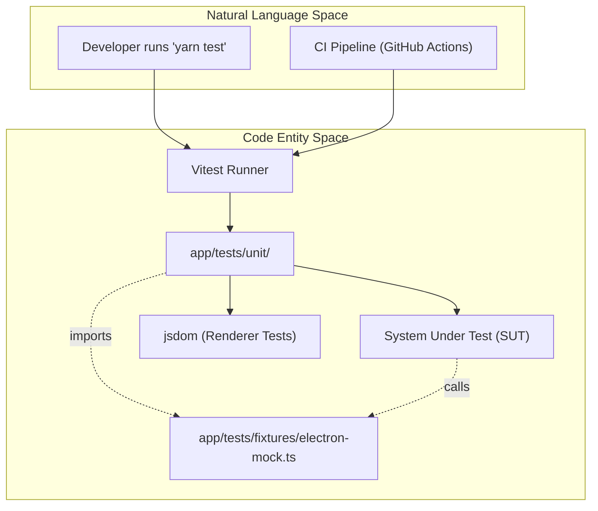
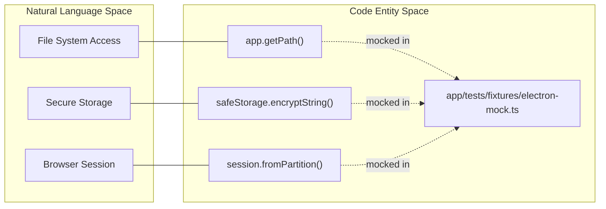

<!-- source: DeepWiki mcp.deepwiki.com · repo browser-use/desktop · page 8.3 Testing Infrastructure · fetched 2026-10-30 -->

# Testing Infrastructure

Relevant source files

The following files were used as context for generating this wiki page:

- [.github/workflows/ci.yml](.github/workflows/ci.yml)
- [app/tests/fixtures/electron-mock.ts](app/tests/fixtures/electron-mock.ts)
- [app/tests/unit/hl/codexStdinWindows.test.ts](app/tests/unit/hl/codexStdinWindows.test.ts)
- [app/tests/unit/hub/SettingsPane.spec.tsx](app/tests/unit/hub/SettingsPane.spec.tsx)
- [app/tests/unit/hub/useVimKeys.spec.tsx](app/tests/unit/hub/useVimKeys.spec.tsx)
- [app/tests/unit/identity/onboardingHandlers.test.ts](app/tests/unit/identity/onboardingHandlers.test.ts)
- [app/tests/unit/updater/updater.spec.ts](app/tests/unit/updater/updater.spec.ts)

The Browser Use Desktop testing infrastructure provides a multi-layered verification stack ranging from low-level unit tests to end-to-end (E2E) integration tests. The suite ensures reliability across the multi-process Electron architecture, including specific platform-dependent behaviors like Windows command-line argument handling and auto-updater lifecycle management.

## Testing Stack Overview

The repository utilizes several specialized testing tools to cover different aspects of the application:

| Test Type | Tooling | Target |
| :--- | :--- | :--- |
| **Unit / Integration** | [Vitest](https://vitest.dev) | Business logic, state management, and utility functions. |
| **UI Component** | Vitest + [JSDOM](https://github.com/jsdom/jsdom) | React components in the Renderer process. |
| **Smoke Tests** | Node.js `spawn` + Vitest | Cross-platform process execution (e.g., Windows `.cmd` shims). |
| **Mocking** | `electron-mock.ts` | Simulation of Electron APIs in Node.js environments. |

### Data Flow: Test Execution
This diagram shows how tests interact with mocks and the system under test (SUT).

Title: Test Execution and Mocking Flow

Sources: [.github/workflows/ci.yml:75-98](), [app/tests/fixtures/electron-mock.ts:1-9]()

---

## Unit and Integration Testing (Vitest)

The primary testing framework is Vitest, configured to run in the `app` directory. It handles standard TypeScript logic and React component testing using the `jsdom` environment [app/tests/unit/hub/SettingsPane.spec.tsx:1-6]().

### Key Test Suites
*   **Updater Logic**: Verifies the `initUpdater` and `stopUpdater` lifecycle, ensuring updates are skipped in development and correctly configured in production [app/tests/unit/updater/updater.spec.ts:1-12]().
*   **UI Components**: Tests like `SettingsPane.spec.tsx` verify that user interactions (e.g., recording a global shortcut) correctly trigger IPC calls [app/tests/unit/hub/SettingsPane.spec.tsx:86-111]().
*   **Vim Keybindings**: Validates that the `useVimKeys` hook correctly intercepts keyboard events even when input fields are focused [app/tests/unit/hub/useVimKeys.spec.tsx:55-80]().
*   **Onboarding Flow**: Ensures that the `onboardingHandlers` correctly manage the transition from the onboarding window to the main shell, including API key persistence [app/tests/unit/identity/onboardingHandlers.test.ts:1-10]().

Sources: [app/tests/unit/updater/updater.spec.ts:1-12](), [app/tests/unit/hub/SettingsPane.spec.tsx:1-6](), [app/tests/unit/hub/useVimKeys.spec.tsx:29-33](), [app/tests/unit/identity/onboardingHandlers.test.ts:1-10]()

---

## The Electron Mock Fixture

Since unit tests run in a standard Node.js environment rather than inside an Electron runtime, the `electron-mock.ts` fixture provides a comprehensive stub of the Electron API.

### Mocked Entities
The fixture simulates the following modules to prevent `require('electron')` from throwing errors:
*   **`app`**: Provides fake paths for `userData` and `logs` using `os.tmpdir()` [app/tests/fixtures/electron-mock.ts:14-22]().
*   **`ipcMain`**: Stubbed handlers for IPC communication [app/tests/fixtures/electron-mock.ts:34-40]().
*   **`safeStorage`**: Implements a deterministic XOR-style encryption (`sstmock:`) to allow tests to verify that data is being processed without requiring actual system keychains [app/tests/fixtures/electron-mock.ts:101-113]().
*   **`session`**: A massive stub covering `webRequest` interception, cookie management, and extension loading [app/tests/fixtures/electron-mock.ts:139-182]().

Title: Entity Mapping: Electron Mocks

Sources: [app/tests/fixtures/electron-mock.ts:14-22](), [app/tests/fixtures/electron-mock.ts:101-113](), [app/tests/fixtures/electron-mock.ts:139-182]()

---

## Specialized Smoke Tests

### Windows Spawn Verification
A critical part of the infrastructure is the `codexStdinWindows.test.ts` suite. This job runs on a `windows-latest` GitHub runner to guard against regressions where `cmd.exe` or `.cmd` shims mangle multi-line strings passed via command-line arguments [.github/workflows/ci.yml:115-123]().

The test performs a real-world "round-trip":
1.  Creates a temporary `.cmd` shim [app/tests/unit/hl/codexStdinWindows.test.ts:32-42]().
2.  Spawns the process using `resolveCliSpawn` [app/tests/unit/hl/codexStdinWindows.test.ts:45]().
3.  Writes a multi-line prompt to `stdin` [app/tests/unit/hl/codexStdinWindows.test.ts:56]().
4.  Verifies the shim captured the input exactly as sent, ensuring no word-splitting occurred [app/tests/unit/hl/codexStdinWindows.test.ts:69-71]().

Sources: [.github/workflows/ci.yml:115-123](), [app/tests/unit/hl/codexStdinWindows.test.ts:18-72]()

---

## Continuous Integration (CI)

The CI pipeline is defined in `.github/workflows/ci.yml` and enforces strict quality gates.

| Job | Description | Command |
| :--- | :--- | :--- |
| **Lint** | Runs ESLint to check for code style and syntax errors [.github/workflows/ci.yml:46-48](). | `yarn lint` |
| **Typecheck** | Runs `tsc --noEmit` to ensure TypeScript type safety [.github/workflows/ci.yml:71-73](). | `yarn typecheck` |
| **Unit** | Executes Vitest and generates coverage reports [.github/workflows/ci.yml:95-97](). | `yarn test:coverage` |
| **Windows Spawn** | Specialized smoke test for Windows CLI argument handling [.github/workflows/ci.yml:140-142](). | `yarn vitest run tests/unit/hl/codexStdinWindows.test.ts` |

### CI Environment Configuration
*   **Node Version**: 22 [.github/workflows/ci.yml:15]().
*   **Dependency Management**: Uses `yarn install --frozen-lockfile` [.github/workflows/ci.yml:44]().
*   **Git Rewrite**: Rewrites `git+ssh` to `https` to allow transitive dependency installation in environments without SSH keys [.github/workflows/ci.yml:39-40]().

Sources: [.github/workflows/ci.yml:15-142]()

---

