# Page: Overview

# Overview

<details>
<summary>Relevant source files</summary>

The following files were used as context for generating this wiki page:

- [CONTRIBUTING.md](CONTRIBUTING.md)
- [README.md](README.md)
- [pyproject.toml](pyproject.toml)

</details>


macOS Harness is a high-level, "thin" automation framework designed to give LLM agents direct control over a macOS environment. Unlike traditional automation tools that rely on brittle app-specific recipes or heavy frameworks, macOS Harness provides a minimalist set of raw macOS primitives. This allows an agent to observe the screen, interact with windows via PID-targeted events, and write its own logic in standard Python mid-task.

The project is built on the philosophy that the agent should "write what is missing" [README.md:8-9](). By exposing native capabilities like `CoreGraphics` window capture and `Accessibility` (AX) trees, the harness enables control over both native and Electron-based applications without requiring the target app to be in the foreground.

## Core Design Philosophy

The codebase adheres to three non-negotiable invariants to ensure a non-intrusive user experience [CONTRIBUTING.md:12-13]():
1.  **No Physical Pointer Movement**: The system uses a virtual overlay to show intent rather than hijacking the hardware cursor.
2.  **No Window Activation**: Interaction occurs via background events; apps are not "raised" or brought to the front.
3.  **No User-Data Telemetry**: Telemetry is strictly limited to execution metadata and never includes screenshots, window titles, or private text.

For a deeper dive into these constraints and the "thin harness" approach, see **[Design Principles & Invariants](#1.2)**.

## System Architecture

The system operates as a persistent Python process that bridges high-level agent commands to low-level macOS frameworks. It provides a unified execution surface where `mac.*` (native), `browser.*` (web), and standard Python modules (like `Path` and `subprocess`) coexist.

### Code-to-System Mapping
The following diagram illustrates how the Python namespaces exposed to the agent map to specific macOS subsystems and code entities.

**Diagram: Namespace to Code Entity Mapping**
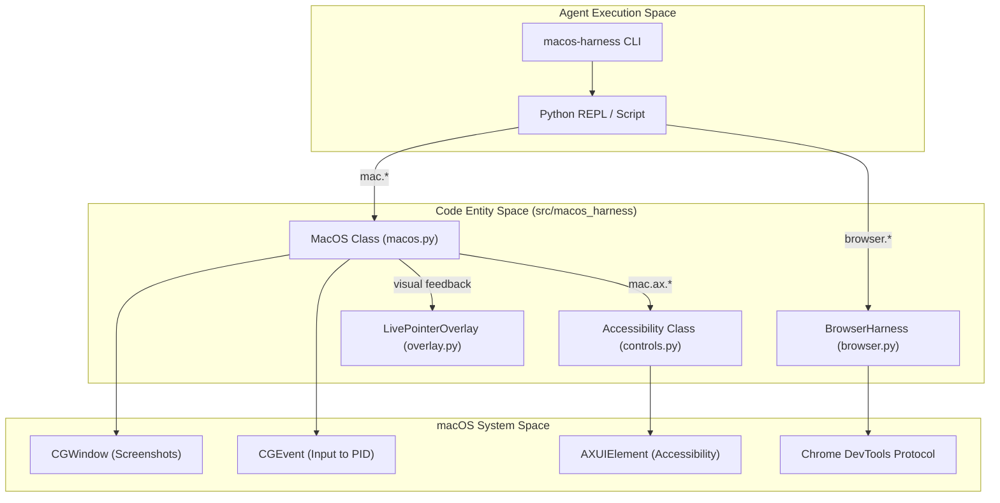
**Sources:** [README.md:57-74](), [src/macos_harness/macos.py:1-20](), [src/macos_harness/browser.py:1-15]()

## Major Subsystems

### 1. The Six-Verb Surface
The primary interface for agents consists of six core primitives defined in the `MacOS` class: `see`, `key`, `type`, `click`, `ax`, and `script` [README.md:34-52](). These allow for a "vision-first" workflow where the agent captures a window, identifies coordinates, and sends targeted input events.

### 2. Browser Integration
Through the `BrowserHarness` proxy, the system connects to a real, logged-in instance of Google Chrome using the Chrome DevTools Protocol (CDP) [README.md:80](). This allows the agent to switch seamlessly between native app automation and web-based tasks within the same process.

### 3. Visual Feedback (Overlay)
Since the harness does not move the physical cursor, it spawns a separate `LivePointerOverlay` process. This process renders a virtual, animated pointer using AppKit to show the user exactly where the agent is "clicking" without interrupting manual input [README.md:78]().

### 4. Telemetry & Privacy
The harness includes a privacy-safe telemetry module that uses PostHog. It is designed to be opt-out and explicitly excludes any sensitive data such as app names or screenshots [README.md:83-95]().

## Getting Started
To begin using the harness, it is recommended to use the `uv` package manager for installation and the `doctor` command to verify system permissions (Accessibility, Screen Recording, etc.).

```bash
# Verify environment and permissions
macos-harness doctor
```

For detailed setup instructions, including agent registration and permission handling, see **[Getting Started & Installation](#1.1)**.

## Project Structure
- **`src/macos_harness/`**: Contains the core logic for macOS interaction, browser bridging, and the CLI.
- **`skills/`**: Contains the `SKILL.md` file and agent definitions (e.g., OpenAI YAML) used to teach LLMs how to use the harness [pyproject.toml:50-51]().
- **`tests/`**: A comprehensive test suite covering both the macOS primitives and the telemetry safety guards.

**Sources:** [README.md:1-97](), [pyproject.toml:1-54](), [CONTRIBUTING.md:1-13]()

---

# Page: Getting Started & Installation

# Getting Started & Installation

<details>
<summary>Relevant source files</summary>

The following files were used as context for generating this wiki page:

- [README.md](README.md)
- [install.md](install.md)
- [pyproject.toml](pyproject.toml)

</details>


The `macos-harness` is designed to be a "thin" interface between an LLM agent and the macOS operating system. It provides a persistent Python execution environment pre-populated with primitives for vision, input, and accessibility [README.md:57-82](). This page details the installation process, permission verification via the `doctor` command, and initial verification.

## Installation Paths

The harness supports two primary installation paths: **Agent-Assisted** (recommended for LLM workflows) and **Manual**.

### 1. Agent-Assisted Installation
You can delegate the entire setup to a capable agent (like Claude Code or Codex). The agent will handle dependency management, skill registration, and permission checks.

**Prompt for the Agent:**
```text
Install or upgrade macOS Harness from https://github.com/browser-use/macos-harness with uv using Python 3.12. Register the skill printed by `macos-harness skill`, then run `macos-harness doctor`. Explain any missing macOS permissions and ask before requesting them. Finally, verify the harness by capturing one already-running app without bringing it to the foreground.
```
[README.md:27-29](), [install.md:7-9]()

### 2. Manual Installation
For developers who prefer manual control, use `uv` to install the tool globally.

```bash
# Install the CLI tool
uv tool install --python 3.12 --upgrade --force macos-harness

# Register the skill for your agent (e.g., for Codex)
mkdir -p "${CODEX_HOME:-$HOME/.codex}/skills/macos-harness"
macos-harness skill > "${CODEX_HOME:-$HOME/.codex}/skills/macos-harness/SKILL.md"

# Run the health check
macos-harness doctor
```
[install.md:13-18]()

---

## The Installation Data Flow

The following diagram illustrates how the `macos-harness` CLI interacts with the system during the installation and registration phase.

**Installation & Skill Registration Flow**
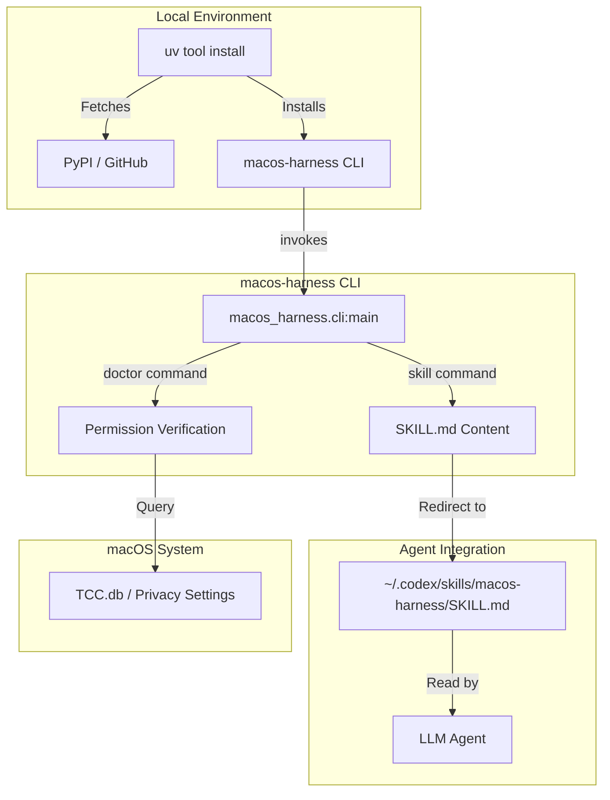
**Sources:** [pyproject.toml:39-40](), [install.md:13-18](), [README.md:27-29]()

---

## Verification & Permissions

After installation, you must ensure the harness has the necessary macOS permissions. Unlike standard automation tools, `macos-harness` targets specific PIDs and background windows, requiring specific entitlements.

### Running the Doctor
The `doctor` command checks for four critical permission buckets:
1.  **Accessibility**: Required for `mac.ax` and `mac.click`.
2.  **Screen Recording**: Required for `mac.see`.
3.  **Automation (AppleEvents)**: Required for `mac.script`.
4.  **Post Events**: Required for sending `CGEvent` inputs to specific PIDs.

[install.md:20-22](), [README.md:85-86]()

### First Screenshot Capture (Verification)
To verify the installation without disrupting your workflow, run a command that captures a background window (e.g., Finder) without bringing it to the front.

```bash
macos-harness <<'PY'
# Captures a screenshot object for Finder
frame = mac.see("Finder")
print(f"Captured frame: {frame}")
PY
```
[install.md:26-29](), [README.md:37-38]()

---

## Execution Environment

When running commands via `macos-harness`, the CLI initializes a `_namespace()` which pre-imports and instantiates key controllers. This allows agents to write logic using high-level primitives immediately.

**Code Entity Mapping: CLI Namespace**
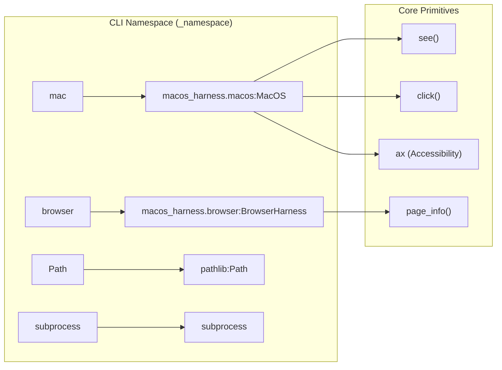
**Sources:** [README.md:51-52](), [README.md:60-74](), [pyproject.toml:40]()

### Telemetry Configuration
By default, the harness collects anonymous telemetry (command category, duration, success/failure). It **never** collects screenshots, window titles, or private data [README.md:88-91]().

To disable telemetry:
```bash
macos-harness telemetry disable
```
[README.md:94](), [install.md:36]()

---

## Technical Specifications

| Component | Requirement / Value | Source |
| :--- | :--- | :--- |
| **Python Version** | `>= 3.11` (3.12 recommended) | [pyproject.toml:10]() |
| **OS** | macOS (Darwin) | [pyproject.toml:19]() |
| **Key Dependencies** | `browser-harness`, `pillow`, `pyobjc-framework-ApplicationServices` | [pyproject.toml:27-29]() |
| **Build System** | `hatchling` | [pyproject.toml:1-3]() |
| **CLI Entrypoint** | `macos_harness.cli:main` | [pyproject.toml:40]() |

**Sources:** [pyproject.toml:1-40](), [README.md:88-97]()

---

# Page: Design Principles & Invariants

# Design Principles & Invariants

<details>
<summary>Relevant source files</summary>

The following files were used as context for generating this wiki page:

- [CONTRIBUTING.md](CONTRIBUTING.md)
- [README.md](README.md)
- [SECURITY.md](SECURITY.md)

</details>


This page outlines the foundational philosophy and technical constraints that govern the development and operation of `macos-harness`. These principles ensure that the harness remains a predictable, non-intrusive, and privacy-preserving tool for LLM agents.

## The Three Non-Negotiable Invariants

To maintain a "ghost-in-the-machine" experience where an agent can work alongside a human user without interference, the codebase must strictly adhere to three invariants [CONTRIBUTING.md:12-13]().

### 1. No Physical Pointer Movement
The harness never takes control of the system's hardware cursor. Instead of using `CGEventPost` to move the global cursor, it uses an animated, click-through overlay to provide visual feedback [README.md:78]().
*   **Implementation:** Input events are targeted directly at a specific Process Identifier (PID) using `CGEventPostToPid`.
*   **Benefit:** The user can continue using their mouse while the agent performs clicks in the background.

### 2. No Window Activation
The harness never "raises" or "activates" a target application to the foreground [README.md:76]().
*   **Implementation:** Screenshots are captured using `CGWindowListCreateImage` for specific window IDs, and input is sent to PIDs regardless of their focus state [README.md:68-73]().
*   **Benefit:** The agent can work on "Spotify" or "Slack" while the user is actively typing in a different window, like a code editor, without losing focus.

### 3. No User-Data Telemetry
Privacy is enforced at the architectural level. Telemetry is strictly limited to operational metadata [README.md:88-91]().
*   **Prohibited Data:** Screenshots, window titles, application names, UI text, file paths, and LLM prompts are never serialized or transmitted.
*   **Permitted Data:** Command category (e.g., `see`, `click`), success/failure status, duration, package version, and OS architecture.

---

## Thin Harness Philosophy

`macos-harness` is designed to be a "thin" bridge between an LLM and the operating system. It intentionally avoids "app-specific" logic [CONTRIBUTING.md:3-4]().

| Feature | Philosophy | Implementation |
| :--- | :--- | :--- |
| **Tooling** | No "Slack tools" or "Spotify tools". | Agents use the six core primitives to build their own logic [README.md:54-55](). |
| **Logic** | The agent writes missing logic mid-task. | Agents execute raw Python strings via the harness [README.md:16-18](). |
| **Surface** | Minimize the API surface area. | Focused on `see`, `key`, `type`, `click`, `ax`, and `script` [README.md:34-49](). |

### Logic Flow: Natural Language to Code Execution
The following diagram illustrates how an agent's intent is transformed into macOS primitive calls via the thin harness.

**Intent to Primitive Mapping**
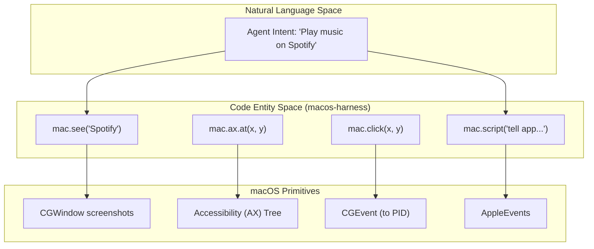
Sources: [README.md:37-49](), [README.md:59-74]()

---

## Preference for Raw macOS Primitives

The harness prefers exposing the underlying macOS APIs over creating abstractions. This allows the LLM to leverage the full power of the OS rather than being limited by the harness's design.

*   **`mac.ax` (Accessibility):** Instead of a simplified "find button" function, the harness exposes the raw Accessibility tree via `controls.py`. This allows agents to query attributes like `AXRole`, `AXDescription`, and `AXValue` directly [README.md:43]().
*   **`mac.script` (AppleScript):** For complex inter-process communication that vision or AX cannot solve, the harness provides a direct execution path for AppleScript/JXA [README.md:44]().
*   **`mac.key` & `mac.type`:** These interact with `CGEvent` to simulate hardware-level keystrokes directed at specific applications, bypassing the need for the app to be "active" [README.md:77]().

### System Architecture & Data Flow
The architecture is centered around a single persistent Python process that manages multiple specialized bridges.

**Harness Subsystem Architecture**
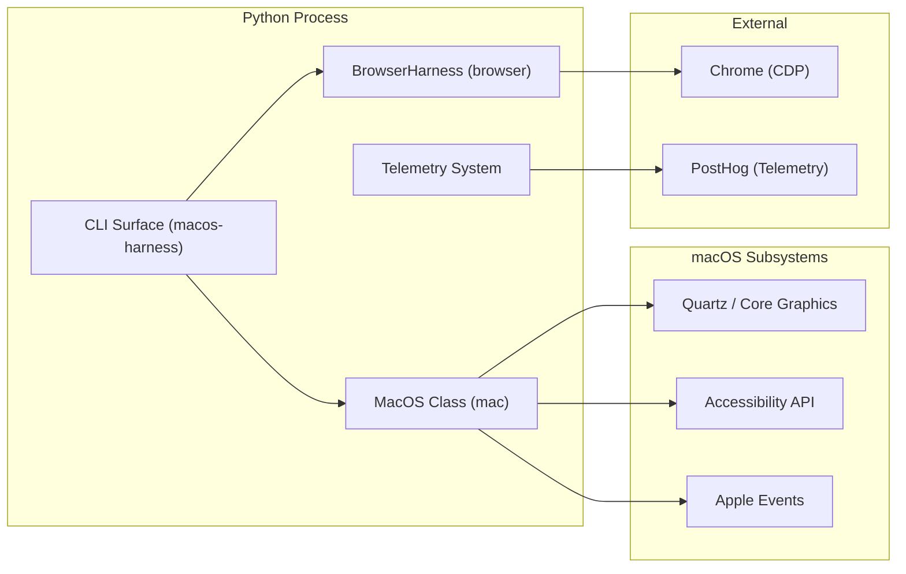
Sources: [README.md:59-74](), [README.md:88-91]()

---

## Security Model

The harness operates under a principle of "Agent as User." It requires explicit macOS permissions to function, which are checked and reported via the `doctor` command [README.md:85-86]().

*   **Trust Boundary:** Agent instructions and third-party UI content are treated as **untrusted input** [SECURITY.md:7-8]().
*   **Permission Buckets:**
    1.  **Screen Recording:** Required for `mac.see()`.
    2.  **Accessibility:** Required for `mac.ax` and `mac.click()`.
    3.  **Automation:** Required for `mac.script()`.
    4.  **Post Events:** Required for `mac.key()` and `mac.type()`.

Users are encouraged to review irreversible actions performed by the agent and grant only the minimum permissions necessary for the task [SECURITY.md:8-9]().

Sources: [README.md:83-86](), [SECURITY.md:1-9]()

---

# Page: Core Architecture

# Core Architecture

<details>
<summary>Relevant source files</summary>

The following files were used as context for generating this wiki page:

- [src/macos_harness/__init__.py](src/macos_harness/__init__.py)
- [src/macos_harness/cli.py](src/macos_harness/cli.py)
- [uv.lock](uv.lock)

</details>


The **macos-harness** is designed as a lightweight, persistent bridge between high-level agentic instructions and the low-level macOS C APIs. The architecture prioritizes a "thin harness" philosophy, exposing raw system primitives rather than complex abstractions, which allows LLM agents to orchestrate multi-app workflows using a standard six-verb interface.

## System Overview

The system operates as a persistent Python process that manages two primary interaction objects: `mac` (for native OS control) and `browser` (for web-specific automation). These objects are pre-populated into the execution namespace by the CLI, providing a unified surface for scripts.

### Execution Flow: Natural Language to Code Entity

This diagram illustrates how an agent's intent is translated through the harness's core entities into system-level actions.

**Intent Translation Pipeline**
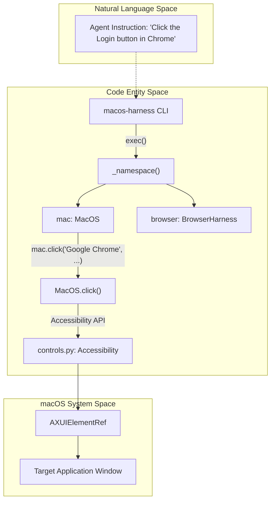
**Sources:** [src/macos_harness/cli.py:21-28](), [src/macos_harness/cli.py:31-37](), [src/macos_harness/macos.py:32-45]()

## Layered Dependency Model

The harness is structured in layers, where each layer provides a more specific interface to the hardware and OS.

1.  **CLI & Execution Surface**: The entry point that handles process persistence and environment setup.
2.  **Harness Objects (`mac` & `browser`)**: The primary API surface for all automation.
3.  **Subsystems**: Specialized modules for Accessibility (AX), Window Management, and Browser Debugging.
4.  **OS Primitives**: Direct calls to `ApplicationServices`, `CoreGraphics`, and `AppleScript`.

**Component Interaction Map**
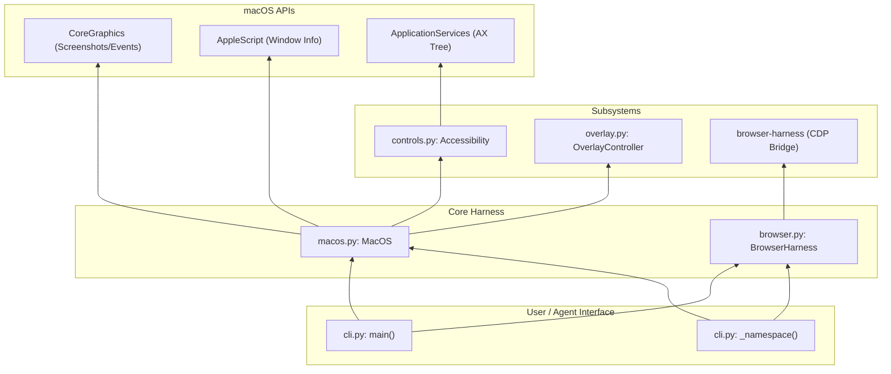
**Sources:** [src/macos_harness/cli.py:21-28](), [src/macos_harness/macos.py:32-45](), [src/macos_harness/browser.py:16-30](), [src/macos_harness/controls.py:18-35]()

## Core Components

### CLI & Execution Surface
The CLI provides the `_namespace()` helper [src/macos_harness/cli.py:21-28](), which pre-injects `mac`, `browser`, `Path`, and `subprocess` into the Python environment. This allows for stateless execution of complex scripts passed via `stdin`.
For details, see [CLI & Execution Surface](#2.1).

### MacOS Primitives (`mac`)
The `MacOS` class in `macos.py` is the primary engine for native interaction. It implements the **Six-Verb Surface**:
*   `see`: Captures the visual state [src/macos_harness/macos.py:203-247]().
*   `key`: Sends keyboard shortcuts.
*   `type`: Inputs text strings.
*   `click`: Interacts with coordinates or AX elements.
*   `ax`: Direct access to the Accessibility subsystem.
*   `script`: Executes raw AppleScript for app-specific control.

For details, see [MacOS Primitives Module](#2.2).

### Accessibility (AX) Subsystem
The `Accessibility` class in `controls.py` manages the inspection and manipulation of the macOS UI tree. It provides the `at()` and `query()` methods to locate elements without relying on fragile visual coordinates.
For details, see [Accessibility (AX) Subsystem](#2.3).

### Browser Harness Integration (`browser`)
The `BrowserHarness` class provides a lazy-proxy to Google Chrome via the Chrome DevTools Protocol (CDP). It bridges the gap between native `mac.*` commands and web-specific `browser.*` commands, including handling the macOS-specific "Allow remote debugging" permission dialogs.
For details, see [Browser Harness Integration](#2.4).

## Data Invariants
The architecture is strictly bound by three design invariants:
1.  **No Physical Pointer Movement**: The system uses `CGEventCreateMouseEvent` with specific PIDs to interact without hijacking the user's mouse.
2.  **No Window Activation**: Actions are performed in the background where possible to avoid disrupting the user.
3.  **Privacy-First Telemetry**: Only command metadata is collected; no screenshots or user data ever leave the machine.

**Sources:** [src/macos_harness/macos.py:442-458](), [src/macos_harness/telemetry.py:73-95]()

---

# Page: CLI & Execution Surface

# CLI & Execution Surface

<details>
<summary>Relevant source files</summary>

The following files were used as context for generating this wiki page:

- [README.md](README.md)
- [macos-harness](macos-harness)
- [src/macos_harness/cli.py](src/macos_harness/cli.py)

</details>


The `macos-harness` CLI provides a unified execution environment where a persistent Python process is granted direct access to macOS system primitives, a real browser instance via CDP, and the local filesystem. It is designed to be the primary entry point for both human developers and LLM agents.

## Shell Wrapper & Entry Point

The harness is typically invoked via a shell wrapper script named `macos-harness` located in the project root. This script ensures the correct Python environment is utilized before calling the core CLI module.

### Implementation Details
- **Environment Resolution**: The script first checks for a local virtual environment at `.venv/bin/python` [macos-harness:6-8]().
- **Fallback**: If no local venv is found, it uses `uv` to run the module, ensuring dependencies are managed [macos-harness:10-10]().
- **Module Path**: The wrapper executes the `macos_harness.cli` module [macos-harness:7-7]().

**Sources:** [macos-harness:1-10]()

---

## Execution Surface: `_namespace()`

The core power of the harness lies in the `_namespace()` helper function. This function populates a Python dictionary that serves as the global namespace for code executed via `stdin` or the `repl`.

| Key | Object / Class | Purpose |
| :--- | :--- | :--- |
| `mac` | `MacOS()` | Access to `see`, `key`, `type`, `click`, `ax`, and `script`. |
| `browser` | `BrowserHarness()` | Lazy-proxy for Chrome DevTools Protocol integration. |
| `Path` | `pathlib.Path` | Standard library path manipulation for local file access. |
| `subprocess` | `subprocess` | Standard library for executing shell commands. |

**Sources:** [src/macos_harness/cli.py:21-29]()

### Data Flow: Natural Language to Code Execution

This diagram illustrates how a natural language request from an agent translates into the execution of Python code within the pre-populated namespace.

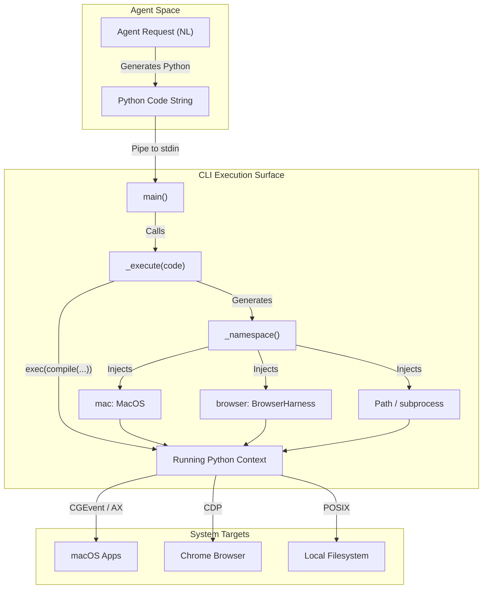
**Sources:** [src/macos_harness/cli.py:21-37](), [src/macos_harness/cli.py:85-152]()

---

## Subcommands Reference

The CLI uses `argparse` to handle several subcommands designed for environment verification, state inspection, and telemetry management.

### `doctor`
Checks the current runtime for necessary macOS permissions (Accessibility, Screen Recording, etc.).
- **Flag `--request`**: Triggers Apple's native permission prompts if access is missing [src/macos_harness/cli.py:96-97]().
- **Output**: Returns a JSON object containing the status of all required permissions [src/macos_harness/cli.py:98-98]().

### `apps`
Lists all currently running macOS applications with their process identifiers (PIDs) and bundle IDs.
- **Implementation**: Calls `MacOS().list_apps()` and prints the JSON result [src/macos_harness/cli.py:102-102]().

### `repl`
Starts a persistent interactive Python session using `code.interact` [src/macos_harness/cli.py:110-117]().
- **Environment**: The session is pre-loaded with the `_namespace()`, allowing immediate use of `mac` and `browser` objects.

### `skill`
Prints the content of `SKILL.md`. This is the system prompt that teaches an LLM how to use the harness [src/macos_harness/cli.py:105-108]().
- **Resolution**: It first looks for a bundled resource, then falls back to the local file path in the repository [src/macos_harness/cli.py:40-46]().

### `see`
Captures a screenshot of a specific application window without bringing it to the foreground.
- **Arguments**: `app` (name or PID), `--max-width`, `--max-height`, `--no-pointer`.
- **Implementation**: Wraps `MacOS().see()` [src/macos_harness/cli.py:121-126]().

### `state`
Dumps the Accessibility (AX) tree of a target application as JSON.
- **Arguments**: `app`, `--screenshot` (embeds base64 image), `--max-depth`, `--max-nodes`, `--include-menu-bar`.
- **Implementation**: Wraps `MacOS().get_app_state()` [src/macos_harness/cli.py:131-138]().

### `telemetry`
Inspects or modifies the anonymous telemetry settings.
- **Actions**: `status`, `enable`, `disable` [src/macos_harness/cli.py:68-68]().
- **Implementation**: Proxies to `run_telemetry_cli` [src/macos_harness/cli.py:89-89]().

### `stdin` (Default)
If no subcommand is provided and `stdin` is not a TTY, the CLI reads the input as Python code and executes it [src/macos_harness/cli.py:141-147](). This is the primary mode used by LLM agents.

**Sources:** [src/macos_harness/cli.py:48-82](), [src/macos_harness/cli.py:85-152]()

---

## Command Execution Flow

The following diagram maps the internal logic of `main()` as it routes different CLI commands to their respective `MacOS` or `BrowserHarness` methods.

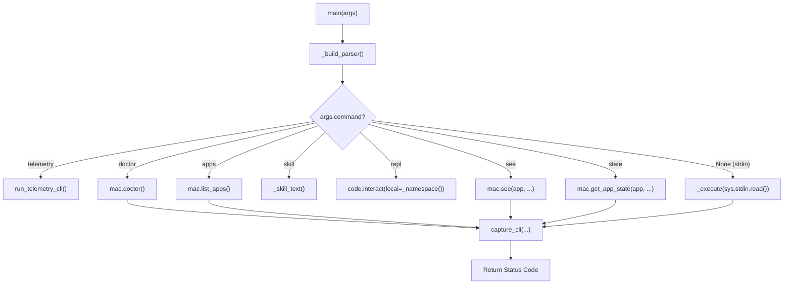

### Telemetry Capture
Every command execution (including Python execution via stdin) triggers a telemetry event in a `finally` block [src/macos_harness/cli.py:153-154]().
- **Captured Data**: Command name (or "python"), success boolean, and duration in seconds.
- **Privacy**: No user-identifiable data or code content is sent.

**Sources:** [src/macos_harness/cli.py:85-155](), [src/macos_harness/telemetry.py:17-18]()

---

# Page: MacOS Primitives Module

# MacOS Primitives Module

<details>
<summary>Relevant source files</summary>

The following files were used as context for generating this wiki page:

- [src/macos_harness/controls.py](src/macos_harness/controls.py)
- [src/macos_harness/macos.py](src/macos_harness/macos.py)

</details>


The `MacOS` class in `macos.py` serves as the foundational interface for interacting with the macOS operating system. It provides a "six-verb" surface (`see`, `key`, `type`, `click`, `ax`, `script`) that allows an agent or developer to observe the screen and manipulate the system without physical pointer movement or window activation.

[src/macos_harness/macos.py:271-274]()

## Core Architecture

The module leverages three primary macOS subsystems:
1.  **Accessibility (AXUIElement):** Used for semantic tree inspection and high-level actions (e.g., pressing a button by its index).
2.  **Core Graphics (CGEvent):** Used for low-level input injection (mouse clicks, keystrokes) targeted at specific PIDs to avoid interfering with the physical user.
3.  **AppKit (NSWorkspace):** Used for application discovery, window resolution, and state monitoring.

### Error Handling
The module defines specific exceptions to handle the unique constraints of macOS automation:
*   `MacOSError`: Base class for discovery or control failures [src/macos_harness/macos.py:36-37]().
*   `AccessibilityPermissionError`: Raised when the process lacks the necessary TCC permissions [src/macos_harness/macos.py:40-41]().
*   `FocusChangedError`: Raised when a background-targeted action unexpectedly forces a window to the front [src/macos_harness/macos.py:44-45]().

### Natural Language to Code Entity Mapping (Input & Action)

This diagram maps the conceptual "verbs" used by agents to the underlying implementation methods and macOS APIs.

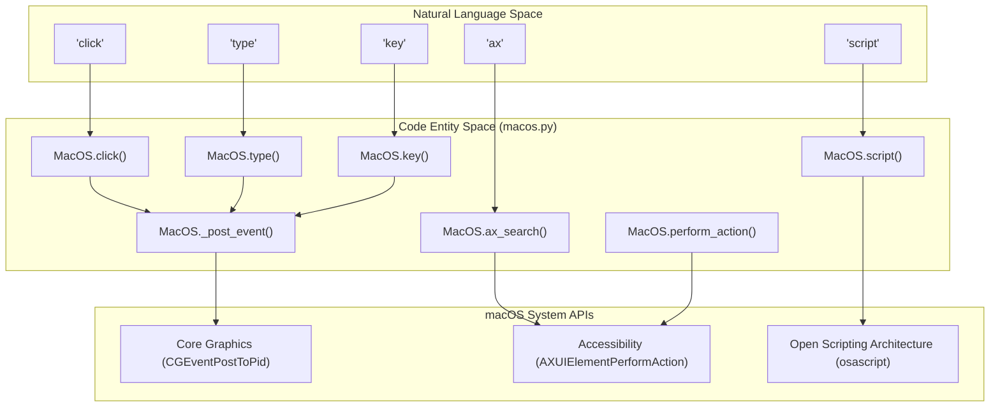
Sources: [src/macos_harness/macos.py:328-331](), [src/macos_harness/macos.py:433-435](), [src/macos_harness/macos.py:488-490](), [src/macos_harness/macos.py:532-535]()

---

## Primary Verbs

### 1. `see` (Observation)
The `see` method captures the current state of the system, including a screenshot and a semantic accessibility tree.
*   **Retina Scaling:** It automatically detects the scale factor of the captured PNG to map pixel coordinates back to logical points [src/macos_harness/macos.py:246-252]().
*   **Window Resolution:** If an `app` name is provided, it resolves the PID and captures only that application's windows [src/macos_harness/macos.py:348-355]().

### 2. `click`, `drag`, `move`, `scroll` (Mouse Input)
Mouse interactions are performed via `CGEvent` and are targeted at a specific PID.
*   **Virtual Pointer:** Every move or click command triggers a JSON update to the `LivePointerOverlay` to visually represent the action without moving the hardware cursor [src/macos_harness/macos.py:377-385]().
*   **PID Targeting:** By using `CGEventPostToPid`, the harness can click buttons in background apps without changing the system focus [src/macos_harness/macos.py:756-760]().
*   **Scroll Splitting:** Large scroll deltas are split into smaller steps to ensure reliable processing by target applications [src/macos_harness/macos.py:258-268]().

### 3. `key` and `type` (Keyboard Input)
*   **`key`**: Used for modifier combos (e.g., `cmd+c`) or special keys (`enter`, `esc`). It uses a lookup table for macOS-specific keycodes [src/macos_harness/macos.py:160-227]().
*   **`type`**: Sends a sequence of characters. It handles shifted characters (like `!`) by automatically injecting the `shift` modifier flag [src/macos_harness/macos.py:228-230]().

### 4. `ax` (Accessibility)
The `ax` verb provides access to the `Accessibility` class in `controls.py`. This is the "escape hatch" for precise UI manipulation.
*   **`ax.query()`**: Searches the AX tree for elements matching specific criteria (role, title, etc.) [src/macos_harness/controls.py:59-73]().
*   **`ax.at(x, y)`**: Performs a "hit test" to find the AX element at specific coordinates [src/macos_harness/controls.py:28-48]().
*   **`ax.perform(index, action)`**: Triggers AX actions like `AXPress` or `AXShowMenu` [src/macos_harness/controls.py:101-102]().

### 5. `script` (AppleScript)
Executes arbitrary AppleScript via the `osascript` CLI. This is often the most robust way to control "Scriptable" applications like Music, Finder, or Calendar [src/macos_harness/macos.py:532-540]().

---

## Visual Feedback and Scaling

The harness must bridge the gap between the agent's view (logical points) and the system's reality (pixels).

### Coordinate Mapping Data Flow

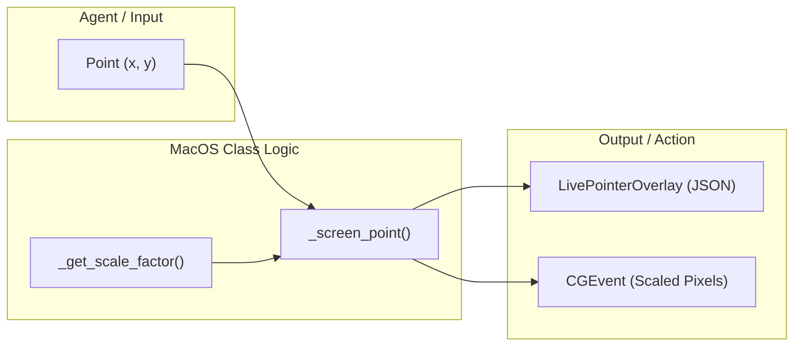
Sources: [src/macos_harness/macos.py:716-725](), [src/macos_harness/macos.py:732-748]()

### Screenshot Pipeline
1.  **Capture:** Calls `/usr/sbin/screencapture -x` to a temporary file [src/macos_harness/macos.py:365-368]().
2.  **Size Detection:** Reads the PNG header to determine the physical pixel dimensions [src/macos_harness/macos.py:246-252]().
3.  **Scale Calculation:** Compares pixel dimensions against logical `NSScreen` dimensions to calculate the `scale_factor` (e.g., 2.0 for Retina) [src/macos_harness/macos.py:716-725]().

## Implementation Details: Element Indexing
To avoid passing complex objects to the agent, the `MacOS` class maintains a session-based cache of `AXUIElementRef` objects.
*   **`_remember_element(element)`**: Stores a reference and returns an integer index [src/macos_harness/macos.py:612-618]().
*   **`_element(index)`**: Retrieves the reference for a given index, raising a `MacOSError` if the index is invalid or expired [src/macos_harness/macos.py:620-625]().

Sources:
- `src/macos_harness/macos.py`
- `src/macos_harness/controls.py`
- `src/macos_harness/overlay.py`

---

# Page: Accessibility (AX) Subsystem

# Accessibility (AX) Subsystem

<details>
<summary>Relevant source files</summary>

The following files were used as context for generating this wiki page:

- [src/macos_harness/controls.py](src/macos_harness/controls.py)
- [src/macos_harness/macos.py](src/macos_harness/macos.py)

</details>


The Accessibility (AX) subsystem provides a semantic interface to macOS user interface elements. While the `MacOS.see()` verb provides visual state, the `Accessibility` class in `controls.py` allows for precise interrogation and manipulation of the UI tree using Apple's `ApplicationServices` framework.

## Overview

The `Accessibility` class acts as an "explicit escape hatch" for scenarios where visual-only interaction is insufficient [src/macos_harness/controls.py:1-15](). It enables agents to query element attributes (titles, roles, values), perform semantic actions (pressing buttons, incrementing sliders), and navigate the application hierarchy without relying on coordinate-based clicks.

### Key Data Structures

- **Element Indexing**: The harness maintains a mapping between integer IDs and raw `AXUIElementRef` objects to allow stateless-looking API calls from the agent [src/macos_harness/macos.py:348-356]().
- **Compact Attributes**: By default, the subsystem fetches a subset of critical attributes (`AXRole`, `AXTitle`, `AXDescription`, `AXValue`, `AXFrame`) to minimize IPC overhead [src/macos_harness/controls.py:17-23]().

## System Architecture

The following diagram illustrates the relationship between the `Accessibility` high-level API, the `MacOS` host class, and the underlying macOS `ApplicationServices` (AS) framework.

### Accessibility Control Flow
"This diagram maps the high-level Accessibility methods to their internal implementation logic."

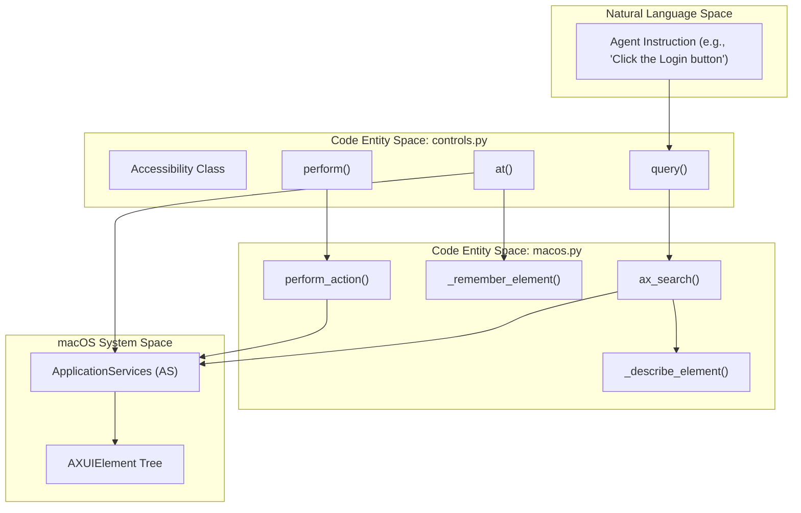
Sources: [src/macos_harness/controls.py:14-119](), [src/macos_harness/macos.py:271-400]()

---

## Core API Methods

### `at(x, y, ...)`
Performs a hit-test at the specified coordinates. It converts the point to the appropriate coordinate space and calls `AXUIElementCopyElementAtPosition` [src/macos_harness/controls.py:28-57](). It returns a dictionary description of the element and registers it in the internal index.

### `query(...)`
Wraps `MacOS.ax_search()` to find elements based on criteria like `text`, `search_key` (role), or visibility [src/macos_harness/controls.py:59-86]().

### `get()` and `set()`
- `get(element_index, attributes)`: Retrieves specific AX attributes (e.g., `AXValue`) for a previously discovered element [src/macos_harness/controls.py:88-93]().
- `set(element_index, attribute, value)`: Updates an attribute. Commonly used for `AXFocused` or `AXSelected` [src/macos_harness/controls.py:95-96]().

### `perform(element_index, action)`
Executes a semantic action. Defaults to `AXPress`. It supports aliases like `confirm`, `increment`, and `show menu` [src/macos_harness/controls.py:101-102](), [src/macos_harness/macos.py:91-99]().

### `parameterized(element_index, attribute, parameter)`
Accesses advanced AX attributes that require an input parameter, such as line numbers in text areas [src/macos_harness/controls.py:104-112]().

### `dump(app)`
Captures the entire AX tree for a specific application [src/macos_harness/controls.py:117-119]().

---

## The AX Tree Pipeline

The subsystem relies on a pipeline to transform raw C-pointers from macOS into JSON-serializable dictionaries.

### Element Processing Pipeline
"This diagram shows the data flow from a raw AXUIElementRef to a serialized dictionary."

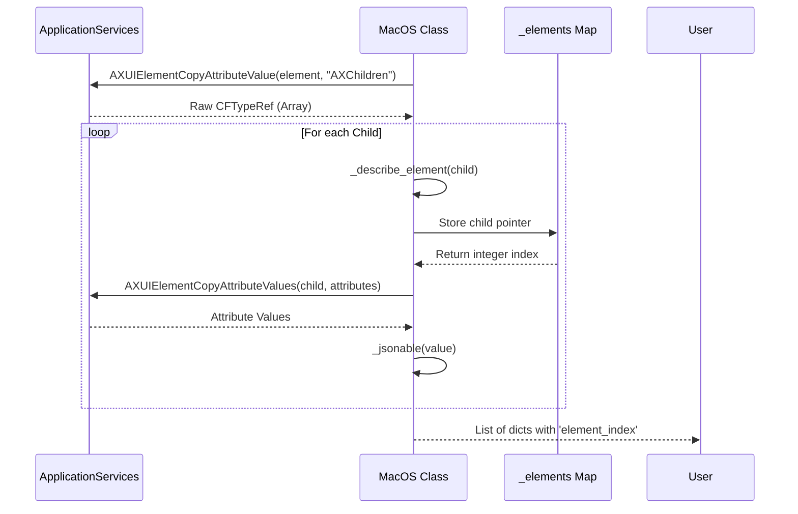
Sources: [src/macos_harness/macos.py:553-600](), [src/macos_harness/macos.py:650-680]()

### `_snapshot_tree` and Search Logic
The `ax_search` function implements a sophisticated retrieval logic [src/macos_harness/macos.py:603-647]():
1. **Chromium Predicate API**: It first attempts to use the high-performance `AXSearch` API (often used by browsers) [src/macos_harness/macos.py:619-625]().
2. **Bounded Fallback**: If the specialized search is unavailable or fails, it performs a depth-first traversal of the AX tree, bounded by `max_nodes` to prevent infinite loops or performance degradation in complex UIs [src/macos_harness/macos.py:633-647]().

## AXEnhancedUserInterface
For certain applications (notably Chrome and Electron-based apps), the harness attempts to enable `AXEnhancedUserInterface`. This attribute unlocks deeper accessibility information that is otherwise hidden to improve performance. The harness sets this on the application root element during the initial connection or search [src/macos_harness/macos.py:530-540]().

## Element Indexing & Memory
The `MacOS` instance maintains an internal dictionary `self._elements` [src/macos_harness/macos.py:348](). 
- When an element is encountered via `at()`, `query()`, or `dump()`, it is passed to `_remember_element(element)` [src/macos_harness/macos.py:672-680]().
- This function returns a stable integer `element_index`.
- This index is used by the agent in subsequent calls to `perform()` or `get()`, allowing the harness to look up the original `AXUIElementRef` pointer [src/macos_harness/macos.py:666-670]().

| Feature | Implementation |
| :--- | :--- |
| **Hit Testing** | `AS.AXUIElementCopyElementAtPosition` [src/macos_harness/controls.py:46]() |
| **Action Execution** | `AS.AXUIElementPerformAction` [src/macos_harness/macos.py:488]() |
| **Attribute Set** | `AS.AXUIElementSetAttributeValue` [src/macos_harness/macos.py:480]() |
| **Tree Traversal** | Recursive `AXChildren` retrieval in `_snapshot_tree` [src/macos_harness/macos.py:575]() |

**Sources:**
- `src/macos_harness/controls.py`
- `src/macos_harness/macos.py`

---

# Page: Browser Harness Integration

# Browser Harness Integration

<details>
<summary>Relevant source files</summary>

The following files were used as context for generating this wiki page:

- [src/macos_harness/browser.py](src/macos_harness/browser.py)
- [uv.lock](uv.lock)

</details>


The Browser Harness integration provides a high-level, specialized interface for interacting with web browsers (primarily Google Chrome) via the Chrome DevTools Protocol (CDP). While the `mac` object handles native macOS primitives, the `browser` object leverages the `browser-harness` library to provide DOM-aware capabilities.

## Overview

The integration is encapsulated in the `BrowserHarness` class within [src/macos_harness/browser.py:106-168](). It acts as a **lazy proxy**, meaning it does not attempt to establish a connection to the browser or start the harness daemon until a method or attribute is first accessed [src/macos_harness/browser.py:155-164]().

Key responsibilities include:
1.  **Lazy Connection Management**: Delaying overhead until browser interaction is required.
2.  **Chrome Permission Handling**: Automatically bypassing the macOS-specific "Allow remote debugging?" dialog that appears when CDP is initiated.
3.  **Bridge to `browser-harness`**: Exposing the `helpers` module from the underlying `browser-harness` dependency.

### Relationship: `mac.*` vs `browser.*`

| Feature | `mac` (Native) | `browser` (Web) |
| :--- | :--- | :--- |
| **Target** | OS Windows, Menus, Native Apps | DOM Elements, Tabs, JS Context |
| **Mechanism** | AX (Accessibility), CGEvent, AppleScript | CDP (Chrome DevTools Protocol) |
| **Resolution** | PID/Window Name based | URL/Tab/CSS Selector based |
| **Visibility** | Visual screenshots (Retina) | DOM snapshots & CDP screenshots |

Sources: [src/macos_harness/browser.py:1-13](), [uv.lock:19-31]()

---

## The BrowserHarness Proxy

The `BrowserHarness` class implements `__getattr__` to ensure that any call to a browser primitive triggers the `connect()` sequence if the harness is not already active.

### Data Flow: Lazy Initialization

The following diagram illustrates the transition from a "Lazy" state to a "Connected" state upon the first call to a browser method (e.g., `browser.open_url()`).

**Title: BrowserHarness Connection Flow**
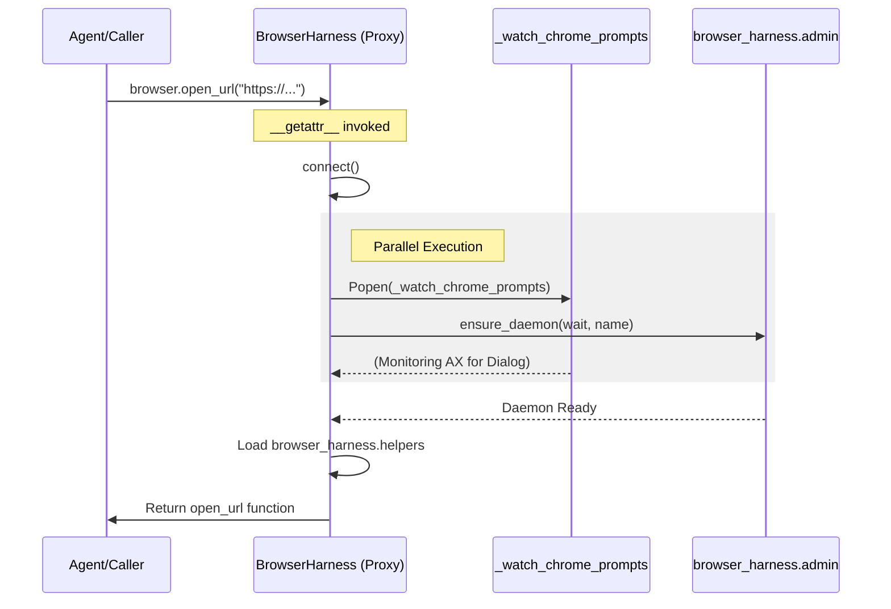
Sources: [src/macos_harness/browser.py:114-153](), [src/macos_harness/browser.py:155-164]()

---

## Automatic Chrome Dialog Approval

A significant challenge in automating Chrome on macOS is the "Allow remote debugging?" security prompt. `macos-harness` solves this by spawning a sidecar process that uses native Accessibility (AX) primitives to find and click the "Allow" button.

### `_approve_chrome_prompt` Logic
The harness uses `ApplicationServices` to inspect the system-wide AX tree [src/macos_harness/browser.py:26-30](). It specifically searches for a window where:
-   `kCGWindowOwnerName` is "Google Chrome" [src/macos_harness/browser.py:32-33]()
-   `kCGWindowName` is "Allow remote debugging?" [src/macos_harness/browser.py:34-35]()

Once found, it calculates the coordinates for the "Allow" button. Instead of a single point, it generates a grid of points near the bottom-right of the dialog to ensure the button is hit regardless of minor layout variations [src/macos_harness/browser.py:41-46](). It verifies the element at the position has `AXRole == "AXButton"` and `AXDescription == "Allow"` before performing the `AXPress` action [src/macos_harness/browser.py:57-63]().

### `_watch_chrome_prompts`
This function acts as a supervisor. It polls the window list using `CGWindowListCopyWindowInfo` [src/macos_harness/browser.py:87-89](). When the target dialog is detected, it spawns a short-lived subprocess to execute the approval logic [src/macos_harness/browser.py:96-102](). This separation ensures that the main harness thread is not blocked by AX polling during the connection phase.

**Title: Chrome Dialog Approval Subsystem**
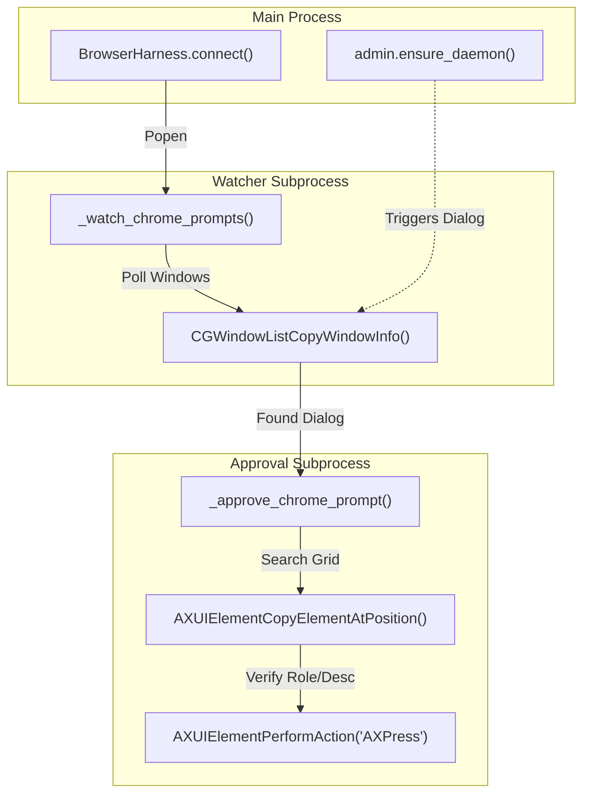
Sources: [src/macos_harness/browser.py:15-69](), [src/macos_harness/browser.py:71-104]()

---

## Technical Details

### Dependency Bridge
The `browser` object is a thin wrapper around the `browser-harness` PyPI package.
-   **CDP Bridge**: Uses `cdp-use` and `websockets` for communication [uv.lock:19-27](), [uv.lock:34-41]().
-   **Daemon Management**: `admin.ensure_daemon` handles the lifecycle of the underlying browser automation server [src/macos_harness/browser.py:142]().
-   **Helper Injection**: Once connected, `self._helpers` (the `browser_harness.helpers` module) satisfies all attribute lookups [src/macos_harness/browser.py:152-163]().

### Configuration
-   **`name`**: An optional identifier for the browser session, stored in the `BU_NAME` environment variable [src/macos_harness/browser.py:118-119]().
-   **`wait`**: The timeout (default 60s) for the daemon to become available and for the AX approver to remain active [src/macos_harness/browser.py:109-111]().

### Error Handling
If `browser-harness` is not installed (e.g., `uv sync` was not run), the harness raises a `RuntimeError` during the `connect()` call, advising the user on how to resolve the environment [src/macos_harness/browser.py:123-127]().

Sources: [src/macos_harness/browser.py:106-168](), [uv.lock:1-45]()

---

# Page: Visual Feedback: Overlay & Pointer

# Visual Feedback: Overlay & Pointer

<details>
<summary>Relevant source files</summary>

The following files were used as context for generating this wiki page:

- [src/macos_harness/overlay.py](src/macos_harness/overlay.py)
- [src/macos_harness/pointer.py](src/macos_harness/pointer.py)

</details>


The visual feedback system in macOS Harness provides a way to observe the agent's actions in real-time without violating the core invariant that the physical system cursor must remain undisturbed. This is achieved through a virtual pointer rendered on a transparent, click-through AppKit overlay.

## System Architecture

The feedback system is split between a Python interface used by the harness and a specialized AppKit subprocess that handles the high-performance rendering and animation requirements of macOS.

### Interaction Flow
The following diagram illustrates how commands from the harness are translated into visual updates on the screen.

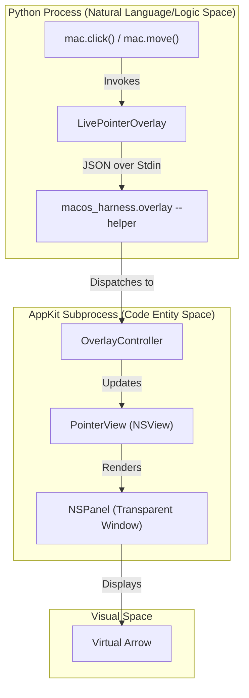

**Sources:**
- `LivePointerOverlay` class: [src/macos_harness/overlay.py:21-22]()
- Helper subprocess execution: [src/macos_harness/overlay.py:75-82]()
- `OverlayController` and `PointerView` definitions: [src/macos_harness/overlay.py:127-170]()

---

## Live Pointer Overlay

The `LivePointerOverlay` class manages a persistent background process that renders a non-activating, click-through `NSPanel` [src/macos_harness/overlay.py:180-184](). This panel sits at a high window level (`NSStatusWindowLevel + 1`) to ensure it remains visible above most other windows and across all Spaces [src/macos_harness/overlay.py:196-201]().

Key capabilities include:
*   **Asynchronous Communication**: Commands are sent via JSON strings over a pipe to avoid blocking the main harness execution [src/macos_harness/overlay.py:96-97]().
*   **State Management**: The overlay supports `move`, `show`, `hide`, and `click` commands [src/macos_harness/overlay.py:37-59]().
*   **Cubic Animation**: The helper process uses eased animations for pointer movement to provide a smooth, human-like visual experience.

For implementation details on the JSON protocol and AppKit window configuration, see **[Live Pointer Overlay](#3.1)**.

**Sources:**
- Command methods: [src/macos_harness/overlay.py:37-60]()
- Window properties (click-through, non-activating): [src/macos_harness/overlay.py:176-193]()

---

## Pointer Geometry

The visual appearance of the pointer is defined by a set of geometric constants that ensure the virtual cursor matches the look and feel of a standard macOS arrow while maintaining precise alignment with action coordinates.

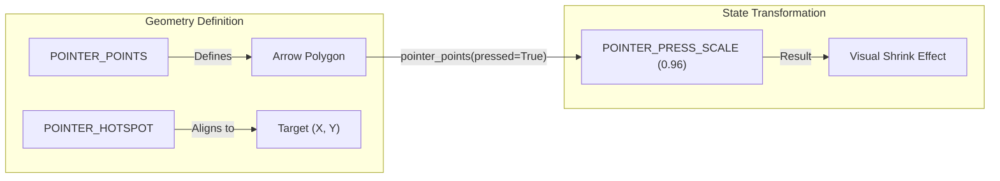

The geometry system handles:
*   **Coordinate Mapping**: The arrow is defined relative to a "hotspot" (the tip of the arrow), which corresponds to the exact pixel where an action occurs [src/macos_harness/pointer.py:7-13]().
*   **Visual Press Feedback**: When a `click` command is issued, the pointer points are scaled down slightly (to 96% size) around the hotspot to simulate a physical press [src/macos_harness/pointer.py:14-24]().

For the specific point arrays and scaling logic, see **[Pointer Geometry](#3.2)**.

**Sources:**
- Geometry constants: [src/macos_harness/pointer.py:5-14]()
- Scaling function `pointer_points`: [src/macos_harness/pointer.py:17-24]()

---

# Page: Live Pointer Overlay

# Live Pointer Overlay

<details>
<summary>Relevant source files</summary>

The following files were used as context for generating this wiki page:

- [src/macos_harness/overlay.py](src/macos_harness/overlay.py)

</details>


The Live Pointer Overlay provides visual feedback for an LLM agent's actions without moving the physical macOS system cursor. It achieves this by spawning a dedicated AppKit helper process that renders a virtual pointer on a transparent, click-through window layer.

### Architecture & Data Flow

The overlay system consists of two parts: the `LivePointerOverlay` class in the main Python process and a subprocess running the AppKit event loop. Communication occurs via a JSON-based protocol over `stdin`.

#### Component Relationship

| Component | Responsibility |
| :--- | :--- |
| `LivePointerOverlay` | Manages the lifecycle of the helper process and provides the Python API (`move`, `click`, `show`, `hide`). [src/macos_harness/overlay.py:21-24]() |
| `OverlayController` | An Objective-C (`NSObject`) class in the helper process that manages the `NSPanel` and handles command dispatch. [src/macos_harness/overlay.py:170-171]() |
| `PointerView` | An AppKit `NSView` that draws the pointer shape using `NSBezierPath` and handles "pressed" state visuals. [src/macos_harness/overlay.py:127-129]() |
| `JSON Protocol` | A line-delimited JSON stream used to send commands from Python to the AppKit helper. [src/macos_harness/overlay.py:108-119]() |

Sources: [src/macos_harness/overlay.py:21-24](), [src/macos_harness/overlay.py:170-171](), [src/macos_harness/overlay.py:127-129](), [src/macos_harness/overlay.py:108-119]()

### JSON Command Protocol

The `LivePointerOverlay` class communicates with the helper via a `subprocess.Popen` pipe [src/macos_harness/overlay.py:75-82](). Commands are serialized as single-line JSON objects [src/macos_harness/overlay.py:96-97]().

| Command | Payload Example | Description |
| :--- | :--- | :--- |
| `move` | `{"cmd":"move","x":100,"y":200,"duration":0.16}` | Animates the pointer to a new coordinate over a specified duration. |
| `show` | `{"cmd":"show","x":100,"y":200}` | Immediately positions and displays the pointer. |
| `hide` | `{"cmd":"hide"}` | Hides the pointer panel. |
| `click` | `{"cmd":"click"}` | Triggers a visual "press" animation (scaling and shadow change). |
| `quit` | `{"cmd":"quit"}` | Gracefully terminates the helper process. |

Sources: [src/macos_harness/overlay.py:37-70](), [src/macos_harness/overlay.py:75-82](), [src/macos_harness/overlay.py:96-97]()

### AppKit Implementation Details

#### The Click-Through Window (`NSPanel`)
The overlay uses an `NSPanel` configured to be non-activating and transparent to mouse events. This ensures the virtual pointer does not interfere with the agent's ability to interact with the underlying UI.

Key `NSPanel` configurations:
* **Style Mask**: `NSWindowStyleMaskBorderless` and `NSWindowStyleMaskNonactivatingPanel` [src/macos_harness/overlay.py:176-179]().
* **Level**: `NSStatusWindowLevel + 1` ensures it stays above most system windows [src/macos_harness/overlay.py:196]().
* **Mouse Events**: `setIgnoresMouseEvents_(True)` allows clicks to pass through to the windows beneath [src/macos_harness/overlay.py:193]().
* **Collection Behavior**: Configured to join all spaces and full-screen apps [src/macos_harness/overlay.py:197-201]().

#### Coordinate Mapping & Multi-Display Support
The helper process maps standard macOS screen coordinates (where (0,0) is bottom-left) to the visual overlay position. It uses `Quartz.CGDisplayBounds(Quartz.CGMainDisplayID())` to determine the primary display dimensions for coordinate flipping [src/macos_harness/overlay.py:246-248]().

#### Cubic-Eased Animation
When a `move` command is received, the `OverlayController` uses a high-frequency timer (`NSTimer`) to update the pointer position [src/macos_harness/overlay.py:228-232](). The animation uses a cubic easing function (`t * t * (3 - 2 * t)`) to provide smooth, natural movement [src/macos_harness/overlay.py:265]().

### Pointer Rendering

The `PointerView` class draws the pointer dynamically. It fetches a list of points from `pointer_points()` [src/macos_harness/overlay.py:138](), which defines the arrow geometry.

* **Hotspot Alignment**: The pointer is drawn such that the tip of the arrow aligns with the target coordinate, accounting for the `POINTER_HOTSPOT` [src/macos_harness/pointer.py:9-11]().
* **Press State**: When `click()` is called, the `pressed` flag is set to `True`, causing `pointer_points` to return a scaled-down version of the arrow [src/macos_harness/pointer.py:24]().
* **Visual Styling**: The pointer includes a 2.5pt white stroke, a 0.65pt black inner stroke, and a subtle shadow for visibility against varied backgrounds [src/macos_harness/overlay.py:147-164]().

### Data Flow Diagram

The following diagram illustrates the flow from a Python `move()` call to the screen update in the AppKit helper.

**Pointer Movement Pipeline**
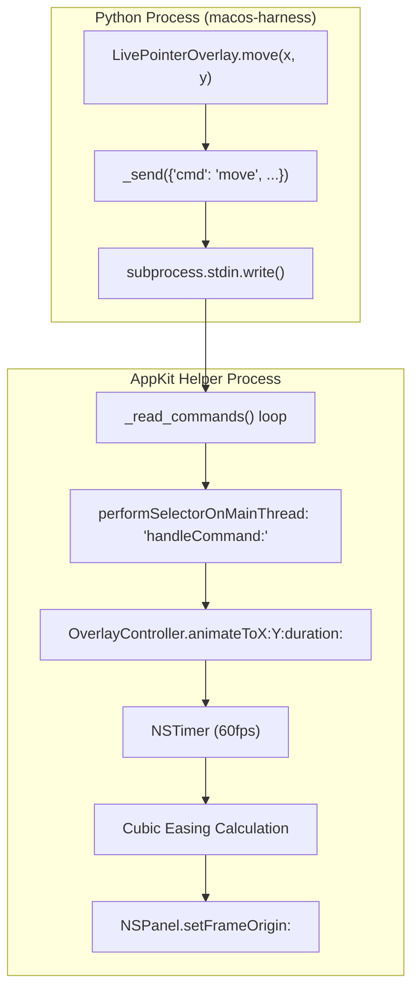
Sources: [src/macos_harness/overlay.py:37-46](), [src/macos_harness/overlay.py:96-97](), [src/macos_harness/overlay.py:108-116](), [src/macos_harness/overlay.py:228-235](), [src/macos_harness/overlay.py:265]()

### Entity Mapping

This diagram maps the logical concepts to the specific code entities implementing them.

**Logical to Code Entity Mapping**
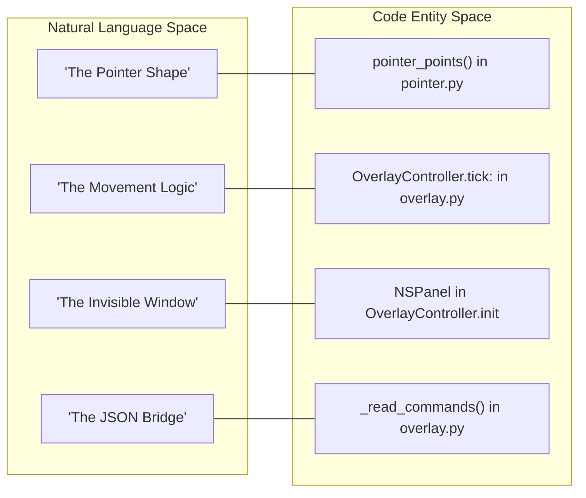
Sources: [src/macos_harness/pointer.py:22-24](), [src/macos_harness/overlay.py:255-276](), [src/macos_harness/overlay.py:180-184](), [src/macos_harness/overlay.py:108-119]()

---

# Page: Pointer Geometry

# Pointer Geometry

<details>
<summary>Relevant source files</summary>

The following files were used as context for generating this wiki page:

- [src/macos_harness/pointer.py](src/macos_harness/pointer.py)

</details>


The `macos-harness` virtual pointer system provides visual feedback to the user without moving the physical system cursor. This feedback is rendered in two places: as a live overlay using `AppKit` and as a rendered element in screenshots. The `pointer.py` module defines the shared geometry, dimensions, and scaling logic to ensure consistent appearance across both contexts.

### Data Flow: Geometry to Rendering
The geometry defined in `pointer.py` serves as the single source of truth for the pointer's shape. The `pointer_points()` function calculates the final coordinates by applying a scale factor relative to a fixed hotspot, which is then consumed by rendering logic to draw the pointer polygon.

**Pointer Geometry Definition**
| Constant | Value | Description |
| :--- | :--- | :--- |
| `POINTER_WIDTH` | `42.0` | Total width of the pointer bounding box. |
| `POINTER_HEIGHT` | `50.0` | Total height of the pointer bounding box. |
| `POINTER_HOTSPOT` | `(5.0, 3.0)` | The active "tip" of the pointer where clicks occur. |
| `POINTER_POINTS` | `((5.0, 3.0), ...)` | A tuple of 4 vertices defining the arrow polygon. |
| `POINTER_PRESS_SCALE` | `0.96` | The scale factor applied when the pointer is in a "pressed" state. |

**Sources:** [src/macos_harness/pointer.py:5-14]()

---

### Coordinate Scaling & Transformation

The primary logic in this module is contained within `pointer_points()`. This function transforms the static `POINTER_POINTS` based on the interaction state (pressed vs. idle). 

To simulate a "click" animation, the pointer shrinks slightly. Crucially, this scaling must occur relative to the `POINTER_HOTSPOT` rather than the center of the shape. This ensures that the tip of the arrow remains fixed at the target coordinate while the rest of the body retracts.

**Mapping Logic Diagram**
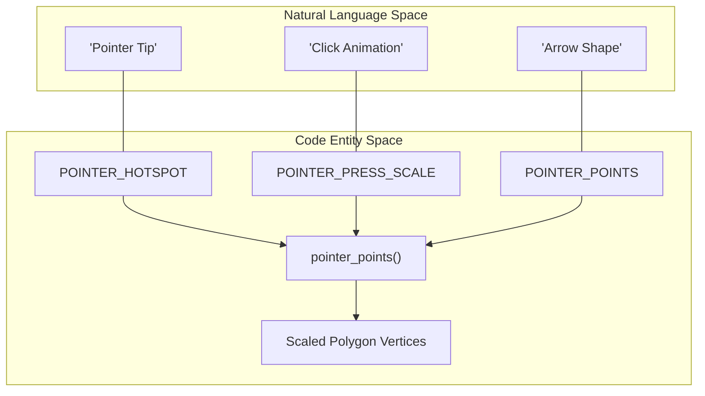
**Sources:** [src/macos_harness/pointer.py:17-24]()

---

### Implementation Details

#### The `pointer_points` Function
The function `pointer_points(*, pressed: bool = False)` implements the scaling math [src/macos_harness/pointer.py:17-24]().

1.  **Scale Selection**: It selects a `scale` factor (1.0 for idle, 0.96 for pressed) [src/macos_harness/pointer.py:19]().
2.  **Origin Translation**: For every vertex $(x, y)$ in `POINTER_POINTS`, it calculates the distance from the `POINTER_HOTSPOT` $(hot\_x, hot\_y)$.
3.  **Scaling**: It multiplies that distance by the `scale`.
4.  **Re-translation**: It adds the result back to the `POINTER_HOTSPOT` to return the point to the original coordinate space [src/macos_harness/pointer.py:22-23]().

**Mathematical Formula:**
$P'_{x} = hot\_x + (P_{x} - hot\_x) \times scale$
$P'_{y} = hot\_y + (P_{y} - hot\_y) \times scale$

#### Pointer Vertices
The pointer is defined as a 4-point polygon representing a standard macOS-style arrow:
1.  `(5.0, 3.0)`: The Tip (Hotspot)
2.  `(5.0, 46.0)`: Bottom-left
3.  `(18.0, 33.0)`: Inner-notch
4.  `(37.0, 33.0)`: Bottom-right

**Shape and Hotspot Relationship**
```mermaid
graph LR
    subgraph "pointer.py constants"
        direction TB
        H["POINTER_HOTSPOT (5.0, 3.0)"]
        P1["Point 1: (5.0, 3.0)"]
        P2["Point 2: (5.0, 46.0)"]
        P3["Point 3: (18.0, 33.0)"]
        P4["Point 4: (37.0, 33.0)"]
    end

    H === P1
    P1 --- P2
    P2 --- P3
    P3 --- P4
    P4 --- P1

    style H stroke-width:4px
```

**Sources:** [src/macos_harness/pointer.py:7-13](), [src/macos_harness/pointer.py:20-24]()

---

# Page: Telemetry

# Telemetry

<details>
<summary>Relevant source files</summary>

The following files were used as context for generating this wiki page:

- [src/macos_harness/cli.py](src/macos_harness/cli.py)
- [src/macos_harness/telemetry.py](src/macos_harness/telemetry.py)

</details>


macOS Harness includes a tiny, privacy-safe, opt-out telemetry system designed to help maintainers understand usage patterns and improve reliability without ever touching sensitive user data. The system is strictly limited to capturing command categories and execution metadata.

## Design Philosophy & Privacy Invariants

The telemetry system is built on a "privacy-first" foundation with several non-negotiable invariants:
*   **No User Content:** The system never collects application names (except for known harness commands), screenshots, text, window titles, or file paths [src/macos_harness/telemetry.py:158-160]().
*   **Coarse Metadata:** Only coarse execution data (success/failure, duration) and environment metadata (OS version, architecture) are transmitted [src/macos_harness/telemetry.py:162-178]().
*   **Anonymized Identity:** A random UUID `install_id` is generated locally to distinguish installations without linking to real-world identities [src/macos_harness/telemetry.py:67-78]().
*   **Non-Blocking:** Telemetry is sent in a detached background process to ensure it never slows down the CLI or agent execution [src/macos_harness/telemetry.py:145-151]().

### Data Flow: CLI to PostHog

The following diagram illustrates how telemetry is captured at the end of a CLI command execution and dispatched.

**Telemetry Dispatch Pipeline**
```mermaid
graph TD
    subgraph "CLI Execution Space"
        A["main()"] -- "finally" --> B["capture_cli()"]
        B -- "if is_enabled()" --> C["_send(payload)"]
    end

    subgraph "Background Process"
        C -- "subprocess.Popen" --> D["_SENDER Script"]
        D -- "urllib.request" --> E["PostHog API"]
    end

    subgraph "Local State"
        F["telemetry.json"] -- "_load()" --> B
    end
```
Sources: [src/macos_harness/cli.py:153-154](), [src/macos_harness/telemetry.py:138-155]()

## Collected Data Points

When `capture_cli` is invoked, it strictly filters the `command` against a whitelist of known subcommands. If the command is not in the `COMMANDS` set, it is recorded as `"python"` to protect privacy [src/macos_harness/telemetry.py:21](), [src/macos_harness/telemetry.py:169]().

| Field | Description | Source |
| :--- | :--- | :--- |
| `command` | One of: `python`, `doctor`, `apps`, `repl`, `skill`, `see`, `state`. | [src/macos_harness/telemetry.py:21]() |
| `success` | Boolean indicating if the command returned exit code 0. | [src/macos_harness/cli.py:154]() |
| `duration_seconds` | Execution time rounded to 2 decimal places. | [src/macos_harness/telemetry.py:171]() |
| `macos_harness_version` | The version of the installed package. | [src/macos_harness/telemetry.py:104-109]() |
| `agent` | Detected LLM agent environment (e.g., `claude-code`, `cursor`). | [src/macos_harness/telemetry.py:111-121]() |
| `os` / `machine` | OS name and hardware architecture (e.g., `Darwin`, `arm64`). | [src/macos_harness/telemetry.py:174-175]() |

Sources: [src/macos_harness/telemetry.py:162-178]()

## Configuration & Opt-Out

Users can opt-out of telemetry through three different mechanisms: environment variables, the CLI, or direct config file modification.

### 1. Environment Overrides
The system checks several standard environment variables. If any are set to "disable" values, telemetry is suppressed [src/macos_harness/telemetry.py:16-20]().
*   `MACOS_HARNESS_TELEMETRY`: Set to `0`, `false`, `no`, or `off` to disable.
*   `DO_NOT_TRACK`: Set to `1`, `true`, `yes`, or `on` to disable.
*   `ANONYMIZED_TELEMETRY`: Set to `0`, `false`, `no`, or `off` to disable.

### 2. Configuration File
State is persisted in a JSON file. By default, this is located at `~/Library/Application Support/macos-harness/telemetry.json` [src/macos_harness/telemetry.py:24-32]().
*   **Custom Home:** Setting `MACOS_HARNESS_HOME` overrides the base directory [src/macos_harness/telemetry.py:25-28]().
*   **Permissions:** The configuration directory is restricted to `0o700` and the file to `0o600` for security [src/macos_harness/telemetry.py:46-50]().

### 3. CLI Subcommand
The `telemetry` subcommand provides a user-friendly interface to manage these settings [src/macos_harness/cli.py:88-89]().

```bash
# Check current status and install_id
macos-harness telemetry status

# Opt-out of telemetry
macos-harness telemetry disable

# Opt-in to telemetry
macos-harness telemetry enable
```
Sources: [src/macos_harness/telemetry.py:184-195](), [src/macos_harness/cli.py:65-68]()

## Implementation Details

The core logic resides in `telemetry.py`. It uses a detached `subprocess` to execute a minimal Python script (`_SENDER`) that performs the HTTP POST request using `urllib.request`. This ensures that even if the network is slow or the telemetry server is unreachable, the user experience is unaffected [src/macos_harness/telemetry.py:123-135]().

**Code Entity Mapping: Telemetry Logic**
```mermaid
classDiagram
    class CLI {
        +main(argv)
        +capture_cli(command, success, duration)
    }
    class TelemetryModule {
        +is_enabled() bool
        +status() dict
        +set_enabled(bool)
        +_send(payload)
        +_install_id() str
    }
    class PostHog {
        <<Service>>
        +POSTHOG_KEY
        +POSTHOG_HOST
    }

    CLI ..> TelemetryModule : calls capture_cli [cli.py:154]
    TelemetryModule ..> PostHog : sends payload [telemetry.py:138]
    TelemetryModule --> TelemetryFile : reads/writes [telemetry.py:31]
```
Sources: [src/macos_harness/cli.py:154](), [src/macos_harness/telemetry.py:14-15](), [src/macos_harness/telemetry.py:31]()

### Agent Detection
The `_agent()` function identifies the calling environment by checking for specific environment variables associated with popular AI coding tools [src/macos_harness/telemetry.py:111-121]():
*   `CLAUDECODE` -> `claude-code`
*   `CURSOR_AGENT` -> `cursor`
*   `CODEX_THREAD_ID` -> `codex`

Sources: [src/macos_harness/telemetry.py:111-121]()

---

# Page: Skill & Agent Integration

# Skill & Agent Integration

<details>
<summary>Relevant source files</summary>

The following files were used as context for generating this wiki page:

- [pyproject.toml](pyproject.toml)
- [skills/macos-harness/SKILL.md](skills/macos-harness/SKILL.md)
- [skills/macos-harness/agents/openai.yaml](skills/macos-harness/agents/openai.yaml)

</details>


The macOS Harness is designed to be consumed by LLM agents as a high-level "skill." It packages the complex interactions of macOS APIs into a compact, six-verb interface that allows an agent to control the operating system through a persistent Python execution environment. Integration is achieved through a combination of a structured prompt definition (`SKILL.md`) and framework-specific configuration files.

## Overview of Agent Integration

Integration with LLM frameworks relies on treating the `macos-harness` CLI as a tool that accepts Python scripts via `stdin`. This allows agents to execute multi-step logic in a single round trip, rather than invoking individual primitives one by one.

### The Skill Surface
The harness exposes a minimized API surface to the agent, centered around six primary verbs:
1.  `see`: Capture screenshots and window state.
2.  `key`: Send keyboard shortcuts to specific PIDs.
3.  `type`: Send text input to specific PIDs.
4.  `click`: Perform PID-targeted mouse events.
5.  `ax`: Interact with the Accessibility tree.
6.  `script`: Execute AppleScript for exact, focus-safe commands.

### Agent-Harness Interaction Flow

The following diagram illustrates how an LLM agent interacts with the macOS Harness through the CLI and the pre-populated Python namespace.

**Agent Execution Logic**
```mermaid
graph TD
    subgraph "Natural Language Space"
        A["LLM Agent"] -- "Generates Python Script" --> B["Execution Layer"]
    end

    subgraph "Code Entity Space"
        B -- "cat script.py | macos-harness" --> C["macos_harness.cli:main"]
        C -- "Pre-populates" --> D["_namespace()"]
        D -- "Injects" --> E["mac: MacOS"]
        D -- "Injects" --> F["browser: BrowserHarness"]
        
        E -- "calls" --> G["macos_harness.macos:see"]
        E -- "calls" --> H["macos_harness.macos:click"]
        F -- "calls" --> I["macos_harness.browser:connect"]
    end

    G -- "Returns" --> J["Screenshot/Window Data"]
    J -- "Parsed by" --> A
```
Sources: [src/macos_harness/cli.py:1-40](), [skills/macos-harness/SKILL.md:37-54](), [src/macos_harness/browser.py:1-30]()

## Skill Definition (SKILL.md)

The core of the integration is the `SKILL.md` file. This document serves as the "instruction manual" for the LLM, defining the operational constraints and the strategy for using the harness effectively. It is bundled into the Python package and can be force-included in builds.

**Key concepts covered in the skill definition:**
*   **Round-trip Minimization:** Instructions for agents to bundle deterministic steps (e.g., search + type + capture) into a single Python execution block to reduce latency.
*   **Mode Selection Hierarchy:** A decision tree for agents to choose the "lowest useful mode," preferring AppleScript (`script`) or Vision (`see`) over complex Accessibility (`ax`) tree traversals.
*   **Invariants:** Hard rules the agent must follow, such as never requesting window activation or moving the physical cursor.

For details on the specific prompt instructions and strategy, see [SKILL.md — Agent Prompt & Usage Guide](#5.1).

Sources: [skills/macos-harness/SKILL.md:1-96](), [pyproject.toml:50-51]()

## Agent Configuration

To make the harness discoverable by agent orchestrators (such as those using the OpenAI tool format), the repository includes standardized configuration metadata.

### OpenAI YAML Interface
The `agents/openai.yaml` file defines how the skill appears in compatible UIs and provides a `default_prompt` that triggers the harness's capabilities.

| Field | Value |
| :--- | :--- |
| `display_name` | macOS Harness |
| `short_description` | Simple visual control for the whole Mac |
| `default_prompt` | Use $macos-harness to see and control my Mac... |

For details on integrating with specific LLM providers and YAML fields, see [Agent Configuration (OpenAI YAML)](#5.2).

Sources: [skills/macos-harness/agents/openai.yaml:1-4]()

## Skill Registration Architecture

The harness is registered as a system-level tool. When the agent decides to use the "macOS Harness" skill, it formats its intent into a Python block that is piped into the `macos-harness` CLI.

**Skill Registration Flow**
```mermaid
graph LR
    subgraph "Agent Framework"
        YAML["openai.yaml"] -- "Registers" --> Registry["Skill Registry"]
        Registry -- "Provides Prompt" --> LLM["LLM Core"]
    end

    subgraph "System Surface"
        LLM -- "Writes to stdin" --> CLI["macos-harness CLI"]
        CLI -- "Executes" --> Py["Python Interpreter"]
        Py -- "Uses" --> Lib["macos_harness Library"]
    end
```
Sources: [skills/macos-harness/agents/openai.yaml:1-4](), [pyproject.toml:39-40](), [skills/macos-harness/SKILL.md:10-21]()

---

# Page: SKILL.md — Agent Prompt & Usage Guide

# SKILL.md — Agent Prompt & Usage Guide

<details>
<summary>Relevant source files</summary>

The following files were used as context for generating this wiki page:

- [README.md](README.md)
- [skills/macos-harness/SKILL.md](skills/macos-harness/SKILL.md)

</details>


The `SKILL.md` file serves as the primary instruction set and behavioral contract for LLM agents utilizing the macOS Harness. It defines the operational boundaries, the minimized API surface, and the decision-making logic required to control macOS without violating the harness's core invariants.

## Purpose and Scope

The purpose of `SKILL.md` is to teach an agent how to interact with the `macos-harness` CLI and its preloaded Python environment. It shifts the agent's strategy from "step-by-step" tool calling to "burst execution," where the agent writes and executes Python scripts that perform multiple operations within a single round trip [skills/macos-harness/SKILL.md:8-18]().

## The Six-Verb Surface

The harness simplifies the vast macOS API into six primary verbs exposed through the `mac` object. Agents are instructed to think exclusively in these primitives to maintain consistency and reliability.

| Verb | Description | Code Entity |
| :--- | :--- | :--- |
| `see` | Captures a screenshot of a specific app window. | `mac.see()` |
| `key` | Sends a keyboard shortcut to a specific PID. | `mac.key()` |
| `type` | Sends a string of text to a specific PID. | `mac.type()` |
| `click` | Sends a raw mouse click to coordinates within a PID. | `mac.click()` |
| `ax` | Interacts with the macOS Accessibility tree. | `mac.ax` |
| `script` | Executes raw AppleScript/Apple Events. | `mac.script()` |

**Sources:** [skills/macos-harness/SKILL.md:37-51](), [README.md:34-55]()

## Round-Trip Minimization Strategy

To ensure efficiency and reduce latency, the harness encourages a "burst" execution model. Agents should bundle deterministic, reversible steps into a single Python program rather than making individual CLI calls for every click or keystroke [skills/macos-harness/SKILL.md:23-35]().

### Execution Flow
1.  **Identify Boundary:** The agent determines the next "decision point" (e.g., an irreversible action or a state requiring visual verification).
2.  **Compose Script:** The agent writes a Python script using the six verbs and standard libraries (`Path`, `subprocess`).
3.  **Execute Burst:** The script is piped into `macos-harness` via stdin.
4.  **Verify:** The script concludes with a final `mac.see()` or AX query to confirm the end-state.

**Sources:** [skills/macos-harness/SKILL.md:8-18](), [skills/macos-harness/SKILL.md:25-30]()

## Mode Selection Hierarchy

Agents follow a strict hierarchy when deciding how to interact with an application. They are instructed to choose the "lowest useful mode" to minimize overhead and maximize reliability.

### Decision Tree: Mode Selection

```mermaid
graph TD
    Start["Task Requirement"] --> Q1{"Is there a known focus-safe script?"}
    Q1 -- "Yes" --> Script["mac.script() (AppleScript)"]
    Q1 -- "No" --> Q2{"Is the target visible?"}
    Q2 -- "Yes" --> Q3{"Is there a reliable keyboard route?"}
    Q3 -- "Yes" --> Key["mac.key() / mac.type()"]
    Q3 -- "No" --> Vision["mac.see() + mac.click()"]
    Q2 -- "No" --> Q4{"Is semantic identity/state required?"}
    Q4 -- "Yes" --> AX["mac.ax (Accessibility)"]
    Q4 -- "No" --> Failure["Switch mode or stop"]
```
**Sources:** [skills/macos-harness/SKILL.md:56-69]()

## Invariant Rules for Agents

The harness enforces several non-negotiable invariants that the agent must respect to ensure it does not interfere with the human user's physical environment.

*   **No Physical Pointer Movement:** `mac.click()` and `mac.move()` interact with the target PID's event queue or the virtual overlay; the physical system cursor never moves [skills/macos-harness/SKILL.md:76-77]().
*   **No Window Activation:** The harness targets background PIDs. If an app becomes frontmost, the harness raises a `FocusChangedError` [skills/macos-harness/SKILL.md:72-74]().
*   **Retina Scaling:** All coordinates returned by `mac.see()` are pre-scaled for the window's backing store; agents must use these coordinates directly [skills/macos-harness/SKILL.md:80-81]().
*   **No Guessing:** `mac.click()` is a raw event. It does not "guess" AX actions. If a click fails, the agent must switch to `mac.ax` or `mac.script` [skills/macos-harness/SKILL.md:75-78]().

**Sources:** [skills/macos-harness/SKILL.md:70-86](), [README.md:76-81]()

## Browser vs. Native Logic

The agent must distinguish between native macOS UI and web content.

*   **Browser Harness (CDP):** Use the `browser` object for DOM manipulation, network requests, and tab management. Agents are forbidden from using AX to interact with elements *inside* a web page [skills/macos-harness/SKILL.md:89-90]().
*   **MacOS Harness (AX):** Used only to handle browser-level chrome, such as the "Allow remote debugging?" permission sheet, which is a native macOS dialog [skills/macos-harness/SKILL.md:90-92]().

**Sources:** [skills/macos-harness/SKILL.md:87-93]()

## Runtime Loading and Registration

The skill is designed to be self-bootstrapping. An agent typically registers the skill by following these steps:

1.  **Installation:** The agent installs the package using `uv` [README.md:27-29]().
2.  **Discovery:** The agent runs `macos-harness skill` to output the content of `SKILL.md` and the agent-specific YAML configuration [README.md:28]().
3.  **Verification:** The agent runs `macos-harness doctor` to check for Accessibility, Screen Recording, and Event Posting permissions [skills/macos-harness/SKILL.md:94-96]().

### System Component Mapping

The following diagram maps the natural language concepts in `SKILL.md` to the internal Python classes and CLI components.

```mermaid
graph LR
    subgraph "Natural Language Space (SKILL.md)"
        V["Six Verbs"]
        B["Browser Logic"]
        P["Permissions"]
    end

    subgraph "Code Entity Space"
        V --> MAC["MacOS class (macos.py)"]
        MAC --> SEE["mac.see()"]
        MAC --> CLICK["mac.click()"]
        MAC --> AX_OBJ["mac.ax (Accessibility class)"]
        
        B --> BROWSER["BrowserHarness (browser.py)"]
        
        P --> DOCTOR["doctor() (macos.py)"]
        DOCTOR --> CLI["macos-harness CLI"]
    end
```

**Sources:** [README.md:57-74](), [skills/macos-harness/SKILL.md:37-51](), [skills/macos-harness/SKILL.md:94-96]()

---

# Page: Agent Configuration (OpenAI YAML)

# Agent Configuration (OpenAI YAML)

<details>
<summary>Relevant source files</summary>

The following files were used as context for generating this wiki page:

- [skills/macos-harness/agents/openai.yaml](skills/macos-harness/agents/openai.yaml)

</details>


The `macos-harness` is designed to be consumed by LLM agent orchestrators as a modular "skill." This integration is defined through a YAML interface specification that provides the necessary metadata for an agent to understand its capabilities and constraints.

## Purpose and Scope

The configuration file `skills/macos-harness/agents/openai.yaml` serves as the registration manifest for compatible agent frameworks (such as those following the OpenAI skill/plugin interface patterns). It defines the human-readable identity of the tool and, crucially, the `default_prompt` that establishes the operational constraints for the LLM when it invokes the harness.

### Data Flow: Registration to Execution

The following diagram illustrates how the YAML configuration bridges the gap between the "Natural Language Space" (the Agent's reasoning) and the "Code Entity Space" (the harness execution environment).

**Agent Integration Pipeline**
```mermaid
graph TD
    subgraph "Natural Language Space (Agent Orchestrator)"
        YAML["openai.yaml"]
        Prompt["default_prompt"]
        ShortDesc["short_description"]
    end

    subgraph "Code Entity Space (macos-harness)"
        SkillMD["SKILL.md"]
        CLI["macos-harness skill"]
        Verbs["mac.see(), mac.click(), etc."]
    end

    YAML -- "Registers" --> Orchestrator["Agent Orchestrator"]
    ShortDesc -- "Identifies Tool" --> Orchestrator
    Prompt -- "Sets System Constraints" --> Orchestrator
    Orchestrator -- "Injects Context" --> SkillMD
    SkillMD -- "Defines API" --> CLI
    CLI -- "Executes" --> Verbs
```
**Sources:** [skills/macos-harness/agents/openai.yaml:1-4]()

## Interface Definition

The interface is composed of three primary fields that dictate how the skill is presented to and used by the AI agent.

| Field | Value | Technical Role |
| :--- | :--- | :--- |
| `display_name` | `"macOS Harness"` | The primary identifier used in UI elements and tool listings [skills/macos-harness/agents/openai.yaml:2-2](). |
| `short_description` | `"Simple visual control for the whole Mac"` | A high-level summary used by the LLM to determine tool relevancy during the planning phase [skills/macos-harness/agents/openai.yaml:3-3](). |
| `default_prompt` | `"Use $macos-harness to see and control my Mac..."` | The system instruction injected into the agent's context to enforce core invariants [skills/macos-harness/agents/openai.yaml:4-4](). |

### The `default_prompt` Invariants

The `default_prompt` field in `openai.yaml` is not merely a description; it is a functional constraint that enforces the "Thin Harness" philosophy. 

1.  **Tool Reference:** It uses the `$macos-harness` variable to link the prompt to the specific tool implementation [skills/macos-harness/agents/openai.yaml:4-4]().
2.  **Pointer Invariant:** It explicitly instructs the agent to operate **"without moving my physical cursor"** [skills/macos-harness/agents/openai.yaml:4-4](). This aligns with the implementation of the `LivePointerOverlay` which uses a virtual pointer rather than `CGEventPost` for mouse movement.
3.  **Focus Invariant:** It mandates operation without **"taking focus"** [skills/macos-harness/agents/openai.yaml:4-4](). This reinforces the design of the `mac` primitives (e.g., `mac.click()`) which target specific PIDs to avoid disruptive window activation.

**Relationship between YAML and Execution**
```mermaid
graph LR
    subgraph "openai.yaml (Config)"
        DP["default_prompt"]
    end

    subgraph "macos.py (Implementation)"
        MV["No Physical Movement"]
        NF["No Window Activation"]
    end

    DP -- "Mandates" --> MV
    DP -- "Mandates" --> NF
```
**Sources:** [skills/macos-harness/agents/openai.yaml:4-4]()

## Implementation Details

The file `skills/macos-harness/agents/openai.yaml` is located within the `skills/` directory, which is packaged with the harness distribution. When an agent orchestrator loads this skill, it reads these fields to populate its internal tool registry.

*   **File Path:** `skills/macos-harness/agents/openai.yaml` [skills/macos-harness/agents/openai.yaml:1-4]()
*   **Format:** Standard YAML 1.2.

**Sources:**
*   [skills/macos-harness/agents/openai.yaml:1-4]()

---

# Page: Permissions & Security

# Permissions & Security

<details>
<summary>Relevant source files</summary>

The following files were used as context for generating this wiki page:

- [README.md](README.md)
- [SECURITY.md](SECURITY.md)
- [src/macos_harness/macos.py](src/macos_harness/macos.py)

</details>


macOS Harness operates by interfacing directly with system-level APIs to observe and control applications. Because these capabilities (screen capture, synthetic input, and UI inspection) are sensitive, macOS enforces a strict permission model. This page provides a high-level overview of the security architecture, the required permission buckets, and the harness's commitment to safety and privacy.

## Security Architecture Overview

The harness is designed around the **Principle of Least Privilege** and three non-negotiable safety invariants. Unlike traditional automation tools, it avoids global system changes in favor of targeted, process-specific interactions.

### The Three Invariants
1.  **No Physical Pointer Movement**: The harness never moves the user's actual mouse cursor. It draws a virtual overlay and sends events directly to application PIDs [src/macos_harness/macos.py:781-784]().
2.  **No Window Activation**: The harness captures screenshots and sends events to background windows without bringing them to the front, preventing "focus stealing" [src/macos_harness/macos.py:76-77]().
3.  **No User-Data Telemetry**: Telemetry is strictly limited to operational metadata (e.g., command success, duration) and explicitly excludes screenshots, window titles, or UI text [README.md:88-91]().

### Component Interaction & Security
The following diagram illustrates how the harness components interact with macOS security boundaries:

**Security Boundary Mapping**
```mermaid
graph TD
    subgraph "Python Process (macos-harness)"
        A["mac.* Primitives"]
        B["browser.* Primitives"]
        C["LivePointerOverlay"]
    end

    subgraph "macOS Security Frameworks"
        D["Screen Recording (TCC)"]
        E["Accessibility (AX)"]
        F["PostEvent (Input)"]
        G["Automation (AppleEvents)"]
    end

    A -->|"screencapture -l"| D
    A -->|"AXUIElement"| E
    A -->|"CGEventPostToPid"| F
    A -->|"osascript"| G
    C -->|"NSPanel (Click-through)"| E
    B -->|"CDP Bridge"| E
```
Sources: [README.md:59-74](), [src/macos_harness/macos.py:1-6](), [src/macos_harness/overlay.py:44-55]()

---

## Permission Model

To function correctly, the harness requires four distinct macOS permissions. These are managed via the `doctor` command and the `request_permissions()` utility.

| Permission | Usage in Code | Consequence if Missing |
| :--- | :--- | :--- |
| **Accessibility** | `AXUIElement` APIs in `controls.py` | `AccessibilityPermissionError` raised; cannot inspect UI tree. |
| **Screen Recording** | `screencapture` in `mac.see()` | Screenshots will be empty or contain only the desktop wallpaper. |
| **Post Events** | `CGEventPostToPid` in `mac.click()` | Input events are ignored by target applications. |
| **Automation** | `osascript` in `mac.script()` | AppleScript execution fails with a "Not allowed" error. |

### The Doctor Command
The `macos-harness doctor` command serves as the primary diagnostic tool. It checks the current status of all four permissions using native system calls such as `AXIsProcessTrusted()` and `CGPreflightScreenCaptureAccess()` [src/macos_harness/macos.py:1134-1175]().

For details on how these checks are implemented and how to use the `--request` flag, see [Permission Model & Doctor Command](#6.1).

---

## Security Policy & Threat Model

The project maintains a formal security policy defined in `SECURITY.md`. This policy treats the LLM agent and the UI it interacts with as potential sources of untrusted input.

### Key Security Guidelines
*   **Vulnerability Reporting**: Security issues should be reported privately via GitHub Security Advisories [SECURITY.md:3-5]().
*   **Untrusted Input**: Developers and users must treat agent instructions and third-party application UI as untrusted [SECURITY.md:7-8]().
*   **Irreversible Actions**: The harness encourages a "human-in-the-loop" approach for irreversible actions [SECURITY.md:8-9]().

### Minimum Privilege Operation
The harness is designed to be scoped to specific PIDs whenever possible. For example, `mac.click()` and `mac.type()` target specific Process IDs rather than the global system event stream [src/macos_harness/macos.py:781-790]().

For a detailed breakdown of the threat model and safety recommendations, see [Security Policy & Threat Model](#6.2).

---

## Telemetry & Privacy

The harness includes an opt-out telemetry system. It is designed to be privacy-safe by construction: the code responsible for sending telemetry lacks access to the screenshot buffers or UI tree data.

*   **Collected**: Command category (e.g., `see`, `click`), success/failure, duration, OS version, and agent name [README.md:88-91]().
*   **Never Collected**: Prompts, app names, screenshots, UI text, or file paths [README.md:90-91]().
*   **Disabling**: Users can disable telemetry via `macos-harness telemetry disable` [README.md:94-95]().

Sources: [README.md:83-95](), [src/macos_harness/telemetry.py:1-20]()

---

# Page: Permission Model & Doctor Command

# Permission Model & Doctor Command

<details>
<summary>Relevant source files</summary>

The following files were used as context for generating this wiki page:

- [src/macos_harness/cli.py](src/macos_harness/cli.py)
- [src/macos_harness/macos.py](src/macos_harness/macos.py)

</details>


macOS Harness operates by interfacing with sensitive system-level APIs provided by the `ApplicationServices` and `AppKit` frameworks. To ensure security and user privacy, macOS requires explicit authorization for the harness to observe the screen, simulate input events, and inspect the Accessibility (AX) tree of other applications.

The `doctor` command serves as the primary diagnostic tool for verifying these permissions, while the `--request` flag provides a mechanism to trigger the native system prompts required for authorization.

## Permission Buckets

The harness requires four distinct permission "buckets" to function correctly. Each bucket corresponds to a specific set of macOS security constraints.

| Bucket | Purpose | Verification Method |
| :--- | :--- | :--- |
| **Accessibility** | Inspecting the AX tree and performing semantic actions (e.g., clicking a specific AX element). | `AS.AXIsProcessTrusted()` |
| **Screen Recording** | Capturing window screenshots via the `screencapture` CLI. | `AS.CGPreflightScreenCaptureAccess()` |
| **Post Events** | Simulating low-level mouse and keyboard events via `CGEventPost`. | `AS.CGPreflightPostEventAccess()` |
| **Automation** | Executing AppleScript to control applications (e.g., fetching the URL from a browser). | Checked via `tccutil` or by attempting a "no-op" script execution. |

### Implementation of Checks

The permission checks are implemented within the `MacOS.doctor()` method, which calls the underlying Core Graphics and Accessibility preflight functions.

```mermaid
graph TD
    subgraph "MacOS.doctor() Implementation"
        START["mac.doctor()"] --> AX["AXIsProcessTrusted()"]
        AX --> SC["CGPreflightScreenCaptureAccess()"]
        SC --> PE["CGPreflightPostEventAccess()"]
        PE --> OUT["Return JSON status"]
    end

    subgraph "Natural Language Space"
        P1["'Can I see the screen?'"]
        P2["'Can I type/click?'"]
        P3["'Can I read UI labels?'"]
    end

    AX --- P3
    SC --- P1
    PE --- P2
```

**Sources:**
- Permission check logic: [src/macos_harness/macos.py:321-344]()
- Constant definitions: [src/macos_harness/macos.py:26-33]()

---

## The Doctor Command

The `doctor` command provides a JSON-formatted report of the current system state. This is intended for both human debugging and automated health checks by agent frameworks.

### JSON Output Format
The output of `mac.doctor()` (invoked via `macos-harness doctor`) returns a dictionary containing:
1.  **permissions**: Boolean status for `accessibility`, `screen_capture`, and `post_event`.
2.  **python**: The version of the current interpreter.
3.  **harness**: The version of the `macos-harness` package.
4.  **os**: System version and architecture (e.g., `macOS-14.5-arm64`).

**Sources:**
- CLI command handling: [src/macos_harness/cli.py:94-100]()
- `doctor()` return structure: [src/macos_harness/macos.py:321-344]()

---

## Requesting Permissions (`--request`)

Because macOS security policy prevents programmatic granting of permissions, the harness must trigger the system's native "Permission Requested" dialogs. 

When the `--request` flag is used (e.g., `macos-harness doctor --request`), the `MacOS.request_permissions()` method is called. This method utilizes "Request" variants of the preflight APIs which, unlike the "Preflight" variants, will pop up a system modal if the permission is currently denied or undetermined.

### Data Flow: Permission Request

```mermaid
sequenceDiagram
    participant CLI as "macos_harness/cli.py"
    participant M as "MacOS Class (macos.py)"
    participant AS as "ApplicationServices (macOS)"
    participant TCC as "TCC.db (System Security)"

    CLI->>M: request_permissions()
    M->>AS: AXIsProcessTrustedWithOptions({...})
    AS-->>TCC: Check Privacy Database
    TCC-->>User: [Display System Prompt]
    M->>AS: CGRequestScreenCaptureAccess()
    M->>AS: CGRequestPostEventAccess()
    M->>CLI: Return to Doctor Check
```

**Sources:**
- `request_permissions` implementation: [src/macos_harness/macos.py:346-353]()
- CLI flag handling: [src/macos_harness/cli.py:59-61]() and [src/macos_harness/cli.py:96-97]()

---

## Accessibility Trust Verification

The most critical permission is **Accessibility**. Without it, the harness cannot resolve window hierarchies or interact with elements semantically.

The harness checks this using `AS.AXIsProcessTrusted()`. If a command is attempted while this permission is missing, the harness raises a specific `AccessibilityPermissionError`.

### Interaction Flow for AX Access

1.  **Initialization**: `MacOS.__init__` is called.
2.  **Check**: The harness verifies bindings are available via `_require_macos()`.
3.  **Execution**: When a command like `mac.ax()` or `mac.see()` is called, it implicitly relies on the process being trusted.
4.  **Failure**: If `AXIsProcessTrusted()` returns `False`, the system will often block the call silently or return an `AXError`. The harness wraps these into `MacOSError` or `AccessibilityPermissionError`.

**Sources:**
- `_require_macos` check: [src/macos_harness/macos.py:233-239]()
- Error definitions: [src/macos_harness/macos.py:40-41]()
- AX status check in doctor: [src/macos_harness/macos.py:322-322]()

---

# Page: Security Policy & Threat Model

# Security Policy & Threat Model

<details>
<summary>Relevant source files</summary>

The following files were used as context for generating this wiki page:

- [CONTRIBUTING.md](CONTRIBUTING.md)
- [SECURITY.md](SECURITY.md)

</details>


This page documents the security posture, vulnerability reporting procedures, and the threat model for `macos-harness`. As a tool designed to provide LLM agents with programmatic control over a macOS environment, the harness operates with elevated privileges (Accessibility, Screen Recording, and Event Injection). Understanding the trust boundaries and the principle of least privilege is critical for safe deployment.

## Vulnerability Reporting

The project maintains a private disclosure channel for security concerns. Users and researchers who discover vulnerabilities should not open public issues.

*   **Reporting Channel:** Vulnerabilities must be reported privately through **GitHub Security Advisories** for the `browser-use/macos-harness` repository [SECURITY.md:3-4]().
*   **Scope:** This includes exploits that could lead to unauthorized privilege escalation, bypass of user-granted permissions, or leakage of sensitive UI data beyond the configured agent interface.

## Threat Model & Trust Boundaries

The `macos-harness` security model is predicated on the user acting as the ultimate security principal. The harness itself is a "thin" intermediary that executes commands on behalf of an agent.

### Untrusted Inputs
The harness treats two primary sources as untrusted input:
1.  **Agent Instructions:** Any code or command sequence generated by an LLM agent is considered untrusted [SECURITY.md:7-8](). Agents may attempt to perform destructive actions or access sensitive information if not properly constrained by the orchestrator.
2.  **Third-Party UI:** Content read from the screen via `mac.see()` [macos.py:102-125]() or the Accessibility tree [controls.py:22-54]() is untrusted. Malicious applications could attempt "UI Injection" attacks, where text rendered in a window is designed to trick an agent's reasoning engine into executing unauthorized commands.

### Irreversible Actions
The policy mandates that users **review irreversible actions** [SECURITY.md:8-9](). Because the harness can simulate keyboard events [macos.py:223-234]() and mouse clicks [macos.py:236-258](), it has the technical capability to delete files, send emails, or modify system settings if the agent is granted those permissions.

### Data Flow & Trust Diagram
The following diagram illustrates the flow of untrusted data and the permission boundaries enforced by the macOS kernel.

**Data Flow Security Boundaries**
```mermaid
graph TD
    subgraph "Untrusted Space"
        Agent["LLM Agent / Instructions"]
        TargetApp["Third-Party Applications / UI"]
    end

    subgraph "Harness Process (Python)"
        MacOS["MacOS Class (macos.py)"]
        AX["Accessibility Class (controls.py)"]
        Telemetry["Telemetry Module"]
    end

    subgraph "macOS Security Frameworks"
        TCC["TCC.db (Permissions)"]
        AXAPI["Accessibility API"]
        CGAPI["CoreGraphics (Screen/Events)"]
    end

    Agent -- "Untrusted Code/Verbs" --> MacOS
    TargetApp -- "Untrusted UI Data" --> AX
    AX -- "Filtered Snapshots" --> Agent
    MacOS -- "Request Execution" --> CGAPI
    CGAPI -- "Check Permissions" --> TCC
    Telemetry -- "Anonymized Stats" --> External["PostHog (Opt-out)"]

    style Agent fill:none,stroke-dasharray: 5 5
    style TargetApp fill:none,stroke-dasharray: 5 5
```
**Sources:** [SECURITY.md:7-9](), [macos.py:102-125](), [controls.py:22-54]().

## Principle of Least Privilege

The harness requires specific macOS permissions to function, but these should be granted judiciously based on the specific task requirements.

| Permission | Code Entity / Function | Security Impact |
| :--- | :--- | :--- |
| **Accessibility** | `AXIsProcessTrusted()` [macos.py:756-764]() | Allows reading the UI tree and interacting with elements via `controls.py`. |
| **Screen Recording** | `CGPreflightScreenCaptureAccess()` [macos.py:738-746]() | Allows `mac.see()` to capture pixels. Sensitive data in background windows may be captured. |
| **Post Events** | `CGPreflightPostEventAccess()` [macos.py:748-754]() | Allows `mac.click()` and `mac.type()` to inject input events into the system stream. |
| **Automation** | AppleScript `osascript` [macos.py:365-374]() | Allows direct control of specific apps (e.g., Chrome, Finder). |

Users are encouraged to grant the **minimum permissions needed** for the specific task [SECURITY.md:8-9](). For example, if an agent only needs to read text, Screen Recording may not be required if Accessibility is sufficient.

## Security Invariants

The codebase enforces three core invariants to protect the user's environment and privacy:

1.  **No Physical Pointer Movement:** The harness uses `CGEventCreateMouseEvent` with a specific PID or `kCGEventTargetUnixProcessID` to inject events without moving the hardware cursor [macos.py:246-255](). This prevents the agent from "stealing" the user's mouse focus [CONTRIBUTING.md:12-13]().
2.  **No Window Activation:** Commands should not force a window to the foreground (e.g., `make frontmost`) unless explicitly requested, preserving the user's active workspace [CONTRIBUTING.md:13]().
3.  **Privacy-Safe Telemetry:** The telemetry system is strictly opt-out and is architected to never collect user-identifiable data such as app names, screenshots, or window titles [CONTRIBUTING.md:13]().

**Permission Verification Logic**
```mermaid
sequenceDiagram
    participant CLI as cli.py (doctor)
    participant MacOS as MacOS Class (macos.py)
    participant TCC as macOS TCC Framework

    CLI->>MacOS: doctor()
    MacOS->>TCC: CGPreflightScreenCaptureAccess()
    TCC-->>MacOS: kCGErrorSuccess / kCGErrorFailure
    MacOS->>TCC: AXIsProcessTrusted()
    TCC-->>MacOS: True / False
    MacOS-->>CLI: Return Permission State Map
    CLI->>User: Display JSON/Table Status
```
**Sources:** [macos.py:730-775](), [CONTRIBUTING.md:12-13]().

---

# Page: Testing

# Testing

<details>
<summary>Relevant source files</summary>

The following files were used as context for generating this wiki page:

- [.github/workflows/ci.yml](.github/workflows/ci.yml)
- [tests/test_browser.py](tests/test_browser.py)
- [tests/test_macos.py](tests/test_macos.py)
- [tests/test_overlay.py](tests/test_overlay.py)
- [tests/test_telemetry.py](tests/test_telemetry.py)

</details>


The `macos-harness` test suite is designed to ensure the reliability of macOS-specific interactions while maintaining strict privacy and performance invariants. The suite utilizes `pytest` and leverages extensive monkeypatching of macOS system frameworks (via `ApplicationServices`) to simulate OS behavior without requiring physical hardware interaction or actual permission grants during CI.

The testing philosophy emphasizes:
- **Zero-Side-Effect Verification**: Ensuring input events are routed to specific PIDs without moving the physical cursor [tests/test_macos.py:179-190]().
- **Privacy Enforcement**: Validating that telemetry payloads never contain sensitive user data [tests/test_telemetry.py:35-58]().
- **AX Tree Robustness**: Testing the fallback mechanisms and depth-bounding of Accessibility tree queries [tests/test_macos.py:119-176]().

## Test Execution

Testing is integrated into the CI pipeline using `uv`. The suite is executed against macOS runners for Python versions 3.11 and 3.12.

| Command | Description |
| :--- | :--- |
| `uv run ruff check .` | Executes linting and static analysis. |
| `uv run pytest` | Runs the full test suite. |

**Sources:** [.github/workflows/ci.yml:19-20]()

## Testing Architecture

The following diagram illustrates how the test suite interacts with the core harness components and simulated macOS services.

### Test Interaction Model
```mermaid
graph TD
    subgraph "Test Space"
        T_MAC["test_macos.py"]
        T_BROWSER["test_browser.py"]
        T_OVERLAY["test_overlay.py"]
        T_TELEMETRY["test_telemetry.py"]
    end

    subgraph "Code Entity Space"
        MAC["MacOS class"]
        AX["Accessibility class"]
        BROWSER["BrowserHarness"]
        OVERLAY["LivePointerOverlay"]
        TEL["telemetry module"]
    end

    subgraph "Simulated OS (Monkeypatch)"
        AS["ApplicationServices (FakeAS)"]
        CG["CoreGraphics (Simulated)"]
    end

    T_MAC --> MAC
    T_MAC --> AX
    T_BROWSER --> BROWSER
    T_OVERLAY --> OVERLAY
    T_TELEMETRY --> TEL

    MAC -.-> AS
    BROWSER -.-> AS
    OVERLAY -.-> CG
```
**Sources:** [tests/test_macos.py:62-72](), [tests/test_browser.py:15-50](), [tests/test_overlay.py:34-42]()

## Core Test Modules

### macOS & Overlay Tests
These tests verify the core `MacOS` primitives and the visual feedback system. Key focus areas include:
- **Input Routing**: Asserting that `click` and `type` events are posted to the correct PID and do not trigger `CGWarpMouseCursorPosition` [tests/test_macos.py:179-190]().
- **Accessibility Fallbacks**: Ensuring `ax.query` correctly navigates the `AXUIElement` tree and enforces `max_nodes` limits [tests/test_macos.py:119-176]().
- **Overlay Protocol**: Validating the JSON-based communication between the harness and the `LivePointerOverlay` helper process [tests/test_overlay.py:34-68]().

For details, see [macOS & Overlay Tests](#7.1).

### Browser & Telemetry Tests
These tests focus on integration with external browsers and the privacy-safe telemetry system.
- **Chrome Approval**: Simulates the macOS Accessibility dialog that appears when Chrome is remotely controlled, ensuring the `_approve_chrome_prompt` logic can identify and click the "Allow" button via system-wide AX [tests/test_browser.py:8-54]().
- **Telemetry Sanitization**: A strict check ensuring that no "forbidden" keys (like `screenshot`, `window`, or `text`) ever appear in the serialized telemetry payloads [tests/test_telemetry.py:35-58]().
- **Environment Control**: Verifying that telemetry can be disabled via `MACOS_HARNESS_TELEMETRY` environment variables or local config files [tests/test_telemetry.py:22-34]().

For details, see [Browser & Telemetry Tests](#7.2).

## Data Integrity and Geometry
The suite includes utility tests for low-level data handling, such as:
- **PNG Validation**: Verifying that `_png_size` correctly parses IHDR chunks without loading the full image into memory [tests/test_macos.py:19-24]().
- **Scroll Splitting**: Ensuring `_split_scroll_delta` preserves the exact total movement across multiple events [tests/test_macos.py:47-50]().
- **Pointer Scaling**: Confirming that the virtual pointer scales correctly around its `POINTER_HOTSPOT` when in a pressed state [tests/test_overlay.py:69-77]().

**Sources:** [tests/test_macos.py:19-50](), [tests/test_overlay.py:69-77]()

---

# Page: macOS & Overlay Tests

# macOS & Overlay Tests

<details>
<summary>Relevant source files</summary>

The following files were used as context for generating this wiki page:

- [tests/test_macos.py](tests/test_macos.py)
- [tests/test_overlay.py](tests/test_overlay.py)

</details>


This section documents the test suites for the core macOS interaction layer and the visual feedback overlay system. The tests verify the integrity of the "thin harness" philosophy, ensuring that the harness correctly interacts with macOS APIs without violating safety invariants like physical pointer movement or window activation.

## Overview of Test Suites

The testing strategy for `macos-harness` relies heavily on monkeypatching the `ApplicationServices` (AS) and `AppKit` frameworks to simulate macOS behavior without requiring a graphical environment for every unit test.

| Test Module | Primary Focus | Key Files Tested |
| :--- | :--- | :--- |
| `test_macos.py` | AX tree rendering, PID-targeted input, permission preflights, and error handling. | [macos_harness/macos.py]() |
| `test_overlay.py` | JSON protocol for the helper process and pointer geometry scaling. | [macos_harness/overlay.py](), [macos_harness/pointer.py]() |

Sources: [tests/test_macos.py:1-16](), [tests/test_overlay.py:1-8]()

## macOS Interaction Tests

The `test_macos.py` suite ensures that the `MacOS` class correctly translates high-level verbs into low-level C-types and system calls.

### Accessibility (AX) Fallback & Search
The harness implements a bounded tree search to prevent infinite recursion in deep AX trees. `test_ax_query_falls_back_to_a_bounded_tree` verifies that the `ax.query` method respects `max_nodes` limits and correctly filters elements by attributes like `AXTitle` or `AXValue` [tests/test_macos.py:119-178]().

### Application & Focus Guards
*   **Enhanced User Interface**: `test_application_element_enables_enhanced_ax` confirms that when an application element is requested, the harness sets `AXEnhancedUserInterface` to `True` via `AXUIElementSetAttributeValue`, which is required for Chromium-based apps to expose their full AX tree [tests/test_macos.py:97-118]().
*   **Focus Guard**: `test_focus_changed_error_is_raised_if_app_switches` ensures that if the `frontmostApplication` changes during a sequence of events, a `FocusChangedError` is raised to prevent the agent from interacting with the wrong context [tests/test_macos.py:236-258]().
*   **Targeting Requirement**: `test_input_without_target_is_refused` validates that input commands (like `type` or `click`) raise a `MacOSError` if no target application is specified, preventing accidental global input [tests/test_macos.py:202-217]().

### Input & Geometry Utilities
*   **Scroll Splitting**: `_split_scroll_delta` is tested to ensure that large scroll distances are broken into smaller chunks while preserving the exact total delta [tests/test_macos.py:47-51]().
*   **Retina Scaling**: `_png_size` is verified to correctly parse PNG headers to determine dimensions for coordinate scaling [tests/test_macos.py:19-24]().
*   **Tree Rendering**: `_render_tree` is tested to ensure the text representation of the AX tree (used in agent prompts) is correctly indented and includes roles, titles, and actions [tests/test_macos.py:27-45]().

### Logic-to-Code Mapping: macOS Verbs
The following diagram maps the high-level agent verbs to the internal implementation details verified by `test_macos.py`.

```mermaid
graph TD
    subgraph "Agent Surface"
        [mac.click] --> [MacOS.click]
        [mac.type] --> [MacOS.type]
        [mac.ax.query] --> [Accessibility.query]
    end

    subgraph "Verified Implementation (test_macos.py)"
        [MacOS.click] -- "assert no warp" --> [CGWarpMouseCursorPosition_fail]
        [MacOS.click] -- "PID targeting" --> [CGEventPostToPid]
        [Accessibility.query] -- "depth control" --> [_copy_attributes_recursion]
        [MacOS.type] -- "event pairs" --> [CGEventCreateKeyboardEvent]
    end

    [CGWarpMouseCursorPosition_fail] -- "Source" --> [tests/test_macos.py:188-190]
    [CGEventPostToPid] -- "Source" --> [tests/test_macos.py:185-185]
    [Accessibility.query] -- "Source" --> [tests/test_macos.py:162-168]
```
Sources: [tests/test_macos.py:62-71](), [tests/test_macos.py:179-200](), [tests/test_macos.py:218-234]()

## Overlay & Pointer Tests

The `test_overlay.py` suite focuses on the communication between the main Python process and the `LivePointerOverlay` helper process.

### The Overlay JSON Protocol
The overlay operates as a separate process to ensure that the animated pointer does not block the main execution loop. The communication is verified by mocking `subprocess.Popen` and inspecting the `stdin` stream.

| Command | Data Verified | Purpose |
| :--- | :--- | :--- |
| `move` | `x`, `y`, `duration` | Animates the virtual cursor to a coordinate. |
| `click` | - | Triggers the "pressed" visual state. |
| `show` / `hide` | `x`, `y` (for show) | Controls visibility of the NSPanel. |
| `quit` | - | Gracefully closes the helper process. |

Sources: [tests/test_overlay.py:34-67](), [macos_harness/overlay.py:43-58]()

### Pointer Geometry Scaling
The virtual pointer is a collection of points that must scale correctly when the "click" animation occurs. `test_pressed_pointer_scales_around_the_hotspot` ensures that the `pointer_points` function scales the arrow shape relative to the `POINTER_HOTSPOT` rather than the origin `(0,0)`.

```mermaid
graph LR
    subgraph "Geometry Space"
        [POINTER_POINTS] -- "Base Shape" --> [pointer_points_func]
        [POINTER_HOTSPOT] -- "Anchor" --> [pointer_points_func]
        [POINTER_PRESS_SCALE] -- "0.8x" --> [pointer_points_func]
    end

    subgraph "Transformation Logic"
        [pointer_points_func] -- "Calculation" --> [Result]
        [Result] -- "Formula" --> F["(x - hot_x) * scale"]
    end
```
Sources: [tests/test_overlay.py:69-77](), [macos_harness/pointer.py:7-15]()

## System Health (Doctor Command)

The `doctor()` method is tested to ensure it correctly aggregates system permissions. `test_doctor_reports_real_permission_preflights` mocks the following preflight checks:
*   `CGPreflightScreenCaptureAccess`: Verified for Screen Recording.
*   `CGPreflightPostEventAccess`: Verified for Accessibility/Input.
*   `AXIsProcessTrusted`: Verified for Accessibility API access.

The test ensures the resulting dictionary correctly maps these low-level boolean flags to the human-readable status returned by the CLI [tests/test_macos.py:73-96]().

Sources: [tests/test_macos.py:73-96](), [macos_harness/macos.py:145-175]()

---

# Page: Browser & Telemetry Tests

# Browser & Telemetry Tests

<details>
<summary>Relevant source files</summary>

The following files were used as context for generating this wiki page:

- [tests/test_browser.py](tests/test_browser.py)
- [tests/test_telemetry.py](tests/test_telemetry.py)

</details>


This section documents the verification suite for browser integration and telemetry privacy. These tests ensure that the harness can interact with system-level browser prompts without physical input and that the telemetry subsystem adheres to strict privacy invariants regarding user data.

## Browser Integration Tests

The browser testing suite, primarily located in `tests/test_browser.py`, focuses on the harness's ability to handle the "Allow remote debugging?" accessibility dialog that Google Chrome presents when a debugger attempts to attach.

### Chrome AX Approver Verification
The function `_approve_chrome_prompt` is tested using a sophisticated monkeypatching strategy that simulates the macOS `ApplicationServices` framework. This allows the test to verify the logic for finding and clicking the "Allow" button without requiring a physical macOS environment or an actual Chrome instance.

The test `test_chrome_approver_uses_systemwide_ax_without_input` validates:
1.  **System-Wide Access**: The approver correctly uses `AXUIElementCreateSystemWide` to gain a global view of the UI [tests/test_browser.py:20-21]().
2.  **Window Targeting**: It identifies the specific "Allow remote debugging?" window owned by "Google Chrome" [tests/test_browser.py:24-31]().
3.  **Coordinate Calculation**: It calculates the correct click position within the window bounds to target the "Allow" button [tests/test_browser.py:34-37]().
4.  **Action Execution**: It confirms that `AXUIElementPerformAction` is called with `AXPress` on the correct button element [tests/test_browser.py:45-47](), [tests/test_browser.py:54-54]().

### Browser Test Data Flow
The following diagram illustrates how the `FakeAS` (Fake Application Services) class intercepts calls from the `browser` module to simulate the macOS Accessibility API.

**Diagram: Browser AX Approver Mocking**
```mermaid
graph TD
    subgraph "Test Entity Space"
        TEST["test_chrome_approver_uses_systemwide_ax_without_input"]
        FAKE_AS["FakeAS (Mock Class)"]
    end

    subgraph "Code Entity Space"
        APPROVE["browser_module._approve_chrome_prompt"]
        SYS_WIDE["AXUIElementCreateSystemWide"]
        WIN_LIST["CGWindowListCopyWindowInfo"]
        AX_POS["AXUIElementCopyElementAtPosition"]
        AX_PERFORM["AXUIElementPerformAction"]
    end

    TEST -- "monkeypatch.setitem" --> FAKE_AS
    APPROVE -- "calls" --> SYS_WIDE
    APPROVE -- "searches for Chrome" --> WIN_LIST
    APPROVE -- "locates button" --> AX_POS
    APPROVE -- "triggers click" --> AX_PERFORM
    
    FAKE_AS -- "provides" --> SYS_WIDE
    FAKE_AS -- "returns mock window" --> WIN_LIST
    FAKE_AS -- "returns mock button" --> AX_POS
    FAKE_AS -- "records AXPress" --> AX_PERFORM
```
**Sources:** [tests/test_browser.py:8-54]()

---

## Telemetry Tests

The telemetry tests in `tests/test_telemetry.py` verify the privacy invariants and configuration persistence of the `macos_harness.telemetry` module.

### Config File Permissions
The system ensures that telemetry configuration is stored securely. When `telemetry.status()` is called, it initializes the configuration directory and file with restricted POSIX permissions:
*   **Directory**: `0o700` (Read/Write/Execute for owner only) [tests/test_telemetry.py:19-19]().
*   **JSON Config**: `0o600` (Read/Write for owner only) [tests/test_telemetry.py:18-18]().

### Opt-Out & Environment Overrides
Telemetry can be disabled through multiple channels, which are tested in `test_environment_and_config_can_disable_telemetry`:
1.  **Environment Variable**: Setting `MACOS_HARNESS_TELEMETRY="0"` immediately disables the subsystem [tests/test_telemetry.py:24-25]().
2.  **Programmatic Control**: `telemetry.set_enabled(False)` persists the opt-out state [tests/test_telemetry.py:28-29]().

### Privacy Invariants (Data Scrubbing)
A critical test, `test_capture_has_no_channel_for_user_data`, ensures that no PII (Personally Identifiable Information) or context-sensitive data is ever serialized into the telemetry payload. The test verifies that even if "unknown-user-values" are passed to the capture function, they are not sent to the backend [tests/test_telemetry.py:40-42]().

The test asserts that the following forbidden strings (or data related to them) never appear in the serialized JSON payload:
*   `app`, `window`, `title` (Application context)
*   `path`, `script` (System/User file paths or logic)
*   `screenshot`, `text`, `prompt` (User content)

**Diagram: Telemetry Data Scrubbing Logic**
```mermaid
graph LR
    subgraph "Input Space"
        CMD["Command Category"]
        SUCC["Success Flag"]
        DUR["Duration"]
        USER["User PII / App Names"]
    end

    subgraph "Logic Space (telemetry.py)"
        CAPTURE["telemetry.capture_cli"]
        MAP["Property Mapping"]
        SEND["_send (internal)"]
    end

    subgraph "Output Space (PostHog)"
        PAYLOAD["JSON Payload"]
    end

    CMD --> CAPTURE
    SUCC --> CAPTURE
    DUR --> CAPTURE
    USER -- "BLOCKED" --> CAPTURE
    
    CAPTURE --> MAP
    MAP -- "event: macos_harness_cli" --> SEND
    SEND --> PAYLOAD
    
    style USER stroke-dasharray: 5 5
```
**Sources:** [tests/test_telemetry.py:35-58]()

### Telemetry Implementation Summary
| Feature | Implementation | Verification |
| :--- | :--- | :--- |
| **Privacy** | Hardcoded key allowlist | `test_capture_has_no_channel_for_user_data` [tests/test_telemetry.py:35]() |
| **Storage** | `telemetry.json` in `MACOS_HARNESS_HOME` | `test_status_creates_private_anonymous_config` [tests/test_telemetry.py:9]() |
| **Security** | `chmod 600` on config files | `test_status_creates_private_anonymous_config` [tests/test_telemetry.py:18-19]() |
| **Opt-out** | `MACOS_HARNESS_TELEMETRY=0` | `test_environment_and_config_can_disable_telemetry` [tests/test_telemetry.py:22]() |

**Sources:** [tests/test_telemetry.py:1-58](), [tests/test_browser.py:1-54]()

---

# Page: CI/CD & Distribution

# CI/CD & Distribution

<details>
<summary>Relevant source files</summary>

The following files were used as context for generating this wiki page:

- [.github/workflows/ci.yml](.github/workflows/ci.yml)
- [.github/workflows/publish.yml](.github/workflows/publish.yml)
- [pyproject.toml](pyproject.toml)

</details>


This page provides a high-level overview of the automated pipelines and packaging configurations that ensure the stability and availability of the `macos-harness` library. The project utilizes GitHub Actions for both Continuous Integration (CI) and automated publishing to PyPI, leveraging the `uv` package manager for reproducible environments.

### Workflow Orchestration

The codebase relies on two primary GitHub Actions workflows located in the `.github/workflows/` directory. These pipelines manage the lifecycle of the code from pull request validation to official release distribution.

#### System Integration Diagram
The following diagram illustrates how the CI/CD environment interacts with the codebase and external package registries.

**CI/CD Pipeline Architecture**
```mermaid
graph TD
    subgraph "GitHub Actions Environment"
        CI_WF["ci.yml"]
        PUB_WF["publish.yml"]
    end

    subgraph "Execution Layer"
        MACOS_RUNNER["macos-latest Runner"]
        LINUX_RUNNER["ubuntu-latest Runner"]
    end

    subgraph "Tools & Build"
        UV["astral-sh/setup-uv"]
        RUFF["ruff check"]
        PYTEST["pytest"]
        HATCH["hatchling build-backend"]
    end

    CI_WF -->|"runs-on"| MACOS_RUNNER
    PUB_WF -->|"runs-on"| LINUX_RUNNER

    MACOS_RUNNER --> UV
    UV -->|"uv sync --locked"| RUFF
    UV -->|"uv run pytest"| PYTEST

    LINUX_RUNNER --> UV
    UV -->|"uv build"| HATCH
    HATCH -->|"OIDC Auth"| PYPI["PyPI Registry"]
```
**Sources:** [.github/workflows/ci.yml:1-20](), [.github/workflows/publish.yml:1-22](), [pyproject.toml:1-3]()

---

### Continuous Integration (CI)
The CI suite is designed to validate code quality and functional correctness across supported Python versions on macOS hardware. Because the harness interacts directly with macOS APIs (e.g., `pyobjc-framework-ApplicationServices`), the test suite requires a macOS environment to execute properly.

*   **Triggers:** Executes on every `push` and `pull_request` to the repository.
*   **Environment:** Uses `macos-latest` runners to accommodate native framework dependencies.
*   **Validation:** Includes linting via `ruff` and unit testing via `pytest`.
*   **Matrix:** Tests are executed against Python 3.11 and 3.12.

For details on the testing matrix and environment locking, see [Continuous Integration](#8.1).

**Sources:** [.github/workflows/ci.yml:3-20](), [pyproject.toml:20-22]()

---

### Publishing & Package Distribution
The distribution pipeline automates the creation of Python wheels and their upload to PyPI. The build process uses `hatchling` as the build backend and `uv` for artifact generation.

*   **Packaging Strategy:** The build is configured to include not only the source code in `src/macos_harness` but also the `SKILL.md` file required for LLM agent integration.
*   **Security:** Utilizes OIDC (OpenID Connect) Trusted Publishing, removing the need for long-lived PyPI tokens.
*   **Triggers:** Can be manually triggered via `workflow_dispatch` or automatically when a new GitHub `release` is published.

For details on the build configuration and PyPI authentication, see [Publishing & Package Distribution](#8.2).

**Sources:** [.github/workflows/publish.yml:3-22](), [pyproject.toml:1-3](), [pyproject.toml:47-51]()

---

### Build Configuration Summary
The project metadata and build requirements are defined in `pyproject.toml`. This file governs how the package is identified and what dependencies are required for installation.

| Entity | Configuration / Value |
| :--- | :--- |
| **Package Name** | `macos-harness` |
| **Build Backend** | `hatchling.build` |
| **Entry Point** | `macos-harness = macos_harness.cli:main` |
| **Python Support** | `>=3.11` |
| **Core Dependencies** | `browser-harness`, `pillow`, `pyobjc-framework-ApplicationServices` |
| **Included Assets** | `src/macos_harness`, `skills/macos-harness/SKILL.md` |

**Sources:** [pyproject.toml:5-10](), [pyproject.toml:26-30](), [pyproject.toml:39-40](), [pyproject.toml:50-51]()

---

# Page: Continuous Integration

# Continuous Integration

<details>
<summary>Relevant source files</summary>

The following files were used as context for generating this wiki page:

- [.github/workflows/ci.yml](.github/workflows/ci.yml)

</details>


The Continuous Integration (CI) pipeline for the `macos-harness` project is designed to ensure code quality, type safety, and functional correctness across supported Python versions on native macOS environments. Given the harness's deep integration with macOS-specific APIs (ApplicationServices, AppKit, CoreGraphics), the CI environment exclusively utilizes macOS runners to validate system-level interactions and permission-checking logic.

### Workflow Triggers and Environment

The CI workflow is defined in [.github/workflows/ci.yml:1-20](). It is configured to execute automatically under two primary conditions:
1.  **Push**: Any commit pushed to any branch triggers a build [.github/workflows/ci.yml:4-4]().
2.  **Pull Request**: Any pull request targeting the repository triggers the suite [.github/workflows/ci.yml:5-5]().

The pipeline utilizes the `macos-latest` runner image [.github/workflows/ci.yml:9-9](). This is a strict requirement because the codebase relies on Python modules that interface with macOS frameworks which are unavailable on Linux or Windows runners.

### Matrix Strategy

To ensure compatibility across the supported lifecycle of the project, the CI uses a build matrix targeting two specific Python versions [.github/workflows/ci.yml:10-12]():
*   **Python 3.11**
*   **Python 3.12**

This matrix ensures that syntax features and library dependencies (managed via `uv`) remain compatible across both versions.

### Execution Pipeline

The CI process follows a linear execution flow managed by `astral-sh/setup-uv`. This ensures high-performance dependency resolution and reproducible environments through lockfile enforcement.

#### CI Data Flow and Execution Logic

The following diagram illustrates the sequence of operations within the `test` job defined in [.github/workflows/ci.yml:8-20]().

**Diagram: CI Workflow Execution Sequence**
```mermaid
sequenceDiagram
    participant GHA as "GitHub Actions Runner (macos-latest)"
    participant UV as "uv (Package Manager)"
    participant Ruff as "ruff (Linter)"
    participant Pytest as "pytest (Test Runner)"

    GHA->>GHA: "actions/checkout@v4"
    GHA->>UV: "setup-uv (Python 3.11/3.12)"
    UV->>UV: "uv sync --locked"
    Note over UV: "Ensures uv.lock consistency"
    GHA->>Ruff: "uv run ruff check ."
    alt "Linting Fails"
        Ruff-->>GHA: "Exit Code 1"
        Note right of GHA: "Pipeline Terminated"
    else "Linting Passes"
        Ruff-->>GHA: "Exit Code 0"
        GHA->>Pytest: "uv run pytest"
        Pytest->>Pytest: "Execute test_macos.py, test_browser.py, etc."
        Pytest-->>GHA: "Test Results"
    end
```
**Sources:** [.github/workflows/ci.yml:13-20]()

### Dependency Management and Reproducibility

The pipeline emphasizes environment reproducibility by using `uv sync --locked` [.github/workflows/ci.yml:18-18](). This command forces the environment to match the exact versions specified in the `uv.lock` file, preventing "it works on my machine" issues caused by transitive dependency updates.

### Quality Control Steps

The CI pipeline enforces two distinct stages of validation:

1.  **Static Analysis (Linting)**: The `ruff` linter is executed via `uv run ruff check .` [.github/workflows/ci.yml:19-19](). This checks for code style violations, logical errors, and maintains the codebase's structural integrity.
2.  **Automated Testing**: The full test suite is executed using `pytest` [.github/workflows/ci.yml:20-20](). This includes:
    *   Unit tests for the `mac` and `browser` objects.
    *   Mocked tests for macOS Accessibility (AX) services.
    *   Validation of the visual overlay JSON protocol.
    *   Telemetry configuration and privacy invariant checks.

**Diagram: Code Entity to CI Task Mapping**
```mermaid
graph TD
    subgraph "CI Task"
        SYNC["uv sync --locked"]
        LINT["ruff check"]
        TEST["pytest"]
    end

    subgraph "Code Entities Validated"
        LINT --> PY_FILES["*.py files"]
        TEST --> TEST_MACOS["test_macos.py"]
        TEST --> TEST_BROWSER["test_browser.py"]
        TEST --> TEST_TELEMETRY["test_telemetry.py"]
        TEST --> TEST_OVERLAY["test_overlay.py"]
        SYNC --> UV_LOCK["uv.lock"]
        SYNC --> PYPROJECT["pyproject.toml"]
    end
```
**Sources:** [.github/workflows/ci.yml:18-20]()

### Failure Handling

If any step in the pipeline (sync, lint, or test) returns a non-zero exit code, the job is marked as failed in the GitHub UI. This blocks pull requests from being merged if the "Require status checks to pass before merging" branch protection rule is enabled.

**Sources:**
*   [.github/workflows/ci.yml:1-20]()

---

# Page: Publishing & Package Distribution

# Publishing & Package Distribution

<details>
<summary>Relevant source files</summary>

The following files were used as context for generating this wiki page:

- [.github/workflows/publish.yml](.github/workflows/publish.yml)
- [pyproject.toml](pyproject.toml)

</details>


This page documents the automated release pipeline and packaging configuration for `macos-harness`. The project utilizes modern Python packaging standards with `uv` and `hatchling`, leveraging GitHub Actions and OIDC Trusted Publishing for secure delivery to PyPI.

## Build Configuration

The `macos-harness` build process is managed by `hatchling`, which is specified as the build backend in the project configuration [pyproject.toml:1-3]().

### Metadata and Dependencies
The package metadata defines the project as a specialized macOS automation tool [pyproject.toml:5-25](). Key runtime dependencies include:
*   `browser-harness`: For Chrome DevTools Protocol integration [pyproject.toml:27-27]().
*   `pillow`: For screenshot processing and image handling [pyproject.toml:28-28]().
*   `pyobjc-framework-ApplicationServices`: Required for native macOS API access, restricted to the `darwin` platform [pyproject.toml:29-29]().

### Artifact Generation
The build system generates a wheel by including the source code located in `src/macos_harness` [pyproject.toml:47-48](). A critical component of the distribution is the inclusion of `SKILL.md`, which contains the system prompt for LLM agents. This file is explicitly mapped into the package structure using the `force-include` directive [pyproject.toml:50-51]().

**Table: Build Artifact Mapping**

| Source Path | Target Path in Wheel | Purpose |
| :--- | :--- | :--- |
| `src/macos_harness` | `macos_harness/` | Core Python logic and CLI. |
| `skills/macos-harness/SKILL.md` | `macos_harness/SKILL.md` | Agent instructions and API surface documentation. |

### Entry Points
The package exposes a CLI command `macos-harness` which maps to the `main` function in the CLI module [pyproject.toml:39-40]().

Sources: [pyproject.toml:1-54]()

## Publish Workflow

The publishing process is automated via a GitHub Actions workflow defined in `.github/workflows/publish.yml`. It handles the transition from source code to a live PyPI release.

### Workflow Triggers
The workflow is designed to be triggered in two ways [.github/workflows/publish.yml:3-7]():
1.  **`release: published`**: Automatically runs when a new GitHub Release is created.
2.  **`workflow_dispatch`**: Allows maintainers to manually trigger a build and publish event from the GitHub Actions UI.

### Security and OIDC
The workflow uses **Trusted Publishing** (OIDC) to authenticate with PyPI. This eliminates the need for long-lived API tokens stored in GitHub Secrets.
*   The workflow requests `id-token: write` permissions to obtain the OIDC token [.github/workflows/publish.yml:8-10]().
*   The job is constrained to the `pypi` environment to ensure only authorized runs can publish [.github/workflows/publish.yml:15-15]().

### Execution Steps
The pipeline runs on `ubuntu-latest` and follows a linear execution path [.github/workflows/publish.yml:12-22]():

**Diagram: Publishing Data Flow**
"Publish Pipeline Execution"
```mermaid
graph TD
    Trigger["Trigger (Release/Manual)"] --> Checkout["actions/checkout"]
    Checkout --> SetupUV["astral-sh/setup-uv (Python 3.12)"]
    SetupUV --> Build["uv build"]
    Build --> Artifacts["dist/ (*.whl, *.tar.gz)"]
    Artifacts --> Publish["pypa/gh-action-pypi-publish"]
    Publish --> PyPI["PyPI Repository"]

    subgraph "Environment: pypi"
        Publish
    end
```

Sources: [.github/workflows/publish.yml:1-22]()

## Distribution Architecture

The relationship between the build tools, the source files, and the final distribution artifact is illustrated below.

**Diagram: Code to Package Mapping**
"Natural Language to Code Entity Space: Packaging"
```mermaid
graph LR
    subgraph "Source Space"
        CLI["macos_harness.cli:main"]
        SkillFile["skills/macos-harness/SKILL.md"]
        PyProj["pyproject.toml"]
    end

    subgraph "Build Entity Space"
        Hatch["hatchling.build"]
        UV["uv build"]
    end

    subgraph "Distribution Space (Wheel)"
        Bin["macos-harness (Executable)"]
        InternalSkill["macos_harness/SKILL.md"]
    end

    PyProj -- "Defines script" --> CLI
    CLI -- "Becomes" --> Bin
    PyProj -- "force-include" --> SkillFile
    SkillFile -- "Placed at" --> InternalSkill
    UV -- "Invokes" --> Hatch
    Hatch -- "Produces" --> Bin
    Hatch -- "Produces" --> InternalSkill
```

Sources: [pyproject.toml:1-51](), [.github/workflows/publish.yml:21-21]()

---

# Page: Glossary

# Glossary

<details>
<summary>Relevant source files</summary>

The following files were used as context for generating this wiki page:

- [README.md](README.md)
- [skills/macos-harness/SKILL.md](skills/macos-harness/SKILL.md)
- [src/macos_harness/controls.py](src/macos_harness/controls.py)
- [src/macos_harness/macos.py](src/macos_harness/macos.py)
- [src/macos_harness/overlay.py](src/macos_harness/overlay.py)
- [src/macos_harness/telemetry.py](src/macos_harness/telemetry.py)
- [uv.lock](uv.lock)

</details>


This glossary defines the technical terms, macOS frameworks, and domain-specific concepts used within the `macos-harness` codebase. It serves as a reference for onboarding engineers to map natural language requirements to specific code entities and system behaviors.

## Core Concepts & Terms

| Term | Definition | Code Reference |
|:---|:---|:---|
| **AX (Accessibility)** | The macOS Accessibility framework (`ApplicationServices`) used to query the semantic UI tree and perform actions. | [src/macos_harness/controls.py:14-15]() |
| **AX Search Key** | Specific predicates (e.g., `AXButtonSearchKey`) used by the `ax_search` API to filter elements by role. | [src/macos_harness/macos.py:142-159]() |
| **CDP** | Chrome DevTools Protocol, used via `browser-harness` to control the real Chrome browser. | [README.md:68-70]() |
| **Click-through** | A property of the virtual pointer overlay that allows it to be visible without intercepting mouse events. | [src/macos_harness/overlay.py:1-1]() |
| **Doctor** | A diagnostic command that checks for required macOS permissions (Accessibility, Screen Recording, etc.). | [README.md:85-86]() |
| **FocusChangedError** | An error raised when a background-targeted input causes the target application to become the frontmost app. | [src/macos_harness/macos.py:44-46]() |
| **PID-targeted Input** | Sending keyboard or mouse events directly to a specific Process ID without requiring window focus. | [README.md:77-77]() |
| **Retina Scaling** | The process of doubling pixel coordinates for screenshots and inputs to match High-DPI macOS displays. | [README.md:80-81]() |
| **Six Verbs** | The primary API surface for agents: `see`, `key`, `type`, `click`, `ax`, and `script`. | [skills/macos-harness/SKILL.md:39-39]() |

---

## System Architecture & Data Flow

The following diagram illustrates how the `macos-harness` persistent Python process bridges natural language agent intent to native macOS system calls and code entities.

### Intent to Code Mapping
```mermaid
graph TD
    subgraph "Natural Language Space (Agent Intent)"
        A["'Click the Play button in Spotify'"]
        B["'Search for a song'"]
    end

    subgraph "Code Entity Space (macos-harness)"
        direction LR
        C["mac.click()"]
        D["mac.type()"]
        E["mac.ax.at()"]
        F["LivePointerOverlay"]
    end

    subgraph "System Space (macOS Primitives)"
        G["CGEventPostToPid"]
        H["AXUIElementCopyElementAtPosition"]
        I["NSPanel (Overlay)"]
    end

    A --> C
    A --> E
    B --> D
    
    C --> G
    C --> F
    E --> H
    F --> I
```
**Sources:** [README.md:59-74](), [src/macos_harness/macos.py:271-274](), [src/macos_harness/overlay.py:21-22]()

---

## Detailed Glossary Entries

### Accessibility (AX)
The `Accessibility` class provides a thin wrapper around `ApplicationServices` (AS). It allows the harness to "see" the semantic structure of an app (roles, titles, values) when raw vision (`mac.see`) is insufficient.
*   **Key Function:** `at(x, y)` performs a hit-test to find the AX element at specific coordinates [src/macos_harness/controls.py:28-37]().
*   **Key Function:** `query()` uses `ax_search` to find elements by criteria like `text` or `search_key` [src/macos_harness/controls.py:59-73]().

### CGEvent (Core Graphics Events)
Low-level input events used to simulate user interaction. Unlike standard mouse events, the harness uses `CGEventPostToPid` (implied by the PID-targeted input requirement) to ensure events are delivered to background apps without moving the physical cursor [README.md:77-78]().

### LivePointerOverlay
A separate Objective-C/AppKit helper process that renders a virtual cursor. It uses an `NSPanel` with `setIgnoresMouseEvents_(True)` to remain non-interactive [src/macos_harness/overlay.py:193-193]().
*   **Implementation:** Commands are sent via JSON over `stdin` to the helper process [src/macos_harness/overlay.py:96-97]().
*   **Pointer View:** The `PointerView` class handles the actual drawing of the arrow using `NSBezierPath` [src/macos_harness/overlay.py:127-139]().

### Telemetry
A privacy-safe collection system. It captures command categories (e.g., `doctor`, `see`) and duration but explicitly excludes sensitive data like app names or screenshots.
*   **Invariants:** It never records prompts, window titles, or UI text [README.md:88-91]().
*   **Opt-out:** Users can disable it via `MACOS_HARNESS_TELEMETRY=0` or the CLI [src/macos_harness/telemetry.py:55-64]().

---

## Mapping: API Surface to Implementation

This diagram maps the high-level `mac` object verbs to their internal implementation classes and the corresponding macOS framework.

### API to Framework Bridge
```mermaid
graph LR
    subgraph "Agent API (mac.*)"
        SEE["see()"]
        CLICK["click()"]
        AX["ax.at()"]
        SCRIPT["script()"]
    end

    subgraph "Internal Logic"
        SCREEN["screencapture CLI"]
        PTR["LivePointerOverlay"]
        AX_INT["Accessibility Class"]
        AS_WRAP["AppleScript / osascript"]
    end

    subgraph "macOS Frameworks"
        CG["Core Graphics / CGWindow"]
        APPKIT["AppKit (NSPanel)"]
        AS_FRAME["ApplicationServices (AX)"]
        AE["Apple Events"]
    end

    SEE --> SCREEN
    SCREEN --> CG
    
    CLICK --> PTR
    PTR --> APPKIT
    
    AX --> AX_INT
    AX_INT --> AS_FRAME
    
    SCRIPT --> AS_WRAP
    AS_WRAP --> AE
```
**Sources:** [README.md:60-74](), [src/macos_harness/macos.py:1-6](), [src/macos_harness/controls.py:14-15](), [src/macos_harness/overlay.py:21-22]()

---

## Abbreviation Reference

| Abbreviation | Full Name | Description |
|:---|:---|:---|
| **AE** | Apple Events | Inter-process communication protocol for controlling macOS apps via scripts. |
| **AS** | ApplicationServices | The umbrella framework for Accessibility and Core Graphics. |
| **PID** | Process Identifier | The unique ID for a running application instance, used for targeted input. |
| **RGBA** | Red Green Blue Alpha | The color space used for the virtual pointer drawing. |
| **uv** | uv | The Python package manager used to install and run the harness. |

**Sources:** [src/macos_harness/macos.py:25-33](), [src/macos_harness/overlay.py:155-157](), [README.md:28-28](), [src/macos_harness/telemetry.py:172-173]()