# Page: Overview

# Overview

<details>
<summary>Relevant source files</summary>

The following files were used as context for generating this wiki page:

- [README.md](README.md)
- [browser-use-node/README.md](browser-use-node/README.md)
- [browser-use-node/src/v2/helpers.ts](browser-use-node/src/v2/helpers.ts)
- [browser-use-python/README.md](browser-use-python/README.md)
- [browser-use-python/src/browser_use_sdk/v2/client.py](browser-use-python/src/browser_use_sdk/v2/client.py)
- [docs/cloud/agent/quickstart.mdx](docs/cloud/agent/quickstart.mdx)
- [docs/cloud/api-reference.mdx](docs/cloud/api-reference.mdx)
- [docs/cloud/quickstart.mdx](docs/cloud/quickstart.mdx)
- [docs/docs.json](docs/docs.json)
- [docs/open-source/introduction.mdx](docs/open-source/introduction.mdx)

</details>


The Browser Use SDK repository provides the official client libraries for interacting with **Browser Use Cloud**, a state-of-the-art AI browser automation platform. The SDKs allow developers to control headless browsers, execute complex web tasks using natural language, and manage persistent browser identities (Profiles) and environments (Workspaces).

## What is Browser Use?

Browser Use enables AI agents to interact with the web like humans. It handles the heavy lifting of infrastructure, including:
*   **Stealth Browsers:** Chromium instances designed to bypass bot detection [docs/cloud/quickstart.mdx:3-4]().
*   **Managed Infrastructure:** CAPTCHA solving, residential proxies, and high-performance execution [docs/cloud/quickstart.mdx:3-4]().
*   **Agent Intelligence:** Support for leading LLMs (GPT, Claude, Gemini) optimized for browser navigation [docs/cloud/agent/quickstart.mdx:44-46]().

The repository contains two primary SDKs:
1.  **Python SDK** (`browser-use-sdk` on PyPI) [browser-use-python/README.md:1-12]().
2.  **TypeScript SDK** (`browser-use-sdk` on npm) [browser-use-node/README.md:1-9]().

## System Architecture

The SDKs are thin wrappers around the Browser Use REST API (v2 and v3) [docs/cloud/agent/quickstart.mdx:7-8](). They provide a 1:1 mapping of API endpoints to class methods, ensuring that every cloud feature is accessible programmatically.

### Conceptual Mapping: Natural Language to Code

The following diagram illustrates how a natural language request from a user is transformed into code entities within the SDK and eventually executed on the Cloud API.

**Diagram: Request Flow and Code Entity Association**
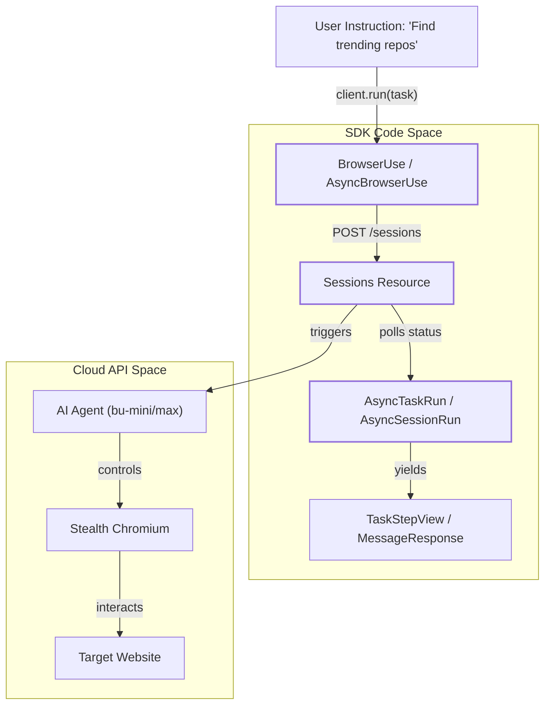
Sources: [browser-use-python/src/browser_use_sdk/v2/client.py:27-56](), [docs/cloud/agent/quickstart.mdx:7-10](), [browser-use-node/src/v2/helpers.ts:27-48]()

## SDK Versions: v2 vs v3

The repository maintains two versions of the API simultaneously. While both are supported, **v3** is the current recommendation for new projects due to its session-centric model.

| Feature | v2 (Legacy) | v3 (Current) |
| :--- | :--- | :--- |
| **Primary Unit** | `Tasks` | `Sessions` |
| **Model** | Task-centric (Task ID) | Session-centric (Session ID) |
| **Output** | `TaskResult` | `SessionResponse` |
| **Imports** | `browser_use_sdk.v2` | `browser_use_sdk.v3` |

Sources: [docs/cloud/quickstart.mdx:27-45](), [browser-use-python/src/browser_use_sdk/v2/client.py:22-25](), [docs/cloud/api-reference.mdx:21-22]()

### Entity Relationship Diagram

This diagram shows how the core code entities (Classes and Types) relate to the system resources.

**Diagram: SDK Resource Model**
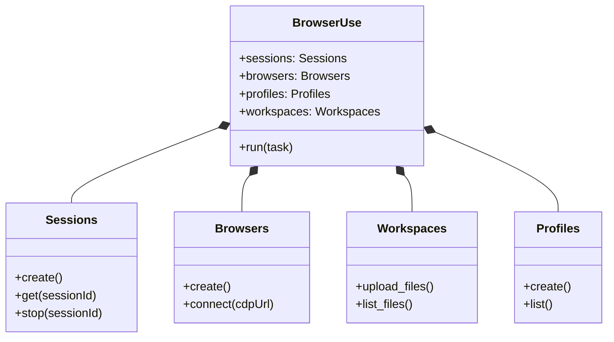
Sources: [browser-use-python/src/browser_use_sdk/v2/client.py:49-56](), [docs/cloud/agent/quickstart.mdx:7-8]()

## Navigation Guide

The wiki is structured to take you from a basic implementation to deep architectural understanding.

### [Getting Started](#1.1)
Step-by-step guide for new developers. Covers installation via `pip` or `npm`, obtaining API keys from the Cloud console, and running your first `client.run()` command.
*   **Key Files:** `docs/cloud/quickstart.mdx`, `README.md`.

### [Repository Layout and Design Principles](#1.2)
Explains the monorepo structure and the "1:1 with OpenAPI" philosophy. Learn how the code-generation pipeline ensures both Python and TypeScript SDKs stay in sync with the backend.
*   **Key Files:** `CLAUDE.md`, `RUNBOOK.md`, `docs/docs.json`.

### [SDK Architecture](#2)
Deep dive into the internal mechanics:
*   **Client Classes:** `BrowserUse` and `AsyncBrowserUse` implementations.
*   **HTTP Layer:** Handling retries, authentication, and error mapping.
*   **Session Helpers:** How `TaskRun` and `SessionStream` handle polling and async iteration.

### [API Resources Reference](#3)
Detailed documentation for every resource manager:
*   **Sessions & Browsers:** The core of execution.
*   **Workspaces:** File management and I/O.
*   **Profiles:** Managing cookies and browser state.

### [Open Source SDK (browser_use Python Library)](#5)
Overview of the `browser-use` Python library (distinct from the Cloud SDK), which allows for local execution and custom tool registration.
*   **Key Files:** `docs/open-source/introduction.mdx`.

---
**Sources:**
* [docs/docs.json:40-171]()
* [docs/cloud/quickstart.mdx:1-65]()
* [docs/cloud/agent/quickstart.mdx:1-47]()
* [browser-use-python/src/browser_use_sdk/v2/client.py:27-56]()
* [browser-use-node/src/v2/helpers.ts:9-20]()

---

# Page: Getting Started

# Getting Started

<details>
<summary>Relevant source files</summary>

The following files were used as context for generating this wiki page:

- [browser-use-node/examples/basic.ts](browser-use-node/examples/basic.ts)
- [browser-use-node/examples/streaming.ts](browser-use-node/examples/streaming.ts)
- [browser-use-node/examples/structured-output.ts](browser-use-node/examples/structured-output.ts)
- [browser-use-node/package.json](browser-use-node/package.json)
- [browser-use-python/examples/basic.py](browser-use-python/examples/basic.py)
- [browser-use-python/examples/streaming.py](browser-use-python/examples/streaming.py)
- [browser-use-python/examples/structured_output.py](browser-use-python/examples/structured_output.py)
- [browser-use-python/pyproject.toml](browser-use-python/pyproject.toml)
- [browser-use-python/tests/test_prod.py](browser-use-python/tests/test_prod.py)
- [browser-use-python/uv.lock](browser-use-python/uv.lock)
- [docs/cloud/agent/quickstart.mdx](docs/cloud/agent/quickstart.mdx)
- [docs/cloud/quickstart.mdx](docs/cloud/quickstart.mdx)
- [docs/cloud/vibecoding.mdx](docs/cloud/vibecoding.mdx)
- [docs/open-source/vibecoding.mdx](docs/open-source/vibecoding.mdx)

</details>


This page provides a technical guide for developers to integrate the Browser Use SDK into their projects. It covers installation, authentication, and the execution of the first automated browser task using the Cloud API.

## 1. Installation

The Browser Use SDK is available for both Python and TypeScript. It is designed as a thin wrapper around the Browser Use Cloud API, providing type-safe access to managed browser infrastructure [docs/cloud/agent/quickstart.mdx:7-8]().

### Python
The Python SDK requires Python 3.9 or higher [browser-use-python/pyproject.toml:11-11]().
```bash
pip install browser-use-sdk
```
**Dependencies:** `httpx` (HTTP client) and `pydantic` (data validation) [browser-use-python/pyproject.toml:12-12]().

### TypeScript / Node.js
The TypeScript SDK is distributed as an ESM module with CJS compatibility [browser-use-node/package.json:7-9]().
```bash
npm install browser-use-sdk
# or
pnpm add browser-use-sdk
```
**Dependencies:** `dotenv` and `zod` (for structured output schema validation) [browser-use-node/package.json:63-64]().

**Sources:** [browser-use-python/pyproject.toml:1-37](), [browser-use-node/package.json:1-67](), [docs/cloud/quickstart.mdx:7-16]()

---

## 2. Authentication

The SDK authenticates requests using an API Key. You can obtain a key from the [Browser Use Cloud Settings](https://cloud.browser-use.com/settings?tab=api-keys&new=1) [docs/cloud/quickstart.mdx:18-18]().

### Configuration Methods
1.  **Environment Variable:** The SDK automatically looks for `BROWSER_USE_API_KEY` [docs/cloud/quickstart.mdx:20-22]().
2.  **Constructor Argument:** Pass the `api_key` directly to the client constructor [browser-use-python/tests/test_prod.py:47-47]().

```bash
export BROWSER_USE_API_KEY=bu_your_key_here
```

**Sources:** [docs/cloud/quickstart.mdx:18-22](), [browser-use-python/tests/test_prod.py:32-47]()

---

## 3. Running Your First Task

The simplest way to interact with the API is the `.run()` method. This method encapsulates the entire lifecycle: creating a session, polling for status updates, and returning the final result [docs/cloud/agent/quickstart.mdx:9-9]().

### Basic Execution (Async)
The SDKs are designed for asynchronous execution to handle the long-running nature of browser automation tasks.

**Python Implementation:**
```python
import asyncio
from browser_use_sdk.v3 import AsyncBrowserUse

async def main():
    # Uses BROWSER_USE_API_KEY from env
    client = AsyncBrowserUse()
    result = await client.run("Find the price of Bitcoin on CoinMarketCap")
    print(result.output)

asyncio.run(main())
```
[docs/cloud/quickstart.mdx:27-37]()

**TypeScript Implementation:**
```typescript
import { BrowserUse } from "browser-use-sdk/v3";

const client = new BrowserUse();
const result = await client.run("Find the price of Bitcoin on CoinMarketCap");
console.log(result.output);
```
[docs/cloud/quickstart.mdx:38-44]()

### Data Flow: Run vs. Session
The following diagram illustrates the transition from a natural language instruction to the code entities that manage the browser lifecycle.

**Task Execution Logic**
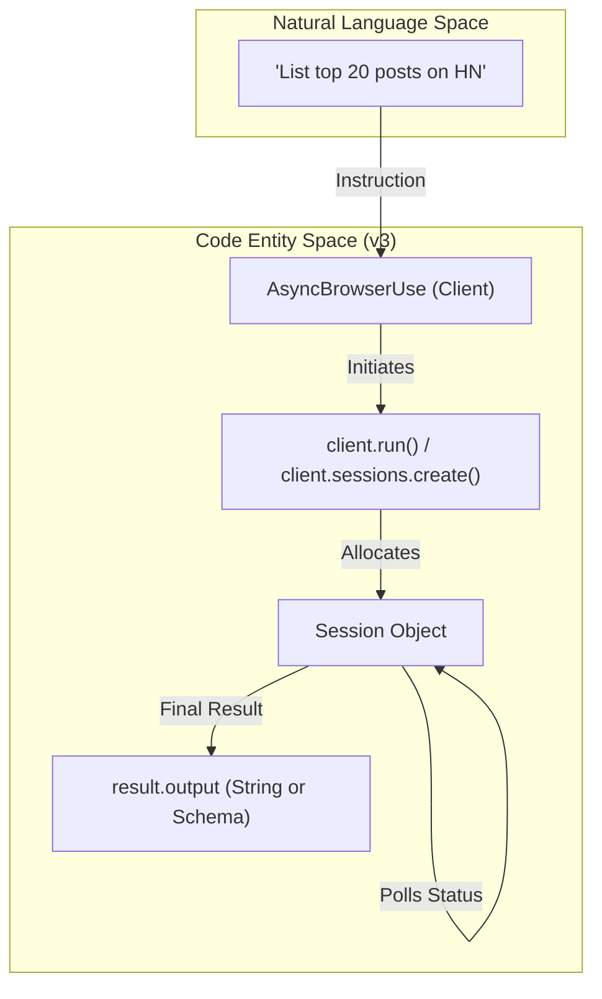

**Sources:** [docs/cloud/agent/quickstart.mdx:7-10](), [browser-use-python/examples/basic.py:12-21](), [browser-use-node/examples/basic.ts:1-20]()

---

## 4. Understanding Import Paths (v2 vs v3)

The SDK supports two versions of the API. **v3 is the current standard**, focusing on a "Session-centric" model, while v2 is the legacy "Task-centric" model.

| Feature | v2 (Legacy) | v3 (Current) |
| :--- | :--- | :--- |
| **Primary Resource** | `tasks` | `sessions` |
| **Import Path (Py)** | `from browser_use_sdk.v2 import ...` | `from browser_use_sdk.v3 import ...` |
| **Import Path (TS)** | `import { ... } from "browser-use-sdk/v2"` | `import { ... } from "browser-use-sdk/v3"` |
| **Status Model** | `finished` / `isSuccess` | `idle` / `stopped` / `error` |

### Import Defaults
In both SDKs, the root import (e.g., `from browser_use_sdk import BrowserUse`) currently points to the version determined by the package's internal exports, but explicitly importing from `/v3` is recommended for forward compatibility [browser-use-node/package.json:22-31]().

**Sources:** [browser-use-node/package.json:11-32](), [docs/cloud/agent/quickstart.mdx:7-10](), [browser-use-python/tests/test_prod.py:44-44]()

---

## 5. Advanced Usage Patterns

### Structured Output
You can force the agent to return data matching a specific schema (Pydantic in Python, Zod in TypeScript) [browser-use-python/tests/test_prod.py:114-128]().

```python
from pydantic import BaseModel
class PriceResult(BaseModel):
    price: float
    currency: str

result = await client.run("What is the price of gold?", schema=PriceResult)
print(result.output.price) # Typed as float
```
[browser-use-python/tests/test_prod.py:108-128]()

### Real-time Streaming
To monitor the agent's progress step-by-step, use the streaming pattern [browser-use-python/examples/streaming.py:15-22]().

**Streaming Logic Flow**
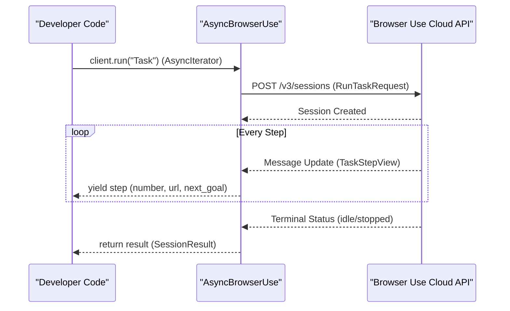

**Sources:** [browser-use-python/examples/streaming.py:12-22](), [browser-use-node/examples/streaming.ts:7-21](), [browser-use-python/tests/test_prod.py:133-152]()

---

# Page: Repository Layout and Design Principles

# Repository Layout and Design Principles

<details>
<summary>Relevant source files</summary>

The following files were used as context for generating this wiki page:

- [.claude/commands/generate.md](.claude/commands/generate.md)
- [.env.example](.env.example)
- [.gitignore](.gitignore)
- [CLAUDE.md](CLAUDE.md)
- [RUNBOOK.md](RUNBOOK.md)
- [Taskfile.yml](Taskfile.yml)
- [browser-use-node/.gitignore](browser-use-node/.gitignore)
- [browser-use-node/package.json](browser-use-node/package.json)
- [browser-use-node/pnpm-lock.yaml](browser-use-node/pnpm-lock.yaml)
- [browser-use-python/examples/profiles.py](browser-use-python/examples/profiles.py)
- [browser-use-python/examples/sessions.py](browser-use-python/examples/sessions.py)
- [browser-use-python/pyproject.toml](browser-use-python/pyproject.toml)
- [browser-use-python/src/browser_use_sdk/v2/resources/billing.py](browser-use-python/src/browser_use_sdk/v2/resources/billing.py)
- [browser-use-python/src/browser_use_sdk/v2/resources/files.py](browser-use-python/src/browser_use_sdk/v2/resources/files.py)
- [browser-use-python/src/browser_use_sdk/v2/resources/marketplace.py](browser-use-python/src/browser_use_sdk/v2/resources/marketplace.py)
- [browser-use-python/tests/test_live.py](browser-use-python/tests/test_live.py)
- [browser-use-python/uv.lock](browser-use-python/uv.lock)
- [static/sdks-banner.png](static/sdks-banner.png)

</details>


This page details the structural organization of the Browser Use SDK monorepo, the core philosophies guiding its development, and the automated pipelines used to maintain parity between the Python and TypeScript implementations.

## Monorepo Structure

The repository is organized as a monorepo containing both the Node.js and Python SDKs, along with shared documentation and API snapshots. This structure ensures that changes to the underlying Browser Use Cloud API are reflected simultaneously across both languages.

```text
/
├── browser-use-node/           # TypeScript SDK source and configuration
│   ├── src/
│   │   ├── core/               # Shared HTTP logic, retry mechanisms, and errors
│   │   ├── generated/          # Auto-generated types from OpenAPI (v2 and v3)
│   │   ├── v2/                 # V2 client, resource managers, and run/stream helpers
│   │   └── v3/                 # V3 client, session managers, and run/stream helpers
│   └── package.json            # Node.js dependencies and build scripts
├── browser-use-python/         # Python SDK source and configuration
│   ├── src/browser_use_sdk/
│   │   ├── _core/              # Shared HTTP logic and error handling
│   │   ├── generated/          # Auto-generated Pydantic models (v2 and v3)
│   │   ├── v2/                 # V2 client and resource implementations
│   │   └── v3/                 # V3 client and session implementations
│   └── pyproject.toml          # Python dependencies and build metadata
├── snapshots/                  # JSON snapshots of OpenAPI specs used for the last generation
│   ├── v2.json
│   └── v3.json
├── Taskfile.yml                # Unified command runner for generation, testing, and publishing
├── RUNBOOK.md                  # Detailed instructions for the SDK update pipeline
└── CLAUDE.md                   # Project rules, layout summary, and design principles
```
Sources: `[CLAUDE.md:5-27]()`, `[browser-use-node/package.json:1-35]()`, `[browser-use-python/pyproject.toml:1-19]()`

## Design Principles

The SDK development is governed by five core principles to ensure reliability and maintainability:

1.  **1:1 with OpenAPI**: Every endpoint defined in the Cloud API specification must map directly to a corresponding method in the SDK resource managers `[CLAUDE.md:53-53]()`.
2.  **Generated Types**: To prevent drift, all data models and type definitions are generated from the OpenAPI spec using `openapi-typescript` for Node.js and `datamodel-codegen` for Python `[CLAUDE.md:54-54]()`.
3.  **Minimal Helpers**: High-level abstractions like `.run()` and `.stream()` are kept thin (typically ~20 lines) to remain easy to audit and debug `[CLAUDE.md:55-55]()`.
4.  **Strict Type Safety**: The Python SDK returns Pydantic model instances rather than raw dictionaries, ensuring IDE completion and runtime validation `[CLAUDE.md:56-56]()`.
5.  **Synchronization**: Both SDKs must implement identical retry logic (HTTP 429 only), polling intervals (2s), and terminal status detection `[CLAUDE.md:62-63]()`.

## Code Generation Pipeline

The repository uses a deterministic pipeline to transform OpenAPI specifications into functional code. This process is managed via the `Taskfile.yml`.

### Type Generation Workflow

The `gen:types` task coordinates the generation for both languages:
*   **TypeScript**: Uses `openapi-typescript` to produce `types.ts`. These are then aliased within resource files to provide a clean developer experience `[Taskfile.yml:34-40]()`.
*   **Python**: Uses `datamodel-codegen` with specific flags (`--snake-case-field`, `--use-union-operator`) to generate Pydantic v2 models in `models.py` `[Taskfile.yml:42-65]()`.

### Data Flow: Spec to SDK

The following diagram illustrates how a backend change propagates through the repository entities:

**OpenAPI to Code Entity Mapping**
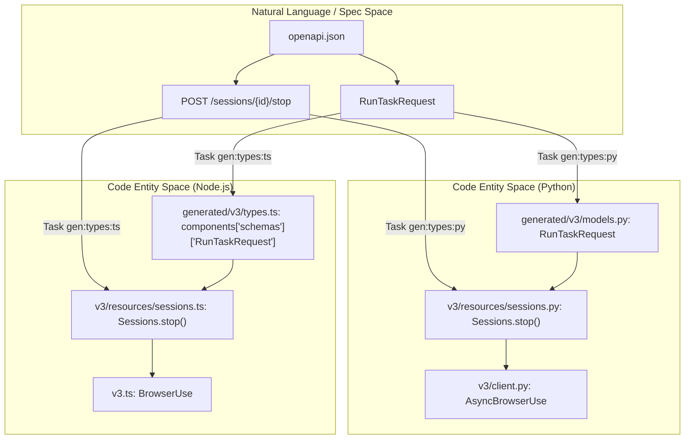
Sources: `[Taskfile.yml:28-65]()`, `[CLAUDE.md:51-57]()`, `[RUNBOOK.md:46-55]()`

## SDK Update Runbook

The `RUNBOOK.md` defines a four-phase process for updating the SDKs when the backend API changes. This process is designed to be executed by developers or AI agents (like Claude) to maintain perfect parity.

### Phase 0: Discovery
Compare fresh OpenAPI specs against the local `snapshots/` directory. Changes are classified as **MAJOR** (removed endpoints/required fields), **MINOR** (new endpoints), or **PATCH** (new optional fields) `[RUNBOOK.md:5-17]()`.

### Phase 1: Regenerate & Audit
Run `task gen:types`. Because code generators often have quirks, manual or automated audits are performed:
*   **Python Patching**: `datamodel-codegen` often outputs string literals for enum defaults; these must be manually patched to enum members `[RUNBOOK.md:23-23]()`.
*   **Regex Engine**: If models contain complex regex, `ConfigDict(regex_engine="python-re")` is added to the Pydantic models `[RUNBOOK.md:24-24]()`.

### Phase 2: Implementation
Update the resource managers (e.g., `marketplace.py`) to include new methods or parameters. A key rule is that every method with a request body **MUST** accept `**extra` (Python) or a spread object (TS) to ensure forward compatibility with new API fields `[CLAUDE.md:61-61]()`.

### Phase 3: Verification
The testing strategy involves three tiers:
1.  **Vibe Tests**: Spec-driven tests that do not require a backend `[Taskfile.yml:119-123]()`.
2.  **Live Tests**: Integration tests against a local backend (`localhost:8000`) `[Taskfile.yml:137-141]()`.
3.  **Prod Tests**: Smoke tests against the production API `[Taskfile.yml:155-159]()`.

**SDK Update Pipeline**
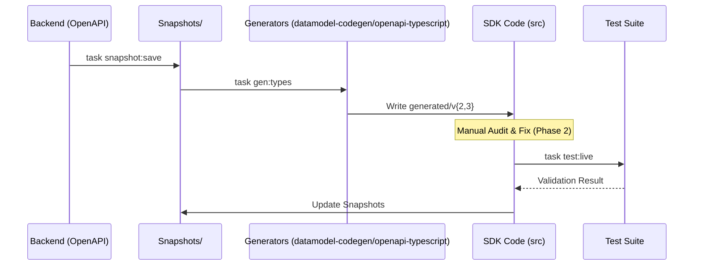
Sources: `[RUNBOOK.md:1-43]()`, `[Taskfile.yml:206-213]()`

## Resource Implementation Pattern

Every resource in the SDK (e.g., `Marketplace`, `Sessions`, `Billing`) follows a standard pattern for both synchronous and asynchronous clients.

| Feature | Python Implementation | Node.js Implementation |
| :--- | :--- | :--- |
| **HTTP Client** | `SyncHttpClient` / `AsyncHttpClient` | `HttpClient` |
| **Validation** | `Model.model_validate()` | Type casting / Zod (optional) |
| **Naming** | `snake_case` | `camelCase` |
| **Extra Params** | `**extra: Any` | `...extra: any` |

Example from `Marketplace.execute`:
[browser-use-python/src/browser_use_sdk/v2/resources/marketplace.py:56-75]()
```python
def execute(
    self,
    skill_id: str,
    *,
    parameters: dict[str, Any] | None = None,
    session_id: str | None = None,
    **extra: Any,
) -> ExecuteSkillResponse:
    body: dict[str, Any] = {}
    # ... logic to build body ...
    body.update(extra) # Forward compatibility
    return ExecuteSkillResponse.model_validate(
        self._http.request("POST", f"/marketplace/skills/{skill_id}/execute", json=body)
    )
```
Sources: `[browser-use-python/src/browser_use_sdk/v2/resources/marketplace.py:56-75]()`, `[CLAUDE.md:61-61]()`

---

# Page: SDK Architecture

# SDK Architecture

<details>
<summary>Relevant source files</summary>

The following files were used as context for generating this wiki page:

- [README.md](README.md)
- [browser-use-node/README.md](browser-use-node/README.md)
- [browser-use-node/src/index.ts](browser-use-node/src/index.ts)
- [browser-use-node/src/v2/helpers.ts](browser-use-node/src/v2/helpers.ts)
- [browser-use-node/src/v3/client.ts](browser-use-node/src/v3/client.ts)
- [browser-use-node/src/v3/resources/browsers.ts](browser-use-node/src/v3/resources/browsers.ts)
- [browser-use-python/README.md](browser-use-python/README.md)
- [browser-use-python/src/browser_use_sdk/__init__.py](browser-use-python/src/browser_use_sdk/__init__.py)
- [browser-use-python/src/browser_use_sdk/v2/client.py](browser-use-python/src/browser_use_sdk/v2/client.py)
- [browser-use-python/src/browser_use_sdk/v2/helpers.py](browser-use-python/src/browser_use_sdk/v2/helpers.py)
- [browser-use-python/src/browser_use_sdk/v3/client.py](browser-use-python/src/browser_use_sdk/v3/client.py)
- [browser-use-python/src/browser_use_sdk/v3/resources/browsers.py](browser-use-python/src/browser_use_sdk/v3/resources/browsers.py)
- [browser-use-python/src/browser_use_sdk/v3/resources/sessions.py](browser-use-python/src/browser_use_sdk/v3/resources/sessions.py)

</details>


This page provides a high-level overview of the internal structure of the Browser Use Python and TypeScript SDKs. Both SDKs are designed to be thin, type-safe wrappers around the Browser Use Cloud API, maintaining a 1:1 relationship with the OpenAPI specification while providing ergonomic helpers for common patterns like polling and streaming.

## Core Design Philosophy

The SDKs follow a "Resource-Based" architecture. The top-level `BrowserUse` client acts as a container for specialized resource managers (e.g., `sessions`, `browsers`, `workspaces`), each corresponding to a specific set of API endpoints.

### High-Level Component Diagram

This diagram shows how natural language requests from the user flow through the SDK components into the Cloud API.

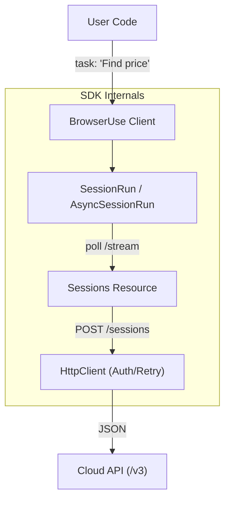

**Sources:**
- [browser-use-python/src/browser_use_sdk/v3/client.py:25-50]()
- [browser-use-node/src/v3/client.ts:26-55]()

---

## Client Classes (v2 and v3)

The SDK supports two major API versions. While v2 is maintained for legacy support, v3 is the current standard, shifting from a "Task-centric" model to a "Session-centric" model.

- **v3 Client**: Found in `browser_use_sdk.v3` (Python) and `browser-use-sdk/v3` (Node). It focuses on `sessions` that can run multiple tasks and maintain state. [browser-use-python/src/browser_use_sdk/v3/client.py:25-26](), [browser-use-node/src/v3/client.ts:26-26]()
- **v2 Client**: The default import in both SDKs. It uses a `tasks` resource as the primary unit of work. [browser-use-python/src/browser_use_sdk/__init__.py:8-9](), [browser-use-node/src/index.ts:1-1]()

Both clients provide a high-level `.run()` method that abstracts away session creation, polling for completion, and output parsing.

For details on API differences and constructor options, see [Client Classes (v2 and v3)](#2.1).

---

## HTTP Layer and Error Handling

The foundation of both SDKs is a custom HTTP client (`SyncHttpClient`/`AsyncHttpClient` in Python, `HttpClient` in Node) that manages the low-level communication with the Cloud API.

Key responsibilities include:
- **Authentication**: Injecting the `Authorization: Bearer <API_KEY>` header into every request. [browser-use-python/src/browser_use_sdk/v3/client.py:35-44]()
- **Serialization**: Handling JSON cleaning and Pydantic/Zod schema conversions.
- **Resiliency**: Implementing exponential backoff and retries, specifically for `429 Too Many Requests` errors.
- **Timeouts**: Managing request-level and global task-level timeouts.

For details on the networking stack, see [HTTP Layer and Error Handling](#2.2).

---

## Session Helpers and Streaming

Executing a browser task is an asynchronous, long-running operation. The SDKs provide "Helper" classes to manage this lifecycle:

| Feature | Python Class | Node.js Class |
|:---|:---|:---|
| **v3 Execution** | `AsyncSessionRun` | `SessionRun` |
| **v2 Execution** | `AsyncTaskRun` | `TaskRun` |

These helpers implement a "Dual-Pattern":
1. **Awaitable**: You can `await` the helper directly to block until the task is finished and get the final result. [browser-use-python/src/browser_use_sdk/v2/helpers.py:186-187](), [browser-use-node/src/v2/helpers.ts:61-66]()
2. **Async Iterator**: You can use `async for` (Python) or `for await` (Node) to stream individual browser steps or messages as they occur. [browser-use-python/src/browser_use_sdk/v2/helpers.py:201-218](), [browser-use-node/src/v2/helpers.ts:69-93]()

For details on pagination and terminal status detection, see [Session Helpers and Streaming](#2.3).

---

## Generated Types and OpenAPI Sync

To ensure 1:1 parity with the Cloud API, the majority of the data models (Requests and Responses) are auto-generated from the backend's OpenAPI specification.

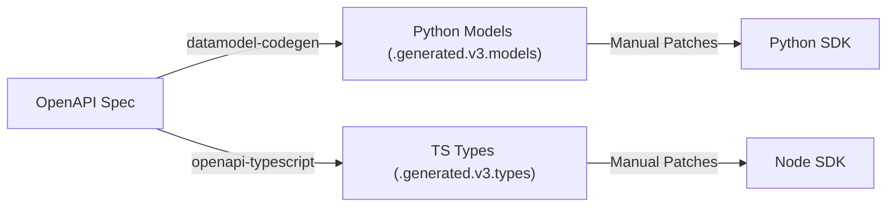

- **Python**: Uses `pydantic` models for runtime validation. [browser-use-python/src/browser_use_sdk/v3/resources/sessions.py:9-13]()
- **Node.js**: Uses TypeScript interfaces for compile-time safety, with `zod` for optional runtime schema validation of agent outputs. [browser-use-node/src/v3/client.ts:1-12]()

For details on the generation pipeline and snapshots, see [Generated Types and OpenAPI Sync](#2.4).

**Sources:**
- [browser-use-python/src/browser_use_sdk/v2/helpers.py:13-13]()
- [browser-use-node/src/v2/helpers.ts:9-9]()
- [browser-use-python/src/browser_use_sdk/v3/resources/sessions.py:67-69]()
- [browser-use-node/src/v3/client.ts:85-86]()

---

# Page: Client Classes (v2 and v3)

# Client Classes (v2 and v3)

<details>
<summary>Relevant source files</summary>

The following files were used as context for generating this wiki page:

- [README.md](README.md)
- [browser-use-node/README.md](browser-use-node/README.md)
- [browser-use-node/src/index.ts](browser-use-node/src/index.ts)
- [browser-use-node/src/v2/helpers.ts](browser-use-node/src/v2/helpers.ts)
- [browser-use-node/src/v3.ts](browser-use-node/src/v3.ts)
- [browser-use-node/src/v3/client.ts](browser-use-node/src/v3/client.ts)
- [browser-use-node/src/v3/resources/browsers.ts](browser-use-node/src/v3/resources/browsers.ts)
- [browser-use-node/src/v3/resources/sessions.ts](browser-use-node/src/v3/resources/sessions.ts)
- [browser-use-python/README.md](browser-use-python/README.md)
- [browser-use-python/src/browser_use_sdk/__init__.py](browser-use-python/src/browser_use_sdk/__init__.py)
- [browser-use-python/src/browser_use_sdk/v2/__init__.py](browser-use-python/src/browser_use_sdk/v2/__init__.py)
- [browser-use-python/src/browser_use_sdk/v2/client.py](browser-use-python/src/browser_use_sdk/v2/client.py)
- [browser-use-python/src/browser_use_sdk/v2/helpers.py](browser-use-python/src/browser_use_sdk/v2/helpers.py)
- [browser-use-python/src/browser_use_sdk/v3/__init__.py](browser-use-python/src/browser_use_sdk/v3/__init__.py)
- [browser-use-python/src/browser_use_sdk/v3/client.py](browser-use-python/src/browser_use_sdk/v3/client.py)
- [browser-use-python/src/browser_use_sdk/v3/resources/browsers.py](browser-use-python/src/browser_use_sdk/v3/resources/browsers.py)
- [browser-use-python/src/browser_use_sdk/v3/resources/sessions.py](browser-use-python/src/browser_use_sdk/v3/resources/sessions.py)

</details>


The Browser Use SDK provides two primary entry points for interacting with the Browser Use Cloud API: the `BrowserUse` (synchronous) and `AsyncBrowserUse` (asynchronous) client classes. These classes encapsulate the HTTP communication layer, manage resource-specific managers (e.g., sessions, browsers, workspaces), and provide high-level methods for task execution and streaming.

## Client Overview

The SDK supports two distinct API versions: **v2** (task-centric) and **v3** (session-centric). While both versions share similar patterns, they differ in their import paths and internal resource management.

### v3 Client Architecture (Recommended)
The v3 client is designed around a unified `sessions` resource where tasks are dispatched to browser sessions.

| Feature | Python Class | Node.js Class |
| :--- | :--- | :--- |
| **Sync Client** | `browser_use_sdk.v3.BrowserUse` | N/A (Node is async-first) |
| **Async Client** | `browser_use_sdk.v3.AsyncBrowserUse` | `browser_use_sdk.v3.BrowserUse` |
| **Base URL** | `https://api.browser-use.com/api/v3` | `https://api.browser-use.com/api/v3` |

### v2 Client Architecture (Legacy)
The v2 client uses a model where `tasks` are the primary entity, which in turn manage underlying `sessions`.

| Feature | Python Class | Node.js Class |
| :--- | :--- | :--- |
| **Sync Client** | `browser_use_sdk.BrowserUse` | N/A |
| **Async Client** | `browser_use_sdk.AsyncBrowserUse` | `browser_use_sdk.BrowserUse` |
| **Base URL** | `https://api.browser-use.com/api/v2` | `https://api.browser-use.com/api/v2` |

**Sources:**
- [browser-use-python/src/browser_use_sdk/v3/client.py:20-50]()
- [browser-use-node/src/v3/client.ts:14-55]()
- [browser-use-python/src/browser_use_sdk/__init__.py:1-10]()

---

## Constructor and Initialization

Both v2 and v3 clients require an API key, which can be provided explicitly or via the `BROWSER_USE_API_KEY` environment variable.

### Configuration Options
The `BrowserUse` constructor accepts several optional parameters to tune the client behavior:
- `api_key`: The project API key from the Browser Use Cloud dashboard.
- `base_url`: Override the default API endpoint (useful for testing or proxying).
- `timeout`: Global request timeout in seconds (Python) or milliseconds (Node).
- `max_retries`: (Node only) Number of automatic retries for failed requests.

**Python (v3) Initialization Example:**
[browser-use-python/src/browser_use_sdk/v3/client.py:28-44]()

**Node.js (v3) Initialization Example:**
[browser-use-node/src/v3/client.ts:35-55]()

### Natural Language to Code Entity Mapping: Client Initialization
This diagram maps the high-level initialization concepts to the internal SDK entities.

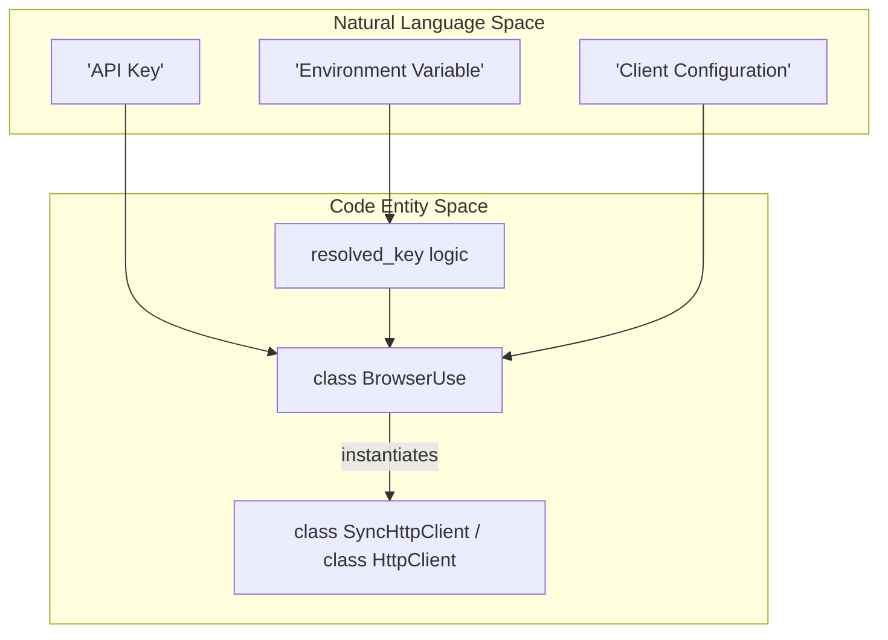
**Sources:**
- [browser-use-python/src/browser_use_sdk/v3/client.py:35-44]()
- [browser-use-node/src/v3/client.ts:36-48]()

---

## High-Level Methods: `run()` and `stream()`

The clients provide two main methods to execute browser tasks. These methods are abstractions over the `sessions.create` (v3) or `tasks.create` (v2) endpoints.

### 1. `run()`
A blocking (or `await`-able) method that dispatches a task and waits for the agent to reach a terminal state (e.g., `success`, `error`).

- **Return Value**: A `SessionResult` (v3) or `TaskResult` (v2) containing the final `output` and metadata.
- **Polling**: Internally calls `_poll_output` to check the session status until completion.
- **Schema Support**: Supports Pydantic (Python) or Zod (Node) for structured output.

**Sources:**
- [browser-use-python/src/browser_use_sdk/v3/client.py:104-164]()
- [browser-use-node/src/v3/client.ts:70-114]()

### 2. `stream()`
A method that returns an iterator/stream of messages as they are generated by the agent.

- **Return Value**: A `SessionStream` (v3) or `TaskStream` (v2).
- **Functionality**: Allows real-time observation of the agent's progress (e.g., "Navigating to Google", "Extracting price").
- **Final Result**: The stream object contains a `.result` property that becomes populated once the stream is exhausted.

**Sources:**
- [browser-use-python/src/browser_use_sdk/v3/client.py:165-224]()

---

## Structured Output Support

The v3 client provides first-class support for structured data extraction using schema libraries. This is implemented by converting the schema to a JSON Schema and passing it to the `output_schema` parameter of the API.

### Python (Pydantic)
In Python, you pass a Pydantic `BaseModel`. The SDK calls `.model_json_schema()` to generate the definition for the LLM.
[browser-use-python/src/browser_use_sdk/v3/client.py:135-143]()

### Node.js (Zod)
In Node.js, you pass a Zod schema. The SDK uses `z.toJSONSchema(schema)` to serialize the requirements.
[browser-use-node/src/v3/client.ts:78-86]()

---

## Resource Management

The client acts as a hub for various resource managers. Each manager handles a specific set of API endpoints.

| Manager | Purpose | v2 Access | v3 Access |
| :--- | :--- | :--- | :--- |
| `sessions` | Manage browser session lifecycle | `client.sessions` | `client.sessions` |
| `browsers` | Standalone browser control | `client.browsers` | `client.browsers` |
| `workspaces` | File and script management | N/A | `client.workspaces` |
| `profiles` | Persistent browser identities | `client.profiles` | `client.profiles` |
| `billing` | Credit and usage tracking | `client.billing` | `client.billing` |
| `tasks` | Legacy task management | `client.tasks` | N/A |

**Sources:**
- [browser-use-python/src/browser_use_sdk/v3/client.py:45-49]()
- [browser-use-node/src/v3/client.ts:27-31]()

### Code Entity Interaction: Session Execution Flow
This diagram illustrates how the `BrowserUse` client coordinates between different code entities during a `run()` call.

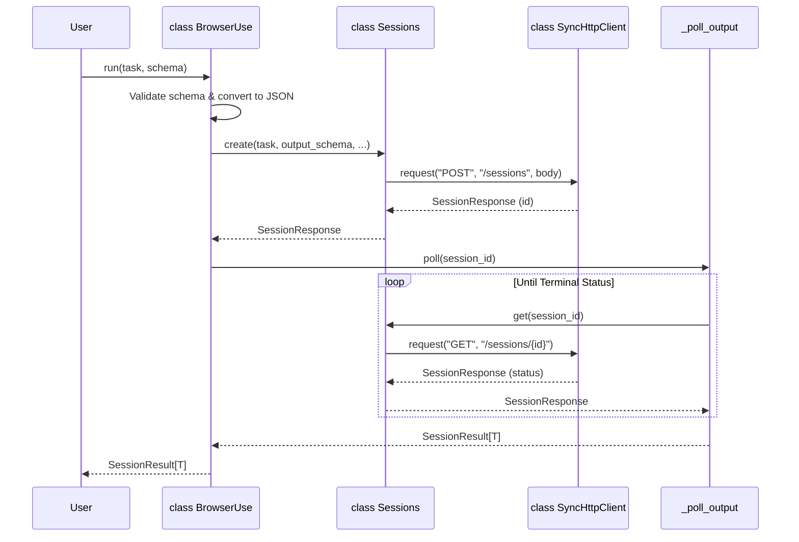
**Sources:**
- [browser-use-python/src/browser_use_sdk/v3/client.py:104-163]()
- [browser-use-python/src/browser_use_sdk/v3/resources/sessions.py:23-69]()

---

## v2 vs v3 API Surface Differences

The primary architectural shift from v2 to v3 is the move from a "Task" object to a "Session" object.

### Task Dispatching
- **v2**: You create a `Task`, which returns a `task_id`. The task then starts a session.
- **v3**: You create a `Session` with an optional `task`. If a `session_id` is provided to `run()`, the SDK automatically sets `keep_alive=True` to allow multi-turn interactions.

**Sources:**
- [browser-use-python/src/browser_use_sdk/v3/client.py:146-148]()
- [browser-use-node/src/v3/client.ts:88-90]()

### Script Caching (v3 Only)
The v3 `run()` and `stream()` methods support `cache_script`.
- If `True`, the SDK requires a `workspace_id`.
- The agent will attempt to generate and save a deterministic script to the workspace, which can be re-run at lower cost.

**Sources:**
- [browser-use-python/src/browser_use_sdk/v3/client.py:123-133]()

---

# Page: HTTP Layer and Error Handling

# HTTP Layer and Error Handling

<details>
<summary>Relevant source files</summary>

The following files were used as context for generating this wiki page:

- [browser-use-node/src/core/http.ts](browser-use-node/src/core/http.ts)
- [browser-use-node/src/v3/helpers.ts](browser-use-node/src/v3/helpers.ts)
- [browser-use-python/src/browser_use_sdk/_core/__init__.py](browser-use-python/src/browser_use_sdk/_core/__init__.py)
- [browser-use-python/src/browser_use_sdk/_core/errors.py](browser-use-python/src/browser_use_sdk/_core/errors.py)
- [browser-use-python/src/browser_use_sdk/_core/http.py](browser-use-python/src/browser_use_sdk/_core/http.py)
- [browser-use-python/src/browser_use_sdk/v3/helpers.py](browser-use-python/src/browser_use_sdk/v3/helpers.py)

</details>


This page documents the internal HTTP communication layer used by both the Python and Node.js SDKs. It covers the implementation of the low-level clients, authentication mechanisms, automated retry logic, and standardized error reporting.

## Overview of HTTP Clients

The SDKs use dedicated HTTP client classes to wrap underlying network libraries (`httpx` in Python and `fetch` in Node.js). These classes handle the boilerplate of API communication, ensuring consistent behavior across all resource managers.

| Feature | Python Implementation | Node.js Implementation |
| :--- | :--- | :--- |
| **Sync Client** | `SyncHttpClient` [browser-use-python/src/browser_use_sdk/_core/http.py:63-107]() | N/A (Async only) |
| **Async Client** | `AsyncHttpClient` [browser-use-python/src/browser_use_sdk/_core/http.py:109-153]() | `HttpClient` [browser-use-node/src/core/http.ts:10-132]() |
| **Underlying Lib** | `httpx` [browser-use-python/src/browser_use_sdk/_core/http.py:10]() | `fetch` (Native/Undici) [browser-use-node/src/core/http.ts:63]() |

### Data Flow: Request Lifecycle

The following diagram illustrates how a request moves from a Resource Manager through the HTTP layer to the Browser Use Cloud API.

**Request and Error Handling Flow**
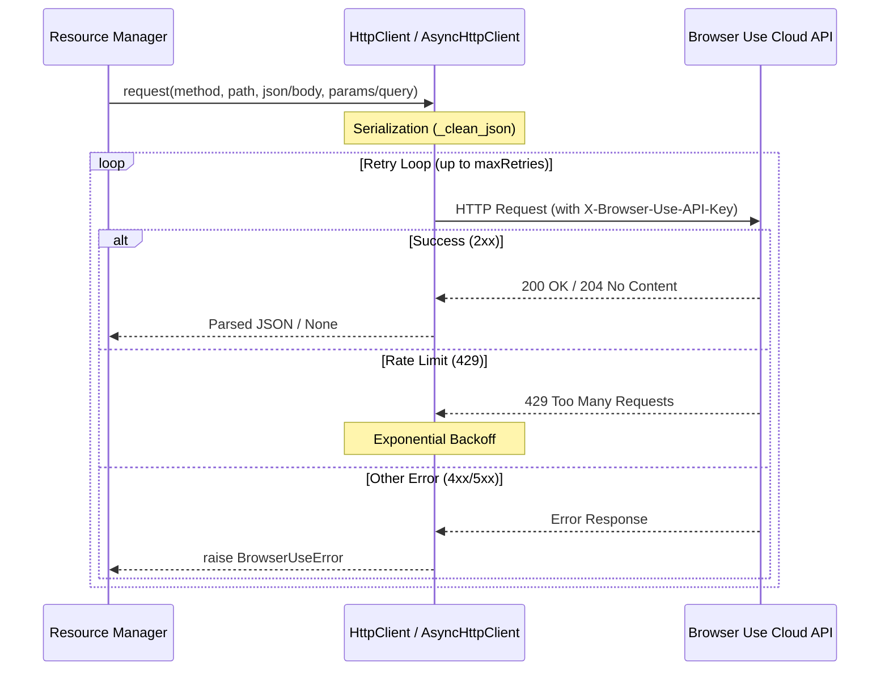
Sources: [browser-use-python/src/browser_use_sdk/_core/http.py:80-103](), [browser-use-node/src/core/http.ts:48-112]()

---

## Authentication and Headers

Every request sent by the SDK includes the `X-Browser-Use-API-Key` header. This is configured during the initialization of the client.

- **Python**: The header is set in the `httpx.Client` or `httpx.AsyncClient` constructor [browser-use-python/src/browser_use_sdk/_core/http.py:76]().
- **Node.js**: The header is injected into the `headers` object during each `request` call [browser-use-node/src/core/http.ts:41-43]().

---

## Serialization and Parameter Cleaning

Before data is sent to the API, it undergoes a cleaning process to ensure it is compatible with the backend's expectations.

### Python: `_clean_json`
The Python SDK uses a recursive `_clean_json` function to prepare complex types for the `httpx` request:
- **Pydantic Models**: Converted using `.model_dump(by_alias=True, exclude_none=True)` [browser-use-python/src/browser_use_sdk/_core/http.py:26-27]().
- **Enums**: Converted to their underlying `.value` [browser-use-python/src/browser_use_sdk/_core/http.py:28-29]().
- **UUIDs/Datetimes**: Stringified to standard formats [browser-use-python/src/browser_use_sdk/_core/http.py:30-33]().

### Node.js: Query Param Cleaning
The Node.js client iterates through the `query` object, filtering out `undefined` or `null` values and converting remaining values to strings using `String(value)` [browser-use-node/src/core/http.ts:33-39]().

Sources: [browser-use-python/src/browser_use_sdk/_core/http.py:20-34](), [browser-use-node/src/core/http.ts:32-39]()

---

## Retry Logic and Exponential Backoff

Both SDKs implement an automatic retry mechanism specifically for `429 Too Many Requests` status codes.

1.  **Retry Target**: Only HTTP 429 is retried [browser-use-python/src/browser_use_sdk/_core/http.py:15](), [browser-use-node/src/core/http.ts:80]().
2.  **Default Retries**: 3 attempts [browser-use-python/src/browser_use_sdk/_core/http.py:16](), [browser-use-node/src/core/http.ts:19]().
3.  **Backoff Strategy**:
    - **Python**: Uses `min(_BACKOFF_BASE * (2 ** attempt), 10)` where base is 0.5s [browser-use-python/src/browser_use_sdk/_core/http.py:17-92]().
    - **Node.js**: Uses `Math.min(1000 * 2 ** (attempt - 1), 10_000)` [browser-use-node/src/core/http.ts:50]().

Sources: [browser-use-python/src/browser_use_sdk/_core/http.py:90-98](), [browser-use-node/src/core/http.ts:48-85]()

---

## Error Handling: `BrowserUseError`

When the API returns a non-success status code (and retries are exhausted or inapplicable), the SDK raises a `BrowserUseError`. This class provides structured access to the failure details.

**Class Definition (Python)**: [browser-use-python/src/browser_use_sdk/_core/errors.py:6-18]()
**Class Definition (Node.js)**: [browser-use-node/src/core/errors.ts]() (referenced in [browser-use-node/src/core/http.ts:107]())

### Error Parsing Logic
The SDKs attempt to extract a human-readable message from the response body:
1.  Check for a `message` field in the JSON response.
2.  Check for a `detail` field (common in FastAPI/Python backends).
3.  Fallback to the HTTP reason phrase or status code.

| Field | Description |
| :--- | :--- |
| `status_code` | The raw HTTP status code (e.g., 401, 404, 500). |
| `message` | The extracted error string for the user. |
| `detail` | The full raw JSON body returned by the API for debugging. |

Sources: [browser-use-python/src/browser_use_sdk/_core/http.py:41-60](), [browser-use-node/src/core/http.ts:87-107]()

---

## Timeout Handling and Abort Signals (Node.js)

In the Node.js SDK, `HttpClient` utilizes the `AbortController` API to manage request timeouts and allow user-initiated cancellations.

1.  **Default Timeout**: 30 seconds [browser-use-node/src/core/http.ts:20]().
2.  **Internal Timeout**: An `AbortController` is created per request. If the request exceeds the `timeout` duration, `controller.abort()` is called [browser-use-node/src/core/http.ts:54-57]().
3.  **User Signal**: If a user provides their own `AbortSignal` via `options.signal`, it takes precedence, allowing external cancellation of the request [browser-use-node/src/core/http.ts:55-60]().

**Entity Mapping: HTTP Entities**
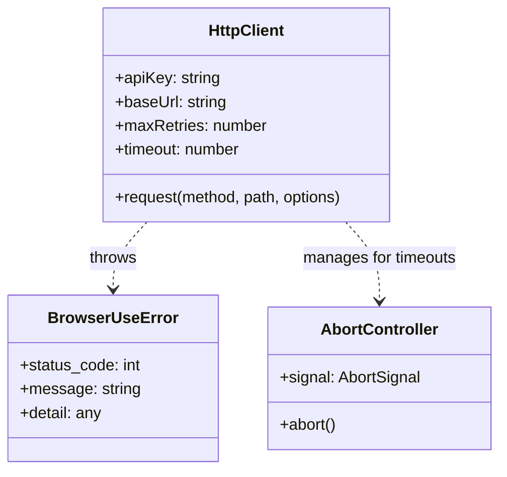
Sources: [browser-use-node/src/core/http.ts:10-132](), [browser-use-python/src/browser_use_sdk/_core/errors.py:6-18]()

---

## Implementation Details: Python Helpers

The Python SDK includes a sentinel object `_UNSET` to distinguish between a parameter being omitted versus a user explicitly passing `None`.

- **`_UNSET`**: Used as a default value in resource manager methods. If a value is `_UNSET`, it is not sent in the JSON payload. If it is `None`, it is sent as a JSON `null` [browser-use-python/src/browser_use_sdk/_core/__init__.py:4-7]().
- **`_clean_params`**: Specifically handles query string serialization, converting booleans to `"true"`/`"false"` and stripping `None` values [browser-use-python/src/browser_use_sdk/_core/http.py:155-167]().

Sources: [browser-use-python/src/browser_use_sdk/_core/__init__.py:4-9](), [browser-use-python/src/browser_use_sdk/_core/http.py:155-167]()

---

# Page: Session Helpers and Streaming

# Session Helpers and Streaming

<details>
<summary>Relevant source files</summary>

The following files were used as context for generating this wiki page:

- [browser-use-node/src/core/http.ts](browser-use-node/src/core/http.ts)
- [browser-use-node/src/v3/client.ts](browser-use-node/src/v3/client.ts)
- [browser-use-node/src/v3/helpers.ts](browser-use-node/src/v3/helpers.ts)
- [browser-use-node/src/v3/resources/browsers.ts](browser-use-node/src/v3/resources/browsers.ts)
- [browser-use-python/src/browser_use_sdk/_core/http.py](browser-use-python/src/browser_use_sdk/_core/http.py)
- [browser-use-python/src/browser_use_sdk/v3/client.py](browser-use-python/src/browser_use_sdk/v3/client.py)
- [browser-use-python/src/browser_use_sdk/v3/helpers.py](browser-use-python/src/browser_use_sdk/v3/helpers.py)
- [browser-use-python/src/browser_use_sdk/v3/resources/browsers.py](browser-use-python/src/browser_use_sdk/v3/resources/browsers.py)
- [browser-use-python/src/browser_use_sdk/v3/resources/sessions.py](browser-use-python/src/browser_use_sdk/v3/resources/sessions.py)
- [docs/cloud/agent/streaming.mdx](docs/cloud/agent/streaming.mdx)
- [docs/cloud/tutorials/integrations/n8n.mdx](docs/cloud/tutorials/integrations/n8n.mdx)
- [docs/cloud/tutorials/integrations/openclaw.mdx](docs/cloud/tutorials/integrations/openclaw.mdx)
- [docs/cloud/tutorials/integrations/playwright.mdx](docs/cloud/tutorials/integrations/playwright.mdx)

</details>


The Browser Use SDK provides high-level abstractions for managing the lifecycle of an agent session. Instead of requiring manual polling of the REST API, the SDKs use helper classes to implement a "dual-purpose" pattern: you can either `await` a run to get the final result or iterate over it using an async-for loop to stream live messages.

## Dual-Purpose Run Pattern

Both the Python and Node.js SDKs implement a pattern where the `run()` method returns a handle that is both a Promise (or Awaitable) and an Async Iterator. This allows developers to choose between blocking for a result or building real-time UIs.

### Core Entities

| Entity | Language | Role |
| :--- | :--- | :--- |
| `SessionRun` | Node.js | Dual-purpose class implementing `PromiseLike` and `Symbol.asyncIterator` [browser-use-node/src/v3/helpers.ts:26-148](). |
| `AsyncSessionRun` | Python | Dual-purpose class implementing `__await__` and `__aiter__` [browser-use-python/src/browser_use_sdk/v3/helpers.py:82-165](). |
| `SessionResult` | Both | Wrapper containing the final `SessionResponse` and the parsed/typed `output` [browser-use-python/src/browser_use_sdk/v3/helpers.py:18-32](), [browser-use-node/src/v3/helpers.ts:20-20](). |

### Data Flow: Run and Stream

The following diagram illustrates how a call to `client.run()` transitions from session creation to terminal status detection.

**Session Execution Flow**
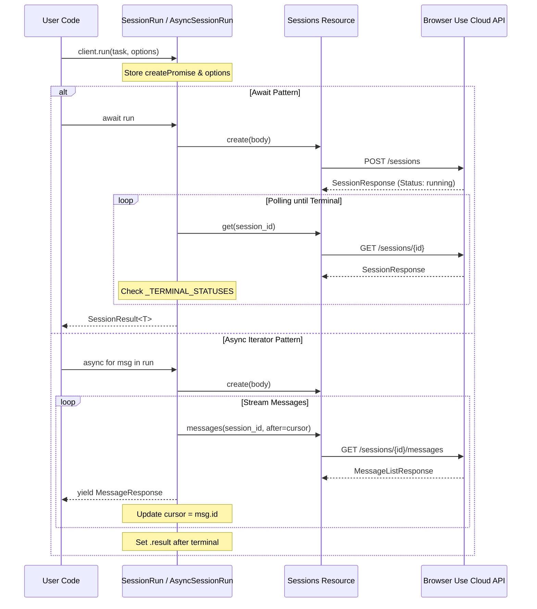
Sources: [browser-use-python/src/browser_use_sdk/v3/helpers.py:82-165](), [browser-use-node/src/v3/helpers.ts:26-148](), [docs/cloud/agent/streaming.mdx:14-37]()

## Cursor-Based Message Pagination

Streaming is implemented via cursor-based pagination on the `/sessions/{id}/messages` endpoint. The SDK maintains a `cursor` (the ID of the last received message) and requests only new messages in subsequent polls [browser-use-python/src/browser_use_sdk/v3/helpers.py:140-147](), [browser-use-node/src/v3/helpers.ts:108-116]().

### Start Cursor for Follow-up Tasks
When running a follow-up task on an existing `session_id`, the SDK snapshots the current latest message ID as the `_startCursor`. This ensures the iterator only yields messages produced by the *new* task, ignoring the history of previous tasks in that same session [browser-use-node/src/v3/client.ts:93-110]().

### Terminal Status Detection
The SDK considers a session finished when its `status` enters one of the `_TERMINAL_STATUSES`:
* `idle`: Task completed successfully and session is ready for next task.
* `stopped`: Task or session was manually cancelled.
* `timed_out`: Session exceeded its maximum duration.
* `error`: An unrecoverable error occurred.

Sources: [browser-use-python/src/browser_use_sdk/v3/helpers.py:13-13](), [browser-use-node/src/v3/helpers.ts:8-8](), [browser-use-python/src/browser_use_sdk/v3/resources/sessions.py:111-130]()

## Polling and Timeouts

The SDKs use a polling mechanism to monitor session progress.

* **Default Interval**: 2 seconds [browser-use-python/src/browser_use_sdk/v3/helpers.py:52-52](), [browser-use-node/src/v3/helpers.ts:46-46]().
* **Default Timeout**: 14,400 seconds (4 hours) [browser-use-python/src/browser_use_sdk/v3/helpers.py:51-51](), [browser-use-node/src/v3/helpers.ts:45-45]().
* **Drain Logic**: When a session reaches a terminal status, the SDK performs one final "drain" poll for messages to ensure no late-arriving logs are missed before returning the result [browser-use-python/src/browser_use_sdk/v3/helpers.py:152-159](), [browser-use-node/src/v3/helpers.ts:121-128]().

**Entity Mapping: Polling Logic**
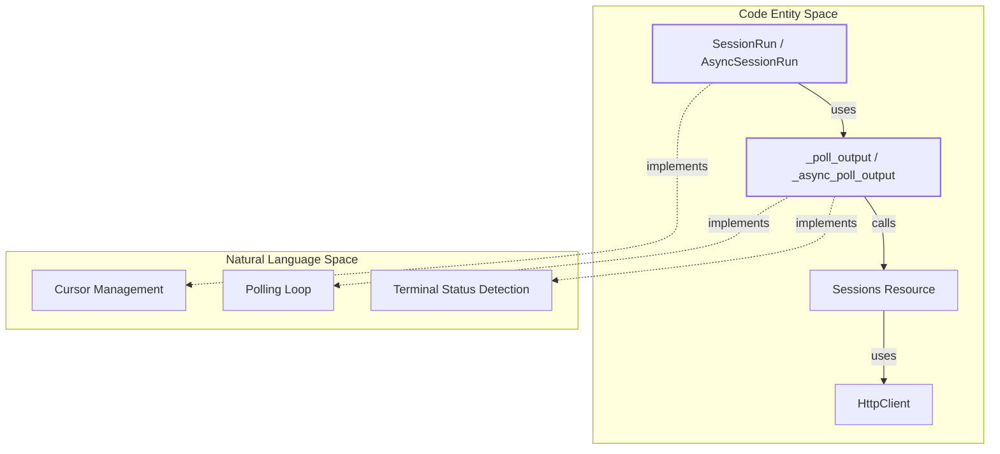
Sources: [browser-use-python/src/browser_use_sdk/v3/helpers.py:46-80](), [browser-use-node/src/v3/helpers.ts:78-100](), [browser-use-python/src/browser_use_sdk/_core/http.py:63-106]()

## Implementation Details

### Node.js: `SessionRun`
In TypeScript, `SessionRun` implements `PromiseLike<SessionResult<T>>`. This allows it to be used with `await` without being an actual `Promise` instance, enabling the custom iterator logic [browser-use-node/src/v3/helpers.ts:26-68]().

### Python: `AsyncSessionRun` and `SessionStream`
Python provides two distinct helpers:
1. `AsyncSessionRun`: For `AsyncBrowserUse`, supporting `await` and `async for` [browser-use-python/src/browser_use_sdk/v3/helpers.py:82-165]().
2. `SessionStream`: For the synchronous `BrowserUse` client, providing a standard `Iterator` for use in `for msg in stream:` blocks [browser-use-python/src/browser_use_sdk/v3/helpers.py:167-202]().

### Structured Output Parsing
The helpers automatically handle the conversion of the raw session `output` (often a JSON string from the LLM) into typed objects using Pydantic (Python) or Zod (Node.js) if a schema was provided during the `run()` call [browser-use-python/src/browser_use_sdk/v3/helpers.py:35-43](), [browser-use-node/src/v3/helpers.ts:142-147]().

Sources: [browser-use-python/src/browser_use_sdk/v3/client.py:135-143](), [browser-use-node/src/v3/client.ts:78-86]()

---

# Page: Generated Types and OpenAPI Sync

# Generated Types and OpenAPI Sync

<details>
<summary>Relevant source files</summary>

The following files were used as context for generating this wiki page:

- [.claude/commands/generate.md](.claude/commands/generate.md)
- [.env.example](.env.example)
- [.gitignore](.gitignore)
- [RUNBOOK.md](RUNBOOK.md)
- [Taskfile.yml](Taskfile.yml)
- [browser-use-node/.gitignore](browser-use-node/.gitignore)
- [browser-use-node/pnpm-lock.yaml](browser-use-node/pnpm-lock.yaml)
- [browser-use-node/src/generated/v2/types.ts](browser-use-node/src/generated/v2/types.ts)
- [browser-use-node/src/generated/v3/types.ts](browser-use-node/src/generated/v3/types.ts)
- [browser-use-python/examples/profiles.py](browser-use-python/examples/profiles.py)
- [browser-use-python/examples/sessions.py](browser-use-python/examples/sessions.py)
- [browser-use-python/src/browser_use_sdk/generated/v2/models.py](browser-use-python/src/browser_use_sdk/generated/v2/models.py)
- [browser-use-python/src/browser_use_sdk/generated/v3/models.py](browser-use-python/src/browser_use_sdk/generated/v3/models.py)
- [browser-use-python/tests/test_live.py](browser-use-python/tests/test_live.py)
- [docs/cloud/openapi/v2.json](docs/cloud/openapi/v2.json)
- [docs/cloud/openapi/v3.json](docs/cloud/openapi/v3.json)
- [docs/openapi/v2.json](docs/openapi/v2.json)
- [docs/openapi/v3.json](docs/openapi/v3.json)
- [snapshots/v2.json](snapshots/v2.json)
- [snapshots/v3.json](snapshots/v3.json)
- [static/sdks-banner.png](static/sdks-banner.png)

</details>


The Browser Use SDK follows a "1:1-with-OpenAPI" design philosophy, ensuring that both the Python and TypeScript SDKs remain perfectly in sync with the Cloud API. This is achieved through a deterministic code-generation pipeline that transforms OpenAPI specifications into native type definitions and Pydantic models.

## Code Generation Pipeline

The synchronization process is managed via `Taskfile.yml` and follows a structured flow from the backend specification to the SDK source code.

### Implementation Flow

1.  **Spec Retrieval**: Fresh OpenAPI specs are pulled from the running local backend or the production environment [Taskfile.yml:13-18]().
2.  **Snapshotting**: The repository maintains a `snapshots/` directory containing `v2.json` and `v3.json`. These serve as the "known good" baseline for the current SDK version [snapshots/v3.json:1-10]().
3.  **Type Generation**:
    *   **Node.js**: Uses `openapi-typescript` to generate interfaces from the spec [Taskfile.yml:38-39]().
    *   **Python**: Uses `datamodel-codegen` to generate Pydantic v2 models [Taskfile.yml:46-64]().

### Pipeline Architecture

Title: OpenAPI Synchronization and Generation Flow
```mermaid
graph TD
    subgraph "Backend Space"
        B_V2["OpenAPI V2 Spec"]
        B_V3["OpenAPI V3 Spec"]
    end

    subgraph "Snapshots (Git Tracked)"
        S_V2["snapshots/v2.json"]
        S_V3["snapshots/v3.json"]
    end

    subgraph "Node.js SDK Generation"
        TS_GEN["openapi-typescript"]
        TS_V2["browser-use-node/src/generated/v2/types.ts"]
        TS_V3["browser-use-node/src/generated/v3/types.ts"]
    end

    subgraph "Python SDK Generation"
        PY_GEN["datamodel-codegen"]
        PY_V2["browser-use-python/.../generated/v2/models.py"]
        PY_V3["browser-use-python/.../generated/v3/models.py"]
    end

    B_V2 -->| "task spec:pull" | S_V2
    B_V3 -->| "task spec:pull" | S_V3
    
    S_V2 --> TS_GEN
    S_V3 --> TS_GEN
    TS_GEN --> TS_V2
    TS_GEN --> TS_V3

    S_V2 --> PY_GEN
    S_V3 --> PY_GEN
    PY_GEN --> PY_V2
    PY_GEN --> PY_V3
```
Sources: [Taskfile.yml:13-65](), [RUNBOOK.md:7-24]()

## Tooling and Configuration

### Node.js (TypeScript)
The TypeScript SDK utilizes `openapi-typescript` to generate a comprehensive `paths` interface. Instead of direct exports for every schema, the SDK resources use local type aliases that point into the generated `components["schemas"]` [RUNBOOK.md:67-68]().

*   **Generated File**: `browser-use-node/src/generated/v3/types.ts` [browser-use-node/src/generated/v3/types.ts:1-10]()
*   **Command**: `npx openapi-typescript {{.OPENAPI_V3}} -o src/generated/v3/types.ts` [Taskfile.yml:39]()

### Python (Pydantic)
The Python SDK uses `datamodel-codegen` (pinned to version 0.45.0) to generate Pydantic models. It is configured to use snake_case fields, field constraints, and the union operator (`|`) for type hints [Taskfile.yml:46-54](), [RUNBOOK.md:64]().

*   **Generated File**: `browser-use-python/src/browser_use_sdk/generated/v3/models.py` [browser-use-python/src/browser_use_sdk/generated/v3/models.py:1-10]()
*   **Command**: `datamodel-codegen --input-file-type openapi --output-model-type pydantic_v2.BaseModel --snake-case-field` [Taskfile.yml:46-51]()

## Post-Generation Patches

Due to limitations in automated generators, the SDK pipeline includes mandatory post-generation fixes documented in the `RUNBOOK.md`.

| Issue | Target | Resolution |
| :--- | :--- | :--- |
| **Enum Defaults** | Python | `datamodel-codegen` outputs string literals for defaults. These must be manually patched to enum members (e.g., `Status.active` instead of `'active'`) to satisfy type checkers [RUNBOOK.md:23, 63](). |
| **Regex Engine** | Python | Pydantic models with complex regex patterns (lookaheads) require `ConfigDict(regex_engine="python-re")` [browser-use-python/src/browser_use_sdk/generated/v3/models.py:27-29](), [RUNBOOK.md:62](). |
| **Snake Case** | Python | Python params are converted from `snake_case` in code to `camelCase` in the request body via Pydantic aliases [browser-use-python/src/browser_use_sdk/generated/v3/models.py:38, 50](), [RUNBOOK.md:51](). |

Sources: [RUNBOOK.md:22-24](), [browser-use-python/src/browser_use_sdk/generated/v3/models.py:26-30]()

## Synchronization Workflow

The synchronization process is a three-phase workflow designed to prevent breaking changes from reaching production.

Title: SDK Update Runbook Phases
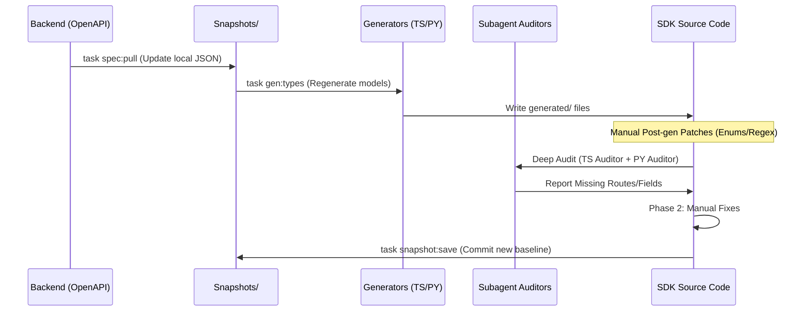
Sources: [RUNBOOK.md:5-43](), [Taskfile.yml:206-212]()

### Phase 0: Discovery and Classification
Before generating code, developers must diff the fresh specs against `snapshots/`. Changes are classified by impact [RUNBOOK.md:7-14]():
*   **MAJOR**: Removed endpoints, required parameters, or response fields.
*   **MINOR**: New endpoints.
*   **PATCH**: New optional parameters or enum values.

### Phase 1: Audit
After running `task gen:types`, two parallel subagents (one for TS, one for Python) audit the SDK resources against the new spec [RUNBOOK.md:25-29](). They verify:
*   **Method Coverage**: Every route in `openapi.json` has a corresponding method in the SDK (e.g., `POST /sessions` -> `.create()`) [RUNBOOK.md:48]().
*   **Type Safety**: Methods return Pydantic model instances in Python (via `model_validate()`) or the correct TypeScript aliases [RUNBOOK.md:68]().

### Phase 2: Validation
The final step involves running the "vibe" tests (spec-driven, no backend) and, if possible, live integration tests to ensure the generated types correctly serialize/deserialize data from the API [Taskfile.yml:114-141]().

Sources: [RUNBOOK.md:31-41](), [Taskfile.yml:28-42]()

---

# Page: API Resources Reference

# API Resources Reference

<details>
<summary>Relevant source files</summary>

The following files were used as context for generating this wiki page:

- [browser-use-node/src/v3/client.ts](browser-use-node/src/v3/client.ts)
- [browser-use-node/src/v3/resources/browsers.ts](browser-use-node/src/v3/resources/browsers.ts)
- [browser-use-python/src/browser_use_sdk/v3/client.py](browser-use-python/src/browser_use_sdk/v3/client.py)
- [browser-use-python/src/browser_use_sdk/v3/resources/browsers.py](browser-use-python/src/browser_use_sdk/v3/resources/browsers.py)
- [browser-use-python/src/browser_use_sdk/v3/resources/sessions.py](browser-use-python/src/browser_use_sdk/v3/resources/sessions.py)
- [docs/openapi/v2.json](docs/openapi/v2.json)
- [docs/openapi/v3.json](docs/openapi/v3.json)
- [snapshots/v2.json](snapshots/v2.json)
- [snapshots/v3.json](snapshots/v3.json)

</details>


This page provides a high-level overview of the resource managers exposed by the Browser Use SDK clients. These resources act as the primary interface for interacting with the Cloud API's entities, such as agent sessions, browser instances, persistent profiles, and workspaces.

The SDK follows a resource-based architecture where the main `BrowserUse` client delegates specific functionality to dedicated resource classes [browser-use-python/src/browser_use_sdk/v3/client.py:45-49]().

### Resource Mapping Overview

The following diagram illustrates how the high-level SDK resource managers map to the underlying Cloud API entities and their corresponding code implementations.

**Resource Entity Mapping**
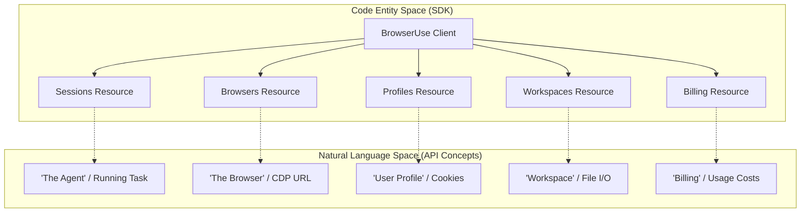
Sources: [browser-use-python/src/browser_use_sdk/v3/client.py:45-49](), [browser-use-node/src/v3/client.ts:27-31]()

---

### Sessions Resource (v3)
The `Sessions` resource is the primary entry point for the v3 "session-centric" model. It manages the lifecycle of an agent session, which can transition between `idle` and `running` states. It supports dispatching tasks to existing sessions, cursor-based message pagination, and granular stop strategies [browser-use-python/src/browser_use_sdk/v3/resources/sessions.py:19-154]().

For details, see [Sessions Resource (v3)](#3.1).

### Browsers Resource
The `Browsers` resource allows for the creation of standalone browser instances without an active agent. This is typically used for direct automation via CDP, Playwright, or Puppeteer. It provides the `liveUrl` for real-time viewing and `cdpUrl` for remote debugging [browser-use-python/src/browser_use_sdk/v3/resources/browsers.py:17-86]().

For details, see [Browsers Resource](#3.2).

### Workspaces Resource (v3)
`Workspaces` provide a persistent, isolated file system for sessions. This resource manages the upload of input files (via presigned S3 URLs) and the listing or downloading of output files generated by the agent during task execution [browser-use-python/src/browser_use_sdk/v3/client.py:49]().

For details, see [Workspaces Resource (v3)](#3.3).

### Profiles Resource
`Profiles` are containers for browser state, including cookies, `localStorage`, and session data. They enable the "login once, reuse many" pattern. Note that state persistence is only guaranteed if a session is explicitly stopped using the SDK [browser-use-python/src/browser_use_sdk/v3/client.py:47]().

For details, see [Profiles Resource](#3.4).

### Tasks, Skills, and Marketplace (v2)
These resources are specific to the v2 "task-centric" model. While v3 is recommended for new integrations, v2 remains supported for legacy workflows involving the `Skills` library (reusable agent capabilities) and the `Marketplace` (pre-configured community agents) [snapshots/v2.json:62-212]().

For details, see [Tasks, Skills, and Marketplace Resources (v2)](#3.5).

### Billing Resource
The `Billing` resource provides transparency into account balances and usage costs. It allows developers to query the `AccountView`, which includes current credit balances and the specific cost vectors (LLM, Browser, and Proxy) incurred by sessions [snapshots/v2.json:15-60]().

For details, see [Billing Resource](#3.6).

---

### Resource Relationship Diagram

The diagram below shows how resources interact during a typical automated workflow: a `Profile` is attached to a `Session`, which uses a `Workspace` for file I/O, all while consuming credits tracked by the `Billing` resource.

**Resource Interaction Lifecycle**
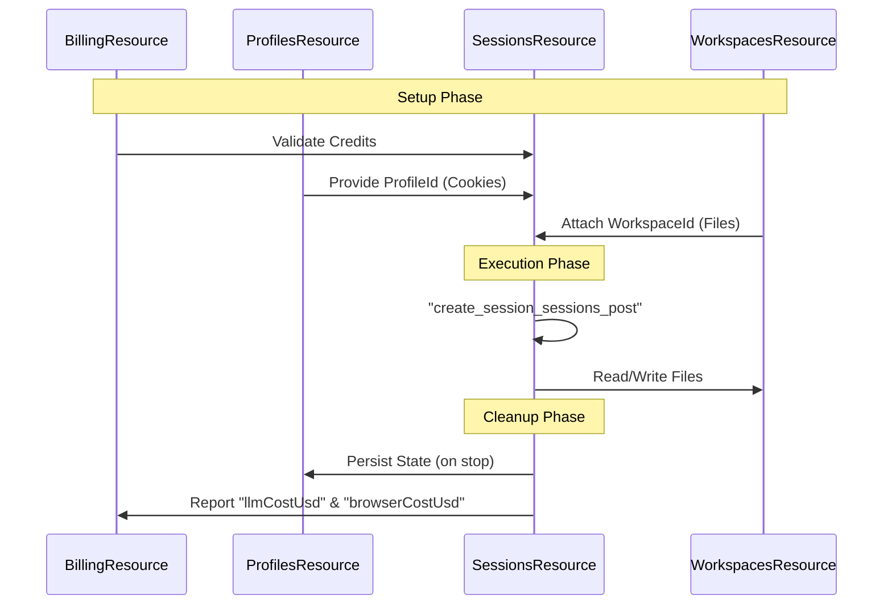
Sources: [snapshots/v3.json:21-22](), [browser-use-python/src/browser_use_sdk/v3/resources/sessions.py:23-39](), [snapshots/v2.json:15-22]()

---

# Page: Sessions Resource (v3)

# Sessions Resource (v3)

<details>
<summary>Relevant source files</summary>

The following files were used as context for generating this wiki page:

- [browser-use-node/src/generated/v3/types.ts](browser-use-node/src/generated/v3/types.ts)
- [browser-use-node/src/v3.ts](browser-use-node/src/v3.ts)
- [browser-use-node/src/v3/client.ts](browser-use-node/src/v3/client.ts)
- [browser-use-node/src/v3/resources/browsers.ts](browser-use-node/src/v3/resources/browsers.ts)
- [browser-use-node/src/v3/resources/sessions.ts](browser-use-node/src/v3/resources/sessions.ts)
- [browser-use-python/src/browser_use_sdk/generated/v3/models.py](browser-use-python/src/browser_use_sdk/generated/v3/models.py)
- [browser-use-python/src/browser_use_sdk/v3/__init__.py](browser-use-python/src/browser_use_sdk/v3/__init__.py)
- [browser-use-python/src/browser_use_sdk/v3/client.py](browser-use-python/src/browser_use_sdk/v3/client.py)
- [browser-use-python/src/browser_use_sdk/v3/resources/browsers.py](browser-use-python/src/browser_use_sdk/v3/resources/browsers.py)
- [browser-use-python/src/browser_use_sdk/v3/resources/sessions.py](browser-use-python/src/browser_use_sdk/v3/resources/sessions.py)
- [docs/openapi/v2.json](docs/openapi/v2.json)
- [docs/openapi/v3.json](docs/openapi/v3.json)
- [snapshots/v2.json](snapshots/v2.json)
- [snapshots/v3.json](snapshots/v3.json)

</details>


The **Sessions** resource is the primary interface for interacting with the Browser Use v3 API. Unlike v2, which was task-centric, v3 is session-centric: an agent exists within a session, and multiple tasks can be dispatched to the same session while maintaining browser state, authentication, and workspace context.

## Overview of Session Lifecycle

A session transitions through several states defined by the `BuAgentSessionStatus` enum. The lifecycle typically begins with a `POST /sessions` request, which can either create an idle session or immediately dispatch a task.

### Session States
| State | Description |
| :--- | :--- |
| `created` | Initial state after the session record is created in the database. |
| `running` | An agent is currently executing a task within the session. |
| `idle` | The session is active but no task is running. Ready for follow-up tasks. |
| `stopped` | The session has been explicitly terminated. The browser sandbox is destroyed. |
| `timed_out` | The session exceeded its maximum duration and was automatically stopped. |
| `error` | A terminal error occurred during task execution or session setup. |

**Sources:** [browser-use-python/src/browser_use_sdk/generated/v3/models.py:101-107](), [snapshots/v3.json:21-30]()

## Code Entity Mapping

The following diagram maps the natural language concepts of session management to the specific classes and methods in the SDK.

### Session Management Flow
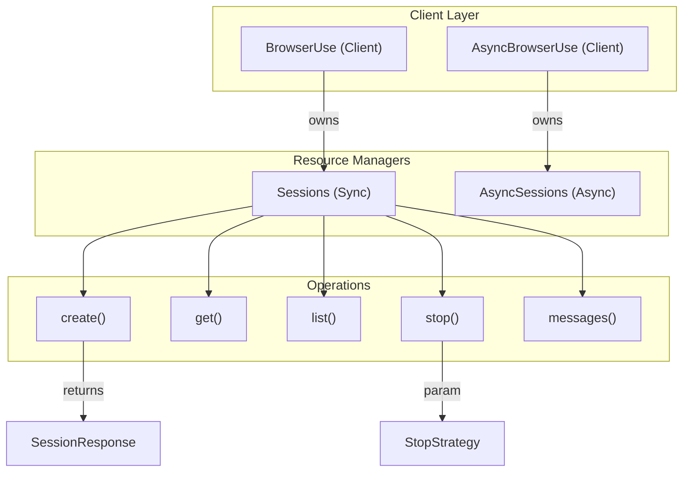
**Sources:** [browser-use-python/src/browser_use_sdk/v3/client.py:48-49](), [browser-use-python/src/browser_use_sdk/v3/resources/sessions.py:19-155](), [browser-use-node/src/v3/client.ts:53]()

## Creating and Dispatching Tasks

The `create` method (and the high-level `run`/`stream` methods) uses the `RunTaskRequest` schema. This is a polymorphic endpoint that handles three main scenarios:

1.  **New Session + Task:** Provide `task`, leave `sessionId` null.
2.  **Existing Session + Task:** Provide both `task` and `sessionId`.
3.  **Idle Session (No Task):** Leave `task` null. Useful for pre-uploading files to a workspace before starting an agent.

### RunTaskRequest Parameters
| Parameter | Type | Description |
| :--- | :--- | :--- |
| `task` | `str` | The natural language instruction for the agent. |
| `model` | `BuModel` | The LLM tier to use (e.g., `bu-mini`, `bu-ultra`). |
| `keep_alive` | `bool` | If `true`, the session enters `idle` after the task. If `false`, it enters `stopped`. |
| `output_schema` | `dict` | JSON Schema for structured data extraction. |
| `proxy_country_code` | `str` | Two-letter code (e.g., "us", "de") for residential proxy rotation. |
| `cache_script` | `bool` | Enables deterministic rerun caching for the task. |

**Sources:** [browser-use-python/src/browser_use_sdk/v3/resources/sessions.py:23-38](), [snapshots/v3.json:332-414]()

## Stop Strategies

The `stop` method allows for granular control over how a session is terminated via the `StopStrategy` enum.

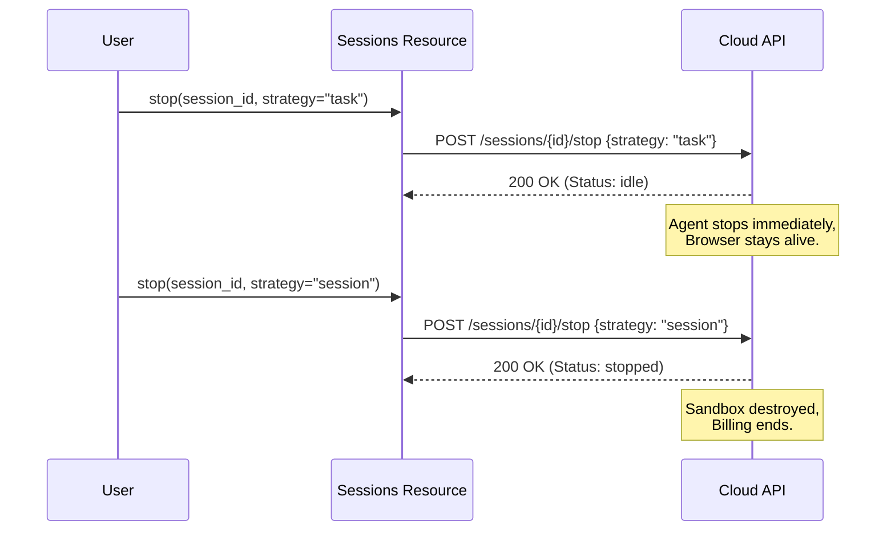

*   **`session` (Default):** Completely destroys the browser sandbox and moves the session to the `stopped` state.
*   **`task`:** Only interrupts the currently running agent task. The browser remains active, and the session returns to `idle`.

**Sources:** [browser-use-python/src/browser_use_sdk/v3/resources/sessions.py:95-105](), [snapshots/v3.json:221-222]()

## Message Pagination

Messages within a session are retrieved using cursor-based pagination. This is critical for the `stream()` implementation to ensure no messages are missed or duplicated during long-running tasks.

### Cursor Implementation
The `messages()` method accepts `after` and `before` parameters, which correspond to message UUIDs.
*   **Python:** `sessions.messages(session_id, after=last_msg_id)` [browser-use-python/src/browser_use_sdk/v3/resources/sessions.py:111-130]()
*   **Node.js:** `sessions.messages(sessionId, { after: lastMsgId })` [browser-use-node/src/generated/v3/types.ts:97]()

## Session Persistence (Keep-Alive)

The `keep_alive` parameter controls the post-task behavior of the browser.

*   **Auto-Detection:** In the SDK `run()` and `stream()` methods, if a `session_id` is provided, `keep_alive` defaults to `true` to facilitate multi-turn conversations. [browser-use-python/src/browser_use_sdk/v3/client.py:146-147]()
*   **Manual Persistence:** If `keep_alive` is `true`, the session will remain in `idle` until the `timeout_at` timestamp is reached or `stop(strategy="session")` is called.

**Sources:** [browser-use-python/src/browser_use_sdk/v3/client.py:146-147](), [snapshots/v3.json:21]()

## Recording Handling

If `enable_recording` is set to `true` during session creation, the platform generates an MP4 recording of the browser viewport.

### `wait_for_recording`
Since video processing happens asynchronously after a session stops, the SDK provides a helper to poll for the final URLs.

```python
# Python implementation of polling for recording URLs
def wait_for_recording(self, session_id, timeout=15, interval=2):
    deadline = time.monotonic() + timeout
    while time.monotonic() < deadline:
        session = self.get(session_id)
        if session.recording_urls:
            return list(session.recording_urls)
        time.sleep(interval)
    return []
```
**Sources:** [browser-use-python/src/browser_use_sdk/v3/resources/sessions.py:132-153](), [browser-use-python/src/browser_use_sdk/generated/v3/models.py:93-98]()

## Summary Table of Session Endpoints

| Method | HTTP | Path | Description |
| :--- | :--- | :--- | :--- |
| `create` | `POST` | `/sessions` | Create session or dispatch task. |
| `list` | `GET` | `/sessions` | Paginated list of all project sessions. |
| `get` | `GET` | `/sessions/{id}` | Detailed session status and cost metadata. |
| `stop` | `POST` | `/sessions/{id}/stop` | Stop task or destroy session. |
| `delete` | `DELETE` | `/sessions/{id}` | Soft-delete session record. |
| `messages` | `GET` | `/sessions/{id}/messages` | Cursor-paginated agent message history. |

**Sources:** [snapshots/v3.json:15-325](), [browser-use-python/src/browser_use_sdk/v3/resources/sessions.py:19-155]()

---

# Page: Browsers Resource

# Browsers Resource

<details>
<summary>Relevant source files</summary>

The following files were used as context for generating this wiki page:

- [browser-use-node/src/v2/resources/browsers.ts](browser-use-node/src/v2/resources/browsers.ts)
- [browser-use-node/src/v2/resources/sessions.ts](browser-use-node/src/v2/resources/sessions.ts)
- [browser-use-node/src/v3/client.ts](browser-use-node/src/v3/client.ts)
- [browser-use-node/src/v3/resources/browsers.ts](browser-use-node/src/v3/resources/browsers.ts)
- [browser-use-python/src/browser_use_sdk/v2/resources/browsers.py](browser-use-python/src/browser_use_sdk/v2/resources/browsers.py)
- [browser-use-python/src/browser_use_sdk/v2/resources/sessions.py](browser-use-python/src/browser_use_sdk/v2/resources/sessions.py)
- [browser-use-python/src/browser_use_sdk/v3/client.py](browser-use-python/src/browser_use_sdk/v3/client.py)
- [browser-use-python/src/browser_use_sdk/v3/resources/browsers.py](browser-use-python/src/browser_use_sdk/v3/resources/browsers.py)
- [browser-use-python/src/browser_use_sdk/v3/resources/sessions.py](browser-use-python/src/browser_use_sdk/v3/resources/sessions.py)
- [docs/cloud/agent/follow-up-tasks.mdx](docs/cloud/agent/follow-up-tasks.mdx)
- [docs/cloud/agent/structured-output.mdx](docs/cloud/agent/structured-output.mdx)
- [docs/cloud/browser/playwright-puppeteer-selenium.mdx](docs/cloud/browser/playwright-puppeteer-selenium.mdx)
- [docs/cloud/browser/stealth.mdx](docs/cloud/browser/stealth.mdx)
- [docs/cloud/guides/webhooks.mdx](docs/cloud/guides/webhooks.mdx)
- [docs/cloud/legacy/skills.mdx](docs/cloud/legacy/skills.mdx)
- [docs/cloud/new-features/api-v3.mdx](docs/cloud/new-features/api-v3.mdx)

</details>


The Browsers resource provides direct access to the Browser Use managed browser infrastructure. While the [Sessions Resource (v3)](/api-resources-reference/sessions-resource-v3) is typically used for agent-led tasks, the Browsers resource allows developers to create standalone browser sessions for manual control, live viewing, or integration with existing automation frameworks like Playwright and Puppeteer.

Every browser session runs in a hardened Chromium fork featuring built-in stealth, anti-fingerprinting, and automatic proxy rotation [docs/cloud/browser/playwright-puppeteer-selenium.mdx:7-8]().

## Resource Architecture

The Browsers resource is available in both v2 and v3 SDKs. It interacts with the `/browsers` endpoint of the Cloud API.

### Code Entity Mapping

The following diagram bridges the high-level resource concepts to the specific classes and methods in the SDK.

**Browsers Resource Entity Map**
```mermaid
graph TD
    subgraph "SDK Client"
        A["BrowserUse (v3)"] -- "has resource" --> B["Browsers"]
        C["AsyncBrowserUse (v3)"] -- "has resource" --> D["AsyncBrowsers"]
    end

    subgraph "Browsers Resource Class"
        B -- "create()" --> E["POST /browsers"]
        B -- "get()" --> F["GET /browsers/{id}"]
        B -- "stop()" --> G["PATCH /browsers/{id} {action: 'stop'}"]
        B -- "list()" --> H["GET /browsers"]
    end

    subgraph "Data Models (v3)"
        E --> I["BrowserSessionItemView"]
        F --> J["BrowserSessionView"]
        H --> K["BrowserSessionListResponse"]
    end

    style A stroke-width:2px
    style B stroke-width:4px
    style E stroke-dasharray: 5 5
```
Sources: [browser-use-python/src/browser_use_sdk/v3/client.py:46](), [browser-use-python/src/browser_use_sdk/v3/resources/browsers.py:17-86](), [browser-use-node/src/v3/resources/browsers.ts:15-42]()

## Creating Standalone Sessions

Standalone sessions are useful when you want to bypass the Agent LLM and control the browser directly or provide a "Human-in-the-Loop" interface via the `liveUrl`.

### Configuration Options
When calling `create()`, you can configure the browser environment:

| Parameter | Type | Description |
| :--- | :--- | :--- |
| `profile_id` | `str` | Attach a [Profile](/api-resources-reference/profiles-resource) to reuse cookies/storage. |
| `proxy_country_code` | `str` | Specify a country (e.g., "us", "de") for residential proxy exit. |
| `browser_screen_width` | `int` | Set the viewport width. |
| `browser_screen_height` | `int` | Set the viewport height. |
| `timeout` | `int` | Session duration in minutes (Default: 15, Max: 240). |
| `enable_recording` | `bool` | Enable video recording of the session. |

Sources: [browser-use-python/src/browser_use_sdk/v3/resources/browsers.py:21-52](), [docs/cloud/browser/playwright-puppeteer-selenium.mdx:79-88]()

## Integration: CDP, Playwright, and Puppeteer

The Browsers resource provides two critical URLs in the `BrowserSessionView` response:
1.  **`cdp_url` / `cdpUrl`**: A WebSocket endpoint for direct Chrome DevTools Protocol (CDP) connections [docs/cloud/browser/playwright-puppeteer-selenium.mdx:102]().
2.  **`live_url` / `liveUrl`**: A URL for a hosted interactive web view of the browser session [docs/cloud/browser/playwright-puppeteer-selenium.mdx:103]().

### Connection Flow

```mermaid
sequenceDiagram
    participant App as "Your Application"
    participant SDK as "Browser Use SDK"
    participant API as "Cloud API (/browsers)"
    participant PW as "Playwright / Puppeteer"

    App->>SDK: browsers.create(proxy_country_code="us")
    SDK->>API: POST /browsers
    API-->>SDK: { id, cdpUrl, liveUrl }
    SDK-->>App: BrowserSessionItemView
    App->>PW: connectOverCDP(cdpUrl)
    PW->>API: WebSocket Upgrade
    Note over PW, API: Direct Browser Control
    App->>SDK: browsers.stop(id)
    SDK->>API: PATCH /browsers/{id} {action: 'stop'}
```
Sources: [docs/cloud/browser/playwright-puppeteer-selenium.mdx:96-130](), [browser-use-python/src/browser_use_sdk/v3/resources/browsers.py:75-85]()

### Implementation Example (Python)
```python
from browser_use_sdk.v3 import AsyncBrowserUse
from playwright.async_api import async_playwright

client = AsyncBrowserUse()
# 1. Create the managed browser
browser_session = await client.browsers.create(proxy_country_code="us")

async with async_playwright() as p:
    # 2. Connect Playwright to the remote browser via CDP
    pw_browser = await p.chromium.connect_over_cdp(browser_session.cdp_url)
    page = pw_browser.contexts[0].pages[0]
    
    await page.goto("https://example.com")
    print(await page.title())
    
    await pw_browser.close()

# 3. Explicitly stop to avoid unnecessary billing
await client.browsers.stop(browser_session.id)
```
Sources: [docs/cloud/browser/playwright-puppeteer-selenium.mdx:96-113](), [browser-use-python/src/browser_use_sdk/v3/resources/browsers.py:83-85]()

## Stopping and Refunds

Sessions created via the Browsers resource continue to run (and consume credits) until they either:
1.  Reach the configured `timeout`.
2.  Are explicitly stopped via the SDK.

The `stop()` method is a convenience wrapper that calls `update()` with the `action="stop"` payload [browser-use-python/src/browser_use_sdk/v3/resources/browsers.py:83-85](). 

### Proportional Refunds
Browser Use Cloud typically calculates costs based on active duration. If a session is configured for a 60-minute timeout but is stopped via `browsers.stop()` after 5 minutes, the project is only billed for the used duration.

> [!WARNING]
> Always call `stop()` in a `finally` block or use a context manager to ensure sessions are terminated, as closing the local Playwright/Puppeteer client does not always immediately terminate the remote cloud session [docs/cloud/browser/playwright-puppeteer-selenium.mdx:155-157]().

## v2 vs v3 Differences

While the core functionality remains similar, there are structural differences in the resource implementation:

| Feature | v2 (Legacy) | v3 (Current) |
| :--- | :--- | :--- |
| **Namespace** | `client.browsers` | `client.browsers` |
| **Action Enum** | `BrowserSessionUpdateAction.stop` [browser-use-python/src/browser_use_sdk/v2/resources/browsers.py:112]() | String literal `"stop"` [browser-use-python/src/browser_use_sdk/v3/resources/browsers.py:85]() |
| **Resizing** | Supported (`allow_resizing`) [browser-use-python/src/browser_use_sdk/v2/resources/browsers.py:38]() | Supported (`allow_resizing`) [browser-use-python/src/browser_use_sdk/v3/resources/browsers.py:45]() |
| **ID Type** | `str` | `str` or `UUID` [browser-use-python/src/browser_use_sdk/v3/resources/browsers.py:69]() |

Sources: [browser-use-python/src/browser_use_sdk/v2/resources/browsers.py:1-113](), [browser-use-python/src/browser_use_sdk/v3/resources/browsers.py:1-86]()

---

# Page: Workspaces Resource (v3)

# Workspaces Resource (v3)

<details>
<summary>Relevant source files</summary>

The following files were used as context for generating this wiki page:

- [browser-use-node/src/v3/resources/workspaces.ts](browser-use-node/src/v3/resources/workspaces.ts)
- [browser-use-python/src/browser_use_sdk/v3/resources/workspaces.py](browser-use-python/src/browser_use_sdk/v3/resources/workspaces.py)
- [docs/cloud/agent/human-in-the-loop.mdx](docs/cloud/agent/human-in-the-loop.mdx)
- [docs/cloud/agent/workspaces.mdx](docs/cloud/agent/workspaces.mdx)
- [docs/cloud/browser/live-preview.mdx](docs/cloud/browser/live-preview.mdx)
- [docs/cloud/guides/authentication.mdx](docs/cloud/guides/authentication.mdx)
- [docs/cloud/tutorials/chat-ui.mdx](docs/cloud/tutorials/chat-ui.mdx)
- [docs/openapi/v2.json](docs/openapi/v2.json)
- [docs/openapi/v3.json](docs/openapi/v3.json)
- [snapshots/v2.json](snapshots/v2.json)
- [snapshots/v3.json](snapshots/v3.json)

</details>


The **Workspaces** resource provides persistent file storage for browser agents. It enables a common I/O pattern where developers upload configuration or data files for the agent to consume, and later download files (like reports, CSVs, or screenshots) that the agent generated during its session.

## Overview and Purpose

Workspaces act as a virtual file system for the agent. When a session is created with a `workspace_id`, the agent's sandbox is initialized with access to that workspace's files [docs/cloud/agent/workspaces.mdx:7-10]().

Key capabilities include:
*   **Persistent Storage**: Files survive between different tasks and sessions if they share the same workspace.
*   **Large File Support**: Uses a presigned URL pattern for direct S3 uploads/downloads, bypassing API gateway payload limits.
*   **Organization**: Supports file prefixes (folders) and shallow vs. recursive listing.
*   **Security**: Includes path traversal protection in SDK helpers to prevent unauthorized access to local files during upload/download.

## Data Flow: File I/O Pattern

The Workspaces resource implements an **Upload → Execute → Download** pattern. Because the API does not accept raw binary data in the JSON request body, the SDK coordinates a two-step process using presigned URLs.

### 1. Upload Flow
1.  **Metadata Exchange**: The SDK calls `upload_files` with file names and sizes [browser-use-python/src/browser_use_sdk/v3/resources/workspaces.py:128-135]().
2.  **Presigned URL Generation**: The backend returns a `FileUploadResponse` containing S3 PUT URLs for each file.
3.  **Direct Upload**: The SDK performs an HTTP `PUT` request for each local file directly to the provided S3 URL [browser-use-python/src/browser_use_sdk/v3/resources/workspaces.py:186-190]().

### 2. Download Flow
1.  **File Discovery**: The SDK calls `files` with `include_urls=True` to find the specific file and its temporary download URL [browser-use-python/src/browser_use_sdk/v3/resources/workspaces.py:103-112]().
2.  **Direct Download**: The SDK performs an HTTP `GET` on the presigned URL and writes the stream to the local disk [browser-use-python/src/browser_use_sdk/v3/resources/workspaces.py:221-224]().

### File I/O Sequence Diagram
Title: Workspace File Upload and Agent Execution
```mermaid
sequenceDiagram
    participant App as "Client Application"
    participant SDK as "Browser Use SDK (Workspaces)"
    participant API as "Cloud API (/workspaces)"
    participant S3 as "Storage (S3)"

    App->>SDK: .upload("data.csv")
    SDK->>API: POST /workspaces/{id}/files/upload
    API-->>SDK: 200 OK (Presigned PUT URL)
    SDK->>S3: HTTP PUT (File Content)
    S3-->>SDK: 200 OK
    SDK-->>App: Remote Path

    App->>API: POST /sessions (with workspace_id)
    Note over API: Agent reads data.csv from workspace
    API-->>App: Session Result (Task Done)

    App->>SDK: .download("report.pdf")
    SDK->>API: GET /workspaces/{id}/files?includeUrls=true
    API-->>SDK: 200 OK (Presigned GET URL)
    SDK->>S3: HTTP GET
    S3-->>SDK: File Stream
    SDK->>App: Local File Saved
```
**Sources**: [browser-use-python/src/browser_use_sdk/v3/resources/workspaces.py:162-191](), [browser-use-python/src/browser_use_sdk/v3/resources/workspaces.py:193-224](), [docs/cloud/agent/workspaces.mdx:12-47]()

## Implementation Details

### Resource Manager Classes
The Workspaces resource is managed by the `Workspaces` class in both SDKs. It is attached to the main client under the `.workspaces` property.

*   **Python**: `Workspaces` in `browser_use_sdk.v3.resources.workspaces` [browser-use-python/src/browser_use_sdk/v3/resources/workspaces.py:40-40]().
*   **TypeScript**: `Workspaces` in `src/v3/resources/workspaces` [browser-use-node/src/v3/resources/workspaces.ts:69-69]().

### Key Methods and Parameters

| Method | Description | Key Parameters |
| :--- | :--- | :--- |
| `list` | Lists all workspaces in the project. | `page_size`, `page_number` |
| `create` | Creates a new workspace container. | `name` |
| `get` | Retrieves metadata for a specific workspace. | `workspace_id` |
| `update` | Renames an existing workspace. | `workspace_id`, `name` |
| `delete` | Permanently deletes a workspace and all files. | `workspace_id` |
| `files` | Lists files with pagination and filtering. | `prefix`, `shallow`, `include_urls`, `cursor` |
| `upload` | **High-level helper**: Handles URL acquisition and PUT. | `*paths`, `prefix` |
| `download` | **High-level helper**: Handles discovery and GET. | `path`, `to` |
| `size` | Returns total storage used in bytes. | `workspace_id` |

**Sources**: [browser-use-python/src/browser_use_sdk/v3/resources/workspaces.py:44-160](), [browser-use-node/src/v3/resources/workspaces.ts:73-122]()

### Code Entity Mapping: Workspaces Logic
Title: Mapping Workspace Methods to API Endpoints
```mermaid
graph LR
    subgraph SDK ["SDK Entity: Workspaces Class"]
        M1["upload()"]
        M2["download()"]
        M3["files()"]
        M4["delete_file()"]
        M5["size()"]
    end

    subgraph API ["Cloud API Endpoints"]
        E1["POST /files/upload"]
        E2["GET /files"]
        E3["DELETE /files"]
        E4["GET /size"]
    end

    subgraph Helpers ["Internal Utilities"]
        H1["_guess_content_type()"]
        H2["_safe_join()"]
    end

    M1 --> E1
    M2 --> E2
    M3 --> E2
    M4 --> E3
    M5 --> E4
    M1 -.-> H1
    M2 -.-> H2
```
**Sources**: [browser-use-python/src/browser_use_sdk/v3/resources/workspaces.py:26-37](), [browser-use-python/src/browser_use_sdk/v3/resources/workspaces.py:103-160]()

## Advanced Filtering and Organization

### Prefix and Shallow Filtering
Workspaces use a flat object store that simulates a directory structure using the `prefix` parameter.
*   **Prefix**: Passing `prefix="reports/"` to `files()` will return all files starting with that string [browser-use-python/src/browser_use_sdk/v3/resources/workspaces.py:107-112]().
*   **Shallow**: If `shallow=True`, the API only returns files at the immediate level of the prefix, effectively treating it like a single-directory `ls` command [browser-use-python/src/browser_use_sdk/v3/resources/workspaces.py:111-111]().

### Path Traversal Protection
The SDKs implement a `_safe_join` (Python) or `safeJoin` (Node) utility to prevent malicious or accidental path traversal when downloading files to the local machine [browser-use-python/src/browser_use_sdk/v3/resources/workspaces.py:31-37](), [browser-use-node/src/v3/resources/workspaces.ts:5-12]().

```python
# Python implementation of path traversal check
def _safe_join(base: Path, untrusted: str) -> Path:
    base_resolved = base.resolve()
    resolved = (base / untrusted).resolve()
    if base_resolved != resolved and base_resolved not in resolved.parents:
        raise ValueError(f"Path traversal detected: {untrusted}")
    return resolved
```
**Sources**: [browser-use-python/src/browser_use_sdk/v3/resources/workspaces.py:31-37]()

## Resource Models
The Workspaces resource uses the following generated models for data validation:
*   `WorkspaceView`: The core representation of a workspace (id, name, created_at) [browser-use-python/src/browser_use_sdk/v3/resources/workspaces.py:19-19]().
*   `FileListResponse`: A paginated list of file metadata including `path`, `size`, and optionally `url` [browser-use-python/src/browser_use_sdk/v3/resources/workspaces.py:12-12]().
*   `FileUploadItem`: Used to request upload URLs, containing `name`, `contentType`, and `size` [browser-use-python/src/browser_use_sdk/v3/resources/workspaces.py:13-13]().

**Sources**: [browser-use-python/src/browser_use_sdk/v3/resources/workspaces.py:11-20](), [snapshots/v3.json:115999]() (refers to schemas in full OpenAPI spec).

---

# Page: Profiles Resource

# Profiles Resource

<details>
<summary>Relevant source files</summary>

The following files were used as context for generating this wiki page:

- [browser-use-node/examples/authentication.ts](browser-use-node/examples/authentication.ts)
- [browser-use-node/examples/profiles.ts](browser-use-node/examples/profiles.ts)
- [browser-use-node/examples/sessions.ts](browser-use-node/examples/sessions.ts)
- [browser-use-node/examples/stealth.ts](browser-use-node/examples/stealth.ts)
- [browser-use-node/src/v3/resources/profiles.ts](browser-use-node/src/v3/resources/profiles.ts)
- [browser-use-node/tests/vibe.test.ts](browser-use-node/tests/vibe.test.ts)
- [browser-use-python/examples/authentication.py](browser-use-python/examples/authentication.py)
- [browser-use-python/src/browser_use_sdk/v3/resources/profiles.py](browser-use-python/src/browser_use_sdk/v3/resources/profiles.py)
- [browser-use-python/tests/test_vibe.py](browser-use-python/tests/test_vibe.py)
- [docs/cloud/agent/human-in-the-loop.mdx](docs/cloud/agent/human-in-the-loop.mdx)
- [docs/cloud/agent/workspaces.mdx](docs/cloud/agent/workspaces.mdx)
- [docs/cloud/browser/live-preview.mdx](docs/cloud/browser/live-preview.mdx)
- [docs/cloud/guides/authentication.mdx](docs/cloud/guides/authentication.mdx)
- [docs/cloud/tutorials/chat-ui.mdx](docs/cloud/tutorials/chat-ui.mdx)

</details>


The **Profiles** resource provides persistent browser identity containers. Unlike standard sessions which start with a clean slate, a Profile stores cookies, `localStorage`, and session data, enabling the "Login once, reuse many" pattern. This is essential for bypassing repeated 2FA prompts or maintaining authenticated states across disparate agent runs.

## Implementation Overview

Profiles are managed through the `Profiles` (Node.js) or `AsyncProfiles`/`Profiles` (Python) classes. These classes wrap the `/profiles` REST API endpoints.

### Data Flow: Persistence and State
The most critical technical requirement for Profiles is the persistence trigger. Browser state is **only** synchronized and saved to the cloud storage when a session is explicitly stopped.

1.  **Creation**: A profile is created as a named container.
2.  **Attachment**: A `profileId` is passed during `sessions.create()`.
3.  **Execution**: The agent performs actions (e.g., logging into LinkedIn).
4.  **Persistence**: The user calls `sessions.stop()`. This triggers the backend to bundle the current browser context state and update the Profile's persistent storage.

### Code Entity Mapping

The following diagram maps the high-level profile concepts to the specific code entities in the SDK.

**Profile Entity Mapping**
```mermaid
graph TD
    subgraph "Natural Language Space"
        A["Browser Identity"]
        B["Saved Cookies"]
        C["Persistent Login"]
    end

    subgraph "Code Entity Space (v3)"
        D["ProfileView (Model)"]
        E["Profiles (Resource Manager)"]
        F["ProfileCreateRequest (Schema)"]
        G["AsyncProfiles (Python Class)"]
    end

    A --> D
    B --> E
    C --> F
    E -.-> G
    
    style A fill:none,stroke-width:2px
    style B fill:none,stroke-width:2px
    style C fill:none,stroke-width:2px
```
**Sources:** [browser-use-python/src/browser_use_sdk/v3/resources/profiles.py:15-103](), [browser-use-node/src/v3/resources/profiles.ts:15-42]()

---

## Key Functions and Classes

### Python (v3)
In Python, the `AsyncProfiles` class handles asynchronous interactions with the profile service.

| Method | Role | Path |
| :--- | :--- | :--- |
| `create()` | Initializes a new profile container. | `/profiles` (POST) |
| `list()` | Retrieves profiles with optional `query` filtering. | `/profiles` (GET) |
| `get()` | Fetches details for a specific `profile_id`. | `/profiles/{id}` (GET) |
| `update()` | Renames or modifies profile metadata. | `/profiles/{id}` (PATCH) |
| `delete()` | Permanently removes the profile and its stored state. | `/profiles/{id}` (DELETE) |

**Sources:** [browser-use-python/src/browser_use_sdk/v3/resources/profiles.py:83-149]()

### Node.js (v3)
The Node.js implementation follows the same REST mapping using the `HttpClient`.

**Profile Lifecycle Interaction**
```mermaid
sequenceDiagram
    participant U as User Code
    participant P as Profiles Resource
    participant S as Sessions Resource
    participant API as Cloud API

    U->>P: create({ name: "user-1" })
    P->>API: POST /profiles
    API-->>U: ProfileView (id: "prof_abc")
    
    U->>S: create({ profileId: "prof_abc" })
    S->>API: POST /sessions
    Note over API: Loads cookies from prof_abc
    
    U->>S: run("Login to Service")
    Note over API: Browser state changes
    
    U->>S: stop(sessionId)
    S->>API: POST /sessions/{id}/stop
    Note over API: Saves new cookies to prof_abc
```
**Sources:** [browser-use-node/src/v3/resources/profiles.ts:15-42](), [docs/cloud/guides/authentication.mdx:7-37]()

---

## Usage Patterns

### The "Login Once" Pattern
This pattern involves creating a session with a profile, performing a manual or automated login, and then stopping the session to save the credentials.

```python
# Example of persisting state
profile = await client.profiles.create(name="production-user")
session = await client.sessions.create(profile_id=profile.id)

# Perform login task
await client.run("Log into Amazon with provided credentials", session_id=session.id)

# CRITICAL: Must stop to save cookies/localStorage
await client.sessions.stop(session.id)
```
**Sources:** [docs/cloud/guides/authentication.mdx:7-21](), [browser-use-node/examples/profiles.ts:12-21]()

### Profile Management and Searching
Profiles can be queried by name using the `query` parameter in the `list` method. This is useful for mapping internal system User IDs to Browser Use Profiles.

```typescript
// Searching for an existing profile by name
const results = await client.profiles.list({ query: "internal-user-42" });
const profile = results.items[0]; 

if (!profile) {
  const newProfile = await client.profiles.create({ name: "internal-user-42" });
}
```
**Sources:** [docs/cloud/guides/authentication.mdx:77-80](), [browser-use-node/src/v3/resources/profiles.ts:24-26]()

---

## Technical Requirements & Constraints

### Persistence Guarantee
State is **not** streamed in real-time to the profile storage. It is bundled at the end of a session. If a session crashes, times out (15-minute inactivity limit), or is deleted without being stopped, the profile state may revert to its previous version.
*   **Maximum Duration**: Sessions have a hard limit of 4 hours.
*   **Inactivity**: Sessions time out after 15 minutes of idle time.

**Sources:** [docs/cloud/guides/authentication.mdx:96-98](), [docs/cloud/agent/human-in-the-loop.mdx:12-14]()

### Resource Mapping (v2 vs v3)
Both SDK versions map to the same underlying profile infrastructure, though the resource manager locations differ slightly in the codebase.

| Version | SDK Path | Spec Mapping |
| :--- | :--- | :--- |
| **v2** | `client.profiles` | `_V2_MAP` in `test_vibe.py` |
| **v3** | `client.profiles` | `_V3_MAP` in `test_vibe.py` |

**Sources:** [browser-use-python/tests/test_vibe.py:71-75](), [browser-use-python/tests/test_vibe.py:114-119]()

---

# Page: Tasks, Skills, and Marketplace Resources (v2)

# Tasks, Skills, and Marketplace Resources (v2)

<details>
<summary>Relevant source files</summary>

The following files were used as context for generating this wiki page:

- [CLAUDE.md](CLAUDE.md)
- [browser-use-node/src/generated/v2/types.ts](browser-use-node/src/generated/v2/types.ts)
- [browser-use-node/src/v2/resources/browsers.ts](browser-use-node/src/v2/resources/browsers.ts)
- [browser-use-node/src/v2/resources/sessions.ts](browser-use-node/src/v2/resources/sessions.ts)
- [browser-use-node/src/v2/resources/tasks.ts](browser-use-node/src/v2/resources/tasks.ts)
- [browser-use-python/src/browser_use_sdk/generated/v2/models.py](browser-use-python/src/browser_use_sdk/generated/v2/models.py)
- [browser-use-python/src/browser_use_sdk/v2/resources/billing.py](browser-use-python/src/browser_use_sdk/v2/resources/billing.py)
- [browser-use-python/src/browser_use_sdk/v2/resources/browsers.py](browser-use-python/src/browser_use_sdk/v2/resources/browsers.py)
- [browser-use-python/src/browser_use_sdk/v2/resources/files.py](browser-use-python/src/browser_use_sdk/v2/resources/files.py)
- [browser-use-python/src/browser_use_sdk/v2/resources/marketplace.py](browser-use-python/src/browser_use_sdk/v2/resources/marketplace.py)
- [browser-use-python/src/browser_use_sdk/v2/resources/profiles.py](browser-use-python/src/browser_use_sdk/v2/resources/profiles.py)
- [browser-use-python/src/browser_use_sdk/v2/resources/sessions.py](browser-use-python/src/browser_use_sdk/v2/resources/sessions.py)
- [browser-use-python/src/browser_use_sdk/v2/resources/skills.py](browser-use-python/src/browser_use_sdk/v2/resources/skills.py)
- [browser-use-python/src/browser_use_sdk/v2/resources/tasks.py](browser-use-python/src/browser_use_sdk/v2/resources/tasks.py)

</details>


This page provides a technical reference for the v2-only resources in the Browser Use SDK. While v3 moves toward a session-centric model (where tasks are messages within a session), v2 uses a **task-centric model** where tasks are top-level entities that can either auto-create or attach to browser sessions.

## v2 Task-Centric vs v3 Session-Centric

In the v2 API, the `Task` is the primary unit of execution. A task can exist independently of a pre-created session; if no `sessionId` is provided during creation, the system automatically provisions a temporary session.

| Feature | v2 (Task-Centric) | v3 (Session-Centric) |
| :--- | :--- | :--- |
| **Primary Entity** | `Task` [browser-use-python/src/browser_use_sdk/v2/resources/tasks.py:88]() | `Session` |
| **Execution** | `tasks.create()` returns a `taskId` | `sessions.run()` starts an agent in a session |
| **Lifecycle** | Tasks reach `finished` or `stopped` | Sessions reach `idle` or `stopped` |
| **History** | Steps are properties of the Task | History is a list of Messages in the Session |

**Sources:** [CLAUDE.md:31-32](), [browser-use-python/src/browser_use_sdk/v2/resources/tasks.py:18-117](), [browser-use-node/src/generated/v2/types.ts:44-54]()

---

## Tasks Resource

The `Tasks` resource manages the lifecycle of AI agent executions. It supports creating, listing, stopping, and polling for completion.

### Task Execution Flow
The following diagram illustrates the lifecycle of a v2 Task from creation to completion.

**Task Lifecycle and SDK Entities**
```mermaid
sequenceDiagram
    participant App as "User Application"
    participant SDK as "Tasks Resource (v2/resources/tasks.py)"
    participant API as "Cloud API (/tasks)"

    App->>SDK: .create(task="Extract data", session_settings=...)
    SDK->>API: POST /tasks
    API-->>SDK: TaskCreatedResponse (task_id)
    SDK-->>App: TaskCreatedResponse
    
    Loop Polling
        App->>SDK: .status(task_id)
        SDK->>API: GET /tasks/{task_id}/status
        API-->>SDK: TaskStatusView (status="running")
        SDK-->>App: TaskStatusView
    End

    App->>SDK: .wait(task_id)
    Note over SDK: Polls until status in<br/>_TERMINAL_STATUSES
    SDK->>API: GET /tasks/{task_id}
    API-->>SDK: TaskView (status="finished")
    SDK-->>App: TaskView
```
**Sources:** [browser-use-python/src/browser_use_sdk/v2/resources/tasks.py:18-202](), [browser-use-node/src/v2/resources/tasks.ts:28-84]()

### Key Methods
- **`create()`**: Starts a new task. If `sessionId` is omitted, it uses `sessionSettings` to configure a new temporary browser [browser-use-python/src/browser_use_sdk/v2/resources/tasks.py:92-143]().
- **`status()`**: A lightweight endpoint returning only status, output, and cost. Optimized for high-frequency polling [browser-use-python/src/browser_use_sdk/v2/resources/tasks.py:192-196]().
- **`wait()`**: A client-side helper that polls `.status()` every 2 seconds (default) until the task reaches a terminal state (`finished` or `stopped`), then fetches the full `TaskView` [browser-use-python/src/browser_use_sdk/v2/resources/tasks.py:204-221]().
- **`logs()`**: Returns a secure download URL for the execution logs [browser-use-python/src/browser_use_sdk/v2/resources/tasks.py:198-202]().

---

## Skills Resource

Skills are reusable agent capabilities that can be generated, refined, and executed. They represent "recorded" or "learned" behaviors that the agent can perform deterministically or semi-deterministically.

### Skill Management and Code Mapping
The `Skills` resource maps directly to the `/skills` API surface.

**Skills Code-to-API Mapping**
```mermaid
graph TD
    subgraph "SDK Class: Skills"
        S_CREATE["create()"]
        S_EXEC["execute()"]
        S_REFINE["refine()"]
        S_RB["rollback()"]
    end

    subgraph "API Endpoints"
        P_SKILLS["POST /skills"]
        P_EXEC["POST /skills/{id}/execute"]
        P_REFINE["POST /skills/{id}/refine"]
        P_RB["POST /skills/{id}/rollback"]
    end

    S_CREATE --> P_SKILLS
    S_EXEC --> P_EXEC
    S_REFINE --> P_REFINE
    S_RB --> P_RB

    subgraph "Models (generated/v2/models.py)"
        M_REQ["CreateSkillRequest"]
        M_RESP["SkillResponse"]
        M_EXEC["ExecuteSkillResponse"]
    end

    P_SKILLS -.-> M_REQ
    P_SKILLS -.-> M_RESP
    P_EXEC -.-> M_EXEC
```
**Sources:** [browser-use-python/src/browser_use_sdk/v2/resources/skills.py:17-187](), [browser-use-python/src/browser_use_sdk/generated/v2/models.py:159-189]()

### Skill Lifecycle Functions
- **`create()`**: Initiates skill generation based on a `goal` and `agent_prompt` [browser-use-python/src/browser_use_sdk/v2/resources/skills.py:21-39]().
- **`refine()`**: Updates a skill based on natural language `feedback` and optional `test_output` [browser-use-python/src/browser_use_sdk/v2/resources/skills.py:134-152]().
- **`execute()`**: Runs a specific skill ID within an optional `sessionId`, passing `parameters` as a dictionary [browser-use-python/src/browser_use_sdk/v2/resources/skills.py:115-132]().
- **`executions()`**: Retrieves a paginated list of previous executions for a specific skill [browser-use-python/src/browser_use_sdk/v2/resources/skills.py:160-177]().

---

## Marketplace Resource

The Marketplace allows users to discover, clone, and execute skills shared by the community.

### Marketplace Implementation
The `Marketplace` class handles interactions with the `/marketplace` sub-path.

| Method | Endpoint | Description |
| :--- | :--- | :--- |
| `list()` | `GET /marketplace/skills` | Browse public skills with filters like `category` or `query` [browser-use-python/src/browser_use_sdk/v2/resources/marketplace.py:18-42](). |
| `get()` | `GET /marketplace/skills/{slug}` | Get details for a specific marketplace skill using its slug [browser-use-python/src/browser_use_sdk/v2/resources/marketplace.py:44-48](). |
| `clone()` | `POST /marketplace/skills/{id}/clone` | Copy a marketplace skill into the user's private skill library [browser-use-python/src/browser_use_sdk/v2/resources/marketplace.py:50-54](). |
| `execute()` | `POST /marketplace/skills/{id}/execute` | Run a marketplace skill directly without cloning it first [browser-use-python/src/browser_use_sdk/v2/resources/marketplace.py:56-75](). |

**Sources:** [browser-use-python/src/browser_use_sdk/v2/resources/marketplace.py:14-75]()

---

## Technical Implementation Details

### Data Flow and Validation
Both SDKs follow a strict pattern for resource methods:
1. **Body Construction**: Python uses internal helpers like `_build_create_body` to handle `_UNSET` values and optional parameters [browser-use-python/src/browser_use_sdk/v2/resources/tasks.py:21-85]().
2. **HTTP Request**: The `HttpClient` (Node) or `SyncHttpClient/AsyncHttpClient` (Python) performs the request [browser-use-node/src/v2/resources/tasks.ts:29]().
3. **Model Validation**:
   - **Python**: Uses `model_validate()` on generated Pydantic classes (e.g., `TaskView.model_validate(...)`) [browser-use-python/src/browser_use_sdk/v2/resources/tasks.py:173-175]().
   - **Node.js**: Relies on TypeScript interfaces generated from the OpenAPI spec for compile-time safety [browser-use-node/src/v2/resources/tasks.ts:2-13]().

### Forward Compatibility
Every method accepting a request body includes `**extra` (Python) or accepts a partial component schema (Node). This allows the SDK to support new backend features before the SDK types are officially regenerated [CLAUDE.md:61](), [browser-use-python/src/browser_use_sdk/v2/resources/tasks.py:43-44]().

**Sources:** [CLAUDE.md:51-58](), [browser-use-python/src/browser_use_sdk/v2/resources/tasks.py:141-143](), [browser-use-node/src/v2/resources/tasks.ts:5-13]()

---

# Page: Billing Resource

# Billing Resource

<details>
<summary>Relevant source files</summary>

The following files were used as context for generating this wiki page:

- [browser-use-node/src/generated/v3/types.ts](browser-use-node/src/generated/v3/types.ts)
- [browser-use-node/src/v3/resources/billing.ts](browser-use-node/src/v3/resources/billing.ts)
- [browser-use-python/src/browser_use_sdk/generated/v3/models.py](browser-use-python/src/browser_use_sdk/generated/v3/models.py)
- [browser-use-python/src/browser_use_sdk/v3/resources/billing.py](browser-use-python/src/browser_use_sdk/v3/resources/billing.py)
- [docs/openapi/v2.json](docs/openapi/v2.json)
- [docs/openapi/v3.json](docs/openapi/v3.json)
- [snapshots/v2.json](snapshots/v2.json)
- [snapshots/v3.json](snapshots/v3.json)

</details>


The Billing resource provides programmatic access to account-level financial data, credit balances, and usage-based cost tracking for browser sessions and AI agent tasks. It allows developers to monitor remaining credits and understand the cost breakdown of their automation workflows across both v2 and v3 of the Browser Use API.

## Account Billing Information

The primary entry point for the Billing resource is the `account()` method. This method retrieves the `AccountView` object, which contains the current state of the project's credits and plan details.

### The `account()` Method
The `account()` method performs a `GET` request to the `/billing/account` endpoint [browser-use-python/src/browser_use_sdk/v3/resources/billing.py:11-15](). It is available in both synchronous and asynchronous flavors in the Python SDK and as a standard Promise-based method in the Node.js SDK [browser-use-node/src/v3/resources/billing.ts:10-12]().

### AccountView Fields
The `AccountView` model provides the following key fields:
*   `totalCreditsBalanceUsd`: The remaining credit balance for the account in USD.
*   `rateLimit`: The current rate limits applied to the account.
*   `plan_info`: Details regarding the subscription tier (e.g., Pay As You Go, Business, or Scaleup).

**Billing Data Flow**

Title: Billing Account Retrieval Flow
```mermaid
graph TD
    subgraph "SDK Layer"
        A["Billing.account()"] --> B["HttpClient.request('GET', '/billing/account')"]
    end
    subgraph "API Layer (v2/v3)"
        B --> C["/billing/account Endpoint"]
        C --> D["Fetch Project Credits"]
        D --> E["Fetch Plan Metadata"]
    end
    subgraph "Response Mapping"
        E --> F["AccountView (JSON)"]
        F --> G["SDK Model Validation"]
    end
```
Sources: [browser-use-python/src/browser_use_sdk/v3/resources/billing.py:11-26](), [snapshots/v3.json:15-61]()

## Session Cost Tracking

While the `Billing` resource provides account-wide totals, individual session costs are tracked within the `SessionResponse` (v3) and `BrowserSessionView` (v3/v2) objects. Browser Use tracks costs across three primary vectors to provide a granular breakdown of expenditure per session.

### The Three Cost Vectors
Every session tracks usage through these specific fields:

1.  **`llmCostUsd`**: The cost incurred by the Large Language Model (LLM) during agent execution. This is determined by the model tier used (e.g., `bu-mini`, `bu-ultra`) and the number of tokens processed [snapshots/v3.json:44-46]().
2.  **`browserCostUsd`**: The cost for hosting the managed browser infrastructure. Browser sessions are typically charged per hour. In v3, stopping a session triggers a proportional refund for unused time, rounded to the nearest minute [browser-use-node/src/generated/v3/types.ts:123-132]().
3.  **`proxyCostUsd`**: The cost associated with proxy usage. This includes both the base cost for the proxy connection and costs derived from data throughput, represented by `proxyUsedMb` [browser-use-python/src/browser_use_sdk/generated/v3/models.py:73-79]().

### Cost Entity Mapping
The following diagram associates the logical cost vectors with the specific code entities in the generated models.

Title: Session Cost Entity Mapping
```mermaid
classDiagram
    class SessionResponse {
        +UUID id
        +String llmCostUsd
        +BrowserSessionView browser
    }
    class BrowserSessionView {
        +String proxyCost
        +String browserCost
        +String proxyUsedMb
    }
    SessionResponse *-- BrowserSessionView : contains
    
    note for SessionResponse "llmCostUsd tracks agent-side \nintelligence costs"
    note for BrowserSessionView "proxyCost and browserCost track \ninfrastructure usage"
```
Sources: [browser-use-python/src/browser_use_sdk/generated/v3/models.py:26-98](), [snapshots/v3.json:44-46]()

## Implementation Details

### Python SDK
In Python, the billing resource is split into `Billing` (Sync) and `AsyncBilling` (Async) classes. Both wrap the `AccountView.model_validate` call to ensure type safety using Pydantic [browser-use-python/src/browser_use_sdk/v3/resources/billing.py:7-26]().

### Node.js SDK
In Node.js, the `Billing` class uses the `HttpClient` to fetch the `AccountView` type, which is defined in the generated TypeScript components [browser-use-node/src/v3/resources/billing.ts:6-13]().

### Pricing and Refunds (v3)
In the v3 API, browser sessions include specific logic for tiered pricing:
*   **Pay As You Go**: Standard hourly rate (e.g., $0.06/hour).
*   **Subscribers**: Discounted hourly rate (e.g., $0.03/hour).
*   **Proportional Refunds**: When a browser session is stopped via `update_browser_session` or `stop_session`, the system calculates the unused time and issues a refund to the account's credit balance [browser-use-node/src/generated/v3/types.ts:161-168]().

**Resource Association**

Title: Billing and Session Resource Relationship
```mermaid
graph LR
    subgraph "Billing Resource"
        A["Billing.account()"] -- "Returns" --> B["AccountView"]
        B -- "totalCreditsBalanceUsd" --> C["Account Balance"]
    end
    subgraph "Session Resource"
        D["Sessions.get()"] -- "Returns" --> E["SessionResponse"]
        E -- "llmCostUsd" --> F["Agent Cost"]
        E -- "browser.browserCost" --> G["Infra Cost"]
        E -- "browser.proxyCost" --> H["Network Cost"]
    end
    C -. "Depleted by" .-> F
    C -. "Depleted by" .-> G
    C -. "Depleted by" .-> H
```
Sources: [browser-use-python/src/browser_use_sdk/v3/resources/billing.py:11-15](), [browser-use-python/src/browser_use_sdk/generated/v3/models.py:73-86](), [snapshots/v3.json:132-161]()

---

# Page: Cloud Platform Features

# Cloud Platform Features

<details>
<summary>Relevant source files</summary>

The following files were used as context for generating this wiki page:

- [docs/cloud/api-reference.mdx](docs/cloud/api-reference.mdx)
- [docs/cloud/llms-full.txt](docs/cloud/llms-full.txt)
- [docs/cloud/llms.txt](docs/cloud/llms.txt)
- [docs/docs.json](docs/docs.json)
- [docs/llms-full.txt](docs/llms-full.txt)
- [docs/llms.txt](docs/llms.txt)

</details>


The Browser Use Cloud platform provides a managed infrastructure layer that extends the core SDK capabilities with production-grade features. While the open-source library handles local automation, the Cloud platform manages stealth browser clusters, residential proxy rotation, persistent authentication states, and cost-optimized execution via script caching.

The platform is accessible via the [API v3 Reference](https://docs.browser-use.com/cloud/api-reference) and is exposed through the `BrowserUse` (TypeScript) and `AsyncBrowserUse` (Python) client classes [docs/cloud/agent/quickstart:83-85]().

### Platform Architecture Overview

The following diagram illustrates how high-level natural language tasks are translated into managed cloud entities and infrastructure components.

**Natural Language to Cloud Entity Mapping**
```mermaid
graph TD
    subgraph "Natural Language Space"
        Task["'Book a flight to Tokyo'"]
        Schema["'Output as JSON'"]
        Auth["'Use my saved LinkedIn login'"]
    end

    subgraph "Code Entity Space (Cloud API)"
        Session["RunTaskRequest / CreateSession"]
        Output["output_schema / z.object"]
        Profile["profile_id"]
        Proxy["ProxyCountryCode"]
    end

    subgraph "Infrastructure Layer"
        Stealth["Stealth Chromium"]
        ResProxy["Residential Proxy"]
        Storage["Workspaces / S3"]
    end

    Task --> Session
    Schema --> Output
    Auth --> Profile
    Session --> Stealth
    Session --> ResProxy
    Profile --> Stealth
    Output --> Session
```
Sources: [docs/cloud/llms-full.txt:48-61](), [docs/cloud/llms.txt:28-42]()

---

### Agent Intelligence and Models
The Cloud platform supports multiple model tiers optimized for browser navigation. Users can select between `bu-mini`, `bu-max`, and `bu-ultra` tiers, which map to specific provider models like `claude-sonnet-4.6` or `gpt-5.4-mini` [docs/cloud/llms-full.txt:129-133](). Beyond basic execution, the agent supports structured data extraction via `output_schema`, multi-turn "follow-up" tasks within the same session, and real-time message streaming.

For details, see [Agent Execution and Models](#4.1).

### Script Caching and Deterministic Rerun
To reduce LLM costs and increase reliability, the platform includes a **Deterministic Rerun** sub-system. When a task is executed with `cache_script=true`, the platform generates a reusable script in the workspace. Subsequent runs with the same parameters can bypass the LLM entirely, executing the cached actions at near-zero cost.

For details, see [Script Caching and Deterministic Rerun](#4.2).

### Managed Browser Infrastructure
Browser Use Cloud operates a fleet of "Stealth" Chromium instances designed to bypass bot detection. This infrastructure includes:
*   **Residential Proxies:** Automatic rotation across 195+ countries [docs/llms.txt:40]().
*   **Live Preview:** Real-time visual monitoring of the agent via `liveUrl` [docs/cloud/llms-full.txt:51]().
*   **Session Recording:** Automatic MP4 generation of the entire automation flow [docs/cloud/llms-full.txt:57]().

For details, see [Browser Infrastructure: Stealth, Proxies, and Live Preview](#4.3).

### Authentication and Secrets
The platform provides multiple patterns for handling sensitive data. **Profiles** allow for "login once, reuse many" workflows by persisting cookies and localStorage [docs/llms.txt:45](). For dynamic credentials, the system supports `sensitive_data` injection, 1Password integration, and built-in TOTP 2FA handling using the `bu_2fa_code` suffix.

For details, see [Authentication, Secrets, and 2FA](#4.4).

### Webhooks and Integrations
For asynchronous workflows, the platform provides a webhook system that sends `agent.task.status_update` events upon session completion or failure. This enables integration with external CI/CD pipelines, n8n workflows, and the Browser Use MCP (Model Context Protocol) server for IDE tools like Cursor and Windsurf [docs/llms.txt:53-56]().

For details, see [Webhooks and Async Notifications](#4.5).

---

### Infrastructure Component Relationship
This diagram maps the SDK resource managers to the underlying cloud infrastructure components.

**SDK Resource to Infrastructure Mapping**
```mermaid
graph LR
    subgraph "SDK Client"
        Sessions["client.sessions"]
        Browsers["client.browsers"]
        Profiles["client.profiles"]
        Workspaces["client.workspaces"]
    end

    subgraph "Cloud Backend"
        SessionRunner["SessionRunner (V3)"]
        BrowserPool["Stealth Browser Cluster"]
        Vault["Profile / Cookie Vault"]
        FileStore["Workspace S3 Bucket"]
    end

    Sessions --> SessionRunner
    Browsers --> BrowserPool
    Profiles --> Vault
    Workspaces --> FileStore
    SessionRunner --> BrowserPool
    SessionRunner --> FileStore
```
Sources: [docs/cloud/llms-full.txt:83-85](), [docs/docs.json:61-97]()

---

# Page: Agent Execution and Models

# Agent Execution and Models

<details>
<summary>Relevant source files</summary>

The following files were used as context for generating this wiki page:

- [docs/cloud/agent/cache-script.mdx](docs/cloud/agent/cache-script.mdx)
- [docs/cloud/agent/follow-up-tasks.mdx](docs/cloud/agent/follow-up-tasks.mdx)
- [docs/cloud/agent/models.mdx](docs/cloud/agent/models.mdx)
- [docs/cloud/agent/streaming.mdx](docs/cloud/agent/streaming.mdx)
- [docs/cloud/agent/structured-output.mdx](docs/cloud/agent/structured-output.mdx)
- [docs/cloud/browser/playwright-puppeteer-selenium.mdx](docs/cloud/browser/playwright-puppeteer-selenium.mdx)
- [docs/cloud/browser/stealth.mdx](docs/cloud/browser/stealth.mdx)
- [docs/cloud/faq.mdx](docs/cloud/faq.mdx)
- [docs/cloud/guides/mcp-server.mdx](docs/cloud/guides/mcp-server.mdx)
- [docs/cloud/guides/webhooks.mdx](docs/cloud/guides/webhooks.mdx)
- [docs/cloud/llms-full.txt](docs/cloud/llms-full.txt)
- [docs/cloud/llms.txt](docs/cloud/llms.txt)
- [docs/cloud/tutorials/grow-therapy-compare.mdx](docs/cloud/tutorials/grow-therapy-compare.mdx)
- [docs/cloud/tutorials/integrations/n8n.mdx](docs/cloud/tutorials/integrations/n8n.mdx)
- [docs/cloud/tutorials/integrations/openclaw.mdx](docs/cloud/tutorials/integrations/openclaw.mdx)
- [docs/cloud/tutorials/integrations/playwright.mdx](docs/cloud/tutorials/integrations/playwright.mdx)
- [docs/llms-full.txt](docs/llms-full.txt)
- [docs/llms.txt](docs/llms.txt)

</details>


This page covers the core execution logic of the Browser Use agent, the supported model tiers, and the lifecycle of an automation session. It details how natural language tasks are transformed into browser actions through specific LLM mappings and structured output validation.

## Supported Model Tiers

The Browser Use Cloud SDK supports several model tiers optimized for different levels of complexity and cost. Users can specify a model via the `model` parameter in `client.run()` or `sessions.create()`.

| Tier | API String | Mapping / Provider | Use Case |
| :--- | :--- | :--- | :--- |
| **bu-ultra** | `claude-opus-4.6` | Anthropic Claude 3.5 Opus | Most capable; for maximum accuracy and complex reasoning. |
| **bu-max** | `claude-sonnet-4.6` | Anthropic Claude 3.5 Sonnet | **Recommended.** Best balance of capability and cost. |
| **bu-mini** | `gpt-5.4-mini` | OpenAI GPT-4o mini | Fast and efficient; for simple, well-defined tasks. |

**Sources:**
- [docs/cloud/llms-full.txt:123-135]()
- [docs/cloud/faq.mdx:7-11]()
- [docs/cloud/agent/models.mdx:7-17]()

## Session Lifecycle and States

Every agent execution happens within a session. The session transitions through a defined set of states represented by the `BuAgentSessionStatus` (v3) or legacy status fields (v2).

### Lifecycle Diagram: Session State Transitions
This diagram maps the high-level session lifecycle to the state identifiers used in the `sessions.get()` response.

```mermaid
graph TD
    "CREATED"["created"] --> "IDLE"["idle"]
    "IDLE"["idle"] -- "client.run() / sessions.send_task()" --> "RUNNING"["running"]
    "RUNNING"["running"] -- "Task Completion" --> "IDLE"["idle"]
    "RUNNING"["running"] -- "client.sessions.stop(strategy='task')" --> "IDLE"["idle"]
    "RUNNING"["running"] -- "client.sessions.stop(strategy='session')" --> "STOPPED"["stopped"]
    "RUNNING"["running"] -- "Error / Exception" --> "ERROR"["error"]
    "RUNNING"["running"] -- "Timeout (max 4h)" --> "TIMED_OUT"["timed_out"]
    "IDLE"["idle"] -- "Inactivity" --> "STOPPED"["stopped"]
```

**Sources:**
- [docs/cloud/llms-full.txt:85-85]()
- [docs/cloud/agent/streaming.mdx:96-98]()
- [docs/cloud/tutorials/integrations/n8n.mdx:49-49]()

## Structured Output with `output_schema`

The SDK allows users to define a strict schema for the agent's final response. When an `output_schema` is provided, the agent is forced to return data that matches the schema, which the SDK then validates and parses into a typed object.

- **Python:** Uses `pydantic.BaseModel`.
- **TypeScript:** Uses `zod` (requires Zod v4).

### Implementation Flow: Schema to Typed Object
This diagram shows how a code-defined schema (e.g., Pydantic) influences the backend agent and returns to the SDK as a typed entity.

```mermaid
sequenceDiagram
    participant UserCode as "User Code (BaseModel/Zod)"
    participant SDK as "AsyncBrowserUse.run()"
    participant API as "/api/v3/sessions"
    participant Agent as "LLM Agent"

    UserCode->>SDK: Pass schema object
    SDK->>SDK: Convert schema to JSON Schema
    SDK->>API: POST { task, output_schema }
    API->>Agent: Constrain output to JSON Schema
    Agent-->>API: Validated JSON String
    API-->>SDK: SessionResult { output: JSON }
    SDK->>SDK: Parse JSON into UserCode Class
    SDK-->>UserCode: Typed result.output
```

**Sources:**
- [docs/cloud/llms-full.txt:165-192]()
- [docs/cloud/agent/structured-output.mdx:1-20]()

## Streaming Messages

The SDK supports real-time streaming of the agent's execution steps. This includes reasoning, browser actions (e.g., "Clicking button"), and tool outputs.

### Key Data Structures
- **`AsyncSessionRun` (Python) / `SessionStream` (Node):** An iterable object returned by `client.run()` that yields message chunks.
- **`MessageResponse`:** Contains fields like `role` (user/assistant/tool), `type`, `summary`, and `screenshot_url`.

```python
# Example of streaming in Python
run = client.run("Find the top story on Hacker News")
async for msg in run:
    print(f"[{msg.role}] {msg.summary}")
```

**Sources:**
- [docs/cloud/agent/streaming.mdx:11-37]()
- [docs/cloud/guides/mcp-server.mdx:77-77]()

## Follow-up Tasks and `keep_alive`

By default, a session stops after the first task is completed. By setting `keep_alive=True`, the session remains in the `idle` state, allowing for follow-up tasks in the same browser context (preserving cookies, tabs, and page state).

1.  **`client.run(..., keep_alive=True)`**: Executes the task and leaves the browser running.
2.  **`client.sessions.send_task(session_id, task=...)`**: Sends a new instruction to the existing session.
3.  **`client.sessions.stop(session_id, strategy="session")`**: Explicitly terminates the infrastructure.

**Sources:**
- [docs/cloud/llms-full.txt:59-59]()
- [docs/cloud/agent/streaming.mdx:48-70]()
- [docs/cloud/guides/mcp-server.mdx:73-75]()

## Deterministic Reruns (Caching)

The "Deterministic Rerun" feature bypasses the LLM for repeated tasks by using cached scripts. This is triggered by the `@{{param}}` syntax in the task string and requires a `workspace_id`.

- **Template Hashing:** The SDK/API identifies the template (e.g., `"Get price for @{{}}"`).
- **Script Generation:** On the first run, the agent generates a Python script in the workspace's `scripts/` directory.
- **Execution:** Subsequent calls with the same template execute the script directly in a sandbox, resulting in $0 LLM cost.

**Sources:**
- [docs/cloud/agent/cache-script.mdx:7-77]()
- [docs/cloud/llms.txt:35-35]()

---

# Page: Script Caching and Deterministic Rerun

# Script Caching and Deterministic Rerun

<details>
<summary>Relevant source files</summary>

The following files were used as context for generating this wiki page:

- [browser-use-node/src/v3/client.ts](browser-use-node/src/v3/client.ts)
- [browser-use-node/src/v3/resources/browsers.ts](browser-use-node/src/v3/resources/browsers.ts)
- [browser-use-python/src/browser_use_sdk/v3/client.py](browser-use-python/src/browser_use_sdk/v3/client.py)
- [browser-use-python/src/browser_use_sdk/v3/resources/browsers.py](browser-use-python/src/browser_use_sdk/v3/resources/browsers.py)
- [browser-use-python/src/browser_use_sdk/v3/resources/sessions.py](browser-use-python/src/browser_use_sdk/v3/resources/sessions.py)
- [docs/cloud/agent/cache-script.mdx](docs/cloud/agent/cache-script.mdx)
- [docs/cloud/agent/models.mdx](docs/cloud/agent/models.mdx)
- [docs/cloud/faq.mdx](docs/cloud/faq.mdx)
- [docs/cloud/guides/mcp-server.mdx](docs/cloud/guides/mcp-server.mdx)
- [docs/cloud/llms-full.txt](docs/cloud/llms-full.txt)
- [docs/cloud/llms.txt](docs/cloud/llms.txt)
- [docs/cloud/tutorials/grow-therapy-compare.mdx](docs/cloud/tutorials/grow-therapy-compare.mdx)
- [docs/llms-full.txt](docs/llms-full.txt)
- [docs/llms.txt](docs/llms.txt)

</details>


The Deterministic Rerun sub-system allows the Browser Use SDK to execute complex browser tasks at near-zero LLM cost after an initial "discovery" run. By transforming natural language instructions into parameterized Python scripts stored within a workspace, the system bypasses the LLM for subsequent executions, providing up to 99% cost reduction and significantly lower latency.

## Overview and Syntax

Deterministic rerun is triggered by the presence of template parameters in the task string or by explicit configuration via the `cache_script` parameter [[browser-use-python/src/browser_use_sdk/v3/client.py:123-131]]().

### Template Syntax: `@{{param}}`
The system uses a specific bracket syntax to identify variables within a task:
*   **Parameterized:** `"Get the top @{{5}} stories from HN"` identifies `5` as a variable [[docs/cloud/agent/cache-script.mdx:22-22]]().
*   **Static Cache:** Append `@{{}}` to a task to cache the exact string without parameters [[docs/cloud/agent/cache-script.mdx:135-140]]().
*   **Multiple Params:** Tasks can contain multiple bracketed sections, e.g., `"Search @{{google.com}} for @{{browser-use}}"` [[docs/cloud/agent/cache-script.mdx:59-63]]().

### Parameter: `cache_script`
The `cache_script` parameter in `client.run()` or `client.sessions.create()` controls this behavior [[browser-use-python/src/browser_use_sdk/v3/client.py:104-118]]():

| Value | Description |
| :--- | :--- |
| `None` (Default) | Auto-detect. Enabled if `@{{}}` is present and a `workspace_id` is provided [[browser-use-python/src/browser_use_sdk/v3/client.py:124-126]](). |
| `True` | Force-enable. Requires a `workspace_id` [[browser-use-python/src/browser_use_sdk/v3/client.py:132-133]](). |
| `False` | Force-disable caching even if brackets are present [[browser-use-python/src/browser_use_sdk/v3/client.py:127-127]](). |

**Sources:** `[browser-use-python/src/browser_use_sdk/v3/client.py:104-133]()`, `[docs/cloud/agent/cache-script.mdx:54-92]()`

---

## Implementation and Data Flow

The sub-system bridges the gap between the "Natural Language Space" (LLM reasoning) and the "Code Entity Space" (deterministic script execution).

### Logic Flow: Natural Language to Script
1.  **Template Extraction:** The system strips values from `@{{}}` to create a generic template.
2.  **Hashing:** The template string is hashed to create a unique identifier (e.g., `a7f3b2c1`) [[docs/cloud/agent/cache-script.mdx:67-68]]().
3.  **Lookup:** The system checks the attached `Workspace` for a file at `scripts/{hash}.py` [[docs/cloud/agent/cache-script.mdx:69-69]]().
4.  **Execution/Generation:**
    *   **Cache Miss:** A full agent session is initiated. Upon successful completion, the agent generates a standalone Python script and saves it to the workspace [[docs/cloud/agent/cache-script.mdx:71-72]]().
    *   **Cache Hit:** The system bypasses the LLM and executes the existing script in a secure sandbox, injecting the new parameter values [[docs/cloud/agent/cache-script.mdx:74-76]]().

### System Architecture Diagram
The following diagram illustrates how `BrowserUse.run()` interacts with `Sessions` and the `Workspaces` file system to manage scripts.

"Deterministic Rerun Architecture"
```mermaid
graph TD
    subgraph "Natural Language Space"
        Task["Task with @{{params}}"]
    end

    subgraph "Code Entity Space"
        Client["BrowserUse.run()"]
        SessRes["Sessions.create(cache_script=True)"]
        WorkRes["Workspaces (scripts/ folder)"]
        Agent["Agent (LLM)"]
        Sandbox["Python Sandbox"]
    end

    Task --> Client
    Client --> SessRes
    SessRes -- "1. Check Cache" --> WorkRes
    
    WorkRes -- "2a. Miss: {hash}.py not found" --> Agent
    Agent -- "3. Perform Task" --> Browser["Managed Browser"]
    Agent -- "4. Save Generated Script" --> WorkRes

    WorkRes -- "2b. Hit: {hash}.py found" --> Sandbox
    Sandbox -- "3. Execute with Params" --> Browser
    
    Browser -- "Result" --> Client
```
**Sources:** `[browser-use-python/src/browser_use_sdk/v3/client.py:149-163]()`, `[docs/cloud/agent/cache-script.mdx:54-77]()`

---

## Workspace Integration and Script Storage

Cached scripts are stored as standard files within a `Workspace`. This allows users to inspect, download, or manually delete scripts via the `Workspaces` resource [[docs/cloud/agent/cache-script.mdx:227-230]]().

### Hash-based Lookup
The script filename is derived from the hash of the normalized task template. 
*   **Template:** `"Get @{{}} news from @{{}}"`
*   **Storage Path:** `workspaces/{workspace_id}/scripts/{template_hash}.py`

### Auto-Healing with LLM Judge
If a cached script fails (e.g., due to a website UI change), the system can trigger "Auto-healing." An LLM judge evaluates the failure and decides whether to:
1.  Re-run the full agent to "repair" the script.
2.  Update the existing script in the workspace.
3.  Fallback to a standard agent run for that specific execution.

**Sources:** `[docs/cloud/agent/cache-script.mdx:67-76]()`, `[browser-use-python/src/browser_use_sdk/v3/resources/workspaces.py]()` (implied by workspace file structure).

---

## Cost and Performance Comparison

The primary advantage of the Deterministic Rerun sub-system is the elimination of LLM token costs for repeated tasks.

| Metric | Agent Run (Cache Miss) | Cached Rerun (Cache Hit) |
| :--- | :--- | :--- |
| **LLM Cost** | Full (Input + Output tokens) | **$0.00** [[docs/cloud/agent/cache-script.mdx:7]]() |
| **Latency** | High (Reasoning + Step-by-step) | **Low** (Direct script execution) [[docs/cloud/agent/cache-script.mdx:26-30]]() |
| **Reliability** | Probabilistic | Deterministic |
| **Typical Speed** | ~60s [[docs/cloud/agent/cache-script.mdx:20]]() | ~5s [[docs/cloud/agent/cache-script.mdx:26]]() |

### Execution Logic Diagram
This diagram maps the SDK function calls to the backend behavior during a rerun.

"SDK to Backend Execution Mapping"
```mermaid
sequenceDiagram
    participant User
    participant SDK as "AsyncBrowserUse.run()"
    participant API as "POST /v3/sessions"
    participant FS as "Workspaces Resource"
    participant Exec as "Sandbox / Agent"

    User->>SDK: run(task, workspace_id, cache_script=True)
    SDK->>API: sessions.create(task, workspaceId, cacheScript=True)
    API->>FS: list_files(prefix='scripts/')
    alt Script Exists
        FS-->>API: {hash}.py found
        API->>Exec: execute_python({hash}.py, params)
    else Script Missing
        FS-->>API: 404 Not Found
        API->>Exec: start_agent_session()
        Exec->>FS: upload_file('scripts/{hash}.py')
    end
    Exec-->>API: SessionResult
    API-->>SDK: SessionResponse
    SDK-->>User: SessionResult
```
**Sources:** `[browser-use-python/src/browser_use_sdk/v3/client.py:149-163]()`, `[browser-use-python/src/browser_use_sdk/v3/resources/sessions.py:23-69]()`, `[docs/cloud/agent/cache-script.mdx:54-77]()`

---

## Practical Examples

### Parameterized Scraper
A common use case is looping through a list of items to scrape from the same site structure [[docs/cloud/agent/cache-script.mdx:100-114]]().

```python
# First call: Agent discovers the path
result = await client.run(
    "Search for @{{laptop}} on amazon.com and return prices",
    workspace_id=my_workspace_id
)

# Subsequent calls: 0 LLM cost
for item in ["keyboard", "monitor", "mouse"]:
    result = await client.run(
        f"Search for @{{{{{item}}}}} on amazon.com and return prices",
        workspace_id=my_workspace_id
    )
```

### Static Task Caching
For tasks that never change but need to be run periodically [[docs/cloud/agent/cache-script.mdx:138-149]]().

```python
# The @{{}} suffix forces the system to cache this exact string
result = await client.run(
    "Check if the login button is visible on example.com @{{}}",
    workspace_id=my_workspace_id
)
```

**Sources:** `[docs/cloud/agent/cache-script.mdx:93-224]()`

---

# Page: Browser Infrastructure: Stealth, Proxies, and Live Preview

# Browser Infrastructure: Stealth, Proxies, and Live Preview

<details>
<summary>Relevant source files</summary>

The following files were used as context for generating this wiki page:

- [docs/cloud/agent/follow-up-tasks.mdx](docs/cloud/agent/follow-up-tasks.mdx)
- [docs/cloud/agent/human-in-the-loop.mdx](docs/cloud/agent/human-in-the-loop.mdx)
- [docs/cloud/agent/structured-output.mdx](docs/cloud/agent/structured-output.mdx)
- [docs/cloud/agent/workspaces.mdx](docs/cloud/agent/workspaces.mdx)
- [docs/cloud/browser/live-preview.mdx](docs/cloud/browser/live-preview.mdx)
- [docs/cloud/browser/playwright-puppeteer-selenium.mdx](docs/cloud/browser/playwright-puppeteer-selenium.mdx)
- [docs/cloud/browser/stealth.mdx](docs/cloud/browser/stealth.mdx)
- [docs/cloud/guides/authentication.mdx](docs/cloud/guides/authentication.mdx)
- [docs/cloud/guides/webhooks.mdx](docs/cloud/guides/webhooks.mdx)
- [docs/cloud/llms-full.txt](docs/cloud/llms-full.txt)
- [docs/cloud/llms.txt](docs/cloud/llms.txt)
- [docs/cloud/tutorials/chat-ui.mdx](docs/cloud/tutorials/chat-ui.mdx)
- [docs/llms-full.txt](docs/llms-full.txt)
- [docs/llms.txt](docs/llms.txt)

</details>


This page documents the managed browser infrastructure provided by the Browser Use Cloud. It covers the hardened Chromium environment designed for AI agents, the integrated residential proxy network, real-time session visualization, and recording capabilities.

## Managed Stealth Browser

Every session in Browser Use Cloud runs in a hardened, managed Chromium fork specifically designed to bypass bot detection and anti-scraping measures [docs/cloud/browser/playwright-puppeteer-selenium.mdx:7-7](). This infrastructure is the default for both AI agent tasks (`sessions.create`) and raw CDP sessions (`browsers.create`) [docs/cloud/llms-full.txt:48-61]().

### Key Stealth Features
*   **Fingerprint Randomization:** Automatic randomization of browser fingerprints to prevent tracking across sessions.
*   **Hardened Chromium:** A custom fork that removes typical automation markers used by anti-bot services [docs/cloud/browser/stealth.mdx:1-10]().
*   **Cookie Banner Blocking:** Built-in logic to handle or bypass common consent overlays that often obstruct AI agents.

### Entity Mapping: Browser Configuration
The following diagram bridges the natural language configuration to the specific code entities in the v3 SDK.

**Browser Infrastructure Entity Map**
```mermaid
graph TD
    subgraph "Natural Language Space"
        A["'Use a US Proxy'"]
        B["'Watch live'"]
        C["'Record video'"]
        D["'Keep cookies'"]
    end

    subgraph "Code Entity Space (v3 SDK)"
        A -->|maps to| E["proxyCountryCode: 'us'"]
        B -->|returns| F["liveUrl / live_url"]
        C -->|maps to| G["enableRecording: true"]
        D -->|maps to| H["profileId: 'uuid'"]
    end

    E --- I["RunTaskRequest / CreateBrowserRequest"]
    G --- I
    H --- I
    F --- J["SessionResponse / BrowserResponse"]
```
Sources: [docs/cloud/llms-full.txt:48-61](), [docs/cloud/browser/playwright-puppeteer-selenium.mdx:79-88](), [docs/cloud/browser/live-preview.mdx:11-29]()

---

## Residential Proxies

Browser Use Cloud includes a built-in residential proxy network covering 195+ countries [docs/cloud/browser/playwright-puppeteer-selenium.mdx:7-7](). Proxies are rotated automatically and are enabled by default for all sessions.

### Proxy Selection
Users can specify a target country using the `proxy_country_code` (Python) or `proxyCountryCode` (TypeScript) parameter [docs/cloud/browser/playwright-puppeteer-selenium.mdx:83-83]().

| Parameter | Type | Description |
| :--- | :--- | :--- |
| `proxy_country_code` | `string` | ISO 3166-1 alpha-2 code (e.g., `us`, `de`, `jp`). |
| `custom_proxy` | `string` | Enterprise feature to provide a custom proxy URL (SOCKS5/HTTP). |

### Implementation Flow
When a session is initiated, the backend orchestrator selects an exit node based on the provided parameters before launching the Chromium instance.

**Proxy Data Flow**
```mermaid
sequenceDiagram
    participant U as User Code
    participant SDK as SDK Client
    participant API as Cloud API v3
    participant B as Stealth Browser

    U->>SDK: run(task, proxyCountryCode='de')
    SDK->>API: POST /sessions { "proxy_country_code": "de" }
    API->>B: Spawn Chromium with --proxy-server=residential_de
    B->>API: Return liveUrl
    API->>SDK: SessionResponse
    SDK->>U: result.live_url
```
Sources: [docs/cloud/llms-full.txt:102-106](), [docs/cloud/browser/playwright-puppeteer-selenium.mdx:19-28]()

---

## Live Preview

The `liveUrl` (or `live_url` in Python) is a unique URL returned immediately upon the creation of any session or standalone browser [docs/cloud/browser/live-preview.mdx:11-12](). It allows developers and end-users to watch the agent's actions in real-time.

### Embedding the Browser
The `liveUrl` is hosted on `live.browser-use.com` and can be embedded in any web application using an `iframe` [docs/cloud/browser/live-preview.mdx:49-57]().

**CSP Requirements:**
If your application implements a Content Security Policy (CSP), you must allow the live domain:
`Content-Security-Policy: frame-src 'self' https://live.browser-use.com;` [docs/cloud/browser/live-preview.mdx:59-63]()

### Customization Parameters
The live view can be customized via query strings appended to the `liveUrl` [docs/cloud/browser/live-preview.mdx:77-87]():
*   `theme`: Set to `light` or `dark` (default).
*   `ui`: Set to `false` to hide the browser chrome (URL bar and tabs).

### Human-in-the-Loop (HITL)
The live preview is not just for viewing; it supports direct interaction. This allows for patterns where an agent performs the bulk of a task, but pauses for a human to handle sensitive steps like payments or 2FA [docs/cloud/agent/human-in-the-loop.mdx:7-15]().

Sources: [docs/cloud/browser/live-preview.mdx:11-87](), [docs/cloud/agent/human-in-the-loop.mdx:23-52]()

---

## Session Recording

Recording produces an MP4 video of the browser session. This is particularly useful for debugging or audit trails.

### Enabling Recording
Recording must be explicitly enabled during session or browser creation [docs/cloud/browser/live-preview.mdx:95-95]().

*   **Agent Task:** Pass `enable_recording=True` to `client.run()` or `client.sessions.create()` [docs/cloud/browser/live-preview.mdx:104-104]().
*   **Standalone Browser:** Pass `enable_recording=True` to `client.browsers.create()` [docs/cloud/browser/live-preview.mdx:132-132]().

### Retrieving Recordings
Because video processing happens asynchronously after a browser closes, the SDK provides a helper method to wait for the final MP4 URLs.

*   **Method:** `client.sessions.wait_for_recording(session_id)` (Python) / `client.sessions.waitForRecording(sessionId)` (TypeScript) [docs/cloud/browser/live-preview.mdx:108-121]().
*   **Behavior:** Polls for up to 15 seconds. Returns a list of presigned MP4 URLs [docs/cloud/browser/live-preview.mdx:107-127]().
*   **Expiration:** Presigned URLs expire after **1 hour** [docs/cloud/browser/live-preview.mdx:145-147]().

**Recording Retrieval Logic**
```mermaid
flowchart TD
    Start["client.run(..., enable_recording=True)"] --> Task["Agent Task Execution"]
    Task --> Stop["Session Stops (Terminal State)"]
    Stop --> Wait["client.sessions.wait_for_recording(id)"]
    Wait --> Poll{"Is MP4 Ready?"}
    Poll -- No --> Retry["Sleep & Retry (Up to 15s)"]
    Retry --> Poll
    Poll -- Yes --> Result["Return List of Presigned MP4 URLs"]
```
Sources: [docs/cloud/browser/live-preview.mdx:91-148](), [docs/cloud/tutorials/chat-ui.mdx:113-128]()

---

## Technical Summary Table

| Feature | Code Parameter (v3) | Return Entity | Notes |
| :--- | :--- | :--- | :--- |
| **Stealth** | (Enabled by default) | N/A | Hardened Chromium fork [docs/cloud/browser/playwright-puppeteer-selenium.mdx:7-7]() |
| **Proxy** | `proxy_country_code` | N/A | Residential rotation [docs/cloud/browser/playwright-puppeteer-selenium.mdx:83-83]() |
| **Live View** | `live_url` (read-only) | `SessionResponse` | Hosted on `live.browser-use.com` [docs/cloud/browser/live-preview.mdx:11-20]() |
| **Recording** | `enable_recording` | `recording_url` | Presigned MP4 expires in 1hr [docs/cloud/browser/live-preview.mdx:145-147]() |

Sources: [docs/cloud/browser/live-preview.mdx:1-148](), [docs/cloud/browser/playwright-puppeteer-selenium.mdx:79-88]()

---

# Page: Authentication, Secrets, and 2FA

# Authentication, Secrets, and 2FA

<details>
<summary>Relevant source files</summary>

The following files were used as context for generating this wiki page:

- [docs/cloud/agent/human-in-the-loop.mdx](docs/cloud/agent/human-in-the-loop.mdx)
- [docs/cloud/agent/workspaces.mdx](docs/cloud/agent/workspaces.mdx)
- [docs/cloud/browser/live-preview.mdx](docs/cloud/browser/live-preview.mdx)
- [docs/cloud/guides/2fa.mdx](docs/cloud/guides/2fa.mdx)
- [docs/cloud/guides/authentication.mdx](docs/cloud/guides/authentication.mdx)
- [docs/cloud/guides/secrets.mdx](docs/cloud/guides/secrets.mdx)
- [docs/cloud/llms-full.txt](docs/cloud/llms-full.txt)
- [docs/cloud/llms.txt](docs/cloud/llms.txt)
- [docs/cloud/tutorials/chat-ui.mdx](docs/cloud/tutorials/chat-ui.mdx)
- [docs/llms-full.txt](docs/llms-full.txt)
- [docs/llms.txt](docs/llms.txt)

</details>


This page documents the security and authentication patterns supported by the Browser Use SDK. It covers how to handle sensitive credentials, bypass or automate two-factor authentication (2FA), and integrate human intervention for complex security flows.

### Overview of Authentication Patterns

The SDK provides multiple layers of security and authentication management, ranging from simple credential injection to full 1Password vault integration and automated email verification.

| Feature | Description | Implementation |
| :--- | :--- | :--- |
| **Sensitive Data** | Inject real values into the DOM without sending them to the LLM. | `sensitive_data` / `sensitiveData` param |
| **Secrets Scoping** | Domain-specific credentials for the agent. | `secrets` param + `allowed_domains` |
| **Profiles** | Persistent browser state (cookies/localStorage). | `client.profiles` resource |
| **AgentMail** | Automated email verification for 2FA. | `agentmail=True` (default) |
| **TOTP** | Automated 6-digit code generation. | `bu_2fa_code` suffix in prompts |
| **HITL** | Human-in-the-Loop via live browser. | `live_url` + `client.run()` |

---

### Sensitive Data and Secrets Scoping

To protect credentials, the SDK supports two primary patterns: **Sensitive Data Injection** and **Domain-Scoped Secrets**.

#### Sensitive Data Injection
This pattern prevents the LLM from ever seeing the actual secret. You provide a placeholder in the prompt and a mapping in the `sensitive_data` parameter. The Cloud infrastructure replaces the placeholder with the real value only when interacting with the browser DOM [docs/cloud/guides/secrets.mdx:7-19]().

#### Domain-Scoped Secrets
You can provide credentials that are only accessible to the agent when it is on a specific domain. This is often paired with `allowed_domains` to prevent the agent from navigating to malicious sites to leak info [docs/cloud/guides/secrets.mdx:7-31]().

**Data Flow: Secret Injection**
```mermaid
graph TD
    subgraph "Local Environment"
        A["SDK client.run()"]
    end

    subgraph "Browser Use Cloud"
        B["LLM (Orchestrator)"]
        C["Browser Worker"]
        D["Secret Store / Injector"]
    end

    A -- "Prompt + Secrets Map" --> B
    B -- "Instruction (Placeholder)" --> C
    D -- "Real Value (via DOM)" --> C
    C -- "Result" --> A
```
Sources: [docs/cloud/guides/secrets.mdx:7-61](), [docs/cloud/llms-full.txt:83-86]()

---

### Persistent Profiles

Profiles allow you to save the browser's state, including cookies and `localStorage`. This is the most efficient way to handle authentication for sites with long-lived sessions [docs/cloud/guides/authentication.mdx:3-5]().

1. **Create/Get Profile**: Use `client.profiles.create()` to initialize a container [docs/cloud/guides/authentication.mdx:12-14]().
2. **Execute Task**: Pass the `profile_id` to `sessions.create()` or `run()` [docs/cloud/guides/authentication.mdx:15-16]().
3. **Persist State**: **Crucial:** You must call `sessions.stop()` to save the updated cookies to the profile storage [docs/cloud/guides/authentication.mdx:19-20]().

Sources: [docs/cloud/guides/authentication.mdx:1-40](), [docs/cloud/llms.txt:45-47]()

---

### Two-Factor Authentication (2FA)

Browser Use provides several automated and semi-automated ways to bypass 2FA challenges.

#### AgentMail (Email Verification)
Each session is assigned a unique email address by default (`agentmail=True`). The agent can check this inbox to retrieve verification codes automatically [docs/cloud/guides/2fa:150-173]().

#### TOTP with 1Password Integration
For authenticator-app style 2FA, you can provide a TOTP secret. In legacy v2 patterns, the SDK supports `op_vault_id` for 1Password. In v3, appending `bu_2fa_code` to a prompt instruction can trigger the agent to look for and generate a 6-digit code [docs/cloud/llms.txt:66-67]().

#### Human-in-the-Loop (HITL)
If a security challenge is too complex for the agent (e.g., a specific CAPTCHA or hardware key), you can use the `live_url` to let a human take over [docs/cloud/agent/human-in-the-loop.mdx:3-10]().

**Code Entity Interaction: HITL Flow**
```mermaid
sequenceDiagram
    participant App as "Local App (SDK)"
    participant Session as "AsyncSessionRun (v3)"
    participant Live as "live.browser-use.com"
    participant Cloud as "Cloud API /sessions"

    App->>Cloud: client.sessions.create(keep_alive=True)
    Cloud-->>App: session_id, live_url
    App->>Live: Embed live_url in iframe
    App->>Session: client.run(task, session_id)
    Note over Live: Human interacts with browser
    App->>Session: client.run(follow_up_task, session_id)
    App->>Cloud: client.sessions.stop(session_id)
```
Sources: [docs/cloud/agent/human-in-the-loop.mdx:24-52](), [docs/cloud/browser/live-preview.mdx:45-57](), [docs/cloud/tutorials/chat-ui.mdx:73-86]()

---

### Implementation Details

#### 1Password and Vaults
The SDK allows integration with 1Password via the `op_vault_id` parameter (primarily in v2). This enables the agent to fetch credentials directly from a secure vault during execution [docs/cloud/llms.txt:66-67]().

#### Webhook Verification
When using webhooks for async notifications (e.g., when a long-running auth task completes), the SDK recommends verifying the `X-Browser-Use-Signature` header. This is an HMAC-SHA256 signature over the concatenation of the timestamp and request body [docs/cloud/llms.txt:55]().

#### Summary Table of SDK Methods

| Resource | Method | Role in Auth |
| :--- | :--- | :--- |
| `profiles` | `create()`, `list()` | Managing persistent browser identities [docs/cloud/guides/authentication.mdx:44-66](). |
| `sessions` | `stop()` | Required to persist profile state [docs/cloud/guides/authentication.mdx:96-98](). |
| `sessions` | `create()` | Inject `profile_id` and `agentmail` settings [docs/cloud/llms-full.txt:48-61](). |
| `run()` | `run()` | Entry point for `secrets` and `sensitive_data` [docs/cloud/guides/secrets.mdx:14-18](). |

Sources: [docs/cloud/guides/authentication.mdx:1-99](), [docs/cloud/guides/2fa.mdx:1-190](), [docs/cloud/guides/secrets.mdx:1-61]().

---

# Page: Webhooks and Async Notifications

# Webhooks and Async Notifications

<details>
<summary>Relevant source files</summary>

The following files were used as context for generating this wiki page:

- [docs/cloud/agent/cache-script.mdx](docs/cloud/agent/cache-script.mdx)
- [docs/cloud/agent/follow-up-tasks.mdx](docs/cloud/agent/follow-up-tasks.mdx)
- [docs/cloud/agent/models.mdx](docs/cloud/agent/models.mdx)
- [docs/cloud/agent/structured-output.mdx](docs/cloud/agent/structured-output.mdx)
- [docs/cloud/browser/playwright-puppeteer-selenium.mdx](docs/cloud/browser/playwright-puppeteer-selenium.mdx)
- [docs/cloud/browser/stealth.mdx](docs/cloud/browser/stealth.mdx)
- [docs/cloud/faq.mdx](docs/cloud/faq.mdx)
- [docs/cloud/guides/mcp-server.mdx](docs/cloud/guides/mcp-server.mdx)
- [docs/cloud/guides/webhooks.mdx](docs/cloud/guides/webhooks.mdx)
- [docs/cloud/llms-full.txt](docs/cloud/llms-full.txt)
- [docs/cloud/llms.txt](docs/cloud/llms.txt)
- [docs/cloud/tutorials/grow-therapy-compare.mdx](docs/cloud/tutorials/grow-therapy-compare.mdx)
- [docs/llms-full.txt](docs/llms-full.txt)
- [docs/llms.txt](docs/llms.txt)

</details>


The Browser Use SDK provides a robust system for asynchronous monitoring of agent tasks through webhooks and integration with the Model Context Protocol (MCP). This allows developers to build reactive applications that respond to task completions, status changes, and state transitions without persistent polling.

### Webhook System Architecture

The webhook system is designed for high reliability and security. It enables the Browser Use Cloud to push real-time updates to a user-defined HTTP endpoint whenever an agent's status changes.

#### Event Types
Currently, the system supports the following event types:
- `agent.task.status_update`: Triggered when a task transitions between `running`, `idle`, or `stopped` states [docs/cloud/guides/webhooks.mdx:9-12]().
- `test`: A ping event used to verify the endpoint configuration [docs/cloud/guides/webhooks.mdx:13-13]().

#### Data Flow and Payload
When an event occurs, the Cloud API sends a `POST` request to the configured URL with a JSON payload containing the task and session identifiers.

**Payload Structure:**
```json
{
  "type": "agent.task.status_update",
  "timestamp": "2025-01-15T10:30:00Z",
  "payload": {
    "task_id": "task_abc123",
    "session_id": "session_xyz",
    "status": "idle",
    "metadata": {}
  }
}
```
Sources: [docs/cloud/guides/webhooks.mdx:17-28]()

### Signature Verification

To ensure requests originate from Browser Use and prevent replay attacks, every webhook includes two security headers:
1. `X-Browser-Use-Signature`: An HMAC-SHA256 hash of the payload [docs/cloud/guides/webhooks.mdx:34-34]().
2. `X-Browser-Use-Timestamp`: The Unix timestamp of the request [docs/cloud/guides/webhooks.mdx:35-35]().

#### Verification Logic
The signature is computed over the string `{timestamp}.{body}`. The `body` must be the raw JSON with keys sorted alphabetically and no extra whitespace (canonical JSON) [docs/cloud/guides/webhooks.mdx:37-37]().

**Verification Process Diagram:**

```mermaid
graph TD
    subgraph "Verification Flow"
        A["Receive POST Request"] --> B["Extract Headers: Signature & Timestamp"]
        B --> C{"Timestamp < 5m old?"}
        C -- "No" --> D["Reject (401)"]
        C -- "Yes" --> E["Canonicalize JSON Body (Sort Keys)"]
        E --> F["Construct Message: timestamp.body"]
        F --> G["Compute HMAC-SHA256 with Secret"]
        G --> H{"Match X-Browser-Use-Signature?"}
        H -- "No" --> I["Reject (401)"]
        H -- "Yes" --> J["Process Payload"]
    end
```
Sources: [docs/cloud/guides/webhooks.mdx:39-84]()

### MCP Server Integration

The Browser Use Cloud exposes a Model Context Protocol (MCP) server at `https://api.browser-use.com/v3/mcp`. This allows IDE tools and AI assistants (Cursor, Windsurf, Claude Desktop) to execute browser tasks directly.

#### Integration Configuration
To connect an IDE, the `x-browser-use-api-key` must be provided in the headers of the MCP configuration [docs/cloud/guides/mcp-server.mdx:1-33]().

#### Available MCP Tools
The MCP server provides a functional bridge between natural language prompts in IDEs and the SDK resources:

| MCP Tool Name | Description | Related SDK Resource |
| :--- | :--- | :--- |
| `run_session` | Creates a session and starts a task | `sessions.create()` |
| `get_session` | Polls status, cost, and live URL | `sessions.get()` |
| `send_task` | Sends follow-up to an idle session | `client.run(session_id=...)` |
| `stop_session` | Terminates task or destroys sandbox | `sessions.stop()` |
| `get_session_messages` | Retrieves agent reasoning and actions | `sessions.messages()` |

Sources: [docs/cloud/guides/mcp-server.mdx:69-80]()

### Implementation Mapping

The following diagram maps the high-level notification concepts to the specific entities and endpoints in the Cloud API.

**Entity Relationship and Event Map:**

```mermaid
classDiagram
    class "Cloud_API_v3" {
        +POST /sessions
        +POST /mcp
        +Webhook_Dispatcher
    }
    class "Webhook_Target" {
        +X-Browser-Use-Signature
        +X-Browser-Use-Timestamp
        +handle_status_update()
    }
    class "MCP_Client" {
        +Cursor
        +Claude_Desktop
        +Windsurf
    }
    
    "Cloud_API_v3" --|> "Webhook_Target" : "agent.task.status_update"
    "MCP_Client" --|> "Cloud_API_v3" : "run_session / get_session"
    "Cloud_API_v3" ..> "Webhook_Target" : "HMAC-SHA256 Verification"
```
Sources: [docs/cloud/guides/webhooks.mdx:110-179](), [docs/cloud/guides/mcp-server.mdx:12-67]()

### Configuration Summary

| Feature | Configuration Location | Key Security Mechanism |
| :--- | :--- | :--- |
| **Webhooks** | [Dashboard Settings](https://cloud.browser-use.com/settings?tab=webhooks) | HMAC-SHA256 over Canonical JSON |
| **MCP Server** | IDE Config (`mcp.json` / `claude_desktop_config.json`) | `x-browser-use-api-key` Header |
| **Async Polling** | `client.run()` method | Exponential Backoff on 429s |

Sources: [docs/cloud/guides/webhooks.mdx:6-6](), [docs/cloud/guides/mcp-server.mdx:18-50](), [docs/cloud/llms.txt:83-85]()

---

# Page: Open Source SDK (browser_use Python Library)

# Open Source SDK (browser_use Python Library)

<details>
<summary>Relevant source files</summary>

The following files were used as context for generating this wiki page:

- [docs/generate-llms-txt.sh](docs/generate-llms-txt.sh)
- [docs/open-source/customize/skills/basics.mdx](docs/open-source/customize/skills/basics.mdx)
- [docs/open-source/introduction.mdx](docs/open-source/introduction.mdx)
- [docs/open-source/legacy/sandbox/quickstart.mdx](docs/open-source/legacy/sandbox/quickstart.mdx)
- [docs/open-source/llms-full.txt](docs/open-source/llms-full.txt)
- [docs/open-source/llms.txt](docs/open-source/llms.txt)
- [docs/open-source/quickstart.mdx](docs/open-source/quickstart.mdx)
- [docs/open-source/supported-models.mdx](docs/open-source/supported-models.mdx)

</details>


The `browser_use` Python library is a self-hosted, open-source framework for building AI-powered browser automation agents. Unlike the Cloud SDK which interacts with a managed API, this library allows developers to run agents locally or on their own infrastructure, providing full control over the browser instance and LLM selection.

## Core Concepts

The library is built around three primary entities that work together to translate natural language instructions into browser actions:

1.  **Agent**: The high-level orchestrator that manages the loop of perception (DOM analysis), reasoning (LLM), and action (tool execution).
2.  **Browser / BrowserSession**: Manages the underlying Playwright instance, handling tabs, cookies, and low-level page interactions.
3.  **Tools Registry**: A collection of functions (built-in or custom) that the Agent can invoke to interact with the web.

### Natural Language to Code Mapping

The following diagram illustrates how natural language tasks are processed by the library's core classes.

**Task Execution Flow**
```mermaid
graph TD
    subgraph "Natural Language Space"
        Task["'Find the #1 post on HN'"]
    end

    subgraph "Code Entity Space (browser_use)"
        Agent["Agent Class"]
        LLM["ChatOpenAI / ChatBrowserUse"]
        Controller["Registry / Controller"]
        Session["BrowserSession / Browser"]
    end

    Task --> Agent
    Agent -->|Prompt| LLM
    LLM -->|Action Call| Controller
    Controller -->|Playwright Cmd| Session
    Session -->|DOM State| Agent
```
Sources: [docs/open-source/quickstart.mdx:71-86](), [docs/open-source/llms.txt:18-22]()

---

## Agent and Browser Customization
The `Agent` class is the entry point for most users. It can be configured with various parameters to control its reasoning depth and execution limits. The `Browser` and `BrowserSession` classes provide hooks into the automation layer, allowing for real browser attachments or remote CDP connections.

*   **Agent Configuration**: Parameters like `max_steps`, `flash_mode`, and `system_prompt_extension` allow fine-tuning of the agent's behavior.
*   **Browser Lifecycle**: Support for persistent contexts, proxy rotation, and `on_step_start`/`on_step_end` hooks.

For details, see [Agent and Browser Customization](#5.1).

Sources: [docs/open-source/llms.txt:18-29](), [docs/open-source/quickstart.mdx:137-137]()

---

## Tools and Skills
The power of the open-source SDK lies in its extensibility through the Tools registry. Developers can define custom Python functions and expose them to the agent using decorators.

*   **@tools.action**: A decorator used to register custom functions.
*   **Dependency Injection**: Tools can automatically receive the current `BrowserSession` to perform complex DOM manipulations.
*   **Skills**: A concept for reusable, high-level API-like endpoints that can be shared across agents.

For details, see [Tools and Skills](#5.2).

Sources: [docs/open-source/llms.txt:31-37](), [docs/open-source/customize/skills/basics.mdx:15-27]()

---

## Supported Models and Integrations
The library is LLM-agnostic, supporting a wide range of providers through LangChain-compatible interfaces.

| Provider | Class | Environment Variable |
| :--- | :--- | :--- |
| **Browser Use** | `ChatBrowserUse` | `BROWSER_USE_API_KEY` |
| **OpenAI** | `ChatOpenAI` | `OPENAI_API_KEY` |
| **Google** | `ChatGoogle` | `GOOGLE_API_KEY` |
| **Anthropic** | `ChatAnthropic` | `ANTHROPIC_API_KEY` |
| **Azure** | `ChatAzureOpenAI` | `AZURE_OPENAI_API_KEY` |

Beyond LLMs, the library integrates with the **Model Context Protocol (MCP)** and workflow tools like **n8n**.

For details, see [Supported Models and Integrations](#5.3).

Sources: [docs/open-source/supported-models.mdx:12-162](), [docs/open-source/llms.txt:38-40]()

---

## CLI and Development Setup
For rapid prototyping and local development, the library includes a CLI and a specific architecture for managing browser states.

*   **CLI Commands**: `browser-use install` for setup and `browser-use open` for persistent sessions.
*   **Daemon Architecture**: Support for multi-session management with low-latency command execution.
*   **Production Path**: Transitioning from local scripts to the `@sandbox` decorator for cloud-hosted execution.

For details, see [CLI and Development Setup](#5.4).

Sources: [docs/open-source/quickstart.mdx:17-39](), [docs/open-source/llms.txt:16-16](), [docs/open-source/legacy/sandbox/quickstart.mdx:17-27]()

---

# Page: Agent and Browser Customization

# Agent and Browser Customization

<details>
<summary>Relevant source files</summary>

The following files were used as context for generating this wiki page:

- [docs/open-source/customize/agent/all-parameters.mdx](docs/open-source/customize/agent/all-parameters.mdx)
- [docs/open-source/customize/agent/output-format.mdx](docs/open-source/customize/agent/output-format.mdx)
- [docs/open-source/customize/agent/prompting-guide.mdx](docs/open-source/customize/agent/prompting-guide.mdx)
- [docs/open-source/customize/browser/all-parameters.mdx](docs/open-source/customize/browser/all-parameters.mdx)
- [docs/open-source/customize/browser/authentication.mdx](docs/open-source/customize/browser/authentication.mdx)
- [docs/open-source/customize/browser/real-browser.mdx](docs/open-source/customize/browser/real-browser.mdx)
- [docs/open-source/customize/hooks.mdx](docs/open-source/customize/hooks.mdx)
- [docs/open-source/customize/tools/basics.mdx](docs/open-source/customize/tools/basics.mdx)
- [docs/open-source/customize/tools/response.mdx](docs/open-source/customize/tools/response.mdx)
- [docs/open-source/examples/templates/follow-up-tasks.mdx](docs/open-source/examples/templates/follow-up-tasks.mdx)
- [docs/open-source/examples/templates/parallel-browser.mdx](docs/open-source/examples/templates/parallel-browser.mdx)
- [docs/open-source/examples/templates/sensitive-data.mdx](docs/open-source/examples/templates/sensitive-data.mdx)
- [docs/open-source/legacy/actor/all-parameters.mdx](docs/open-source/legacy/actor/all-parameters.mdx)

</details>


This page provides a technical deep dive into customizing the behavior of the `Agent` and `Browser` classes within the `browser-use` open-source library. It covers parameter configurations, lifecycle hooks, authentication strategies, and how to control the agent's reasoning and output formats.

## Agent Configuration

The `Agent` class is the primary orchestrator that bridges the LLM and the browser. Its behavior is highly configurable through constructor parameters and environment variables.

### Core Parameters and Reasoning
The agent's intelligence and execution flow are controlled by several key flags:
*   **`max_steps`**: Limits the total number of iterations the agent can perform for a single task [docs/open-source/customize/hooks.mdx:80]().
*   **`use_thinking`**: When `True` (default), the agent uses an internal "thinking" field for explicit reasoning before taking actions [docs/open-source/customize/agent/all-parameters.mdx:29]().
*   **`flash_mode`**: A performance-optimized mode that skips evaluation, next goal, and thinking steps, relying purely on memory. Enabling this overrides `use_thinking` [docs/open-source/customize/agent/all-parameters.mdx:30]().
*   **`system_prompt_extension`**: Allows developers to append custom instructions to the default system prompt without overwriting it entirely [docs/open-source/customize/agent/all-parameters.mdx:34]().

### Visual and Extraction Settings
*   **`use_vision`**: Can be set to `"auto"`, `True`, or `False`. It determines if screenshots are included in the LLM context. Disabling vision is recommended when handling sensitive data to prevent PII leaks in screenshots [docs/open-source/customize/agent/all-parameters.mdx:17](), [docs/open-source/examples/templates/sensitive-data.mdx:35]().
*   **`page_extraction_llm`**: Allows specifying a separate, potentially smaller/cheaper LLM specifically for text extraction tasks [docs/open-source/customize/agent/all-parameters.mdx:19]().

### Agent Entity Mapping
The following diagram maps high-level Agent concepts to their corresponding code entities and data structures.

**Agent Architecture Mapping**
```mermaid
graph TD
    subgraph "Natural Language Space"
        Task["Task Description"]
        Reasoning["Reasoning/Thinking"]
        Secret["Sensitive Data"]
    end

    subgraph "Code Entity Space (browser_use.agent.Agent)"
        AgentClass["Agent Class"]
        TaskAttr["agent.task"]
        ThinkingAttr["agent.state.thinking"]
        SensitiveAttr["agent.sensitive_data"]
        History["agent.history"]
    end

    Task --> TaskAttr
    Reasoning --> ThinkingAttr
    Secret --> SensitiveAttr
    AgentClass --> History
    AgentClass --> TaskAttr
```
**Sources:** [docs/open-source/customize/hooks.mdx:36-40](), [docs/open-source/customize/agent/all-parameters.mdx:8-40]()

---

## Browser and Session Customization

The `Browser` class manages the browser process, while `BrowserSession` (often aliased as `browser_session`) handles the specific interaction state.

### BrowserSession Parameters
Configuration options for the browser include:
*   **`headless`**: Controls whether the browser runs with a UI. It auto-detects based on environment if set to `None` [docs/open-source/customize/browser/all-parameters.mdx:18]().
*   **`allowed_domains` / `prohibited_domains`**: Security features to restrict the agent's navigation. Lists over 100 domains are optimized to O(1) sets [docs/open-source/customize/browser/all-parameters.mdx:28-39]().
*   **`keep_alive`**: If `True`, the browser instance remains open after the agent completes its task, allowing for follow-up tasks in the same session [docs/open-source/customize/browser/all-parameters.mdx:27](), [docs/open-source/examples/templates/follow-up-tasks.mdx:24]().

### Authentication Strategies
1.  **Real Browser Profiles**: Use `Browser.from_system_chrome()` to attach to an existing Chrome installation, inheriting all logged-in sessions and extensions [docs/open-source/customize/browser/authentication.mdx:35](), [docs/open-source/customize/browser/real-browser.mdx:19]().
2.  **Storage State**: Export and load cookies/localStorage using a JSON file (Playwright format). Use `browser.export_storage_state('auth.json')` to save state [docs/open-source/customize/browser/authentication.mdx:62-71]().
3.  **TOTP 2FA**: Inject a TOTP secret into `sensitive_data` using the `bu_2fa_code` suffix. The agent will generate a fresh 6-digit code when it encounters that placeholder [docs/open-source/customize/browser/authentication.mdx:143-154]().

### Browser Entity Mapping
The following diagram illustrates the relationship between browser configuration and the underlying automation components.

**Browser Infrastructure Mapping**
```mermaid
graph TD
    subgraph "Natural Language Space"
        Identity["User Identity / Profile"]
        Proxy["Proxy Settings"]
        Remote["Remote Browser"]
    end

    subgraph "Code Entity Space (browser_use.browser)"
        BrowserClass["Browser Class"]
        SessionClass["BrowserSession"]
        ChromeProfile["Browser.from_system_chrome()"]
        ProxySettings["ProxySettings"]
        CDP["cdp_url"]
    end

    Identity --> ChromeProfile
    Proxy --> ProxySettings
    Remote --> CDP
    BrowserClass --> SessionClass
    SessionClass --> CDP
```
**Sources:** [docs/open-source/customize/browser/all-parameters.mdx:14-52](), [docs/open-source/customize/browser/authentication.mdx:35-71]()

---

## Lifecycle Hooks

Lifecycle hooks allow developers to execute custom asynchronous code during the agent's execution loop.

| Hook | Description | Execution Point |
| :--- | :--- | :--- |
| `on_step_start` | Executed at the start of each step. | Before the LLM decides on the next action [docs/open-source/customize/hooks.mdx:17](). |
| `on_step_end` | Executed at the end of each step. | After actions are executed, before the next step starts [docs/open-source/customize/hooks.mdx:18](). |

### Implementation Details
Hooks are passed to the `agent.run()` method. They receive the `agent` instance as the sole parameter, providing access to:
*   `agent.browser_session`: For direct CDP commands or page state summary [docs/open-source/customize/hooks.mdx:43-49]().
*   `agent.history`: To inspect previous URLs or model thoughts [docs/open-source/customize/hooks.mdx:46-47]().
*   `agent.pause()` / `agent.resume()`: To halt execution for human intervention [docs/open-source/customize/hooks.mdx:65-68]().

**Sources:** [docs/open-source/customize/hooks.mdx:15-81]()

---

## Output Format and Tool Responses

The agent's output can be structured using Pydantic models via the `output_model_schema` parameter [docs/open-source/customize/agent/all-parameters.mdx:14]().

### ActionResult Customization
When creating custom tools using the `@tools.action` decorator, developers use `ActionResult` to control what the LLM sees:

| Property | Behavior |
| :--- | :--- |
| `extracted_content` | The primary data returned to the LLM [docs/open-source/customize/tools/response.mdx:31](). |
| `include_extracted_content_only_once` | If `True`, the content is shown once and then moved to a file the LLM can reference, saving context tokens [docs/open-source/customize/tools/response.mdx:51-53](). |
| `long_term_memory` | Information that persists in the LLM's context for all subsequent steps [docs/open-source/customize/tools/response.mdx:33](). |
| `is_done` | Signals the agent to terminate the task successfully [docs/open-source/customize/tools/response.mdx:76](). |

**Sources:** [docs/open-source/customize/tools/response.mdx:8-79](), [docs/open-source/customize/agent/all-parameters.mdx:14]()

---

# Page: Tools and Skills

# Tools and Skills

<details>
<summary>Relevant source files</summary>

The following files were used as context for generating this wiki page:

- [docs/generate-llms-txt.sh](docs/generate-llms-txt.sh)
- [docs/open-source/customize/tools/add.mdx](docs/open-source/customize/tools/add.mdx)
- [docs/open-source/customize/tools/available.mdx](docs/open-source/customize/tools/available.mdx)
- [docs/open-source/customize/tools/remove.mdx](docs/open-source/customize/tools/remove.mdx)
- [docs/open-source/llms-full.txt](docs/open-source/llms-full.txt)
- [docs/open-source/llms.txt](docs/open-source/llms.txt)

</details>


The `browser-use` library provides a robust **Tools Registry** that allows agents to interact with the web and local systems. This system bridges natural language instructions from an LLM to executable Python code through a structured dispatch mechanism.

## Tools Registry and `@tools.action`

The core of the extensibility model is the `Tools` class and its `@tools.action` decorator. This decorator registers a Python function as a "tool" that the Agent can perceive and call.

### Implementation and Registration
To add a custom tool, you instantiate the `Tools` registry and decorate your functions. The LLM uses the `description` parameter to understand when and why to invoke the tool.

```python
from browser_use import Tools, Agent, ActionResult

tools = Tools()

@tools.action(description='Ask human for help with a question')
async def ask_human(question: str) -> ActionResult:
    answer = input(f'{question} > ')
    return ActionResult(extracted_content=f'The human responded with: {answer}')

agent = Agent(task='...', llm=llm, tools=tools)
```
*Sources: [docs/open-source/customize/tools/add.mdx:23-36]()*

### Dependency Injection (Name Matching)
The registry uses **parameter name matching** to inject system objects into your tools. This is a critical design pattern: the SDK inspects the function signature and provides the requested objects based on the variable names, not just types.

| Parameter Name | Type | Description |
| :--- | :--- | :--- |
| `browser_session` | `BrowserSession` | Provides direct access to the current page and CDP. |
| `cdp_client` | `CdpClient` | Direct Chrome DevTools Protocol client. |
| `page_extraction_llm`| `BaseChatModel` | The LLM instance used by the agent for sub-tasks. |
| `file_system` | `FileSystem` | Access to the local/sandbox file system. |

**Common Pitfall**: Using `browser: Browser` instead of `browser_session: BrowserSession` will fail because the injector specifically looks for the `browser_session` string in the signature.
*Sources: [docs/open-source/customize/tools/add.mdx:43-60](), [docs/open-source/customize/tools/add.mdx:146-167]()*

## Data Flow: Natural Language to Tool Execution

The following diagram illustrates how a natural language request is transformed into a specific code execution via the `Tools` registry.

**Diagram: NL to Tool Execution Bridge**
```mermaid
graph TD
    subgraph "Natural Language Space"
        Task["'Click the submit button'"]
        LLM["LLM (GPT/Claude/BU-Mini)"]
    end

    subgraph "Code Entity Space"
        Agent["Agent Class"]
        Registry["Tools Registry (Tools class)"]
        Action["@tools.action Function"]
        BS["BrowserSession"]
    end

    Task --> LLM
    LLM -- "tool_call: click_submit_button" --> Agent
    Agent -- "Lookup" --> Registry
    Registry -- "Inject browser_session" --> Action
    Action -- "page.get_elements_by_css_selector" --> BS
```
*Sources: [docs/open-source/customize/tools/add.mdx:28-32](), [docs/open-source/customize/tools/add.mdx:71-86]()*

## Built-in Tools

The SDK comes with a comprehensive suite of pre-defined tools categorized by their interaction type.

| Category | Tools |
| :--- | :--- |
| **Navigation** | `search`, `navigate`, `go_back`, `wait` |
| **Interaction** | `click`, `input`, `upload_file`, `scroll`, `send_keys` |
| **Extraction** | `extract` (LLM-based), `screenshot`, `dropdown_options` |
| **System** | `write_file`, `read_file`, `evaluate` (JS execution) |
| **Control** | `switch` (tabs), `close`, `done` |

### Restricting Capabilities
You can restrict an agent's capabilities by excluding specific built-in tools during initialization:
```python
tools = Tools(exclude_actions=['search', 'wait'])
```
*Sources: [docs/open-source/customize/tools/available.mdx:11-49](), [docs/open-source/customize/tools/remove.mdx:9-14]()*

## Tool Response Handling

Tools should ideally return an `ActionResult` object. This class allows the tool to communicate complex state back to the agent beyond a simple string.

### The `ActionResult` Entity
When a tool finishes execution, it returns data that the Agent uses to decide the next step.

**Diagram: Tool Response Data Flow**
```mermaid
graph LR
    subgraph "Tool Execution"
        Fn["Custom Python Function"]
        AR["ActionResult Object"]
    end

    subgraph "Agent Logic"
        Obs["Observation Space"]
        NextStep["Next Action Selection"]
    end

    Fn -->|"returns"| AR
    AR -->|"extracted_content"| Obs
    AR -->|"include_in_memory"| Obs
    Obs --> NextStep
```
*Sources: [docs/open-source/customize/tools/add.mdx:28-31](), [docs/open-source/customize/tools/response.mdx:1-37]()*

## Skills Concept

In the open-source context, "Skills" refer to high-level capabilities composed of one or more tools or deterministic scripts. While "Tools" are individual atomic actions (like `click`), a "Skill" often represents a complex, reusable workflow (e.g., "Login to LinkedIn" or "Extract Invoice Data").

### Pydantic Integration
Skills often require structured input. The registry supports Pydantic models to define complex parameter schemas that the LLM must satisfy.

```python
class Cars(BaseModel):
    name: str = Field(description='The name of the car')
    price: int = Field(description='Price in USD')

@tools.action(description='Save cars to file')
def save_cars(cars: list[Cars]) -> str:
    # Logic to save Pydantic objects
    return f'Saved {len(cars)} cars'
```
*Sources: [docs/open-source/customize/tools/add.mdx:102-118]()*

### Domain Security
Tools and skills can be scoped to specific domains to prevent the agent from using sensitive capabilities on untrusted sites.
```python
@tools.action(description='Fill bank form', allowed_domains=['https://mybank.com'])
def fill_bank_form(account_number: str):
    pass
```
*Sources: [docs/open-source/customize/tools/add.mdx:121-131]()*

---

# Page: Supported Models and Integrations

# Supported Models and Integrations

<details>
<summary>Relevant source files</summary>

The following files were used as context for generating this wiki page:

- [docs/cloud/browser/proxies.mdx](docs/cloud/browser/proxies.mdx)
- [docs/cloud/legacy/agent.mdx](docs/cloud/legacy/agent.mdx)
- [docs/cloud/legacy/public-share.mdx](docs/cloud/legacy/public-share.mdx)
- [docs/open-source/browser-use-cli.mdx](docs/open-source/browser-use-cli.mdx)
- [docs/open-source/customize/integrations/mcp-server.mdx](docs/open-source/customize/integrations/mcp-server.mdx)
- [docs/open-source/customize/skills/basics.mdx](docs/open-source/customize/skills/basics.mdx)
- [docs/open-source/development/monitoring/observability.mdx](docs/open-source/development/monitoring/observability.mdx)
- [docs/open-source/development/monitoring/openlit.mdx](docs/open-source/development/monitoring/openlit.mdx)
- [docs/open-source/development/n8n-integration.mdx](docs/open-source/development/n8n-integration.mdx)
- [docs/open-source/legacy/sandbox/quickstart.mdx](docs/open-source/legacy/sandbox/quickstart.mdx)
- [docs/open-source/quickstart.mdx](docs/open-source/quickstart.mdx)
- [docs/open-source/supported-models.mdx](docs/open-source/supported-models.mdx)

</details>


This page provides a technical overview of the Large Language Model (LLM) providers, external integrations, and observability tools supported by the Browser Use SDK. It covers both the managed Cloud infrastructure and the open-source library configurations.

## Supported LLM Providers

The SDK supports over 15 LLM providers. While `ChatBrowserUse` is the recommended optimized model, the architecture allows for seamless switching between major providers like OpenAI, Anthropic, and Google.

### Browser Use (Optimized)
`ChatBrowserUse` is an in-house model optimized for browser automation, designed to match the accuracy of top-tier models while operating 3-5x faster [docs/open-source/supported-models.mdx:14-14]().

| Model ID | Description |
| :--- | :--- |
| `bu-latest` / `bu-1-0` | Default optimized model [docs/open-source/supported-models.mdx:42-42]() |
| `bu-2-0` | Premium model with improved reasoning [docs/open-source/supported-models.mdx:43-43]() |

### Third-Party Integrations
The SDK leverages standard provider classes to interface with external LLMs.

*   **OpenAI**: Supports all models via `ChatOpenAI`. Compatible with any OpenAI-standard API by overriding the base URL [docs/open-source/supported-models.mdx:103-127]().
*   **Anthropic**: Uses `ChatAnthropic`. Coordinate clicking is automatically enabled for `claude-sonnet-4-*` and `claude-opus-4-*` models [docs/open-source/supported-models.mdx:131-138]().
*   **Google Gemini**: Supports Gemini and Gemma models via `ChatGoogle`. Requires `GOOGLE_API_KEY` [docs/open-source/supported-models.mdx:66-82]().
*   **Azure OpenAI**: Supports the Chat Completions API and the newer Responses API (required for `gpt-5.1-codex` models) [docs/open-source/supported-models.mdx:182-192]().

### LLM Configuration Flow
The following diagram illustrates how an LLM instance is passed into the `Agent` and utilized during execution.

**Agent-LLM Association**
```mermaid
graph TD
    subgraph "Natural Language Space"
        Task["'Find the top post on HN'"]
    end

    subgraph "Code Entity Space"
        LLM_Config["ChatBrowserUse / ChatOpenAI"]
        Agent_Class["browser_use.Agent"]
        Runner["Agent.run()"]
    end

    Task --> Agent_Class
    LLM_Config --> Agent_Class
    Agent_Class --> Runner
```
Sources: [docs/open-source/quickstart.mdx:71-82](), [docs/open-source/supported-models.mdx:16-30]()

---

## Model Context Protocol (MCP) Server

Browser Use can operate as a local **Model Context Protocol (MCP)** server, allowing AI assistants (like Claude Desktop, Cursor, or Windsurf) to control a local browser through a standardized interface [docs/open-source/customize/integrations/mcp-server.mdx:1-6]().

### Implementation and Tools
The MCP server is started via the CLI using the `--mcp` flag [docs/open-source/customize/integrations/mcp-server.mdx:15-16](). It exposes several low-level automation tools to the connected LLM:

*   **Navigation**: `browser_navigate`, `browser_go_back`.
*   **Interaction**: `browser_click`, `browser_type`, `browser_scroll`.
*   **State**: `browser_get_state` (returns interactive elements and screenshots).
*   **Tab Management**: `browser_list_tabs`, `browser_switch_tab`, `browser_close_tab`.
*   **Autonomous Fallback**: `retry_with_browser_use_agent` [docs/open-source/customize/integrations/mcp-server.mdx:121-144]().

Sources: [docs/open-source/customize/integrations/mcp-server.mdx:117-144](), [docs/open-source/browser-use-cli.mdx:7-13]()

---

## Workflow and Framework Integrations

### n8n Integration
Browser Use integrates with n8n via the `n8n-nodes-browser-use` community node. This allows browser automation to be triggered as part of a larger visual workflow [docs/open-source/development/n8n-integration.mdx:7-9]().

*   **Operations**: `Run Task`, `Get Task Status`, `Get Task Media` (screenshots/PDFs), and `Stop Task` [docs/open-source/development/n8n-integration.mdx:78-84]().
*   **Data Flow**: The node sends instructions to the Browser Use Cloud API and returns structured results or media to subsequent n8n nodes [docs/open-source/development/n8n-integration.mdx:88-97]().

### Playwright Integration
While the SDK manages its own browser instances, it can connect to existing Playwright or Puppeteer setups via a `cdpUrl` [docs/open-source/browser-use-cli.mdx:114-115]().

### Managed Proxy Infrastructure
The Cloud SDK provides built-in residential proxy rotation across 195+ countries.
*   **Configuration**: Controlled via `proxy_country_code` in the `browsers.create` or `run` methods [docs/cloud/browser/proxies.mdx:7-14]().
*   **Custom Proxies**: Enterprise users can provide their own HTTP/SOCKS5 proxy details (host, port, credentials) [docs/cloud/browser/proxies.mdx:53-68]().

Sources: [docs/open-source/development/n8n-integration.mdx:1-124](), [docs/cloud/browser/proxies.mdx:1-85]()

---

## Observability and Monitoring

The SDK supports native tracing and session recording through integrations with OpenTelemetry-compatible platforms.

### Laminar
Laminar provides deep observability, specifically capturing **browser session recordings** (video) alongside agent steps [docs/open-source/development/monitoring/observability.mdx:10-12]().
*   **Setup**: Initialized via `Laminar.initialize(project_api_key=...)` [docs/open-source/development/monitoring/observability.mdx:39-39]().
*   **Traces**: Syncs the timeline of the browser video with the agent's internal thoughts and tool calls [docs/open-source/development/monitoring/observability.mdx:53-57]().

### OpenLIT
OpenLIT is an OpenTelemetry-native platform for tracking costs and performance [docs/open-source/development/monitoring/openlit.mdx:8-10]().
*   **Zero-Code Instrumentation**: Initialized with `openlit.init()`, it automatically wraps all LLM calls and browser actions [docs/open-source/development/monitoring/openlit.mdx:24-32]().
*   **Metrics**: Tracks token usage, cost per model, and request latency for page navigations [docs/open-source/development/monitoring/openlit.mdx:61-80]().

**Observability Data Flow**
```mermaid
graph LR
    subgraph "Execution"
        Agent["Agent.run()"]
        Browser["Playwright/Chromium"]
    end

    subgraph "Instrumentation Layer"
        OTEL["OpenTelemetry / OpenLIT / Laminar"]
    end

    subgraph "Observability Backends"
        LMNR["Laminar (Video + Traces)"]
        OLIT["OpenLIT (Costs + Metrics)"]
    end

    Agent --> OTEL
    Browser --> OTEL
    OTEL --> LMNR
    OTEL --> OLIT
```

Sources: [docs/open-source/development/monitoring/observability.mdx:8-49](), [docs/open-source/development/monitoring/openlit.mdx:8-52]()

---

# Page: CLI and Development Setup

# CLI and Development Setup

<details>
<summary>Relevant source files</summary>

The following files were used as context for generating this wiki page:

- [docs/cloud/browser/proxies.mdx](docs/cloud/browser/proxies.mdx)
- [docs/cloud/legacy/agent.mdx](docs/cloud/legacy/agent.mdx)
- [docs/cloud/legacy/public-share.mdx](docs/cloud/legacy/public-share.mdx)
- [docs/generate-llms-txt.sh](docs/generate-llms-txt.sh)
- [docs/open-source/browser-use-cli.mdx](docs/open-source/browser-use-cli.mdx)
- [docs/open-source/customize/integrations/mcp-server.mdx](docs/open-source/customize/integrations/mcp-server.mdx)
- [docs/open-source/development/n8n-integration.mdx](docs/open-source/development/n8n-integration.mdx)
- [docs/open-source/development/roadmap.mdx](docs/open-source/development/roadmap.mdx)
- [docs/open-source/development/setup/contribution-guide.mdx](docs/open-source/development/setup/contribution-guide.mdx)
- [docs/open-source/development/setup/local-setup.mdx](docs/open-source/development/setup/local-setup.mdx)
- [docs/open-source/llms-full.txt](docs/open-source/llms-full.txt)
- [docs/open-source/llms.txt](docs/open-source/llms.txt)

</details>


This page documents the Browser Use Command Line Interface (CLI), the local development environment for contributors, and the roadmap for the SDK. The CLI provides both direct browser automation and a unified interface for managing Browser Use Cloud resources.

## Browser Use CLI

The `browser-use` CLI is a high-performance tool designed for both manual browser manipulation and cloud platform management. It features a persistent daemon architecture that reduces command latency to approximately 50ms by keeping the browser process alive between discrete CLI calls [docs/open-source/browser-use-cli.mdx:7-10]().

### Core Architecture and Modes

The CLI operates in two primary functional domains:
1.  **Direct Browser Control**: Allows navigation, element interaction (click, type, scroll), and state inspection [docs/open-source/browser-use-cli.mdx:9-9]().
2.  **Cloud Platform Management**: Acts as a REST passthrough for the Browser Use API (v2 and v3), enabling management of sessions, tasks, and billing from the terminal [docs/open-source/browser-use-cli.mdx:11-11]().

#### Execution Flow Diagram
This diagram illustrates the interaction between the CLI, the background daemon, and the target browser.

```mermaid
graph TD
    subgraph "User Space"
        User["User/Script"] -- "browser-use open <url>" --> CLI["CLI Entrypoint"]
    end

    subgraph "Local Daemon (Background)"
        CLI -- "Socket/IPC (~50ms latency)" --> Daemon["Multi-session Daemon"]
        Daemon -- "Playwright/CDP" --> Browser["Chromium Instance"]
    end

    subgraph "Cloud Space"
        CLI -- "REST API (v2/v3)" --> CloudAPI["Browser Use Cloud API"]
        CloudAPI -- "Provision" --> RemoteBrowser["Cloud Browser"]
    end

    CLI -- "--connect / --cdp-url" --> RemoteBrowser
```
Sources: [docs/open-source/browser-use-cli.mdx:7-15]()

### Installation and Setup

The recommended installation method is via the one-line installer which handles Python dependencies and system-level requirements [docs/open-source/browser-use-cli.mdx:25-30]().

| Method | Command |
| :--- | :--- |
| **macOS / Linux** | `curl -fsSL https://browser-use.com/cli/install.sh \| bash` |
| **Windows (PS)** | `& "C:\Program Files\Git\bin\bash.exe" -c 'curl -fsSL https://browser-use.com/cli/install.sh \| bash'` |
| **Manual (uv)** | `uv pip install browser-use && browser-use install` |

Sources: [docs/open-source/browser-use-cli.mdx:25-60]()

### Key CLI Commands

The CLI follows a state-based workflow: navigate to a page, run `state` to receive a list of interactive elements with indices, and then target those indices for actions [docs/open-source/browser-use-cli.mdx:13-13]().

*   **`browser-use state`**: Returns the current URL, page title, and a numbered list of clickable elements [docs/open-source/browser-use-cli.mdx:135-135]().
*   **`browser-use open <url>`**: Navigates the current tab to a specific URL [docs/open-source/browser-use-cli.mdx:126-126]().
*   **`browser-use click <index>`**: Clicks an element based on the index provided by the `state` command [docs/open-source/browser-use-cli.mdx:142-142]().
*   **`browser-use --mcp`**: Starts the CLI as a local Model Context Protocol (MCP) server, allowing IDEs like Cursor or Claude Desktop to control the browser [docs/open-source/customize/integrations/mcp-server.mdx:12-16]().

## Model Context Protocol (MCP) Server

Browser Use can run as an MCP server via stdio. This allows AI models to use the browser as a tool directly [docs/open-source/customize/integrations/mcp-server.mdx:6-6]().

### MCP Implementation Mapping
This diagram maps the MCP tool names to the underlying browser actions.

```mermaid
graph LR
    subgraph "MCP Interface"
        T1["browser_navigate"]
        T2["browser_click"]
        T3["browser_get_state"]
        T4["retry_with_browser_use_agent"]
    end

    subgraph "CLI/SDK Implementation"
        T1 --> SDK_NAV["browser.navigate()"]
        T2 --> SDK_CLICK["browser.click(index)"]
        T3 --> SDK_STATE["browser.get_state()"]
        T4 --> SDK_AGENT["Agent.run()"]
    end
```
Sources: [docs/open-source/customize/integrations/mcp-server.mdx:117-144]()

## Local Development Setup

For contributors looking to modify the SDK or CLI, the repository uses `uv` for dependency management [docs/open-source/development/setup/local-setup.mdx:10-15]().

### Environment Configuration
1.  **Clone**: `git clone https://github.com/browser-use/browser-use` [docs/open-source/development/setup/local-setup.mdx:11-11]().
2.  **Sync**: `uv sync --all-extras --dev` installs all optional dependencies and development tools [docs/open-source/development/setup/local-setup.mdx:13-13]().
3.  **Environment**: Copy `.env.example` to `.env` and configure your `BROWSER_USE_API_KEY` or LLM provider keys [docs/open-source/development/setup/local-setup.mdx:21-23]().

### Development Utility Scripts
The repository provides several helper scripts in the `bin/` directory:
*   `./bin/setup.sh`: Automated venv creation and dependency installation [docs/open-source/development/setup/local-setup.mdx:34-34]().
*   `./bin/lint.sh`: Runs formatting (ruff/black), linting, and type checking [docs/open-source/development/setup/local-setup.mdx:37-37]().
*   `./bin/test.sh`: Executes the core test suite used in CI [docs/open-source/development/setup/local-setup.mdx:40-40]().

Sources: [docs/open-source/development/setup/local-setup.mdx:30-41]()

## Contribution and Roadmap

### PR Requirements
A great Pull Request must include:
*   A clear explanation of the "Why" behind the change [docs/open-source/development/setup/contribution-guide.mdx:26-26]().
*   Demo screenshots or GIFs for UI/behavioral changes [docs/open-source/development/setup/contribution-guide.mdx:27-27]().
*   Passing CI tests and a focus on a single feature per PR [docs/open-source/development/setup/contribution-guide.mdx:28-29]().

### Getting Help
Developers can find support through:
*   **Discord**: Active community with over 20k members [docs/open-source/development/get-help:67-67]().
*   **GitHub Issues**: For bug reporting and feature requests [docs/open-source/development/setup/contribution-guide.mdx:19-19]().
*   **Roadmap**: Future plans are tracked in the roadmap section, though currently listed as "Big things coming soon!" [docs/open-source/development/roadmap.mdx:8-8]().

Sources: [docs/open-source/development/setup/contribution-guide.mdx:8-38](), [docs/open-source/development/roadmap.mdx:1-9]()

---

# Page: Testing and Development Workflow

# Testing and Development Workflow

<details>
<summary>Relevant source files</summary>

The following files were used as context for generating this wiki page:

- [.claude/commands/generate.md](.claude/commands/generate.md)
- [.env.example](.env.example)
- [.gitignore](.gitignore)
- [RUNBOOK.md](RUNBOOK.md)
- [Taskfile.yml](Taskfile.yml)
- [browser-use-node/.gitignore](browser-use-node/.gitignore)
- [browser-use-node/pnpm-lock.yaml](browser-use-node/pnpm-lock.yaml)
- [browser-use-python/examples/profiles.py](browser-use-python/examples/profiles.py)
- [browser-use-python/examples/sessions.py](browser-use-python/examples/sessions.py)
- [browser-use-python/tests/test_live.py](browser-use-python/tests/test_live.py)
- [static/sdks-banner.png](static/sdks-banner.png)

</details>


This page provides an overview of the development lifecycle for the Browser Use SDKs, focusing on the multi-tiered testing strategy and the automated pipeline used to keep the Python and TypeScript SDKs synchronized with the Cloud API.

## Testing Strategy

The SDK uses a three-tier testing approach to ensure reliability across different environments without requiring a full backend stack for basic development.

| Tier | Name | Command | Description |
| :--- | :--- | :--- | :--- |
| **Tier 1** | **Vibe Tests** | `task test` | Spec-driven unit tests. Validates client initialization and basic logic. No backend or real API key required. |
| **Tier 2** | **Live Integration** | `task test:live` | Tests against a local backend (`localhost:8000`). Validates full request/response cycles and resource CRUD. |
| **Tier 3** | **Prod Smoke** | `task test:prod` | High-level sanity checks against the production API. Used before releases to ensure compatibility. |

Tests are categorized using `pytest` markers in Python (e.g., `@pytest.mark.live`, `@pytest.mark.prod`) and separate test files in TypeScript (`live.test.ts`, `prod.test.ts`).

For implementation details and coverage maps, see **[Test Infrastructure](#6.1)**.

### Tiered Testing Flow

The following diagram illustrates how the different test tiers interact with the system components.

**Test Tier Architecture**
```mermaid
graph TD
    subgraph "Local Development"
        A["Vibe Tests"] -- "Mocks/Logic" --> B["SDK Client"]
        C["Live Tests"] -- "HTTP" --> D["Local Backend (Port 8000)"]
    end

    subgraph "Production"
        E["Prod Smoke Tests"] -- "HTTP + API Key" --> F["Cloud API (api.browser-use.com)"]
    end

    B["SDK Client"] -.-> C
    B["SDK Client"] -.-> E
```
Sources: [Taskfile.yml:106-160](), [browser-use-python/tests/test_live.py:31-51]()

---

## SDK Update Pipeline

The SDKs are designed to be 1:1 reflections of the Cloud OpenAPI specification. When the backend API changes, the repository follows a structured update pipeline managed via `Taskfile.yml` and AI-driven automation.

### Update Workflow (The `/sdk` Pipeline)

1.  **Pull & Diff**: Fresh specs are pulled from the backend and compared against snapshots in `snapshots/v2.json` and `snapshots/v3.json`.
2.  **Generation**: Types are regenerated using `openapi-typescript` (Node) and `datamodel-codegen` (Python).
3.  **Audit**: Parallel subagents (one for TS, one for Python) compare the new types against existing resource managers to identify missing endpoints or breaking changes.
4.  **Fix & Test**: Developers (or AI agents) apply fixes based on the audit and run the three-tier test suite.

For the step-by-step execution guide, see **[SDK Update Runbook](#6.2)**.

### Code Generation Tools

The repository utilizes deterministic code generation to ensure type safety across both languages.

| Language | Tool | Output Path |
| :--- | :--- | :--- |
| **TypeScript** | `openapi-typescript` | `browser-use-node/src/generated/` |
| **Python** | `datamodel-codegen` | `browser-use-python/src/browser_use_sdk/generated/` |

**Code Generation Pipeline**
```mermaid
graph LR
    subgraph "Backend Space"
        spec["openapi.json (v2/v3)"]
    end

    subgraph "Code Entity Space"
        node_gen["npx openapi-typescript"]
        py_gen["datamodel-codegen"]
        
        ts_types["src/generated/v3/types.ts"]
        py_models["generated/v3/models.py"]
    end

    spec --> node_gen
    spec --> py_gen
    node_gen --> ts_types
    py_gen --> py_models
```
Sources: [Taskfile.yml:34-65](), [RUNBOOK.md:20-29]()

---

## Development Utilities

The `Taskfile.yml` provides several utility commands to streamline the workflow:

*   **`task version:bump`**: Synchronizes versions across `package.json`, `pyproject.toml`, and `README.md`.
*   **`task check`**: Runs type-checking for both SDKs using `tsc` (Node) and `pyright` (Python).
*   **`task build`**: Compiles the TypeScript SDK (ESM/CJS) and builds the Python wheel via `uv`.
*   **`task snapshot:save`**: Commits the current OpenAPI specs to the `snapshots/` directory after a successful update.

Sources: [Taskfile.yml:88-105](), [Taskfile.yml:162-182](), [Taskfile.yml:206-212]()

---

# Page: Test Infrastructure

# Test Infrastructure

<details>
<summary>Relevant source files</summary>

The following files were used as context for generating this wiki page:

- [.claude/commands/test-docs.md](.claude/commands/test-docs.md)
- [Taskfile.yml](Taskfile.yml)
- [browser-use-node/examples/basic.ts](browser-use-node/examples/basic.ts)
- [browser-use-node/examples/streaming.ts](browser-use-node/examples/streaming.ts)
- [browser-use-node/examples/structured-output.ts](browser-use-node/examples/structured-output.ts)
- [browser-use-node/src/v3/resources/profiles.ts](browser-use-node/src/v3/resources/profiles.ts)
- [browser-use-node/tests/prod.test.ts](browser-use-node/tests/prod.test.ts)
- [browser-use-node/tests/vibe.test.ts](browser-use-node/tests/vibe.test.ts)
- [browser-use-python/examples/basic.py](browser-use-python/examples/basic.py)
- [browser-use-python/examples/profiles.py](browser-use-python/examples/profiles.py)
- [browser-use-python/examples/sessions.py](browser-use-python/examples/sessions.py)
- [browser-use-python/examples/streaming.py](browser-use-python/examples/streaming.py)
- [browser-use-python/examples/structured_output.py](browser-use-python/examples/structured_output.py)
- [browser-use-python/src/browser_use_sdk/v3/resources/profiles.py](browser-use-python/src/browser_use_sdk/v3/resources/profiles.py)
- [browser-use-python/tests/test_live.py](browser-use-python/tests/test_live.py)
- [browser-use-python/tests/test_prod.py](browser-use-python/tests/test_prod.py)
- [browser-use-python/tests/test_vibe.py](browser-use-python/tests/test_vibe.py)

</details>


The Browser Use SDK employs a three-tier testing strategy designed to ensure API coverage, local integration stability, and production reliability across both Python and TypeScript implementations. This infrastructure is managed primarily through a `Taskfile.yml` which orchestrates test execution, environment switching, and spec-driven validation.

## 1. Testing Tiers

The SDK categorizes tests into three distinct levels based on their dependencies and execution environment.

### Tier 1: Vibe Tests (Spec-Driven)
These tests do not require a running backend or a real API key. Their primary purpose is to verify **SDK Completeness**. They parse the local OpenAPI `openapi.json` files and ensure that every endpoint defined in the spec has a corresponding method in the SDK.

*   **Mechanism**: Uses `_V2_MAP` and `_V3_MAP` dictionaries to map `(method, path)` pairs to SDK resource classes and methods [browser-use-python/tests/test_vibe.py:46-130]().
*   **Coverage**: Ensures that no new API features are missing from the SDK clients.
*   **Execution**: `task test` [Taskfile.yml:119-124]().

### Tier 2: Live Integration Tests
These tests run against a **localhost backend**. They verify the end-to-end data flow between the SDK's HTTP layer and the actual API implementation without incurring cloud costs.

*   **Requirement**: A running instance of the Browser Use Cloud backend.
*   **Markers**: Annotated with `@pytest.mark.live` (Python) or run via `live.test.ts` (Node) [Taskfile.yml:125-142]().
*   **Execution**: `task test:live`.

### Tier 3: Prod Smoke Tests
These tests hit the **production API** (`api.browser-use.com`). They verify authentication, real-world latency, and the stability of the live infrastructure.

*   **Requirement**: A valid `BROWSER_USE_API_KEY` in `.env.prod` [browser-use-python/tests/test_prod.py:16-32]().
*   **Scope**: Critical paths including Session creation, Profile CRUD, and Task execution with structured output [browser-use-python/tests/test_prod.py:64-130]().
*   **Execution**: `task test:prod`.

---

## 2. Test Execution Flow

The following diagram illustrates how the `Taskfile.yml` routes different test commands to the appropriate SDK environments and backend targets.

### Test Routing Architecture
```mermaid
graph TD
    subgraph "CLI Entrypoint (Taskfile.yml)"
        T_ALL["task test"]
        T_LIVE["task test:live"]
        T_PROD["task test:prod"]
    end

    subgraph "Test Logic"
        VIBE["Vibe Tests (Spec vs Code)"]
        LIVE["Integration Tests"]
        PROD["Smoke Tests"]
    end

    subgraph "Targets"
        SPEC["local openapi.json"]
        L_BACKEND["Localhost Backend (8000)"]
        P_API["Production API (Cloud)"]
    end

    T_ALL --> VIBE
    VIBE --> SPEC

    T_LIVE --> LIVE
    LIVE --> L_BACKEND

    T_PROD --> PROD
    PROD --> P_API
```
**Sources:** [Taskfile.yml:106-160](), [browser-use-python/tests/test_vibe.py:1-40]()

---

## 3. Spec-Driven Coverage (Vibe Tests)

The "Vibe" tests are the most critical for maintainers. They use reflection to inspect the SDK classes and compare them against the `openapi.json` source of truth.

### Coverage Mapping Entity Relationship
This diagram shows how the `TestV2Coverage` and `TestV3Coverage` classes bridge the "Natural Language Space" (the OpenAPI spec) to the "Code Entity Space" (the SDK Resource classes).

```mermaid
classDiagram
    class OpenAPI_Spec {
        +paths: Dict
        +operationId: String
    }
    class V3_MAP {
        +get_sessions: (sessions, list)
        +post_sessions: (sessions, create)
        +delete_session: (sessions, delete)
    }
    class BrowserUse_SDK {
        +sessions: Sessions
        +profiles: Profiles
        +workspaces: Workspaces
    }
    class Sessions_Resource {
        +create()
        +list()
        +get()
        +stop()
    }

    OpenAPI_Spec --> V3_MAP : "Parsed by _spec_endpoints()"
    V3_MAP --> BrowserUse_SDK : "Maps to Attribute"
    BrowserUse_SDK *-- Sessions_Resource : "Contains"
```
**Sources:** [browser-use-python/tests/test_vibe.py:100-130](), [browser-use-node/tests/vibe.test.ts:120-150](), [browser-use-python/src/browser_use_sdk/v3/resources/profiles.py:15-82]()

### Key Functions
*   `_spec_endpoints(spec)`: Iterates through the OpenAPI JSON to find all valid HTTP paths and methods [browser-use-python/tests/test_vibe.py:135-141]().
*   `test_all_spec_endpoints_mapped()`: Asserts that every endpoint found by `_spec_endpoints` exists in the `_V2_MAP` or `_V3_MAP` [browser-use-python/tests/test_vibe.py:154-158]().
*   `test_sdk_methods_exist()`: Uses `getattr` and `inspect` to verify that the methods referenced in the maps actually exist on the SDK client classes [browser-use-python/tests/test_vibe.py:160-170]().

---

## 4. Example Test Patterns

### Production Smoke Test (Python)
The production tests verify that the SDK correctly handles real network responses and Pydantic validation.

```python
# From browser-use-python/tests/test_prod.py
class TestProfiles:
    def test_crud_lifecycle(self, client):
        # Create
        profile = client.profiles.create(name="SDK Prod Test")
        assert profile.id is not None
        pid = str(profile.id)

        try:
            # Get and verify
            got = client.profiles.get(pid)
            assert str(got.id) == pid
        finally:
            # Cleanup
            client.profiles.delete(pid)
```
**Sources:** [browser-use-python/tests/test_prod.py:64-88]()

### Live Integration Test (TypeScript)
TypeScript tests use `vitest` or `tsx` to run against the local backend, often testing streaming capabilities.

```typescript
// From browser-use-node/examples/streaming.ts
const task = client.run("Summarize the wikipedia.org main page.");
for await (const step of task) {
  console.log(`[${step.number}] ${step.nextGoal} — ${step.url}`);
}
// Verify terminal result
console.log("\nOutput:", task.result!.output);
```
**Sources:** [browser-use-node/examples/streaming.ts:16-20]()

---

## 5. Summary of Test Commands

| Command | Tier | Target | Purpose |
| :--- | :--- | :--- | :--- |
| `task test` | Vibe | Local Spec | Verify SDK covers all OpenAPI endpoints. |
| `task test:live` | Integration | Localhost | Verify SDK-to-Backend communication logic. |
| `task test:prod` | Smoke | Production | Verify Auth, Billing, and real-world execution. |
| `task check` | Static | Source Code | Run `pyright` (PY) and `tsc` (TS) type checks. |

**Sources:** [Taskfile.yml:100-160]()

---

# Page: SDK Update Runbook

# SDK Update Runbook

<details>
<summary>Relevant source files</summary>

The following files were used as context for generating this wiki page:

- [.claude/commands/generate.md](.claude/commands/generate.md)
- [.env.example](.env.example)
- [.gitignore](.gitignore)
- [RUNBOOK.md](RUNBOOK.md)
- [Taskfile.yml](Taskfile.yml)
- [browser-use-node/.gitignore](browser-use-node/.gitignore)
- [browser-use-node/package.json](browser-use-node/package.json)
- [browser-use-node/pnpm-lock.yaml](browser-use-node/pnpm-lock.yaml)
- [browser-use-python/examples/profiles.py](browser-use-python/examples/profiles.py)
- [browser-use-python/examples/sessions.py](browser-use-python/examples/sessions.py)
- [browser-use-python/pyproject.toml](browser-use-python/pyproject.toml)
- [browser-use-python/tests/test_live.py](browser-use-python/tests/test_live.py)
- [browser-use-python/uv.lock](browser-use-python/uv.lock)
- [static/sdks-banner.png](static/sdks-banner.png)

</details>


This runbook outlines the systematic process for updating the Browser Use Python and TypeScript SDKs when the backend OpenAPI specification changes. The SDKs follow a **1:1-with-OpenAPI** design philosophy, ensuring that every endpoint, parameter, and schema in the Cloud API is accurately reflected in both client libraries.

## Phase 0: Discover and Classify

The update process begins by identifying the delta between the current backend state and the last known SDK state.

1.  **Pull Fresh Specs**: Retrieve the latest `openapi.json` from the local or staging backend.
    *   `task spec:pull` [Taskfile.yml:13-18]()
2.  **Diff Against Snapshots**: Compare the fresh specs in `backend/spec/api/v{2,3}/openapi.json` against the historical records in `snapshots/v{2,3}.json`.
    *   `task snapshot:diff` [Taskfile.yml:214-222]()
3.  **Classify Changes**: Categorize the diffs to determine the version impact according to SemVer rules:

| Change Type | Impact | SDK Version Bump |
| :--- | :--- | :--- |
| New endpoint | Feature | MINOR |
| Removed endpoint / Required param / Enum removal | Breaking | **MAJOR** |
| New optional param / Response field / New enum value | Enhancement | PATCH |
| Description / Documentation only | Meta | None |

[RUNBOOK.md:5-15]()

### Data Flow: Spec to Snapshots
The `snapshots/` directory acts as the ground truth for the SDK's last published state.

```mermaid
graph TD
    subgraph "Backend Space"
        B["FastAPI Backend"] -- "GET /openapi.json" --> OS["OpenAPI Spec"]
    end

    subgraph "SDK Workspace"
        OS -- "task spec:pull" --> LSPEC["local/openapi.json"]
        SNAP["snapshots/v3.json"] -- "diff" --> LSPEC
        LSPEC -- "task snapshot:save" --> SNAP
    end

    LSPEC -- "codegen" --> GEN["Generated Types"]
```
Sources: [Taskfile.yml:13-18](), [Taskfile.yml:206-212](), [RUNBOOK.md:5-15]()

---

## Phase 1: Regenerate & Audit

Once changes are classified and approved, the code generation pipeline is triggered.

### 1. Regeneration
The SDKs use different tools for type generation:
*   **TypeScript**: `openapi-typescript` generates types from `components["schemas"]`. [browser-use-node/package.json:43]()
*   **Python**: `datamodel-codegen` generates Pydantic v2 models. [Taskfile.yml:45-64]()

### 2. Post-Generation Patches
Manual intervention is required to fix recurring quirks in the `datamodel-codegen` tool:
*   **Enum Defaults**: The generator often outputs string literals for enum defaults (e.g., `status: str = "idle"`). These must be patched to use actual Enum members (e.g., `status: Status = Status.idle`) to satisfy `pyright` type checking. [RUNBOOK.md:63]()
*   **Regex Engine**: If Pydantic models contain regex lookaheads, the `ConfigDict(regex_engine="python-re")` must be added to the model. [RUNBOOK.md:62]()

### 3. Deep Audit
Two parallel subagents (one for TS, one for Python) audit the resource managers against the new types.
*   **TS Auditor**: Inspects `browser-use-node/src/v2/` and `v3/`.
*   **Python Auditor**: Inspects `browser-use-python/src/browser_use_sdk/v2/` and `v3/`.
*   **Goal**: Ensure every new route is mapped to a method and every parameter is exposed. [RUNBOOK.md:25-29]()

Sources: [Taskfile.yml:28-65](), [RUNBOOK.md:20-29](), [RUNBOOK.md:62-64]()

---

## Phase 2: Fix and Synchronize

In this phase, developers (or AI agents) implement the missing logic identified during the audit.

### Method Mapping Conventions
To maintain consistency across both SDKs, use the following naming conventions based on the HTTP verb and path:

| HTTP Verb | Path Pattern | SDK Method Name |
| :--- | :--- | :--- |
| `POST` | `/resource` | `.create()` |
| `GET` | `/resource` | `.list()` |
| `GET` | `/resource/{id}` | `.get()` |
| `DELETE` | `/resource/{id}` | `.delete()` |
| `PATCH` | `/resource/{id}/stop` | `.stop()` |

[RUNBOOK.md:48]()

### Implementation Rules
*   **Python Parameter Mapping**: Convert `snake_case` SDK parameters to `camelCase` in the request body to match the backend expectations. [RUNBOOK.md:51]()
*   **Type Safety**: Python resource methods must return Pydantic model instances via `model_validate()`, never raw dictionaries. [RUNBOOK.md:68]()
*   **Resource Parity**: Python and TypeScript SDKs must maintain identical method coverage. [RUNBOOK.md:33]()

Sources: [RUNBOOK.md:31-35](), [RUNBOOK.md:48-51](), [RUNBOOK.md:68]()

---

## Phase 3: Test and Ship

The final phase ensures stability and updates the repository state.

### Testing Tiers
1.  **Vibe Tests**: Fast, spec-driven tests that require no backend.
    *   `task test` [Taskfile.yml:119-123]()
2.  **Live Integration Tests**: Tests against a running `localhost:8000` backend.
    *   `task test:live` [Taskfile.yml:137-141]()
3.  **Prod Smoke Tests**: Final validation against the production API.
    *   `task test:prod` [Taskfile.yml:155-159]()

### Release Steps
1.  **Version Bump**: Sync versions across `package.json`, `pyproject.toml`, and `README.md`.
    *   `task version:bump -- patch|minor|major` [Taskfile.yml:168-181]()
2.  **Save Snapshots**: Move the current specs to the `snapshots/` folder.
    *   `task snapshot:save` [Taskfile.yml:206-212]()
3.  **Commit**: Commit the changes and the new snapshots.
4.  **Publish**: Manually trigger the publish tasks.
    *   `task publish:ts` and `task publish:py` [Taskfile.yml:184-198]()

### System Entity Mapping

```mermaid
graph LR
    subgraph "Command Interface"
        T["Taskfile.yml"] -- "executes" --> RB["RUNBOOK.md Logic"]
    end

    subgraph "Python Entities"
        PY_CLI["AsyncBrowserUse"] -- "uses" --> PY_GEN["generated/v3/models.py"]
        PY_RES["v3/resources/"] -- "validates" --> PY_MOD["pydantic.BaseModel"]
    end

    subgraph "Node.js Entities"
        TS_CLI["BrowserUse"] -- "uses" --> TS_GEN["generated/v3/types.ts"]
        TS_RES["src/v3/"] -- "references" --> TS_COMP["components['schemas']"]
    end

    T -- "gen:types:py" --> PY_GEN
    T -- "gen:types:ts" --> TS_GEN
```
Sources: [Taskfile.yml:34-65](), [browser-use-node/package.json:43](), [browser-use-python/pyproject.toml:5-12](), [RUNBOOK.md:67-68]()

Sources: [Taskfile.yml:106-160](), [Taskfile.yml:168-212](), [RUNBOOK.md:37-43]()

---

# Page: API Reference and OpenAPI Specs

# API Reference and OpenAPI Specs

<details>
<summary>Relevant source files</summary>

The following files were used as context for generating this wiki page:

- [docs/cloud/api-reference.mdx](docs/cloud/api-reference.mdx)
- [docs/cloud/openapi/v2.json](docs/cloud/openapi/v2.json)
- [docs/cloud/openapi/v3.json](docs/cloud/openapi/v3.json)
- [docs/docs.json](docs/docs.json)
- [docs/openapi/v2.json](docs/openapi/v2.json)
- [docs/openapi/v3.json](docs/openapi/v3.json)
- [snapshots/v2.json](snapshots/v2.json)
- [snapshots/v3.json](snapshots/v3.json)

</details>


This page provides a high-level overview of the Browser Use REST API architecture, the locations of the OpenAPI specifications, and the interactive tools available for exploring the API surface. The Browser Use Cloud API is the foundation upon which the Python and TypeScript SDKs are built, maintaining a strict 1:1 mapping with the underlying REST endpoints.

## API Architecture Overview

The Browser Use API is structured into two primary versions: **v3 (Current)** and **v2 (Legacy)**. While both are supported, v3 introduces a session-centric model that allows for more complex, multi-turn agent interactions and improved resource management.

### Version Comparison

| Feature | v3 (Session-Centric) | v2 (Task-Centric) |
| :--- | :--- | :--- |
| **Primary Resource** | `Sessions` [snapshots/v3.json:15]() | `Tasks` [snapshots/v2.json:62]() |
| **Lifecycle** | Created → Idle → Running → Stopped [snapshots/v3.json:221]() | Created → Running → Finished [snapshots/v2.json:195]() |
| **Persistence** | `keep_alive` allows multi-turn tasks [snapshots/v3.json:21]() | Usually one-off execution |
| **Base URL** | `https://api.browser-use.com/api/v3` [snapshots/v3.json:10]() | `https://api.browser-use.com/api/v2` [snapshots/v2.json:10]() |

For details on the specific endpoints and schemas of each version, see:
* **[v3 API Reference](#7.1)** — Modern session-based agent API.
* **[v2 API Reference](#7.2)** — Legacy task-based API.

---

## OpenAPI Specification Locations

The repository maintains "Source of Truth" OpenAPI JSON files used for documentation and SDK code generation. These files are located in the `docs/` and `snapshots/` directories.

### v3 Specification
* **Source:** [docs/openapi/v3.json:1-7]()
* **Snapshot:** [snapshots/v3.json:1-7]()
* **Title:** Browser Use Public API v3
* **Version:** 3.0.0

### v2 Specification
* **Source:** [docs/openapi/v2.json:1-7]()
* **Snapshot:** [snapshots/v2.json:1-7]()
* **Title:** Browser Use Public API v2
* **Version:** 2.0.0

---

## Interactive API Playground

Browser Use provides an interactive playground for testing endpoints directly from the browser. This is configured via the `docs.json` file, which enables the Mintlify interactive API display [docs/docs.json:31-34]().

### Authentication
All requests to the API, whether via the playground, `curl`, or SDKs, require an API key passed in the `X-Browser-Use-API-Key` header [docs/cloud/api-reference.mdx:8-14]().

### Request Mapping
The following diagram illustrates how a Natural Language request in the playground or SDK maps to specific Code Entities defined in the OpenAPI spec.

**API Request Mapping: Language to Entity**
```mermaid
graph TD
    subgraph "Natural Language Space"
        A["'Run a task on GitHub'"]
        B["'Stop the agent'"]
    end

    subgraph "Code Entity Space (v3)"
        direction LR
        POST_SESS["POST /sessions"]
        STOP_SESS["POST /sessions/{id}/stop"]
        REQ_SCHEMA["RunTaskRequest"]
        RESP_SCHEMA["SessionResponse"]
    end

    A -->|"Mapped to"| POST_SESS
    B -->|"Mapped to"| STOP_SESS
    POST_SESS -->|"Uses Schema"| REQ_SCHEMA
    POST_SESS -->|"Returns"| RESP_SCHEMA
```
**Sources:** [snapshots/v3.json:15-60](), [snapshots/v3.json:215-222]()

---

## API Resource Hierarchy

The API surface is organized into logical resource groups. The SDKs mirror this structure by providing resource managers (e.g., `client.sessions`, `client.browsers`).

**System Resource Hierarchy**
```mermaid
graph TD
    subgraph "Browser Use API (api.browser-use.com)"
        V3["/api/v3"]
        V2["/api/v2"]
    end

    subgraph "v3 Resources"
        V3 --> SESS["/sessions"]
        V3 --> BROW["/browsers"]
        V3 --> WORK["/workspaces"]
        V3 --> PROF["/profiles"]
        V3 --> BILL["/billing"]
    end

    subgraph "v2 Resources"
        V2 --> TASK["/tasks"]
        V2 --> SKIL["/skills"]
        V2 --> MARK["/marketplace"]
    end
```
**Sources:** [docs/docs.json:138-170](), [snapshots/v3.json:14-15](), [snapshots/v2.json:14-15]()

### Core Resources
* **Sessions (v3):** The primary entry point for managing agent lifecycles and tasks [snapshots/v3.json:15]().
* **Browsers:** Direct access to managed browser instances, providing `cdpUrl` and `liveUrl` [docs/docs.json:78-84]().
* **Workspaces (v3):** File management system for agent I/O [docs/docs.json:72]().
* **Profiles:** Identity containers for persisting browser state like cookies and logins [docs/docs.json:86-93]().
* **Billing:** Access to account balances and credit usage [snapshots/v2.json:15]().

---

## Detailed References

* **[v3 API Reference](#7.1)** — Detailed documentation of the modern `/sessions` API, including `RunTaskRequest` fields, `BuAgentSessionStatus` lifecycle, and cursor-based message pagination.
* **[v2 API Reference](#7.2)** — Documentation for the legacy `/tasks` and `/skills` API, including migration paths for moving from v2 `TaskStatus` to v3 session states.

**Sources:**
- [docs/docs.json:1-171]()
- [snapshots/v3.json:1-222]()
- [snapshots/v2.json:1-211]()
- [docs/cloud/api-reference.mdx:1-58]()

---

# Page: v3 API Reference

# v3 API Reference

<details>
<summary>Relevant source files</summary>

The following files were used as context for generating this wiki page:

- [browser-use-node/src/generated/v3/types.ts](browser-use-node/src/generated/v3/types.ts)
- [browser-use-python/src/browser_use_sdk/generated/v3/models.py](browser-use-python/src/browser_use_sdk/generated/v3/models.py)
- [docs/cloud/legacy/skills.mdx](docs/cloud/legacy/skills.mdx)
- [docs/cloud/new-features/api-v3.mdx](docs/cloud/new-features/api-v3.mdx)
- [docs/cloud/openapi/v2.json](docs/cloud/openapi/v2.json)
- [docs/cloud/openapi/v3.json](docs/cloud/openapi/v3.json)
- [docs/openapi/v2.json](docs/openapi/v2.json)
- [docs/openapi/v3.json](docs/openapi/v3.json)
- [snapshots/v2.json](snapshots/v2.json)
- [snapshots/v3.json](snapshots/v3.json)

</details>


This page provides a comprehensive technical reference for the Browser Use v3 REST API. The v3 API introduces a session-centric model designed for multi-turn agent interactions, persistent file workspaces, and advanced browser control.

## Overview and Base URL

The v3 API is hosted at:
`https://api.browser-use.com/api/v3` [snapshots/v3.json:10-10]()

Unlike v2, which focused on discrete tasks, v3 operates on **Sessions**. A session encapsulates the browser instance, the agent's state, and an optional workspace.

### Session Lifecycle
Sessions transition through several states defined by the `BuAgentSessionStatus` enum:
- `created`: Initial state after POST request.
- `running`: The agent is actively executing a task.
- `idle`: The browser is active, but no task is running (waiting for next command).
- `stopped`: The session has been explicitly terminated.
- `timed_out`: The session reached its maximum duration.
- `error`: A fatal error occurred during execution.

Sources: [browser-use-python/src/browser_use_sdk/generated/v3/models.py:101-107](), [snapshots/v3.json:21-30]()

---

## Sessions Resource (`/sessions`)

The Sessions resource is the primary entry point for agent execution.

### Create or Dispatch Task
`POST /sessions`

This endpoint is polymorphic based on the provided parameters in the `RunTaskRequest`:
1.  **New Idle Session**: Provide neither `session_id` nor `task`. Used to setup a browser/workspace before commands.
2.  **New Task Session**: Provide `task` but no `session_id`. Creates a session and starts the agent immediately.
3.  **Follow-up Task**: Provide both `session_id` and `task`. Dispatches a new command to an existing `idle` session.

| Parameter | Type | Description |
| :--- | :--- | :--- |
| `task` | `string` | The natural language command for the agent. |
| `session_id` | `UUID` | (Optional) Target an existing session. |
| `keep_alive` | `boolean` | If `false` (default), session stops after task. If `true`, stays `idle`. |
| `output_schema` | `object` | JSON Schema for structured data extraction. |
| `model` | `BuModel` | Tier: `bu-mini`, `bu-max`, `bu-ultra`, etc. |

Sources: [snapshots/v3.json:15-60](), [browser-use-python/src/browser_use_sdk/generated/v3/models.py:317-380]()

### Stop Strategy
`POST /sessions/{session_id}/stop`

Controls how a session is terminated via the `StopSessionRequest`:
- `strategy="session"` (Default): Destroys the browser sandbox and workspace mapping. Session moves to `stopped`.
- `strategy="task"`: Interrupts the current agent run but keeps the browser alive. Session moves to `idle`.

Sources: [snapshots/v3.json:215-221](), [browser-use-python/src/browser_use_sdk/generated/v3/models.py:383-393]()

---

## Data Flow: Natural Language to Agent Execution

The following diagram illustrates how a request flows from the SDK into the v3 Session architecture.

**v3 Execution Flow**
```mermaid
sequenceDiagram
    participant User as "User Code"
    participant SDK as "AsyncBrowserUse (SDK)"
    participant API as "Sessions API (/sessions)"
    participant Agent as "BuAgent (Backend)"
    participant Browser as "Chromium (BaaS)"

    User->>SDK: .run("Find prices", keep_alive=true)
    SDK->>API: POST /sessions {task, keep_alive}
    API-->>SDK: SessionResponse {id, status: "running"}
    API->>Agent: Initialize Agent Loop
    Agent->>Browser: Attach & Navigate
    loop Step-by-Step
        Agent->>Browser: Take Screenshot/DOM
        Agent->>Agent: LLM Reasoning
        Agent->>Browser: Execute Action (Click/Type)
    end
    Agent-->>API: Task Complete
    API->>API: Set Status to "idle"
    User->>SDK: .sessions.get(id)
    SDK->>API: GET /sessions/{id}
    API-->>User: SessionResponse {status: "idle", output: "..."}
```
Sources: [docs/cloud/new-features/api-v3.mdx:21-29](), [snapshots/v3.json:21-30](), [browser-use-python/src/browser_use_sdk/generated/v3/models.py:276-314]()

---

## Workspaces Resource (`/workspaces`)

Workspaces provide persistent file storage (`/home/user/`) for sessions.

### Key Operations
- `POST /workspaces`: Create a named container.
- `GET /workspaces/{workspace_id}/files`: List files with `prefix` filtering and `next_cursor` pagination.
- `POST /workspaces/{workspace_id}/upload-url`: Generates presigned S3 URLs for file uploads.
- `DELETE /workspaces/{workspace_id}/files/{path}`: Remove specific assets.

### Workspace Data Structure
The `FileInfo` object tracks file metadata:
- `path`: Relative path in the sandbox.
- `size`: Size in bytes.
- `url`: Presigned download URL (only if `includeUrls=true` is passed to the list endpoint).

Sources: [browser-use-python/src/browser_use_sdk/generated/v3/models.py:179-218](), [snapshots/v3.json:444-480]()

---

## Browsers Resource (`/browsers`)

Used for **Browser-as-a-Service (BaaS)** use cases where a raw CDP/Playwright connection is required without the Browser Use Agent.

### BrowserSessionView Fields
| Field | Description |
| :--- | :--- |
| `liveUrl` | Real-time interactive stream of the browser. |
| `cdpUrl` | Endpoint for `playwright.chromium.connect_over_cdp()`. |
| `timeoutAt` | Absolute timestamp for hard-timeout. |
| `proxyCost` | Cumulative cost of residential proxy usage. |

Sources: [browser-use-python/src/browser_use_sdk/generated/v3/models.py:26-98](), [snapshots/v3.json:712-750]()

---

## Billing and Cost Tracking

The `Billing` resource provides account-level balances and per-session cost breakdowns.

### Session Cost Vectors
Every `SessionResponse` contains a `cost` field of type `SessionCost`, which aggregates:
1.  **LLM Cost**: `llm_cost_usd` - Based on tokens used by the agent.
2.  **Browser Cost**: `browser_cost_usd` - Hourly rate for the browser infrastructure (pro-rated to the minute).
3.  **Proxy Cost**: `proxy_cost_usd` - Based on megabytes transferred via residential proxies.

**Entity Mapping: Billing to Code**
```mermaid
classDiagram
    class AccountView {
        +UUID projectId
        +float totalCreditsBalanceUsd
        +float monthlySpendingLimitUsd
        +PlanInfo plan_info
    }
    class SessionCost {
        +str llm_cost_usd
        +str browser_cost_usd
        +str proxy_cost_usd
    }
    class SessionResponse {
        +UUID id
        +BuAgentSessionStatus status
        +SessionCost cost
    }

    AccountView --|> PlanInfo : contains
    SessionResponse --|> SessionCost : tracks
    SessionResponse --|> BuAgentSessionStatus : lifecycle
```
Sources: [browser-use-python/src/browser_use_sdk/generated/v3/models.py:251-274](), [snapshots/v2.json:15-60]() (Billing shared across versions), [browser-use-python/src/browser_use_sdk/generated/v3/models.py:276-314]()

---

## Profiles Resource (`/profiles`)

Profiles are persistent storage for browser state (cookies, localStorage, indexedDB).
- **Persistance**: You must call `sessions.stop()` or `browsers.update(status='stopped')` to trigger the sync of state from the live browser back to the profile storage.
- **Usage**: Pass `profile_id` in the `RunTaskRequest` to resume a logged-in session.

Sources: [browser-use-node/src/generated/v3/types.ts:171-196](), [browser-use-python/src/browser_use_sdk/generated/v3/models.py:230-249]()

---

# Page: v2 API Reference

# v2 API Reference

<details>
<summary>Relevant source files</summary>

The following files were used as context for generating this wiki page:

- [browser-use-node/src/generated/v2/types.ts](browser-use-node/src/generated/v2/types.ts)
- [browser-use-python/src/browser_use_sdk/generated/v2/models.py](browser-use-python/src/browser_use_sdk/generated/v2/models.py)
- [docs/cloud/api-v2-overview.mdx](docs/cloud/api-v2-overview.mdx)
- [docs/cloud/browser/proxies.mdx](docs/cloud/browser/proxies.mdx)
- [docs/cloud/legacy/agent.mdx](docs/cloud/legacy/agent.mdx)
- [docs/cloud/legacy/public-share.mdx](docs/cloud/legacy/public-share.mdx)
- [docs/open-source/browser-use-cli.mdx](docs/open-source/browser-use-cli.mdx)
- [docs/open-source/customize/integrations/mcp-server.mdx](docs/open-source/customize/integrations/mcp-server.mdx)
- [docs/open-source/development/n8n-integration.mdx](docs/open-source/development/n8n-integration.mdx)

</details>


The v2 API is the legacy task-centric interface for the Browser Use Cloud platform. While v3 focuses on persistent sessions and message-based interaction, v2 is designed around discrete `Task` objects that encapsulate an agent's goal, execution steps, and resulting files.

## Task-Centric Architecture

In the v2 model, a `Task` is the primary unit of work. When you call `client.run()`, the SDK creates a task that manages its own lifecycle.

### Data Flow: Task Execution
This diagram shows the transition from a natural language goal to a structured `TaskView` in the v2 system.

```mermaid
graph TD
    subgraph "Natural Language Space"
        UserGoal["'Find the most upvoted post on Reddit'"]
    end

    subgraph "Code Entity Space (v2)"
        Client["AsyncBrowserUse (v2)"] -- "run()" --> TaskReq["CreateTaskRequest"]
        TaskReq -- "POST /tasks" --> TaskID["task_id (UUID)"]
        TaskID -- "Poll /tasks/{id}/status" --> TaskStatus["TaskStatus (Enum)"]
        TaskStatus -- "Finished" --> TaskView["TaskView"]
        
        TaskView --> Steps["list[TaskStep]"]
        TaskView --> Files["list[TaskOutputFile]"]
    end

    UserGoal -.-> Client
```
Sources: [browser-use-python/src/browser_use_sdk/generated/v2/models.py:30-98](), [browser-use-node/src/generated/v2/types.ts:27-62]()

## Core Resources

### Tasks (`/tasks`)
The central resource for v2. Tasks can be created with or without an explicit `sessionId`. If no `sessionId` is provided, the system auto-creates a session and closes it upon completion (`keep_alive=false`).

*   **Create Task**: `POST /tasks`. Accepts parameters like `task` (goal), `llm`, `output_schema`, and `session_settings`. [browser-use-node/src/generated/v2/types.ts:41-56]()
*   **Get Status**: `GET /tasks/{task_id}/status`. A lightweight endpoint optimized for polling that returns status, output, and cost without the overhead of full step logs. [browser-use-node/src/generated/v2/types.ts:87-106]()
*   **Update Task**: `PATCH /tasks/{task_id}`. Used to `stop`, `pause`, or `resume` execution. [browser-use-node/src/generated/v2/types.ts:80-84]()

### Sessions (`/sessions`)
In v2, sessions are containers for browsers. A session can host multiple sequential tasks.
*   **Lifecycle**: Use `POST /sessions` to pre-configure a browser (e.g., proxy country, screen dimensions) before running tasks. [browser-use-node/src/generated/v2/types.ts:149-153]()
*   **Persistence**: Sessions remain `active` until explicitly `stopped` or until they hit their `timeout_at` timestamp. [browser-use-python/src/browser_use_sdk/generated/v2/models.py:31-53]()

### Files (`/files`)
V2 uses a two-step process for file I/O:
1.  **Uploads**: Request a presigned URL via `client.files.session_url`, then POST the file content to that URL. [docs/cloud/legacy/agent.mdx:36-82]()
2.  **Outputs**: Completed tasks may produce `TaskOutputFile` objects. Access these by getting a download URL from `client.files.task_output`. [docs/cloud/legacy/agent.mdx:88-104]()

## Status Model and Lifecycle

The v2 status model uses a combination of `status` enums and boolean flags to indicate success.

| Entity | Status Values | Success Indicator |
| :--- | :--- | :--- |
| **Task** | `pending`, `running`, `finished`, `stopped`, `failed` | `isSuccess` (bool) |
| **Session** | `active`, `stopped` | N/A |

Unlike v3, which uses an `idle` state to wait for new messages, a v2 task transitions directly to `finished` once the goal is reached or the agent calls the `stop` tool.

Sources: [browser-use-python/src/browser_use_sdk/generated/v2/models.py:17-20](), [browser-use-node/src/generated/v2/types.ts:95-106]()

## Model Tiers (v2)

V2 supports a specific set of model strings passed via the `llm` parameter.

| Model Name | API String | Role |
| :--- | :--- | :--- |
| **Browser Use 2.0** | `browser-use-2.0` | Default high-performance model |
| **Browser Use LLM** | `browser-use-llm` | Cost-optimized model |
| **O3** | `o3` | High-reasoning model |
| **Claude Sonnet 4.5**| `claude-sonnet-4-5-20250929`| Premium performance |

Sources: [docs/cloud/legacy/agent.mdx:7-18]()

## Legacy Concepts

### Actor and Sandbox
The v2 API contains references to "Actors" and "Sandboxes" (legacy internal terms for the execution environment). In the SDK, these are largely abstracted into `Task` execution. 
*   **Skills**: V2 allows creating `Skills` (reusable browser scripts). These can be cloned from the `Marketplace` or created via `POST /skills`. [browser-use-python/src/browser_use_sdk/generated/v2/models.py:159-189]()
*   **Marketplace**: A repository of public skills that can be executed directly or added to an agent's `skill_ids`. [browser-use-node/src/generated/v2/types.ts:11]()

## Migration to v3

Users are encouraged to migrate to v3 for improved reliability and lower latency. Key differences include:

1.  **Session-Centric**: In v3, you interact with a `Session` by sending `Messages`. There is no top-level `Task` object.
2.  **Status**: v3 introduces the `idle` status, meaning the browser is open and waiting for the next instruction, whereas v2 tasks simply finish.
3.  **File I/O**: v3 replaces the `/files` resource with `/workspaces`, allowing for a more traditional filesystem feel within the agent's environment.

```mermaid
graph LR
    subgraph "v2 Model"
        V2Task["Task (one-off)"] --> V2Result["TaskResult"]
    end

    subgraph "v3 Model"
        V3Session["Session (persistent)"] -- "add_message()" --> V3Running["Running"]
        V3Running -- "agent_finishes" --> V3Idle["Idle (ready for next message)"]
    end
```
Sources: [browser-use-node/src/generated/v2/types.ts:95-106](), [docs/cloud/legacy/agent.mdx:118-136]()

## SDK Usage Example (v2)

### Streaming a Task
```python
from browser_use_sdk import AsyncBrowserUse

client = AsyncBrowserUse()
# run() returns an AsyncTaskRun (v2) which is an AsyncIterator
run = client.run("Search for latest news", llm="browser-use-2.0")

async for step in run:
    print(f"Agent is at: {step.url}")

# Result is populated after iteration
print(f"Final Output: {run.result.output}")
```
Sources: [docs/cloud/legacy/agent.mdx:113-123]()

---

# Page: Tutorials and Integration Examples

# Tutorials and Integration Examples

<details>
<summary>Relevant source files</summary>

The following files were used as context for generating this wiki page:

- [docs/cloud/agent/cache-script.mdx](docs/cloud/agent/cache-script.mdx)
- [docs/cloud/agent/human-in-the-loop.mdx](docs/cloud/agent/human-in-the-loop.mdx)
- [docs/cloud/agent/models.mdx](docs/cloud/agent/models.mdx)
- [docs/cloud/agent/workspaces.mdx](docs/cloud/agent/workspaces.mdx)
- [docs/cloud/browser/live-preview.mdx](docs/cloud/browser/live-preview.mdx)
- [docs/cloud/faq.mdx](docs/cloud/faq.mdx)
- [docs/cloud/guides/authentication.mdx](docs/cloud/guides/authentication.mdx)
- [docs/cloud/guides/mcp-server.mdx](docs/cloud/guides/mcp-server.mdx)
- [docs/cloud/tutorials/chat-ui.mdx](docs/cloud/tutorials/chat-ui.mdx)
- [docs/cloud/tutorials/grow-therapy-compare.mdx](docs/cloud/tutorials/grow-therapy-compare.mdx)

</details>


This page provides a high-level overview of practical implementation patterns and third-party integrations for the Browser Use SDK. It serves as a directory for developers looking to move beyond basic API calls into production-grade workflows, such as building interactive UIs, handling complex file I/O, or connecting to external automation platforms.

## Common Patterns and Recipes

The SDK supports several advanced interaction patterns that extend the utility of the browser agent. These patterns focus on maximizing efficiency, reducing LLM costs, and providing better user experiences.

### Interaction and UI Patterns
*   **Streaming and Callbacks**: Using the `run()` method with `for await` (TypeScript) or `async for` (Python) to process agent messages in real-time as they arrive, rather than waiting for task completion [docs/cloud/tutorials/chat-ui.mdx:74-84]().
*   **Human-in-the-Loop**: Implementing workflows where an agent performs initial navigation, pauses for human input (e.g., 2FA, payment approval, or product selection), and then resumes execution within the same session [docs/cloud/agent/human-in-the-loop.mdx:24-52]().
*   **Live Preview Embedding**: Using the `live_url` (Python) or `liveUrl` (TypeScript) returned by `sessions.create()` to embed the agent's browser directly into an application via an `<iframe>` [docs/cloud/browser/live-preview.mdx:49-57]().

### Data and Performance Patterns
*   **Structured Output**: Utilizing Pydantic (Python) or Zod (TypeScript) schemas with the `output_schema` parameter to ensure the agent returns strictly typed JSON data [docs/cloud/tutorials/grow-therapy-compare.mdx:41-69]().
*   **Deterministic Rerun (Caching)**: Using `@{{parameter}}` syntax and `workspaces` to cache browser navigation scripts. This allows subsequent runs with different parameters to execute at $0 LLM cost [docs/cloud/agent/cache-script.mdx:13-31]().
*   **Workspace File I/O**: Managing persistent storage for agents to read uploaded files (like CSVs for bulk processing) or save generated assets (like reports or screenshots) for later download [docs/cloud/agent/workspaces.mdx:14-47]().

For detailed code examples and implementation guides, see [Common Patterns and Recipes](#8.1).

### Bridging Concepts to Code: Session Execution
The following diagram illustrates how natural language tasks are transformed into executable code entities within the SDK.

**Task to Execution Flow**
```mermaid
graph TD
    subgraph "Natural Language Space"
        Task["'Extract top 5 stories from HN'"]
        Schema["Pydantic/Zod Schema Definition"]
    end

    subgraph "Code Entity Space"
        Client["AsyncBrowserUse (Python) / BrowserUse (Node)"]
        RunMethod["client.run(task, output_schema=Schema)"]
        SessionObj["Session (v3)"]
        Stream["SessionStream / AsyncTaskRun"]
    end

    Task --> RunMethod
    Schema --> RunMethod
    Client --> RunMethod
    RunMethod --> SessionObj
    RunMethod --> Stream
    Stream -- "yields" --> Msg["MessageResponse"]
```
Sources: [docs/cloud/tutorials/chat-ui.mdx:74-84](), [docs/cloud/tutorials/grow-therapy-compare.mdx:87-93](), [docs/cloud/agent/human-in-the-loop.mdx:24-52]()

---

## Third-Party Integrations

Browser Use is designed to be an extensible component of a larger AI and automation ecosystem. It integrates with popular development tools and workflow engines.

### Developer Tools and IDEs
*   **Model Context Protocol (MCP)**: The SDK provides an MCP server implementation that allows AI coding assistants like **Claude Desktop**, **Cursor**, and **Windsurf** to directly execute browser tasks using tools like `run_session` and `send_task` [docs/cloud/guides/mcp-server.mdx:7-67]().
*   **Browser Automation Frameworks**: Integration with Playwright, Puppeteer, and Selenium via the `cdpUrl` provided by the `browsers` resource, allowing existing automation scripts to run on Browser Use's managed, stealth infrastructure [docs/cloud/browser/live-preview.mdx:131-143]().

### Workflow and Agent Platforms
*   **n8n Integration**: Using Browser Use as a node within n8n workflows to automate complex web-based triggers and actions.
*   **Agent Frameworks**: Guides for connecting the SDK to higher-level agentic frameworks like Hermes Agent and OpenClaw.

For integration steps and configuration snippets, see [Third-Party Integrations](#8.2).

### Bridging Concepts to Code: External Tooling
This diagram shows how external clients interact with the SDK's internal resource managers.

**Integration Architecture**
```mermaid
graph LR
    subgraph "External Clients"
        Claude["Claude Desktop (MCP)"]
        Cursor["Cursor IDE"]
        CustomApp["Custom Next.js App"]
    end

    subgraph "SDK Resource Managers"
        SessMan["SessionsResource (v3)"]
        ProfMan["ProfilesResource"]
        WorkMan["WorkspacesResource"]
    end

    subgraph "Cloud Infrastructure"
        API["api.browser-use.com"]
        Live["live.browser-use.com"]
    end

    Claude -- "run_session" --> SessMan
    Cursor -- "headers: x-browser-use-api-key" --> API
    CustomApp -- "iframe src" --> Live
    SessMan --> API
    ProfMan --> API
    WorkMan --> API
```
Sources: [docs/cloud/guides/mcp-server.mdx:71-80](), [docs/cloud/tutorials/chat-ui.mdx:22-28](), [docs/cloud/browser/live-preview.mdx:59-63]()

---

## Summary Table: Feature Comparison

| Feature | Primary Code Entity | Typical Use Case |
| :--- | :--- | :--- |
| **Live View** | `session.live_url` | Real-time monitoring / Human-in-the-loop [docs/cloud/browser/live-preview.mdx:11-20]() |
| **Persistence** | `ProfilesResource` | Maintaining logins and cookies [docs/cloud/guides/authentication.mdx:7-21]() |
| **Cost Savings** | `cache_script=True` | High-frequency repetitive scraping [docs/cloud/agent/cache-script.mdx:85-92]() |
| **File Handling** | `WorkspacesResource` | Uploading data or downloading generated reports [docs/cloud/agent/workspaces.mdx:7-10]() |
| **Structured Data** | `output_schema` | Converting web pages into typed JSON [docs/cloud/tutorials/grow-therapy-compare.mdx:37-69]() |

Sources: [docs/cloud/browser/live-preview.mdx:11-20](), [docs/cloud/guides/authentication.mdx:7-21](), [docs/cloud/agent/cache-script.mdx:85-92](), [docs/cloud/agent/workspaces.mdx:7-10](), [docs/cloud/tutorials/grow-therapy-compare.mdx:37-69]()

---

# Page: Common Patterns and Recipes

# Common Patterns and Recipes

<details>
<summary>Relevant source files</summary>

The following files were used as context for generating this wiki page:

- [browser-use-node/examples/authentication.ts](browser-use-node/examples/authentication.ts)
- [browser-use-node/examples/basic.ts](browser-use-node/examples/basic.ts)
- [browser-use-node/examples/profiles.ts](browser-use-node/examples/profiles.ts)
- [browser-use-node/examples/sessions.ts](browser-use-node/examples/sessions.ts)
- [browser-use-node/examples/stealth.ts](browser-use-node/examples/stealth.ts)
- [browser-use-node/examples/streaming.ts](browser-use-node/examples/streaming.ts)
- [browser-use-node/examples/structured-output.ts](browser-use-node/examples/structured-output.ts)
- [browser-use-python/examples/authentication.py](browser-use-python/examples/authentication.py)
- [browser-use-python/examples/basic.py](browser-use-python/examples/basic.py)
- [browser-use-python/examples/streaming.py](browser-use-python/examples/streaming.py)
- [browser-use-python/examples/structured_output.py](browser-use-python/examples/structured_output.py)
- [browser-use-python/tests/test_prod.py](browser-use-python/tests/test_prod.py)

</details>


This page provides practical code examples and architectural patterns for using the Browser Use SDK. It covers common workflows such as basic task execution, real-time streaming, structured data extraction, and session management.

## Basic Task Execution

The simplest way to use the SDK is the `run()` method. This method abstracts away session creation, task monitoring, and polling. It returns a result object containing the agent's final answer and the execution metadata.

### Python Pattern
In Python, you can use the synchronous `BrowserUse` client or the `AsyncBrowserUse` client. The `run()` method returns a `TaskResult` [browser-use-python/tests/test_prod.py:94-97]().

```python
from browser_use_sdk import AsyncBrowserUse
import asyncio

async def main():
    client = AsyncBrowserUse()
    # run() returns TaskResult with output and metadata
    result = await client.run("Search for the top 10 Hacker News posts")
    print(f"Output: {result.output}")
    print(f"Status: {result.status}")
```
Sources: [browser-use-python/examples/basic.py:12-21](), [browser-use-python/tests/test_prod.py:92-104]()

### Node.js Pattern
The Node.js SDK provides a similar interface through the `BrowserUse` class.

```typescript
import { BrowserUse } from "browser-use-sdk";

async function main() {
  const client = new BrowserUse();
  const result = await client.run("Find the top 10 Hacker News posts");
  console.log(result.output);
}
```
Sources: [browser-use-node/examples/basic.ts:7-16]()

---

## Streaming with Message Callbacks

For long-running tasks, streaming allows you to monitor the agent's progress step-by-step. The `run()` method in both SDKs supports an `async for` (Python) or `for await` (Node.js) pattern.

### Data Flow: Streaming Execution
The following diagram illustrates how the `TaskStream` (v2) or `SessionStream` (v3) yields updates from the backend to the client.

**Agent Progress Streaming**
```mermaid
sequenceDiagram
    participant App as "User Application"
    participant SDK as "AsyncBrowserUse.run()"
    participant API as "Browser Use API (/sessions/{id}/run)"
    
    App->>SDK: call run(task_prompt)
    SDK->>API: POST /run (streaming: true)
    loop Every Agent Step
        API-->>SDK: Chunk (TaskStepView)
        SDK-->>App: yield step object
    end
    API-->>SDK: Final Result (TaskResult)
    SDK->>App: Update run.result & Terminate Loop
```
Sources: [browser-use-python/examples/streaming.py:12-22](), [browser-use-node/examples/streaming.ts:7-21]()

### Implementation Example
In Python, the `run` object itself is an async iterator [browser-use-python/examples/streaming.py:19-20](). In Node.js, you can iterate directly over the `client.run()` call [browser-use-node/examples/streaming.ts:10-14]().

```python
# Python Streaming
run = client.run("Go to wikipedia.org")
async for step in run:
    print(f"[Step {step.number}] {step.next_goal}")
print(f"Final: {run.result.output}")
```
Sources: [browser-use-python/examples/streaming.py:15-22](), [browser-use-node/examples/streaming.ts:10-20]()

---

## Structured Output with Pydantic/Zod

To extract machine-readable data, you can pass a schema to the `run()` method. The SDK handles the JSON schema conversion and automatically parses the LLM's response into the specified type.

| Feature | Python Implementation | Node.js Implementation |
| :--- | :--- | :--- |
| **Schema Library** | `pydantic.BaseModel` | `zod.z` |
| **Parameter** | `schema=MyModel` | `{ schema: MyZodObject }` |
| **Result Access** | `result.output` (typed) | `result.output` (typed) |

### Python Example (Pydantic)
```python
from pydantic import BaseModel
from browser_use_sdk import AsyncBrowserUse

class HackerNewsPost(BaseModel):
    title: str
    url: str
    score: int

class SearchResult(BaseModel):
    posts: list[HackerNewsPost]

async def main():
    client = AsyncBrowserUse()
    result = await client.run("Find top 10 HN posts", schema=SearchResult)
    # result.output is now a SearchResult instance
    for post in result.output.posts:
        print(post.title)
```
Sources: [browser-use-python/examples/structured_output.py:17-38](), [browser-use-python/tests/test_prod.py:108-128]()

---

## Session Management and Keep-Alive

Sessions allow you to run multiple tasks within the same browser context, preserving cookies, tabs, and local storage. This is critical for multi-turn workflows or when you need to perform actions across different domains in one "sitting".

### Multi-Turn Workflow Pattern
1.  **Create Session**: Initialize a persistent browser instance.
2.  **Execute Task 1**: Perform an action (e.g., log in).
3.  **Execute Task 2**: Perform a follow-up action using the state from Task 1.
4.  **Stop/Delete**: Explicitly clean up to avoid billing for idle time.

```typescript
const session = await client.sessions.create({ proxyCountryCode: "uk" });

// Task 1: Search
await client.run("Search for 'browser automation'", { sessionId: session.id });

// Task 2: Summarize (State is preserved)
const result = await client.run("Summarize the first result", { sessionId: session.id });

await client.sessions.stop(session.id);
```
Sources: [browser-use-node/examples/sessions.ts:13-35](), [browser-use-python/tests/test_prod.py:157-179]()

---

## Geo-Scraping with Proxies

Browser Use provides residential proxies by default. You can specify the `proxyCountryCode` during session creation to route traffic through a specific region.

**Code Entity to Infrastructure Mapping**
This diagram maps SDK parameters to the underlying browser infrastructure.

```mermaid
graph TD
    subgraph "Client Code"
        A["client.sessions.create()"]
        B["proxyCountryCode: 'de'"]
        C["profileId: 'uuid'"]
    end

    subgraph "Cloud Infrastructure"
        D["Residential Proxy Pool"]
        E["Chromium Instance"]
        F["Profile Storage (S3/DB)"]
    end

    A -->|Configures| E
    B -->|Selects Node in| D
    C -->|Mounts Cookies from| F
    D --- E
```
Sources: [browser-use-node/examples/stealth.ts:20-27](), [browser-use-node/examples/profiles.ts:17-21]()

### Implementation
```python
# Create a session with a German proxy
session = await client.sessions.create(proxy_country_code="de")
result = await client.run("What is my IP location?", session_id=str(session.id))
```
Sources: [browser-use-node/examples/stealth.ts:20-27](), [browser-use-python/examples/authentication.py:22-28]()

---

## Authentication and Persistent Profiles

To avoid logging in repeatedly, use **Profiles**. A Profile stores the browser's state (cookies, localStorage). When you stop a session associated with a profile, the state is saved and can be reloaded in future sessions.

1.  **Create a Profile**: `client.profiles.create(name="MyProfile")` [browser-use-node/examples/profiles.ts:13]().
2.  **Attach to Session**: Pass `profile_id` when creating a session [browser-use-python/examples/authentication.py:22]().
3.  **Persistence**: You **must** call `sessions.stop()` to trigger the state save operation [browser-use-node/examples/profiles.ts:21]().

```python
# Reuse a profile to stay logged in
session = await client.sessions.create(profile_id="your-profile-id")
output = await client.run("Check my LinkedIn notifications", session_id=str(session.id))
await client.sessions.stop(str(session.id)) # Saves state
```
Sources: [browser-use-python/examples/authentication.py:15-31](), [browser-use-node/examples/profiles.ts:13-31]()

---

## Error Handling Recipes

The SDK raises `BrowserUseError` for API-level issues (4xx/5xx). It is recommended to wrap execution in try/except blocks, especially when managing sessions to ensure cleanup.

```python
from browser_use_sdk._core.errors import BrowserUseError

try:
    result = client.run("Some complex task")
except BrowserUseError as e:
    if e.status_code == 404:
        print("Resource not found")
    elif e.status_code == 429:
        print("Rate limited")
```
Sources: [browser-use-python/tests/test_prod.py:185-200]()

---

# Page: Third-Party Integrations

# Third-Party Integrations

<details>
<summary>Relevant source files</summary>

The following files were used as context for generating this wiki page:

- [docs/cloud/agent/cache-script.mdx](docs/cloud/agent/cache-script.mdx)
- [docs/cloud/agent/follow-up-tasks.mdx](docs/cloud/agent/follow-up-tasks.mdx)
- [docs/cloud/agent/models.mdx](docs/cloud/agent/models.mdx)
- [docs/cloud/agent/streaming.mdx](docs/cloud/agent/streaming.mdx)
- [docs/cloud/agent/structured-output.mdx](docs/cloud/agent/structured-output.mdx)
- [docs/cloud/browser/playwright-puppeteer-selenium.mdx](docs/cloud/browser/playwright-puppeteer-selenium.mdx)
- [docs/cloud/browser/stealth.mdx](docs/cloud/browser/stealth.mdx)
- [docs/cloud/faq.mdx](docs/cloud/faq.mdx)
- [docs/cloud/guides/mcp-server.mdx](docs/cloud/guides/mcp-server.mdx)
- [docs/cloud/guides/webhooks.mdx](docs/cloud/guides/webhooks.mdx)
- [docs/cloud/tutorials/grow-therapy-compare.mdx](docs/cloud/tutorials/grow-therapy-compare.mdx)
- [docs/cloud/tutorials/integrations/hermes-agent.mdx](docs/cloud/tutorials/integrations/hermes-agent.mdx)
- [docs/cloud/tutorials/integrations/n8n.mdx](docs/cloud/tutorials/integrations/n8n.mdx)
- [docs/cloud/tutorials/integrations/openclaw.mdx](docs/cloud/tutorials/integrations/openclaw.mdx)
- [docs/cloud/tutorials/integrations/playwright.mdx](docs/cloud/tutorials/integrations/playwright.mdx)

</details>


This page provides technical guides for integrating Browser Use with external automation frameworks, workflow tools, and AI agent ecosystems. Browser Use provides multiple integration surfaces: direct CDP (Chrome DevTools Protocol) for existing automation scripts, an MCP (Model Context Protocol) server for IDE-based agents, and specialized connectors for tools like n8n, Hermes, and OpenClaw.

## 1. Playwright, Puppeteer, and Selenium

Browser Use provides a hardened Chromium infrastructure accessible via WebSocket. This allows developers to point existing automation scripts at Browser Use's stealth browsers without rewriting logic.

### Implementation via WebSocket URL
The simplest integration method bypasses the SDK and connects directly using a formatted WebSocket URL. Configuration is handled via query parameters.

| Parameter | Type | Description |
|-----------|------|-------------|
| `apiKey` | `string` | **Required.** Your Browser Use API key. |
| `proxyCountryCode` | `string` | Proxy country code (e.g. `us`, `de`). |
| `profileId` | `string` | Load a saved browser profile (cookies/state). |
| `timeout` | `int` | Session timeout in minutes (Default: 15). |

### Data Flow: External Framework to Cloud Browser
The following diagram illustrates how external libraries connect to the Browser Use infrastructure using the `cdp_url`.

**CDP Connection Architecture**
```mermaid
graph TD
    subgraph "Local Environment"
        A["Playwright/Puppeteer Script"] -- "connect_over_cdp()" --> B["WebSocket Client"]
    end
    
    subgraph "Browser Use Cloud"
        B -- "wss://connect.browser-use.com" --> C["CDP Gateway"]
        C --> D["Hardened Chromium Instance"]
        D --> E["Residential Proxy"]
    end
    
    E --> F["Target Website"]
```

### SDK-Managed Connection
Alternatively, use the SDK to manage the lifecycle of the browser and retrieve the `cdp_url` programmatically.

- **Python**: `await client.browsers.create()` returns a `BrowserResponse` containing the `cdp_url` [docs/cloud/browser/playwright-puppeteer-selenium.mdx:101-102]().
- **Node.js**: `await client.browsers.create()` provides `browser.cdpUrl` [docs/cloud/browser/playwright-puppeteer-selenium.mdx:119-120]().

Sources: [docs/cloud/browser/playwright-puppeteer-selenium.mdx:9-113](), [docs/cloud/browser/playwright-puppeteer-selenium.mdx:115-130]()

---

## 2. MCP Server (Claude, Cursor, Windsurf)

Browser Use exposes an MCP (Model Context Protocol) server endpoint at `https://api.browser-use.com/v3/mcp`. This allows AI assistants like Claude Desktop or Cursor to execute browser tasks directly.

### Available Tools
The MCP server exposes several key functions that map to SDK resource managers:

| MCP Tool | SDK Mapping | Description |
|----------|-------------|-------------|
| `run_session` | `sessions.create` | Starts a task with `model` and `output_schema` support. |
| `get_session` | `sessions.get` | Polls status, step count, and retrieves the `live_url`. |
| `send_task` | `sessions.create` | Sends follow-up tasks to an `idle` keep-alive session. |
| `stop_session` | `sessions.stop` | Terminates the task or the entire sandbox. |

**MCP Tool to Code Entity Mapping**
```mermaid
graph LR
    subgraph "Natural Language Space (LLM)"
        LLM["Claude / Cursor"] -- "Calls Tool" --> T1["run_session"]
        LLM -- "Queries" --> T2["get_session"]
    end

    subgraph "Code Entity Space (Browser Use API)"
        T1 --> V3S["/v3/sessions (POST)"]
        T2 --> V3G["/v3/sessions/{id} (GET)"]
        V3S --> AS["AsyncBrowserUse.sessions.create"]
        V3G --> GS["AsyncBrowserUse.sessions.get"]
    end
```

Sources: [docs/cloud/guides/mcp-server.mdx:1-80]()

---

## 3. n8n Workflow Automation

Browser Use integrates with n8n as a standard HTTP service. This allows for long-running, asynchronous browser tasks within a visual workflow.

### Integration Pattern
1.  **Authentication**: Use "Header Auth" with `Authorization: Bearer YOUR_API_KEY` [docs/cloud/tutorials/integrations/n8n.mdx:10-15]().
2.  **Execution**: Send a `POST` to `/api/v3/sessions` to initiate a task [docs/cloud/tutorials/integrations/n8n.mdx:21-34]().
3.  **Polling/Webhooks**:
    *   **Polling**: Loop a `GET` request to `/api/v3/sessions/{id}` until `status` is `idle` or `stopped` [docs/cloud/tutorials/integrations/n8n.mdx:41-51]().
    *   **Webhooks**: Configure a Webhook node in n8n to receive `agent.task.status_update` events [docs/cloud/tutorials/integrations/n8n.mdx:53-55]().

Sources: [docs/cloud/tutorials/integrations/n8n.mdx:1-60](), [docs/cloud/guides/webhooks.mdx:1-28]()

---

## 4. Webhooks

Webhooks provide real-time notifications for task status changes, eliminating the need for manual polling in high-scale integrations.

### Payload and Verification
Webhooks are sent with an `X-Browser-Use-Signature` (HMAC-SHA256) to ensure authenticity. The signature is calculated over the string `{timestamp}.{body}` [docs/cloud/guides/webhooks.mdx:32-37]().

**Webhook Lifecycle**
```mermaid
sequenceDiagram
    participant Cloud as Browser Use Cloud
    participant App as Third-Party App (Express/FastAPI)
    
    Cloud->>Cloud: Task completes (status: idle)
    Cloud->>App: POST /webhook (agent.task.status_update)
    App->>App: Verify HMAC-SHA256 Signature
    App->>App: Process payload.payload.task_id
    App-->>Cloud: 200 OK
```

Sources: [docs/cloud/guides/webhooks.mdx:1-180]()

---

## 5. Hermes Agent and OpenClaw

These integrations allow specialized AI agents to leverage Browser Use's stealth and proxy infrastructure.

### Hermes Agent
Hermes can be configured in two modes:
1.  **Cloud Browser Backend**: Pointing Hermes's native `browser_navigate` tools to Browser Use via the `BROWSER_USE_API_KEY` in `~/.hermes/.env` [docs/cloud/tutorials/integrations/hermes-agent.mdx:10-44]().
2.  **CLI Mode**: Installing the `browser-use` CLI as a skill, allowing the agent to run terminal commands for browser control [docs/cloud/tutorials/integrations/hermes-agent.mdx:53-99]().

### OpenClaw
OpenClaw connects to Browser Use primarily via CDP. By adding a profile in `~/.openclaw/openclaw.json`, the agent can direct its `openclaw browser` commands to the remote WebSocket endpoint [docs/cloud/tutorials/integrations/openclaw.mdx:10-41]().

Sources: [docs/cloud/tutorials/integrations/hermes-agent.mdx:1-100](), [docs/cloud/tutorials/integrations/openclaw.mdx:1-66]()

---

# Page: Glossary

# Glossary

<details>
<summary>Relevant source files</summary>

The following files were used as context for generating this wiki page:

- [.claude/commands/generate.md](.claude/commands/generate.md)
- [.env.example](.env.example)
- [.gitignore](.gitignore)
- [RUNBOOK.md](RUNBOOK.md)
- [browser-use-node/.gitignore](browser-use-node/.gitignore)
- [browser-use-node/pnpm-lock.yaml](browser-use-node/pnpm-lock.yaml)
- [browser-use-node/src/core/http.ts](browser-use-node/src/core/http.ts)
- [browser-use-node/src/generated/v3/types.ts](browser-use-node/src/generated/v3/types.ts)
- [browser-use-node/src/v3/client.ts](browser-use-node/src/v3/client.ts)
- [browser-use-node/src/v3/helpers.ts](browser-use-node/src/v3/helpers.ts)
- [browser-use-node/src/v3/resources/browsers.ts](browser-use-node/src/v3/resources/browsers.ts)
- [browser-use-python/src/browser_use_sdk/_core/http.py](browser-use-python/src/browser_use_sdk/_core/http.py)
- [browser-use-python/src/browser_use_sdk/generated/v3/models.py](browser-use-python/src/browser_use_sdk/generated/v3/models.py)
- [browser-use-python/src/browser_use_sdk/v3/client.py](browser-use-python/src/browser_use_sdk/v3/client.py)
- [browser-use-python/src/browser_use_sdk/v3/helpers.py](browser-use-python/src/browser_use_sdk/v3/helpers.py)
- [browser-use-python/src/browser_use_sdk/v3/resources/browsers.py](browser-use-python/src/browser_use_sdk/v3/resources/browsers.py)
- [browser-use-python/src/browser_use_sdk/v3/resources/sessions.py](browser-use-python/src/browser_use_sdk/v3/resources/sessions.py)
- [docs/cloud/llms-full.txt](docs/cloud/llms-full.txt)
- [docs/cloud/llms.txt](docs/cloud/llms.txt)
- [docs/generate-llms-txt.sh](docs/generate-llms-txt.sh)
- [docs/llms-full.txt](docs/llms-full.txt)
- [docs/llms.txt](docs/llms.txt)
- [docs/open-source/llms-full.txt](docs/open-source/llms-full.txt)
- [docs/open-source/llms.txt](docs/open-source/llms.txt)
- [docs/openapi/v2.json](docs/openapi/v2.json)
- [docs/openapi/v3.json](docs/openapi/v3.json)
- [snapshots/v2.json](snapshots/v2.json)
- [snapshots/v3.json](snapshots/v3.json)
- [static/sdks-banner.png](static/sdks-banner.png)

</details>


This page provides a comprehensive reference for terms, domain concepts, and implementation-specific identifiers used throughout the Browser Use SDK codebase. It serves as a technical bridge for engineers to map high-level automation concepts to specific code entities.

## Core Concepts & Lifecycle

The SDK revolves around managed browser automation. The transition from v2 to v3 represents a shift from "Task-centric" to "Session-centric" design.

### Agent vs. Browser
While both involve Chromium instances, they represent different levels of abstraction:
*   **Agent**: An AI-driven entity that interprets natural language, plans steps, and executes actions. It is managed via the `Sessions` resource [browser-use-python/src/browser_use_sdk/v3/resources/sessions.py:19-21]().
*   **Browser (BaaS)**: "Browser as a Service". Raw access to a stealth browser instance via CDP (Chrome DevTools Protocol) or Playwright/Puppeteer. Managed via the `Browsers` resource [browser-use-python/src/browser_use_sdk/v3/resources/browsers.py:13-15]().

### Session Lifecycle (v3)
The `BuAgentSessionStatus` enum defines the state machine for an agent session:
1.  **`created`**: Initial state upon calling `sessions.create()`.
2.  **`running`**: The agent is actively interacting with a webpage or processing LLM logic.
3.  **`idle`**: The task is finished, but the browser is kept alive for follow-up tasks (requires `keep_alive=True`).
4.  **`stopped`**: The session is terminated and resources are released.
5.  **`timed_out` / `error`**: Terminal failure states.

**Sources**: [browser-use-python/src/browser_use_sdk/generated/v3/models.py:101-107](), [snapshots/v3.json:21-30]()

### Natural Language to Code Mapping

The following diagram maps user-facing concepts to the primary classes and methods in the SDK.

```mermaid
graph TD
    subgraph "Natural Language Space"
        Task["'Find the top post on HN'"]
        Schema["'Return as JSON'"]
        State["'Stay logged in'"]
    end

    subgraph "Code Entity Space"
        Client["BrowserUse / AsyncBrowserUse"]
        RunMethod["run(task, output_schema)"]
        SessionObj["SessionResponse"]
        ProfileObj["Profiles.create()"]
    end

    Task --> RunMethod
    Schema --> RunMethod
    RunMethod --> Client
    Client --> SessionObj
    State --> ProfileObj
    ProfileObj -- "profile_id" --> RunMethod
```
**Sources**: [browser-use-python/src/browser_use_sdk/v3/client.py:25-131](), [docs/cloud/llms-full.txt:173-189]()

---

## Technical Glossary

| Term | Definition | Code Pointer |
| :--- | :--- | :--- |
| **BaaS** | Browser as a Service. Managed stealth browser infrastructure. | `BrowsersResource` [browser-use-python/src/browser_use_sdk/v3/client.py:46]() |
| **CDP URL** | Chrome DevTools Protocol endpoint used to connect external tools (Playwright/Puppeteer) to a cloud browser. | `BrowserSessionView.cdp_url` [browser-use-python/src/browser_use_sdk/generated/v3/models.py:42-47]() |
| **Deterministic Rerun** | A feature that executes a previously recorded script for $0 LLM cost using template variables. | `cache_script` parameter in `run()` [browser-use-python/src/browser_use_sdk/v3/client.py:123-131]() |
| **Keep Alive** | Boolean flag that prevents a session from stopping after a task completes, allowing multi-turn interactions. | `RunTaskRequest.keep_alive` [snapshots/v3.json:29-30]() |
| **Live URL** | A WebSocket-powered URL used to view the agent's browser in real-time within a web UI. | `BrowserSessionView.live_url` [browser-use-python/src/browser_use_sdk/generated/v3/models.py:36-41]() |
| **Output Schema** | A Pydantic (Python) or Zod (TS) model used to force the agent to return structured data. | `resolved_schema` logic in `run()` [browser-use-python/src/browser_use_sdk/v3/client.py:135-143]() |
| **Profile** | A persistent container for browser state (cookies, localStorage, sessions). | `Profiles` resource [browser-use-python/src/browser_use_sdk/v3/resources/profiles.py]() |
| **Stealth** | Modified Chromium binaries designed to bypass bot detection (fingerprint randomization, etc.). | `docs/cloud/llms.txt:39-39`() |
| **Workspace** | A virtual file system attached to a session for uploading inputs or downloading agent-generated files. | `Workspaces` resource [browser-use-python/src/browser_use_sdk/v3/resources/workspaces.py]() |

---

## Architecture Components

### The HTTP Layer
Both SDKs utilize a specialized HTTP client that handles authentication via the `X-Browser-Use-API-Key` header and manages timeouts.

*   **Python**: `SyncHttpClient` and `AsyncHttpClient` in `_core/http.py`.
*   **Node.js**: `HttpClient` in `core/http.ts`.

### Data Flow: Task Execution
The following diagram illustrates the internal data flow when a developer calls `client.run()`.

```mermaid
sequenceDiagram
    participant User
    participant Client as BrowserUse.run()
    participant Sessions as Sessions Resource
    participant API as Cloud API (/sessions)
    participant Helper as _poll_output()

    User->>Client: run(task, output_schema)
    Client->>Sessions: create(task, output_schema_dict)
    Sessions->>API: POST /api/v3/sessions
    API-->>Sessions: SessionResponse (Status: created)
    Sessions-->>Client: SessionResponse
    Client->>Helper: Start Polling
    loop Every 2s
        Helper->>API: GET /api/v3/sessions/{id}
        API-->>Helper: SessionResponse (Status: running/idle)
    end
    Helper-->>User: SessionResult[T]
```
**Sources**: [browser-use-python/src/browser_use_sdk/v3/client.py:104-163](), [browser-use-python/src/browser_use_sdk/v3/helpers.py:17-17]() (for `_poll_output`)

---

## Resource Managers

Resource managers are the primary interface for interacting with the Cloud API. They are organized into logical groups under the main client.

### Sessions (v3)
The core resource for agent interaction.
*   **Implementation**: `Sessions` [browser-use-python/src/browser_use_sdk/v3/resources/sessions.py:19]()
*   **Key Methods**: `create`, `get`, `stop`, `messages`, `wait_for_recording`.

### Browsers
Used for raw browser access without the AI agent layer.
*   **Implementation**: `BrowsersResource` [browser-use-python/src/browser_use_sdk/v3/resources/browsers.py:13]()
*   **Pricing Logic**: Charged per hour, proportional refund on `stop`. [browser-use-node/src/generated/v3/types.ts:123-132]()

### Workspaces
Handles file I/O for agent tasks.
*   **Implementation**: `Workspaces` [browser-use-python/src/browser_use_sdk/v3/resources/workspaces.py]()
*   **Concept**: Files are uploaded to S3 via presigned URLs before being accessed by the agent sandbox.

### Profiles
Manages persistent browser identities.
*   **Implementation**: `ProfilesResource` [browser-use-python/src/browser_use_sdk/v3/resources/profiles.py]()
*   **Requirement**: Must call `sessions.stop(strategy='session')` to ensure state is persisted back to the cloud.

**Sources**: [browser-use-python/src/browser_use_sdk/v3/client.py:45-49](), [browser-use-node/src/generated/v3/types.ts:189-196]()