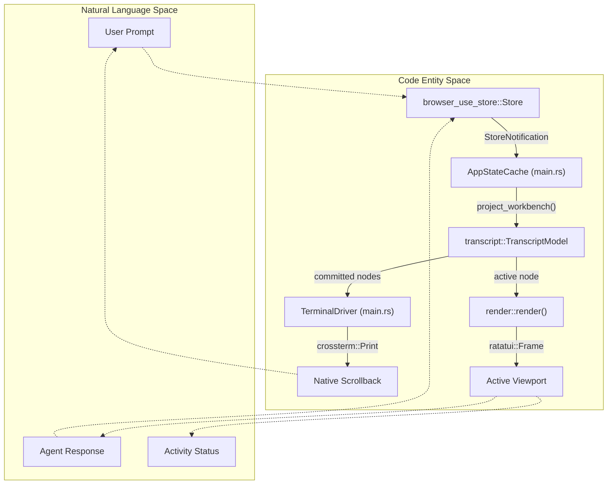
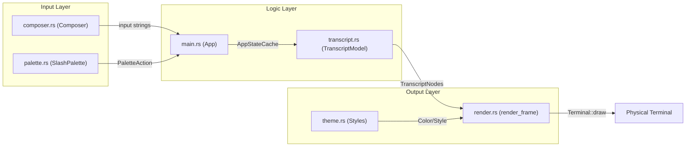

<!-- source: DeepWiki mcp.deepwiki.com · repo browser-use/terminal · page 4 Terminal User Interface (TUI) · fetched 2026-10-30 -->

# Terminal User Interface (TUI)

Relevant source files

The following files were used as context for generating this wiki page:

- [crates/browser-use-tui/src/main.rs](crates/browser-use-tui/src/main.rs)
- [docs/terminal-renderer-architecture.md](docs/terminal-renderer-architecture.md)

The `browser-use-tui` crate provides a high-performance, interactive terminal workbench built on [ratatui](https://ratatui.rs). It serves as the primary human-in-the-loop interface for the Browser Use agent, offering real-time streaming of agent thoughts, tool executions, and multi-agent coordination.

The TUI is designed with a hybrid rendering model that combines native terminal scrollback (for persistence) with an "active viewport" for live updates [docs/terminal-renderer-architecture.md:65-73]().

### System Architecture Overview

The TUI architecture separates the concerns of event projection, state management, and visual rendering. It operates on a reactive loop that listens for updates from the `Store` and user input via `crossterm`.

#### High-Level Data Flow
The following diagram illustrates how raw events from the SQLite store are projected through the transcript engine into the final rendered UI.

**TUI Projection Pipeline**

Sources: [docs/terminal-renderer-architecture.md:37-63](), [crates/browser-use-tui/src/main.rs:18-20](), [crates/browser-use-tui/src/main.rs:2553-2570]()

---

### [App Orchestration and Event Loop](#4.1)

The TUI lifecycle is managed by the `App` struct and the `run_terminal` entry point [crates/browser-use-tui/src/main.rs:2528-2540](). It orchestrates:
- **Reactivity**: Responding to `StoreNotification` events when the agent writes to the database [crates/browser-use-tui/src/main.rs:2604-2615]().
- **State Projection**: Using `project_workbench` to transform raw event logs into a `WorkbenchState` suitable for rendering [crates/browser-use-tui/src/main.rs:2553-2565]().
- **Terminal Management**: The `TerminalDriver` handles raw mode, bracketed paste, and CSI-u keyboard enhancement [crates/browser-use-tui/src/main.rs:34-45]().

For details, see [App Orchestration and Event Loop](#4.1).

### [Rendering and Surfaces](#4.2)

The TUI is composed of multiple `Surface` variants [crates/browser-use-tui/src/main.rs:117-130](). The rendering engine in `render.rs` manages a complex layout of:
- **Main View**: The primary transcript and active task area.
- **Modals/Overlays**: Centered popups for settings, model selection, and API key entry [crates/browser-use-tui/src/main.rs:149-152]().
- **Bottom Panes**: Non-blocking surfaces like the "Developer" or "History" views [crates/browser-use-tui/src/main.rs:133-145]().

For details, see [Rendering and Surfaces](#4.2).

### [Transcript Engine](#4.3)

The `TranscriptModel` is the "brain" of the UI. It reduces a sequence of `EventRecord` objects into a list of `TranscriptNode`s [crates/browser-use-tui/src/transcript.rs:326-335]().
- **Node Merging**: Compacting multiple tool calls or thoughts into a single visual block.
- **Streaming**: Handling the transition from "active" (live-updating) to "committed" (finalized) nodes [docs/terminal-renderer-architecture.md:108-110]().
- **Syntax Highlighting**: Using specialized themes for code blocks and file paths.

For details, see [Transcript Engine](#4.3).

### [Composer, Slash Palette, and Input Handling](#4.4)

User interaction is centered around the `Composer`, a multi-line text input widget [crates/browser-use-tui/src/composer.rs:23-45]().
- **Slash Palette**: A command menu (triggered by `/`) for switching models, browsers, or accounts [crates/browser-use-tui/src/palette.rs:25-40]().
- **Rich Input**: Support for Shift+Enter for new lines, bracketed paste for large text blocks, and history navigation.

For details, see [Composer, Slash Palette, and Input Handling](#4.4).

### [Theme and Visual Design](#4.5)

The visual identity of the TUI is defined in `theme.rs`. It provides a semantic styling layer that abstracts terminal colors into functional roles [crates/browser-use-tui/src/theme.rs:135-150]():
- **Activity Indicators**: Shimmering animations for waiting states.
- **Markdown Styles**: Bold, italic, and code block rendering for agent responses.
- **Status Styles**: Color-coded indicators for success, failure, and warning states.

For details, see [Theme and Visual Design](#4.5).

---

### Component Interaction Diagram

This diagram maps the high-level TUI components to their specific implementation files and primary responsibilities.

**TUI Component Map**

Sources: [crates/browser-use-tui/src/main.rs:56-64](), [docs/terminal-renderer-architecture.md:9-35]()

---

