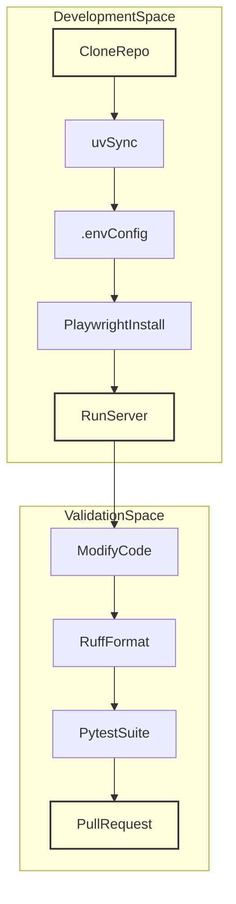
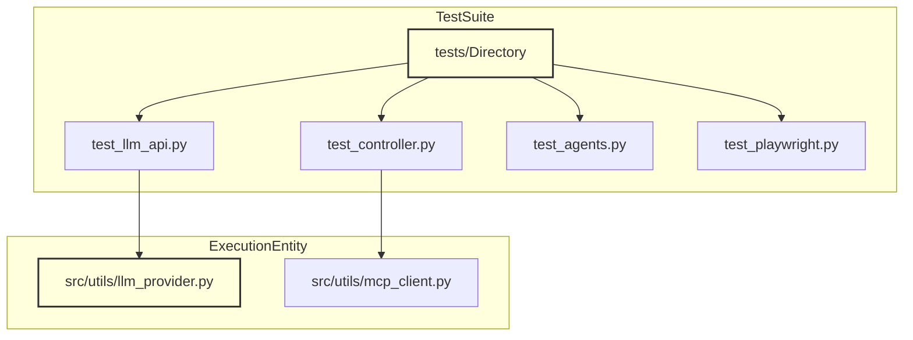

<!-- source: DeepWiki mcp.deepwiki.com · repo browser-use/web-ui · page 10 Development · fetched 2026-10-30 -->

# Development

Relevant source files

The following files were used as context for generating this wiki page:

- [.vscode/settings.json](.vscode/settings.json)
- [SECURITY.md](SECURITY.md)
- [assets/examples/test.png](assets/examples/test.png)
- [assets/web-ui.png](assets/web-ui.png)
- [src/utils/utils.py](src/utils/utils.py)

This section provides resources, tooling guidelines, and workflows for contributors working on the `browser-use/web-ui` codebase. It covers local development setup, editor configurations, security reporting policies, and high-level overviews of utility modules, the testing suite, and CI/CD automation.

For detailed technical specifications, implementation details, and deep dives, refer to the child pages:
- [Utility Functions](#10.1) — Detailed documentation of `src/utils/utils.py` helpers like `encode_image()` and `get_latest_files()`.
- [Testing](#10.2) — Comprehensive overview of the `tests/` directory covering `test_llm_api.py`, `test_controller.py`, and provider validation.
- [CI/CD Pipeline](#10.3) — Workflow definitions for multi-platform Docker builds and GHCR publishing.

Sources: [.vscode/settings.json:1-11](), [SECURITY.md:1-19]()

## Development Workflow & Setup

Contributors use `uv` for dependency management and Python 3.12+ for development. The workflow standardizes environment setup, code formatting via Ruff, and automated testing.

**Development Lifecycle Flow**

To set up your local environment:
1. Clone the repository and install dependencies using `uv sync --all-extras`
2. Configure your local environment variables in `.env` based on `.env.example`
3. Install headless browsers via `uv run playwright install chromium`
4. Launch the application via `python webui.py`

Editor settings are pre-configured for VS Code in `[.vscode/settings.json:1-11]`, enforcing Ruff formatting and type checking (`python.analysis.typeCheckingMode`).

Sources: [.vscode/settings.json:1-11](), [src/utils/utils.py:1-39]()

## Utility Functions Overview

The codebase provides helper utilities in `[src/utils/utils.py:1-39]()` to manage file encoding and artifacts. 

- **`encode_image()`**: Converts local image paths into base64-encoded strings required by vision-capable LLM APIs `[src/utils/utils.py:12-17]()`.
- **`get_latest_files()`**: Scans directories for completion-verified recording (`.webm`) and trace (`.zip`) files, ensuring stale or incomplete files are ignored `[src/utils/utils.py:20-39]()`.

For in-depth documentation, function signatures, and usage patterns, see [Utility Functions](#10.1).

Sources: [src/utils/utils.py:1-39]()

## Testing Infrastructure Overview

The test suite located in `tests/` verifies LLM provider integrations, controller actions, agent loops, and browser automation behaviors.

**Testing Architecture Hierarchy**

Key testing modules include `test_llm_api.py` for validating multi-provider LLM responses, `test_controller.py` for controller actions, and browser-level checks. For complete testing guides, run instructions, and framework patterns, see [Testing](#10.2).

Sources: [tests/test_llm_api.py:1-159]()

## CI/CD Pipeline Overview

Automated continuous integration and deployment workflows are managed via GitHub Actions. These pipelines build multi-architecture Docker containers (`amd64`, `arm64`) and push validated images directly to the GitHub Container Registry (GHCR).

For step-by-step pipeline configurations, runner details, and publishing triggers, see [CI/CD Pipeline](#10.3).

Sources: [.github/workflows/](/.github/workflows)

## Security Policy

Security vulnerabilities should be reported responsibly rather than through public repository issues or pull requests. Contributors must follow coordinated disclosure guidelines via the GitHub Security Advisories interface `[SECURITY.md:1-19]()`.

- **Reporting Channel**: Open a new advisory at [GitHub Security Advisories](https://github.com/browser-use/web-ui/security/advisories/new) `[SECURITY.md:7-7]()`.
- **Required Details**: Include vulnerability type, affected source paths `[SECURITY.md:11-12]()`, replication steps, and proof-of-concept code `[SECURITY.md:15-16]()`.

Sources: [SECURITY.md:1-19]()

---

